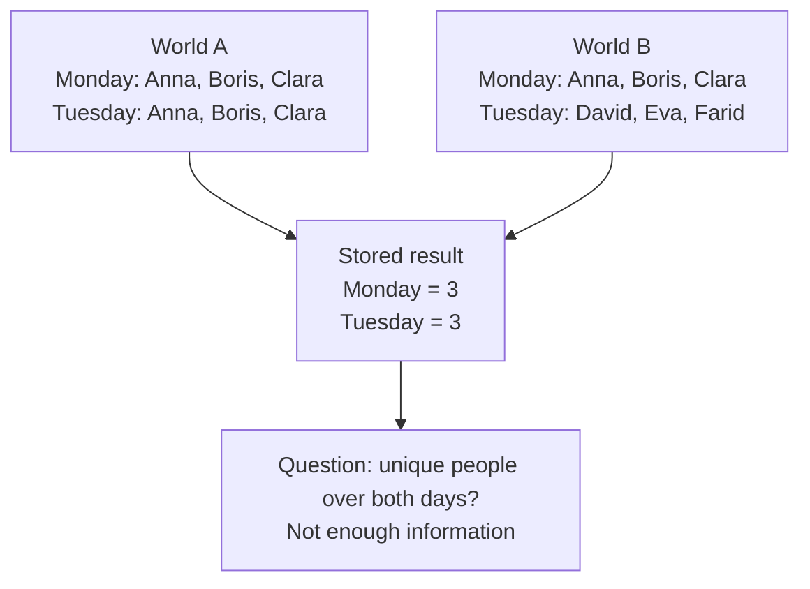
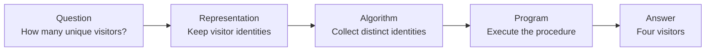

# CS110 — Foundations of Computation and Algorithms
## Lecture 01: What Is Computation, Really?

*How problems become data, data becomes algorithms, and algorithms become running software.*

**Estimated study time:** 60–75 minutes, including exercises.

---

### How to listen to this lecture

This lecture is written for continuous listening first, then for on-screen re-reading. Sticky-note callouts mark the ideas worth pausing on. Thought challenges near the end are meant to be answered **out loud** before you peek at the solutions. There is no terminal lab in this lecture — the workout is reasoning.

By the end, you should be able to separate problems, algorithms, and programs; explain why representation can make a question unanswerable; and use a short checklist before you try to "just compute" something.

---

# Part I — Intuition

*The mystery of the missing names: why a computer can follow instructions perfectly and still be unable to answer a simple question.*

### Before anything else, picture two guest lists

Imagine you're helping organize a school fair. Every day, the person at the entrance writes down the names of the people who visit. On Monday, three people come in: Anna, Boris, and Clara. On Tuesday, Anna, Clara, and David visit.

At the end of each day, the organizer asks you to report how many different people came. Monday: three. Tuesday: three. You write the numbers on a small board and throw the paper lists away to save space.

On Wednesday, the organizer asks, “How many **different people** visited across both days?” You know that three came on Monday and three on Tuesday. Can you give the exact answer?

No. Some people might have visited twice. In our original lists there were four distinct people, but those lists are gone. The two numbers alone don't tell you which visitors overlapped.

The opening picture shows two different realities producing identical daily counts. A computer that sees only those counts cannot distinguish between them.



This is an odd kind of computer problem. The computer isn't too slow. It isn't too small. You could give it a billion processors and it still wouldn't recover the missing names. **The answer wasn't preserved in the information you chose to keep.**

### 1. The real world is bigger than the description we store

Let's rewind the fair. Think of the real world as the entire event: actual people, their faces, their names, when they arrived, which booths they visited, and whether they returned the next day.

Now you want a computer to answer a question about that event. You have to decide how to describe reality in a form the computer can handle. Maybe you store names. Maybe customer IDs. Maybe just the number of people entering each day.

That description is called a **representation**. It's the information you choose to keep.

A representation is like a map of a city. A subway map is fantastic for finding train connections, but terrible for locating every tree. A street map answers a different question. Neither is a perfect copy of the city, and neither needs to be. The useful map is the one that preserves the details your question requires.

If the fair organizer only ever asks for daily visitor counts, keeping the two totals might be enough. But if they later want unique visitors across a week, returning visitors, or the busiest booth, the totals no longer suffice.

**You cannot calculate a distinction your data has erased.**

### 2. An algorithm is a procedure, not a magician

Suppose we kept the actual names. Now the unique-visitor problem is solvable.

We could make a fresh list, read Monday's names, and write each name only once. Then read Tuesday's names and add anyone not already on the list. At the end, count the names. Four.

Those are instructions. An **algorithm** is a well-defined procedure for solving a problem. A **program** is an implementation of that procedure in a form a computer can execute.

Notice the order. First came the question. Then the choice of what information to preserve. Then a procedure to produce the answer. Only after that do we need JavaScript, Python, or another programming language.

The second diagram keeps these decisions separate. When something goes wrong, they tell us where to investigate.



This order explains why a beautifully written program can still be useless. If the question is misunderstood, it solves the wrong problem. If the data is incomplete, it can't recover what was lost. If the procedure is too expensive, it may never finish in useful time. And if the implementation contains a bug, the right procedure produces the wrong result.

Those are different kinds of failure, so they need different fixes.

### 3. State is the computer's memory of the story so far

Imagine the fair now runs a small app. Anna checks in on Monday. The app remembers that. When she returns Tuesday, it recognizes her and avoids counting her as a new unique visitor.

The app's answer depends on what it already remembers. That remembered information is part of its **state**.

Two identical requests can produce different results if the state differs. “Check in Anna” might create a new record the first time and simply register a return visit the second time. The input text looks the same. The world the request enters is different.

And there may be hidden state: the current date, whether the database has committed a write, or an external service's response. Before declaring a program unpredictable, ask whether you've accounted for all the information that influences the result.

### 4. Correct, possible, and practical are three different questions

Let's imagine the fair becomes a huge international event with ten million visitors. We still retain complete identifiers. Unique counting is now **possible** in principle, because the needed information exists.

But what if our method is to compare every visitor with every other visitor, one pair at a time? The calculation could be terribly expensive. A smarter way to organize the identities might avoid most of those comparisons.

So we have three separate questions. **Do we have the information to answer? Do we have a procedure that gives the correct answer? Can it finish with acceptable time and resources?**

Computer science concerns all three, not merely the act of writing instructions in a programming language.

This also explains why an AI assistant cannot legitimately invent the missing Monday–Tuesday overlap. A fluent answer isn't a substitute for the underlying information. A tool is only as informative as the data and assumptions it uses.

### Your mental checkpoint

Before going deeper, try answering without looking back.

**Question A:** The fair retains Monday's count of 100 and Tuesday's count of 100. How many unique visitors came across both days? **We cannot know exactly from those totals alone.**

**Question B:** The fair retains names, but our program checks every name against every other name and takes hours. Is the problem missing information? **No. The data may be sufficient; the procedure is inefficient.**

**Question C:** A request to check in Anna produces a different answer from yesterday. Is the program necessarily random? **No. Its remembered state or another relevant condition may have changed.**

Carry one picture into Part II: **the real event, the information retained about it, the procedure used to answer a question, and the running program are four different things.** The technical lecture will explore what each distinction makes possible—and what it makes impossible.

*The intuition pass ends here.*

---

# Part II — Deep Dive

# 1. The Case of the Missing Users

> **Case file #001** — *Analytics desk, Monday morning.* Suspect: two innocent-looking numbers.

Imagine you're working on the analytics backend of a successful SaaS platform.

On Monday, your application reports 100 unique active users.

On Tuesday, another 100.

Your product manager opens the dashboard, looks at the numbers, and asks a perfectly reasonable question:

"So, how many unique users did we have across those two days?"

The junior developer on your team immediately replies: "Two hundred."

You suspect that's wrong.

And, of course, it is. Someone might have used the application on both days.

No problem. You'll just query the database.

Except there's a complication.

Several months ago, somebody decided that storing individual user activity records was wasteful. Why keep millions of events when the dashboard only needs daily totals?

So the system now retains this: Monday had 100 unique active users. Tuesday also had 100.

That's it. The underlying activity records have been discarded.

You can write SQL. You can write TypeScript. You can spin up a hundred AWS Lambda functions, hire the world's most expensive database consultant, or point an enormously powerful AI agent at the problem.

**None of them can calculate the exact answer from these two numbers.**

Not because the calculation is computationally expensive.

Not because you haven't discovered the right algorithm.

Because the information required to answer the question no longer exists in the data you've retained.

Let's examine that more closely.

### Two possible worlds

```text
  WORLD A — same crowd both days          WORLD B — different crowds
  ┌─────────────────────────┐             ┌─────────────────────────┐
  │  Mon: ①②③…⑩⓪           │             │  Mon: ①②③…⑩⓪           │
  │  Tue: ①②③…⑩⓪           │             │  Tue: ⑩①…⑳⓪ (new folks) │
  │                         │             │                         │
  │  Daily counts: 100, 100 │             │  Daily counts: 100, 100 │
  │  True unique total: 100 │             │  True unique total: 200 │
  └─────────────────────────┘             └─────────────────────────┘
              ▲                                       ▲
              └──────── same database rows ───────────┘
                        different realities
```

In the first world, the same hundred people use the application on both days.

- Monday: users 1–100.
- Tuesday: users 1–100.
- Unique users across both days: **100**.

In the second world, a completely different group uses the application on Tuesday.

- Monday: users 1–100.
- Tuesday: users 101–200.
- Unique users across both days: **200**.

In both worlds, your database contains exactly the same two numbers: 100 and 100.

Yet the correct answers differ.

There are also countless intermediate possibilities. Perhaps 40 users returned on Tuesday and 60 were new. That would produce 160 unique users.

The exact total could be anywhere from 100 to 200. Complete overlap yields 100 unique users across both days. Partial overlap — say forty return and sixty are new — yields 160. No overlap yields 200.

Here is the important observation:

> **Sticky note #1**
>
> If two different realities produce identical input data but require different answers, no algorithm using only that input can always return the correct answer.

That's a surprisingly powerful principle.

We have just established a limitation on what can be computed from a particular representation of information.

And we didn't need to know a single programming language to do it.

This is where computer science becomes interesting.

> ✓ Room 1 complete — the mystery: missing information, not missing code

---

# 2. What Computer Science Is Actually About

Programming and computer science overlap enormously, but they are not identical.

Programming's main activity is instructing a computer to perform operations. Its typical question is "How do I write this?" Its failure mode is often a bug in the code.

Computer science studies what can be computed, how, and at what cost. Its typical question is "Can this be answered at all — and correctly?" Its failure mode is a wrong model, an impossible question, or a bad cost trade-off.

Programming is the activity of instructing a computer to perform operations.

Computer science studies something more fundamental: what problems can be expressed computationally, what procedures can solve them, why those procedures work, and what resources or information they require.

Consider the following three questions.

First: can the weekly number of unique users be calculated from the data we have? That is really about **whether the available information is sufficient**.

Second: if it can, what procedure should we use? That is about **algorithms and correctness**.

Third: how efficiently can a real computer perform that procedure? That is about **computational complexity and implementation**.

Those are three different problems.

An experienced developer can easily jump straight to question three. We open an IDE, select a data structure, and begin writing code.

But if the answer to question one is no, the rest is wasted effort.

This is one reason sophisticated engineering is often more about choosing the correct model than about writing clever code.

Let's formalize what we've just encountered.

## A problem, an algorithm, and a program

These three terms are related but represent different things.

```text
  PROBLEM  ──►  ALGORITHM  ──►  PROGRAM
  "what?"        "how?"         "on this machine"
     │              │                 │
     │              │                 │
  desired        procedure         TypeScript,
  result         that works        SQL, Python…
```

A **computational problem** specifies what we want to determine.

For example:

> Given a collection of user activity events within a particular period, determine how many distinct users generated those events.

An **algorithm** is a finite, well-defined procedure for obtaining the result.

For example:

> Examine each event, add its user identifier to a collection that excludes duplicates, and return the size of that collection.

A **program** is an implementation of the algorithm in a particular computational environment.

Here's a TypeScript implementation:

```typescript
interface ActivityEvent {
  userId: string;
  timestamp: number;
}

function countActiveUsers(
  events: ActivityEvent[],
  start: number,
  end: number
): number {
  const users = new Set<string>();

  for (const event of events) {
    if (
      event.timestamp >= start &&
      event.timestamp < end
    ) {
      users.add(event.userId);
    }
  }

  return users.size;
}
```

Nothing exciting about the code itself.

You've probably written similar things hundreds of times.

But look at what is hidden beneath these few lines.

We're assuming that `userId` identifies a user consistently across the entire period.

We're assuming timestamps are expressed using a consistent time scale.

We're assuming the collection contains the relevant activity events.

We're assuming that every event represents activity according to our business definition.

And we're assuming that the input dataset is complete enough for the question we're answering.

If any of those assumptions is false, the program can execute perfectly and still return the wrong answer.

Notice something else: the implementation uses a `Set`, but that's merely one possible approach.

We could sort the user identifiers and count transitions between distinct values. We could use a database query with `COUNT(DISTINCT ...)`. We could maintain an incrementally updated data structure.

Different implementations can solve the same computational problem.

That's the distinction worth remembering:

> **Sticky note #2**
>
> The problem defines the desired result. The algorithm defines the procedure. The program realizes the procedure on an actual machine.

Much of software engineering consists of maintaining the connection between those three layers.

> ✓ Room 2 complete — three layers: problem → algorithm → program

---

# 3. The Art of Representation

Let's return to the missing users.

What went wrong?

Somebody made a decision about how to represent activity data.

Instead of preserving individual events, the system preserved daily counts.

This is an example of **abstraction**.

An abstraction deliberately discards details so that we can focus on what matters for a particular purpose.

And abstraction is absolutely essential.

Imagine trying to build a SaaS application if every operation required reasoning about the precise electrical state of every transistor in the CPU.

You'd never finish the login screen.

So we work at higher levels.

```text
  Abstractions we live in (and gratefully ignore)
  ────────────────────────────────────────────────
  HTTP requests          ←── electrical signals
  database transactions  ←── disk operations
  objects                ←── memory addresses
  strings                ←── bytes
  "login screen"         ←── ≈ 10¹⁰ transistors behaving
```

We talk about strings instead of bytes, objects instead of memory addresses, HTTP requests instead of electrical signals, and database transactions instead of disk operations.

Each abstraction allows us to ignore details.

But here's the catch:

> **Sticky note #3**
>
> An abstraction is useful only relative to the questions we need to answer.

Daily active-user counts are a perfectly reasonable representation if we only care about trends in daily activity.

They are not sufficient for calculating exact unique users across arbitrary combinations of days.

Neither representation is inherently good or bad.

They serve different purposes.

## The information you've thrown away

Think about the original dataset as a collection of activity events.

Each event identifies a user and a time.

We then perform a transformation:

**Activity events → daily unique-user counts**

```text
  Many event histories          One summary
  ─────────────────────         ───────────
   history α ──┐
   history β ──┼──►  compress  ──►  Mon:100, Tue:100
   history γ ──┘
   history δ ──┘
        ▲
        └── many-to-one = irreversible
```

This transformation compresses the original information.

Many different collections of events produce the same daily counts.

In mathematical language, the transformation is *many-to-one*.

Once you've reduced the original data to daily counts, you cannot uniquely reconstruct the original collection of users.

This has a name in information theory and mathematics: an information-losing transformation.

The transformation is not reversible.

And that gives us a rather useful way to think about data models:

Whenever you choose to store a summary instead of the underlying information, ask yourself:

> **Sticky note #4**
>
> Which future questions will become impossible to answer exactly?

This question applies everywhere.

### Example: monitoring

Suppose your API monitoring system stores only average response times.

At 14:00, the average latency is 200 milliseconds.

Does that mean the API is performing well?

Not necessarily.

Imagine two systems handling 100 requests.

System A handles ninety-nine requests at 200 ms each and one more at 200 ms — average 200 ms, and users are fine. System B handles ninety-nine requests at 100 ms each and one request at 10,100 ms — the average is still 200 ms, but one person had a terrible day.

In the first system, every request takes 200 milliseconds.

In the second system, 99 requests take 100 milliseconds, and one takes 10,100 milliseconds.

Both have an average of 200 milliseconds.

But their user experiences are quite different.

If you stored only the average, you cannot reconstruct the latency distribution.

You cannot calculate the 99th percentile accurately. You cannot identify whether the average resulted from consistently moderate performance or a handful of extreme outliers.

That's why production monitoring systems commonly preserve richer distribution information, such as histograms.

### Example: financial transactions

Suppose your application stores only the current account balance.

The balance is €500.

Can you determine whether an unauthorized withdrawal happened yesterday?

Of course not.

Many different transaction histories can produce the same final balance.

To answer questions about historical behavior, you need some representation of that history: a transaction ledger, audit events, or equivalent records.

Again, the information required depends on the questions you expect to answer.

### Example: the shape of a city

Imagine a city-building simulation.

You want to know whether every residential neighborhood has road access to a hospital.

You store the total number of roads and the number of intersections.

Would that be enough?

No.

```text
  SAME COUNTS, DIFFERENT WORLDS

  City A — connected                 City B — islands
  ●──●──●──●                         ●──●      ●──●
  │     │                            │           │
  ●─────●──hospital                  ●           ●──hospital
                                     (no path from left island)

  Same #roads, same #intersections. Totally different reachability.
```

Two cities can contain exactly the same number of roads and intersections while having completely different connectivity.

One might have a connected road network.

Another might consist of several isolated islands of roads.

To answer questions about reachability, you need to preserve information about **which intersections are connected to which others**.

That's why graph representations are so useful in transportation systems.

A graph preserves relationships between entities rather than merely counting them.

We will study graphs properly in CS110-L04.

For now, notice the general pattern.

A representation determines what distinctions your program can make.

If two important situations become indistinguishable in your data model, your software cannot reliably treat them differently.

## Representation isn't just a storage decision

This point extends beyond databases.

Every program operates on representations of something.

An integer stands in for a number. A string stands in for text. A timestamp stands in for a point in time. A JSON object may stand in for a customer, a booking, or an API request. A vector of floats may stand in for an ML embedding. A graph may stand in for a road network, a dependency tree, or a social network.

But none of these representations is identical to the real thing.

A customer is not a JSON object.

A city is not a graph.

A financial transaction is not merely a row in PostgreSQL.

Those are computational models of selected aspects of reality.

The difference matters because reality contains more information than our models preserve.

Which brings us to a second foundational concept.

> ✓ Room 3 complete — representation = what you keep vs what you throw away

---

# 4. A Computer Never Solves the Real World Directly

Consider a navigation application.

You ask it to find the fastest route from your apartment to the airport.

What does the computer actually solve?

It doesn't inspect reality in some magical way.

It operates on a model of the road network.

That model might represent intersections as nodes, road segments as edges, and estimated travel times as numerical costs.

Finding a route then becomes a graph problem.

For a simplified static network, a shortest-path algorithm such as Dijkstra's algorithm can find the route with the smallest total cost, provided the edge costs satisfy its assumptions.

But imagine that the travel-time estimates are stale.

```text
  REALITY                          MODEL
  ───────                          ─────
  Route A: accident → 45 min       Route A: "12 min"  ← stale
  Route B: clear    → 18 min       Route B: "18 min"

  Algorithm (correct on the model):  "Take A!"
  Reality:                           "That was a bad idea."
```

The algorithm calculates that Route A takes 12 minutes and Route B takes 18 minutes.

In reality, a major accident has turned Route A into a 45-minute journey.

The algorithm can be completely correct relative to its input and still recommend the wrong route in reality.

That's not necessarily a failure of the shortest-path algorithm.

It might be a failure of the model.

We need to distinguish three things:

**Reality** asks what is actually happening on the roads. The **model** asks how the app represents roads and travel times. The **algorithm** asks how the app searches that model for the best route.

```text
            REALITY
               │
               │  (lossy snapshot)
               ▼
             MODEL  ◄──── algorithm searches here
               │
               ▼
            ANSWER
               │
               └── useful only if the model was faithful enough
```

The algorithm solves the model.

Whether that solution is useful in reality depends on how faithfully the model captures the relevant features of the real-world problem.

And the situation gets even more interesting.

Suppose a thousand drivers use the same navigation application.

The system identifies Route A as fastest and recommends it to everyone.

A thousand drivers obediently take Route A.

Now Route A becomes congested.

The recommendation has changed the conditions under which it was calculated.

We have a feedback loop.

```text
  recommend Route A ──► everyone takes A ──► A congests
         ▲                                      │
         └──────── model updates (maybe) ───────┘
```

The system's outputs influence the world, and the changed world influences subsequent outputs.

Suddenly, "find the shortest path through a graph" is not quite the same problem as "minimize travel time for many interacting drivers in a changing road network."

Both are computational problems, but their models differ enormously.

This is one of the reasons real engineering systems become complicated.

The challenge isn't always finding a cleverer algorithm.

Sometimes the challenge is recognizing that the problem you're solving is an oversimplification of the one you actually care about.

## Models and assumptions

Every useful computational model makes assumptions.

A navigation model might assume:

- Road travel times can be estimated.
- The road network is represented accurately.
- Vehicles can traverse particular roads.
- The relevant traffic conditions remain sufficiently stable during route calculation.

A database model might assume:

- User identifiers are unique.
- Foreign keys represent valid relationships.
- A particular timestamp convention is consistently applied.
- Business rules can be expressed through the stored fields and constraints.

A payment-processing model might assume:

- Each payment has a stable identifier.
- Payment attempts have distinguishable states.
- Duplicate requests can be recognized.
- External payment providers may fail or respond late.

Some assumptions are explicit. Others are hidden in code or documentation.

Senior engineering judgment often comes down to identifying those hidden assumptions before they become production incidents.

Here's an excellent habit:

Whenever you encounter a software system, ask:

> **Sticky note #5**
>
> What does this system believe about the world, and under what circumstances will those beliefs become false?

That's not philosophical decoration.

It's a practical debugging and architecture technique.

> ✓ Room 4 complete — algorithms solve models, not reality

---

# 5. State: The Computer's Memory of What Has Happened

So far, we've mostly discussed computation as transforming an input into an output.

For example:

`calculateRoute(roadNetwork, start, destination) → route`

But most applications don't operate in complete isolation.

They remember things.

A booking system remembers existing reservations. An auth service remembers sessions. A game remembers where objects are. A message queue remembers which jobs are pending. An AI agent remembers earlier messages, tool results, and partial work.

This remembered information is called **state**.

And once state enters the picture, the behavior of a program can depend not only on its current input but also on what happened previously.

Let's return to our activity analytics example.

Suppose events arrive continuously.

Every time an activity event appears, we want to update the number of unique users.

Here's a tempting implementation:

```typescript
let activeUsers = 0;

function recordActivity(event: ActivityEvent) {
  activeUsers++;
}
```

Obviously, this counts activity events, not unique users.

So we introduce a set of previously observed user identifiers.

Here is a tiny sketch: a `Set` remembers seen user IDs; `recordActivity` adds one, and `getActiveUserCount` returns how many unique IDs we have stored.

```typescript
const seenUsers = new Set<string>();

function recordActivity(event: ActivityEvent) {
  seenUsers.add(event.userId);
}

function getActiveUserCount() {
  return seenUsers.size;
}
```

Now repeated events from the same user don't increase the count.

The set represents what the system knows about previously encountered users.

It is the state of this tiny computation.

Mathematically, we can describe the process as a state transition:

```text
  previousState  +  event  ──►  newState

  {Alice, Bob}   +  Carol  ──►  {Alice, Bob, Carol}
  {Alice, Bob}   +  Alice  ──►  {Alice, Bob}        ← no change
```

`newState = transition(previousState, event)`

In our example:

`newSeenUsers = previousSeenUsers ∪ {event.userId}`

The union symbol simply means that the new set contains everything from the old set plus the identifier from the current event.

A useful property emerges:

Processing the same user twice produces the same final set as processing that user once.

This is an example of **idempotent behavior**.

The operation can be repeated without changing its result after the first application.

You've almost certainly encountered the practical importance of this principle in APIs, background jobs, or payment integrations.

But we're still dealing with the simple conceptual version.

## A subtle question: What counts as the state?

Imagine a system that stores only the number 100, representing the current count of distinct users.

Then another event arrives from user 57.

Should the count increase?

You cannot know from the number 100 alone.

```text
  State = just "100"          State = the set of users
  ─────────────────           ────────────────────────
  Event: user 57              Event: user 57
  ??? increase or not ???     Already in set? → no
                              New?            → yes (+1)
```

You need to know whether user 57 was already included.

That information must exist somewhere.

Perhaps in a set.

Perhaps in a database table with a unique constraint.

Perhaps in another data structure that preserves the necessary membership information.

The important point is that a single number does not contain enough state to make the decision reliably.

This is exactly the same kind of information problem we encountered at the beginning of the lesson.

A state representation must preserve enough information to support the operations the system needs to perform next.

And this gives us a deeper understanding of what application state really is.

It is not simply "some variables."

> **Sticky note #6**
>
> State is the information about past events that the system retains because it may influence future behavior.

That definition is useful across programming paradigms, distributed systems, databases, user interfaces, and AI agents.

## Why the same request can produce different results

Consider a hotel booking API:

`POST /reservations`

The request specifies a hotel, a room type, and a date range.

If the room is available, the operation may succeed.

If the room is already booked, it may fail.

The HTTP request can be identical in both cases.

What changed?

The state of the reservation system.

A simplified model would be:

`(currentState, request) → (newState, response)`

```text
  Request: "book Room 12 for Friday"
                │
                ├── state: free  ──►  success + reserved
                └── state: taken ──►  failure
```

The output depends on both the request and the state against which the request is processed.

This is a more useful conceptual model for many real applications than imagining every function as a simple input-output calculator.

Of course, actual systems introduce further complications.

Two requests may arrive simultaneously.

State may be distributed across several machines.

A process may crash halfway through an operation.

A network response may disappear even though the state change succeeded.

We will explore these situations in later lectures.

For now, the foundational idea is that application behavior often involves a sequence of state transitions rather than isolated calculations.

## State and determinism

There's one distinction worth making before we move on.

A deterministic computation produces the same result when given the same complete inputs and starting state.

If the same API request produces two different responses, that doesn't necessarily make the underlying computation nondeterministic.

Perhaps the database state was different.

Perhaps the current time was different.

Perhaps a remote service supplied different information.

Perhaps the program intentionally used randomness.

The request alone may not describe everything influencing the result.

This is especially useful when debugging systems that appear unpredictable.

Before concluding that something behaves randomly, ask whether you've accounted for all the relevant state and external inputs.

Sometimes the system isn't unpredictable at all.

You're simply observing an incomplete picture of it.

> ✓ Room 5 complete — state = memory of the past that shapes the future

---

# 6. Correct, Possible, and Practical Are Different Things

We've now discovered two kinds of computational difficulty.

First, a problem may be impossible to solve exactly from the available information.

Second, a problem may be solvable in principle but difficult to model accurately.

There is a third category that becomes enormously important as systems grow:

**A problem may have an exact solution, but obtaining that solution may require unacceptable resources.**

```text
  THREE KINDS OF "HARD"
  ─────────────────────
  ① Impossible from this data     → missing information
  ② Wrong / incomplete model      → solves the wrong world
  ③ Exact but too expensive       → need approximation / trade-offs
```

Return one last time to our activity analytics system.

Suppose the company has hundreds of millions of activity events.

You want the exact number of distinct users across an arbitrary time window.

One solution is to maintain a set of all user identifiers encountered in that window.

Assuming you can read the relevant events and have enough memory, the approach is straightforward.

But the set may become enormous.

What if the system operates at planetary scale and the analytics service must answer queries almost immediately?

Now we face a trade-off.

We could maintain exact data, paying the storage and processing costs.

Or we could use a probabilistic data structure that estimates the number of distinct values using far less memory.

A famous example is **HyperLogLog**.

HyperLogLog can estimate the number of distinct elements in a large collection without storing every individual identifier.

Its answer is approximate rather than exact.

The fascinating part is that compatible sketches can also be merged, allowing estimates of distinct elements across multiple datasets.

So unlike our original daily counts, appropriately designed daily sketches can retain enough statistical information to estimate a combined distinct count.

Not recover it exactly. Estimate it.

This is a meaningful engineering trade-off:

An exact set of IDs gives an exact answer at higher memory and processing cost. A HyperLogLog-style sketch gives an approximate answer at dramatically lower memory. Daily counts alone are cheap, but they are often *wrong* for combined windows because they lose the information you need.

Neither is automatically superior.

For a marketing dashboard, a small estimation error might be perfectly acceptable.

For a contractual billing system where customers pay per unique user, the same error might be unacceptable.

The correct choice depends on the problem's requirements.

And now we have three different questions.

**Can we determine the answer from the available information?**

**Can we develop a correct procedure for the model?**

**Can we execute that procedure within acceptable resource limits?**

These questions recur throughout computer science.

Algorithms, data structures, databases, distributed systems, performance engineering, and machine learning all encounter different versions of them.

We will formalize computational cost in CS110-L03.

But for today, understand the essential distinction:

Possible doesn't necessarily mean practical.

And practical doesn't necessarily mean exact.

> ✓ Room 6 complete — possible ≠ practical ≠ exact

---

# 7. What Changes in the Age of AI Agents?

You might be wondering why we're spending so much time on seemingly basic concepts when the industry is busy building autonomous AI systems.

The answer is that these concepts have become more important, not less.

Imagine you connect an AI assistant to your analytics database.

The assistant has a tool:

`getDailyActiveUsers(date)`

It can retrieve daily unique-user counts.

Then a customer asks:

"How many unique users did we have across Monday and Tuesday?"

The assistant calls its tool twice.

It receives:

Monday: 100.

Tuesday: 100.

What happens next?

```text
  Customer question
         │
         ▼
  Tool returns: Mon=100, Tue=100
         │
         ├── poorly designed agent ──► "200!"  (confidently wrong)
         ├── better agent          ──► "maybe overlap — uncertain"
         └── reliable system       ──► "insufficient information
                                         for an exact answer"
```

A poorly designed assistant might confidently report 200 unique users.

A somewhat better assistant might realize that there could be overlapping users and provide a warning.

A reliable system should recognize that the available information is insufficient to determine the exact result.

Notice that this limitation has nothing to do with the model's intelligence.

A hypothetical language model far more capable than today's systems would face the same fundamental problem.

It cannot reconstruct information that was never supplied and no longer exists in the accessible data.

It might estimate, infer, or search for additional evidence.

But it cannot guarantee an exact answer from insufficient input.

This is why reliable agentic applications require more than sophisticated prompting.

They need carefully designed tools, data representations, state management, validation, permissions, and explicit assumptions about what their information sources can establish.

The AI model may be responsible for deciding what actions to take.

But the rest of the software system must still define what those actions mean, what information they expose, and what guarantees they provide.

In other words, an AI agent is still a computational system.

It doesn't escape the foundations we're studying.

This is also why experienced software engineers remain valuable in an increasingly AI-assisted industry.

Generating code is only one part of engineering.

Someone must still determine whether the system represents the right problem, whether its operations preserve important guarantees, and whether its behavior is acceptable under realistic conditions.

An AI coding assistant can produce an elegant implementation of the wrong model in seconds.

That's not much of a victory.

> **Sticky note #7**
>
> Smarter models don't invent missing data. Tools and representations still decide what can be known.

> ✓ Room 7 complete — AI still lives inside computation's rules

---

# 8. A Framework for Thinking About Computational Problems

Let's bring the ideas together.

When you encounter a new engineering problem, imagine passing it through six questions.

```text
  ┌──────────────────────────────────────────────┐
  │  THE SIX-QUESTION CHECKLIST                  │
  │  (print this; tape it near your IDE)         │
  ├──────────────────────────────────────────────┤
  │  1. What exactly are we trying to determine? │
  │  2. What information do we have?             │
  │  3. How are we representing the problem?     │
  │  4. What procedure produces the result?      │
  │  5. What will the procedure cost?            │
  │  6. What changes when it runs in reality?    │
  └──────────────────────────────────────────────┘
```

### 1. What exactly are we trying to determine or accomplish?

Define the desired behavior.

Not "build an analytics service."

Something more precise, such as:

"Count the number of distinct authenticated accounts that generated at least one qualifying activity event during a specified seven-day interval."

Already, we've clarified several ambiguities.

### 2. What information do we have?

Inspect the available inputs and state.

Do we have individual events? Stable account identifiers? Only summary counts? Reliable timestamps?

Do we know enough to answer the question?

If not, what additional information would be necessary?

### 3. How are we representing the problem?

Are users represented by accounts, cookies, devices, or something else?

Are time intervals represented with timestamps and explicit boundaries?

Which distinctions have we preserved, and which have we discarded?

### 4. What procedure produces the desired result?

Now we can discuss algorithms.

A hash-based set? Sorting? A database aggregation? An approximate sketch?

What properties make the approach correct under our assumptions?

### 5. What will the procedure cost?

How much memory?

How much CPU time?

How much network traffic?

What happens when the dataset becomes a hundred times larger?

Would a less exact solution be acceptable?

### 6. What changes when the procedure runs in reality?

What if events arrive late?

What if a worker crashes?

What if the same event arrives twice?

What if two machines update the result concurrently?

What if the definition of an active user changes next month?

These aren't necessarily all questions for the same engineer or the same stage of implementation.

But together they form a useful mental model of software engineering.

Notice how little of this is about programming-language syntax.

That's intentional.

> ✓ Room 8 complete — you now have a reusable checklist

---

# 9. The Oral Examination

We now have enough knowledge to examine computation like an engineer rather than merely recognize its vocabulary.

Before reading the solutions, try answering these questions out loud. Imagine that a senior engineer is interviewing you and will challenge any hand-waving. No elaborate project setup is required — paper or a text editor is enough.

### Challenge A — The Impossible Dashboard

**Estimated time: 8–10 minutes**

A website records the following distinct active-user counts: Monday 120, Tuesday 180, Wednesday 150.

You have only these three numbers.

Answer the following:

1. What is the smallest possible number of unique users across all three days?
2. What is the largest possible number?
3. Could the actual number be 200?
4. What additional information would allow you to calculate the exact total?
5. Would storing a list of users active on each day be sufficient? What assumptions would that introduce?

Try to construct concrete examples rather than guessing.

### Challenge B — An Incomplete Traffic Model

**Estimated time: 8–10 minutes**

You are building a route planner for a city simulation.

The current version knows:

- Which roads connect which intersections.
- The length of each road.
- The speed limit on each road.

It does not know:

- Current traffic congestion.
- Traffic-light phases.
- Road closures.
- Vehicle acceleration and braking behavior.

Your product manager asks:

"Can we use this data to calculate the fastest route?"

Consider these questions:

1. Can the system calculate the shortest route by distance?
2. Can it calculate the fastest route under a simplified travel-time model?
3. Can it guarantee the fastest actual route in the simulated city?
4. Which missing information is most important?
5. If you add accurate current congestion measurements, does that necessarily solve the problem of predicting travel time?

The last question is particularly interesting.

### Challenge C — A Better Analytics System

**Estimated time: 10–15 minutes**

You're redesigning our original activity analytics service.

Requirements:

- Report daily active users.
- Report exact distinct active accounts over arbitrary seven-day periods.
- Support millions of events per day.
- Avoid counting duplicate deliveries of the same event as separate activity.
- Minimize unnecessary personal-data retention.

Describe a reasonable high-level design.

You don't need to write code.

Think about:

- What information must be retained.
- What can safely be aggregated.
- What identifiers are required.
- Where state should live.
- What happens when events arrive late.
- Where an approximate solution might be acceptable.

There isn't one universally correct architecture.

The goal is to demonstrate that you understand how requirements influence representation and algorithmic choices.

### Challenge D — Explain It Like a Senior Engineer

**Estimated time: 5 minutes**

Imagine you're interviewing for a senior backend position.

The interviewer asks:

"Our analytics service calculates daily active users correctly. Why can't we simply sum those values to get weekly active users?"

Give a concise, technically convincing answer.

Don't launch into a ten-minute lecture about information theory.

Explain the actual problem, demonstrate it with an example, and state what data would be needed to solve it.

That's an excellent exercise in communicating technical concepts without unnecessary complexity.

> ✓ Room 9 complete — challenges attempted

---

# 10. Solutions and Discussion

*Read this section after attempting the challenges out loud.*

### Solution A — Impossible dashboard

The minimum is **180**.

All 120 Monday users and all 150 Wednesday users could belong to the same group of 180 users active on Tuesday.

The maximum is **450**.

That occurs when the three days have completely disjoint user populations.

And yes, 200 is possible.

For instance, Monday's 120 users could all be included among Tuesday's 180, while Wednesday introduces 20 new users and includes 130 returning users.

Across the three days, there would be 200 distinct users.

Put briefly: the minimum is 180 — the maximum of the daily counts under maximum overlap. A mid value such as 200 is possible with partial overlap. The maximum is 450 — the sum of the daily counts under no overlap.

The exact total requires additional information about user identity or overlap between days.

Lists of stable account identifiers would be sufficient for exact counting of distinct accounts, assuming those lists are complete and the identifiers are consistent.

More generally, for daily distinct counts `c1, c2, ..., cn`, with no additional information about overlap, the combined distinct count lies between:

`max(c1, c2, ..., cn)`

and

`c1 + c2 + ... + cn`

This is a useful illustration of how mathematical reasoning can reveal something even when exact reconstruction is impossible.

### Solution B — Incomplete traffic model

The system can calculate the shortest path by distance, assuming its road graph is accurate.

It can also calculate the fastest path under a simplified model where travel time is calculated from road length and assumed travel speed.

But it cannot guarantee the fastest actual route without sufficiently accurate information about changing traffic conditions.

And even adding live congestion data doesn't completely solve the problem.

Why?

Because the journey takes place in the future.

Traffic conditions will change during the journey, possibly partly because other vehicles react to similar route recommendations.

This is the distinction between calculating an optimal solution for a static model and predicting behavior in a dynamic environment.

### Solution C — Better analytics system

One reasonable design would retain stable account identifiers associated with activity windows.

Exact seven-day distinct counts could be calculated from appropriately maintained per-day account sets or from an underlying event store.

Duplicate events would not inflate distinct-account counts if aggregation is based on stable account membership.

Late arrivals would require a policy for updating historical aggregates and communicating when a reporting window is considered final.

Privacy requirements might motivate pseudonymous identifiers, restricted access, and a defined retention window.

If approximate reporting becomes acceptable, mergeable distinct-count sketches could reduce storage and processing costs.

The architecture would also need to define what counts as activity and what constitutes an account.

The key insight isn't the choice of Redis versus PostgreSQL.

It's understanding which information the system must preserve to satisfy its guarantees.

### Solution D — Senior-engineer explanation

A concise interview answer might sound like this:

"Daily active-user counts don't preserve overlap between days. If the same hundred people use the product on Monday and Tuesday, the two daily counts sum to 200, but the two-day distinct count is only 100. To calculate weekly active users exactly, we need stable user identifiers or another representation that preserves the relevant cross-day membership information. If exactness isn't required, we could use an approximate distinct-count structure."

That's a solid answer.

It identifies the limitation, demonstrates it, and proposes a solution without wandering off into unrelated implementation details.

> ✓ Room 10 complete — answers checked

---

# 11. The Mental Model Worth Keeping

Let's finish by returning to the question in the title.

**What is computation, really?**

At a practical level, computation is the execution of well-defined operations on represented information, potentially transforming both outputs and stored state.

But understanding computation requires more than knowing how instructions execute.

It requires understanding the relationship between a problem, the information available to solve it, the model used to represent it, and the algorithm that manipulates that model.

Today's most important ideas were:

**1. Problems are not algorithms, and algorithms are not programs.**

A problem specifies the desired result. An algorithm describes how to obtain it. A program implements the procedure in a particular environment.

**2. Representation determines what information remains available.**

When you compress, aggregate, or simplify data, you may discard distinctions that future calculations require.

**3. Correct algorithms can produce useless real-world results when their models are wrong.**

A shortest-path algorithm can correctly solve a graph while failing to identify the fastest real-world journey.

**4. State connects present behavior to past events.**

In a stateful application, outputs often depend on both the current request and retained information about what happened previously.

**5. Computability, correctness, and efficiency are different concerns.**

Some answers cannot be determined from the available input. Other problems have correct algorithms that are too expensive to execute at the required scale. Approximation can be a deliberate engineering choice.

**6. AI doesn't abolish these principles.**

An AI agent can help choose algorithms, interpret information, or execute tools. But the surrounding system still determines what information exists, what operations are permitted, and what guarantees can be made.

And perhaps the most useful principle of the entire lecture is this:

> **The master sticky note**
>
> Before asking how to compute something, make sure you've correctly defined what must be computed—and whether your data actually makes it possible.

That's a foundation we'll build on throughout the course.

---

# 12. Next Lecture — Everything Is Numbers — Until It Isn't

We've established that computation works on *representations* of information — and that the wrong representation can make a question unanswerable even when the code is perfect.

But what do those representations look like inside a machine?

Why can money arithmetic go wrong with floating-point numbers? Why can a large identifier silently lose precision? Why can two identical-looking names fail to match? Why can a night "happen twice" when clocks fall back?

In **CS110-L02**, we'll examine bits, integers, floating-point values, text encodings, and time — and discover why "everything is numbers" is both true and dangerously incomplete.

---

## Dense Cheatsheet — Interview Glance Card

*Fenced so voice readers skip it. Skim on screen when revising; open sections above only when a row fails to spark.*

```text
CS110-L01  WHAT IS COMPUTATION — INTERVIEW GLANCE CARD

CORE MODEL
  Computation     Well-defined ops on REPRESENTED info
                  (may transform outputs AND stored state)
  Layers          PROBLEM ("what?") → ALGORITHM ("how?") → PROGRAM ("on this machine")
  Same problem    Many algorithms / implementations (Set, sort+scan, COUNT DISTINCT…)
  Master trap     Code can run perfectly and still be wrong — wrong model / missing info

THE MISSING-USERS PRINCIPLE
  Mon:100, Tue:100  → exact 2-day unique CANNOT be computed
  Why               Two worlds → same stored rows → different truths (100…200)
  Sticky            If two realities share input but need different answers,
                    no algorithm on that input always returns the correct answer
  Bounds (days c_i) min = max(c_i)   max = sum(c_i)   mid values via partial overlap
  Oral A            120/180/150 → min 180, max 450, 200 possible; need IDs/overlap info

REPRESENTATION & ABSTRACTION
  Abstraction       Deliberately discard detail for a purpose — useful ONLY vs questions
  Many-to-one       Events → daily counts = irreversible / information-losing
  Ask always        Which FUTURE questions become impossible after this summary?
  Monitoring        Avg latency alone hides outliers (200ms all-OK vs one 10.1s spike)
  Finance           Balance alone ≠ history (unauthorized withdrawal undetectable)
  City / graphs     Road+intersection COUNTS ≠ connectivity; need which↔which
  Reality ≠ model   Customer ≠ JSON; city ≠ graph; tx ≠ one DB row

MODEL vs REALITY
  Algorithm solves the MODEL; usefulness needs a faithful-enough model
  Stale travel times → Dijkstra "correct on graph," wrong on roads
  Feedback loop     Recommend A → everyone takes A → A congests → model outdated
  Habit             What does this system believe? When do those beliefs go false?

STATE
  State             Past info retained because it may influence future behavior
  Transition        (previousState, event) → newState
  Unique users      Count alone insufficient; need membership (Set / unique table / …)
  Idempotence       Same user twice → same set as once (∪ is idempotent)
  API               Identical POST can succeed or fail — state changed (room free vs taken)
  Model             (currentState, request) → (newState, response)
  Determinism trap  Different responses ≠ nondeterminism if state/time/remote/rng differed
                    Account for ALL relevant state before calling it "random"

THREE KINDS OF HARD
  ① Impossible from this data     missing information
  ② Wrong / incomplete model      solves the wrong world
  ③ Exact but too expensive       approximate / trade-offs (e.g. HyperLogLog sketches)
  Exact set vs HLL vs daily counts — different guarantees; billing vs dashboard ≠ same bar
  Possible ≠ practical ≠ exact

AI / AGENTS
  Tools returning Mon=100,Tue=100 still cannot invent overlap
  Smarter models don't invent missing data; tools/representations decide what can be known
  Wrong elegant model in seconds ≠ victory

SIX-QUESTION CHECKLIST
  1. What exactly are we trying to determine?
  2. What information do we have?
  3. How are we representing the problem?
  4. What procedure produces the result?
  5. What will the procedure cost?
  6. What changes when it runs in reality?
     (late events, crashes, duplicates, concurrency, definition drift)

ORAL RECOVERY LINES
  Why not sum DAU → WAU?   Overlap discarded; same 100 both days → sum 200, distinct 100
  Traffic model            Distance / simplified time OK; live congestion ≠ full prediction
                           Journey is FUTURE; recommendations change the world
  Analytics redesign       Keep stable IDs / day sets or events; dedupe; late-arrival policy;
                           privacy retention; sketches only if approx OK

SENIOR LINE: define WHAT must be computed — and whether the data makes it possible —
before asking HOW to compute it.
```
