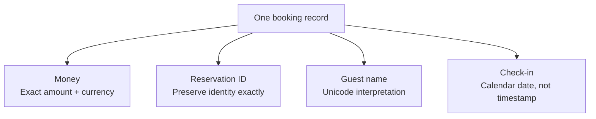

# CS110 — Foundations of Computation and Algorithms
## Lecture 02: Everything Is Numbers — Until It Isn't

*Why computers sometimes get arithmetic wrong, misunderstand perfectly valid names, and turn October 25 into October 24.*

**Estimated study time:** 60–80 minutes, including experiments and exercises.

---

### How to listen to this lecture

Written for continuous listening first, then for on-screen re-reading. Sticky-note callouts mark ideas worth pausing on. Near the end, answer the challenges **out loud** before reading solutions. The console experiments live after the spoken lecture ends — keep them for a screen session.

By the end, you should be able to explain why bits need an interpretation scheme, why money/IDs/text/time each have classic representation traps, and what four questions to ask whenever data crosses a boundary.

---

# Part I — Intuition

*One hotel reservation travels through several computer systems. The numbers survive, but some of their meanings don't.*

### First, imagine a box full of labels

A traveler named Amélie books a hotel room for October 25. The room costs €129.90. She receives reservation identifier `9007199254740993`.

A hotel clerk writes those details on a card. Another clerk copies the card into a different filing system. A third clerk sends the details to the payment desk.

The card contains several kinds of information: a person's name, an amount of money, a reservation identifier, and a calendar date. On paper, we don't normally confuse them. We know that €129.90 is a price, not a phone number; that October 25 is a day, not an elapsed duration; and that a reservation number is a label, not something we should round.

A computer, however, ultimately stores patterns of bits—zeros and ones. Those bits do not explain their own meaning. A program has to agree on how to interpret them.

The opening diagram shows the same booking passing through several services. Each arrow creates an opportunity for a detail to be misunderstood.


Nothing malicious needs to happen. Every service can be following its own rules correctly while the information changes meaning on its journey.

### 1. The same symbols can tell different stories

Imagine the clerk writes **42** on a piece of paper. What is it?

Forty-two euros? Room forty-two? Forty-two guests? The forty-second reservation? The number alone doesn't tell us.

The computer faces the same issue at a lower level. A pattern of bits might represent a small number, part of a letter, a color component, or something else. An agreed representation tells the computer how to interpret it.

Think of the bits as notes on a musical staff. The ink marks mean something only because musicians agree on a notation system. Different rules produce different interpretations.

In software, those rules appear as data types, encodings, file formats, database schemas, and API contracts.

**The stored pattern and the meaning of that pattern are not the same thing.**

### 2. Money is not just an ordinary approximate number

Now look at Amélie's €129.90 room price.

A person thinks of euros and cents. There are exactly one hundred cents per euro. If the business operates in cents, the exact amount is 12,990 cents.

But a computer using an ordinary binary floating-point number may represent some decimal fractions only approximately. It's similar to trying to write one third using a finite number of decimal digits: `0.333...` keeps going. Certain simple decimal fractions become repeating fractions in binary.

The approximation is often so tiny it doesn't matter for scientific calculations, graphics, or simulations. But billing requires clear rules about exact amounts, currency, scale, and rounding.

So the clerk's card can carry an integer number of minor currency units, or an appropriate exact decimal representation, rather than trusting ordinary floating-point arithmetic to model money perfectly.

The computer isn't broken when it rounds according to the representation it was given. The mistake is asking that representation to provide a guarantee it doesn't promise.

### 3. A reservation ID looks like a number but isn't an amount

Our reservation identifier is `9007199254740993`. Its digits look numerical, but their purpose is to identify one booking.

We don't add two reservation IDs, take their average, or round them to the nearest hundred. We only need to preserve them exactly and compare them reliably.

Some environments, including ordinary JavaScript `Number` values, cannot represent every sufficiently large integer exactly. If a service parses a large identifier as an imprecise number, it may silently change its final digits.

That's a dreadful property for an identifier. The simple intuition is that **something that looks like a number may actually be a label that must never change**. A string is often the right representation at an API boundary.

### 4. A name is what a person sees, not necessarily one simple sequence of bytes

Now consider the name Amélie.

On a screen, it looks straightforward. But text systems can represent visually identical characters in different ways. An accented character may be represented as one Unicode code point or as a base letter followed by a combining accent.

Both representations can display the same name. A naive byte-for-byte comparison may nevertheless treat them as different.

Similarly, what a person calls one visible character may contain several Unicode code points. Emoji and certain writing systems make this especially obvious.

The software must decide whether it is comparing bytes, code points, visually perceived characters, or names under an application-specific normalization policy. None of those questions is answered simply by saying “it's a string.”

### 5. A date is not a moment on a universal clock

Finally, Amélie arrives on October 25.

That is a **calendar date**. It tells the hotel which day she intends to check in. It does not specify an exact worldwide instant.

Now imagine another service converts that date to a timestamp at midnight in one time zone and displays it in another. Depending on the conversion, the displayed calendar date might become October 24.

The user never requested a different day. The software accidentally changed the kind of information it was carrying.

These three notions are distinct: a date on a calendar, a local clock time in a particular time zone, and a specific instant on a global timeline. Different business operations need different representations.

The second diagram is a reminder that one booking card contains several different promises.



### 6. Every boundary is a translation

When the booking service serializes the record into JSON, writes it to a database, or sends it across a message queue, values move between representations.

Sometimes this translation preserves everything important. Sometimes a number loses precision, a date gains an accidental time zone, a missing field becomes null, or visually identical text fails to compare as expected.

The right engineering question is not merely “can these two systems exchange JSON?” It's **“will the receiving system reconstruct the same meaning?”**

And here's a final distinction. Compression may preserve the original information exactly, or deliberately discard some of it. A cryptographic hash is a fingerprint, not a reversible copy. You cannot recover a booking's full details from its short hash value any more than you can reconstruct Amélie's face from a hotel check-in count.

### Your mental checkpoint

**Question A:** Why might €0.10 + €0.20 be awkward in binary floating-point? **Some decimal fractions aren't exactly representable in that format.**

**Question B:** Should a reservation identifier be treated as an amount we can round? **No. Its identity must be preserved exactly.**

**Question C:** Is “October 25” the same thing as “a particular UTC instant”? **No. A calendar date alone doesn't identify one instant.**

Keep the original hotel card in your mind. In Part II we'll investigate the precise machinery—binary, floating point, Unicode, time zones, serialization—and why selecting a representation is part of defining what correctness means.

*The intuition pass ends here.*

---

# Part II — Deep Dive

# 1. Three Bugs, One Culprit

> **Case file #002** — *Monday morning. Three tickets. One shared villain.*

It's Monday morning. You're drinking your coffee when three bug reports arrive from different parts of your SaaS platform.

The first concerns billing.

A customer has been charged an incorrect amount. The difference is tiny, just a fraction of a cent in the intermediate calculation, but it has propagated into the final invoice.

The second concerns guest management.

Two customers with apparently identical names are treated as different people. Your frontend displays the same characters for both, but searching for one doesn't find the other.

The third concerns reservations.

A customer booked a room for October 25. After the reservation passed through another service, the date displayed as October 24.

```text
  TICKET A          TICKET B            TICKET C
  ────────          ────────            ────────
  Billing           Guest names         Reservations
  0.1 + 0.2…        "Amélie" ≠ "Amélie" Oct 25 → Oct 24
       │                  │                   │
       └──────────────────┴───────────────────┘
                          │
              same culprit: representation ≠ reality
```

Three apparently unrelated problems.

One involves arithmetic. Another involves text. The third involves time.

Yet all three originate from the same fundamental issue.

> **Sticky note #1**
>
> The computer's representation of information is not the information itself.

A decimal number is not necessarily stored as an exact decimal number.

A visible character is not necessarily represented by one unit of text.

A calendar date is not necessarily a timestamp.

These distinctions sound elementary until a system violates them.

And they lead us to a rather interesting question:

How does a machine that fundamentally manipulates binary information manage to represent the astonishing variety of things we ask it to work with?

Let's investigate.

> ✓ Room 1 complete — three bugs, one theme

---

# 2. A Computer Doesn't Know What a Number Means

You already know that digital computers operate using binary.

We're not going to spend half an hour converting 157 into base two. You can refresh that in minutes if you've forgotten it.

But there's a more interesting point hiding behind binary representation.

Consider this sequence of eight bits:

`01000001`

What does it mean?

```text
  Same bits → many meanings (pick a scheme)
  ─────────────────────────────────────────
  01000001
      │
      ├── integer 65
      ├── letter  A   (ASCII / UTF-8)
      ├── a color component
      ├── a bitmask of eight flags
      └── a fragment of something larger
```

Perhaps it's the integer 65.

Perhaps it's the letter `A` encoded using ASCII or UTF-8.

Perhaps it's one component of a color.

Perhaps it's a bitmask describing eight independent flags.

Perhaps it's merely a fragment of some much larger structure.

The bits alone don't tell us.

Their meaning comes from the rules used to interpret them.

That's the first fundamental idea of this session:

> **Sticky note #2**
>
> Bits carry information, but their interpretation is determined by a representation scheme.

We call such schemes *encodings* when they define how information is represented in a particular form.

**ASCII** defines mappings between character values and numerical codes. **UTF-8** defines how Unicode code points become bytes. **IEEE 754** defines common floating-point representations and operations. A **network protocol** defines how byte sequences become messages.

The physical computer doesn't see hotel reservations, JSON objects, or customer names.

Those are meanings imposed on patterns of bits by software and agreed-upon conventions.

## Why binary?

Binary has a powerful engineering advantage: systems can distinguish two states with reasonable tolerance for physical imperfections.

A circuit doesn't need to represent every possible real number as a perfectly accurate voltage.

It needs to distinguish ranges corresponding to logical zero and logical one.

Real hardware is more complicated, of course, but this abstraction makes reliable digital computation practical.

One bit yields two distinct patterns. Two bits yield four. Three bits yield eight. In general, *n* bits yield 2ⁿ patterns — so eight bits yield 256.

A single bit has two possible values.

Two bits have four possible combinations.

Three bits have eight.

With `n` bits, there are `2^n` possible patterns.

This produces an unavoidable consequence: a fixed number of bits can represent only a finite number of distinct values.

Eight bits produce 256 patterns.

If those patterns represent unsigned integers, the range is 0 through 255.

But what if we need negative numbers?

We could reserve a bit for the sign. However, most modern general-purpose CPUs use a representation called **two's complement** for signed integers.

In an 8-bit two's-complement representation:

Under a common two's-complement reading of eight bits: `00000001` means 1, `00000000` means 0, `11111111` means -1, `10000000` means -128, and `01111111` means 127.

The mathematics behind two's complement is elegant, but the important property for now is practical: addition works using the same basic binary arithmetic circuitry for positive and negative integers.

There's also a consequence.

If you use an 8-bit signed integer, 127 is the maximum positive value.

What happens when you add one?

```text
  8-bit signed overflow (wrapping arithmetic)

      127  +  1  ──►  -128
   01111111         10000000
           ▲
           └── crossed the edge of what 8 bits can say
```

Under wrapping 8-bit arithmetic, the result becomes -128.

The arithmetic has crossed the boundary of what the representation can express.

This is **integer overflow**.

Different programming languages and execution environments handle overflow differently. Some wrap, some trap, some check explicitly, and some offer integer types with much larger or arbitrary ranges.

JavaScript's ordinary `number` type is a particularly interesting case because it doesn't use a conventional fixed-width integer representation.

And that brings us to our first production bug.

> ✓ Room 2 complete — bits need a decoding rule

---

# 3. The Strange Arithmetic of Floating-Point Numbers

Open a JavaScript console and evaluate: `0.1 + 0.2 === 0.3`

The result is: `false`

And `0.1 + 0.2` produces approximately `0.30000000000000004`.

This is one of the most famous programming curiosities, so you've probably encountered it many times.

But let's explain *why* it happens rather than merely memorizing that JavaScript is bad at decimals.

Because JavaScript is not actually malfunctioning.

It's performing arithmetic according to the rules of its numerical representation.

## Decimal fractions aren't always binary fractions

In base ten, we represent numbers using powers of ten.

The decimal fraction 0.125 means:

`1/10 + 2/100 + 5/1000`

But the same number can also be written as:

`1/8`

And because eight is a power of two, this number has a finite binary representation:

`0.001₂`

That means:

`1 × 2^-3 = 0.125`

So far, everything is straightforward.

Now consider 0.1.

In decimal notation, it's pleasantly simple:

`1/10`

But ten contains a factor of five.

A finite binary fraction can only represent rational numbers whose reduced denominator is a power of two.

Therefore, 1/10 cannot be represented by a finite number of binary fractional digits.

Its binary expansion repeats:

`0.00011001100110011...`

```text
  Same idea, different base
  ─────────────────────────
  1/3 in decimal:   0.333333...   (never ends)
  1/10 in binary:   0.000110011... (never ends)

  Exact finite form only if the denominator's prime
  factors fit the base. Binary loves powers of two.
```

This is conceptually the same problem you encounter when trying to represent 1/3 in ordinary decimal notation:

`0.333333333...`

No finite decimal representation expresses it exactly.

The important insight is that **which fractions can be represented exactly depends on the number system's base**.

Computers typically use binary floating-point arithmetic.

That means some extremely simple-looking decimal fractions cannot be represented exactly.

## Floating-point representation

JavaScript's ordinary numbers generally use the IEEE 754 binary64 format.

A binary64 value occupies 64 bits.

Conceptually, those bits encode three things:

```text
  IEEE 754 binary64 (conceptual)
  ──────────────────────────────────────────────
  │ sign │   exponent   │     significand      │
  │ 1b   │    ~11b      │   ~52b (+ hidden 1)  │
  ──────────────────────────────────────────────
           ≈ binary scientific notation
           range: enormous
           precision: finite (~15–17 decimal digits)
```

- A sign.
- An exponent.
- A significand, which carries the number's significant digits.

You can think of this as binary scientific notation.

In decimal scientific notation, we might write:

`6.02 × 10²³`

In binary floating-point, the idea is similar, but the base is two.

The number can represent very large and very small magnitudes by adjusting its exponent.

However, it has limited precision because the significand contains a finite number of bits.

Binary64 effectively provides 53 bits of significand precision for normal finite values.

That's roughly 15–17 significant decimal digits, depending on the number.

The format is a compromise.

It provides an enormous numerical range while preserving useful precision.

But it cannot represent every real number, or even every ordinary-looking decimal fraction, exactly.

So when JavaScript evaluates: `0.1 + 0.2`

it doesn't add the exact mathematical values 1/10 and 1/5.

It adds two nearby representable binary floating-point values.

The addition is then rounded to the nearest representable result according to the arithmetic rules.

That result happens to be slightly larger than the nearest representation of 0.3.

Hence the surprising comparison.

## Why this matters beyond trivia

Suppose your billing system calculates:

```typescript
const itemPrice = 0.10;
const serviceFee = 0.20;

const total = itemPrice + serviceFee;
```

This is a poor foundation for exact monetary accounting.

The error may be tiny, and many display routines will conceal it.

But repeated calculations, taxation, rounding, reconciliation, and interactions between systems can create genuinely incorrect outcomes.

The usual lesson is not that floating-point numbers are defective.

It's that **binary floating-point is not a representation designed to guarantee exact decimal monetary arithmetic**.

### A better representation for money

For currencies with two decimal places, a common solution is to store values as integer minor units.

Instead of `const price = 12.50;`, prefer something like `const priceCents = 1250;`.

Store money as integer cents, then add: 1250 plus 275 is exactly 1525.

```typescript
const subtotalCents = 1250;
const feeCents = 275;

const totalCents = subtotalCents + feeCents;
// 1525
```

All three values are integers.

As long as the values remain within the safe integer range, the arithmetic is exact.

This works very well for many billing applications.

But even here, there are complications.

Not every currency uses two decimal places.

Exchange rates and percentage-based calculations may require fractions smaller than the currency's minor unit.

Tax legislation or payment providers may impose specific rounding rules.

So professional financial systems must explicitly define currency, units, precision, and rounding policy. Decimal arithmetic libraries and database decimal types are often appropriate.

The key isn't merely "use integers."

It's **choose a numerical representation that preserves the guarantees your domain requires**.

### When floating-point is perfectly appropriate

Floating-point arithmetic is not something to avoid universally.

It is excellent for a huge variety of scientific, graphical, analytical, and engineering computations.

A financial ledger needs exact decimal money — floating-point is usually the wrong tool. Physics, graphics, network latency estimates, and image processing typically need approximate continuous values or samples — floating-point is usually fine. Statistics dashboards often tolerate approximation as well.

If you're simulating vehicle movement, estimating network latency, processing images, or calculating statistical values, small numerical approximation errors may be entirely acceptable.

The question is whether the acceptable error is understood.

A financial ledger usually requires different guarantees from a physics simulation.

We don't need to fear approximate numbers.

We need to know when we're using them.

> **Sticky note #3**
>
> Floating-point isn't broken. Using it for exact money is.

> ✓ Room 3 complete — 0.1 + 0.2 explained (and when float is fine)

---

# 4. The Integer That Disappeared

There is another numerical trap that matters particularly to full-stack developers.

JavaScript's `number` can represent integers exactly only within a certain safe range.

The largest safe positive integer is: `Number.MAX_SAFE_INTEGER`, then `// 9007199254740991`

That's approximately nine quadrillion.

You might reasonably wonder why anyone would care.

After all, your SaaS probably doesn't have nine quadrillion customers.

But consider a different use case.

Your PostgreSQL database uses a 64-bit integer identifier.

A row might have this ID:

`9007199254740993`

The backend sends it to the frontend as a JSON number.

The frontend parses the response using JavaScript.

Now look at this:

```javascript
const id = JSON.parse(
  '{"id":9007199254740993}'
).id;

console.log(id);
// 9007199254740992
```

```text
  PostgreSQL          JSON number           JavaScript number
  9007199254740993  ──────►  same digits  ──────►  9007199254740992
                                                      ▲
                                                      └── silently rounded
```

The original integer has changed.

JavaScript couldn't preserve that exact value as a `number`.

You didn't perform arithmetic.

You didn't explicitly convert anything.

You simply parsed a JSON response.

And an identifier was silently corrupted.

This is the sort of bug that can survive testing for years before suddenly appearing in production.

Most test databases don't contain IDs anywhere near this large.

But certain distributed identifier schemes, large external IDs, or long-lived systems can expose the problem.

## The important distinction: numbers versus identifiers

An identifier may consist entirely of digits without being a numerical quantity.

Consider a telephone number.

You don't multiply it by two.

You don't calculate its square root.

Leading zeros may matter.

Its purpose is identification, not arithmetic.

A phone number looks numeric but is an identity, not a quantity — safer as a string. An account or database ID is likewise an identity — safer as a string, or BigInt used carefully. A postal code is an identity that may need leading zeros — string. An invoice total in cents is a quantity you add — integer or decimal. A temperature reading is a measurement — floating-point is often fine.

The same principle applies to many account IDs, external transaction IDs, postal codes, and database identifiers.

Representing an identifier as a string can be more appropriate than representing it as a number.

For large integer quantities requiring exact arithmetic, JavaScript provides `BigInt`: `const id = 9007199254740993n;`

But `BigInt` introduces its own integration considerations.

For example: `JSON.stringify({ id: 9007199254740993n });`

throws an error by default.

A straightforward cross-service solution is to serialize the identifier as a decimal string: `{`, `  "id": "9007199254740993"`, and `}`

Now the receiving application can preserve it exactly, and convert it into an appropriate integer type only if needed.

The general lesson is surprisingly important:

> **Sticky note #4**
>
> A value looking like a number doesn't mean that a floating-point numerical type is its correct representation.

> ✓ Room 4 complete — large IDs are not JavaScript numbers

---

# 5. The Customer Whose Name Existed Twice

Let's move to our second production bug.

A customer registers with the name Amélie.

Later, another process imports a customer record with what appears to be the same name.

Both records display:

**Amélie**

But a direct string comparison returns false.

How?

Surely the letter é is the letter é.

Well, visually, yes.

Computationally, things are more complicated.

## ASCII was never going to be enough

Early character encoding systems were designed for relatively limited collections of characters.

ASCII, for example, defines 128 character codes, including English letters, digits, punctuation, and control characters.

That was enough for many early American computing applications.

It was obviously inadequate for representing the world's languages.

What about Lithuanian letters?

What about Hebrew?

Cyrillic?

Chinese characters?

Mathematical notation?

Emoji?

Different character encodings proliferated, often creating compatibility problems.

A file written using one encoding might display incorrectly when interpreted using another.

Unicode was developed to provide a common system for assigning code points to characters and other textual elements.

Today, Unicode underlies most modern text processing.

But there's an important distinction between **characters, code points, and bytes**.

## Unicode code points and encodings

A Unicode code point is an assigned numerical value, usually written like this:

`U+0041` is Latin capital letter A. `U+20AC` is the euro sign €. `U+1F600` is the grinning-face emoji.

But code points aren't necessarily stored directly as fixed-size chunks in every program.

UTF-8 is one way to encode Unicode code points as sequences of bytes.

It uses between one and four bytes per code point.

For example:

In UTF-8, `A` is typically one byte, `€` about three bytes, and `😀` about four.

JavaScript strings, meanwhile, are indexed in UTF-16 code units.

And that's where things start getting strange.

Consider: `"Hello".length`, then `// 5`

Nothing surprising.

Now: `"😀".length`, then `// 2`

Why two?

Because this emoji is represented by a pair of UTF-16 code units, known as a surrogate pair.

So JavaScript's string length is not necessarily the number of Unicode code points or the number of visually perceived characters.

For a slightly more interesting example: `"🇱🇹".length`, then `// 4`

```text
  One flag you see → four units JS counts
  ───────────────────────────────────────
  🇱🇹
   │
   ├── 2 regional-indicator code points
   └── each = 2 UTF-16 code units  →  .length === 4
       (and 8 bytes in UTF-8)
```

The Lithuanian flag looks like one symbol.

But it's represented by two Unicode regional-indicator code points, each occupying two UTF-16 code units.

One visual symbol.

Two code points.

Four UTF-16 code units.

And in UTF-8, eight bytes.

This is why naive string slicing can sometimes break emoji or other complex characters.

And why measuring visible text length can require more than checking `.length`.

## Grapheme clusters: what a person sees

Unicode has a concept called an *extended grapheme cluster*.

Roughly speaking, it represents a unit of text that users generally perceive as a character.

One grapheme cluster may contain multiple Unicode code points.

Modern JavaScript provides `Intl.Segmenter` for Unicode-aware text segmentation:

```javascript
const segmenter = new Intl.Segmenter("en", {
  granularity: "grapheme"
});

const symbols = [...segmenter.segment("🇱🇹")];

console.log(symbols.length);
// 1
```

For the flag emoji `🇱🇹`, UTF-8 may use about eight bytes. JavaScript's `.length` counts four UTF-16 code units. There are two Unicode code points. A person sees one grapheme cluster.

This distinction matters for text editors, character counters, UI truncation, and many forms of user-facing input.

A username limit of "20 characters" is surprisingly ambiguous unless you define what you're counting.

Twenty bytes?

Twenty UTF-16 code units?

Twenty Unicode code points?

Twenty grapheme clusters?

Different answers produce different behavior.

## Back to Amélie

Now let's return to the two apparently identical names.

Unicode allows some visible text to be represented using different sequences of code points.

For example, the accented letter é can be represented as a single code point:

`U+00E9`

Or as a combination:

`U+0065` — Latin small letter e.

`U+0301` — Combining acute accent.

```text
  Same look, different bytes
  ──────────────────────────
  é  =  U+00E9              (one code point)
  é  =  e + ́  = U+0065 + U+0301  (two code points)

  Display: identical
  a === b: false  (until you normalize)
```

Both may render identically.

But the strings are different sequences of code points.

JavaScript demonstrates this beautifully:

```javascript
const a = "\u00E9";
const b = "e\u0301";

console.log(a === b);
// false

console.log(a.length);
// 1

console.log(b.length);
// 2
```

This explains our original bug.

The customer names could appear identical while their underlying representations differed.

One solution is **Unicode normalization**.

`a.normalize("NFC") === b.normalize("NFC")`, then `// true`

Normalization transforms canonically equivalent sequences into a consistent form.

Now comparisons behave as expected for this particular kind of equivalence.

But be careful.

Unicode normalization does not automatically solve every problem involving text equality.

Case differences, culturally specific rules, lookalike characters, and identity verification introduce additional issues.

A search engine may deliberately use loose comparisons.

An authentication system may need stricter identifier handling.

An ordinary display name may not need to be unique at all.

Once again, the correct representation depends on what the system is trying to accomplish.

## Why this matters in 2026

Software is increasingly international.

Your users may speak different languages and use different scripts.

Your applications may pass text through browsers, mobile apps, databases, AI systems, logs, and external APIs.

Text that looks perfectly ordinary to one component can be interpreted differently by another.

And a confident assumption that "a string is just a string" can create bugs that are extremely difficult to reproduce.

Unicode isn't merely a historical problem that clever libraries solved decades ago.

It's a living part of everyday software engineering.

> **Sticky note #5**
>
> What a human sees ≠ what `.length` counts ≠ what bytes store.

> ✓ Room 5 complete — Amélie explained (normalize before you compare)

---

# 6. The Night That Happened Twice

Now let's investigate our third bug.

A customer books a hotel for October 25.

Somewhere between the frontend and backend, the date changes to October 24.

At first glance, this seems absurd.

A date is a date.

But computers don't have one universal concept of time.

They have several different concepts, and confusing them causes enormous trouble.

Let's distinguish three.

## An instant

An instant is a specific point on the global timeline.

For example:

`2026-10-25T00:30:00Z`

The `Z` indicates UTC.

This identifies a particular moment.

People in different time zones may display that moment with different local clock times, but they're referring to the same instant.

Unix timestamps represent instants relative to the Unix epoch.

JavaScript's traditional `Date` object fundamentally represents an instant as a number of milliseconds since that epoch.

This is useful for events like:

- When a request arrived.
- When a payment was authorized.
- When a message was sent.
- When a background job started.

These are occurrences on the global timeline.

## A calendar date

Now consider:

`2026-10-25`

This is a calendar date.

It does not inherently identify a particular instant.

And for many business operations, that's exactly what we want.

A hotel guest checks in on October 25.

Their booking is associated with that local calendar date, not necessarily with midnight UTC.

```text
  Calendar date ≠ instant
  ───────────────────────
  "check in Oct 25"  ──(careless UTC conversion)──►  "Oct 24" on screen
                         ▲
                         └── wrong kind of time value crossed a boundary
```

If a frontend carelessly converts the date into a UTC timestamp and another component converts it into a different time zone, the displayed calendar date may change.

That's how one system can claim October 25 while another displays October 24.

The underlying value may have been interpreted as the wrong kind of time information.

Hotel stays, birthdays, and many calendar-based business rules should generally preserve calendar-date semantics rather than arbitrarily converting dates into global instants.

## Local clock time and time zones

A third concept is local time.

For example:

"03:30 in Vilnius."

That sounds specific.

But it may not be enough to identify a unique instant.

Here's an especially timely example.

On **October 25, 2026**, Lithuania transitions from daylight saving time back to standard time.

The clocks move backward.

As a result, the local time **03:30 occurs twice**.

The two occurrences correspond to different UTC instants:

On 25 October 2026 at 03:30 in Vilnius, one occurrence with offset UTC+03:00 corresponds to 00:30 UTC. Another occurrence of the same local clock reading with offset UTC+02:00 corresponds to 01:30 UTC.

```text
  DST "fall back" — clocks rewind
  ───────────────────────────────
  02:00 ──► 03:00 ──► 03:30 (#1, +03) ──► 04:00 …
                    ↻ clocks jump back
              03:00 ──► 03:30 (#2, +02) ──► …

  Same wall-clock reading. One hour apart on the real timeline.
```

Both are legitimate.

They are one hour apart.

Imagine a system scheduling a background job for 03:30 local time on that day.

Which occurrence should it use?

The first?

The second?

Both?

The answer depends on the application's requirements.

This is not an obscure theoretical edge case.

It's a real ambiguity created by the relationship between local civil time and the global timeline.

## Why an offset isn't always enough

You might think we can solve everything by storing a UTC offset.

But a fixed offset isn't the same as a time zone.

`UTC+02:00` simply describes a difference from UTC.

`Europe/Vilnius` identifies a geographical time zone with historical and applicable civil-time rules.

Those rules determine which offsets apply on particular dates.

If you're scheduling something for 09:00 every Monday in Vilnius, you generally want to preserve the local time and time zone.

If you store one fixed UTC offset, your schedule can drift when daylight saving rules change.

This is why mature time APIs distinguish instants, calendar dates, local times, and zoned date-times.

JavaScript's modern Temporal API was designed around precisely these distinctions, although native support still varies by runtime.

## A practical mental model

For most web applications, I would start with these rules:

**Events** such as a request arriving or a payment authorizing prefer a precise instant, usually UTC. **Hotel stays and birthdays** prefer calendar-date semantics. **Appointments and recurring local schedules** prefer local time plus a time zone, with explicit handling for ambiguous or nonexistent local times. **Durations** require clarity about elapsed time versus calendar arithmetic.

**Events:** Store a precise instant, usually represented in UTC.

**Hotel stays and birthdays:** Preserve calendar-date semantics.

**Appointments and recurring local schedules:** Preserve the intended local time and time zone, with explicit handling of ambiguous or nonexistent times.

**Durations:** Be clear whether you mean elapsed time or calendar arithmetic.

That last distinction matters more than it first appears.

"Add 24 hours" is not always the same operation as "schedule this for the same local time tomorrow."

Around daylight saving transitions, those can produce different results.

The computer is not confused.

It's faithfully following a representation whose meaning may not match the business requirement.

> **Sticky note #6**
>
> Instant ≠ calendar date ≠ local clock time. Mix them and October 25 becomes October 24.

> ✓ Room 6 complete — time has more than one meaning

---

# 7. Serialization: Where Meaning Gets Lost Between Services

So far we've discussed how individual values are represented.

But modern applications constantly move collections of values between systems.

```text
  Vue frontend ──JSON──► Node backend ──SQL──► PostgreSQL
                              │
                              ├──► Lambda / another service
                              ├──► AI tool call
                              └──► message queue job
```

A Vue frontend communicates with a Node.js backend.

The backend writes to PostgreSQL.

A Lambda function sends data to another service.

An AI agent calls an external tool.

A message queue transports a job.

All these operations require systems to agree on how information is represented.

This is **serialization**.

Serialization transforms in-memory values into a representation suitable for storage or transmission.

Deserialization reconstructs values from that representation.

JSON is perhaps the most familiar example.

Consider this JavaScript object:

```javascript
const result = {
  amount: 1250,
  currency: "EUR",
  discount: undefined,
  score: NaN
};

console.log(JSON.stringify(result));
```

The output is:

```json
{
  "amount": 1250,
  "currency": "EUR",
  "score": null
}
```

In memory, `amount` may be `1250` and still be `1250` after `JSON.stringify`. `currency` as `"EUR"` likewise survives. But `discount` as `undefined` is **gone** after ordinary object serialization, and `score` as `NaN` becomes `null`.

Notice what happened.

The `discount` field disappeared.

The `NaN` value became `null`.

These weren't arbitrary bugs.

They're consequences of how JavaScript's JSON serialization works.

JSON doesn't have native representations for `undefined`, `NaN`, or infinity.

So those values cannot be preserved directly through ordinary JSON serialization.

And as we've already seen, BigInt requires explicit handling.

## Serialization is not automatically reversible

It's tempting to assume that serialization is just a temporary transformation.

Take an object, turn it into JSON, send it somewhere, parse it, and get the same object back.

But that assumption is not universally true.

Some information may be discarded.

Types may change.

Precision may be lost.

Special values may not survive.

Even apparently ordinary data can be affected by the semantics of the receiving programming language.

A useful conceptual test is:

`decode(encode(value))`

Does that reconstruct a value with the same meaning?

Not necessarily the same object identity or memory layout.

The same *meaning*.

For a financial amount, that might require preserving an exact decimal value and currency.

For a calendar event, it might require preserving the distinction between a date and an instant.

For a customer identifier, it might require preserving every digit exactly.

## A cross-service example

Suppose your backend retrieves a PostgreSQL row: `id: 9007199254740993`, `amount: 109.90`, and `check_in: 2026-10-25`

You then create an API response.

A careless implementation might convert everything into ordinary JavaScript numbers and `Date` objects.

Treat `id` as a JavaScript number and you may lose precision past the safe-integer range. Treat `amount` as a float and you invite money bugs. Treat `check_in` as a `Date` instant and you may land on the wrong calendar day across time zones.

The identifier risks losing precision.

The financial amount risks floating-point inaccuracies.

The calendar date risks being treated as an instant and converted across time zones.

Each field contains a different kind of information.

Yet an overly generic serialization layer can destroy the distinctions that matter.

A more deliberate API contract might use:

```json
{
  "id": "9007199254740993",
  "amount": "109.90",
  "currency": "EUR",
  "checkInDate": "2026-10-25"
}
```

This representation preserves the intended decimal value as text, the identifier exactly, and the check-in as a date-only value.

Of course, the client must still validate and interpret the fields correctly.

Strings aren't magic.

A string containing `"109.90"` doesn't inherently enforce financial rules.

But it avoids silently converting an exact decimal representation into approximate binary floating-point during transport.

The real solution is a contract shared by both systems.

That contract needs to specify not only field names and types but also their meaning.

This is one of the reasons API design is much more than agreeing on JSON structure.

> **Sticky note #7**
>
> `decode(encode(x))` must preserve *meaning*, not just "something JSON-looking."

> ✓ Room 7 complete — serialization can quietly rewrite your data

---

# 8. Compression, Hashes, and Information You Can't Recover

Let's finish the conceptual portion with one last distinction.

Earlier, we discussed how aggregation can discard information.

But not every transformation that reduces storage necessarily loses information.

Consider compressing a text file.

A lossless compression algorithm produces a smaller representation that can be decompressed to recover the original data exactly.

The representation changes, but the original information is preserved.

Now consider a JPEG image.

JPEG commonly uses lossy compression.

Some image information is discarded to reduce file size.

The decompressed image may look extremely similar to the original, but it isn't necessarily identical.

The distinction between lossless and lossy representations is fundamental.

## What about hashes?

Suppose we calculate a SHA-256 hash of a document.

The result is a fixed-length 256-bit value.

We can use it as a fingerprint to check whether content appears to match an expected value.

But we cannot generally reconstruct the original document from the hash.

There are vastly more possible documents than 256-bit hash values.

Many different inputs must therefore map to the same hash value.

This is an application of a simple mathematical fact known as the pigeonhole principle.

If you have more possible inputs than outputs, at least two inputs must share an output.

```text
  Many documents          Few hash slots
  ──────────────          ──────────────
  doc₁ ──┐
  doc₂ ──┼──► SHA-256 ──► 256-bit fingerprint
  doc₃ ──┘                    │
  …                           └── cannot reverse to "the" original
```

Cryptographic hash functions are designed so that finding such collisions is computationally extremely difficult, along with other important security properties.

But hashing is fundamentally different from reversible encryption or lossless compression.

Hashing produces a compact derived value intended for purposes such as integrity checking and identification.

It does not preserve enough information to reconstruct arbitrary original inputs.

This gives us three different transformations:

**Lossless compression** reduces size while preserving information — you can recover the original. **Lossy compression** reduces size by discarding selected information — you cannot recover exactly. **Cryptographic hashing** produces a compact fingerprint — you generally cannot recover the original.

Why include this in an introductory CS course?

Because it reinforces the central theme.

Every transformation has properties and limitations.

A good engineer must understand which information survives and which guarantees are preserved.

This is as relevant to API contracts as it is to image formats, database indexing, or cryptographic systems.

> ✓ Room 8 complete — smaller ≠ always lossy; hash ≠ reversible

---

# 9. The Engineering Principle Connecting Everything

We've covered quite a lot of ground.

Binary numbers.

Floating-point precision.

Integer limits.

Unicode.

Time zones.

Serialization.

Compression.

At first glance, these appear to be unrelated subjects.

But they share a very important principle.

> **Sticky note #8**
>
> Every representation preserves certain distinctions and discards, obscures, or transforms others.

When we represent a monetary amount as binary floating-point, we may sacrifice exact decimal precision.

When we represent text as UTF-16 code units, string length doesn't directly express the number of visible characters.

When we represent a hotel check-in date as a timestamp, we may accidentally introduce time-zone semantics that weren't part of the original requirement.

When we represent a large database identifier as a JavaScript number, we may lose integer precision.

When we serialize application state into JSON, some values may change or disappear.

The question isn't whether these representations are good or bad in isolation.

The question is whether they preserve the properties the application requires.

This suggests a useful engineering habit.

Whenever data crosses a boundary, ask four questions:

```text
  ┌──────────────────────────────────────────────┐
  │  FOUR QUESTIONS AT EVERY BOUNDARY            │
  ├──────────────────────────────────────────────┤
  │  1. What does this value mean?               │
  │  2. How is it represented?                   │
  │  3. What guarantees does that give us?       │
  │  4. What could be lost on the next hop?      │
  └──────────────────────────────────────────────┘
```

**What does this value mean?**

Is it an identifier, measurement, amount, date, instant, status, or something else?

**How is it represented?**

A number, string, timestamp, byte array, decimal, or structured object?

**What guarantees does the representation provide?**

Exactness, range, ordering, reversibility, character identity, or something else?

**What could be lost when it crosses into another system?**

Precision, time-zone context, type information, missing-value distinctions, or other semantics?

Many difficult production bugs become much easier to understand once you start asking those questions.

> ✓ Room 9 complete — one principle ties the whole lecture together

---

# 10. The Oral Examination

We now have enough knowledge to examine representation like an engineer rather than merely recognize its vocabulary.

Before reading the solutions, try answering these questions out loud. Imagine that a senior engineer is interviewing you and will challenge any hand-waving.

### Challenge A — Design a Money Type

**Estimated time: 10 minutes**

You're designing the billing system for a SaaS product that operates internationally.

You need to represent:

- Exact invoice amounts.
- Multiple currencies.
- Discounts.
- Tax calculations.
- Currency conversions.
- Refunds and partial payments.

Would you simply represent all prices as `number`?

If not, what would you use?

Think about storage, transport, arithmetic, rounding, and currency-specific rules.

You don't have to write a full implementation.

Describe the essential design decisions.

### Challenge B — The Dangerous API Contract

**Estimated time: 10 minutes**

An external service returns:

```json
{
  "customerId": 9007199254740993,
  "balance": 104.95,
  "lastActivity": "2026-10-25 03:30:00",
  "customerName": "Amélie"
}
```

Your job is to integrate it into a TypeScript application.

Identify at least four questions you'd want answered before trusting this contract.

Which fields could introduce silent correctness problems?

How would you redesign the contract if you controlled both sides?

### Challenge C — An AI Agent With Perfect Confidence

**Estimated time: 5–10 minutes**

You have an AI agent that can retrieve account balances and transaction summaries.

A user asks:

"Did anyone withdraw money from my account yesterday?"

The agent only has access to the current balance and yesterday's closing balance.

Can it determine the answer reliably?

Why or why not?

What additional information would make the answer possible?

This is a direct application of the ideas from lectures 1 and 2.

> ✓ Room 10 complete — challenges attempted

---

# 11. Solutions and Discussion

*Read after attempting the oral challenges. Lab walkthroughs appear after the spoken lecture ends.*

### Solution A — Money type

A strong design would distinguish exact amounts from approximate measurements.

One approach is to represent posted monetary amounts in integer minor units, together with an explicit currency.

More sophisticated calculations may require decimal arithmetic with a defined scale and rounding policy.

Exchange rates should preserve sufficient precision for the domain, and rounding should happen at explicitly defined stages.

Different currencies may have different minor-unit conventions.

Whatever representation is chosen, the API contract should preserve its exact meaning across system boundaries.

### Solution B — Dangerous API contract

Important questions include:

- Can the customer ID exceed JavaScript's safe integer range?
- Is the balance an exact monetary quantity?
- Which currency does the balance use?
- Is the activity time UTC, local time, or something else?
- If local, which time zone?
- Are customer names normalized or compared according to a defined policy?
- What does missing or null data mean?

A safer contract would explicitly represent identifiers, monetary values, currency codes, and timestamps using appropriate formats and documented semantics.

### Solution C — AI agent confidence

Two balances alone cannot establish whether a withdrawal occurred.

Deposits and withdrawals can cancel each other out.

A balance may also change because of adjustments, fees, or other operations.

The agent needs appropriate transaction-level evidence, including the period and semantics of the account records.

Confidence cannot substitute for missing information.

> ✓ Room 11 complete — answers checked

---

# 12. The Mental Model Worth Keeping

A great deal of software engineering is translating information between representations — price as typed text, validated number, database column, payment payload, ledger entry, report. Each conversion can preserve meaning or destroy it. The same is true for text, dates, identifiers, and measurements. Schemas, API contracts, and TypeScript types are attempts to express the properties that matter — more or less faithfully.

Remember these durable distinctions:

**Bits need an interpretation scheme.**

**Floating-point is not exact money** — use a domain-fitting representation.

**Digit strings aren't always numbers** — especially identifiers.

**Visible text is not the same as code points, `.length`, or bytes.**

**An instant is not a calendar date, and neither is local civil time.**

**Serialization can drop or rewrite meaning.**

**Lossless compression, lossy compression, and hashing preserve different guarantees.**

**At every boundary:** meaning → representation → guarantees → what could be lost.

> **The master sticky note**
>
> Choose representations according to the guarantees your problem requires, not merely according to which data types are convenient.

You don't need to memorize Unicode tables or the exact bit layout of every numerical format.

You do need to recognize when representation choices affect correctness — that's what separates writing working software from explaining why it works, and diagnosing when it stops.

---

# 13. Next Lecture — Algorithms and the Cost of Computation

We've learned that representation decides what remains knowable.

But even when the information exists and the model is sound, a correct procedure may still be too expensive to run.

Why does one approach finish in milliseconds while another seems to grow forever as the input grows? When is "good enough" a responsible engineering choice rather than a shortcut?

In **CS110-L03**, we'll study algorithms and the cost of computation — how to reason about time, space, and trade-offs before you rewrite the whole service in Rust.

---

## Optional Practical Lab — Five Things Worth Testing

*The spoken lecture ends here. The remaining material is a screen-first investigation worksheet.*

Open the browser console or Node.js. You don't need to build an application.

**Estimated time: 15–20 minutes.**

Predict each result *before* you run it, then connect the behavior to the explanations above.

### Lab A — Floating-point surprise

In the console, compare `0.1 + 0.2` against `0.3`, then compare `0.125 + 0.25` against `0.375` — one pair has a finite binary fraction; the other does not.

```javascript
console.log(0.1 + 0.2);
console.log(0.1 + 0.2 === 0.3);

console.log(0.125 + 0.25);
console.log(0.125 + 0.25 === 0.375);
```

Why does one example behave differently from the other?

Hint: think about which fractions have finite binary representations.

### Lab B — The unsafe identifier

Assign the adjacent integers around `Number.MAX_SAFE_INTEGER`, compare them with `===`, check `Number.isSafeInteger`, then keep the larger one as a BigInt with an `n` suffix.

```javascript
const a = 9007199254740992;
const b = 9007199254740993;

console.log(a === b);
console.log(Number.isSafeInteger(a));
console.log(Number.isSafeInteger(b));

const exact = 9007199254740993n;

console.log(exact.toString());
```

Explain why this behavior is dangerous when handling database identifiers.

Would TypeScript's static type system automatically prevent it?

### Lab C — How long is a character?

Build a small array of tricky strings — plain A, accented e, combining accents, an emoji, a flag — then measure `.length` versus grapheme segmentation.

```javascript
const texts = [
  "A",
  "é",
  "e\u0301",
  "😀",
  "🇱🇹"
];

const segmenter = new Intl.Segmenter("en", {
  granularity: "grapheme"
});

for (const text of texts) {
  console.log({
    text,
    utf16Units: text.length,
    codePoints: [...text].length,
    graphemes: [...segmenter.segment(text)].length,
    utf8Bytes: new TextEncoder().encode(text).length
  });
}
```

Look carefully at the output.

What would happen if a frontend validation rule allowed a maximum of ten characters based solely on `.length`?

Would that necessarily match what the user perceives as ten characters?

### Lab D — Serialization isn't innocent

Build an object with `undefined`, `NaN`, `Infinity`, and a boolean, then round-trip it through `JSON.stringify` and `JSON.parse` and notice what survived.

```javascript
const input = {
  id: 42,
  discount: undefined,
  result: NaN,
  maximum: Infinity,
  active: false
};

const serialized = JSON.stringify(input);
const restored = JSON.parse(serialized);

console.log(serialized);
console.log(restored);
```

Which information was lost?

Which values survived?

Now try adding a BigInt property.

What changes?

### Lab E — One local time, two instants

Consider:

`2026-10-25 03:30 Europe/Vilnius`

Without using a programming library, explain why this is ambiguous.

Then consider these two timestamps:

```text
2026-10-25T03:30:00+03:00
2026-10-25T03:30:00+02:00
```

Are they the same instant?

Which happens first?

What information did the numeric UTC offset add?

And what information does the time-zone identifier provide that an offset alone doesn't?

### Lab F — Explain your observations

Write or speak a short diagnosis covering:

1. Why `0.1 + 0.2` differed from the power-of-two example.
2. Why large adjacent integers compared equal as `number`.
3. Which text-length measure matched what a person sees.
4. Which JSON values survived and which did not.
5. Why one Vilnius local time mapped to two UTC instants.

### Lab notes — expected behaviors

**Floating-point.** The fractions 0.125 and 0.25 have finite binary representations because their denominators are powers of two. Their sum, 0.375, is also exactly representable. The decimal fractions 0.1 and 0.2 do not. Approximation and rounding produce the observed difference.

**Unsafe identifiers.** JavaScript's `number` cannot distinguish all sufficiently large adjacent integers. The values 9007199254740992 and 9007199254740993 evaluate to the same JavaScript number. TypeScript doesn't automatically fix this because `number` has the same runtime representation. A string or BigInt-based approach can preserve the identifier exactly, provided serialization and deserialization also preserve it.

**Unicode.** Bytes, UTF-16 code units, Unicode code points, and grapheme clusters are different quantities. For user-facing character counts, grapheme segmentation may be more appropriate than `.length`. For storage or transport limits, byte counts may matter instead.

**JSON.** Properties with `undefined` values are omitted from ordinary object serialization. Non-finite numerical values such as `NaN` and infinity become `null`. Boolean `false` survives unchanged. BigInt serialization throws by default unless explicitly handled.

**Time zones.** On the stated date, Vilnius moves its clocks backward. The two local 03:30 times correspond to different UTC instants. The occurrence with offset +03:00 happens first. The time-zone identifier provides the applicable civil-time rules; the offset identifies the difference from UTC for a particular occurrence.

---

## Dense Cheatsheet — Interview Glance Card

*Fenced so voice readers skip it. Skim on screen when revising; open sections above only when a row fails to spark.*

```text
CS110-L02  REPRESENTATION — INTERVIEW GLANCE CARD

CORE MODEL
  Theme             Representation ≠ reality (billing / names / dates share one culprit)
  Bits              Carry info; MEANING needs an interpretation scheme (encoding)
  Same 01000001     65 | 'A' | color | bitmask | fragment — scheme decides
  n bits → 2ⁿ patterns; fixed width = finite distinct values

INTEGERS
  Unsigned 8-bit    0…255
  Two's complement  same adder for +/− ; 8-bit: 127+1 → −128 (wrap overflow)
  Overflow          wrap / trap / check / bigints — language-dependent
  JS number         NOT fixed-width int; safe ints only ≤ Number.MAX_SAFE_INTEGER
                    (9007199254740991 ≈ 2⁵³−1)

FLOATING-POINT (IEEE 754 binary64)
  Layout            sign | exponent | significand (~53 bits precision; ~15–17 decimal digits)
  Why 0.1+0.2≠0.3   1/10 not finite binary fraction (like 1/3 in decimal); add rounded approx
  Finite binary OK  denominators that are powers of 2 (0.125, 0.25, 0.375)
  Money trap        Float not designed for exact decimal money
  Prefer            integer minor units (cents) + currency; or decimal types + rounding policy
  Complications     ≠2 decimal places; FX; % fees; legislated rounding
  When float OK     physics, graphics, latency estimates, many stats — IF error budget known

IDENTIFIERS ≠ QUANTITIES
  JSON number ID past MAX_SAFE_INTEGER → silent corruption (…993 → …992)
  Phone / postal / account ID → identity (string / careful BigInt), not arithmetic quantity
  BigInt            exact; JSON.stringify throws by default → serialize as decimal string
  Sticky            Looking numeric ≠ floating-point number is the right type

TEXT / UNICODE
  ASCII             128 codes — not the world
  Layers            grapheme (what user sees) ≠ code points ≠ UTF-16 units (.length) ≠ bytes
  Examples          "😀".length → 2 (surrogate pair); "🇱🇹".length → 4 (2 RI × 2 units)
                    UTF-8 flag ≈ 8 bytes; Intl.Segmenter grapheme → 1
  Amélie trap       U+00E9 vs e+U+0301 → display same, === false until normalize (NFC)
  Normalize ≠ all   case, culture, lookalikes, auth vs search vs display still differ
  "20 characters"   ambiguous: bytes? units? code points? graphemes?

TIME — THREE CONCEPTS
  Instant           point on global timeline (…Z / Unix ms); JS Date = instant
  Calendar date     2026-10-25 — NOT an instant; hotel check-in / birthday semantics
  Local + zone      "03:30 Vilnius" may be AMBIGUOUS (DST fall-back: two UTC instants)
  2026-10-25 LT     +03 → 00:30Z first; +02 → 01:30Z second
  Offset ≠ zone     UTC+02 vs Europe/Vilnius (civil rules over dates; schedules can drift)
  Rules of thumb    events→UTC instant; stays/birthdays→date; appointments→local+zone;
                    durations: elapsed hours ≠ "same local tomorrow"
  Trap              date→Date→other TZ → Oct 25 becomes Oct 24

SERIALIZATION
  encode/decode     must preserve MEANING (not object identity)
  JSON drops        undefined omitted; NaN/Infinity → null; BigInt needs explicit handling
  Cross-service     id as string; amount as exact decimal text + currency; checkIn as date-only
  Careless path     JS number ID + float money + Date for calendar → silent wrongness

COMPRESSION / HASH
  Lossless          smaller, recoverable exactly
  Lossy (JPEG…)     discard selected info — not identical after
  SHA-256 hash      fingerprint; pigeonhole → many docs → same 256 bits; NOT reversible
  ≠ encryption / lossless compression

FOUR QUESTIONS AT EVERY BOUNDARY
  1. What does this value mean?        (id / money / date / instant / …)
  2. How is it represented?
  3. What guarantees does that give?   (exactness, range, order, reversibility…)
  4. What could be lost on the next hop?

ORAL RECOVERY
  Money design      minor units + currency; decimal scale/rounding; FX precision; contract
  Dangerous JSON    ID range? exact money+currency? time kind/zone? name normalize policy? nulls?
  AI + two balances Cannot prove withdrawal — deposits cancel, fees, adjustments; need ledger

SENIOR LINE: choose representations for the GUARANTEES the problem needs —
not for whichever type is convenient.
```

