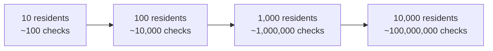
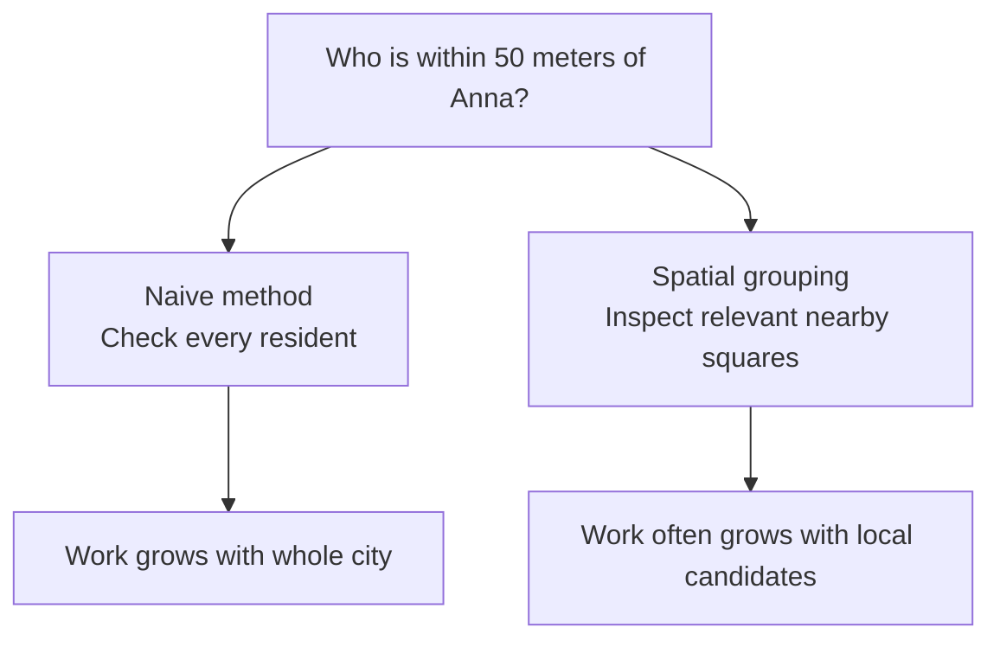

# CS110 — Foundations of Computation and Algorithms
## Lecture 03: Algorithms and the Cost of Computation

*The fascinating relationship between algorithms, scaling, memory, and the physical machines that execute our software.*

**Estimated study time:** 70–90 minutes, including practical exploration.

---

### How to listen to this lecture

Written for continuous listening first, then for on-screen re-reading. Sticky-note callouts mark ideas worth pausing on. Near the end, answer the challenges **out loud** before reading solutions. The console experiment lives after the spoken lecture ends — keep it for a screen session.

By the end, you should be able to explain why costs grow differently as data grows, why Big O is a growth story rather than a stopwatch, why waiting and memory locality count as performance, and what questions to ask before rewriting something that feels slow.

---

# Part I — Intuition

*The city that stopped moving: why giving a computer a bigger job can be much worse than simply doubling the work.*

### Begin with one tiny city

Imagine building a little city simulation. At first it has ten residents. They go to work, cross streets, visit shops, and sometimes look for other people nearby. Everything runs instantly.

Now the city has a thousand residents. Still manageable. Then ten thousand. Then one hundred and twenty thousand. Your computer suddenly struggles, even though the city doesn't look one hundred and twenty times more complicated than before.

Let's focus on just one innocent instruction in the simulation: **every resident checks whether anybody else is nearby**.

Your first implementation is beautifully simple. Take Anna, look at every other resident, compare positions, and collect those within fifty meters. Then do the same for Boris. Then for Clara. Then for everyone.

For ten residents, that means roughly ten people each checking ten people: about one hundred comparisons. Nothing.

For a thousand residents, it becomes about one million candidate comparisons. For ten thousand, about one hundred million. For one hundred and twenty thousand, roughly fourteen billion.

The first visual shows the problem: adding people makes both the number of searchers and the length of every search grow.



This is the moment to understand a central idea: **the cost of an algorithm is not merely how much data you have; it is how the amount of required work grows with that data**.

### 1. The multiplication hiding in the innocent loop

The city has *n* residents. Each resident searches through *n* residents. So the total work grows roughly like *n times n*.

That's the intuition behind **quadratic growth**, often written as O(n²). The notation isn't important yet. The consequence is.

Doubling the population can quadruple the work. Increasing the population tenfold can increase the work a hundredfold.

Compare that with another task: reading the name of every resident once. If the population doubles, that job roughly doubles. That's **linear growth**, written O(n).

Neither notation gives the exact execution time. It tells us how the quantity of work scales when the input grows.

And that tells us why a tiny successful benchmark may say almost nothing about a huge simulation.

### 2. The shortcut is to stop asking irrelevant questions

Now look at the city as a real place. Anna is standing outside a bakery in the northern neighborhood. Does she need to check the position of every person on the opposite side of the city?

No. Her question is about people within fifty meters.

Suppose we divide the map into small squares. Each resident belongs to a square according to location. When Anna checks for neighbors, we examine her square and the relevant nearby squares instead of searching the entire city.

Suddenly, we can often ignore the overwhelming majority of residents. We still check exact distances for nearby candidates, including cases close to square boundaries, but we avoid comparing Anna with people who cannot possibly be near her.

Here's the second visual: the same people and the same question, but a different way of choosing which comparisons deserve to happen.



We haven't upgraded the computer. We haven't switched programming languages. We changed the **algorithm**: the method for answering the question.

In a very crowded square, there may still be lots of work. Maintaining the groups also costs memory and update time. And we must choose enough neighboring squares so we don't miss a valid nearby person.

Those trade-offs belong in the technical lecture. The first mental step is simply recognizing that *avoiding work* can be much more powerful than performing the same unnecessary work faster.

### 3. Faster for large inputs isn't always faster right now

Imagine the city contains only twenty residents. Is building an elaborate spatial index worthwhile?

Maybe not. Checking twenty positions directly is simple and cheap. Constructing and maintaining a clever index could cost more than it saves.

This is why **Big O describes how work grows, not which implementation wins every stopwatch race**.

An algorithm that scales beautifully may carry a fixed setup cost. A straightforward method may be faster for small inputs. Memory layout and cache behavior can also make an apparently less sophisticated approach surprisingly efficient.

A senior engineer therefore asks about both the *shape of growth* and the *actual workload*.

### 4. Why the CPU meter can look half asleep

Here's one more mystery from our city simulation.

The game runs at ten frames per second, but overall CPU usage reads 35%. Does that mean the processor is refusing to work?

Not necessarily. Perhaps one critical simulation thread must finish a long chain of work before the next frame can advance. That thread may be saturated while other cores have free capacity.

Or the simulation may spend time waiting for memory, locks, or other resources. A CPU usage percentage averaged across many cores cannot prove that the particular bottleneck has spare capacity.

Likewise, in web services, a request can spend most of its time waiting for a database or network response while its own CPU usage is tiny. The user experiences latency, not merely active computation time.

So we need two separate questions. **How much work does the algorithm require?** And **where does the program actually spend time performing or waiting for that work?**

The first often predicts how pain grows with larger inputs. The second is investigated using measurements and profiling.

### Your mental checkpoint

**Question A:** Every one of 1,000 residents checks all 1,000 residents. Roughly how many comparisons is that? **About one million.**

**Question B:** If the population doubles, does this naive all-pairs workload merely double? **No. It grows roughly fourfold.**

**Question C:** How can a city update faster without buying a faster CPU? **Avoid irrelevant candidate checks, for example by grouping people spatially.**

**Question D:** Does overall CPU usage of 35% prove that no part of the simulation is saturated? **No. One critical thread or another resource can be the limit.**

Carry the city into Part II. Whenever you encounter O(n), O(log n), O(n²), locality, or an indexing strategy, ask which unnecessary work it avoids—and what extra preparation or memory it requires.

*The intuition pass ends here.*

---

# Part II — Deep Dive

# 1. The City That Had Plenty of CPU and Still Crawled

> **Case file #003** — *Virtual city. Max speed. Ten FPS. Hardware "idle."*

You've built a magnificent virtual city.

There are residential neighborhoods, industrial districts, hospitals, highways, buses, railways, and hundreds of thousands of tiny digital citizens going about their business.

The simulation runs beautifully when the population is small.

```text
  Population    Feel
  ──────────    ────
   10,000       smooth
   30,000       occasional hitch
   60,000       struggling
  120,000       10 FPS  ← you are here
```

At 10,000 residents, everything is smooth.

At 30,000, there's an occasional slowdown.

At 60,000, the simulation begins to struggle.

At 120,000, you crank the simulation speed to its maximum setting, and the game manages a miserable ten frames per second.

Naturally, you open a hardware monitoring application.

And the results are infuriating.

- CPU utilization: about 35%.
- GPU utilization: about 40%.
- Memory usage: nowhere near the limit.

What the hell?

Your expensive computer appears to be sitting around doing nothing while your city struggles to move forward in time.

Perhaps the game is poorly optimized.

Perhaps the CPU isn't being utilized correctly.

Perhaps there's a bug in the simulation engine.

All plausible explanations.

But there's another possibility.

**The computer might be working as hard as it can on the particular sequence of operations that determines how quickly the simulation progresses.**

To understand why, we need to investigate what the simulation is actually doing.

## The problem of finding nearby people

Imagine a simplified city simulator in which every resident occasionally looks for other residents nearby.

Maybe they need to detect pedestrians, avoid collisions, or participate in some social simulation.

You are responsible for implementing the logic.

Here's the first version:

```typescript
function findNearbyPeople(
  person: Person,
  everyone: Person[]
): Person[] {
  return everyone.filter(other =>
    other.id !== person.id &&
    distance(person, other) < 50
  );
}
```

Perfectly reasonable code.

It works.

It's readable.

And for a few hundred people, it may be absolutely fine.

Now suppose the simulation performs this operation for every resident.

For every resident, call `findNearbyPeople` against the whole population, then update interactions — nested work that grows badly as the city grows.

```typescript
for (const person of residents) {
  const nearby = findNearbyPeople(
    person,
    residents
  );

  updateInteractions(person, nearby);
}
```

Can you spot the problem?

For every resident, we're examining every other resident.

```text
  Everyone checks everyone
  ────────────────────────
  n people × n checks ≈ n² comparisons

   n          ≈ comparisons
  ───────     ──────────────
    1,000         1 million
   10,000       100 million
  120,000    ≈ 14.4 billion   ← one round
```

If the city contains 1,000 people, we're performing roughly one million candidate comparisons.

At 10,000 people, roughly one hundred million.

At 120,000 people?

Approximately **14.4 billion**.

And that's for one complete round of these checks.

Suddenly, the performance problem looks rather different.

The issue isn't necessarily that the CPU is lazy.

The issue may be that we've given it an absurd amount of unnecessary work.

A resident standing outside a bakery doesn't need to check the coordinates of every person on the opposite side of the city.

Yet that's exactly what our algorithm demands.

The program is correct.

The algorithm is straightforward.

The implementation is clean.

And the computational approach is terrible for large populations.

This distinction is one of the most important in computer science.

> **Sticky note #1**
>
> Correctness tells us whether an algorithm produces the intended result. Complexity tells us how its resource requirements grow as the problem gets larger.

Let's investigate that second part.

> ✓ Room 1 complete — the city isn't "broken"; the work is absurd

---

# 2. A Thousand Times More Data Does Not Always Mean a Thousand Times More Work

Think about the kinds of operations you perform in ordinary software.

You retrieve a customer by ID.

You search through a collection.

You sort a list.

You calculate statistics.

You compare records.

You find a route through a graph.

Each operation has a cost.

But here's what matters: that cost doesn't necessarily grow at the same rate as the amount of data.

Imagine three hypothetical algorithms.

**Algorithm A** performs approximately 100 operations regardless of how many records exist.

**Algorithm B** performs approximately one operation per record.

**Algorithm C** compares every record against every other record.

Let's see what happens as the input grows.

At 100 records, A does about 100 operations, B about 100, and C about 10,000.

At 1,000 records, A is still about 100, B about 1,000, and C about one million.

At 10,000 records, A remains about 100, B about 10,000, and C about 100 million.

At 100,000 records, A is still about 100, B about 100,000, and C about ten billion.

```text
  Growth mood board
  ─────────────────
  A (fixed)     ─ ─ ─ ─ ─ ─ ─ ─ ─ ─     flat forever
  B (linear)    / / / / / / / / / /     climbs with n
  C (quadratic) /  /   /     /       /  climbs with n²  ← cliff ahead
```

These are illustrative operation counts, not measured execution times.

But the difference is extraordinary.

For Algorithm B, increasing the input tenfold produces ten times as much work.

For Algorithm C, increasing the input tenfold produces approximately one hundred times as much work.

Increase the input a hundredfold?

Algorithm B does a hundred times more work.

Algorithm C does ten thousand times more work.

This is why some applications appear perfectly healthy for months and then deteriorate rapidly as usage grows.

An algorithm that performs acceptably on 5,000 records may become a catastrophe on 500,000.

And the deterioration doesn't have to arrive gradually.

It can feel like the software has suddenly fallen off a cliff.

## Big O: A surprisingly simple idea with an intimidating reputation

Computer scientists needed a convenient language for describing how algorithms scale.

That language is called **asymptotic complexity**.

The most familiar notation is Big O.

You've certainly seen expressions such as:

- **O(1)** — constant.
- **O(log n)** — logarithmic.
- **O(n)** — linear.
- **O(n log n)** — the familiar "almost linear" sorting territory.
- **O(n²)** — quadratic.

They look mathematical, but the practical idea is straightforward.

We want to describe how the resource requirements of an algorithm grow as the input size increases.

Here, `n` commonly represents the size of the input.

Let's examine the most useful complexity classes.

### O(1) — Constant-time work

Imagine retrieving an array element by its index.

`const customer = customers[500];`

In the usual array model, this access takes constant time.

It doesn't require scanning the preceding 500 elements.

The operation's cost doesn't grow proportionally with the array's length.

That's the essential idea of O(1).

It doesn't mean the operation literally takes one CPU instruction.

It means its asymptotic cost is bounded independently of the input size under the relevant model.

### O(n) — Linear work

Imagine searching an unsorted array for a particular customer.

A linear scan: `findCustomer` walks the array with `.find` until it matches the target id.

```typescript
function findCustomer(
  customers: Customer[],
  targetId: string
) {
  return customers.find(
    c => c.id === targetId
  );
}
```

If the desired customer is first, we find it immediately.

If it's last, or doesn't exist, we may inspect every record.

In the worst case, the work grows approximately linearly with the number of customers.

Double the input size, and the worst-case work roughly doubles.

That's O(n).

### O(log n) — Logarithmic work

This one is more interesting.

Imagine you're looking for a particular name in a sorted telephone directory.

You don't start on page one and read every entry.

You open somewhere near the middle.

If the desired name comes earlier alphabetically, you discard the second half.

Otherwise, you discard the first half.

Repeat.

```text
  Binary search halves the world each step
  ────────────────────────────────────────
  1,024 entries  → ~10 steps
  1,000,000      → ~20 steps
  ×1000 more data → only ~+10 steps
```

Every step eliminates approximately half the remaining possibilities.

With 1,024 entries, at most about ten such halvings are needed to narrow the search to one candidate.

With approximately one million entries, about twenty.

A thousandfold increase in data requires only about ten additional steps.

That's the magic of logarithmic growth.

It explains why sorted structures, search trees, and various indexing techniques can remain effective even when datasets become enormous.

We'll explore their mechanics in the next session.

### O(n log n) — An important middle ground

Efficient general-purpose comparison sorting algorithms commonly have O(n log n) worst-case or average-case time complexity, depending on the algorithm.

This grows faster than O(n), but dramatically slower than O(n²).

For large collections, that difference is enormous.

### O(n²) — Quadratic work

Return to our virtual city.

Every person examines every other person.

That's the classic quadratic pattern.

A nested loop is a common clue:

```typescript
for (const a of items) {
  for (const b of items) {
    compare(a, b);
  }
}
```

If both loops traverse `n` elements, we perform `n × n` comparisons.

Hence O(n²).

But don't memorize "nested loops mean quadratic."

Two nested loops can have different complexity if their iteration ranges are constrained, and a single line of code can hide an expensive algorithm.

What matters is the actual amount of work.

## A visual intuition

Consider the approximate growth of several classes:

At 1,000 inputs, log₂ n is about 10, n is 1,000, n log₂ n about 10,000, and n² about one million.

At 10,000, log₂ n is about 13, n is 10,000, n log₂ n about 133,000, and n² about 100 million.

At 100,000, log₂ n is about 17, n is 100,000, n log₂ n about 1.66 million, and n² about 10 billion.

At one million, log₂ n is about 20, n is one million, n log₂ n about 19.9 million, and n² about one trillion.

```text
  Same table, as a vibe
  ─────────────────────
  log n     . . . . . . . . . .     barely moves
  n         /  /  /  /  /  /        steady climb
  n log n   /   /    /     /        a bit steeper
  n²        /     /         /       rocket to the moon
```

Notice that logarithmic growth is extraordinarily slow.

You can multiply the dataset by a thousand and only add roughly ten steps to a binary search.

Quadratic growth does the opposite.

It punishes you mercilessly for success.

If your product becomes popular and your dataset grows, quadratic behavior can become an expensive little celebration of your newfound customers.

> ✓ Room 2 complete — growth rates are the real plot twist

---

# 3. The Plot Twist: Big O Doesn't Tell You Which Algorithm Is Faster

At this point, you might conclude that the best strategy is simply to choose the algorithm with the lowest Big O complexity.

Not so fast.

Consider two algorithms for the same task.

Algorithm A performs approximately:

`1000 × n` units of work.

Algorithm B performs approximately:

`n²` units of work.

A is O(n).

B is O(n²).

Clearly, A is better, right?

Let's compare them.

For `n = 10`:

- Algorithm A: 10,000 units.
- Algorithm B: 100 units.

B is dramatically faster.

For `n = 100`:

- A: 100,000.
- B: 10,000.

B still wins.

At `n = 1,000`, both perform approximately one million units.

At `n = 10,000`:

- A: 10 million.
- B: 100 million.

Now A wins decisively.

What happened?

Algorithm A had a much larger constant factor, but its growth rate was better.

For small inputs, that constant factor dominated.

For large inputs, asymptotic growth dominated.

This is the point of Big O.

It is not a stopwatch.

It is a way of reasoning about how costs scale.

Strictly speaking, Big O is an asymptotic upper-bound notation; developers often use it informally to describe a tight growth rate. When we specifically mean a tight asymptotic bound, the mathematical notation is Θ, pronounced *theta*.

You don't need to become obsessed with the formal notation right now.

The practical distinction is enough:

> **Sticky note #2**
>
> Big O describes scaling behavior, not the actual execution time of a particular implementation on a particular machine.

Two O(n) algorithms may differ enormously in performance.

An O(n²) algorithm may outperform an O(n log n) algorithm for sufficiently small inputs.

And an algorithm that looks theoretically superior may suffer from poor memory access, excessive allocations, or expensive calls into external systems.

Let's investigate why physical machines complicate the picture.

> ✓ Room 3 complete — Big O is a growth story, not a stopwatch

---

# 4. The CPU Is Fast. Memory Is Complicated.

Imagine you have one million integers stored in memory.

You want to calculate their sum.

A straightforward loop works beautifully:

```typescript
let total = 0;

for (const value of numbers) {
  total += value;
}
```

This is O(n).

We examine every element once.

Now imagine that the same values are distributed through a complicated linked structure, with each element pointing to another object somewhere else in memory.

Conceptually, the algorithm is still O(n).

We still visit every value once.

But the actual execution can be substantially slower.

Why?

Because accessing memory isn't free.

And not all memory access patterns are equally efficient.

## The memory hierarchy

Modern computers have multiple levels of storage.

At a very simplified level:

```text
  FAST & TINY                                    SLOW & HUGE
  ───────────────────────────────────────────────────────────
  registers  →  CPU caches  →  RAM  →  SSD / disk
     ▲              ▲            ▲           ▲
     │              │            │           │
   nanoseconds   still fast   slower     much slower
```

1. **CPU registers:** Tiny, extremely fast storage close to execution units.
2. **CPU caches:** Small, fast memories that hold recently or predictably accessed data.
3. **Main memory (RAM):** Much larger, but slower to access.
4. **Persistent storage:** SSDs and other devices, generally slower again.

The CPU can perform arithmetic extremely quickly.

But it needs data to operate on.

If that data isn't readily available, execution may stall while waiting for memory.

This is why the arrangement of data in memory can matter almost as much as the algorithm itself.

## Arrays and locality

Suppose you store a large collection of fixed-size values contiguously.

When the CPU accesses one value, nearby data can often be brought into cache along with it.

If the program then accesses the next value, that data may already be available.

This is called **spatial locality**.

```text
  Array (contiguous)          Linked list (scattered)
  ──────────────────          ───────────────────────
  [1][2][3][4][5]…            (1)→  …  →(2)→  …  →(3)
       ▲                            jump     jump
  next value often already    each hop may miss cache
  in cache
```

Sequential array traversal can take excellent advantage of it.

Now consider a linked list.

Each node contains a value and a reference to the next node.

The nodes may be scattered around memory.

The CPU follows a pointer, discovers another memory location, follows that pointer, and continues.

This can create less predictable memory access.

Even though both structures support O(n) traversal, the contiguous structure may be much faster in practice.

This helps explain something that initially seems counterintuitive:

A theoretically elegant data structure can perform worse than a simple array for real workloads.

Modern CPUs reward predictable, cache-friendly access patterns.

## Why this matters in JavaScript

JavaScript adds another layer of complexity.

An array of small integers doesn't necessarily have the same physical representation as an array of arbitrary objects.

JavaScript engines can specialize representations and optimize common patterns.

Object layouts, garbage collection, hidden classes or shapes, typed arrays, and JIT compilation can all influence performance.

For example, `Float64Array` gives you a typed sequence of numeric values with predictable element representation.

That may be useful for numerical processing, graphics, simulations, or other performance-sensitive workloads.

But don't conclude that typed arrays are automatically superior for all tasks.

They have different capabilities and constraints.

The important principle is that runtime representation influences performance.

## The lesson for optimization

When someone says:

"Both implementations are O(n), so they should perform about the same."

That's not a safe conclusion.

Big O deliberately ignores many of the details that determine real execution time.

Those details include:

- **Constant factors** — same Big O, different wall-clock time.
- **Memory allocations** — allocation thrashing can dominate.
- **Cache locality** — same n, different stall time.
- **Garbage collection** — pauses mid-"O(n)" loop.
- **Branch prediction** — unpredictable branches cost.
- **Runtime optimizations** — a JIT can rewrite the race.
- **System calls, I/O, and network** — waiting is not the same as computing.

Understanding asymptotic complexity gives you a powerful first approximation.

Understanding the machine gives you the next layer.

But even that isn't the entire story.

Because sometimes the biggest cost isn't CPU or memory at all.

> ✓ Room 4 complete — same Big O, different memory walks

---

# 5. The Backend That Spent Ten Seconds Doing Almost Nothing

Imagine your SaaS dashboard displays 100 customer records.

Each customer row includes:

- Customer name.
- Subscription status.
- Most recent invoice.
- Account manager.

The backend fetches the list of customers using PostgreSQL.

So far, so good.

Then it loops over those customers:

```typescript
const customers =
  await customerRepository.find();

for (const customer of customers) {
  customer.lastInvoice =
    await invoiceRepository.findOne({
      where: {
        customerId: customer.id
      },
      order: {
        createdAt: "DESC"
      }
    });
}
```

The code is readable.

Nothing obviously bizarre.

You inspect CPU usage.

It's low.

Memory usage is normal.

Yet the endpoint takes ten seconds.

Why?

Because the program has accidentally created a large number of sequential database round trips.

This is a classic form of the **N+1 query problem**.

```text
  N+1 illustrated
  ───────────────
  1 query:  get customers
  + N:      get invoice for customer 1
            get invoice for customer 2
            …
            get invoice for customer N

  100 customers ≈ 101 queries
  @ ~100 ms each → ~10 seconds of waiting
  CPU? mostly idle. Endpoint? still slow.
```

One query retrieves the customers.

Then another query runs for each customer.

For 100 customers, that's 101 queries.

For 1,000 customers, it's 1,001 queries.

Let's assume, purely for illustration, that each database round trip takes about 100 milliseconds.

The one hundred sequential invoice queries alone could consume roughly ten seconds.

Meanwhile, the Node.js process spends much of its time waiting.

The CPU isn't doing substantial work.

The GPU is irrelevant.

Your machine has plenty of available processing capacity.

And the endpoint is still slow.

The bottleneck isn't raw computational power.

It's the dependency structure of the work.

## Waiting is still part of performance

A request doesn't become fast just because its CPU usage is low.

Its response time includes the time spent waiting for everything required to complete the response.

A useful simplified model is:

`response time = computation + waiting + overhead`

The waiting may involve:

- Database queries.
- Network responses.
- Disk operations.
- Locks.
- Queue delays.
- Other services.
- Available worker capacity.

And if operations depend on one another, some of that waiting cannot simply be eliminated by adding more threads.

## How would we improve the endpoint?

There are several possibilities.

We could request all relevant invoices in batches.

We could use an appropriately designed SQL query to retrieve the required information.

We could precompute or maintain the latest-invoice information where the requirements justify it.

We could use joins, window functions, or other relational techniques depending on the schema.

We might even parallelize some independent requests.

But parallelization alone isn't automatically the best answer.

Launching 1,000 simultaneous queries might simply overwhelm the database.

The more fundamental improvement is reducing unnecessary repeated work and round trips.

This illustrates an important engineering principle:

> **Sticky note #3**
>
> Optimize the expensive dependency, not merely the code that happens to be executing around it.

The question isn't simply how many JavaScript instructions your program performs.

It's how much total work the system performs, where that work happens, and which operations determine the response's completion time.

> ✓ Room 5 complete — waiting counts as performance

---

# 6. Back to the City: How Do We Avoid Checking Everyone?

Let's return to our original simulation.

Every resident examines every other resident to identify nearby people.

We have O(n²) behavior.

At 120,000 residents, this is clearly undesirable.

But how do we improve it?

We could try making the distance calculation faster.

Perhaps avoid square roots by comparing squared distances.

That's a legitimate micro-optimization.

Instead of calculating:

`sqrt(dx² + dy²) < 50`

we can compare:

`dx² + dy² < 2500`

For nonnegative distances, these comparisons are equivalent.

We avoid an unnecessary square-root operation.

Wonderful.

But have we solved our main problem?

Absolutely not.

We're still performing billions of candidate comparisons.

We've made each comparison cheaper.

We haven't eliminated the absurd number of comparisons.

This distinction is central to performance engineering.

Sometimes the biggest gains come not from performing work faster, but from **not performing the work at all**.

## Spatial indexing

Suppose the city is divided into a grid.

Each resident belongs to a cell based on their coordinates.

Instead of maintaining one enormous list of residents, we maintain collections of residents organized by location.

Now, when a resident wants to find nearby people, we examine the cells that overlap the search area.

Residents on the opposite side of the city are ignored.

```text
  Naive: check the whole city          Grid: check nearby cells
  ────────────────────────────         ────────────────────────
  ●……………………………………●              ┌──┬──┬──┬──┐
  ……………YOU………………………              │  │  │  │  │
  ●……………………………………●              ├──┼──┼──┼──┤
                                       │  │YOU│xx│  │  ← only these
  Why ask Copenhagen about             ├──┼──┼──┼──┤
  a 50-meter radius in Vilnius?        │  │xx│xx│  │
                                       └──┴──┴──┴──┘
```

Why compare someone standing in Vilnius with someone standing in Copenhagen when the interaction radius is fifty meters?

The exact choice of grid-cell size and neighboring cells matters for correctness, especially around cell boundaries.

But the conceptual improvement is straightforward.

We've created an **index** that allows us to narrow the search.

Instead of comparing every resident against every other resident, we compare each resident against a much smaller set of candidates.

If the spatial distribution is relatively uniform and the number of nearby candidates stays bounded as the city grows, the total work can approach linear growth in the number of residents.

That's dramatically better than quadratic growth.

But there's a catch.

What if everyone gathers in one tiny area?

A music festival, perhaps.

Or the simulated city experiences some bizarre pathfinding catastrophe and half the population crowds into one intersection.

Now a single grid cell may contain tens of thousands of residents.

Our candidate lists become huge again.

In the worst case, the algorithm could still approach O(n²).

So the grid isn't magic.

It is an optimization based on an assumption about the spatial distribution of the data.

For many realistic workloads, it's highly effective.

For certain pathological workloads, it can degrade badly.

That distinction between expected practical behavior and worst-case behavior appears throughout computer science.

## Other spatial data structures

Depending on the problem, we might use:

- Spatial hash grids.
- Quadtrees.
- R-trees.
- k-d trees.
- Hierarchical spatial partitions.

We won't dive into their implementations today.

The important common feature is that they organize data to avoid examining irrelevant candidates.

And spatial indexing has applications far beyond games.

Geographic databases use spatial indexes.

Mapping services use spatial search.

Physics engines use broad-phase collision detection.

Large interactive simulations need efficient ways to identify nearby entities.

The same principle also appears in ordinary databases.

A database index helps a query locate relevant rows without scanning the entire table.

Of course, indexes have costs.

They occupy memory or storage.

They must be maintained when records change.

They introduce complexity.

And they aren't equally useful for every query.

So even here, we're looking at a trade-off.

> **Sticky note #4**
>
> An index spends resources organizing data so that future searches can avoid unnecessary work.

That's an idea worth remembering.

> ✓ Room 6 complete — don't check Copenhagen for a bakery in Vilnius

---

# 7. An Optimization That Changes the Algorithm, Not Just the Code

Let's examine a simpler example that you could easily encounter in a Node.js backend.

You receive a list of requested product IDs.

You need to determine which IDs exist in your inventory.

Imagine the inventory contains 200,000 products.

And the request contains 10,000 IDs.

Here's a straightforward implementation:

```typescript
const existingIds = inventory.map(
  product => product.id
);

const validIds = requestedIds.filter(
  id => existingIds.includes(id)
);
```

Perfectly readable.

But let's investigate the work.

The `includes()` operation searches the array until it finds the element or reaches the end.

In the worst case, that's O(n) for an inventory containing `n` IDs.

We're calling it once for every requested ID.

If there are `m` requested IDs, the total cost is O(m × n).

With our numbers:

`10,000 × 200,000 = 2 billion`

That's a potential two billion element comparisons.

A lot of work for what appears to be a modest operation.

## The Set solution

Now consider:

```typescript
const existingIds = new Set(
  inventory.map(product => product.id)
);

const validIds = requestedIds.filter(
  id => existingIds.has(id)
);
```

The behavior is almost identical from the caller's perspective.

But the computational structure changes.

- Array `.includes` on each request: roughly O(m × n) — with 200,000 inventory items and 10,000 requested IDs, on the order of two billion comparisons.
- Build a `Set`, then use `.has`: expected O(n + m) — about 210,000 operations for the same sizes.

Building the Set takes O(n) expected time under typical hash-based implementations.

Checking membership is expected O(1) per lookup.

Performing `m` lookups therefore takes expected O(m) time.

The overall expected cost becomes:

`O(n + m)`

For 200,000 inventory items and 10,000 requested IDs, that's work on the order of 210,000 insertions and lookups, rather than potentially billions of comparisons.

This is not a precise benchmark, but it illustrates the scale of the improvement.

And here's something important:

We didn't introduce a more sophisticated algorithm in the code's visible structure.

We simply chose a better data structure for the operation.

That's why algorithms and data structures are so closely connected.

Data structures determine what operations can be performed efficiently.

A poor choice can turn an otherwise straightforward algorithm into a scalability problem.

A good choice can eliminate that problem with a tiny change.

## Is Set always better?

No.

Suppose your inventory contains ten IDs.

You perform one lookup.

Constructing a Set may cost more than simply scanning the array.

And the Set uses additional memory.

If you already have a sorted array, binary search may offer another attractive alternative.

If you're performing millions of lookups, paying the one-time cost of building an index is probably worthwhile.

If you're doing one lookup against a tiny collection, a simple linear scan may be perfectly reasonable.

Again, context matters.

The best data structure depends on what operations you need and how frequently you perform them.

This is why performance discussions should include the workload, not merely the theoretical complexity class.

> **Sticky note #5**
>
> Sometimes the "optimization" is just picking a structure that matches the operation.

> ✓ Room 7 complete — Set vs includes: same job, different universe

---

# 8. Time Complexity Is Only Half the Story

So far, we've concentrated on execution time.

But algorithms consume other resources too.

Memory is especially important.

Consider processing a stream of customer events.

Your task is to determine whether any customer ID appears more than once.

One approach stores every ID in a Set.

One approach: walk the ids, keep a `Set` of what you have seen, and return true as soon as an id repeats.

```typescript
function hasDuplicate(ids: string[]): boolean {
  const seen = new Set<string>();

  for (const id of ids) {
    if (seen.has(id)) {
      return true;
    }

    seen.add(id);
  }

  return false;
}
```

This is efficient in time.

Expected O(n), because each lookup and insertion is expected constant time in typical hash-based implementations.

But what about memory?

In the worst case, when all IDs are distinct, the Set stores all `n` identifiers.

So its additional memory usage grows as O(n).

Now imagine processing a stream containing hundreds of millions of distinct identifiers.

Memory becomes a serious concern.

Could we avoid storing all those identifiers?

Perhaps we could sort the collection first and then compare neighboring values.

After sorting, duplicates appear next to each other.

That approach can reduce the additional memory required for duplicate detection after the sort, but the complete algorithm's time and space characteristics depend on the sorting implementation and whether the data can be rearranged in place.

If the data already arrives sorted, duplicate detection becomes extremely simple.

We only need to remember the previous value.

That's O(1) auxiliary memory.

But if data arrives in arbitrary order and we cannot reorder or store it, the problem becomes much harder.

The point is that we now have two resource dimensions:

- **Time complexity** — how much work must the algorithm perform?
- **Space complexity** — how much additional memory does it require?

```text
  Classic trade-offs
  ──────────────────
  spend memory  ──►  save time     (indexes, caches, Sets)
  spend time    ──►  save memory   (recompute, stream, sort carefully)
  approximate   ──►  save both     (sketches, Bloom filters…)
```

Sometimes we spend memory to save time.

Sometimes we spend time to reduce memory requirements.

Sometimes we accept approximate answers to save both.

These decisions become especially important in large-scale services, embedded systems, databases, and data processing pipelines.

## A surprising example: Hashing and memory

A hash-based collection gives us efficient average membership checks.

But it generally requires additional metadata and space beyond the raw stored values.

An array may be more compact and cache-friendly.

For a small collection, scanning an array can be faster than consulting a hash table.

For a large collection with frequent random membership checks, the hash table is often superior.

Neither data structure is universally better.

Their trade-offs depend on input size, access patterns, memory representation, and implementation details.

That's why experienced engineers should avoid simplistic rules such as:

"Always replace arrays with Sets."

The more useful rule is:

> **Sticky note #6**
>
> Choose the structure whose strengths match the operations your application performs most often.

> ✓ Room 8 complete — time and space are a conversation

---

# 9. The Big O Trap in Real Engineering

There's an amusing phenomenon in technical interviews.

An interviewer asks a candidate to solve a problem.

The candidate writes a working solution.

The interviewer asks:

"Can you improve the time complexity?"

And suddenly everyone behaves as though the fate of civilization depends on changing O(n²) into O(n log n).

Sometimes the improvement genuinely matters.

Other times, the collection contains twelve elements and the original implementation completes in microseconds.

This is where algorithmic knowledge needs to meet engineering judgment.

You should understand complexity.

You should recognize inefficient approaches.

But you shouldn't worship asymptotic notation.

Consider three scenarios.

### Scenario A — A tiny collection

You have eight configuration values.

You need to find one matching a predicate.

A linear scan is probably excellent.

Building an elaborate index would introduce complexity with no meaningful benefit.

### Scenario B — A large analytical workload

You need to match millions of records against millions of other records.

A nested comparison loop could be catastrophic.

Changing the algorithm or using indexes may be absolutely essential.

### Scenario C — A slow API

You inspect the endpoint.

The core algorithm is O(n log n).

That looks fine.

But each iteration performs expensive synchronous work, or the endpoint makes hundreds of sequential database requests.

Changing the algorithmic complexity of a small in-memory operation might have almost no effect.

The true bottleneck lies elsewhere.

```text
  Pick your weapon by the battlefield
  ───────────────────────────────────
  A: 8 configs          → linear scan is fine
  B: millions × millions → change the algorithm / index
  C: slow API           → measure first; maybe it's N+1
```

This is why professional performance engineering begins with measurement.

Not with randomly rewriting code that looks suspicious.

## What should you measure?

A useful investigation might involve:

- **Total response time** — the user-facing pain.
- **CPU utilization and profiling** — hot code paths.
- **Database query duration and count** — N+1 patterns and slow SQL.
- **Network round trips** — waiting between services.
- **Memory allocations and garbage collection** — thrashing and pauses.
- **Event-loop delays** — Node blocked on synchronous work.
- **Cache hit rates** — locality and reuse.
- **Lock contention and queue waits** — serialization bottlenecks.

The goal is to find the operations consuming time or resources along the critical path.

Then you can decide whether the right response is a better algorithm, better data structure, better architecture, or simply a more appropriate deployment configuration.

> ✓ Room 9 complete — Big O is a tool; judgment is the craft

---

# 10. Why 35% CPU Usage Can Still Mean You're CPU-Bound

Let's finally answer one of the mysteries from our opening story.

Why might a simulation run terribly while overall CPU utilization appears low?

Because modern computers contain multiple CPU cores and execute many threads.

Suppose you have a processor exposing eight logical CPUs.

One thread is continuously busy doing an expensive sequential computation.

The other seven are mostly idle.

```text
  8 logical CPUs
  ──────────────
  [████████] busy critical thread
  [        ] idle
  [        ] idle
  [        ] idle
  [        ] idle
  [        ] idle
  [        ] idle
  [        ] idle

  Overall utilization ≈ 12.5%
  Simulation speed? Still stuck on that one thread.
```

Overall CPU usage could appear near 12.5%, even though the busy thread is already consuming the execution capacity of one logical CPU.

The program cannot necessarily make that particular task faster simply by asking the other CPUs to help.

Some calculations depend on the results of previous calculations.

Some algorithms are difficult to divide into independent subtasks.

Some workloads are limited by synchronization, memory latency, or a particular serial stage.

And even when software uses multiple threads, overall utilization can obscure the bottleneck.

A simulation can be limited by a critical thread while substantial hardware capacity remains unused.

## Parallelism isn't magic

Imagine a restaurant kitchen.

There are eight cooks.

One cook is preparing a complicated sauce.

Every other dish must wait until that sauce is finished.

Hiring another eight cooks doesn't necessarily make the sauce cook faster.

The bottleneck is the dependency.

The same thing happens in software.

If one computation must finish before the next simulation tick can proceed, that computation can determine the entire simulation's speed.

Parallelism helps when work can be divided into independent pieces.

It doesn't eliminate dependencies.

And sometimes coordination between parallel tasks introduces additional overhead.

We'll study concurrency and parallelism in more depth in CS320-L06.

For now, remember that hardware utilization percentages are not direct measurements of how much faster your application could theoretically run.

They are observations that need interpretation.

## What about the GPU?

The same principle applies to graphics.

A GPU may show relatively low utilization because it's waiting for the CPU to prepare the next frame.

If the simulation thread is slow, the graphics hardware may have little new work to render.

Conversely, a visually demanding scene may saturate the GPU even when the CPU has plenty of spare capacity.

And in some games, simulation speed and rendering frame rate are separate but interacting systems.

A low frame rate doesn't automatically prove that the GPU is the bottleneck.

Nor does low GPU usage prove that the CPU is the bottleneck.

You need evidence.

This is why useful profiling distinguishes CPU frame time, GPU frame time, simulation update time, and other relevant components.

The original mystery now looks much less mysterious.

A computer can have plenty of unused capacity while a specific critical operation prevents the application from progressing.

And if that operation has poor scaling behavior, adding more data can make the problem dramatically worse.

> **Sticky note #7**
>
> Low overall CPU % can still mean you're stuck on one busy critical path.

> ✓ Room 10 complete — 35% CPU mystery solved

---

# 11. What an Interviewer Is Actually Trying to Discover

Let's move away from the simulation for a moment.

Suppose you're interviewing for a senior full-stack role.

The interviewer presents this problem:

"We have a large array of transactions and want to identify repeated transaction IDs. How would you approach it?"

A junior candidate might immediately start writing loops.

A more experienced candidate should first clarify the constraints.

```text
  Clarify before you code
  ───────────────────────
  How large? Fit in memory?
  Already sorted?
  Need all duplicates, or any?
  Static data or continuous stream?
  Extra memory allowed?
  Exact answer required?
```

How large is the dataset?

Does it fit in memory?

Are transaction IDs already sorted?

Do we need all duplicates or merely to know whether any duplicate exists?

Is the data static or arriving continuously?

Can we use additional memory?

Must the answer be exact?

These questions are not attempts to avoid programming.

They determine which algorithm makes sense.

For an in-memory array, a Set-based solution might be excellent.

For an already sorted stream, keeping the previous ID might suffice.

For a dataset too large for memory, external sorting or another storage-based approach may be necessary.

For a continuous stream with approximate membership requirements, probabilistic structures such as Bloom filters may be relevant, though they introduce false-positive trade-offs.

The correct design depends on the problem.

And that's what good interviewers are often trying to discover.

Can you connect requirements, representations, algorithms, and resource constraints?

Can you explain your reasoning?

Can you recognize the trade-offs?

Can you write a reasonably clean implementation?

Coding matters, of course.

But the deeper skill is selecting and defending an approach.

## Complexity questions you should be comfortable answering

You don't need to become a competitive programming champion.

But you should be able to reason confidently about:

- Array traversal and searching.
- Hash-based membership.
- Sorting and binary search.
- Nested comparisons.
- Basic recursion.
- Memory versus time trade-offs.
- Database indexes.
- Repeated network operations.
- The difference between average-case and worst-case behavior.

These concepts are common enough that a senior developer should understand them without needing to recite textbook proofs.

The more specialized subjects—dynamic programming techniques, graph algorithms, advanced trees, and algorithmic optimization—can be studied selectively based on interview requirements.

We'll introduce some of those ideas later in the course.

> ✓ Room 11 complete — interviewers want judgment, not just loops

---

# 12. The Oral Examination

We now have enough knowledge to reason about cost like an engineer rather than merely recognizing Big O nicknames.

Before reading the solutions, try answering these questions out loud. Imagine that a senior engineer is interviewing you and will challenge any hand-waving.

### Challenge A — The API That Ages Badly

A service maintains a list of 50,000 customers.

Every new customer registration checks whether the email address already exists by scanning the entire list.

The company receives 5,000 new registration attempts each day.

1. What is the worst-case complexity of one registration check?
2. Approximately how many comparisons might be performed across one day?
3. How would a hash-based lookup change the computational structure?
4. If the customers are stored in PostgreSQL, what would be a more appropriate solution than copying everything into an in-memory Set?
5. Why might a unique database constraint be important even if an application-level lookup is very fast?

The fifth question connects algorithmic efficiency with data integrity.

### Challenge B — The Billion-Comparison Disaster

You have two collections:

- 100,000 registered customers.
- 100,000 incoming external records.

For every external record, your code scans all registered customers, searching for a matching email address.

1. What is the worst-case number of comparisons?
2. How would you improve the algorithm?
3. What additional memory would your approach use?
4. What happens if email matching must be case-insensitive?
5. What happens if the two collections are too large to fit in memory?

Don't worry about implementing a production solution to the last question.

Describe the general strategies available.

### Challenge C — Why the CPU Isn't Busy

Your Node.js API is extremely slow.

You observe:

- Overall CPU usage: 20%.
- Memory usage: moderate.
- Database utilization: moderate.
- Average request latency: 6 seconds.

A developer proposes doubling the number of application servers.

Another proposes increasing database capacity.

A third suggests rewriting the endpoint in Rust.

What evidence would you want before choosing any of these proposals?

Consider the distinction between:

- CPU-bound operations.
- Network and database waiting.
- Serial dependencies.
- Lock contention.
- Inefficient query patterns.

Could a single expensive JavaScript computation explain low overall CPU usage?

Could hundreds of sequential database requests produce similar symptoms?

How would you distinguish them?

### Challenge D — An Algorithmic Trade-Off

You need to find the ten most frequently purchased products from one million purchase events.

Consider several approaches.

**Approach 1:** Count occurrences of each product, then sort all products by frequency.

**Approach 2:** Count occurrences, then maintain a heap containing only the ten most frequent candidates.

**Approach 3:** Run an appropriate aggregation query in the database.

Which would you use?

Does your decision change if:

- There are only twenty distinct products?
- There are 900,000 distinct products?
- The result is requested once per day?
- The result is requested thousands of times per second?
- Purchase events arrive continuously?

There's no single answer that wins every scenario.

That's the point.

---

# 13. Solutions and Discussion

*Read after attempting the oral challenges. The console lab appears after the spoken lecture ends.*

### Solution A — The aging API

A linear scan across 50,000 customers has O(n) worst-case complexity.

Across 5,000 registration attempts, we could perform roughly 250 million comparisons if every attempt requires a full scan.

A hash-based lookup can reduce expected membership-check costs significantly after building or maintaining an appropriate hash-based structure.

However, if the authoritative customer data resides in PostgreSQL, an indexed lookup is often more appropriate.

And more importantly, a unique database constraint protects against concurrent registrations that pass an application-level check simultaneously.

Two requests might both observe that an email address isn't registered yet.

Both might attempt to create a customer.

Without database-enforced uniqueness, both could succeed.

A fast lookup doesn't automatically guarantee correctness under concurrency.

### Solution B — Billion comparisons

The worst-case number of comparisons is:

`100,000 × 100,000 = 10,000,000,000`

Ten billion comparisons.

A hash-based lookup structure could reduce expected matching work dramatically.

But it uses additional memory proportional to the number of indexed records.

Case-insensitive matching requires a deliberate and consistent policy for canonicalizing or comparing identifiers. Email addresses have their own technical and provider-specific nuances, so simplistic lowercasing is not a universal identity policy.

For datasets too large for memory, options may include database joins, disk-based sorting and merging, or partitioned processing.

The best approach depends on data distribution, resource limits, and correctness requirements.

### Solution C — Idle CPU

The correct next step is measurement.

Check detailed CPU usage and profiling.

Inspect event-loop delay and CPU-intensive synchronous operations.

Measure database query counts and timings.

Inspect distributed traces or request-level timing.

Look for serial network operations and waits.

Doubling the number of servers might improve throughput under certain bottlenecks without improving the latency of one slow sequential request.

Increasing database capacity may accomplish little if the application is issuing unnecessary round trips.

Rewriting code in Rust might reduce CPU costs while doing almost nothing for network-bound waiting.

The best optimization targets the actual critical path.

### Solution D — Top-ten products

Counting occurrences requires processing the events.

If there are `n` events and `k` distinct products, a hash-based frequency map typically requires expected O(n) processing time and O(k) memory.

Sorting all `k` products by frequency requires O(k log k) additional time.

Maintaining a heap of the top ten candidates after counting can reduce the selection step to O(k log 10), which is effectively linear in `k` for a fixed top-ten requirement.

A database aggregation may be ideal when the data is already stored and indexed appropriately.

If the same result is requested thousands of times per second, caching or maintaining incremental aggregates may matter much more than repeatedly optimizing the selection algorithm.

If events arrive continuously, maintaining updated counts and rankings becomes a different system-design problem.

The right answer depends on scale, query frequency, freshness requirements, and existing infrastructure.

---

# 14. The Mental Model Worth Keeping

Back to the city at 120,000 residents: simulation crawling, CPU underutilized, GPU with spare capacity. We now have a better investigation frame.

Remember these durable distinctions:

**Correct is not the same as scalable** — complexity asks how cost grows.

**Big O is a growth story, not a stopwatch** — constants, memory, and input distribution still matter.

**Same Big O can feel very different** — locality, allocations, and waiting change wall-clock time.

**Waiting is performance too** — N+1 queries and network round trips can dominate while CPU looks idle.

**Pay to organize, then skip irrelevant work** — indexes and Sets change the algorithm, not just the loop.

**Time and space trade off** — match the structure to the operations you actually perform.

**Measure before rewriting** — utilization percentages need context; one busy critical path can starve a machine that looks idle overall.

> **The master sticky note**
>
> Before optimizing how quickly a computer performs an operation, ask whether the operation needs to be performed at all.

The city simulator didn't primarily need a faster distance function — it needed to stop comparing everyone to everyone. The backend didn't need a faster language — it needed fewer sequential database requests. Inventory matching didn't need a faster loop — it needed a better structure.

That is the value of studying algorithms: recognize problem structure, understand the work required, and eliminate unnecessary computation — across languages, frameworks, and generations of technology.

---

# 15. Next Lecture — Data Structures: Choosing How to Remember Things

We've learned to ask how work grows, what the machine is waiting for, and whether a different structure could eliminate comparisons entirely.

But which structures should you reach for, and what do they remember well?

When is an array enough? When does a hash table earn its keep? What do trees, queues, and graphs buy you — and what do they cost?

In **CS110-L04**, we'll study data structures as choices about how to remember things — so the algorithm you need becomes the cheap one.

---

## Optional Practical Lab — Make an Algorithm Collapse

*The spoken lecture ends here. The remaining material is a screen-first investigation worksheet.*

Open Node.js or your browser console.

We're going to compare two ways of checking whether two collections share an element.

The first version uses repeated array scans.

The second builds a Set.

The implementations perform the same logical task.

> **Gym rules:** predict which wins *before* you run it. Then make it collapse by growing `n`.

Two functions, same job: the slow one scans array `b` with `.includes` for each value in `a`; the fast one builds a `Set` from `b` and uses `.has`.

```javascript
function hasOverlapSlow(a, b) {
  for (const value of a) {
    if (b.includes(value)) {
      return true;
    }
  }

  return false;
}

function hasOverlapFast(a, b) {
  const values = new Set(b);

  for (const value of a) {
    if (values.has(value)) {
      return true;
    }
  }

  return false;
}
```

Now a small benchmark:

```javascript
function benchmark(fn, a, b) {
  const start = performance.now();

  const result = fn(a, b);

  return {
    result,
    milliseconds: performance.now() - start
  };
}

for (const n of [1000, 3000, 6000]) {
  const a = Array.from(
    { length: n },
    (_, i) => i
  );

  const b = Array.from(
    { length: n },
    (_, i) => i + n
  );

  console.log(`Input size: ${n}`);

  console.log(
    "Array scanning:",
    benchmark(hasOverlapSlow, a, b)
  );

  console.log(
    "Set lookup:",
    benchmark(hasOverlapFast, a, b)
  );
}
```

We've deliberately created collections with no overlap.

That forces the slow implementation to examine all the elements without finding an early match.

Try running it.

Then increase the input sizes moderately.

Observe the growth in execution time.

The results won't follow the theoretical formulas perfectly.

JavaScript engines optimize code dynamically.

Timers have limited precision.

CPU frequency changes.

Garbage collection may occur.

Other processes may interfere.

A proper benchmark would use warmups, repeated measurements, and a more controlled environment.

But for our purposes, the important phenomenon should be visible.

The two approaches scale differently.

And the difference becomes increasingly important as the inputs grow.

## A second experiment

Modify the data so that the first element of `a` also appears at the beginning of `b`.

Now the slow implementation can succeed almost immediately.

The Set implementation, however, still builds its entire Set before checking the first item.

Which one is faster now?

This is a particularly useful experiment because it demonstrates why worst-case asymptotic complexity isn't the whole performance story.

Input distribution matters.

Early termination matters.

Upfront preprocessing costs matter.

The theoretically superior approach isn't guaranteed to win on every input.

---

## Dense Cheatsheet — Interview Glance Card

*Fenced so voice readers skip it. Skim on screen when revising; open sections above only when a row fails to spark.*

```text
CS110-L03  COST OF COMPUTATION — INTERVIEW GLANCE CARD

CORE MODEL
  Correct ≠ scalable     Complexity = how resource needs GROW with problem size
  City hook              Everyone×everyone nearby → ~n²; 120k ≈ 14.4B comparisons/round
                         Low CPU% can still mean the critical work is absurd / serial
  Master sticky          Before speeding an op up, ask whether it must be performed at all

GROWTH CLASSES (n = input size; asymptotic story, not a stopwatch)
  O(1)       cost bounded independent of n (array index under usual model)
  O(log n)   binary search / balanced trees — ×1000 data ≈ +~10 steps
  O(n)       linear scan; worst case inspect all
  O(n log n) efficient comparison sorts territory
  O(n²)      nested all-pairs; 10× n → ~100× work
  Trap       "nested loops ⇒ quadratic" is a clue, not a law — measure actual work
  Θ vs O     Big O upper bound; Θ = tight; interviews often say O informally for growth

CONSTANTS BEAT ASYMPTOTICS (SMALL n)
  1000n vs n²            n=10,100: n² wins; n=1k tie; n=10k: linear wins
  Lesson                 Same O-class algos can differ hugely; O(n²) can beat O(n log n) small

MACHINE LAYER (same Big O, different wall clock)
  Hierarchy              registers → caches → RAM → SSD/disk
  Spatial locality       contiguous array traversal cache-friendly; linked list pointer-chasing
  JS extras              object layouts, GC, shapes, typed arrays (Float64Array), JIT
  Also ignore by Big O   constants, allocations, GC, branch prediction, syscalls, I/O, network

WAITING IS PERFORMANCE
  response time ≈ computation + waiting + overhead
  N+1 queries            1 customer list + N invoice finds; 100×~100ms ≈ 10s; CPU idle
  Fix                    batch / join / window / precompute — reduce round trips
  Sticky                 Optimize the expensive DEPENDENCY, not nearby busywork
  Parallelize trap       1000 simultaneous queries may crush the DB

INDEXES / STRUCTURE CHANGE THE ALGORITHM
  Micro-opt              compare squared distance — cheaper compare, SAME billion compares
  Grid / spatial index   ignore far cells; uniform → ~linear; crowd festival → can → n² again
  Index cost             memory, maintain on update, complexity; not free
  Sticky                 Index spends resources so future searches skip irrelevant work
  Set vs includes        m lookups × n scan = O(m×n) (~2B); Set then has → expected O(n+m)
  Set always?            Tiny inventory / one lookup — build Set may lose; sorted + binary alt
  Sticky                 Match structure to the operations you actually perform

TIME vs SPACE
  hasDuplicate Set       expected O(n) time, O(n) extra space (all distinct)
  Sort then neighbors    space/time depend on sort + in-place options
  Already sorted stream  O(1) aux — remember previous only
  Trade-offs             memory→time (index/cache/Set); time→memory; approx→both (Bloom…)

JUDGMENT SCENARIOS
  A: 8 configs           linear scan fine
  B: millions×millions   change algorithm / index
  C: slow API O(n log n) maybe N+1 / sync / network — measure first
  Measure                latency, CPU profile, query count/time, RTT, alloc/GC,
                         event-loop delay, cache hits, locks/queues

35% CPU MYSTERY
  One busy critical thread on 8 logical CPUs → ~12.5% overall; rest idle
  Parallelism ≠ magic    dependencies / serial stages / sync / memory latency
  GPU low                may wait on slow simulation; low GPU ≠ CPU bound automatically
  Sticky                 Low overall CPU% can still mean stuck on one critical path

INTERVIEW EDGE — CLARIFY BEFORE CODE
  Size? Fit memory? Sorted? Any vs all duplicates? Stream vs static?
  Extra memory OK? Exact required?
  Comfort topics         traverse/search, hash membership, sort+binary search,
                         nested compares, recursion basics, time↔space,
                         DB indexes, repeated network ops, avg vs worst case
  Bloom filters          approx membership; false-positive trade-off (mentioned)

ORAL RECOVERY
  Aging API              O(n) email scan; 5k×50k ≈ 250M compares/day; hash helps;
                         Postgres INDEX + UNIQUE constraint (concurrency: two passes check)
  Billion match          1e5×1e5 = 1e10; hash + O(n) memory; case policy; join/external sort
  Idle CPU 6s            measure: profile, event-loop, query counts, traces;
                         more servers ≠ fix one serial request; Rust ≠ fix network waits
  Top-10 products        count O(n)/O(k); sort all O(k log k) vs heap top-10 O(k log 10);
                         DB agg / cache / incremental if QPS high or streaming

LAB SPARK
  includes overlap vs Set — growth differs; early hit can make slow path win;
  input distribution + preprocessing cost matter

SENIOR LINE: eliminate unnecessary work; then make remaining work scale —
measure the critical path before rewriting.
```

