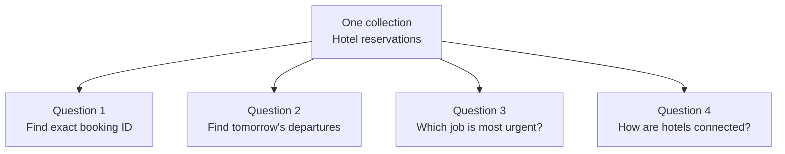
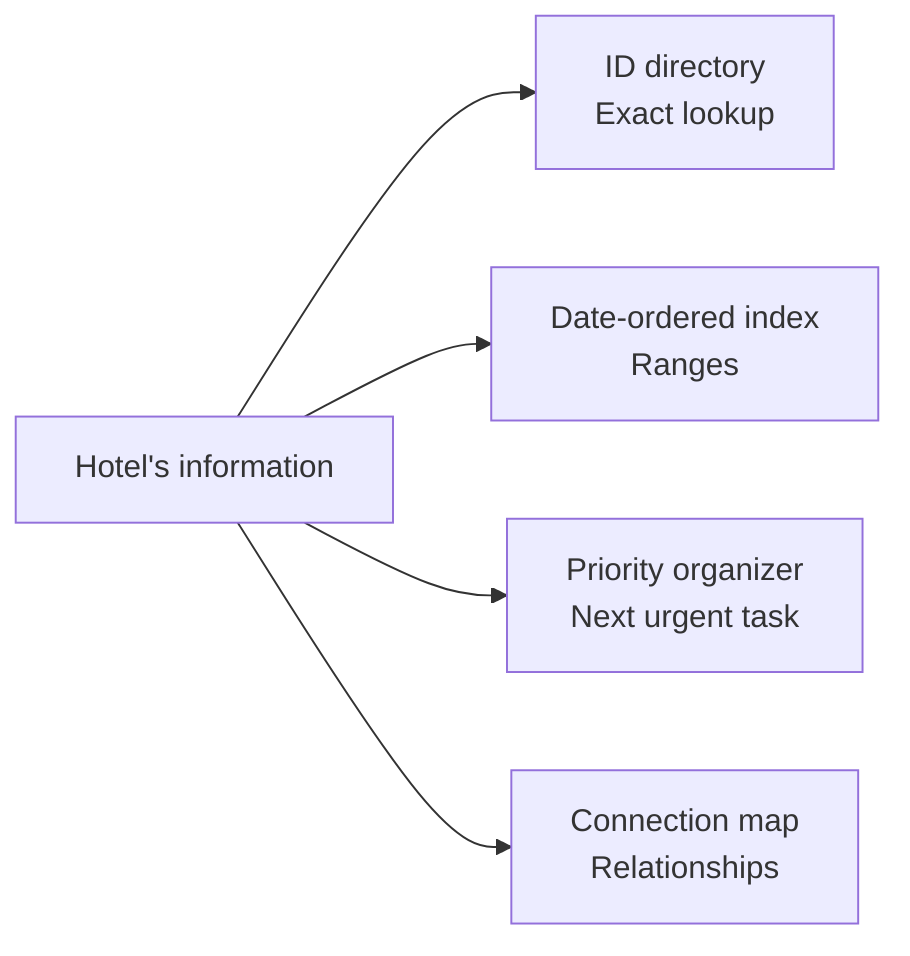

# CS110 — Foundations of Computation and Algorithms
## Lecture 04: Data Structures: Choosing How to Remember Things

*Arrays, hash tables, trees, heaps, graphs, and the engineering decisions that turn ordinary collections of information into efficient systems.*

**Estimated study time:** 70–90 minutes, including practical exercises.

---

### How to listen to this lecture

Written for continuous listening first, then for on-screen re-reading. Sticky-note callouts mark ideas worth pausing on. Near the end, answer the oral challenges **out loud** before reading solutions. The scheduler lab lives after the spoken lecture ends — keep it for a screen session.

Every structure is an investment: you pay memory and maintenance to make *some* future operations cheap. By the end, you should be able to say what arrays, linked lists, hash tables, trees, heaps, and graphs each remember well, how real systems combine them, what worst-case, expected, and amortized actually promise, and which questions to ask before choosing.

---

# Part I — Intuition

*The hotel's impossible filing cabinet: the same reservations, five questions, and no arrangement that makes everything equally easy.*

### Picture the front desk at 11:47 PM

A large hotel operates through a busy front desk. The clerk has hundreds of reservation cards. Each card contains a booking ID, a guest name, a room, a check-in date, and other details.

A customer arrives and says, “My reservation number is R-845192. Can you find it?”

The clerk looks at a giant pile of cards on the desk. One by one, she picks them up and checks their IDs.

Eventually she finds the right card.

A few minutes later, housekeeping calls: “Which rooms are checking out tomorrow?”

The clerk starts another full scan of the pile.

Then the night manager asks: “Which urgent task should we do first?”

A third scan. Another delay.

All the information exists. Nothing is lost. The difficulty is the **arrangement** of the information.

This is the question that data structures answer: **How should we organize information so the operations we need become cheap?**

### 1. The ordinary stack of cards

First imagine an ordinary numbered row of cards. The clerk can immediately pick the card in position thirty-two, provided she already knows she wants position thirty-two.

That's the intuition behind an **array**: items occupy indexed positions that can be accessed efficiently.

But a booking ID like R-845192 is not necessarily the position of its card in that row. To find the card by booking ID, the clerk might still need to search through the sequence.

This is an important distinction. A structure can be extremely good at one operation and mediocre at another.

The first diagram keeps our hotel's needs together. The question changes; the information remains the same.



### 2. Build a directory for the question you ask most

The clerk now adds a directory. She can look up reservation ID R-845192 and discover where its card is stored without reading every other card.

This is the purpose of an **index**: pay some cost to organize the information so future lookups are cheaper.

A **hash table** is one common mechanism for making exact-key lookups fast on average. Instead of scanning every item, it uses a calculation based on the key to find a suitable location in an internal table.

You don't need to understand collisions, resizing, or hashing algorithms yet. Just remember that the clerk traded extra organizational work and storage for much faster questions of the form “find this exact ID.”

But now housekeeping asks for every booking checking out between Tuesday and Friday.

An exact-ID directory isn't naturally arranged by departure date. We need another organization for a different question.

### 3. Sometimes order matters more than exact identity

Imagine keeping another directory sorted by checkout date.

Now the clerk can find the beginning of Tuesday's departures, then read forward through the relevant dates. She doesn't need to inspect cards scattered across the entire hotel archive.

An ordered structure can support range queries: everything between one boundary and another.

A balanced search tree is one family of structures that supports such operations efficiently. We don't need its internal mechanics yet. The mental picture is enough: **keep information in an order that lets you skip large irrelevant regions**.

The trade-off is that adding or modifying records may require updating the structure that maintains that order.

In fact, a real database may maintain multiple indexes over the same underlying records, because customers, housekeeping, and accounting ask different questions.

### 4. The next important thing is a different kind of question

Now the night manager asks the clerk for the next task to perform.

Some tasks are routine. Others are urgent. A payment issue must be handled before a low-priority housekeeping notification.

The clerk doesn't need every task sorted perfectly by every field. She needs quick access to **the most urgent task right now**, and the ability to add new tasks as they arrive.

A **priority queue**, often implemented with a heap, is built for precisely this kind of repeated next-item decision.

Think of it as a task organizer that keeps the highest-priority job accessible without sorting the entire workload from scratch after every update.

### 5. Relationships demand another view

Finally, management asks about hotel-to-hotel shuttle connections. Which hotels are reachable from one another? What route uses the fewest transfers?

A reservation directory doesn't naturally answer that. Now we care about relationships between places rather than simply storing independent cards.

A **graph** models things and the connections between them. Hotels can be represented as nodes, and transport links as edges. Following connections becomes a graph problem.

The second diagram shows how the hotel can maintain different arrangements depending on what the business keeps asking.



Notice that we're not declaring one structure the winner. The same hotel can benefit from several structures because different teams need different operations.

### 6. Every shortcut has a maintenance bill

The clerk's new system feels wonderful. Lookups are faster. Departure lists are easier to prepare. Urgent tasks are found quickly.

But now consider what happens when a reservation is cancelled.

The clerk must update the original card and any directories containing information about it. If one index isn't updated, that directory may give a misleading answer.

So an index doesn't merely consume storage. It creates maintenance work and a responsibility to keep multiple views consistent.

This is why choosing data structures isn't a contest in which the structure with the best lookup complexity always wins. Real workloads also involve writes, deletions, iteration, ranges, ordering, memory constraints, and consistency.

A simple row of cards might be all you need for twenty reservations. A specialized index earns its value when the operations justify its cost.

### Your mental checkpoint

**Question A:** Why doesn't a numbered array automatically make lookup by arbitrary reservation ID instantaneous? **The ID isn't necessarily the element's index; you may still have to search.**

**Question B:** Why might a hotel need both an ID index and a date-ordered index? **Exact lookups and date-range queries are different access patterns.**

**Question C:** What does a priority queue optimize? **Repeated access to the next highest-priority item, along with inserting work.**

**Question D:** Why aren't extra indexes always free improvements? **They use memory or storage, require updating, and must stay consistent.**

Take the front desk into Part II. As arrays, linked lists, hash tables, trees, heaps, and graphs appear, imagine that each is another way of organizing the hotel clerk's world to make a particular kind of question easier.

*The intuition pass ends here.*

---

# Part II — Deep Dive

# 1. The Hotel That Couldn't Find Its Guests

> **Case file #004** — *11:47 PM. Four teams. Same reservations. Four different pains.*

It's 11:47 PM.

You're responsible for the software behind a large international hotel chain.

Everything has been running smoothly. The company has hundreds of properties, millions of historical reservations, thousands of daily check-ins, and a modest army of background workers processing everything from payment confirmations to housekeeping assignments.

Then a strange problem appears.

Here is the pain by department, with what's fast and what's slow for each:

```text
  DEPARTMENT          WHAT'S FAST              WHAT'S SLOW
  ──────────          ───────────              ───────────
  Support             —                        lookup by reservation ID
  Housekeeping        find a reservation       "which rooms next?"
  Marketing           lookup by email          date-range reports
  Scheduling          —                        urgent jobs wait behind junk
```

The support department complains that looking up a reservation takes several seconds.

Meanwhile, the housekeeping system can find a reservation instantly but struggles to determine which rooms need cleaning next.

The marketing department can quickly retrieve customer information by email address, but its reports covering particular date ranges are painfully slow.

And the scheduling system occasionally processes low-priority housekeeping updates before urgent payment confirmations.

Four problems.

Same underlying business.

In some cases, even the same underlying records.

Yet the systems behave very differently.

Your first instinct might be to inspect database indexes, optimize queries, or investigate the backend.

Those are reasonable places to look.

But beneath them lies a more fundamental question:

> **Sticky note #1**
>
> How should information be organized so that the operations we care about are efficient?

This is the central question of data structures.

Let's imagine that we could freeze the entire hotel system and inspect its data.

We have one million reservations.

Each reservation contains:

- A unique reservation ID.
- A customer identifier.
- A hotel identifier.
- A room number.
- Check-in and check-out dates.
- A reservation status.
- A payment status.

Now consider five questions:

1. Find reservation `R-845192`.
2. Find all reservations for one customer.
3. Find reservations checking out tomorrow.
4. Identify the next background job.
5. Are two hotels connected by transport?

All five questions involve retrieving or organizing information.

But they demand different operations.

The first is an exact lookup.

The second is a lookup that may return multiple records.

The third involves filtering by a range or category.

The fourth requires maintaining an ordering by priority or execution time.

The fifth concerns relationships and connectivity.

There is no single magical data structure that makes every possible operation optimal.

And that's why the choice of data structure matters.

The same information can be arranged in ways that make one operation trivial and another painfully expensive.

Let's discover how.

> ✓ Room 1 complete — same data, five different access patterns

---

# 2. Arrays: The Surprisingly Powerful Boring Option

We'll begin with the most familiar data structure.

The array.

You have probably used arrays so many times that they barely register as a design decision.

Here is an array of three reservation objects, each with an id and a guest name:

```typescript
const reservations = [
  { id: "R-101", guest: "Anna" },
  { id: "R-102", guest: "Michael" },
  { id: "R-103", guest: "David" }
];
```

Simple.

Comfortable.

Almost suspiciously ordinary.

But arrays possess an extremely useful property.

In the classical array model, elements of equal size occupy consecutive positions in memory.

If an array begins at memory address `A`, each element occupies `s` bytes, and we want element `i`, its location can be calculated as:

`A + i × s`

Here is that address math as a picture: the array starts at A, and element i sits at A plus i times s, with no searching:

```text
  Address math (no searching)
  ───────────────────────────
  start A
  [0][1][2][3]…[i]…
           ▲
           └── address = A + i × s
```

This is why indexed access is so efficient.

The computer doesn't need to search through earlier elements.

It can calculate where the requested element belongs.

That's the foundation of **constant-time indexed access**.

JavaScript arrays are more flexible than classical fixed-size arrays, and engines can use different internal representations. But the underlying idea remains essential, particularly for typed arrays and low-level languages.

## The wonderful simplicity of contiguous memory

Imagine a row of numbered mailboxes.

Mailbox 0, mailbox 1, mailbox 2, and so on.

If someone asks for mailbox 427, you can go directly to it.

You don't need to open all the preceding mailboxes.

That's array indexing.

Now imagine that you want to read every mailbox.

Because the boxes are next to each other, you can walk along the row efficiently.

Computers benefit from a similar arrangement.

Modern CPUs retrieve data through a memory hierarchy involving caches and main memory.

Accessing consecutive elements often makes good use of cached data.

This is one reason arrays are remarkably effective, even in situations where another data structure looks more sophisticated on paper.

**Simple, predictable memory access can outperform theoretically clever structures with worse locality.**

We encountered this idea in CS110-L03.

But arrays have weaknesses too.

## The problem with inserting things

Suppose our reservations are stored in a sorted array.

We want to insert a new reservation in the middle.

If the array contains one million entries, inserting an element near the beginning may require moving almost one million existing entries to make room.

Here is a contiguous array holding a through f. We insert X after b, and every element after b shifts one slot to the right:

```text
  Insert in the middle of a contiguous array
  ──────────────────────────────────────────
  before:  [a][b][c][d][e][f]…
  insert X after b:
           [a][b][X][c][d][e][f]…
                     ▲── everyone after shifts right
```

The same problem appears when deleting elements.

A classical contiguous array needs to close the gap left behind.

So while indexed access is O(1), inserting or removing elements at arbitrary positions is generally O(n).

Appending to the end of a dynamic array is different.

Dynamic arrays typically allocate extra capacity so that most append operations don't require reallocating the entire collection.

When capacity runs out, the array may allocate a larger region and copy its contents.

That particular append can be expensive.

But because reallocations happen relatively infrequently, the cost averaged over a long sequence of appends is typically O(1) per append.

This is called **amortized complexity**.

We'll revisit it shortly.

## Arrays aren't obsolete

It's tempting to think that sophisticated applications should replace arrays with more advanced structures.

That's nonsense.

Arrays remain exceptionally useful for:

- **Sequential processing** — you walk contiguous memory.
- **Small collections** — simplicity wins.
- **Ordered lists addressed by position** — O(1) indexing.
- **Numerical and rendering work** — locality plus typed arrays.
- **Building other structures** — heaps live in arrays!

In fact, some of the more sophisticated structures we'll study are implemented using arrays internally.

The key is understanding the operations you're performing.

If your data is mostly read sequentially, arrays can be excellent.

If you're repeatedly searching an enormous unsorted collection by an arbitrary identifier, you may want something else.

Which brings us to our first alternative.

> ✓ Room 2 complete — boring arrays are secretly powerful

---

# 3. Linked Lists: The Structure That Sounds Better Than It Often Is

Imagine our row of mailboxes again.

But this time, the mailboxes aren't arranged next to each other.

They're scattered around a large warehouse.

Each mailbox contains a note telling you where to find the next one.

Mailbox A points to mailbox B.

Mailbox B points to mailbox C.

And so on.

You've just imagined a linked list.

Here are the two layouts side by side: an array is a contiguous row of slots, while a linked list is scattered nodes A, B, C, and D, each holding a note that points at the next:

```text
  Array mailboxes              Linked-list warehouse
  ───────────────              ─────────────────────
  [0][1][2][3][4]              (A)──►(B)──►(C)──►(D)
   contiguous row              scattered; follow the notes
```

A node holds a value and a `next` reference that points at another node, or at null:

```typescript
interface ListNode<T> {
  value: T;
  next: ListNode<T> | null;
}
```

A linked list doesn't require every element to occupy a consecutive memory location.

Each node holds its value and a reference to another node.

This changes the cost of certain operations.

## Insertion becomes easy

Suppose you already have a reference to node B.

And you want to insert node X immediately after it.

You create a new node whose `next` points at whatever B used to point to, then you point B's `next` at the new node:

```typescript
const newNode = {
  value: "X",
  next: nodeB.next
};

nodeB.next = newNode;
```

Here is the before and after: B pointed to C, and now B points to X, which points to C. Two pointer updates, and no shifting a million items:

```text
  Before:  B ──► C ──► D
  After:   B ──► X ──► C ──► D
                 ▲
                 └── two pointer updates; no shifting a million items
```

You don't need to shift thousands of other elements.

The insertion takes O(1) time.

Wonderful!

Have we just discovered a superior replacement for arrays?

Not exactly.

There's a rather important catch.

## Finding the insertion point

Suppose you're given an index and told:

"Insert a new element at position 500,000."

In an array, locating the position is straightforward, although shifting elements may be expensive.

In a basic singly linked list, there is no direct calculation that tells you where node 500,000 lives.

You generally have to follow references from the beginning.

One node at a time.

That's O(n).

The insertion itself might be constant-time.

But locating the correct position may still require linear work.

This is a classic example of why complexity claims need context.

> **Sticky note #2**
>
> An operation can be O(1) only when the necessary starting information is already available.

Saying "linked lists support constant-time insertion" without that qualification is misleading.

## Why linked lists can be slower than arrays

Linked lists also have practical costs.

Each node needs space for references.

Nodes may be scattered throughout memory.

Traversing the list involves following pointers.

This can produce cache misses and less predictable memory access.

Meanwhile, arrays offer excellent locality for many workloads.

So a linked list may have more favorable asymptotic complexity for certain insertions while still performing worse in realistic applications.

That's an important distinction.

Data structures don't exist in a world of pure mathematics.

They execute on physical machines.

## So why use linked lists?

They become useful when you frequently insert or remove elements and already possess references to the relevant nodes.

A **doubly linked list** makes each node point both forward and backward.

That permits efficient removal of a known node without searching for its predecessor.

One particularly interesting application is the implementation of certain caches.

We'll return to that later.

For now, remember:

**Arrays** excel at indexed and sequential access, and struggle with inserting or deleting in the middle, because everything shifts.

**Linked lists** excel at local structural changes when you already hold the node, and struggle with finding an arbitrary position.

Neither dominates the other universally.

> ✓ Room 3 complete — O(1) insert needs a known node first

---

# 4. Hash Tables: How to Find a Needle Without Searching the Haystack

Let's return to the hotel.

You have one million reservations.

Someone calls customer support and provides reservation ID `R-845192`.

Your application needs to locate it immediately.

If the reservations are stored in an unsorted array, the obvious approach is a linear search.

In the worst case, you inspect every reservation.

O(n).

What if we could use the reservation ID to determine approximately where the corresponding record should be stored?

That's the basic idea behind a **hash table**.

Hash tables are among the most useful data structures in everyday software engineering.

They power many implementations of dictionaries, maps, sets, caches, and lookup indexes.

And their central mechanism is surprisingly approachable.

## Step one: Turn a key into a number

Suppose we have a reservation identifier.

We pass it through a function called a *hash function*.

The function produces a numerical hash value.

For a toy demonstration, imagine we have a hash table containing eight buckets.

We use the final few bits of an integer hash to select one of those buckets.

Or, even more simply, imagine assigning a bucket using:

`bucket = hash % 8`

The `%` operator gives the remainder after division.

Suppose our hash values are 10, 18, 26, 31, and 43. Hash 10 lands in bucket 2. So do 18 and 26. Hash 31 lands in bucket 7, and hash 43 lands in bucket 3.

Here is the toy table with its eight buckets. Bucket 2 holds three entries — a collision party — bucket 3 holds 43, and bucket 7 holds 31:

```text
  Eight buckets (toy table)
  ─────────────────────────
  [0] [1] [2] [3] [4] [5] [6] [7]
           │   │               │
           │   └── 43          └── 31
           └── 10, 18, 26   ← collision party in bucket 2
```

Notice something curious.

The values 10, 18, and 26 all land in bucket 2.

This is called a **collision**.

Different keys have produced the same bucket location.

And collisions are unavoidable when a large number of possible keys must fit into a limited number of buckets.

So how does the table deal with them?

## Step two: Handle collisions

A hash table needs a collision-resolution strategy.

One approach is to store multiple entries in a bucket.

Another is to search for another available position according to a probing strategy.

Real hash tables use carefully designed implementations, but the conceptual point is simple.

The hash identifies where to look.

Then the table checks the actual key to determine whether it has found the correct entry.

The hash is not necessarily a unique identifier.

Two different keys can have the same hash or the same bucket.

The table must distinguish them correctly.

## Step three: Keep the table from becoming crowded

Imagine we keep inserting reservations.

Eventually, our eight buckets become crowded.

If a large number of keys accumulate in the same bucket, lookup performance deteriorates.

To avoid this, hash tables commonly resize as they grow.

For example, a table might allocate a larger bucket array and redistribute its entries.

This process can be expensive.

But it doesn't occur on every insertion.

That gives us the familiar notion of amortized cost.

Over many insertions, the expected cost per insertion can remain effectively constant under suitable assumptions.

## Why hash tables are so powerful

For well-designed hash tables under typical operating conditions, lookup by key, insert by key, and delete by key are each expected O(1).

That means the expected number of probing steps doesn't grow proportionally with the number of records, assuming the implementation controls collisions and load appropriately.

One million records?

Ten million?

The table can still locate an entry without scanning everything.

Of course, this isn't a magical guarantee.

Worst-case operations can degrade substantially, including toward O(n).

Hash computation has a cost, particularly for large keys.

Memory overhead matters.

Resizing can be expensive.

And hostile or poorly distributed inputs can create problems.

But in ordinary application workloads, hash tables are extraordinarily useful.

## JavaScript Maps and Sets

You already use these ideas in JavaScript.

Here is a Map from reservation ID strings to Reservation objects. We set two entries, then get the one for R-102:

```typescript
const reservations = new Map<string, Reservation>();

reservations.set("R-101", reservationA);
reservations.set("R-102", reservationB);

const result = reservations.get("R-102");
```

A `Map` associates keys with values.

A `Set` stores unique values.

The JavaScript specification does not require a particular internal hash-table implementation, but these collections provide efficient lookup behavior and are commonly implemented using hash-based techniques.

One subtle point is worth knowing.

JavaScript objects used as Map keys are compared by identity rather than by structural equality.

Here two objects, `a` and `b`, have exactly the same id field. We store a value under `a`, then look it up with `b`, and the answer is `undefined`:

```typescript
const a = { id: 42 };
const b = { id: 42 };

const map = new Map();

map.set(a, "Found!");

console.log(map.get(b));
// undefined
```

The two objects contain identical properties.

But they are different objects.

For a Map keyed by objects, that distinction matters.

If you want to retrieve a reservation by its numerical or string identifier, use that identifier as the key rather than creating a fresh object containing the same fields.

## The crucial limitation

Hash tables are excellent for exact key lookup.

But imagine you ask:

"Give me every reservation whose check-out date falls between November 1 and November 7."

A hash table indexed by reservation ID doesn't directly help.

You don't know which reservation IDs correspond to that date range.

Even a hash table keyed by check-out date doesn't automatically provide an efficient way to traverse a range of dates in sorted order.

You might need to inspect many keys.

Hash tables don't inherently organize keys according to their numerical or alphabetical order.

That's where another family of data structures becomes important.

> **Sticky note #3**
>
> Hash = great for exact keys. Not a range scanner.

> ✓ Room 4 complete — needles without haystacks (exact keys only)

---

# 5. Trees: How to Search Without Looking Everywhere

Imagine you're standing in a library containing one million books.

Every book has an identification number.

You want book 750,000.

If the books are scattered randomly, finding it may be difficult.

But suppose they're arranged in ascending order.

Now you can exploit that structure.

You start in the middle.

Is the desired number larger or smaller?

If larger, ignore the lower half.

Then divide the remaining range again.

And again.

This is binary search.

It's one of the most beautiful simple algorithms in computer science because its performance grows so slowly.

A sorted array containing one million elements requires only about twenty comparisons in the worst case to narrow the search to one location.

Approximately twenty decisions to navigate a million possibilities.

That's logarithmic behavior.

But there's a catch.

A sorted array is excellent for searching.

It's less convenient when we frequently insert and delete elements, because maintaining the sorted order may require shifting large portions of the array.

Can we preserve the ability to search efficiently while improving insertion and deletion?

This leads us to **search trees**.

## Binary search trees

A binary search tree organizes values into nodes.

Each node has up to two children.

For a typical binary search tree:

- Values smaller than the current node's key belong in its left subtree.
- Values larger belong in its right subtree.

Imagine this arrangement. Here is a small search tree: 50 at the root, 25 and 75 below it, and leaves 10, 40, 60, and 90. Searching for 60 goes right at 50, then left at 75, skipping the whole left half early:

```text
              50
             /  \
           25    75
          / \    / \
        10  40  60  90

  Find 60:  50 → (right) 75 → (left) 60   ✓
            skipped entire left half early
```

We want to find 60.

Start at 50.

60 is larger, so move right.

Now we're at 75.

60 is smaller, so move left.

Found it.

We didn't inspect every node.

We used ordering information to eliminate entire branches.

That's the key idea.

> **Sticky note #4**
>
> A search tree organizes data so that each comparison can exclude a portion of the remaining search space.

## The danger of an unbalanced tree

Now imagine inserting values in ascending order into an ordinary binary search tree without balancing.

The tree may become a stick: 10, then 20 as its right child, then 30, 40, and 50, each hanging off to the right:

```text
  10
    \
     20
       \
        30
          \
           40
             \
              50

  That's a stick, not a tree. Search for 50 = walk everything.
```

That's barely a tree anymore.

It's effectively a linked list.

Searching for 50 requires following every node.

The structure has lost its logarithmic advantage.

A basic binary search tree can therefore degrade to O(n) search in the worst case.

Balanced search trees address this by maintaining structural properties that prevent them from becoming excessively lopsided.

Examples include AVL trees and red-black trees.

Their balancing mechanisms differ, but the general benefit is similar.

They can maintain O(log n) search, insertion, and deletion.

We don't need to implement tree rotations today.

What's worth understanding is that the logarithmic guarantee depends on maintaining the tree's structure.

## Why databases use trees

Let's return to PostgreSQL.

Imagine a table containing ten million reservations.

You ask for a single reservation by its ID:

```sql
SELECT *
FROM reservations
WHERE reservation_id = 'R-845192';
```

Without an appropriate index, the database may need to scan a large portion of the table.

With a suitable B-tree index, the database can navigate an ordered structure to locate the matching key efficiently.

PostgreSQL's default general-purpose index type is B-tree.

It's designed for operations such as equality comparisons and ordered ranges.

But database B-trees aren't identical to the simple binary search tree we just drew.

Why not?

Because database storage has different physical characteristics.

## The disk-access problem

Imagine a tree containing one million nodes.

If each node requires a separate expensive storage access, traversing twenty levels could involve substantial I/O.

Database indexes therefore benefit from structures with many keys and branches per node.

B-trees use relatively large pages containing multiple entries.

Instead of making a binary decision at every node, a page can guide the search among many possible branches.

That produces a shallow tree.

Here is the contrast: a binary tree is tall and skinny, with two children per node and many hops, while a B-tree page holds many keys and fans out to many child pages, so it needs far fewer expensive hops:

```text
  Binary tree (skinny, tall)     B-tree page (fat, shallow)
  ──────────────────────────     ──────────────────────────
         ●                              ┌──────────────┐
        / \                             │ k1 k2 k3 k4… │
       ●   ●                            └──┬───┬───┬───┘
      / \ / \                              ▼   ▼   ▼
     …               fewer hops            pages of kids
                     more I/O per hop      more work per hop
                                           fewer expensive hops
```

A B-tree with a high branching factor can index enormous datasets while requiring relatively few page accesses to descend through the structure.

And because entries are organized in key order, B-tree indexes can also support range scans efficiently.

For example, ask for reservations whose check-out date falls in the first week of November:

```sql
SELECT *
FROM reservations
WHERE checkout_date >= '2026-11-01'
  AND checkout_date < '2026-11-08';
```

A suitable index can help the database locate the beginning of the relevant range and traverse matching entries.

Whether the optimizer actually uses that index depends on factors such as table size, selectivity, costs, and available statistics.

Indexes are not automatic performance guarantees.

But their structural advantage is fundamental.

They allow the database to locate relevant records without blindly scanning everything.

## Why not index every column?

Because indexes have costs.

They occupy storage.

They require maintenance when data changes.

They can make inserts, updates, and deletes more expensive.

And an index that almost never assists important queries may simply waste resources.

This is why database indexing is a workload-design problem.

You need to know which operations the application actually performs.

A hotel system may benefit from indexes on reservation IDs, customer IDs, check-out dates, or combinations of fields.

But the optimal set depends on the queries.

The same principle applies across computer science:

> **Sticky note #5**
>
> A data structure is an investment in making particular future operations cheaper.

> ✓ Room 5 complete — trees cut the search space; B-trees cut disk hops

---

# 6. Heaps: When You Only Care About What Comes Next

Now let's investigate another hotel-system problem.

Your application has a background job scheduler.

It handles:

- Payment retries.
- Reservation confirmations.
- Housekeeping notifications.
- Customer emails.
- Expired reservation cleanup.
- Scheduled reports.

Some jobs should execute sooner than others.

Each job has a next-execution time.

You want to answer one question extremely efficiently:

**Which job should execute next?**

One approach is to maintain an unsorted array.

Whenever a worker needs the next job, scan the entire array and find the earliest execution time.

That works.

But finding the minimum among `n` elements requires O(n) work.

Another approach is to keep the array completely sorted.

Then the earliest job is immediately available.

But inserting a new job in the correct position may require shifting many elements.

A third approach is a **heap**.

## What is a heap?

A binary min-heap is a tree-shaped structure with a simple ordering rule:

Every parent has a value no greater than its children.

For example, here is a small min-heap: 2 at the root, 5 and 4 below it, then 9, 8, 7, and 6. It isn't fully sorted, but the root is always the minimum — the next job:

```text
              2  ← always the minimum (next job)
             / \
            5   4
           / \ / \
          9  8 7  6

  Not fully sorted — but the root is always the answer to "what's next?"
```

Notice that the entire structure isn't globally sorted.

The left subtree isn't necessarily smaller than the right subtree.

But one thing is guaranteed:

**The smallest value is at the root.**

That's exactly what a priority queue needs.

If the values represent job execution times, the root identifies the job scheduled to run first.

## How does insertion work?

Suppose we insert a new job with priority 1.

A binary heap maintains a complete tree shape, so the new element initially occupies the next available position.

Then it moves upward, swapping with parents as necessary, until the heap property is restored.

This is often called *sifting up*.

Removing the minimum performs the reverse kind of operation.

The root is removed, another element takes its place, and the structure is repaired by moving that element downward.

This is called *sifting down*.

Because a complete binary tree has logarithmic height:

Peeking at the minimum is O(1). Inserting is O(log n). Removing the minimum is O(log n).

That's a useful combination.

The next job is immediately accessible, and maintaining the structure is relatively inexpensive.

## A heap doesn't need pointer-based nodes

Here's a fun detail.

Binary heaps are commonly stored in arrays.

For a zero-indexed array:

- The left child of index `i` is at `2i + 1`.
- The right child is at `2i + 2`.
- The parent is at `floor((i - 1) / 2)`.

Here is that same heap laid out as an array at indices zero through six: 2, 5, 4, 9, 8, 7, and 6, with the root at index zero:

```text
  Heap as an array
  ────────────────
  index:  0  1  2  3  4  5  6
  value:  2  5  4  9  8  7  6
          ▲
          root

  parent(i) = floor((i-1)/2)   children at 2i+1, 2i+2
```

That means we can represent the tree without allocating an object for every node.

The complete-tree shape gives us enough information to calculate the relationships between elements.

A tree implemented using an array.

This is a lovely example of how different data-structure concepts can combine.

## Priority queues aren't ordinary queues

An ordinary FIFO queue returns elements in the order they were inserted.

A priority queue returns elements according to their priority.

These represent different policies.

A FIFO queue is appropriate when every job should be handled in arrival order.

A priority queue is appropriate when the next item is determined by urgency, deadline, cost, or another ranking.

A heap is one common implementation of a priority queue.

However, a binary heap isn't especially efficient for arbitrary searches.

If you ask:

"Find the job with ID X somewhere inside the heap."

The heap ordering alone doesn't tell you where that job lives.

You may need an additional lookup structure.

Which leads us to another important idea:

Real systems often combine several data structures to support different operations efficiently.

> ✓ Room 6 complete — heaps answer "what's next?" in O(1) peek

---

# 7. Graphs: When Relationships Matter More Than Objects

Let's leave the hotel backend and take a walk through a city.

Imagine you're designing the transportation system of a city simulation.

There are thousands of intersections and roads.

You want to determine whether a vehicle can travel from one district to another.

How should the road network be represented?

An array of intersection coordinates isn't enough.

You also need to know which intersections are connected.

This is a **graph**.

A graph consists of vertices, also called nodes, and edges representing relationships between them.

For our city:

- Vertices represent intersections.
- Edges represent roads connecting intersections.

A simplified graph might look like this: intersections A, B, and C along the top, D and E below, F under C, and G under E.

```text
    A —— B —— C
    |         |
    D —— E   F
         |
         G
```

If roads are bidirectional, the edges can be treated as undirected.

If certain streets are one-way, we need directed edges.

If we care about travel distance or travel time, edges can carry weights.

These are all modeling decisions.

The graph structure determines what questions can be answered.

## The adjacency list

One common way to represent a graph is through adjacency lists.

For each node, store its neighbors. Here is the road network as a Map from each intersection to the list of intersections it connects to:

```typescript
const roads = new Map<string, string[]>([
  ["A", ["B", "D"]],
  ["B", ["A", "C"]],
  ["C", ["B", "F"]],
  ["D", ["A", "E"]],
  ["E", ["D", "G"]],
  ["F", ["C"]],
  ["G", ["E"]]
]);
```

Now the system can efficiently ask:

"Which intersections can I reach directly from intersection A?"

The answer is already stored.

B and D.

This is an important optimization.

Instead of scanning every road in the city to discover which roads connect to A, we've organized the network around that operation.

## Breadth-first search

Suppose we want to know whether a path exists from A to G.

One simple graph algorithm is **breadth-first search**, or BFS.

It explores the graph in expanding layers.

Start at A.

First examine all nodes one edge away.

Then all previously undiscovered nodes two edges away.

Then three.

And so on.

Here are the layers from A: hop zero is A; hop one is B and D; hop two is C and E; hop three is F and G, so we find G in three hops:

```text
  BFS layers from A
  ─────────────────
  hop 0:  A
  hop 1:  B, D
  hop 2:  C, E
  hop 3:  F, G   ← found G in 3 hops
```

This is naturally implemented using a queue.

Here's a simple version: a function that takes a graph, a start, and a target. It keeps a queue with a head index, a Set of visited nodes, and a `previous` Map so it can rebuild the path, and it returns the path or null:

```typescript
function shortestPathByHops(
  graph: Map<string, string[]>,
  start: string,
  target: string
): string[] | null {
  const queue = [start];
  let head = 0;

  const visited = new Set([start]);
  const previous = new Map<string, string>();

  while (head < queue.length) {
    const current = queue[head++];

    if (current === target) {
      const path = [target];

      while (path[0] !== start) {
        path.unshift(previous.get(path[0])!);
      }

      return path;
    }

    for (const neighbor of graph.get(current) ?? []) {
      if (!visited.has(neighbor)) {
        visited.add(neighbor);
        previous.set(neighbor, current);
        queue.push(neighbor);
      }
    }
  }

  return null;
}
```

There are several interesting structures working together here.

- The **Map of adjacency lists** is the graph itself.
- The **queue** decides exploration order.
- The **Set** answers: have we already discovered this node?
- The **`previous` Map** lets us reconstruct the path.

Notice how data structures aren't isolated academic curiosities.

They cooperate to implement algorithms.

And choosing the right combination simplifies the problem.

## Why the queue matters

BFS explores nodes in order of increasing distance measured by the number of edges.

That's why it can find a shortest path in an unweighted graph.

We use a FIFO queue so that nodes discovered earlier are processed before nodes discovered later.

If we replaced the queue with a stack, the exploration order would change.

We would get a depth-first style of traversal instead.

Depth-first search is useful for many tasks, but it doesn't generally guarantee the shortest path by number of edges.

The data structure helps determine the behavior of the algorithm.

## Why we don't use Array.shift()

You may have noticed that we wrote `const current = queue[head++];`.

Why not simply write `const current = queue.shift();`?

Because removing the first element from a JavaScript array can require shifting the remaining elements.

Repeatedly doing that can introduce unnecessary work.

Using a head index gives us constant-time access to the next queued item while allowing us to append new items efficiently.

The trade-off is that processed elements remain in the array until the structure is discarded or compacted.

For a bounded traversal like this, that's often acceptable.

It's a small but meaningful example of choosing an implementation according to expected operations.

## Weighted graphs change the problem

Our BFS algorithm finds paths with the fewest edges.

But suppose different roads have different travel times.

One road takes two minutes.

Another takes twenty.

A route containing fewer roads isn't necessarily the fastest.

Now the problem becomes a shortest-path problem in a weighted graph.

Algorithms such as Dijkstra's algorithm can solve this for graphs with nonnegative edge weights.

And implementations of Dijkstra's algorithm often use a priority queue—commonly implemented with a heap—to efficiently select the next node with the lowest tentative distance.

There it is again.

Graphs, maps, sets, and heaps working together.

This is the machinery behind a remarkable range of applications.

Road routing.

Dependency resolution.

Network topology.

Social relationships.

Recommendation systems.

Build systems.

Workflow orchestration.

And even aspects of AI agent execution.

Once you begin recognizing graphs, you start seeing them everywhere.

> ✓ Room 7 complete — relationships are data structures too

---

# 8. The Cache That Needed Two Data Structures

Let's examine a particularly elegant engineering example.

You operate an API that repeatedly retrieves expensive customer profiles.

To reduce database load, you introduce an in-memory cache.

The cache has room for 10,000 customer profiles.

When a profile is requested:

- If it's cached, return it immediately.
- Otherwise, retrieve it and add it to the cache.

Eventually, the cache becomes full.

Now you need to remove something before inserting a new entry.

Which entry should you evict?

One common policy is **Least Recently Used**, or LRU.

Under this policy, the entry that hasn't been accessed for the longest time is removed first.

Simple enough.

But implementing it efficiently requires supporting two operations.

First:

"Find the cached profile for customer X."

Second:

"Move customer X to the most-recently-used position, or remove the least-recently-used entry."

A hash map is excellent for the first operation.

It gives us efficient lookup by customer ID.

But an ordinary unordered hash table doesn't inherently maintain usage recency.

A doubly linked list is excellent for moving known nodes around.

Given a reference to a node, we can remove it from the list and reinsert it elsewhere in constant time.

But a linked list is terrible at locating an arbitrary customer by ID.

So what do we do?

**Combine them.**

## The classic LRU structure

Maintain:

1. A hash map from customer ID to cache node.
2. A doubly linked list representing usage order.

Here is the structure: the map goes from ID to node reference for fast find, and the list runs from least recently used on the left to most recently used on the right. We evict at the least-recently-used end, and touching an entry moves it to the most-recently-used end:

```text
  LRU = Map + doubly linked list
  ──────────────────────────────
  Map:  id ──► node reference     (fast find)

  List (recency order):
  LRU ◄──► … ◄──► … ◄──► MRU
   ▲                        ▲
   └── evict here           └── touch moves here
```

The map gives us fast lookup.

The list gives us fast reordering.

When a customer is accessed:

- Use the map to locate the corresponding node.
- Remove that node from its current position.
- Move it to the most-recently-used end.

When the cache is full:

- Remove the node at the least-recently-used end.
- Delete its ID from the map.

Each operation can be performed in expected O(1) time under the usual hash-table assumptions.

That's a beautiful design.

Two structures compensate for each other's weaknesses.

## A JavaScript shortcut

JavaScript's `Map` maintains insertion order.

That lets us create a compact illustrative LRU cache without explicitly building a linked list.

Here is a class with a capacity. The `get` method moves a key to the newest position, and `set` inserts, then evicts the oldest key if we're over capacity:

```typescript
class LRUCache<K, V> {
  private cache = new Map<K, V>();

  constructor(private capacity: number) {
    if (!Number.isInteger(capacity) || capacity < 1) {
      throw new Error("Capacity must be positive");
    }
  }

  get(key: K): V | undefined {
    if (!this.cache.has(key)) {
      return undefined;
    }

    const value = this.cache.get(key)!;

    this.cache.delete(key);
    this.cache.set(key, value);

    return value;
  }

  set(key: K, value: V): void {
    this.cache.delete(key);
    this.cache.set(key, value);

    if (this.cache.size > this.capacity) {
      const oldestKey =
        this.cache.keys().next().value as K;

      this.cache.delete(oldestKey);
    }
  }
}
```

By deleting and reinserting an accessed key, we move it to the end of the Map's insertion order.

When capacity is exceeded, we remove the oldest key.

For a learning example, this is convenient.

In a production implementation, you'd need to consider concurrency models, memory use, expiration, error handling, and whether a missing value must be distinguished from a cached `undefined`.

But the conceptual design is sound.

And it demonstrates something useful:

> **Sticky note #6**
>
> Sometimes the best data structure isn't one structure. It's a carefully chosen combination.

> ✓ Room 8 complete — LRU = map for lookup + list for recency

---

# 9. One Dataset, Several Indexes

Let's return to our hotel chain one last time.

We have a million reservations.

We need to support several kinds of access.

The obvious mistake would be trying to force every operation through one representation.

Instead, imagine maintaining several complementary structures.

A primary store holds the authoritative reservation records.

A lookup index supports retrieval by reservation ID.

Another index supports finding reservations by customer ID.

An ordered index supports date-range queries.

A priority queue supports scheduled background work.

A graph represents relationships between hotels, transport links, or dependencies.

Conceptually, the reservation data sits at the top, with an ID lookup Map, a customer index, and a date B-tree beneath it, plus a priority queue for scheduled work:

```text
                 RESERVATION DATA
                        |
          +-------------+-------------+
          |             |             |
       ID lookup    Customer lookup  Date index
          |             |             |
        Map           Index        B-tree
                        |
                 Scheduled work
                        |
                  Priority queue
```

The important point is that these structures don't necessarily contain independent copies of every piece of information.

They can reference the same underlying records or maintain derived representations.

A database index, for example, organizes keys and references to rows or storage locations rather than independently becoming the authoritative business dataset.

This architecture gives us different optimized paths into the same logical information.

But it introduces a new problem.

## Keeping indexes consistent

Suppose reservation `R-101` moves from November 4 to November 7.

We update the main reservation record.

But what about the date index?

If we forget to update it, the index becomes stale.

Queries by reservation ID may return the new date.

Queries by date range may still behave according to the old date.

Now the system disagrees with itself.

The authoritative record says check-out is November 7, but the stale date index still says November 4 — two truths:

```text
  Authoritative record:  checkout = Nov 7
  Stale date index:      still says Nov 4
          │
          └── two truths. Bad hotel.
```

This is why maintaining derived structures is not free.

They need consistency rules.

Sometimes the structures are maintained transactionally by a database.

Sometimes they are updated asynchronously.

Sometimes stale information is acceptable for a short period.

Sometimes it's absolutely unacceptable.

Imagine a search index that updates a few seconds after a customer edits their profile.

That might be fine.

Now imagine a payment system that relies on a stale balance.

That's a different matter entirely.

The more ways we organize and duplicate information, the more carefully we must consider consistency.

This leads to an architectural principle we'll revisit repeatedly:

> **Sticky note #7**
>
> Optimize read and write operations deliberately, but understand the cost of keeping multiple representations consistent.

It's one reason database design, caching, event-driven architecture, and distributed systems are so closely connected.

They're all partly concerned with deciding where information lives, how it is organized, and how changes propagate.

> ✓ Room 9 complete — many indexes, one consistency problem

---

# 10. The Three Kinds of Complexity You Should Actually Remember

By now we've encountered several complexity claims.

Arrays give constant-time indexed access.

Hash tables provide expected constant-time lookup.

Balanced search trees provide logarithmic operations.

Heaps support logarithmic insertion and removal.

Graph traversal can be linear in the size of the graph.

But these statements contain different kinds of guarantees.

Let's clarify them.

## Worst-case complexity

Worst-case complexity describes an upper bound on the amount of work an operation may require over inputs of a given size.

For example, searching an unsorted array may require examining every element.

Worst case: O(n).

It doesn't matter whether most searches finish earlier.

The worst case still involves a full scan.

Worst-case analysis is especially important when extreme behavior could be dangerous or unacceptable.

## Average-case and expected complexity

Hash tables typically provide expected O(1) lookup under suitable hashing and implementation assumptions.

That doesn't mean every lookup always performs the same tiny amount of work.

Collisions, resizing, and other details affect individual operations.

Expected complexity describes average behavior under a specified probability model or randomized design.

It's important not to casually replace "expected" with "guaranteed."

They are not equivalent.

## Amortized complexity

Dynamic arrays provide a beautiful example.

Most appends are cheap.

Occasionally, the underlying storage must grow.

When that happens, copying the existing elements may be expensive.

But if capacity grows geometrically, those expensive reallocations occur infrequently enough that the average cost over a long sequence of appends remains constant.

Hence amortized O(1) append.

Three flavors of O(1), and they are not the same. Worst-case is a bound that is never exceeded. Expected is the average under a probability model. Amortized is cheap on average across a sequence, though one operation can still be expensive:

```text
  Three flavors of "O(1)" (not the same!)
  ───────────────────────────────────────
  Worst-case     never worse than this bound
  Expected       average under a probability model
  Amortized      cheap on average across a sequence
                 (one op can still be expensive)
```

The distinction is subtle:

Amortized complexity doesn't require random inputs.

It analyzes the total cost across a sequence of operations.

A particular operation can be expensive while the long-run cost per operation remains low.

For interviews, understanding this conceptual difference is generally more valuable than memorizing formal proofs.

> ✓ Room 10 complete — worst / expected / amortized are different promises

---

# 11. The Data Structure Selection Guide

Let's consolidate the main structures before moving to the oral examination.

These are typical complexity characteristics, assuming standard implementations. Specific libraries, runtimes, workloads, and key types can alter practical performance.

First, each structure's main strength, then its main weakness:

- **Array** — fast indexing, sequential access, and locality; weak at middle insertions and deletions.
- **Linked list** — fast local insertion and removal with a known node; weak at arbitrary lookup, and pays pointer overhead.
- **Hash map or set** — fast expected exact-key lookup; no inherent sorted-key navigation.
- **Balanced search tree** — ordered search and range operations; more structural and memory overhead.
- **Binary heap** — efficient access to the min or max priority; arbitrary lookup is not its strength.
- **FIFO queue** — preserves arrival order; no priority ordering.
- **Stack** — last-in, first-out processing; only the top element is directly accessible.
- **Graph adjacency list** — represents and traverses relationships; performance depends on graph structure and algorithm.

Now the common operations, one structure at a time:

- **Dynamic array** — access by index is O(1), search is O(n). Append is amortized O(1); inserting or removing in the middle is O(n).
- **Linked list** — search is O(n). Insert is O(1) when you already hold the position node, and remove is O(1) with suitable node references.
- **Hash map** — lookup, insert, and remove are each expected O(1).
- **Balanced search tree** — lookup, insert, and remove are each O(log n).
- **Binary heap** — peeking at the root is O(1); insert is O(log n); removing the root is O(log n).

Don't memorize this blindly.

Instead, try to understand *why* the costs arise:

- An **array** can *calculate* an index.
- A **linked list** must *follow* references.
- A **hash table** *transforms* a key into a location.
- A **search tree** *eliminates branches* via ordering.
- A **heap** keeps *just enough* order for min or max.
- A **graph** stores *relationships*, not a linear sequence.

Once you understand those mechanisms, the complexity costs become far easier to remember.

> ✓ Room 11 complete — selection guide locked in (understand, don't chant)

---

# 12. The Oral Examination

Pause the lecture for each one.

Answer **out loud** — as if an interviewer were across the table — before you listen to or read the solutions.

They're designed to reinforce practical judgment rather than obscure algorithm trivia.

### Challenge A — The Wrong Customer Index

**Estimated time: 8 minutes**

You have a PostgreSQL table containing ten million customer records.

The application frequently performs three queries:

1. Find a customer by ID.
2. Find every customer registered during the past seven days.
3. Find customers whose email address matches a particular value.

An engineer suggests creating a hash-based lookup structure for every column.

Would you agree?

What data structures or index strategies would you consider for each query?

What costs would additional indexes introduce?

What information would you gather before creating them?

### Challenge B — Designing a Notification Queue

**Estimated time: 8 minutes**

Your SaaS sends notifications.

Some notifications are urgent.

Others are scheduled for later.

Users may cancel pending notifications.

Workers must process eligible notifications efficiently.

Describe the data structures you might use.

Would a single FIFO queue be sufficient?

Would a priority queue solve every requirement?

What about finding a notification by ID?

How would you avoid keeping inconsistent representations?

### Challenge C — The Giant Social Graph

**Estimated time: 10 minutes**

You're designing a feature that answers:

"Are customer A and customer B connected through a chain of referrals?"

Customers are nodes.

Referral relationships are edges.

There are ten million customers, but most have only a few direct referrals.

Would you use an adjacency matrix or adjacency lists?

Why?

How would you determine whether a path exists between two customers?

How does the structure of the network affect the amount of work required?

### Challenge D — The Cache That Lies

**Estimated time: 8 minutes**

Your application caches customer account information.

The database is authoritative.

The cache uses customer IDs as keys.

One customer changes their subscription plan.

The database updates successfully.

But the cache still contains the old plan.

Is the problem caused by choosing the wrong data structure?

Or is it a different kind of problem?

What mechanisms might you introduce to keep the cached information acceptably fresh?

Would your answer change if the cached field controlled access to a paid feature?

---

# 13. Solutions and Discussion

*Listen or read only after you have answered each challenge out loud.*

### Solution A — Customer indexes

A hash-based lookup is not automatically the best solution for every query.

Customer ID lookups commonly benefit from a primary-key index.

Date-range queries benefit from an ordered index, such as a B-tree index on registration time, when the query is selective enough.

Exact email lookup may also benefit from a suitable B-tree index with the correct uniqueness and comparison semantics.

PostgreSQL's ordinary B-tree indexes can handle equality lookups as well as ordered operations, so creating a specialized hash index for every field would be unnecessary and potentially wasteful.

Every additional index consumes storage and adds maintenance work when affected records change.

Before indexing, investigate actual query frequency, execution plans, selectivity, table size, and workload patterns.

The key is selecting indexes according to the operations the application performs.

### Solution B — Notification queue

A priority queue ordered by scheduled execution time could help identify the next eligible notification.

If urgent notifications need to preempt less important work, the priority model must incorporate that requirement.

A hash map or database index keyed by notification ID can support cancellation and lookup.

But using several structures introduces consistency requirements.

For example, cancelling a notification must prevent it from being processed even if the corresponding item remains temporarily present in a priority queue.

A common strategy is to preserve authoritative job state separately and validate it when work is dequeued.

Real systems may use durable storage, delayed queues, database indexes, or specialized message brokers depending on reliability and scaling requirements.

The crucial insight is that scheduling order, identity lookup, cancellation, and durability are different concerns.

### Solution C — Social graph

An adjacency list is generally attractive for a sparse graph.

With ten million customers and relatively few edges per customer, an adjacency matrix would allocate space for roughly one hundred trillion possible customer pairs.

That is an enormous amount of mostly empty information.

Adjacency lists store the relationships that actually exist.

Breadth-first search or depth-first search can determine reachability.

For an adjacency-list representation, a full BFS or DFS traversal has O(V + E) time complexity, where V is the number of vertices and E is the number of edges.

Practical performance depends on the reachable portion of the graph, branching patterns, and whether the search terminates early.

An important lesson follows: **the shape and density of relationships influence which representation is appropriate.**

### Solution D — Cache consistency

The immediate problem is not necessarily the cache's underlying data structure.

It's the consistency relationship between the cache and the authoritative database.

Possible approaches include:

- Invalidating the cached record after an update.
- Updating the cache as part of the application's write workflow.
- Using expiration times.
- Using version numbers to detect stale entries.
- Revalidating against authoritative state when necessary.

For access-control or billing-sensitive information, stale cache contents may introduce correctness or security risks.

The acceptable consistency model depends on the consequences of stale data.

A cached marketing description can often tolerate more staleness than a cached authorization decision.

This example demonstrates how data-structure design eventually intersects with distributed systems and application architecture.

---

# 14. The Mental Model Worth Keeping

A senior interview may not ask you to implement a red-black tree. It may ask how you'd design a service that retrieves by ID, supports range queries, and processes scheduled work — architecture on the surface, today's access patterns underneath.

Back to the hotel platform: a million reservations, lookup by ID, by customer, by date range, next scheduled job, connectivity between locations. Different questions, different access patterns — exact key, ordered range, priority, relationships. No single representation optimizes all of them.

Remember these durable distinctions:

**Operations come first** — ask which operations matter most before you name a structure.

**Array is index plus locality; list is local surgery** — O(1) insertion needs a known node first.

**Hash is exact key; tree is order and ranges** — a hash table is not a range scanner, and B-trees cut disk hops.

**Heap answers "what's next?"; graph answers "how are things related?"** — priority and relationships are different problems.

**Real systems combine structures** — LRU is a map plus a list, and one dataset can sit behind several indexes.

**Extra indexes and caches are consistency work** — every derived representation can go stale.

**Worst-case, expected, and amortized are different promises** — never casually swap "expected" for "guaranteed."

> **The master sticky note**
>
> Before choosing a data structure, identify the operations the system must perform most often—and the guarantees those operations require.

Not "Map or array?" First: What questions? How often? How large? How often does data change? Does order matter? Exact results? Memory budget? How do multiple representations stay consistent?

Structures aren't mere containers. They're arrangements that make certain computation cheap: arrays for indexed access, hash tables for exact lookup, balanced trees for ordered search, heaps for priority, graphs for relationships — each with costs and assumptions. Choosing well is engineering judgment.

> ✓ All rooms visited. Guests found.

---

# 15. Next Lecture — Searching, Sorting, and Finding Shortcuts

We've learned that the way you store information decides which questions are cheap to ask.

But once the data is organized, how do you actually find things in it? When is a sorted collection worth the cost of sorting? And what shortcuts let an algorithm skip most of the work?

In **CS110-L05**, we'll study searching, sorting, and finding shortcuts — how ordering and structure turn a hopeless scan into a few quick decisions.

---

## Optional Practical Lab — A Tiny Scheduling System

*The spoken lecture ends here. The remaining material is a screen-first reasoning worksheet.*

Let's build a small mental model of a job scheduler.

You have six jobs:

| Job | Scheduled execution |
|---|---|
| A | 10:30 |
| B | 09:15 |
| C | 11:00 |
| D | 09:45 |
| E | 08:50 |
| F | 10:00 |

The application needs to repeatedly retrieve the next job to execute.

> **Gym rules:** reason on paper first. The point is the *cost movement*, not coding a heap tonight.

### Experiment A — An unsorted array

Store all jobs in an array.

Whenever the scheduler needs the next job, scan the array and find the smallest scheduled time.

How much work does one retrieval require in the worst case?

What happens if the queue contains a million jobs?

### Experiment B — A sorted array

Now keep the array sorted by scheduled execution time.

Finding the next job is easy.

But what happens if 10,000 new jobs arrive, each with an arbitrary execution time?

Where does the insertion cost move?

### Experiment C — A min-heap

Now imagine maintaining the jobs in a binary min-heap.

The earliest execution time sits at the root.

Inserting a new job may require moving it upward.

Removing the earliest job may require restoring the heap property.

What are the complexity costs?

Why might this be an attractive structure for a scheduler?

### Experiment D — Cancellation

A customer cancels job `D`.

The scheduler is told:

"Remove job D immediately."

But the heap is organized by execution time, not by job ID.

How efficiently can the scheduler locate that particular job?

What additional structure could you maintain to make cancellation efficient?

And what new consistency problem would that introduce?

This final question is the most interesting one.

It illustrates why real systems often require combinations of data structures rather than isolated textbook examples.

> ✓ Lab complete — scheduler thought experiments done

---

## Dense Cheatsheet — Interview Glance Card

*Fenced so voice readers skip it. Skim on screen when revising; open sections above only when a row fails to spark.*

```text
CS110-L04  DATA STRUCTURES — INTERVIEW GLANCE CARD

CORE MODEL
  Central Q         Organize info so the OPERATIONS we care about are efficient
  Hotel hook        Same reservations; different pains = different access patterns
  Exact key / multi / range / priority-next / connectivity — no one structure wins all
  Master sticky     Identify frequent ops + required guarantees BEFORE naming a structure
  Investment sticky Structure spends memory/maintenance to make particular futures cheaper

ARRAYS
  Address math      A + i×s → O(1) indexed access (classical contiguous model)
  Strengths         sequential scan, locality/cache, small collections, typed arrays,
                    foundation for heaps
  Weak              insert/delete middle → shift → O(n)
  Append            amortized O(1) (occasional grow+copy expensive; rare if geometric growth)
  JS note           engines vary; idea still essential for typed/low-level arrays

LINKED LISTS
  Node              value + next (doubly: also prev)
  Insert after known node → O(1) pointer updates; NO shift of millions
  Trap sticky       O(1) only if starting info already available
                    "insert at index 500k" still O(n) to FIND the node
  Cost              pointer overhead, scattered memory, cache misses
  When useful       frequent local insert/remove WITH node refs; some caches (LRU)
  vs array          array = index+locality; list = local surgery

HASH TABLES
  Pipeline          key → hash → bucket; then verify actual key (hash ≠ unique ID)
  Collision         inevitable (pigeonhole); chaining or probing
  Resize            when crowded; expensive occasionally → amortized insert cost
  Expected          lookup/insert/delete expected O(1) if load/collisions controlled
  Worst             can degrade toward O(n); hostile keys; memory; resize spikes
  JS                Map / Set — efficient lookup; object keys by IDENTITY not structure
                    map.set(a,"…"); map.get(b) → undefined if a≠b objects same fields
  Sticky            Hash = exact keys. NOT a range scanner (checkout Nov 1–7)

TREES / B-TREES
  BST               left < node < right; each compare excludes a branch
  Unbalanced stick  sorted inserts → linked-list shape → search O(n)
  Balanced          AVL / red-black → O(log n) search/insert/delete (structure maintained)
  Sorted array      great search (~20 comps / 1M); painful frequent insert/delete shifts
  DB B-tree         fat pages, high fan-out, shallow → fewer I/O hops; equality + ranges
  Postgres          default general-purpose index = B-tree
  Index costs       storage, write amplification, unused indexes waste; workload-driven
  Optimizer sticky  index ≠ automatic guarantee (selectivity, stats, costs)

HEAPS / PRIORITY QUEUES
  Min-heap          parent ≤ children; root = next; NOT fully sorted
  Ops               peek O(1); insert / extract-min O(log n) (sift up/down)
  Array layout      left 2i+1, right 2i+2, parent ⌊(i−1)/2⌋ — no per-node objects
  FIFO vs priority  arrival order ≠ urgency/deadline
  Weak              arbitrary find-by-ID — need extra map (then consistency)

GRAPHS
  Vertices + edges  undirected / directed / weighted — modeling choices
  Adjacency list    Map node → neighbors; cheap "who touches A?"
  BFS               layers by edge distance; FIFO queue → fewest hops (unweighted)
  DFS               stack/recursion; reachability/cycles/components/topo — NOT shortest hops
  Implementation    queue[head++] not Array.shift (shift is O(n) per dequeue)
  Structures coop   adj Map + queue + visited Set + previous Map (path rebuild)
  Weighted          fewest edges ≠ fastest; Dijkstra + priority queue (nonneg weights)
  Sparse social     adj list; matrix 10M×10M absurd; BFS/DFS O(V+E)

LRU CACHE = COMBINATION
  Map id→node + doubly linked list (LRU…MRU): find + reorder/evict expected O(1)
  JS shortcut       Map insertion order: delete+set = move to newest; keys().next = oldest
  Sticky            Best structure is often a carefully chosen COMBINATION
  Prod notes        concurrency, memory, TTL, undefined vs missing

MANY INDEXES, ONE DATASET
  ID Map + customer index + date B-tree + job PQ + transport graph
  Indexes often keys+refs, not second authoritative copy
  Stale trap        update record, forget date index → two truths
  Consistency       transactional / async / TTL — depends on consequences
                    marketing stale OK; payment/auth stale dangerous
  Sticky            Optimize R/W deliberately; price multi-representation consistency

COMPLEXITY FLAVORS (don't swap casually)
  Worst-case        upper bound over inputs of size n
  Expected          average under hashing/probability model ≠ "guaranteed"
  Amortized         cheap on average across a SEQUENCE; one op can still be expensive
                    (dynamic-array append)

SELECTION CHEAT (typical; understand WHY)
  Dyn array   index O(1); search O(n); append amort O(1); mid insert/del O(n)
  Linked list search O(n); insert/remove O(1) with known node refs
  Hash map    lookup/insert/remove expected O(1)
  Bal. tree   lookup/insert/remove O(log n) + order/ranges
  Bin. heap   peek O(1); insert/remove-root O(log n)
  Mechanisms  array calculates; list follows; hash transforms; tree excludes;
              heap keeps just-enough order; graph stores relationships

ORAL RECOVERY
  Indexes           PK for ID; B-tree for dates/email equality+order; don't hash every column;
                    gather QPS/plans/selectivity first
  Notifications     PQ by time + urgency model; ID index for cancel; validate on dequeue
  Cache lies        often consistency, not wrong structure — invalidate/write-through/
                    TTL/versions; stricter if access-control

SENIOR LINE: operations first — then pick (or combine) structures whose
strengths match those operations and whose consistency cost you accept.
```
