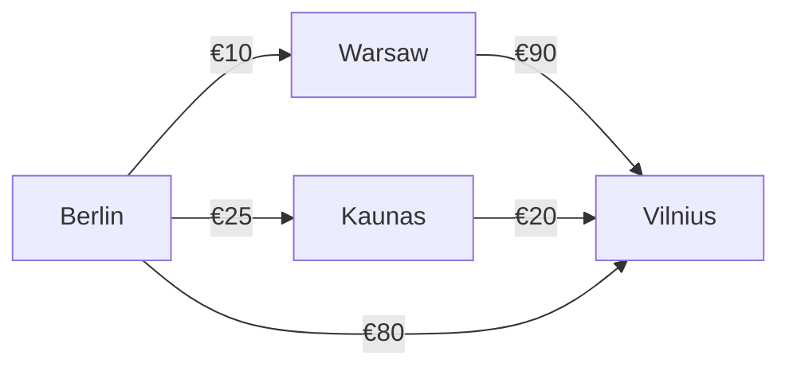
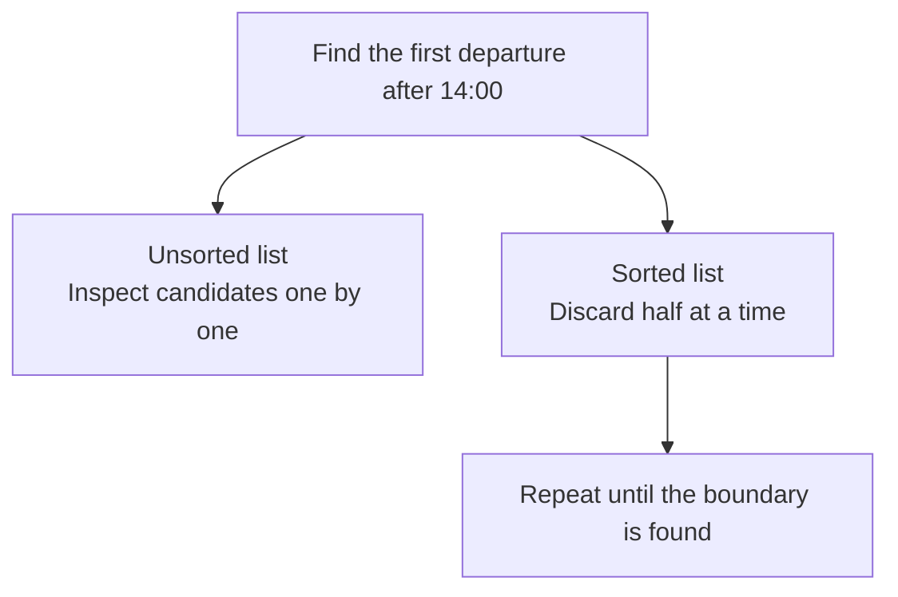

# CS110 — Foundations of Computation and Algorithms
## Lecture 05: Searching, Sorting, and Finding Shortcuts

*Binary search, sorting, recursion, divide and conquer, greedy algorithms, graph search, and the surprisingly creative art of avoiding unnecessary computation.*

**Estimated study time:** 60–80 minutes, including the optional practical lab.

---

### How to listen to this lecture

Written for continuous listening first, then for on-screen re-reading. The theme today is simple: **don't search where the answer cannot be.** Sticky-note callouts mark ideas worth pausing on, and diagrams show where work got skipped. Near the end, answer the challenges **out loud** before reading the solutions. The coding experiments live after the spoken lecture ends — keep them for a screen session.

By the end, you should be able to explain why a cheap next step can lead to an expensive journey, why binary search is really about maintaining a promise, how sorting, divide and conquer, greedy choices, graph search, and memoization each avoid unnecessary work, and why the elegant algorithm sometimes loses to the boring one.

---

# Part I — Intuition

*The train journey that looked cheapest at every stop and still cost a fortune: why good algorithms are about choosing which work can safely be skipped.*

### You're planning a train trip from Berlin to Vilnius

Imagine an app that helps you find the cheapest possible railway journey. It knows a simplified set of connections and prices. You start in Berlin and want to arrive in Vilnius.

The app examines its options. It could take a train from Berlin to Warsaw for €10. Or to Kaunas for €25. Or a direct hypothetical connection to Vilnius for €80.

It chooses Warsaw. Ten euros is the cheapest ticket immediately available.

But from Warsaw, the onward ticket to Vilnius costs €90. The total trip costs €100.

Meanwhile, Berlin to Kaunas for €25, then Kaunas to Vilnius for €20, would have cost €45. Even the €80 direct ticket would have been cheaper than the app's choice.

The app made a reasonable-looking decision at every step. It followed its instructions perfectly. And it chose a terrible journey.

Our first diagram contains the entire puzzle. The numbers are fictional fares, chosen only to explain the idea.



**Choosing the cheapest next step is not the same as choosing the cheapest complete journey.**

This is a surprisingly general problem. A decision that looks best locally can lead to a worse result globally.

### 1. The shortest-looking shortcut may be unjustified

The train planner's rule was simple: always pick the cheapest connection available right now.

That is an example of a **greedy** strategy. Make the best-looking immediate choice without exploring every possible future consequence.

Greedy strategies can be brilliant when a problem has the right structure. But they aren't automatically correct. Our railway example is a counterexample to the specific rule “take the cheapest outgoing edge.”

A proper route-planning algorithm must account for the cost already paid and the remaining possible journey. In a graph with nonnegative edge costs, Dijkstra's algorithm provides one way to do that correctly. Its choices are more carefully justified than our naive ticket-by-ticket greediness.

The important intuition isn't its implementation. It's that a shortcut becomes safe only when we know **why the options we're skipping cannot contain a better answer**.

### 2. Sorting creates useful structure

Now imagine the booking office has a list of a million departure records and you need to find trains leaving after 14:00.

If the records are in random order, the clerk may need to inspect them all.

If they are sorted by departure time, the clerk can look near the middle. If the middle train leaves at 10:00, everything before it is too early. Discard that entire half. Repeat with the remaining half.

This is the core of **binary search**: when information is sorted appropriately, one comparison can eliminate half the remaining possibilities.

It isn't magic. It depends on a promise that the remaining data is ordered. Without that promise, discarding half could eliminate the answer.

In ordinary unsorted data, searching one by one may be the reasonable approach. Sorting first has a cost, so it isn't automatically worth doing for a single lookup. But if the timetable will answer thousands of future searches, paying that preparation cost can make sense.

The second diagram compares the different ways the clerk might approach a large timetable.



One lesson connects sorting, searching, and indexing: **do a little work to organize the possibilities, then avoid exploring candidates that cannot help**.

### 3. Split the problem into smaller pieces

Suppose the railway map is enormous. You could divide some tasks into smaller pieces, solve those pieces, and combine the results.

This is the spirit of **divide and conquer**.

Sorting algorithms such as merge sort use that idea: split a large collection, sort the parts, and merge them into one ordered result.

But not every problem can be separated without consequences. For a cheapest route, the interesting question is how the choices interact. Two partial journeys can't always be combined arbitrarily.

So dividing the problem is useful when smaller solutions fit together in a way that preserves the intended answer.

### 4. A map is more than a list of trains

Our cities and connections naturally form a **graph**.

The cities are nodes. The railway connections are edges. Their prices are weights.

Now different questions require different ways of exploring the same graph.

Can you get from Berlin to Vilnius at all? That is a reachability problem.

What journey uses the fewest transfers if every leg counts equally? That is a different problem.

What journey has the lowest total fare when prices differ? That requires respecting the weights.

A search that considers cities in broad layers, like ripples spreading through water, is the intuition behind breadth-first search. A search that follows one path deeply before returning is the intuition behind depth-first search. The cheapest weighted path requires an appropriate weighted-path algorithm and assumptions.

The graph isn't an algorithm by itself. It's the description of the possible journeys. The procedure depends on which question we're trying to answer.

### 5. Don't solve the same subproblem again and again

Imagine our app calculates a cheapest onward journey from Kaunas to Vilnius for one traveler. Five seconds later, another traveler asks an overlapping question that needs exactly the same sub-result under unchanged fares and constraints.

The app could calculate the same thing from scratch.

Or it could remember the result and reuse it when it's still valid.

That is the simple intuition behind **memoization** and many forms of **dynamic programming**: solve a reusable subproblem once, then use its answer instead of repeating all the work.

But reuse has a condition: the question must truly be the same, and its inputs must still mean the same thing. If ticket prices change, a previously calculated cheapest route may no longer be correct.

We haven't built a full route planner yet. We've identified its real engineering challenge: how to avoid unnecessary work **without skipping possibilities that matter**.

### Your mental checkpoint

**Question A:** Why did the €10 ticket through Warsaw lead to a worse trip? **The cheapest next leg didn't minimize the total fare.**

**Question B:** What makes it safe for binary search to discard half the departures? **A meaningful ordering that guarantees the discarded half cannot contain the target.**

**Question C:** Is a list of connected cities the same thing as an algorithm for the cheapest path? **No. The graph represents possibilities; the algorithm explores them according to the objective.**

**Question D:** When is reusing a cached subproblem answer unsafe? **When the inputs or relevant conditions have changed.**

Carry the railway journey into Part II. Whenever you meet a new algorithmic pattern, ask two questions: **Which work does this approach avoid? And what makes it legitimate to avoid that work?**

*The intuition pass ends here.*

---

# Part II — Deep Dive

# 1. The Journey That Should Have Been Cheaper

> **Case file #005** — *Berlin → Vilnius. Budget traveler. Algorithm picks the worst route.*

Imagine you're building a European railway journey planner.

A customer wants to travel from Berlin to Vilnius. They're flexible about the route, willing to change trains, and interested in minimizing the total ticket price.

Your application has access to a simplified network of possible connections.

For illustration, let's invent these fares. Berlin to Warsaw costs €10. Warsaw to Vilnius costs €90. Berlin to Kaunas costs €25. Kaunas to Vilnius costs €20. And Berlin straight to Vilnius costs €80.

These are hypothetical fares, not actual railway prices.

Your developer implements a seemingly reasonable algorithm:

1. Start in Berlin.
2. Look at the available outgoing connections.
3. Choose the cheapest connection.
4. Repeat until reaching Vilnius.

What could possibly go wrong?

The next diagram sets the greedy route, Berlin to Warsaw to Vilnius for €100, beside the better routes: through Kaunas for €45, or direct for €80.

```text
  GREEDY PATH                         BETTER PATHS
  ───────────                         ────────────
  Berlin ──€10──► Warsaw              Berlin ──€25──► Kaunas
                    │                                   │
                    €90                                 €20
                    ▼                                   ▼
                 Vilnius                             Vilnius
                 TOTAL €100                           TOTAL €45  ✓

  Direct: Berlin ──€80──► Vilnius   (also better than greedy)
```

The algorithm begins in Berlin and sees three options.

Warsaw costs €10.

Kaunas costs €25.

Vilnius directly costs €80.

Naturally, it chooses Warsaw.

Then it continues to Vilnius for another €90.

Total cost: **€100**.

Meanwhile, the customer could have traveled through Kaunas for just €45.

Or directly for €80.

Our algorithm has selected the most expensive of the three routes.

Wonderful. We've invented a travel agency that actively punishes budget-conscious customers.

But notice something important.

The program may be perfectly implemented.

No bugs.

No incorrect calculations.

No missing data.

It faithfully chooses the cheapest outgoing connection at every step.

The failure is conceptual.

> **Sticky note #1**
>
> Choosing the best immediate option doesn't necessarily produce the best overall solution.

This is the distinction between a *local optimum* and a *global optimum*.

The cheapest next step may be part of a terrible overall route.

And recognizing this distinction is central to algorithm design.

Today we're going to investigate several powerful ways of solving problems more intelligently. Six shortcuts, in the order we'll meet them.

**Sorting** exposes useful structure.

**Eliminating search space** means not looking where the answer can't be.

**Divide and conquer** turns one big problem into smaller problems whose answers you combine.

**Exploiting mathematical properties** lets you skip brute force.

**Reusing results**, through memoization and dynamic programming, stops you from solving the same problem twice.

And **searching networks carefully**, with breadth-first search, depth-first search, and Dijkstra, gets you routes instead of accidents.

But we'll begin with one of the simplest and most elegant algorithms ever invented.

> ✓ Room 1 complete — local cheapest ≠ global cheapest

---

# 2. How to Find Something Among a Billion Possibilities

Imagine a database containing one billion customer records.

Every customer has a unique numerical ID.

The records are sorted by that ID.

You need to locate customer 847,293,104.

One possible strategy is to begin with the first record.

Check its ID.

Not a match.

Move to the second.

Not a match.

Continue.

In the worst case, you might inspect one billion records.

That's linear search.

O(n).

Now consider a different approach.

Open the collection near the middle.

The ID is approximately 500 million.

Your target is larger.

Therefore, you can discard the entire lower half of the search space.

Half a billion records eliminated after one comparison.

The next diagram contrasts the two strategies: linear search checks records one by one, up to a billion times, while binary search drops half the candidates at every step and needs about thirty steps for a billion.

```text
  Binary search vs linear search
  ──────────────────────────────
  Linear:  check 1, check 2, check 3, …  (up to a billion)

  Binary:  middle → drop half
           middle → drop half
           middle → drop half
           … ~30 steps for a billion
```

Examine the middle of the remaining half.

Roughly 750 million.

Your target is still larger.

Discard another quarter-billion candidates.

Next comparison: approximately 875 million.

Too large.

Discard everything above it.

And continue.

This is **binary search**.

It's extraordinarily simple, but its consequences are remarkable.

Every comparison can eliminate approximately half the remaining candidates.

Let's see how many comparisons are needed.

About ten halvings for 1,024 records.

About twenty for a million.

About thirty for a billion.

About forty for a trillion.

One trillion records.

About forty decisions to narrow the location to a single candidate.

That's astonishing.

Of course, these are counts of logical search steps, not promises about physical execution time. Reading data from a database or disk introduces additional costs.

But the algorithmic improvement is enormous.

## The essential trick

Binary search is not fast because the computer performs comparisons unusually quickly.

It's fast because each comparison tells us something about a huge number of elements.

If we know the collection is sorted, comparing the target against the middle element allows us to eliminate an entire half.

Without sorting, we lose that ability.

Imagine the customer IDs are arranged randomly.

If the middle ID is smaller than the target, does that prove the target belongs in the right half?

No.

It might be anywhere.

> **Sticky note #2**
>
> Binary search works because the organization of the data allows each comparison to eliminate possibilities.

This connects directly to CS110-L04.

A data structure and an algorithm cooperate.

The structure preserves useful information.

The algorithm exploits it.

> ✓ Room 2 complete — one comparison, half a billion gone

---

# 3. Binary Search Is Really About Maintaining a Promise

Let's implement binary search.

You probably already understand the basic idea, so we won't spend pages explaining every line of a loop.

Instead, let's examine the part that separates a reliable implementation from a subtly broken one.

Consider this function. It's called `lowerBound`: it keeps a left and right boundary, repeatedly looks at the middle, and moves `left` past the middle if the middle value is too small, or pulls `right` back to the middle otherwise.

```typescript
function lowerBound(
  values: number[],
  target: number
): number {
  let left = 0;
  let right = values.length;

  while (left < right) {
    const middle = Math.floor(
      (left + right) / 2
    );

    if (values[middle] < target) {
      left = middle + 1;
    } else {
      right = middle;
    }
  }

  return left;
}
```

What does this function return?

Not necessarily the position of an existing matching element.

It returns the first position at which the value is greater than or equal to the target.

If no such element exists, it returns the array's length.

For example, take the sorted array two, four, four, four, seven, nine. Asking for four returns index one, the first four. Asking for five returns index four, where seven sits. Asking for ten returns six, the array's length.

```typescript
const values = [2, 4, 4, 4, 7, 9];

lowerBound(values, 4);  // 1
lowerBound(values, 5);  // 4
lowerBound(values, 10); // 6
```

This variant is particularly useful because it behaves sensibly when the target is absent or appears multiple times.

But why does it work?

## The invariant

At every step, the algorithm maintains a promise about the interval from `left` up to, but not including, `right`.

The notation means that `left` is included and `right` is excluded.

The next diagram shows that candidate range and the two update rules: a too-small middle moves `left` past it, anything else moves `right` down to it, until the two meet at the insertion point.

```text
  Invariant: answer lives in [left, right)
  ────────────────────────────────────────
  [==== candidate range ====)
   left                    right

  middle too small?  →  left = middle + 1
  otherwise?         →  right = middle

  Shrink until left === right  →  that's the insertion point
```

The algorithm maintains the fact that the first element greater than or equal to the target must be located within this interval, possibly at its right endpoint when no qualifying element exists.

At the beginning, the entire array is a candidate.

Then we examine the middle element.

If the middle value is smaller than the target, we know something important.

Because the array is sorted, every element at or before the middle position must also be smaller than the target.

We can safely discard all of them.

Otherwise, the middle position might be the first qualifying element.

So we keep it and discard everything to its right.

With every iteration, the candidate interval shrinks.

Eventually, `left` equals `right`.

Only one insertion position remains.

That's our answer.

This maintained promise is called a **loop invariant**.

A loop invariant is a property that remains true throughout the execution of a loop.

It's a fundamental technique for reasoning about correctness.

And it reveals something important about algorithms:

> **Sticky note #3**
>
> A correct algorithm doesn't merely perform plausible steps. Each step must preserve the conditions that make the final result valid.

This is particularly useful in interviews.

If someone asks why your binary search works, explaining the invariant is much stronger than saying, "Well, it keeps cutting the array in half."

## Why binary search is notoriously bug-prone

For such a simple idea, binary search has an impressive history of incorrect implementations.

Common mistakes include six traps.

**Wrong interval boundaries** show up as off-by-one errors or a missed element.

**Infinite loops** happen when `left` never meets `right`.

**Skipping the target** comes from updating the wrong branch.

**Duplicate mishandling** finds *a* match instead of the bound you wanted.

**Wrong insertion position** returns whether something exists, not a lower or upper bound.

And **midpoint overflow** in fixed-width integers silently produces a wrong index.

In languages with fixed-width integer indices, even calculating the midpoint carelessly can produce integer overflow.

A common safer expression is `left + floor((right - left) / 2)`.

For JavaScript's ordinary practical array indexing ranges, the overflow issue isn't usually relevant in the same way, but the general lesson remains.

Small boundary details can invalidate an otherwise sound algorithm.

That's why choosing clear interval conventions and maintaining invariants is so valuable.

> ✓ Room 3 complete — binary search = shrinking a promise

---

# 4. The Trick Works on More Than Numbers

Let's take binary search somewhere more interesting.

Suppose your company processes large batches of jobs.

The jobs must be handled in their existing order.

You can distribute them across at most five processing days.

Each day has a maximum allowed workload.

Your question is:

**What is the smallest daily workload capacity that allows all jobs to be completed within five days?**

Imagine the jobs have these workload sizes: seven, two, five, ten, and eight.

You could attempt various possible capacities.

Can the work be scheduled with a daily capacity of 10?

Can it be scheduled with 12?

15?

20?

Here's the interesting property.

If capacity 15 is sufficient, capacity 16 must also be sufficient.

And 17.

And 18.

Increasing the capacity cannot make a previously feasible schedule impossible, assuming the rules remain the same.

That means the answer to the question "Is capacity X sufficient?" has a **monotonic** structure.

For small capacities, the answer is no.

After some threshold, the answer becomes yes.

The next diagram lines up capacities from eight upward with a no or yes for each, and marks the first yes as the binary-search target.

```text
Capacity:  8   9  10  11  12  13  14  15  16 ...
Feasible:  N   N   N   N   Y   Y   Y   Y   Y ...
                          ▲
                          └── first true = binary-search target
```

The numbers here are illustrative.

The important pattern is a run of false answers followed by a run of true answers.

We're looking for the first `true`.

Does that remind you of anything?

Exactly.

Binary search.

But this time, we're not searching an array.

We're searching a range of possible answers.

We implement a function, `canFinishWithCapacity`, that determines whether the work can be completed within the allowed number of days.

Then binary search finds the smallest capacity for which the function returns true.

This technique is commonly called **binary search on the answer**.

It's useful because many optimization problems are difficult to solve directly but easy to verify for a proposed threshold.

Examples include finding the minimum required capacity, the maximum feasible load, the smallest acceptable resource allocation, the minimum speed to meet a deadline, or the largest value under a constraint. In every case, the trick works only if the property is monotonic.

The essential skill isn't memorizing the phrase "binary search on the answer."

It's recognizing a monotonic property.

Once you discover that property, an apparently complicated optimization problem may collapse into a sequence of simple yes-or-no checks.

That's one of the pleasures of algorithm design.

Sometimes the clever part isn't the code.

It's identifying the mathematical structure hiding inside the problem.

> **Sticky note #4**
>
> Hard to solve, easy to check? Look for a monotonic threshold.

> ✓ Room 4 complete — binary search on the answer

---

# 5. Sorting: The Expensive Operation That Makes Other Operations Cheap

Binary search requires ordered information.

So how do we obtain that order?

We sort.

Sorting is one of the most studied problems in computer science, partly because it appears everywhere and partly because it reveals fundamental ideas about algorithm design.

Consider a collection of four reservations, each with an id and a check-in date. R3 checks in on November 9th, R1 and R2 both on November 2nd, and R4 on November 15th.

```typescript
const reservations = [
  { id: "R3", checkIn: "2026-11-09" },
  { id: "R1", checkIn: "2026-11-02" },
  { id: "R4", checkIn: "2026-11-15" },
  { id: "R2", checkIn: "2026-11-02" }
];
```

You need to display them chronologically.

In modern JavaScript, you might call `toSorted` with a comparator that compares check-in dates as strings.

```typescript
const sorted = reservations.toSorted(
  (a, b) =>
    a.checkIn.localeCompare(b.checkIn)
);
```

This works for consistently formatted ISO calendar dates such as `YYYY-MM-DD`, because their lexicographic order matches chronological date order.

It creates a new sorted array rather than modifying the original.

Nothing difficult about the code.

But what is the sorting implementation actually doing?

## The naive approach

One simple sorting strategy repeatedly compares neighboring elements and swaps them when they're out of order.

That's essentially bubble sort.

It has a charming simplicity.

Unfortunately, its worst-case time complexity is O(n²).

With large collections, that becomes problematic.

You can find better sorting algorithms by being more strategic.

And a particularly powerful strategy is **divide and conquer**.

> ✓ Room 5 complete — sort pays upfront so search can skip work later

---

# 6. Divide and Conquer: Solve Something Smaller, Then Put It Back Together

Imagine you're given a shuffled deck of 1,000 numbered cards.

You need to arrange them in ascending order.

One approach is to repeatedly scan the entire deck, moving cards into position.

Another approach is to split the deck into two piles.

Sort each pile separately.

Then merge the two sorted piles.

If both piles are already sorted, merging them is straightforward.

Look at the first card in each pile.

Take the smaller one.

Repeat until both piles are exhausted.

Now imagine using the same strategy recursively to sort each half.

Split 1,000 cards into two groups of 500.

Split each group into groups of 250.

Continue until every group contains one card.

A single card is already sorted.

Then begin merging.

This is **merge sort**.

And it's a beautiful example of divide and conquer.

## Why does it work?

A merge-sort algorithm consists of three conceptual steps.

First, **divide**: split the problem into smaller parts.

Second, **conquer**: sort each part.

Third, **combine**: merge the sorted parts into a sorted whole.

The key is that combining two sorted collections is much easier than sorting an arbitrary collection from scratch.

Let's look at a small example.

The original array is eight, three, six, two, seven, one.

Divide it into eight, three, six, and two, seven, one.

Continue dividing until we have single-element collections.

Then merge. On the left side, three and eight merge into three, eight. Then three, eight and six merge into three, six, eight.

On the other side, two and seven merge into two, seven. Then two, seven and one merge into one, two, seven.

Finally, three, six, eight merges with one, two, seven and becomes one, two, three, six, seven, eight.

The next diagram traces that split-and-merge shape, from the original array down to singles and back up to the sorted whole.

```text
  [8, 3, 6, 2, 7, 1]
         │
    ┌────┴────┐
  [8,3,6]   [2,7,1]
    │         │
   …singles… …singles…
    │         │
  [3,6,8]   [1,2,7]
         │
    [1, 2, 3, 6, 7, 8]
```

The exact intermediate grouping depends on how odd-sized arrays are split, but the principle remains the same.

## Why O(n log n)?

Let's reason about the work.

At each level of the recursive process, merging all the elements requires O(n) total work.

How many levels are there?

Every division approximately halves the collection.

So the number of levels grows as O(log n).

Multiply the work per level by the number of levels: `O(n) × O(log n) = O(n log n)`.

That's the time complexity of merge sort.

It is dramatically better than quadratic sorting for large inputs.

A conventional array-based merge sort also requires O(n) auxiliary storage for merging.

So again, we have a trade-off.

Better time complexity, but additional memory requirements.

## The power of recursion

Merge sort is naturally described recursively.

A recursive function solves a problem by invoking itself on smaller instances.

But recursion needs two things.

First, a **base case**.

Something that tells the process when to stop.

For merge sort, arrays with zero or one element are already sorted.

Second, **progress toward the base case**.

Each recursive call must work on a smaller collection.

Without progress, recursion can continue indefinitely or overflow the call stack.

Consider a tiny function called `countdown`: it returns immediately when `n` is zero or less, otherwise prints `n` and calls itself with one less.

```typescript
function countdown(n: number): void {
  if (n <= 0) return;

  console.log(n);
  countdown(n - 1);
}
```

It's simple, but it contains the essential structure.

A base case.

A smaller recursive problem.

A predictable path toward termination.

Recursion isn't inherently faster than iteration.

Sometimes it's slower, particularly when function-call overhead or stack depth becomes significant.

But it can express naturally recursive problems much more clearly.

Trees, graphs, nested structures, parsers, and divide-and-conquer algorithms often benefit from recursive thinking.

## A caution about JavaScript

JavaScript engines have finite call stacks.

Deep recursion can produce a stack overflow.

For structures that may be extremely deep, iterative algorithms with explicit stacks can be safer.

For merge sort, the recursion depth is logarithmic, so stack depth is generally not the main practical concern.

The broader lesson is that elegant mathematical structure doesn't eliminate runtime constraints.

> ✓ Room 6 complete — divide, conquer, merge (O(n log n))

---

# 7. Why Sorting Can't Always Be Faster Than O(n log n)

Here's a surprisingly deep question.

Could we invent a comparison-based sorting algorithm that always sorts arbitrary values in O(n) time?

Imagine a miraculous algorithm that can sort one million arbitrary objects using only a few million comparisons.

Would that be possible?

Under the standard comparison model, no.

There's a mathematical reason.

Suppose we have `n` distinct items.

How many different possible orderings are there?

For two items, there are two.

For three items, six.

For four items, twenty-four.

In general, there are `n!` possible permutations.

That's `n` factorial.

A comparison between two items can distinguish at most two outcomes: one item comes before the other, or it doesn't. For distinct keys, equality doesn't arise.

Think of sorting as a decision process.

The algorithm must distinguish among all possible input orderings.

A sequence of binary decisions forms a decision tree.

A decision tree with height `h` can distinguish at most `2^h` outcomes.

Therefore, to distinguish `n!` possible orderings, we need `2^h ≥ n!`.

Taking logarithms, `h ≥ log₂(n!)`.

And the growth of `log₂(n!)` is Θ(n log n).

Put another way, each comparison yields at most one bit of "which way?", and we need at least `log₂(n!)` bits, which is about n log n comparisons in the worst case.

So any comparison-based sorting algorithm has a worst-case lower bound of Ω(n log n) comparisons.

This is one of the elegant results of algorithm analysis.

We've established a limit not by examining a particular implementation, but by considering how much information comparisons can reveal.

## So why do linear-time sorting algorithms exist?

Because the lower bound applies to **comparison-based sorting**.

If we know additional properties about the values, other strategies become possible.

Suppose we need to sort one million integers, but every integer lies between 0 and 100.

Instead of comparing pairs of values, we can count how many times each integer occurs.

Then reconstruct the sorted collection.

That's the basic idea behind counting sort.

Its time complexity is O(n + k), where `k` is the range of possible values.

If `k` is small, this can be effectively linear in the number of elements.

Radix sort also exploits the representation of keys rather than relying solely on arbitrary pairwise comparisons.

The crucial distinction is that these algorithms assume something about the data.

They aren't universal replacements for comparison sorting.

They trade generality for the ability to exploit structure.

And that gives us another important algorithmic principle:

> **Sticky note #5**
>
> Additional knowledge about the input can make a problem dramatically easier.

> ✓ Room 7 complete — Ω(n log n) for comparisons; exploit structure to beat it

---

# 8. The Temptation of Greedy Algorithms

Let's return to our disastrous European railway planner.

The algorithm selected the cheapest outgoing ticket at every step.

That was a **greedy strategy**.

A greedy algorithm makes a locally attractive choice and commits to it without necessarily reconsidering earlier decisions.

Greedy algorithms are appealing because they can be simple and efficient.

But there's a danger.

A locally optimal choice doesn't automatically lead to a globally optimal result.

Our railway example demonstrated exactly that.

Berlin to Warsaw cost €10, but the onward connection was expensive.

Berlin to Kaunas cost €25, but the remaining journey was cheaper.

Choosing the cheapest first step failed.

Does this mean greedy algorithms are bad?

Not at all.

Some of the most elegant and efficient algorithms are greedy.

The important question is whether the problem has mathematical properties that make greedy choices safe.

## A problem where greed works beautifully

Imagine a conference room that can host one meeting at a time.

You have several meeting requests, each with a start and end time.

You want to schedule the maximum possible number of non-overlapping meetings.

A surprisingly effective strategy is:

**Always choose the available meeting that finishes earliest.**

Then repeat with meetings that start after the chosen one finishes.

Why might that work?

Because choosing the meeting that finishes earliest leaves as much room as possible for future meetings.

The next diagram sketches four overlapping meetings on a timeline. The rule is to pick the earliest finisher among those still available, then repeat among the meetings compatible with it.

```text
  Unweighted interval scheduling (greed works)
  ────────────────────────────────────────────
  Always pick earliest-finishing available meeting

  |----A----|
        |----B----|
  |----------C----------|
               |--D--|

  Pick A (or whoever finishes first among available),
  then next compatible earliest-finisher, …
```

In fact, this strategy is optimal for the classic unweighted interval-scheduling problem.

It can be proven using an *exchange argument*.

The basic reasoning is that if an optimal schedule begins with a meeting that finishes later than the earliest-finishing available meeting, we can replace that first meeting with the earlier-finishing one without reducing the number of meetings that fit afterward.

So there exists an optimal schedule beginning with the greedy choice.

Then we can apply the same logic to the remaining problem.

That's what makes the greedy strategy safe.

Not intuition alone.

A mathematical property of the problem.

## When greed fails

Suppose meetings have different monetary values.

Now the goal is not to schedule the maximum number of meetings.

It's to maximize total revenue.

The earliest-finishing strategy may no longer be optimal.

Perhaps one long meeting earns €1,000, while three short meetings earn only €100 each.

Now we have a different optimization problem.

The same greedy rule can fail.

This is an important habit in algorithm design:

> **Sticky note #6**
>
> When someone proposes a greedy solution, ask what property guarantees that its local choices can be extended into a global optimum.

Without such a property, you may have a plausible heuristic rather than a correct optimal algorithm.

Heuristics can be useful.

But we should know when we're using one.

> ✓ Room 8 complete — greed needs a correctness property

---

# 9. Exploring Networks: BFS, DFS, and Dijkstra

Our railway network is a graph.

Cities are vertices.

Connections are edges.

Ticket prices are edge weights.

We want to find a path with minimum total cost.

This is a shortest-path problem in a weighted graph.

But not every graph-search algorithm solves the same version of the problem.

Let's distinguish three important approaches.

## Breadth-first search

Breadth-first search, or BFS, explores nodes in layers.

First, nodes one edge away.

Then two edges away.

Then three.

We studied its basic implementation in CS110-L04.

For an unweighted graph, BFS finds a path with the fewest edges.

But that doesn't necessarily mean the lowest monetary cost.

Our Berlin–Vilnius example includes a direct connection.

BFS would identify it as a one-edge route.

But the direct ticket costs €80.

The route through Kaunas costs €45.

So BFS optimizes the number of connections, not arbitrary edge weights.

The algorithm is correct for the problem it's designed to solve.

It simply isn't solving our cheapest-ticket problem.

## Depth-first search

Depth-first search, or DFS, explores one branch deeply before returning to explore alternatives.

It often uses recursion or an explicit stack.

DFS is useful for:

- Reachability.
- Cycle detection.
- Dependency analysis.
- Exploring connected components.
- Topological ordering in appropriate directed graphs.
- Backtracking through possible solutions.

But ordinary DFS doesn't guarantee the shortest path.

A depth-first traversal may find a valid route quickly while missing a much cheaper alternative elsewhere.

Again, correctness depends on the question.

## Dijkstra's algorithm

Now we arrive at one of the most important algorithms in graph theory.

Dijkstra's algorithm finds shortest-path distances from a starting node in a graph with nonnegative edge weights.

It does something more intelligent than choosing the cheapest immediate outgoing edge.

It maintains the best currently known total cost of reaching each node from the starting point.

Then it repeatedly selects the unsettled node with the smallest tentative total cost.

Let's walk through our hypothetical railway example.

From Berlin, we know the best known cost to each destination. Berlin itself costs €0. Warsaw costs €10. Kaunas costs €25. Vilnius costs €80, by the direct ticket.

We first settle Berlin.

Then we choose Warsaw because its tentative total cost, €10, is the smallest.

From Warsaw, the onward connection to Vilnius costs €90.

The total route would cost €100.

But we already know a direct route costing €80.

So we keep €80.

Next, we choose Kaunas, with tentative cost €25.

From Kaunas, the connection to Vilnius costs €20.

Total cost through Kaunas: twenty-five plus twenty, so €45.

That's better than €80.

We update Vilnius's tentative cost to €45.

Eventually, Vilnius is selected with that lowest tentative cost.

We've found the cheapest route in this simplified nonnegative weighted graph.

Compare the two greedy styles. Naive greed picks the cheapest *edge* from where you stand. Dijkstra picks the smallest *total cost from the start* among the unsettled frontier nodes.

## What made Dijkstra different?

Our naive algorithm chose the cheapest edge leaving the current city and committed to a route.

Dijkstra considers the cheapest *total tentative cost from the starting city* among all frontier nodes.

That distinction is crucial.

Dijkstra's algorithm is also greedy, but its greedy choice is supported by a correctness property when edge weights are nonnegative.

Once the algorithm settles the currently cheapest reachable node, no path through unsettled nodes can later produce a cheaper route to it using nonnegative edges.

That's why the strategy works.

## Why negative weights matter

Suppose some edges could have negative costs.

A node that appears expensive now might become cheaper later through a negative-weight edge.

Then Dijkstra's key correctness argument no longer holds in general.

Algorithms such as Bellman–Ford address shortest paths with negative edge weights, provided a reachable negative cycle doesn't make the shortest-path cost undefined.

This isn't something you need to implement from memory today.

But it illustrates a broader lesson.

Algorithmic guarantees depend on assumptions.

Ignore the assumptions, and a perfectly implemented algorithm can return incorrect results.

## And real railway timetables are harder

Our fictional graph assumes connections have fixed additive costs.

But real railway journeys also have:

- Departure times.
- Arrival times.
- Minimum connection durations.
- Limited service schedules.
- Tickets whose prices depend on departure and availability.
- Routes that may not operate every day.

If we're minimizing arrival time instead of ticket cost, the model becomes time-dependent.

A connection is useful only if we can actually catch it.

The shortest geographical route may be slow.

The fewest changes may be expensive.

The cheapest route may arrive the next morning.

There's no universal "best route" without defining the objective and constraints.

This connects back to CS110-L01.

Before designing an algorithm, we must understand the actual problem.

So let's pin each tool to what it optimizes and what it needs.

**BFS** optimizes the fewest edges, and needs an unweighted graph, or equal weights.

**DFS** is about exploration and structure. It is not a shortest-path algorithm by itself.

**Dijkstra** optimizes total cost, and needs nonnegative edge weights.

A **real planner** optimizes whatever you defined, and needs schedules, constraints, and an objective.

> ✓ Room 9 complete — match the search to the objective

---

# 10. Reusing Answers: The First Taste of Dynamic Programming

Let's introduce one more important idea.

Imagine calculating the cheapest route through a large network.

A naive recursive algorithm might explore every possible route.

At each city, it considers every outgoing connection and recursively calculates the best possible continuation.

For a small acyclic network, that's straightforward.

But suppose different routes eventually reach the same city.

Then the recursive process might calculate the best remaining route from that city again and again.

That's wasted work.

Imagine arriving at Kaunas through several possible earlier routes.

Once we know the cheapest continuation from Kaunas to Vilnius, why recompute it every time?

We could remember the result.

This is called **memoization**.

A memoized function caches the result of a computation so that the same subproblem doesn't need to be solved repeatedly.

For suitable problems, memoization can transform an exponentially expensive recursive approach into a much more efficient one.

The larger family of techniques built around solving and reusing overlapping subproblems is called **dynamic programming**.

Despite its intimidating name, the central idea is often simple:

> **Sticky note #7**
>
> Solve smaller problems, store their answers, and reuse those answers when larger problems depend on them.

## An elementary example

Consider the Fibonacci sequence: zero, one, one, two, three, five, eight, thirteen, and onward.

Each value is the sum of the previous two.

A naive recursive implementation returns `n` directly when `n` is below two, and otherwise returns the sum of the two previous Fibonacci values, each computed recursively.

```typescript
function fibonacci(n: number): number {
  if (n < 2) return n;

  return fibonacci(n - 1) +
         fibonacci(n - 2);
}
```

The code is beautiful.

But the execution is wasteful.

The next diagram shows the call tree for `fib(5)`. Notice that `fib(3)` and `fib(2)` show up again in different branches: the same subtrees are computed more than once.

```text
  fib(5)
   ├─ fib(4)
   │   ├─ fib(3)
   │   │   ├─ fib(2) …
   │   │   └─ fib(1)
   │   └─ fib(2) …          ← same subtree, computed again
   └─ fib(3) …              ← and again
```

To calculate `fibonacci(40)`, it repeatedly recalculates many of the same smaller Fibonacci values.

A memoized version remembers them. It keeps a `Map` of results; before computing, it checks the cache, and after computing, it stores the answer.

```typescript
const memo = new Map<number, number>();

function fibonacci(n: number): number {
  if (n < 2) return n;

  const cached = memo.get(n);

  if (cached !== undefined) {
    return cached;
  }

  const result =
    fibonacci(n - 1) +
    fibonacci(n - 2);

  memo.set(n, result);

  return result;
}
```

Now each distinct Fibonacci value up to `n` is calculated at most once.

Time complexity becomes O(n), rather than exponential for the naive recursive implementation.

We spend O(n) memory to save enormous amounts of repeated computation.

An iterative implementation can do even better in auxiliary memory, keeping only the most recent two values.

But the conceptual lesson is about recognizing repeated subproblems.

## When dynamic programming is useful

It appears in problems involving:

- Optimal scheduling.
- Resource allocation.
- Sequence comparison.
- Route optimization under certain constraints.
- Text processing.
- Planning and decision problems.
- Various combinatorial optimizations.

It isn't the answer to everything.

Some problems lack the necessary overlapping subproblem structure.

Others require more specialized algorithms.

But the ability to recognize repeated work is extremely valuable.

And you'll notice that this principle already appears in professional backend engineering.

Caching calculated results is the same intuition: don't recompute.

Incremental aggregates reuse previous state.

Compiled templates pay the cost once.

And avoiding repeated database queries recognizes that overlapping work is expensive.

These aren't necessarily textbook dynamic programming, but they exploit a related engineering intuition:

Don't repeatedly perform expensive work when a valid reusable result already exists.

The challenge, of course, is knowing when the result remains valid.

And that's where state, caching, and consistency enter the picture.

> ✓ Room 10 complete — remember answers to overlapping subproblems

---

# 11. The Six Algorithmic Patterns Worth Recognizing

We've covered quite a few ideas.

Let's organize them into a mental toolkit.

You don't need to memorize fifty algorithms.

For most full-stack engineering work and a substantial share of coding interviews, recognizing a few recurring patterns is much more valuable.

Here are the six patterns.

**Hash-based lookup** organizes keys for fast expected membership checks. You'll use it for deduplication, joins, caches, and matching.

**Sorting plus binary search** establishes order, then eliminates large ranges. Think date ranges, thresholds, and indexed lookups.

**Two pointers and sliding windows** maintain a moving region without rescanning everything. They suit sequences, substrings, and bounded windows.

**Divide and conquer** splits a problem, solves smaller pieces, and combines the results. It powers sorting, searching, and recursive structures.

**Greedy selection** makes a locally optimal choice when correctness conditions permit. Scheduling and some graph algorithms use it.

And **graph search with dynamic programming** explores relationships or reuses subproblem results, for routing, dependencies, planning, and optimization.

Let's spend a moment on one pattern we haven't yet discussed.

## Sliding windows

Imagine an array of hourly API request counts.

You want the maximum total number of requests observed across any consecutive 24-hour window.

A naive implementation might calculate the sum of every 24-element window independently.

But neighboring windows overlap almost completely.

When the window moves forward by one hour:

- One old hour leaves the window.
- One new hour enters.

The next diagram shows a 24-hour window sliding forward by one hour, and the update rule: the new sum equals the old sum, minus the outgoing hour, plus the incoming hour.

```text
  Hours:  [h0 h1 h2 … h23] h24 h25 …
           └──── window ────┘
                └──── window ────┘

  newSum = oldSum - outgoing + incoming
```

Why recalculate the entire sum?

We can update it incrementally: `newSum = oldSum - outgoingValue + incomingValue`.

That's a sliding window.

The technique turns many repeated calculations into constant-time updates.

For a fixed window size, the whole array can be processed in O(n) time.

And the general concept applies beyond arrays.

Moving averages.

Rate limiting.

Recent-event statistics.

Rolling metrics.

Streaming analytics.

The broader principle is that neighboring solutions often share most of their information.

Recognizing that overlap allows us to reuse previous work.

> ✓ Room 11 complete — six patterns, one toolkit

---

# 12. When the Elegant Algorithm Loses to the Boring One

There's one last trap worth investigating before the oral examination.

Suppose you're asked to find whether a target exists in a collection.

You have two approaches.

**Approach A:** Sort the collection, then use binary search.

**Approach B:** Scan the collection linearly.

Binary search is O(log n).

Linear search is O(n).

So A must be faster, right?

Not necessarily.

Because Approach A has an upfront sorting cost.

For a collection of `n` elements:

- Sorting generally costs O(n log n).
- Binary search costs O(log n).

If you're performing only one lookup, sorting first is usually unnecessary.

The entire approach costs O(n log n), compared with O(n) for a simple scan.

But what if you'll perform one hundred thousand lookups against the same collection?

Now the sorting cost can be amortized across many searches.

We pay once to organize the data.

Then every lookup benefits.

For one lookup, a scan at O(n) beats sort plus search at O(n log n). For many lookups, you pay once to organize, and each search is cheap.

This is a recurring architectural question:

> **Sticky note #8**
>
> Is it worth spending resources upfront to make future operations cheaper?

That's what database indexes do.

That's what caches do.

That's what precomputed search structures do.

And it's why workload patterns matter so much.

An algorithm cannot be judged without knowing how it will be used.

## A note about JavaScript sorting

One small but useful runtime detail.

JavaScript's default `sort()` behavior converts elements to strings and compares them according to string ordering.

For example, calling `sort()` with no comparator on `[1, 10, 2]` leaves it as `[1, 10, 2]`, because the string "10" sorts before "2".

That's usually not what you want for numerical sorting.

Use a comparator: `[1, 10, 2].sort((a, b) => a - b)` produces `[1, 2, 10]`.

Also remember that `sort()` mutates the original array.

The newer `toSorted()` method produces a new array.

Modern ECMAScript specifies stable sorting, meaning elements that compare equal retain their original relative order.

But stability, mutation, and comparison semantics are separate concerns.

A senior TypeScript developer should understand these behaviors even if they don't know which sorting algorithm a particular JavaScript engine uses internally.

> ✓ Room 12 complete — elegant ≠ always faster for your workload

---

# 13. The Oral Examination

We now have enough tools to choose a search strategy like an engineer rather than reciting algorithm names.

Before reading the solutions, try answering these questions out loud. Imagine that a senior engineer is interviewing you and will challenge any hand-waving. Speak complete explanations, not fragments.

### Challenge A — The Reservation Search

*Suggested time: 8 minutes.*

Your application stores 500,000 reservations in memory.

They're sorted by check-in date.

You need to retrieve all reservations whose check-in date falls between November 10 and November 15.

You can assume dates use a consistent sortable representation.

1. Would you scan the entire array?
2. How could binary search improve the operation?
3. What happens if there are 10,000 matching reservations?
4. Does O(log n) search mean the entire query can return 10,000 results in O(log n)?
5. What happens to performance if reservations are frequently inserted into this sorted array?

### Challenge B — The Interviewer's Trap

*Suggested time: 8 minutes.*

You're given an unsorted array of one million integers.

You need to answer whether a particular value exists.

An interviewer says: "Binary search is faster than linear search, so why don't you sort the array first?"

How would you respond?

Now suppose the same array will receive 200,000 membership queries.

Does your answer change?

Would you prefer sorting or building a hash-based Set?

What factors would influence your choice?

### Challenge C — The Scheduling Problem

*Suggested time: 10 minutes.*

You have a collection of meeting requests.

Each meeting has a start time, end time, and revenue.

You want to maximize revenue without scheduling overlapping meetings.

A colleague proposes: "Always select the meeting that finishes earliest."

Is this guaranteed to produce the maximum revenue?

If not, construct a counterexample.

How might remembering the best solution to smaller scheduling subproblems help?

You don't need to implement the full algorithm.

Focus on understanding why a greedy strategy may fail and how dynamic programming could become relevant.

### Challenge D — Graph Search in Production

*Suggested time: 10 minutes.*

You're implementing dependency resolution for a build system.

Project A depends on B and C.

B depends on D.

C also depends on D.

1. How would you represent these relationships?
2. How would you ensure D is built only once?
3. What happens if A depends on B and B depends on A?
4. Would BFS or DFS help detect a dependency cycle?
5. Why is a simple visited Set insufficient by itself for detecting every directed cycle correctly?

The final question is particularly important.

It introduces the distinction between nodes that have been completely processed and nodes that are still active in the current traversal.

> ✓ Room 13 complete — challenges answered out loud

---

# 14. Solutions and Discussion

*Read this section after answering out loud. The coding lab appears after the spoken lecture ends.*

### Solution A — Reservation ranges

Because the array is sorted, binary search can find the beginning of the requested date range.

A second boundary search can locate the end.

The two searches require O(log n) comparisons each.

But retrieving the matching records still requires O(k) work, where `k` is the number of matching reservations.

So the total is:

**O(log n + k)**

This is an important complexity pattern for range queries.

You can't return 10,000 records without performing work proportional to the output size.

Frequent insertion into a sorted array may be expensive because maintaining order can require shifting elements.

For a heavily updated production dataset, an ordered index or database-backed structure may be preferable.

### Solution B — Sorting versus searching

For one lookup, sorting first is generally wasteful.

A linear scan costs O(n).

Sorting and then binary searching costs O(n log n) overall.

For many repeated lookups, preprocessing can be worthwhile.

A hash-based Set provides expected O(n) construction and expected O(1) membership checks, making it attractive for repeated exact membership queries.

Sorting may be preferable when ordered traversal or range searches are also needed, or when memory constraints and data characteristics favor that approach.

The correct choice depends on the workload.

### Solution C — Weighted scheduling

Selecting the earliest-finishing meeting maximizes the number of compatible meetings in the classic unweighted problem.

But it doesn't necessarily maximize revenue.

Imagine these requests:

- Meeting A: 09:00–10:00, revenue €10.
- Meeting B: 10:00–11:00, revenue €10.
- Meeting C: 09:00–11:00, revenue €100.

The earliest-finishing strategy could select A and B, earning €20.

But selecting C earns €100.

A dynamic-programming solution can consider whether to include each meeting and reuse optimal results for compatible earlier or later subproblems.

This is the classic weighted interval-scheduling problem.

### Solution D — Dependency graphs

Represent the projects as a directed graph.

An edge from A to B means A depends on B.

A build system can use graph traversal to identify dependencies and avoid rebuilding the same project unnecessarily.

But cycles require special attention.

Suppose A depends on B and B depends on A.

Neither can be built first under those dependency rules.

A common DFS-based cycle-detection method tracks three conceptual states:

- Unvisited.
- Currently being explored.
- Completely processed.

If traversal encounters a node that is already active in the current recursion path, it has discovered a directed cycle.

A simple visited Set isn't sufficient by itself because revisiting a completely processed node can be perfectly legitimate.

For example, both B and C may depend on D.

Encountering D through two different branches doesn't necessarily indicate a cycle.

This is why graph algorithms often need more precise state than merely "seen" versus "unseen."

> ✓ Room 14 complete — answers checked

---

# 15. The Mental Model Worth Keeping

Back to Berlin and Vilnius. A reasonable greedy algorithm — fast, simple, terrible. The fix wasn't faster code. It was better problem structure.

Remember these durable distinctions:

**Local optimum is not global optimum** — the cheapest next railway ticket need not yield the cheapest journey, and greedy needs a correctness argument.

**Binary search needs order or monotonicity** — each comparison must justify discarding a whole region.

**An invariant is a promise** — boundaries are where the bugs live.

**Sorting pays upfront so later operations can skip work** — but only if the workload makes that payment worthwhile.

**Comparison sorting cannot beat n log n** — beating it requires assuming something about the data.

**Greedy needs a proof, and Dijkstra is not "cheapest next edge"** — Dijkstra chooses the smallest total cost from the start, and only for nonnegative weights.

**Match the search to the objective** — BFS for fewest hops, Dijkstra for nonnegative cost, a real planner for schedules and prices.

**Don't repeat work** — memoize overlapping subproblems, slide windows over overlapping ranges, and lean on indexes and caches.

**Workload decides** — one lookup is not the same problem as a hundred thousand.

> **The master sticky note**
>
> A good algorithm doesn't simply search faster. It uses knowledge about the problem to avoid searching where the answer cannot be.

That is why binary search, sorting, and graph algorithms remain valuable even when an assistant can generate the code. Someone still has to recognize which problem to solve, which assumptions hold, and which result is correct.

That also closes CS110. You now have the vocabulary of computation, representation, cost, structure, and shortcuts.

---

# 16. Next Course — Programming Languages, Memory, and Execution

CS110 ends here: what can be computed, how we represent it, what it costs, how we store it, and how we avoid unnecessary search.

The next layer is how languages and runtimes turn those ideas into running programs.

What is a type? Where do values live in memory? What happens when a function calls another function? Why can two correct-looking programs behave so differently under the same algorithm?

In **CS220-L01**, the next course begins — programming languages, memory, and execution. For other natural next courses, see the recommended study order in `README.md`.

---

## Optional Practical Lab — Let's Make the Computer Do Less Work

*The spoken lecture ends here. The remaining material is a screen-first experiment worksheet.*

Now for a little experimentation.

These exercises are deliberately small.

The goal is to observe algorithmic behavior, not build another application.

**Suggested time: 15–20 minutes.**

> **Gym rules:** predict before you run. The challenge solutions were in the spoken lecture; these labs are for your own eyes.

## Experiment A — Binary search with duplicates

Start with a sorted array that contains repeats: one, three, three, three, five, eight, eight, twelve.

```typescript
const values = [
  1, 3, 3, 3, 5, 8, 8, 12
];
```

Implement the `lowerBound` function from earlier.

Predict the result for these four targets: three, four, eight, and thirteen.

```typescript
lowerBound(values, 3);
lowerBound(values, 4);
lowerBound(values, 8);
lowerBound(values, 13);
```

Now think about this:

How would you find the first index containing a value strictly greater than the target?

How would you count the number of occurrences of a target without scanning the entire matching range?

Hint: two boundary searches are enough.

## Experiment B — Sorting isn't free

Create an array of 100,000 random integers.

Measure the time required to:

1. Search the unsorted array for a value.
2. Sort the array.
3. Search the sorted array using binary search.

Repeat the lookup many times.

At approximately what number of lookups does the initial sorting cost begin to pay for itself?

Don't expect a universal answer.

The result depends on the JavaScript engine, hardware, data distribution, and exact implementation.

That's part of the lesson.

## Experiment C — The cheapest next ticket

Represent our hypothetical railway network as a graph.

Try implementing the naive greedy algorithm that selects the cheapest outgoing edge at each step.

Use the example from the opening.

Observe its failure.

Now implement a small exhaustive search that enumerates all simple paths in this tiny graph.

Compare the cheapest complete route with the greedy route.

You don't need to implement Dijkstra yet.

The purpose is to see the difference between local decisions and globally evaluated solutions.

## Experiment D — Repeated work

Run the naive recursive Fibonacci function for increasing values of `n`.

Try values such as 20, 30, and 35.

Measure the execution time.

Then run the memoized version.

Observe how the growth changes.

Avoid pushing naive recursion to unnecessarily large values.

Its execution time grows rapidly.

---

## Dense Cheatsheet — Interview Glance Card

*Fenced so voice readers skip it. Skim on screen when revising; open sections above only when a row fails to spark.*

```text
CS110-L05  SEARCH / SORT / SHORTCUTS — INTERVIEW GLANCE CARD

CORE MODEL
  Theme             Don't search where the answer cannot be
  Berlin trap       Greedy cheapest next edge → €100; Kaunas €45; direct €80
  Sticky            Local optimum ≠ global optimum
  Master sticky     Good algorithms use problem knowledge to AVOID searching

BINARY SEARCH
  Needs             Sorted order (or equivalent structure) so a compare eliminates a region
  Scale             ~10 / 1k; ~20 / 1M; ~30 / 1B; ~40 / 1T logical steps
  lowerBound        first index ≥ target (or length); interval [left, right)
  Invariant sticky  Each step preserves conditions that make the final answer valid
  Bug traps         off-by-one bounds; infinite loop; wrong branch; wrong duplicate bound;
                    existence vs insertion point; midpoint overflow → left+⌊(r−l)/2⌋
  On the answer     Monotonic feasibility (capacity X works ⇒ X+1 works) → search threshold
  Sticky            Hard to solve, easy to check? Look for a monotonic threshold
  Range query       find start+end bounds O(log n) each; emit k matches → O(log n + k)
                    O(log n) locate ≠ O(log n) return 10k rows

SORTING
  Pays upfront      so later search/range can skip work
  Bubble            neighbor swaps; worst O(n²)
  Merge sort        divide / conquer / combine; O(n) work × O(log n) levels = O(n log n)
                    needs O(n) aux for typical array merge
  Recursion needs   base case + progress toward base; JS finite call stack
  Comparison LB     n! orderings; decision tree → Ω(n log n) comparisons worst case
  Beat n log n?     Only with EXTRA structure: counting sort O(n+k), radix — not universal
  Sticky            More knowledge about input → dramatically easier
  JS sort traps     default string compare: [1,10,2]; use (a,b)=>a−b; sort mutates;
                    toSorted copies; modern ECMAScript stable sort

GREEDY
  Definition        Commit to locally attractive choice without full reconsider
  Works             Unweighted interval scheduling: earliest-finishing available (exchange arg)
  Fails             Weighted meetings (A+B €20 vs long C €100); railway cheapest edge
  Sticky            Ask what PROPERTY extends local choices to a global optimum
                    else = heuristic, not proven optimal

GRAPH SEARCH (match tool ↔ objective)
  BFS               fewest edges; unweighted / equal weights — NOT ticket cost
  DFS               reachability, cycles, components, topo, backtracking — not shortest
  Dijkstra          min total cost; nonnegative weights; pick smallest TENTATIVE FROM START
                    ≠ naive cheapest outgoing edge
  Neg weights       Dijkstra argument fails; Bellman–Ford (and neg cycles undefine SP)
  Real planner      schedules, connections, availability — define objective first

MEMOIZATION / DP
  Sticky            Solve smaller problems, store answers, reuse for overlapping subproblems
  fib naive         exponential recompute; memo Map → O(n) time / O(n) mem;
                    iterative can keep last two
  Eng cousins       caches, incremental aggregates, compiled templates, avoid repeat queries
                    (validity/consistency still matter)

SIX PATTERNS TOOLKIT
  1 Hash lookup           dedupe, joins, caches, matching
  2 Sort + binary search  ranges, thresholds, indexed lookups
  3 Two pointers / window  sequences, substrings, bounded windows
  4 Divide & conquer      sort, search, recursive structure
  5 Greedy                when correctness conditions hold
  6 Graph search + DP     routing, deps, planning, optimization

SLIDING WINDOW
  Fixed window move → newSum = oldSum − outgoing + incoming → O(n) over array
  Cousins           moving averages, rate limits, rolling metrics

WORKLOAD TRAP (elegant ≠ always faster)
  One membership    linear O(n) beats sort+binary O(n log n)
  Many lookups      amortize sort OR build Set (expected O(1) each)
  Prefer Set vs sort depends on exact membership vs need for order/ranges/memory
  Sticky            Worth paying upfront to make future ops cheaper? (indexes, caches)

ORAL RECOVERY
  Sorted date range binary bounds + O(k) emit; frequent inserts → shifting array pain
  Interviewer trap  sort-first for one query = waste; many queries → preprocess;
                    Set vs sort by workload
  Weighted schedule earliest-finish maximizes COUNT not revenue; DP on include/skip
  Build deps        directed graph; rebuild-once; cycle = active-in-path vs finished
                    simple visited Set insufficient (shared D via B and C ≠ cycle)

SENIOR LINE: define the objective and assumptions; then pick the shortcut that
discards impossible regions — or prove greed / Dijkstra / DP are entitled to theirs.
```
