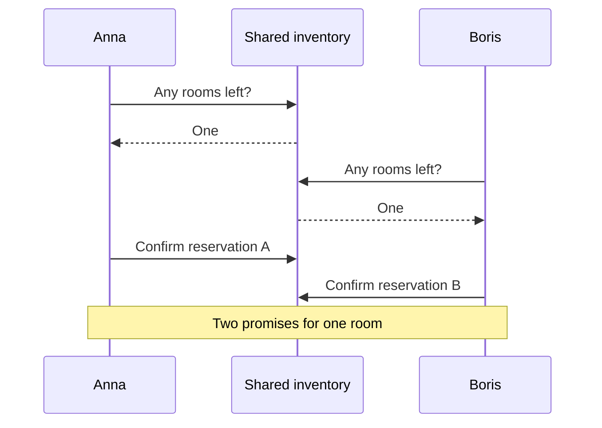
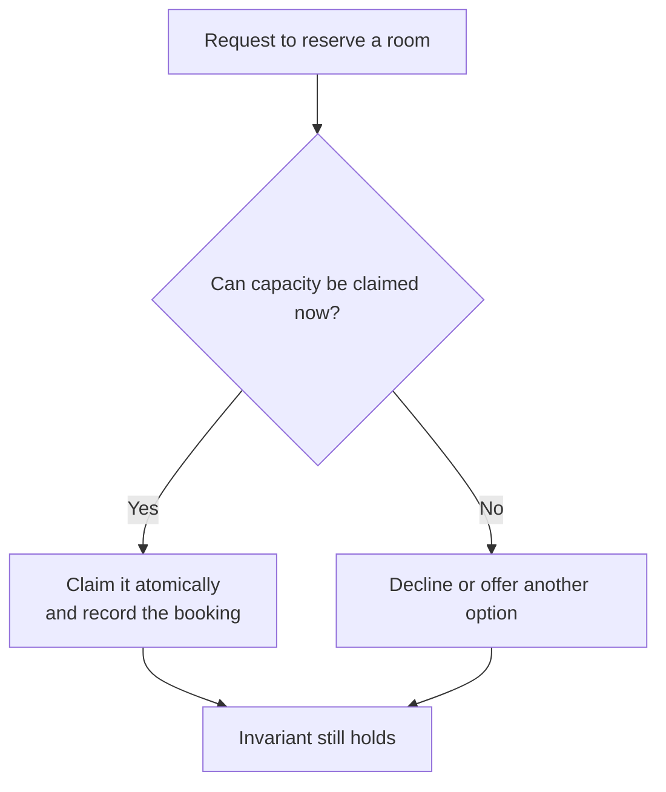

# CS120 — Mathematical and Statistical Thinking for Software Engineers

## Lecture 01: Logic, Proofs, and Invariants

*Why a reservation algorithm can pass hundreds of tests and still occasionally double-book a room — and how mathematical reasoning helps us discover problems that ordinary testing may never encounter.*

---

### How to listen to this lecture

This lecture is about learning to reason more precisely, not memorizing mathematical notation. We'll use one recurring booking-system incident to develop the ideas of logical implications, quantifiers, sets, functions, invariants, and proofs.

The central question is: **What would have to be true for us to trust this system, even in situations we haven't tested?**

Mathematical notation will appear occasionally, but every important idea is explained in ordinary language. Near the end, try answering the oral examination before reading the solutions. The practical exercises and dense interview cheat sheet come after the spoken portion.

---

# Part I — Intuition

*One hotel, one last room, and two perfectly reasonable employees. Why can both do their jobs correctly while the hotel gets overbooked?*

### First, picture the front desk

Imagine a tiny hotel with just one room left for tonight. Two receptionists, Anna and Boris, work at different desks. Both can see a shared screen displaying the number of available rooms.

At noon, the screen says **one room available**. Anna receives a call from a guest who wants it. At precisely the same moment, Boris receives a call from another guest. They both glance at the screen. Both see one room. Both tell their guests, “Yes, we can book that.” Each records a reservation, then updates availability.

At the end, the screen may say zero rooms left. It looks sensible. Except the hotel has promised the same last room to two guests.

Nobody misread the screen. Nobody made a typing mistake. The mistake was in the *rule for changing the shared information*: checking availability and committing a reservation were allowed to happen separately.

The first picture shows the two calls overlapping. The important detail is the gap between **checking** and **claiming**.



A few examples of working bookings could never tell us that this particular overlap is impossible. What we need is a statement that must remain true no matter how the day unfolds.

### 1. The rule that must never break

Let's write the simplest possible promise about our hotel: **the number of rooms promised for a night must never exceed the number of rooms that can actually be sold for that night**.

That promise has a name: an **invariant**. It isn't a description of what usually happens. It's a rule that must remain true throughout every legitimate change of state.

When zero rooms are booked, the rule holds. When one guest books the last room, it still holds. If the system attempts to confirm a second booking, it must refuse or perform some explicitly different business process. It cannot just keep creating promises and hope that the numbers work out afterward.

Now imagine an administrator changes the hotel's capacity from two rooms to one while two reservations are already confirmed. Even if Anna and Boris never make a mistake, that administrative action can break the rule. The invariant belongs to **all operations that change the relevant state**, not only the customer-facing booking button.

This is why stating the rule before inspecting code is so useful. It tells us what every implementation must protect.

### 2. A test is a photograph; a claim is about the whole film

Anna tests the booking system. She books the last room, tries another booking, and sees “Sold out.” The test passes. Boris tries a cancellation and another booking. That passes too.

Those tests are valuable, but each is like a photograph taken during a particular sequence of events. They don't show every possible order in which two employees can act.

Now imagine someone says, “The system **always** prevents overbooking.” That's a much bigger claim than “The three examples we tried worked.” One valid example of an overbooking disproves the universal claim. Such an example is called a **counterexample**.

Notice the asymmetry. Showing a hundred good bookings doesn't establish that *all* bookings will be good. Showing one legitimate bad sequence establishes that “never overbooks” is false.

This introduces a kind of mathematical thinking that is useful even without equations: pay attention to words like **every**, **some**, **never**, and **if**. They change exactly what you're claiming.

### 3. What if we turn the rule around?

Suppose our booking policy says, “If a reservation is confirmed, its room must be allocated.” Does that mean “If a room is allocated, its reservation is confirmed”?

Not necessarily. We might temporarily hold a room while a customer is paying. The allocation exists, but confirmation hasn't happened yet.

This is the difference between a requirement and a guarantee. Allocation is **necessary** for a valid confirmed booking in our example, but allocation alone is not **sufficient** to confirm it. Payment or other conditions might still be missing.

Small logical slips like reversing an “if” statement cause surprisingly serious design mistakes. They appear in authorization too: “Every administrator can edit bookings” does not imply “Everyone who can edit bookings is an administrator.”

### 4. Build the safe operation from the rule

How should we repair the reception desk?

The critical step is not merely displaying the correct count. It is making the *check and claim* behave as one protected decision. A shared authoritative system must decide: “There is capacity **right now**, so I will commit exactly one unit of it.” When Anna wins that decision, Boris must find that the last unit is no longer available.

This is often implemented using an atomic conditional database operation or a transaction that preserves the entire business rule. We will examine those mechanisms later. At the intuition level, all you need is the sequence in the next picture.



This shows the central idea of a **precondition** and a **postcondition**. Before a successful claim, valid capacity must be available at the decision point. Afterward, the reservation and capacity records must agree, and the invariant must still hold.

There's also a simple proof-shaped idea hiding here. Begin in a valid state. Check that every permitted action leaves the system in a valid state. If both are true—and we've included all relevant actions—then a sequence of those actions cannot create an invalid state. That's the intuition behind mathematical induction applied to software state.

The catch is that assumptions matter. If another booking platform can independently sell the same inventory, our local model is incomplete. A perfectly correct rule for a fictional hotel isn't proof of correctness for a real hotel with hidden sellers.

### Your mental checkpoint

**Question A:** The availability counter says zero, but two guests hold confirmations for one room. Is the counter itself enough to prove correctness? **No.** It doesn't establish that confirmed commitments fit capacity.

**Question B:** Anna successfully books the last room, then Boris tries. Which step must be protected against overlap? **The decision to check and claim remaining capacity**, together with appropriately recording the booking.

**Question C:** Does a thousand passing tests prove that no bad execution exists? **No.** One valid counterexample can disprove a universal claim.

Carry this image into Part II: **a rule about the hotel, not about one function; a starting state; and every action that might change it**. The mathematical vocabulary is simply a more precise way to discuss that picture.

*The intuition pass ends here.*

---

# Part II — Deep Dive

# 1. The Booking System That Passed Every Test

It's Monday, 10:42 in the morning.

Our hotel-booking platform has just deployed a new inventory-management service.

The service has a straightforward responsibility: prevent customers from reserving more rooms than a hotel actually has available.

The implementation is written in TypeScript.

For a given hotel, room category, and date, the database stores how many rooms remain available.

When a customer attempts a reservation, the service retrieves the current availability, checks that enough inventory exists, creates the reservation, and reduces the available count.

The engineering team has tested the implementation thoroughly.

There are tests for sold-out hotels, invalid dates, nonexistent room categories, cancellation scenarios, and requests containing unreasonable quantities.

All tests pass.

The test coverage report says 98%.

The deployment succeeds.

And at 10:42, two customers reserve the final available room for the same night.

Both receive confirmation.

The hotel has one room.

The system has sold two.

You open the source code.

The availability check looks correct.

The database update looks correct.

The reservation insert looks correct.

Every individual operation behaves as intended.

And yet the system is wrong.

How can that happen?

The answer is that the developers tested a collection of individual scenarios without establishing a general property of the system.

They proved, informally, that the implementation behaves correctly for the sequences they happened to execute.

They did not establish that the implementation preserves inventory correctness under every permitted ordering of concurrent operations.

That's the distinction we're going to investigate.

**A test describes one journey through the system. A correctness claim concerns an entire class of possible journeys.**

This is where mathematical reasoning enters software engineering.

Not because engineers need to decorate their code with equations.

But because a carefully stated property can reveal entire categories of mistakes that ordinary examples fail to expose.

---

# 2. What Does It Mean for Software to Be Correct?

Before fixing our booking service, we need to answer a surprisingly difficult question.

What does it mean for a program to be correct?

A developer might say that a program is correct when it produces the expected output.

That's a useful starting point.

But expected under which conditions?

Suppose we write a function that divides two numbers.

For ordinary positive inputs, it returns the expected result.

What happens when the divisor is zero?

What happens when the input is a string?

What happens when the numbers are extremely large?

What happens when one input is not a number?

Until we define the permitted inputs and required behavior, we haven't completely defined correctness.

We're merely describing examples of behavior we like.

## 2.1 Correctness is always relative to a specification

A **specification** states what behavior a system is required to exhibit.

For a sorting function, we might require that its output contains the same elements as its input and that those elements appear in nondecreasing order.

Notice that we need both requirements.

A function returning an empty array always produces a sorted array.

But it isn't a correct sorting function.

It violates the requirement to preserve the input elements.

This is a beautiful example of why specifications matter.

A requirement can be perfectly satisfied while the system is still wrong because another requirement was omitted.

For our booking system, a specification might require that confirmed reservations never exceed the available room capacity for any date.

But that's still not the entire business contract.

We also need appropriate behavior when inventory is unavailable, when customers cancel, when payments fail, and when requests are retried.

Correctness is therefore a relationship between an implementation and an explicit set of requirements.

## 2.2 Tests demonstrate cases, not universality

Imagine testing our booking function one thousand times.

Every test passes.

Can we conclude that every possible execution is correct?

No.

Perhaps the function fails only when two requests run concurrently.

Perhaps it fails only during the transition between two calendar dates.

Perhaps it fails when a hotel has exactly one remaining room and an unusual cancellation occurs.

There may be enormous numbers of possible states and execution sequences.

Tests provide evidence about the cases they exercise.

Some testing strategies provide much stronger evidence than others.

But **a finite collection of ordinary test cases does not, by itself, establish a universal correctness claim over an unbounded execution space**.

That's not an argument against testing.

Testing is indispensable.

It's an argument for complementing tests with explicit reasoning about the properties that must hold.

---

# 3. Propositions: Turning Vague Statements Into Claims We Can Examine

Let's begin with the basic unit of logic.

A **proposition** is a statement that can be considered true or false under a defined interpretation.

For example:

"The hotel has three rooms."

"The reservation is confirmed."

"The available inventory is greater than zero."

These are statements whose truth we can evaluate given the relevant facts and definitions.

Now consider:

"The booking system is reliable."

That statement is much less useful.

Reliable in what sense?

Under what load?

During which failures?

With what acceptable error rate?

We need to make it more precise before reasoning about it.

This is a recurring engineering problem.

We often argue using words that sound meaningful but hide incompatible interpretations.

One person says a database is consistent.

Another says a service is available.

A third says an operation is atomic.

Without specifying the relevant guarantees, they may be discussing different properties.

Mathematical reasoning begins by removing ambiguity.

## 3.1 Logical AND and OR

Suppose a reservation can be confirmed only when sufficient inventory exists **and** payment authorization has succeeded.

Both conditions must be satisfied.

This is logical conjunction, commonly called AND.

Now imagine a customer may authenticate using either an existing session **or** an appropriate alternative authentication mechanism.

At least one acceptable route must succeed.

This is logical disjunction, commonly called OR.

These operations feel elementary because programmers use them constantly.

But they become important when requirements grow complicated.

Consider the expression:

A booking is eligible when the customer has verified identity and either has a valid payment method or qualifies for an approved invoice arrangement.

Where do the logical groupings belong?

A misplaced pair of parentheses can change the set of customers who qualify.

When reasoning about critical rules, write the expression so the intended grouping is unambiguous.

This is not mathematical pedantry.

It's how authorization bugs happen.

## 3.2 Negation

Negation means that a proposition is not true.

If the proposition is "the reservation is confirmed," its negation is "the reservation is not confirmed."

But consider a statement involving several conditions.

"The reservation is valid when the dates are valid and payment is authorized."

What does it mean for this combined condition to be false?

At least one required condition failed.

Either the dates are invalid, payment isn't authorized, or both.

This is an example of **De Morgan's laws**.

The negation of "A and B" is "not A or not B."

The negation of "A or B" is "not A and not B."

These relationships appear in access-control policies, validation logic, query filters, and error handling.

A developer who understands them can simplify or challenge complicated conditional logic without relying solely on intuition.

One qualification matters: ordinary programming languages may introduce values such as null, undefined, and SQL's unknown truth value. These can require more careful reasoning than elementary two-valued propositional logic.

The logical model must match the system being analyzed.

---

# 4. Implication: The Most Misunderstood Word in Engineering

Now let's examine a particularly important logical relationship.

Suppose we state:

**If a reservation is confirmed, then the corresponding inventory must have been allocated.**

This is an implication.

We can write it as: confirmed implies allocated.

The implication describes a required relationship between two conditions.

If the reservation is confirmed and the inventory wasn't allocated, the rule has been violated.

But there's a trap.

Does the rule mean that whenever inventory is allocated, the reservation must already be confirmed?

No.

A reservation might temporarily hold inventory while waiting for payment.

Allocation can exist without final confirmation.

The original implication does not establish its reverse.

## 4.1 Necessary versus sufficient conditions

These two words are worth understanding properly.

A condition is **necessary** when the desired outcome cannot legitimately occur without it.

Inventory allocation is necessary for a confirmed reservation under our chosen business rules.

A condition is **sufficient** when satisfying it guarantees the conclusion.

For example, if our system's rules define a particular validated state transition as sufficient to enter the confirmed state, then successfully completing that transition establishes confirmation.

But merely having inventory available isn't sufficient.

Payment might fail.

The booking might violate another business rule.

Or the customer might abandon the process.

This distinction is useful throughout software engineering.

Imagine an interviewer asks:

"Does using HTTPS make an API secure?"

HTTPS is valuable and often necessary for protecting communication over an untrusted network.

But it isn't sufficient to secure the application.

Authorization, input validation, business logic, configuration, and many other concerns remain.

We shouldn't confuse an important prerequisite with a complete solution.

## 4.2 The contrapositive

There's another logical relationship worth knowing.

If A implies B, then not B implies not A.

This is the **contrapositive**.

Return to our business rule:

If a reservation is confirmed, its inventory must be allocated.

The contrapositive says:

If the required inventory is not allocated, the reservation cannot validly be confirmed.

These express the same logical constraint.

But the converse—allocated implies confirmed—is not automatically valid.

Why does this matter?

Because engineers routinely make incorrect conclusions by reversing implications.

"Every failed deployment produced an alert" does not mean "every alert indicates a failed deployment."

"Every properly authenticated request contains valid credentials" does not mean "valid credentials authorize every request."

Understanding the difference between an implication, its converse, and its contrapositive is a small conceptual investment with enormous practical value.

> **Sticky note #1:** If A implies B, you cannot conclude that B implies A. You can conclude that not B implies not A.

---

# 5. Quantifiers: The Difference Between One Example and Every Example

Now we reach a concept that explains why passing tests isn't equivalent to a general guarantee.

Consider this statement:

"Every confirmed reservation has valid inventory."

The word **every** is doing important work.

It means that the property must hold for all confirmed reservations within the specified system and time context.

Mathematics uses a universal quantifier for this kind of statement.

We don't need to become fluent in notation immediately.

The practical interpretation is enough.

We are making a claim about an entire collection of cases.

## 5.1 Universal claims are strong

Suppose our application processes ten thousand reservations.

We inspect one hundred.

Every inspected reservation has valid inventory.

What have we established?

That the selected hundred satisfy the property.

We have not established that all ten thousand do.

If the one hundred were selected using a careful random sampling process, we might make a statistical inference about the larger population.

But that is different from a logical proof that no violation exists.

We will study statistical inference in CS120-L03.

For now, distinguish:

"Every reservation is correct."

from:

"Every reservation we checked was correct."

These are radically different claims.

## 5.2 Existential claims are easier to establish

Now consider:

"At least one reservation was double-booked."

This is an **existential claim**.

To establish it, we need one valid example.

One reservation conflict is enough to disprove the universal claim that double bookings never occur.

This is why counterexamples are so powerful.

Suppose someone proposes an algorithm and claims it always works.

You don't necessarily need to construct a complete alternative algorithm to challenge the claim.

You need one valid input or execution sequence in which it fails.

A single counterexample is sufficient to refute a universal statement.

This is one of the most useful habits in algorithmic interviews and architecture reviews.

Instead of saying, "I have a feeling that won't work," construct the smallest example demonstrating the failure.

## 5.3 Quantifier order changes meaning

Let's explore a more subtle example.

Statement A:

"For every customer, there exists some hotel they can afford."

Statement B:

"There exists one hotel that every customer can afford."

These are not equivalent.

The first permits different customers to afford different hotels.

The second requires one hotel affordable to everyone.

The words are almost identical.

The quantifiers are arranged differently.

Now apply the same idea to a booking.

"For every night in the reservation, there exists an available room."

That isn't necessarily the same as:

"There exists one physical room available for every night."

If the business promises a particular room for the whole stay, the second statement matters.

If the hotel sells interchangeable room-category inventory and permits internal room assignments, a different invariant may be appropriate.

The quantifier structure expresses an actual business requirement.

**A data model or algorithm can be logically consistent while solving the wrong problem because the specification used the wrong quantifiers.**

---

# 6. Sets and Functions: Building a Small Model of Reality

Let's now construct a more precise model of our booking system.

Mathematical models become useful when they remove unnecessary details.

We don't need every column in the database.

We don't need to describe HTTP requests or payment-provider APIs yet.

We only need the information relevant to the property we're investigating.

Suppose a hotel has three rooms in one category.

Let the set of stay dates be all calendar dates for which reservations may be accepted.

For every relevant date, define a capacity.

And define how many units of capacity have been committed to existing reservations or holds that count against availability.

We can think of capacity and reserved inventory as **functions**.

A function associates each valid input with one output.

For example, capacity for December 15 might be three.

Reserved inventory for the same date might be two.

This is simple enough to understand without notation.

But it provides a precise vocabulary for the rule we're trying to enforce.

## 6.1 The inventory invariant

For every date, the reserved quantity must not exceed the capacity.

Also, reserved quantity should not become negative.

So our core invariant is:

**For every date, reserved inventory is at least zero and at most the allowed capacity.**

We could express it compactly as:

\(0 \leq R(d) \leq C(d)\)

Here, R represents reserved inventory, C represents capacity, and d represents a date.

This little expression doesn't implement anything.

It doesn't mention MongoDB, PostgreSQL, Redis, or TypeScript.

That's exactly why it's useful.

It's a statement about the business state that any valid implementation must preserve.

## 6.2 Sets clarify date ranges

Imagine a customer checks in on December 15 and checks out on December 18.

Which nights must the reservation occupy?

December 15, 16, and 17.

Not December 18.

A convenient model treats the stay as a half-open interval: the check-in date is included, and the check-out date is excluded.

That avoids ambiguity about the departure date.

When reasoning about overlapping reservations, we can examine whether their sets of occupied nights intersect.

For example, one booking covering the nights of December 15 through 17 conflicts with another booking of the same uniquely assigned room covering December 17 through 19.

The two intervals share the night of December 17.

But a booking checking out on December 18 does not occupy the night of December 18.

A correct model makes that distinction explicit.

This is one reason mathematical abstractions are valuable.

They help expose boundary conditions before those conditions become production bugs.

## 6.3 A useful model is deliberately incomplete

Our model says nothing about customer names.

It says nothing about the frontend.

It says nothing about payment-provider webhooks.

Those details matter elsewhere, but they aren't necessary for proving the specific inventory constraint.

A good model includes enough information to reason about the target property without reproducing the entire system.

This is a central engineering skill.

Abstraction isn't merely hiding implementation details in classes.

It's identifying which details matter for a particular question.

---

# 7. Preconditions and Postconditions: The Contract of an Operation

Now imagine a function that reserves one room for one night.

We want to describe what must be true before the operation and what must be true afterward.

A **precondition** describes requirements the operation expects to hold before execution.

A **postcondition** describes the guarantees the operation provides after successful completion, assuming its preconditions and relevant environmental assumptions hold.

This is sometimes called **design by contract**.

It is closely related to Hoare logic, a framework for reasoning about programs.

## 7.1 A reservation operation's contract

Suppose our operation reserves one unit of inventory for a date.

Its relevant precondition is that the date is valid, the requested room category exists, and at least one unit of inventory is currently available at the operation's authoritative decision point.

Its successful postcondition is that reserved inventory increases by one, the associated reservation state is recorded appropriately, and the inventory invariant still holds.

The failure result must also be specified.

If no inventory is available, the operation must not silently create a confirmed reservation.

If a transaction fails, it must not leave an unauthorized partial allocation.

This is more useful than simply saying:

"The function creates reservations."

We have identified what success means and which conditions must be preserved.

## 7.2 Preconditions aren't comments that make bugs disappear

Here's an important subtlety.

Suppose we write a function whose contract requires sufficient inventory.

The application checks inventory first.

It sees one remaining unit.

Then, before writing, another request claims that unit.

Our original precondition no longer holds at the actual mutation point.

Simply checking it earlier wasn't enough.

The system must enforce the condition at the appropriate atomic boundary.

This is a **time-of-check to time-of-use problem**.

The mathematical contract tells us what must be true.

The implementation must make that truth meaningful despite concurrency.

One way to do this is to make the database's conditional update test and modify the current state atomically.

The contract informs the mechanism.

It doesn't replace it.

---

# 8. The Counterexample: Two Requests, One Room

We're finally ready to reproduce the original failure.

The hotel has one room remaining for December 15.

Two customers submit booking requests at almost the same moment.

Let's call them A and B.

The application performs these conceptual steps:

First, read the available quantity.

Second, if it is greater than zero, create the reservation.

Third, reduce the available quantity.

Individually, the logic looks reasonable.

But the operations aren't automatically one indivisible action.

The following timeline shows a possible execution.

```text
Initial availability = 1

Request A                       Request B
---------                       ---------
Read availability: 1
                                Read availability: 1
Check: room available
                                Check: room available
Create reservation A
                                Create reservation B
Set availability to 0
                                Set availability to 0

Final availability = 0
Confirmed reservations = 2
Physical capacity = 1
```

The final counter says zero rooms remain.

That might look plausible in isolation.

But the system has two confirmed reservations for one room.

The invariant is violated.

## 8.1 Why tests missed it

The tests likely executed the booking operation sequentially.

One customer reserved the last room.

The next customer attempted a booking and correctly received a sold-out response.

That test passed.

But concurrent requests can interleave.

The operating system, runtime, network, and database determine when different operations execute.

There are many possible interleavings.

Most might behave correctly.

The dangerous one occurs when both requests observe the same available inventory before either claim is committed.

Ordinary unit tests often don't exercise that sequence.

And even concurrency tests may fail to reproduce it consistently unless they deliberately control the relevant timing.

## 8.2 One counterexample destroys the universal claim

The team claimed:

"The implementation never double-books rooms."

We have constructed one permitted execution where it does.

That is enough to refute the claim.

We don't need to measure the failure rate.

We don't need to show it happens under every workload.

We only need to establish that the implementation allows the violating execution.

This is logical reasoning at work.

It transforms a vague fear about concurrency into a concrete defect.

## 8.3 The repair

Suppose the database stores available inventory as an integer.

We replace the separate read-and-write sequence with one atomic conditional operation.

The operation says:

"Decrement available inventory by one, but only when its current value is greater than zero."

If the database performs the condition and update atomically for the relevant record, competing requests cannot both successfully consume the same final unit.

One request succeeds.

The other observes that the condition no longer matches.

But we must still ensure that the reservation record and inventory mutation are coordinated appropriately.

If the decrement succeeds and reservation creation fails afterward, the inventory might remain consumed without a valid booking.

That wider invariant may require a transaction.

The important point is that the logical property tells us where the atomic boundary must be.

> **Sticky note #2:** The bug isn't that two requests execute simultaneously. The bug is that a business decision depends on state that can change between the check and the modification.

---

# 9. Invariants: Properties That Must Survive Every Valid Transition

We've used the word invariant several times.

Now let's define it more carefully.

An **invariant** is a property that must hold in every state reachable through the system's permitted operations, assuming the initial state and model assumptions are valid.

The phrase "reachable state" matters.

We don't need to prove that an arbitrary collection of impossible database values satisfies the invariant.

We need to establish that the system starts in a valid state and that every permitted operation preserves validity.

This gives us a practical method for reasoning about software.

## 9.1 Start with an initial state

Suppose the hotel has one room.

Initially, there are no reservations.

Reserved inventory equals zero.

Capacity equals one.

The invariant holds.

We have established the **base case**.

## 9.2 Examine every permitted transition

Now consider a successful booking.

The operation may increase reserved inventory by one only when doing so will not exceed capacity.

Therefore, if the invariant held before the operation, it still holds afterward.

Now consider cancellation.

A valid cancellation may release previously committed inventory.

It must not reduce the reserved quantity below zero or release the same allocation twice.

Again, if correctly implemented, the transition preserves the invariant.

Now consider increasing capacity.

That doesn't threaten the upper bound as long as the new capacity remains at least the reserved quantity.

But decreasing capacity is more dangerous.

Suppose a hotel reduces its bookable inventory from five units to three while four units are already committed.

If the operation changes capacity unconditionally, it violates the invariant.

Therefore, capacity changes must also respect existing commitments or trigger an explicitly defined business workflow.

This is an important discovery.

An invariant doesn't belong to one booking function.

**It must be preserved by every operation capable of changing the state on which it depends.**

A booking endpoint might be perfectly correct while an administrative inventory-adjustment endpoint breaks the same invariant.

This is why reasoning about system-wide state transitions is powerful.

## 9.3 The induction argument

Our proof has two parts.

First, the initial state satisfies the invariant.

Second, every permitted transition preserves it.

If both statements are true, then every state reached through a finite sequence of permitted transitions satisfies the invariant.

This is a form of **mathematical induction**.

The idea is simple.

We know the first step is safe.

We know that taking one more permitted step from a safe state keeps it safe.

Therefore, no finite sequence of permitted steps can lead to an unsafe state.

Notice how different this is from running one thousand example requests.

We are not enumerating a sample of histories.

We are reasoning about the general structure of all permitted transitions.

Of course, the strength of the proof depends on the accuracy of the model and our examination of the transitions.

If an administrative endpoint was omitted, the argument is incomplete.

If two supposedly atomic operations can actually interleave, an assumption is false.

But the method tells us exactly what must be checked.

---

# 10. Loop Invariants: The Same Reasoning Inside an Algorithm

Invariants aren't limited to databases or concurrent services.

They also help reason about ordinary algorithms.

Imagine a function scanning a list of reservation requests.

Its job is to calculate the total number of requested room-nights.

One implementation processes requests one at a time and maintains a running total.

We can state a loop invariant:

**After processing the first k requests, the running total equals the sum of the room-nights required by those k requests.**

Let's examine why this is useful.

Before processing anything, k is zero.

The running total is zero.

The invariant holds.

When the algorithm processes the next request, it adds that request's room-night count.

The running total now equals the sum of the first k plus one requests.

The invariant is preserved.

When the loop terminates after processing every request, the running total equals the sum for the complete input.

We have established correctness relative to the intended arithmetic model and assumptions.

## 10.1 The three-part loop proof

A typical loop-correctness argument examines three things.

**Initialization:** The invariant holds before the first iteration.

**Maintenance:** If it holds before an iteration, the loop body preserves it.

**Termination:** When the loop stops, the invariant and termination condition imply the desired postcondition.

There's an additional responsibility: prove that the loop actually terminates under the relevant assumptions.

A loop can preserve its invariant forever while never producing an answer.

That distinguishes partial correctness from total correctness.

Partial correctness says the result is correct if execution terminates.

Total correctness additionally establishes termination.

For ordinary application code, we rarely write complete mathematical proofs.

But this reasoning is useful when debugging binary search, pointer algorithms, incremental processing, and stateful loops.

Instead of staring at code and hoping it works, ask what remains true after every iteration.

---

# 11. Proof by Contradiction: What If the Bad State Were Reachable?

Now consider another proof technique.

**Proof by contradiction** begins by assuming that the claim we want to establish is false.

We then show that this assumption conflicts with other established facts.

For example, suppose a database enforces a unique constraint on reservation operation IDs.

We want to establish that two distinct committed rows cannot have the same operation ID in that constrained table, under normal constraint-enforcement semantics.

Assume the opposite.

Suppose two distinct committed rows have the same constrained identifier.

But the database's enforced uniqueness rule prohibits exactly that state.

The assumption contradicts the constraint.

Therefore, the two rows cannot coexist in the committed table while the specified uniqueness guarantee holds.

This proof is only as strong as its assumptions.

If uniqueness is enforced merely by an application-level "check whether the ID exists" operation, concurrency can defeat it.

If the records live in two independent databases with no shared uniqueness mechanism, the conclusion may not apply.

If the constraint is disabled, the premise changes.

The logic is simple.

The difficulty lies in knowing which guarantees are actually enforced.

## 11.1 Contradiction doesn't prove more than the premise allows

Here's a subtle trap.

Suppose we've proved that no two reservations share the same reservation ID.

Does that prove the system cannot double-book a room?

No.

Two conflicting reservations can have different IDs.

Uniqueness of the identifier is a different invariant from uniqueness of the inventory commitment.

This is another example of an incomplete specification.

We proved one meaningful property.

We did not prove every desirable property.

Formal reasoning is valuable precisely because it prevents us from casually treating one guarantee as a substitute for another.

---

# 12. Safety and Liveness: Not Breaking Things Versus Eventually Doing Things

We've mostly discussed properties that forbid bad states.

Reservations must not exceed capacity.

Balances must not become invalid.

Unauthorized users must not access another customer's private information.

These are examples of **safety properties**.

Informally, safety says:

"Something bad never happens."

But a system can be perfectly safe while being practically useless.

Imagine a booking service that rejects every reservation request.

It will never double-book a room.

Its safety property holds.

Customers won't be impressed.

We also need **liveness properties**.

Liveness concerns whether desirable progress eventually occurs.

For example:

"A valid reservation request should eventually receive a meaningful outcome under specified operating assumptions."

Or:

"A temporary inventory hold should eventually be confirmed, released, or otherwise resolved according to its workflow."

These are progress requirements.

## 12.1 Safety and liveness can conflict operationally

Imagine that a payment provider becomes unreachable.

Our booking system has two choices.

It can pretend the payment succeeded and confirm the reservation.

Or it can preserve an uncertain state while investigating or retrying safely.

The second approach may temporarily reduce availability or responsiveness.

But it protects correctness.

A system designed for stronger safety guarantees may sometimes need to wait, reject, or defer operations when it cannot establish the necessary facts.

This is a recurring distributed-systems trade-off.

We shouldn't optimize for immediate progress by silently violating business invariants.

## 12.2 Timeouts complicate liveness

Suppose we state:

"Every pending reservation eventually becomes confirmed or cancelled."

That sounds reasonable.

But what if the application crashes and never restarts?

What if the message-processing system is permanently unavailable?

What if an external dependency never responds?

A rigorous liveness claim needs assumptions.

Perhaps the system requires that workers eventually execute, durable jobs are eventually retried, and relevant dependencies recover sufficiently for progress.

Without assumptions about scheduling and recovery, the statement may be impossible to guarantee.

This illustrates a broader principle.

Safety is often demonstrated by finding a finite bad execution.

Liveness typically concerns the behavior of executions over time.

Proving it requires reasoning about continued progress, not merely checking that one operation completed correctly.

---

# 13. The Model Is Not the Real World

At this point, mathematical reasoning might begin to sound like a universal solution.

Write the invariants.

Prove the operations preserve them.

Deploy perfect software.

Unfortunately, reality is less cooperative.

A proof establishes a conclusion under its assumptions.

If the assumptions don't match the implementation or environment, the conclusion may not apply.

Suppose our inventory model assumes that all reservations pass through one authoritative transactional database.

But the company also accepts reservations through an external supplier integration.

The supplier can independently commit inventory.

Our local database may preserve its own invariant perfectly while the combined business system still oversells rooms.

The local proof isn't necessarily wrong.

The model omitted another actor capable of changing the relevant reality.

## 13.1 Hidden writers

This is a particularly dangerous category of mistake.

A business invariant may be affected by several components.

Customer booking requests.

Administrative inventory adjustments.

Supplier synchronization jobs.

Cancellation workflows.

Manual customer-support corrections.

Import scripts.

Migration tools.

Every writer must respect the relevant invariant.

If even one path bypasses the enforcement mechanism, the property may be violated.

This is why placing critical constraints as close as possible to authoritative state changes is often valuable.

A database constraint or atomic conditional update can protect against mistakes made by several different application paths.

But not every complex business invariant can be represented through one database constraint.

Architecture must identify what remains the application's responsibility.

## 13.2 Time is an assumption too

Imagine a reservation hold expires at 15:00.

A worker responsible for releasing expired holds runs every minute.

At 15:00:05, the hold still exists in the database because the worker hasn't executed.

Is the system incorrect?

That depends on the specification.

If the business rule says the hold becomes invalid precisely at its expiration timestamp, the authoritative decision logic must check that timestamp.

It cannot rely solely on the background worker having physically removed the record.

The cleanup process may run later.

A database record can exist while no longer representing a valid active hold.

This distinction between stored state and business validity becomes important in distributed systems, caches, authentication, and scheduled workflows.

## 13.3 The correct amount of formalism

Do we need to write a mathematical proof for every controller method?

No.

That would impose substantial cost without necessarily improving every part of the system.

The value of formal reasoning depends on risk and complexity.

For rendering a decorative footer, ordinary tests may be sufficient.

For processing money, allocating scarce inventory, coordinating distributed workflows, or enforcing security boundaries, explicit invariants can be extremely valuable.

The goal isn't to convert the codebase into a mathematics textbook.

It's to develop the ability to recognize when a precise property would expose dangerous ambiguity.

---

# 14. Property-Based Testing: Let the Computer Search for Counterexamples

We've established that a few hand-written tests cannot prove a universal claim.

But we can improve testing by making it less dependent on examples we invent manually.

**Property-based testing** begins with a general property and generates many different inputs to challenge it.

Instead of writing ten tests for specific booking quantities, we describe a rule.

For example:

"After any valid sequence of booking and cancellation operations, reserved inventory remains between zero and capacity."

A property-testing framework can generate sequences of operations and check whether the model or implementation violates that condition.

This is more powerful than choosing only a few expected scenarios.

But it is still testing.

The generated cases are finite, and the coverage depends on the generators, assumptions, and test harness.

## 14.1 Shrinking makes failures understandable

One especially useful technique is **shrinking**.

Imagine a property-based test generates a sequence of fifty operations that causes a failure.

That sequence might be difficult to understand.

A shrinking mechanism attempts to simplify the failing case while preserving the failure.

Perhaps it discovers that only three operations are required:

Create reservation A.

Create reservation B concurrently.

Cancel one operation under a particular timing condition.

The reduced case becomes a powerful debugging artifact.

This resembles mathematical counterexample construction.

We aren't merely detecting failure.

We're searching for the smallest explanation that demonstrates the broken property.

## 14.2 Generating inputs isn't enough for concurrency

A property-based test may generate many valid booking requests.

But if it executes them sequentially, it might never expose the dangerous interleaving.

Concurrency testing needs control or variation over operation scheduling.

We may need deliberate barriers, fault injection, or a model of concurrent actions.

This is why the original booking bug survived extensive ordinary testing.

The missing dimension wasn't merely which inputs occurred.

It was **when operations were permitted to interleave**.

---

# 15. Model Checking: Exploring the State Space

There's another powerful idea from formal methods.

Instead of running the full production application, we can construct a small model of its possible states and transitions.

Then a tool explores those states looking for violations.

This is **model checking**.

Imagine reducing our booking system to the smallest interesting scenario.

One hotel.

One room.

Two customers.

Each customer may attempt a reservation.

The model contains actions such as reading availability, attempting a claim, confirming a reservation, and cancelling.

A model checker explores possible execution sequences within that defined model.

If it finds a sequence violating the inventory invariant, it can report the counterexample.

This is particularly valuable for concurrency and distributed systems because humans are bad at imagining all possible interleavings.

## 15.1 State-space explosion

There's a catch.

As the number of actors, states, and operations increases, the number of possible system states can grow enormously.

This is called **state-space explosion**.

A model containing two customers and one room may be easy to explore.

A model containing ten thousand customers, millions of reservations, payment providers, delayed messages, and infrastructure failures would be far more difficult.

That's why useful formal models are usually abstractions.

We remove details that aren't relevant to the property being investigated.

We test the core state-transition logic under small but strategically chosen configurations.

A counterexample in a tiny model can expose a real architectural flaw.

## 15.2 TLA+ and Alloy

You may encounter tools such as TLA+ and Alloy.

TLA+ is commonly used to specify and reason about stateful and concurrent systems, including safety and liveness properties.

The TLC model checker can explore finite models for invariant violations and other specified properties.

Alloy provides a relational modeling language and automated analysis facilities useful for examining structural constraints and possible configurations.

You don't need to master either tool to benefit from this lecture.

But knowing that such tools exist changes how you approach difficult correctness problems.

When a distributed workflow becomes too complicated to reason about through code inspection alone, you can consider modeling its states and transitions explicitly.

Formal methods don't replace tests, monitoring, or operational experience.

They give us additional ways to discover mistakes before those mistakes become production incidents.

---

# 16. Where Logic Appears in Everyday Engineering

Let's make the connection practical.

You probably use mathematical reasoning more often than you realize.

When you define TypeScript discriminated unions for a payment workflow, you're trying to make invalid states harder to express.

When you add a database uniqueness constraint, you're enforcing a universal property of committed records.

When you choose an atomic update instead of a separate read and write, you're preserving an invariant under concurrency.

When you design a retry mechanism, you reason about whether applying the same operation more than once changes the intended result.

When you validate API input, you distinguish preconditions from postconditions.

When you reject a proposed optimization using a small counterexample, you're performing a miniature mathematical argument.

And when an interviewer asks whether a distributed design is safe, your strongest response is often not a product name.

It's a question about the required invariant.

"What exactly must never happen?"

Then:

"Which component enforces that property, and does the guarantee still hold when operations overlap or a component fails?"

That's mathematical thinking expressed in engineering language.

You don't need to sound like a mathematician.

You need to reason like someone who understands what would make a claim true.

---

# 17. The Oral Examination

Try answering these questions aloud before reading the solutions.

Don't simply name a concept. Explain why the conclusion follows, what assumptions it requires, and which counterexample would challenge it.

## Challenge 1 — The test suite

A backend engineer says:

"Our reservation service has 100% statement coverage and every test passes. Therefore, it cannot double-book a room."

Evaluate the argument.

What would be required to support the stronger universal correctness claim?

## Challenge 2 — Necessary versus sufficient

Consider the business rule:

"If a reservation is confirmed, its inventory is allocated."

Is inventory allocation necessary for confirmation?

Is it sufficient?

What is the contrapositive of the rule?

## Challenge 3 — The quantifier trap

Compare these statements.

"For every reservation night, there exists an available physical room."

"There exists one physical room available for every reservation night."

Are they equivalent?

Under which business model might the distinction matter?

## Challenge 4 — The missing invariant

A hotel has three rooms.

The reservation service guarantees that every confirmed reservation has a unique reservation ID.

Can the hotel still be overbooked?

What additional invariant would address that problem?

## Challenge 5 — The concurrent update

Two requests read available inventory equal to one.

Both decide a booking is possible.

Both create reservations.

What is the logical flaw?

How would you change the operation to preserve the inventory invariant?

## Challenge 6 — The induction proof

Suppose reserved inventory initially equals zero and capacity equals five.

Every permitted booking increases reserved inventory by one only when the current reserved quantity is below capacity.

Every permitted cancellation decreases it by one only when a valid outstanding allocation exists.

Explain why the inventory quantity remains between zero and five after any finite sequence of these operations, assuming atomic transitions and no omitted writers.

## Challenge 7 — Safety versus liveness

A booking system rejects every reservation request.

It never double-books a room.

Is it correct?

Which safety property does it satisfy, and which progress requirements might it violate?

## Challenge 8 — The model that lied

A team proves that its local database never allocates more rooms than its configured capacity.

Yet the hotel is occasionally oversold because external suppliers can also sell inventory.

Was the proof necessarily invalid?

What was missing from the model?

---

# 18. Solutions and Discussion

## Solution 1 — Coverage doesn't imply universal correctness

Statement coverage shows that statements were executed during the tests.

It doesn't establish that every input, timing interleaving, environmental failure, or logical state transition was exercised.

A stronger claim requires a precise specification, relevant assumptions, and evidence that permitted operations preserve the required invariant.

Testing can provide important supporting evidence, but coverage percentage alone isn't a proof of correctness.

## Solution 2 — Implication

Inventory allocation is necessary for valid confirmation under the stated rule.

It isn't sufficient because other conditions, such as payment or business validation, may still be required.

The contrapositive is:

"If the required inventory is not allocated, the reservation cannot validly be confirmed."

The converse—allocated inventory implies confirmation—does not follow.

## Solution 3 — Quantifier order

The statements aren't equivalent.

The first allows a different physical room to be available on each night.

The second requires one physical room available throughout the entire stay.

If the product promises one specific physical room, the second requirement is relevant.

If it sells interchangeable room-category inventory and can move guests or allocate rooms differently, the business model may permit other solutions.

The specification must express what the customer is actually promised.

## Solution 4 — Unique IDs don't prevent overbooking

The database can create four confirmed reservations with four distinct identifiers for a hotel that has only three rooms.

Identifier uniqueness doesn't constrain inventory usage.

The system needs an invariant stating that committed inventory demand must not exceed valid capacity for each relevant date and room category, along with a mechanism enforcing it.

## Solution 5 — Check-then-act race

The requests base their decisions on state that can change before the mutation.

A conditional atomic update can enforce the availability check and inventory decrement together.

Reservation creation must also be coordinated with the inventory claim so the system doesn't leave incomplete or contradictory state.

The exact mechanism may involve a database transaction or carefully designed durable hold workflow.

## Solution 6 — Induction

The initial state satisfies the invariant because zero is between zero and five.

A successful booking can only increase reserved inventory when it remains below capacity, so the new value is at most five.

A valid cancellation can only decrease an existing allocation, so the new value remains nonnegative.

If these are the only permitted state-changing operations and their conditions are enforced atomically, each transition preserves the invariant.

By induction over the number of operations, every reachable state after a finite sequence satisfies the invariant.

## Solution 7 — Safety and liveness

The system satisfies the narrow safety property that it never oversells inventory.

But it fails to provide useful progress for valid customers.

A complete specification needs liveness or service-progress requirements in addition to safety.

For example, valid requests should eventually receive appropriate outcomes under specified operating conditions.

Never doing anything is not a satisfactory booking service.

## Solution 8 — Missing external actor

The local proof may be valid under its model.

But the model assumes that the local database has complete authority over inventory.

If an external supplier can independently change the actual available inventory, the local invariant doesn't necessarily describe the global business state.

The architecture needs a model of shared ownership, supplier commitments, synchronization, or an authoritative allocation protocol.

Correctness depends on assumptions matching the real system.

---

# 19. The Mental Model Worth Keeping

Mathematical reasoning in software engineering begins with clear claims.

A **proposition** is a statement whose truth can be examined.

An **implication** states that one condition guarantees another, without automatically establishing the reverse.

A **quantifier** distinguishes what is true for one case from what must hold for every case.

A **counterexample** refutes a universal claim by demonstrating one valid failure.

A **precondition** describes what an operation requires.

A **postcondition** describes what successful execution guarantees.

An **invariant** is a property that must hold in every reachable state.

And **inductive reasoning** establishes that property by proving it initially and showing that every permitted transition preserves it.

The central method is:

**Specify the property. Identify the assumptions. Model the state. Examine the transitions. Search for a counterexample. Enforce the invariant at the correct boundary.**

Testing and formal reasoning complement one another.

Tests expose actual behavior.

Models expose assumptions and possible behavior.

Proofs establish conclusions under explicit conditions.

Together, they produce much stronger confidence than either approach used carelessly.

The most important question to take away is this:

**What would have to be true for this implementation to be correct in every situation that matters?**

That's the beginning of rigorous engineering.

---

# 20. Next Lecture — Probability, Randomness, and Risk

We've spent this lecture reasoning about claims that are true or false under defined assumptions.

But engineering decisions rarely offer complete certainty.

A fraud detector raises an alert.

How likely is the customer actually fraudulent?

A monitoring system reports a suspicious event.

How should we interpret that evidence when genuine failures are rare?

A distributed service has several components that can fail independently—or fail together.

How do we estimate the risk?

In **CS120-L02 — Probability, Randomness, and Risk**, we'll move from logical certainty to mathematical uncertainty.

We'll investigate conditional probability, independence, expected value, base rates, and the surprisingly deceptive behavior of rare events.

Our opening mystery will involve a fraud detector that appears almost perfectly accurate.

And yet most of the alerts it produces are wrong.

The mathematics explaining why is one of the most useful tools an engineer can learn.

---

# Optional Practical Lab — Reasoning About Correctness

*The spoken lecture ends here. The remaining exercises are designed for terminal experimentation, written reasoning, and later revision.*

## Lab A — Build a truth table

Consider two conditions:

- A: The customer is authenticated.
- B: The customer is authorized to view the reservation.

Evaluate the expression "A and B" for every possible combination.

| A | B | A AND B |
|---|---|---|
| False | False | ? |
| False | True | ? |
| True | False | ? |
| True | True | ? |

Then answer:

Does authentication imply authorization?

Does authorization necessarily imply that this particular authentication mechanism succeeded?

What additional assumptions would be required?

## Lab B — Find the logical error

A developer writes this authorization condition:

```typescript
function mayViewReservation(
  isOwner: boolean,
  isAdministrator: boolean,
  isAuthenticated: boolean
): boolean {
  return isOwner || isAdministrator && isAuthenticated;
}
```

The intended policy is:

"The user must be authenticated and must either own the reservation or have administrator privileges."

Explain why the implementation doesn't express that requirement correctly.

Then write the corrected expression.

Investigate how JavaScript's operator precedence affects the original implementation.

## Lab C — Reproduce the booking race

The following deliberately unsafe TypeScript example models a shared inventory counter.

```typescript
let available = 1;
let confirmed = 0;

async function reserve(): Promise<boolean> {
  if (available <= 0) return false;

  await Promise.resolve();

  available -= 1;
  confirmed += 1;

  return true;
}

const results = await Promise.all([
  reserve(),
  reserve(),
]);

console.log({ results, available, confirmed });
```

Before running it, predict the result.

Explain why an asynchronous suspension permits multiple operations to pass the availability check.

Then rewrite the example using a conditional operation that cannot interleave the check and update within the relevant single-threaded execution context.

Remember that such an in-memory correction protects only one process. In a multi-instance backend, the authoritative database still needs appropriate coordination.

## Lab D — Write a database invariant

Imagine a PostgreSQL inventory table containing one row per hotel, room category, and date.

The record stores `capacity` and `reserved`.

A straightforward database constraint can protect valid local values:

```sql
CREATE TABLE inventory (
    hotel_id BIGINT NOT NULL,
    room_type_id BIGINT NOT NULL,
    stay_date DATE NOT NULL,
    capacity INTEGER NOT NULL CHECK (capacity >= 0),
    reserved INTEGER NOT NULL CHECK (reserved >= 0),
    PRIMARY KEY (hotel_id, room_type_id, stay_date),
    CHECK (reserved <= capacity)
);
```

Now design an atomic conditional update that increments `reserved` by one only when spare capacity exists.

Explain why the database constraint remains useful even if application code also checks the condition.

Then discuss which multi-row invariants require additional transactional coordination.

## Lab E — Demonstrate induction

Consider a counter initialized to zero.

The only permitted operations are:

- Increment when the counter is below ten.
- Decrement when the counter is above zero.

Prove that the counter remains between zero and ten after any finite sequence of permitted operations.

Use three parts: initialization, maintenance, and conclusion.

Then propose one new operation that would invalidate your proof unless additional conditions were added.

## Lab F — Construct counterexamples

Evaluate these claims.

1. Every function that returns a sorted array is a correct sorting function.
2. Every idempotent HTTP operation is safe.
3. Every authenticated user is authorized to access the requested resource.
4. Every database transaction prevents every possible business inconsistency.
5. Every successful write is immediately visible on every replica.

For each false claim, construct the smallest useful counterexample.

Then state a narrower claim that would be valid under suitable assumptions.

## Lab G — Property-based testing

Using a property-based testing library such as `fast-check`, design a generator for sequences of inventory operations.

Each operation may attempt to reserve or release one unit.

The test should assert that reserved inventory remains within the permitted bounds after every completed operation.

Begin with a deliberately unsafe implementation.

Then improve it.

For a more ambitious exercise, introduce concurrent operations and make the scheduling behavior testable.

Explain why a property-based test still cannot establish universal correctness over every possible execution.

## Lab H — Build a tiny state-machine model

Model one room and two customers.

Allowed customer states:

- Not booked.
- Pending.
- Confirmed.
- Cancelled.

Define transitions for starting a booking, allocating inventory, confirming, and cancelling.

State a safety invariant: no more than one customer may hold a valid confirmed allocation for the same unique room and night.

Now enumerate possible action sequences.

Try to find a sequence violating the invariant.

If your model doesn't permit such a sequence, explain which assumptions or atomic actions prevent it.

Then add one unsafe transition and locate the counterexample.

## Lab I — Formal reasoning in architecture reviews

Take an architecture containing a booking API, PostgreSQL, Redis, and an external payment provider.

For each component, identify:

- Which facts it owns.
- Which facts it merely copies.
- Which invariants it can enforce.
- Which invariants require coordination across components.
- Which assumptions become invalid during an outage.

Prepare a five-minute oral explanation showing why no single database transaction automatically establishes the correctness of the complete booking-and-payment workflow.

---

## Further Reading — Optional Technical References

1. [Stanford Encyclopedia of Philosophy — Classical Logic](https://plato.stanford.edu/entries/logic-classical/) — Logical implication, validity, and formal reasoning.
2. [Stanford Encyclopedia of Philosophy — Mathematical Induction](https://plato.stanford.edu/entries/induction/) — Inductive reasoning and proof concepts.
3. [Software Foundations — Logical Foundations](https://softwarefoundations.cis.upenn.edu/lf-current/index.html) — Constructive introduction to logic and formal reasoning about programs.
4. [Software Foundations — Hoare Logic](https://softwarefoundations.cis.upenn.edu/plf-current/Hoare.html) — Preconditions, postconditions, and program correctness.
5. [TLA+ Documentation](https://lamport.azurewebsites.net/tla/tla.html) — State-machine specification and reasoning about concurrent systems.
6. [Alloy Documentation](https://alloytools.org/documentation.html) — Relational modeling and automated analysis.
7. [fast-check Documentation](https://fast-check.dev/) — Property-based testing for JavaScript and TypeScript.
8. Leslie Lamport, *Specifying Systems* — Formal specification and reasoning about concurrent and distributed systems.
9. David Gries, *The Science of Programming* — Program invariants and correctness arguments.
10. Daniel Jackson, *Software Abstractions* — Finding software design flaws through models and counterexamples.

---

## Dense Cheatsheet — Interview Glance Card

*This card is fenced so voice readers can skip it. Use it to refresh the lecture's concepts quickly before an interview.*

```text
CS120-L01  LOGIC, PROOFS & INVARIANTS — INTERVIEW GLANCE CARD

CORE DISTINCTIONS
  Test               One observed execution / finite set of cases
  Specification      Required behavior under defined conditions
  Proof              Conclusion established from explicit premises
  Counterexample     ONE valid violating case refutes a universal claim
  Model              Relevant abstraction of system state and transitions

LOGIC
  A AND B            both must hold
  A OR B             at least one holds
  NOT (A AND B)      (NOT A) OR (NOT B)
  NOT (A OR B)       (NOT A) AND (NOT B)

IMPLICATION
  A => B             If A, then B
  Contrapositive     NOT B => NOT A   (equivalent)
  Converse           B => A           (NOT implied)
  Necessary          B is necessary for A if A => B
  Sufficient         A is sufficient for B if A => B

  Confirmed => inventory allocated
  NOT allocated => NOT validly confirmed
  Allocated does NOT imply confirmed.

QUANTIFIERS
  FOR ALL            property must hold for EVERY relevant element
  EXISTS             property holds for AT LEAST ONE element
  To refute FOR ALL: produce ONE valid counterexample.
  To establish EXISTS: produce ONE valid witness.

  FOR ALL nights EXISTS a room
    !=
  EXISTS one room FOR ALL nights

SETS & FUNCTIONS
  Set                collection of distinct elements
  Intersection       shared elements between sets
  Function           maps each valid input to a defined output
  Stay interval      [check-in, check-out) — departure date excluded
  Model only facts relevant to the property being investigated.

CONTRACTS
  Precondition       what operation assumes/requires before execution
  Postcondition      what successful execution guarantees
  Invariant          must hold in EVERY reachable valid state
  Check-then-act     unsafe if state can change between check and mutation

  Hoare-style idea:
    {PRE} operation {POST}
  Correctness depends on PRE, execution semantics, and assumptions.

INVENTORY MODEL
  C(d) = capacity for date d
  R(d) = reserved inventory for date d
  Invariant for EVERY date:
      0 <= R(d) <= C(d)

  To preserve:
    booking: only add 1 when R(d) < C(d)
    cancel:  only subtract valid outstanding allocation
    capacity decrease: never below committed allocations
    multi-night booking: coordinate ALL relevant date records
    other writers (admin, supplier, jobs) must also respect invariant

CONCURRENCY COUNTEREXAMPLE
  Initial available = 1
  A reads 1; B reads 1
  A creates booking; B creates booking
  Both set available to 0
  2 confirmations, 1 physical room
  Individual steps correct; global invariant violated.

  Fix:
    atomic conditional decrement of authoritative inventory
    AND coordinate booking record with inventory claim.
  Local mutex works only within its coordination scope.
  Database transaction/constraint may be required across records.

INDUCTION
  1. INITIALIZATION: invariant holds at starting state.
  2. MAINTENANCE: every allowed transition preserves it.
  3. CONCLUSION: holds for every reachable finite sequence.
  LOOP INVARIANT: property true before/after each iteration.
  TOTAL CORRECTNESS = partial correctness + termination.

PROOF BY CONTRADICTION
  Assume negation of desired claim.
  Derive contradiction with established guarantees.
  Conclusion valid ONLY under those guarantees.

  Unique reservation ID does NOT imply no double bookings.
  Different business properties require different invariants.

SAFETY vs LIVENESS
  Safety:   "Nothing bad ever happens."
            e.g. never oversell inventory.
  Liveness: "Something good eventually happens."
            e.g. pending bookings eventually resolve.
  Reject every booking:
    protects no-oversell safety, fails useful progress.
  Liveness needs assumptions about scheduling/recovery.

MODEL LIMITS
  A proof can be correct for an incomplete model.
  Hidden writer, supplier, clock, network failure, or admin job
  may invalidate assumptions.
  Clarify exact operation and failure scope before claiming safety.

TESTING vs FORMAL REASONING
  Unit tests          known examples
  Property-based      generated cases against general properties
  Shrinking           reduce failure to small counterexample
  Model checking      explore transitions in bounded formal model
  Proof               establish stated property from premises
  All require correct assumptions/specifications.

SENIOR QUESTIONS
  1. What exactly must NEVER happen?
  2. What must EVENTUALLY happen?
  3. What is the authoritative state?
  4. Which operations can change it?
  5. Which operation must be atomic?
  6. Can I construct a two-actor counterexample?
  7. Which assumptions are unproven?
  8. What does a passing test actually establish?

INTERVIEW LINE
  "I identify business invariants, state their assumptions,
   check every state-changing path, and try to construct a
   counterexample. Tests give evidence; atomic constraints and
   sound reasoning protect the general property."
```
