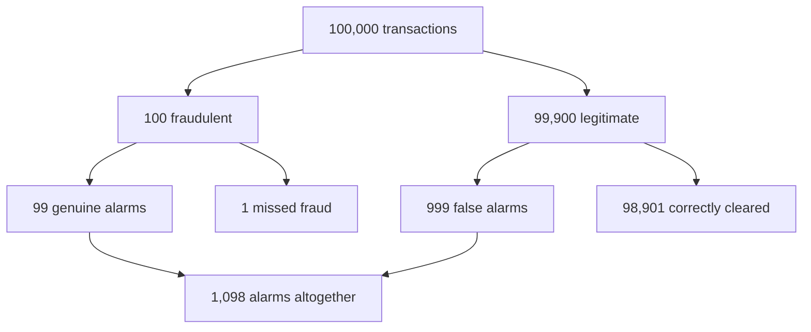
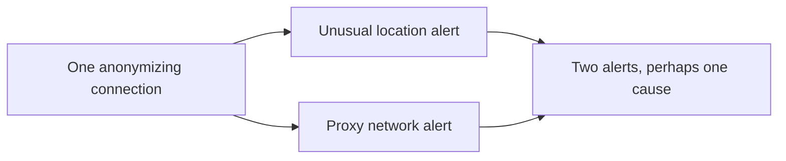

# CS120 — Mathematical and Statistical Thinking for Software Engineers

## Lecture 02: Probability, Randomness, and Risk

*Why a fraud detector with 99% accuracy can still accuse mostly innocent customers, why independent failures behave differently from correlated failures, and how to reason about uncertain outcomes without pretending to predict the future.*

---

### How to listen to this lecture

In CS120-L01, we learned to distinguish examples from universal claims and to reason about invariants that must always hold.

Today we're entering a different mathematical world. Instead of asking whether a statement must be true, we'll investigate how likely different outcomes are under explicit assumptions.

We'll use fraud detection as our recurring case study, then connect probability to retries, redundancy, random identifiers, and engineering decisions under uncertainty.

The equations are deliberately simple. Each represents an idea that can be understood without memorizing notation. The oral examination comes near the end, followed by practical experiments and a dense interview-revision card.

---

# Part I — Intuition

*The fraud alarm works almost perfectly. So why are nearly all the people it accuses innocent?*

### Picture an airport-sized hall of transactions

Imagine our hotel platform processing one hundred thousand bookings. Picture each booking as a person standing in a vast hall. A tiny number wear red coats: those represent fraudulent transactions. Everybody else wears a blue coat: legitimate travelers.

We know that fraud affects approximately **one in a thousand** transactions in this simplified example. Out of one hundred thousand people, that means only one hundred wear red. The other ninety-nine thousand nine hundred wear blue.

At the exit, a clever security detector examines everyone and sounds an alarm when it suspects fraud. It's very good. When someone wears red, it detects them 99% of the time. When someone wears blue, it correctly lets them through 99% of the time.

But that leaves one percent of the enormous blue crowd being stopped accidentally.

The first picture makes the imbalance visible. Notice that the detector doesn't start with equal numbers of innocent and fraudulent people.



The security team gets 1,098 alarms. Only 99 are genuine. Roughly **nine percent** of the alarms point to fraud. The other 91% accuse legitimate travelers.

The detector hasn't malfunctioned. The arithmetic isn't faulty. The problem is that we asked the wrong question about its accuracy.

### 1. Two similar sentences ask opposite questions

Consider two sentences.

**First:** “When a booking is fraudulent, how often does the alarm ring?” Answer: 99%.

**Second:** “When the alarm rings, how often is the booking fraudulent?” Answer: about 9%.

They sound almost like the same claim. They are not. In the first case we start by looking only at fraudulent bookings, then ask how many received alerts. In the second case we start by looking only at *alerts*, then ask how many were genuine.

The crowd we divide by has changed. That is the essential meaning of **conditional probability**: the chance of one event after we've restricted our attention to another event.

The rarity of fraud *before* seeing an alert is called the **base rate** or, in a Bayesian calculation, part of our prior information. An alert provides evidence and changes our estimate. But because legitimate transactions are so numerous, one percent of them creates many false alarms.

This method of updating what we believe using evidence and prior probabilities is the intuition behind **Bayes' theorem**. It doesn't require mystical mathematics. The easiest way to start is to imagine a large crowd and count people in the correct group.

### 2. A detector isn't good or bad in isolation

Now move our detector to a different hall: a special investigation queue where ten percent of transactions are truly fraudulent.

The same detector, with the same 99% detection rate and one-percent false alarm rate, now gives much more reliable positive alerts. Out of ten thousand transactions, it raises about 990 genuine alarms and ninety false ones. More than nine out of ten alarms point to real fraud.

Nothing about the detector changed. What changed was the kind of crowd we applied it to.

This explains why a statistic measured in one environment can mislead us in another. A model validated on a carefully selected investigation queue may behave very differently when deployed to all normal customers.

### 3. Two alarms might come from one cause

Suppose the detector notices that a customer appears to be in another country. A second rule notices that the customer uses an anonymizing network. Both alarms fire.

Are these two independent pieces of evidence? Maybe not. The anonymizing connection may itself explain the unusual location.

If two observations share one underlying cause, treating them as independent confirmations may exaggerate confidence.

The second picture shows the distinction. Two *separate* causes can provide genuinely different information; two sensors responding to the *same* cause might not.



**Independence** matters because many simple probability calculations multiply chances together. That multiplication is justified only under the correct independence assumptions. Two servers in separate machines might fail independently from certain hardware problems, but both might fail together during a shared power or database outage.

The right question is not merely “How many alarms do I have?” It's “How much genuinely new information does each alarm add?”

### 4. Probability helps make decisions, not just predictions

Now the fraud team asks whether it should automatically reject every alerted booking. The answer isn't contained in the detector's percentage.

Rejecting legitimate customers has a cost: lost bookings, support work, distrust. Allowing fraud also has a cost: chargebacks and financial loss. One of those costs might be far larger than the other for a particular transaction.

A useful way to reason about the decision is to combine the chance of an outcome with its consequence. This gives the intuition behind **expected value**. A nine-percent chance of losing five hundred euros represents forty-five euros of expected loss under a simplified model. It doesn't mean any individual booking will lose exactly forty-five euros.

We also have to remember that very rare outcomes accumulate. A bug affecting one in a million requests may happen regularly if the platform processes hundreds of millions of requests. An unlikely random-ID collision becomes more likely as the number of possible pairs of IDs grows. These are different consequences of the same question: how many opportunities does the event have to occur?

And attempts aren't always fresh chances. Three retries during one ten-minute supplier outage share the same failure cause; they're not automatically independent rolls of a die. Worse, blindly retrying a booking might create a second reservation after the first actually succeeded.

### Your mental checkpoint

**Question A:** Which fact should you ask for before celebrating 99% fraud detection accuracy? **How common fraud is and how often legitimate transactions are falsely flagged.**

**Question B:** Two alerts fire because of the same proxy connection. Does that automatically double your confidence? **No.** The alerts may be correlated evidence of one cause.

**Question C:** A request timed out. Is another attempt necessarily an independent chance of success? **No.** The failure may persist, and the first operation may already have succeeded.

Carry this picture into Part II: **start with the full crowd, narrow to the group described by the question, and count what the evidence truly tells you**. The formulas simply make that reasoning reusable.

*The intuition pass ends here.*

---

# Part II — Deep Dive

# 1. The Fraud Detector That Accused Almost Everyone Innocent

It's Thursday morning at our hotel-booking platform.

Three months ago, the fraud-prevention team deployed a new machine-learning model.

The model examines incoming transactions and estimates whether they appear fraudulent.

Its inputs include account history, payment characteristics, unusual purchase patterns, device information, and other signals.

Before deployment, the team evaluated it on a large labeled dataset.

The results looked excellent.

The detector correctly identified 99% of fraudulent transactions.

It also correctly classified 99% of legitimate transactions.

Its overall accuracy was 99%.

Management approved the deployment.

And almost immediately, the fraud-review department began complaining.

Every morning, analysts receive hundreds of alerts. They investigate suspicious reservations, examine transaction histories, and sometimes contact customers.

But something is wrong.

Most alerts concern legitimate customers.

The analysts spend their days investigating ordinary travelers who happened to trigger a suspicious-looking pattern.

Management is furious.

"How can a detector that's 99% accurate be wrong almost every time it raises an alarm?"

The fraud team insists that the original evaluation was correct.

The analysts insist that the alerts are overwhelmingly useless.

And here's the surprising part.

**Both teams can be completely right.**

To understand why, we need one missing fact.

Fraud is rare.

Let's imagine that only one transaction in a thousand is genuinely fraudulent.

That's a fraud prevalence of 0.1%.

Now consider a population of one hundred thousand transactions.

Approximately one hundred are fraudulent.

The remaining 99,900 are legitimate.

Our detector correctly identifies 99% of fraudulent transactions. That gives us approximately 99 genuine fraud alerts.

It also correctly recognizes 99% of legitimate transactions.

Sounds excellent.

But one percent of 99,900 legitimate transactions is 999.

Those 999 legitimate transactions are incorrectly flagged as suspicious.

The fraud-review team therefore receives approximately 1,098 alerts.

Only 99 concern genuine fraud.

The other 999 concern legitimate customers.

In other words, only about nine percent of alerts identify actual fraud.

**The model is 99% accurate, yet roughly 91% of its alerts are false positives.**

Nothing about these numbers is contradictory.

The detector is excellent at classifying individual transactions relative to a certain baseline.

But the overwhelming majority of transactions belong to the legitimate class.

A small error rate applied to an enormous population produces more false alarms than a high detection rate applied to a tiny population.

This is called the **base-rate problem**.

It appears everywhere in engineering.

Security alerts, spam filters, anomaly detection, medical screening, AI moderation, automated monitoring, and even software reliability.

The central mistake is confusing two probabilities.

The probability that the detector raises an alert when fraud exists.

And the probability that fraud exists when the detector raises an alert.

They sound almost identical.

They are not.

Today, we'll learn to distinguish them.

---

# 2. What Probability Actually Describes

Let's begin with the simplest useful interpretation.

Probability assigns a number between zero and one to an event.

A probability of zero represents an impossible event within the assumed model.

A probability of one represents an event that is certain within that model.

A probability of one half represents an event assigned a 50% chance.

But probability is always attached to a defined situation.

Suppose we toss a fair coin.

The model assigns equal probability to heads and tails.

But what exactly does "fair" mean?

It means we're assuming a process whose two outcomes have equal probabilities.

A real physical coin may have tiny biases.

Its behavior can depend on how it's thrown and caught.

The simple mathematical model ignores those complications.

That's acceptable when the model serves our purpose.

The first engineering habit is therefore:

**Before calculating a probability, establish which events and assumptions the calculation refers to.**

## 2.1 Outcomes, sample spaces, and events

Imagine a transaction moving through our fraud detector.

For a simplified model, the transaction has two relevant properties.

Its true classification is either fraudulent or legitimate.

The detector's output is either alert or no alert.

That creates four possible combinations.

A genuine fraud transaction triggers an alert.

A genuine fraud transaction goes undetected.

A legitimate transaction triggers an alert.

A legitimate transaction passes without an alert.

The complete set of possible outcomes is called the **sample space**.

An **event** is a subset of those outcomes.

For example, the event "fraud" includes every outcome in which the transaction is genuinely fraudulent, regardless of whether the detector notices.

The event "alert" includes both true fraud alerts and false alarms.

The event "fraud and alert" contains only correctly detected fraudulent transactions.

This might seem like formal vocabulary for something obvious.

But it gives us a precise way to avoid confusing different questions.

## 2.2 Complements

Suppose an event has a probability of 0.1%.

Its complement is the event not occurring.

The complement therefore has a probability of 99.9%.

The general rule is:

\(P(\text{not }A)=1-P(A)\)

This becomes particularly useful when it's easier to calculate the chance that something never happens.

For example, to calculate the probability that at least one of several independent attempts succeeds, we might first calculate the probability that every attempt fails.

Then subtract that from one.

We'll use this technique when examining retries and redundancy.

## 2.3 Probability doesn't eliminate assumptions

Suppose our fraud prevalence estimate comes from last year's transactions.

What if the company expands into a market with very different fraud patterns?

What if criminals discover a new exploit?

What if fraud attempts increase during a promotional campaign?

The underlying probability may change.

A probability model isn't a permanent property of the universe.

It's a representation of uncertainty under particular conditions.

Good engineers pay attention not only to the result of a calculation but also to whether the assumptions remain appropriate.

---

# 3. Conditional Probability: The Evidence Changes the Population

Let's return to the fraud detector.

Before seeing any alert, we estimate that a randomly selected transaction has a 0.1% probability of being fraudulent.

Now we receive an alert.

Should our estimate remain 0.1%?

No.

The alert provides additional information.

But how much should it change our estimate?

This is the problem of **conditional probability**.

Conditional probability asks:

"What is the probability of event A, given that event B has occurred?"

We write this as \(P(A\mid B)\).

The vertical bar means "given."

So \(P(\text{fraud}\mid\text{alert})\) means the probability that a transaction is fraudulent, given that the detector raised an alert.

That is precisely the number the fraud analysts care about.

## 3.1 The denominator changes

Here's the key intuition.

Before receiving an alert, we're considering all one hundred thousand transactions.

After receiving an alert, we're considering only the transactions for which the detector raised an alarm.

Our relevant population has changed.

Among those alerted transactions, approximately 99 are genuinely fraudulent and 999 are legitimate.

So we calculate the fraction of alerted transactions that are fraudulent.

That's 99 divided by 1,098.

The result is approximately 9%.

Notice what we did.

We didn't invent a sophisticated statistical algorithm.

We simply identified the correct population and counted the relevant outcomes.

This is the essence of conditional probability.

The mathematical definition is:

\[P(A\mid B)=\frac{P(A\cap B)}{P(B)}\]

Here, the intersection represents outcomes where both A and B occur.

The denominator represents the probability of the condition B.

We can use this formula whenever B has positive probability.

But the real understanding lies in recognizing which population belongs in the denominator.

## 3.2 Reversing the condition changes the question

Now compare these statements.

The detector identifies 99% of fraud.

And 9% of alerts are genuine fraud.

The first asks:

"What happens when fraud exists?"

The second asks:

"What does an alert tell us about the transaction?"

These are different conditional probabilities.

In general:

\(P(A\mid B)\neq P(B\mid A)\)

There's no general rule that allows us to reverse the condition.

This is one of the most widespread reasoning errors in statistics.

A test may be very good at detecting a rare event while individual positive results remain relatively uncertain.

A security alert may strongly increase our suspicion without making compromise the most likely explanation.

And an AI classifier may perform well on a benchmark while having poor precision in the environment where it's actually deployed.

> **Sticky note #1:** A detector's ability to recognize fraud is not the same as the probability of fraud after receiving an alert. Always ask which direction the condition points.

---

# 4. Bayes' Theorem: Updating What We Believe

We've discovered the base-rate problem through counting.

Now let's express the general reasoning.

**Bayes' theorem** tells us how to update a probability when we observe new evidence.

Its underlying idea is remarkably simple.

Begin with how likely the event was before receiving the evidence.

Ask how strongly the evidence favors that event compared with the alternatives.

Then calculate the updated probability.

## 4.1 The prior

Before seeing the fraud alert, we estimate that 0.1% of transactions are fraudulent.

This is our **prior probability**.

It represents what we believe about fraud prevalence before considering the detector's result.

The prior isn't necessarily a subjective guess.

It can be estimated from historical data, although the estimate itself may be uncertain.

## 4.2 The likelihood

Next, we consider how the detector behaves.

If fraud exists, the detector raises an alert 99% of the time.

If fraud does not exist, the detector raises an alert 1% of the time.

These quantities describe how likely the evidence is under competing explanations.

They are called **likelihoods**.

The alert is much more likely when fraud exists than when it doesn't.

Specifically, in this simplified example, an alert is 99 times as likely under fraud as under legitimate activity.

That is strong evidence.

But the prior probability of fraud was very low.

The evidence must overcome that low base rate.

## 4.3 The posterior

After incorporating the alert, we calculate the **posterior probability**.

In words:

The probability of fraud given an alert equals the probability of fraud producing an alert, divided by the overall probability of an alert.

The corresponding equation is:

\[P(F\mid A)=\frac{P(A\mid F)P(F)}{P(A\mid F)P(F)+P(A\mid \neg F)P(\neg F)}\]

Don't worry about memorizing it yet.

Let's unpack the structure.

The numerator represents the chance of genuine fraud producing an alert.

The denominator represents every way the alert could happen.

That includes genuine fraud alerts and false alarms.

For our example, the numerator is 99% multiplied by 0.1%.

The denominator adds that quantity to the probability of a false alarm among legitimate transactions.

The result is approximately nine percent.

That's Bayes' theorem in action.

## 4.4 Why the natural-frequency method is often better

Mathematical formulas are useful, but for ordinary engineering discussions, I often prefer working with a concrete population.

Imagine one hundred thousand transactions.

Count the fraudulent ones.

Count the legitimate ones.

Apply the detector's rates to each group.

Then count the alerts.

This method produces the same answer while making the denominator much harder to misunderstand.

The formula lets us generalize.

The concrete population helps us think.

Both are valuable.

---

# 5. The Same Detector Becomes More Useful When Fraud Becomes Common

Now imagine two different environments.

Our ordinary booking platform has a fraud prevalence of 0.1%.

But a specialized investigation queue contains transactions that have already been selected using other risk signals.

Suppose genuine fraud accounts for 10% of that queue.

We apply the same detector.

Its sensitivity and false-positive rate remain unchanged.

What happens?

Among ten thousand transactions in the investigation queue, one thousand are fraudulent.

The detector identifies 990 of them.

The remaining nine thousand are legitimate.

One percent of those generate false alerts, giving us 90 false positives.

We now have 1,080 alerts.

Of those, 990 concern real fraud.

The probability of fraud given an alert is approximately 91.7%.

Compare the environments.

On ordinary traffic, only about 9% of alerts indicate fraud.

On the high-risk investigation queue, approximately 92% do.

The detector itself didn't improve.

The population changed.

This is one of the most important consequences of Bayesian reasoning.

**A test result cannot be interpreted independently of the population to which the test is applied.**

## 5.1 Precision and recall

In machine-learning discussions, these ideas often appear under different names.

**Recall**, also called sensitivity or true-positive rate, asks what fraction of genuine fraud cases the detector identifies.

Our detector has 99% recall.

**Precision**, also called positive predictive value, asks what fraction of generated fraud alerts are genuinely fraudulent.

On ordinary traffic, our precision is about 9%.

The detector's specificity is 99%, because it correctly dismisses 99% of legitimate transactions.

Its false-positive rate is therefore 1%.

These metrics describe different properties.

And overall accuracy can hide the distinction.

For extremely rare events, a classifier that always predicts "legitimate" can achieve high accuracy while detecting no fraud whatsoever.

If only 0.1% of transactions are fraudulent, always predicting legitimate yields 99.9% accuracy.

That's a higher accuracy than our detector.

And it's completely useless for catching fraud.

So when someone tells you a classifier is 99% accurate, your next question shouldn't be "How impressive!"

It should be:

"What's the base rate, and what are the false-positive and false-negative rates?"

---

# 6. What Should We Do With an Alert?

Now let's turn statistical reasoning into an engineering decision.

The fraud detector raises an alert.

Should the application automatically block the reservation?

Should it require additional verification?

Should it send the case to a human analyst?

Or should it allow the transaction to proceed?

The posterior probability helps us estimate risk.

But it doesn't tell us which action is best.

We also need to understand **the consequences of different decisions**.

This introduces expected value.

## 6.1 Probability and cost are different quantities

Imagine an alert corresponds to a transaction with a 9% probability of fraud.

Suppose allowing a fraudulent transaction would cause an average loss of 500 euros.

Under a deliberately simplified model, the expected fraud loss from allowing that alerted transaction is nine percent of 500 euros.

That's 45 euros.

But blocking a legitimate transaction may also have a cost.

Perhaps a false block causes lost revenue, customer frustration, and support work.

Suppose that cost averages 40 euros.

Since approximately 91% of alerted transactions are legitimate, the expected cost of incorrectly blocking a legitimate customer is about 36.40 euros.

Under those particular assumptions, automatic blocking could appear economically preferable to simply allowing every alert.

But the model is incomplete.

The fraud loss may vary dramatically between transactions.

Some fraud attempts are worth ten euros.

Others may cause thousands in losses.

Some legitimate customers recover after verification.

Others abandon the platform permanently.

Blocking may have legal, contractual, and reputational consequences that a simplistic euro estimate doesn't capture.

And the posterior probability itself may be miscalibrated or uncertain.

The calculation isn't a justification to automate every decision.

It illustrates what a rational decision requires.

**Risk is not just probability. It is probability combined with consequences.**

## 6.2 Expected value

The **expected value** of a random outcome is its probability-weighted average.

Imagine an experiment with two possible outcomes.

A transaction causes a loss of 500 euros with probability 9%.

Otherwise, it causes no fraud loss.

The expected loss is 45 euros.

This does not mean the company will lose exactly 45 euros on that transaction.

A single transaction may result in no loss or a much larger loss.

Expected value describes the average outcome implied by the probability model over repeated comparable situations.

It is useful for comparing strategies, making capacity estimates, and estimating long-term costs.

But it isn't a guarantee about an individual event.

## 6.3 Expected value does not describe the full risk

Suppose two infrastructure choices have the same expected annual cost.

The first produces a predictable small expense every month.

The second usually costs nothing but occasionally causes a catastrophic outage.

Their expected costs could be equal.

But the business might reasonably prefer the predictable expense.

Why?

Because the **distribution of outcomes** matters, not only the average.

The organization may have limited cash reserves, strict contractual obligations, or low tolerance for catastrophic losses.

Variance, tail risk, and risk appetite can affect the decision.

We'll examine distributions and variance more formally in CS120-L03.

For now, remember that optimizing expected value alone can conceal extremely undesirable rare outcomes.

---

# 7. Independence: When Multiplying Probabilities Is Allowed

Let's shift from fraud to infrastructure.

Imagine a service running on two machines.

Each machine has a 1% probability of being unavailable during some appropriately defined observation period.

A developer proposes redundancy.

"If each machine is 99% available, two machines should make the service almost perfectly available."

Is that correct?

Possibly.

But we need another assumption.

The failures must be sufficiently **independent**.

Independence means that learning whether one event occurred doesn't change the probability assigned to the other event, within the model.

Formally, independent events A and B satisfy:

\[P(A\cap B)=P(A)P(B)\]

If each machine has a 1% failure probability, and the failures are independent, the probability that both fail during the relevant observation is 1% multiplied by 1%.

That's 0.01%.

So under this simplified model, both machines are unavailable together only one time in ten thousand comparable observations.

The corresponding availability is 99.99%.

That looks excellent.

But now suppose both machines depend on the same database.

Or run in the same availability zone.

Or use the same credentials that can expire simultaneously.

Or receive the same defective deployment.

Their failures may be correlated.

## 7.1 Shared causes destroy the simple calculation

Imagine the two machines live behind the same load balancer.

Both application instances are healthy.

But the load balancer becomes unavailable.

The service fails.

The application machines didn't need to fail independently for the overall service to become unavailable.

The shared component created a common failure mode.

Or imagine both machines query the same PostgreSQL instance.

If that database becomes unavailable, both application servers may stop performing their essential functions.

Adding application replicas doesn't remove the database dependency.

A probability calculation that models only independent application-machine failures will underestimate the real service failure probability.

The mathematics wasn't wrong.

The model omitted common causes.

## 7.2 Conditional independence

There's a subtle but useful refinement.

Events may be independent under one set of conditions but dependent overall.

Imagine two servers with independent hardware failures when the datacenter's power is healthy.

But both lose power during a facility-wide outage.

Given that the facility is operating normally, their hardware failures might be approximately independent.

Across all possible conditions, their total availability is correlated through the shared power system.

This is one reason engineering risk models often separate independent component failures from common-cause failures.

When you hear someone multiply failure probabilities, ask:

**Independent under which conditions?**

That question can save an architecture review from a very misleading calculation.

---

# 8. Mutually Exclusive Is Not the Same as Independent

Let's address a mathematical confusion before it causes trouble.

Two events are **mutually exclusive** when they cannot occur together.

For one transaction, the final ground-truth classification might be fraudulent or legitimate, but not both, under our simplified binary labeling model.

These are mutually exclusive outcomes.

Now compare that with independent events.

Two independent events can occur together.

Indeed, the multiplication rule tells us how often their joint occurrence happens.

For events with positive probabilities, being mutually exclusive usually means they are not independent.

Why?

If one event occurs, the other becomes impossible.

Knowing the outcome of the first completely changes the probability of the second.

For example, when selecting one card from a standard deck, the events "the card is a heart" and "the card is a spade" are mutually exclusive.

They are not independent.

But tossing two fair coins produces independent outcomes under the ordinary model.

Both coins can land heads together.

The distinction matters when designing calculations.

We may add probabilities directly for mutually exclusive alternatives.

We may multiply probabilities for independent events.

Confusing the conditions leads to incorrect answers.

---

# 9. Retries: Why Three Attempts Aren't Always Three Chances

Now imagine our booking backend communicates with an external supplier API.

A request occasionally fails with a transient network error.

The team proposes automatic retries.

Let's quantify the expected benefit.

Suppose each attempt has an independent 20% probability of failure.

The application makes one initial attempt and permits two retries, for three attempts total.

What's the probability that all three attempts fail?

Under independence, we multiply the failure probabilities.

Twenty percent multiplied by twenty percent multiplied by twenty percent gives 0.8%.

Therefore, the probability that at least one attempt succeeds is 99.2%.

That's much better than the 80% success rate of one attempt.

Mathematically, the result is straightforward.

But operationally, the independence assumption is often unrealistic.

## 9.1 Persistent failures

Suppose the supplier API is completely unavailable for ten minutes.

If the first request fails because of that outage, the second attempt a fraction of a second later is very likely to fail too.

The attempts are correlated through the underlying outage.

Multiplying a historical overall failure rate by itself three times would make the reliability improvement look far more impressive than reality.

This is the difference between transient independent errors and persistent shared failure states.

## 9.2 Retrying can make the system less reliable

Now suppose the supplier is overloaded.

It can process one thousand requests per second.

Customers generate twelve hundred.

The supplier is already struggling.

If each failure triggers two immediate retries, additional traffic piles onto the overloaded service.

The retry mechanism intended to improve reliability can worsen the bottleneck.

This is a **retry storm**.

The solution may involve bounded retries, exponential backoff, jitter, admission control, circuit breakers, and coordination with downstream capacity.

But mathematical success probabilities are only one side of the decision.

We must also consider the additional work retries generate.

## 9.3 Idempotency comes first

There's an even more important problem.

Suppose the supplier successfully creates a reservation but the response is lost.

The caller experiences a timeout.

Should it retry the POST request blindly?

No.

The original operation may have succeeded.

A second attempt could create a duplicate reservation.

Retries may improve transport-level success while damaging business correctness.

For operations with side effects, the design needs an appropriate idempotency mechanism and outcome-reconciliation strategy.

Probability tells us how retries change the likelihood of certain outcomes.

It doesn't eliminate the requirement to preserve invariants.

This is a direct connection to CS120-L01.

A probabilistically effective recovery technique must still respect deterministic business constraints.

---

# 10. Expected Counts: Rare Doesn't Mean Unimportant

Let's return to rare events.

Suppose a particular backend bug occurs with probability one in a million per request.

That sounds reassuring.

But our application handles one hundred million requests per day.

What's the expected number of occurrences?

One hundred million multiplied by one-millionth.

That's one hundred.

Under the model, we expect approximately one hundred occurrences per day.

A failure that is extremely rare per request can become a regular production incident at scale.

This is one of the reasons experienced engineers think carefully about denominators.

"Only one in a million" is incomplete.

One in a million of what?

And how many opportunities for failure exist?

## 10.1 Expected counts aren't exact predictions

If the failure probability is one in a million and we process one hundred million comparable requests, the expected count is one hundred.

That doesn't guarantee exactly one hundred failures.

The observed count can vary.

Under independent Bernoulli trials with a fixed failure probability, the number of failures follows a binomial distribution.

Its mean is the number of trials multiplied by the failure probability.

Its variance is the number of trials multiplied by the failure probability and by one minus that probability.

We won't derive the distribution today.

But there's a useful intuition.

Even when the expected failure count is one hundred, we shouldn't expect the observed count to equal one hundred every day.

And if failures are correlated by deployments, regions, customer segments, or shared dependencies, variability may be considerably larger than the simple independent model predicts.

This is why a historical average failure rate is not enough to understand reliability.

We need to understand how failures are distributed and what causes them.

---

# 11. Random Identifiers and the Birthday Paradox

Probability appears in another surprising corner of software engineering.

Unique identifiers.

Imagine generating random identifiers for reservations.

A developer proposes using random 32-bit integers.

That provides about 4.3 billion possible values.

The application will create only one hundred thousand reservations.

Surely collisions are practically impossible?

Not at all.

In fact, a collision becomes quite likely.

The surprising explanation comes from the **birthday paradox**.

## 11.1 Why collisions grow faster than expected

Imagine generating random identifiers one at a time.

The first identifier cannot collide with an earlier identifier because none exists.

The second has one possible earlier collision partner.

The third has two.

The fourth has three.

As we generate more identifiers, the number of possible pairs grows rapidly.

With one hundred thousand identifiers, there are nearly five billion possible pairs.

Even though the identifier space contains billions of values, we have accumulated an enormous number of opportunities for two values to match.

For uniformly random independent identifiers drawn from a space of size M, the collision probability can be approximated by:

\[P(\text{collision})\approx 1-e^{-n(n-1)/(2M)}\]

Here, n is the number of generated identifiers.

We don't need to memorize that formula.

The important fact is that collision risk depends roughly on the square of the number of generated identifiers relative to the size of the identifier space.

For one hundred thousand uniformly random 32-bit identifiers, the approximate collision probability is around 69%.

That's astonishingly high if you were thinking only about the billions of possible values.

## 11.2 Larger random spaces

Now imagine using uniformly random 64-bit identifiers.

For one million generated IDs, the approximate collision probability is only about 2.7 times ten to the minus eight.

That's roughly one chance in 37 million.

A random UUID version 4 contains 122 random bits because some bits encode version and variant information.

Its collision probability under appropriate random-generation assumptions is much smaller still for ordinary application volumes.

But "extremely unlikely" isn't identical to logically impossible.

And a real application's identity model shouldn't rely on probability alone when uniqueness is a business invariant.

## 11.3 Randomness plus enforcement

A strong pattern is to generate IDs from a sufficiently large space using an appropriate randomness source, then enforce uniqueness at the database boundary.

For a reservation table, a unique constraint can prevent two committed records from sharing the same identifier.

In the extraordinarily unlikely event of a collision, the application can generate another identifier under a carefully designed retry policy.

The randomness makes collisions rare.

The database constraint enforces the invariant.

These mechanisms complement one another.

This is a beautiful example of probability and formal correctness working together.

## 11.4 Unpredictability is another property

There's one more distinction.

A random-looking identifier isn't necessarily secure.

Suppose an identifier is generated by a predictable pseudorandom number generator.

An attacker who learns enough about its state might predict future values.

For ordinary simulation, predictable pseudorandom sequences can be useful.

For security tokens, password-reset links, and other sensitive identifiers, unpredictability matters.

Use a cryptographically secure random source where security depends on resistance to guessing.

But don't confuse unpredictability with authorization.

Even an impossible-to-guess reservation identifier should not automatically authorize access to another customer's private information.

Probability reduces guessing risk.

Authorization enforces the access-control rule.

---

# 12. Randomness in Software: Useful Precisely Because We Can Reproduce It

The word random can be misleading in programming.

Most ordinary software random-number generators are **pseudorandom**.

They produce sequences that statistically resemble random values for their intended applications.

But the sequence is generated by a deterministic algorithm.

Given the same initial state or seed, the generator can reproduce the same sequence.

This is extremely useful for engineering experiments.

Imagine running a load test that generates random customer behavior.

One experiment produces a performance regression.

If the random sequence was generated using a reproducible seed, we can rerun the same workload.

That helps separate actual code changes from variations in the test input.

Randomness and reproducibility aren't enemies.

They serve different goals.

## 12.1 Statistical randomness versus security randomness

A simulation may need a reproducible pseudorandom generator.

A security token needs unpredictability against an adversary.

Those are different requirements.

A cryptographically secure random generator is designed to resist prediction and state reconstruction under appropriate assumptions.

A fast simulation-oriented generator may not provide those guarantees.

Neither is universally better.

The right tool depends on what the randomness is supposed to accomplish.

## 12.2 Randomized algorithms

Some algorithms deliberately use randomness.

For example, randomized sampling can help estimate properties of enormous datasets without inspecting every record.

Randomized choices can also help avoid particular worst-case input patterns in certain algorithms.

But a randomized algorithm's guarantee may be probabilistic.

It might promise a low probability of error.

Or it might always return the correct result but have variable running time.

Those are distinct properties.

A senior engineer should ask whether randomness affects correctness, performance, or both.

That's more useful than simply knowing that an algorithm calls a random-number generator.

---

# 13. The Evidence Problem: Two Signals Might Be the Same Signal

Now let's return to our fraud detector for one final investigation.

The fraud team wants to improve precision.

They introduce a second detection rule.

The original model flags transactions with suspicious location behavior.

The new rule flags transactions made through certain anonymizing network services.

The team assumes the two rules provide independent evidence.

If both fire, they multiply the probabilities and report extremely high confidence.

But there's a problem.

The signals overlap.

Customers using an anonymizing network may also appear to be accessing the service from unfamiliar geographical locations.

The two alerts may result from the same underlying behavior.

Counting them as independent evidence exaggerates the amount of information we actually possess.

## 13.1 Evidence should be evaluated conditionally

Imagine the first alert increases our estimated probability of fraud.

Now the second alert arrives.

The important question is not simply whether the second alert is associated with fraud in the general population.

It's whether it provides additional information **given that the first alert already occurred**.

If the second signal tells us almost nothing new after the first, it shouldn't dramatically increase confidence.

This is a conditional-independence problem.

Naïvely multiplying likelihoods can produce extreme and unjustified probabilities when signals are correlated.

More sophisticated models account for dependence or are empirically evaluated on representative combinations of features.

The general lesson reaches far beyond fraud.

## 13.2 Monitoring alerts can share one cause

Imagine a distributed service reports three alerts.

HTTP error rate is high.

Database connection-pool wait time is high.

Request latency is high.

Are these three independent indications that three different subsystems have failed?

Not necessarily.

One overloaded database could cause all three observations.

Treating each alert as independent evidence of a distinct failure would misrepresent the situation.

The alerts may be different manifestations of one underlying event.

During incident diagnosis, we should ask which observations provide genuinely new information and which are consequences of the same mechanism.

This is Bayesian thinking without necessarily writing down a formula.

---

# 14. Engineering Decisions Under Uncertainty

We now have enough machinery to describe a general risk-assessment approach.

Suppose you're evaluating a proposed architecture.

Someone says:

"The chance of this failure is tiny."

That statement isn't sufficient.

Tiny under which workload and assumptions?

How many opportunities for failure occur?

Are the failures independent?

What happens if they cluster?

What is the cost of failure?

What mitigations exist?

And how confident are we in the estimated probability itself?

A useful engineering risk analysis should address all of those questions.

## 14.1 Separate what is known from what is estimated

Imagine the application has a measured 0.2% request-error rate over the last week.

That's an observation about a particular period and workload.

Now someone predicts that the error rate will remain 0.2% next year.

That's an inference.

The two statements deserve different levels of confidence.

Traffic patterns may change.

Dependencies may change.

The application may be deployed to new regions.

And the underlying failure mechanisms may evolve.

Probability models are valuable precisely because they force us to acknowledge uncertainty.

They don't allow us to eliminate it through arithmetic.

## 14.2 Beware false precision

Suppose a risk assessment concludes that a particular incident has a 0.000137% probability of occurring.

That number looks authoritative.

But perhaps it was calculated from three rough guesses about independent component failures.

If the assumptions are poorly supported, the extra decimal places create an illusion of precision.

A broad estimate with explicit uncertainty may be more useful than a precise-looking number built on speculative inputs.

Sometimes the correct engineering answer is:

"We don't have enough evidence to estimate this reliably, but here is the range of plausible outcomes and the measurement that would reduce uncertainty."

That's not weakness.

It's disciplined reasoning.

## 14.3 The decision still needs to be made

Uncertainty doesn't mean we should refuse to act.

We can estimate expected costs.

We can compare scenarios.

We can design experiments.

We can choose mitigations that remain acceptable across several plausible outcomes.

And we can monitor the system so new evidence updates our beliefs.

This is the practical value of probability.

It allows us to reason systematically when certainty isn't available.

**Good engineering isn't pretending uncertainty doesn't exist. It's making decisions that acknowledge it.**

---

# 15. The Oral Examination

Try answering these questions aloud before reading the solutions.

For each scenario, identify the correct probability, state the assumptions, and explain what would make the conclusion unreliable.

## Challenge 1 — The excellent fraud detector

Fraud occurs in 0.1% of transactions.

A detector catches 99% of fraud and falsely flags 1% of legitimate transactions.

Among one hundred thousand transactions, approximately how many alerts are genuine fraud?

What fraction of all alerts are genuine?

Why is overall accuracy misleading?

## Challenge 2 — Changing the population

The same detector is applied to a high-risk queue where 10% of transactions are fraudulent.

Its sensitivity and false-positive rate remain unchanged.

Does an alert now provide stronger evidence of fraud?

Calculate the approximate probability that an alerted transaction is fraudulent.

## Challenge 3 — Reversing the condition

A monitoring tool detects 95% of genuine production incidents.

A developer concludes that 95% of its alerts indicate real incidents.

What's wrong with that reasoning?

Which additional quantities would you need?

## Challenge 4 — Independent server failures

Two independently failing servers each have a 1% probability of being unavailable during a defined observation period.

Assuming either server can provide the service, what is the probability both are unavailable?

What happens to the reasoning if both depend on the same database?

## Challenge 5 — The three retries

A request independently fails with probability 20% on each attempt.

The application permits three attempts in total.

What's the probability all attempts fail?

Why might the answer be unrealistic during a supplier outage?

## Challenge 6 — Rare at scale

A bug occurs independently with probability one in a million per request.

The system handles one hundred million comparable requests daily.

What's the expected number of failures per day?

Does that establish the exact daily failure count?

## Challenge 7 — Random identifiers

A developer proposes 32-bit random identifiers for one hundred thousand records.

They argue there are billions of possible IDs, so collisions are practically impossible.

What's missing from their reasoning?

What should protect the business invariant of uniqueness?

## Challenge 8 — Correlated evidence

A fraud detector flags a transaction because of unusual geography.

A second rule flags it because it appears to use an anonymizing network.

Why might multiplying the two signals' probabilities exaggerate confidence?

What would you need to establish before treating them as independent evidence?

---

# 16. Solutions and Discussion

## Solution 1 — Base rates

Among one hundred thousand transactions, approximately one hundred are fraudulent.

The detector identifies about 99 of them.

Among 99,900 legitimate transactions, approximately 999 are falsely flagged.

That produces about 1,098 alerts, only 99 of which are genuine fraud.

Precision is therefore approximately 9%.

Accuracy is misleading because legitimate transactions dominate the population, so even a small false-positive rate creates many alerts.

## Solution 2 — Higher prevalence

Among ten thousand high-risk transactions, one thousand are fraudulent and nine thousand are legitimate.

The detector identifies 990 fraud cases.

It falsely flags 90 legitimate transactions.

Therefore, approximately 990 of 1,080 alerts concern real fraud.

That's about 91.7%.

The detector didn't change. The base rate changed, making its positive results more informative.

## Solution 3 — Conditional probabilities

Detecting 95% of real incidents describes the true-positive rate.

It doesn't establish the fraction of alerts that correspond to genuine incidents.

We also need the base rate of incidents and the false-positive rate among periods or observations without genuine incidents.

The probability of an alert given an incident isn't generally equal to the probability of an incident given an alert.

## Solution 4 — Redundancy

Under independence, both servers fail with probability 0.01 multiplied by 0.01, which equals 0.0001.

That's 0.01%.

The corresponding availability under the simplified model is 99.99%.

But a shared database introduces a common failure dependency.

The servers' independent hardware-failure probabilities no longer describe all ways the service can become unavailable.

A realistic reliability model must include shared components and correlated causes.

## Solution 5 — Retry probability

Under independent attempts, all three fail with probability 0.2 cubed, or 0.008.

That's 0.8%.

So at least one attempt succeeds with probability 99.2%.

During a persistent outage, failures are correlated, and repeated attempts may be almost certain to fail.

Retries may also overload the dependency and must preserve idempotency for side-effecting operations.

## Solution 6 — Expected failures

One hundred million multiplied by one-millionth equals one hundred expected failures per day.

That is an expectation, not a guaranteed daily count.

Actual observations vary, and correlations can substantially change the distribution of failures.

## Solution 7 — Birthday collisions

The developer considered only the size of the identifier space, not the rapidly growing number of possible pairs among generated IDs.

For one hundred thousand uniformly random 32-bit identifiers, the approximate probability of at least one collision is around 69%.

A larger random identifier space reduces collision risk.

An authoritative uniqueness constraint protects the business invariant.

## Solution 8 — Correlated signals

The two signals may result from the same underlying cause.

Their joint probability cannot safely be calculated by multiplying unconditional probabilities unless the relevant independence assumptions hold.

The second signal's evidential contribution must be evaluated conditional on the first.

We should use a model of their dependence or representative empirical evidence rather than counting essentially duplicated signals as independent confirmation.

---

# 17. The Mental Model Worth Keeping

Probability lets us reason about uncertain outcomes under explicit assumptions.

An **event** is a set of possible outcomes.

A **conditional probability** describes the likelihood of an event after incorporating another condition.

**Bayes' theorem** updates a prior probability using evidence and its likelihood under competing explanations.

A **base rate** matters because rare events can produce mostly false alarms even when detectors have impressive accuracy.

**Independence** permits certain probabilities to be multiplied; common causes can invalidate that assumption.

**Expected value** describes a probability-weighted average, not the exact outcome of one trial.

**Variance and tail risk** remind us that equal averages don't imply equally desirable consequences.

And **random collisions** become important when repeated opportunities accumulate, even if individual collisions are extremely unlikely.

The useful engineering sequence is:

**Define the event. Establish the population. Identify the condition. Check independence. Calculate the relevant probability. Consider the consequences. Challenge the assumptions.**

Three questions recover most of this lecture:

1. **What's the denominator?** Are we discussing all transactions, all fraudulent transactions, or all alerted transactions?
2. **Are the events really independent?** Could one underlying cause produce several observed failures or signals?
3. **What does the outcome cost?** A rare event may be acceptable, catastrophic, or surprisingly common at scale.

The deepest principle is:

**Probability doesn't tell us what will happen. It tells us what our assumptions imply about what might happen—and how new evidence should change our expectations.**

That's an extraordinarily useful skill for software engineering.

---

# 18. Next Lecture — Statistics, Distributions, and Sampling

We've learned how probability describes uncertain events and why base rates, independence, and expected values matter.

But our fraud detector and reliability calculations depended on probabilities that we treated as known.

In reality, engineers rarely know the true probabilities.

They observe data.

They collect samples.

They calculate averages and percentiles.

Then they try to infer something about a larger system.

This introduces another set of dangers.

What if the sample is biased?

What if two services have the same average latency but radically different tail behavior?

What if the measured improvement is merely random variation?

In **CS120-L03 — Statistics, Distributions, and Sampling**, we'll investigate how engineers turn measurements into evidence.

Our opening mystery will involve two API versions with identical average latency—and very different customer experiences.

The next challenge isn't predicting uncertain events from known probabilities.

It's discovering what we can reasonably conclude when the probabilities themselves are unknown.

---

# Optional Practical Lab — Probability Without Guesswork

*The spoken lecture ends here. The remaining experiments are intended for visual study, terminal practice, and interview revision.*

## Lab A — Build the fraud confusion matrix

Using the detector from the lecture, complete the following table for one hundred thousand transactions.

| Actual classification | Alert | No alert | Total |
|---|---:|---:|---:|
| Fraudulent | ? | ? | 100 |
| Legitimate | ? | ? | 99,900 |
| **Total** | ? | ? | 100,000 |

Assume sensitivity of 99% and specificity of 99%.

Calculate accuracy, precision, recall, and false-positive rate.

Explain why these metrics answer different questions.

## Lab B — A small Bayes calculator

Write a TypeScript function that calculates the probability of fraud given an alert.

This example uses probabilities between zero and one.

```typescript
function posteriorProbability(
  prevalence: number,
  sensitivity: number,
  falsePositiveRate: number
): number {
  const trueAlerts = prevalence * sensitivity;
  const falseAlerts = (1 - prevalence) * falsePositiveRate;
  const allAlerts = trueAlerts + falseAlerts;

  if (allAlerts === 0) {
    throw new Error("Condition has zero probability");
  }

  return trueAlerts / allAlerts;
}

console.log(
  posteriorProbability(0.001, 0.99, 0.01)
);
```

Predict the result before running it.

Then experiment with fraud prevalence of 0.01%, 0.1%, 1%, and 10%.

Record how precision changes even though the detector's operating characteristics remain constant.

## Lab C — Improve specificity

Keep fraud prevalence at 0.1% and sensitivity at 99%.

Reduce the false-positive rate from 1% to 0.1%.

Calculate the new expected number of true and false alerts among one hundred thousand transactions.

Determine how much precision improves.

Then explain why improving specificity may be more valuable than slightly improving sensitivity when positive cases are extremely rare.

## Lab D — A natural-frequency tree

Draw a tree beginning with one hundred thousand transactions.

Split the population into fraudulent and legitimate branches.

Then split each branch according to alert and no alert.

Label every branch with its conditional probability and expected count.

Use the completed tree to derive Bayes' theorem through counting rather than memorizing its formula.

## Lab E — Simulate independent versus correlated failures

First, simulate independent attempts where each operation fails with probability 20%.

Count how often all three attempts fail.

Then simulate persistent outages.

In the second model, assign some requests to an outage state in which every immediate retry fails.

Choose parameters so the overall first-attempt failure rate is comparable.

Compare the probability that retries rescue the request.

This experiment should demonstrate that identical marginal failure rates can produce very different retry outcomes when correlation changes.

## Lab F — Estimate collision probabilities

Use the birthday approximation to estimate the probability of a collision among randomly generated IDs.

Compare:

- Ten thousand 32-bit identifiers.
- One hundred thousand 32-bit identifiers.
- One million 64-bit identifiers.
- One billion uniformly random 122-bit values.

A small calculation program can help:

```python
import math

def collision_probability(n: int, bits: int) -> float:
    space = 2 ** bits
    x = n * (n - 1) / (2 * space)
    return -math.expm1(-x)

for n, bits in [
    (10_000, 32),
    (100_000, 32),
    (1_000_000, 64),
    (1_000_000_000, 122),
]:
    print(n, bits, collision_probability(n, bits))
```

The formula assumes uniformly and independently generated values.

Explain why the collision probability grows approximately with the number of possible pairs.

## Lab G — Expected value and fraud review

Suppose manual review costs four euros per alerted transaction.

A successful fraud investigation prevents an average loss of 250 euros.

Assume analysts successfully intercept 80% of genuinely fraudulent transactions they review.

Using the original detector, estimate the expected review cost and expected prevented fraud losses across one hundred thousand transactions.

Then list the missing assumptions that would need to be investigated before using the result to make a real business decision.

Do not confuse positive expected value with a guarantee of profitability.

## Lab H — Design a reliability model

Your booking API depends on:

- Two application instances.
- One load balancer.
- One authoritative database.
- An external payment provider.

Construct a simple probability model of availability.

Identify which failures might reasonably be treated as independent and which involve shared causes.

Explain why multiplying individual component availabilities without examining topology and dependencies can produce misleading results.

Consider the difference between being able to display hotel search results and being able to complete a paid reservation.

## Lab I — Risk analysis without false precision

An engineer claims:

"Our system has a 99.99987% probability of surviving a regional outage."

Ask how that estimate was produced.

Identify the assumed failure probabilities, independence relationships, failure duration, and recovery mechanisms.

Then propose what evidence would be required before treating the estimate as useful for business planning.

The exercise is complete when you can distinguish a numerical calculation from a justified risk assessment.

---

## Further Reading — Optional Technical References

1. [OpenStax — Introductory Statistics: Probability Topics](https://openstax.org/books/introductory-statistics-2e/pages/3-introduction) — Events, conditional probability, independence, and basic probability rules.
2. [OpenStax — Two Basic Rules of Probability](https://openstax.org/books/introductory-statistics/pages/3-3-two-basic-rules-of-probability) — Addition and multiplication rules.
3. [OpenStax — Independent and Mutually Exclusive Events](https://openstax.org/books/introductory-statistics/pages/3-2-independent-and-mutually-exclusive-events) — Two commonly confused concepts.
4. [OpenStax — Discrete Random Variables](https://openstax.org/books/introductory-statistics-2e/pages/4-introduction) — Expected value and discrete probability distributions.
5. [Google — Site Reliability Engineering: Embracing Risk](https://sre.google/sre-book/embracing-risk/) — Translating uncertainty into reliability objectives and operational decisions.
6. [NIST — Engineering Statistics Handbook](https://www.itl.nist.gov/div898/handbook/) — Statistical methods for engineering measurement and decision-making.
7. [Python — `secrets` Module](https://docs.python.org/3/library/secrets.html) — Secure randomness for tokens and identifiers.
8. [Node.js — Web Crypto API](https://nodejs.org/api/webcrypto.html) — Cryptographic randomness in JavaScript environments.
9. Allen B. Downey, *Think Bayes* — An approachable introduction to Bayesian reasoning.
10. David Spiegelhalter, *The Art of Statistics* — Thinking clearly about evidence, uncertainty, and risk.

---

## Dense Cheatsheet — Interview Glance Card

*Fenced for voice-reader skipping. This is the rapid visual review; revisit the lecture only when a concept needs rebuilding.*

```text
CS120-L02  PROBABILITY, RANDOMNESS & RISK — INTERVIEW GLANCE CARD

CORE MODEL
  Probability       likelihood of an event under a model
  Sample space      all possible outcomes
  Event             subset of possible outcomes
  Complement        NOT A
  P(NOT A)          1 - P(A)
  Probability range [0, 1]

CONDITIONAL PROBABILITY
  P(A | B) = P(A AND B) / P(B)
  Read: probability of A GIVEN B.
  The condition changes the relevant population (denominator).

  P(Alert | Fraud) != P(Fraud | Alert)
  Detector recall != probability an alert is correct.

BAYES
  Prior       belief/probability before evidence
  Likelihood  probability of evidence under a hypothesis
  Posterior   updated probability after evidence

  P(Fraud | Alert)
    = sensitivity * prevalence
      / (sensitivity * prevalence
         + falsePositiveRate * (1 - prevalence))

  Count method: 100k transactions
    Fraud 0.1% -> 100 fraud / 99,900 legitimate
    TPR 99%    -> 99 genuine alerts, 1 missed
    FPR 1%     -> 999 false alarms
    Total alerts = 1,098
    Precision    = 99 / 1,098 ≈ 9.0%
    About 91% of alerts are FALSE POSITIVES.
    Overall accuracy still = 99%.

CLASSIFIER METRICS
  TP  fraud correctly alerted
  FP  legitimate incorrectly alerted
  FN  fraud missed
  TN  legitimate correctly dismissed

  Recall / TPR / sensitivity = TP / (TP + FN)
  Specificity                = TN / (TN + FP)
  False-positive rate        = FP / (FP + TN)
  Precision / PPV            = TP / (TP + FP)
  Accuracy                   = (TP + TN) / ALL

  Rare positive class -> accuracy can be misleading.
  Base rate changes -> precision changes even at same TPR/FPR.
  Always ask: "What is the prevalence in THIS population?"

PROBABILITY RULES
  P(A AND B) = P(A) * P(B | A)              general
  P(A AND B) = P(A) * P(B)                  if independent
  P(A OR B)  = P(A) + P(B) - P(A AND B)     general
  Mutually exclusive: cannot occur together.
  Independent: learning one does not change probability of other.
  Nonzero mutually exclusive events are NOT independent.

INDEPENDENCE & CORRELATION
  Independent failures: multiply failure probabilities.
  Two independent 1% machine failures:
    both down = 0.01 * 0.01 = 0.0001 = 0.01%
    redundant pair availability ≈ 99.99%
  BUT shared DB/LB/power/deployment creates correlated failure.
  Ask: "Independent under which conditions?"

RETRIES
  Per-attempt independent failure probability p
  All n attempts fail: p^n
  At least one succeeds: 1 - p^n

  p = 20%, n = 3 total attempts:
    all fail = 0.2^3 = 0.8%
    success at least once = 99.2%

  Persistent outage -> correlated retries -> much less benefit.
  Excess retries -> load amplification / retry storm.
  Side-effecting request -> idempotency + outcome reconciliation first.
  Timeout != operation failed.

EXPECTED VALUE & RISK
  E[X] = sum(probability of outcome * outcome value)
  Example: 9% chance of €500 loss -> expected loss €45.
  Expected value is NOT an individual prediction.
  Same expected cost can hide very different catastrophic tail risk.
  Decision = probability + impact + uncertainty + constraints.

RARE EVENTS AT SCALE
  Expected count ≈ opportunities * event probability
  100,000,000 req/day * 1/1,000,000 failure chance
    -> 100 expected failures/day.
  Observed count need not equal expected count.
  Correlated failures often produce clusters.

VARIANCE INTUITION
  Mean      typical weighted average outcome
  Variance  spread around expectation
  Binomial (independent same-p trials):
    mean = n*p
    variance = n*p*(1-p)
  Heavy tails and correlations may dominate operational risk.

BIRTHDAY COLLISIONS
  n generated random IDs, space size M
  Collision probability ≈ 1 - exp[-n(n-1)/(2M)]
  Approximation depends on independent uniform draws.
  100k random 32-bit IDs -> ~69% chance of collision.
  1M random 64-bit IDs -> ~2.7e-8 (1 in ~37 million).
  Random UUID v4 -> 122 random bits.
  Large random space reduces collisions; UNIQUE constraint enforces truth.
  Unpredictable security tokens need cryptographic RNG.
  Random-looking ID does NOT replace authorization.

RANDOMNESS
  PRNG    deterministic sequence; useful reproducible seeds in tests
  CSPRNG  unpredictable under appropriate security assumptions
  Simulation repeatability != adversarial unpredictability
  Randomized algorithms may trade exactness or runtime for speed.

CORRELATED EVIDENCE
  Two alerts about same proxy/geolocation anomaly may share one cause.
  Don't multiply evidence blindly.
  Ask whether signal B adds information GIVEN signal A.
  Conditional independence is a modeling assumption, not default truth.
  Classifier probabilities require population-specific validation.

RISK-ASSESSMENT QUESTIONS
  1. Exactly which event are we estimating?
  2. What's the denominator / base rate?
  3. Is this P(A|B) or P(B|A)?
  4. Are attempts/failures/signals really independent?
  5. How many opportunities for failure exist?
  6. What is the cost if the event occurs?
  7. Is the estimated probability reliable/current?
  8. What evidence would change our estimate?

SENIOR LINE
  "I distinguish detector accuracy from posterior probability,
   account for prevalence and dependencies, then combine the
   likelihood with impact and uncertainty before choosing a
   mitigation. A calculation is only as good as its assumptions."
```