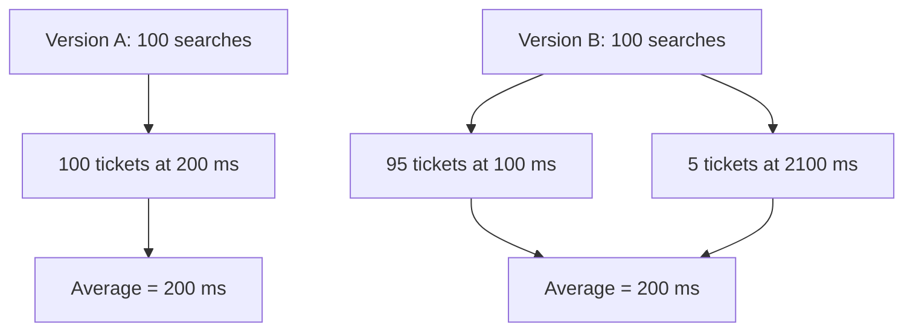
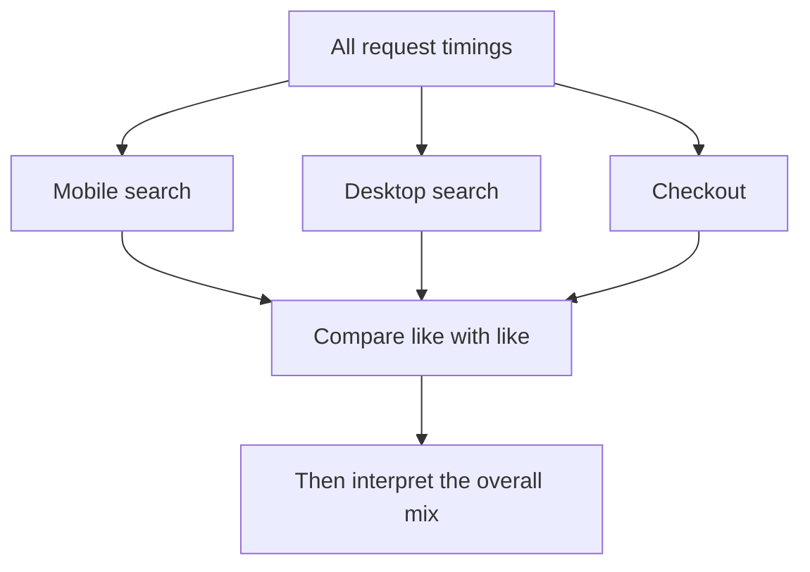

# CS120 — Mathematical and Statistical Thinking for Software Engineers

## Lecture 03: Statistics, Distributions, and Sampling

*Why two APIs with identical average latency can produce radically different customer experiences, why a thousand measurements may tell you less than a hundred well-chosen ones, and how to distinguish meaningful evidence from impressive-looking numbers.*

---

### How to listen to this lecture

In CS120-L02, we learned to reason about uncertain events when their probabilities are known or assumed. Today we'll investigate the opposite problem: **we don't know how the system behaves, so we must infer its behavior from measurements**.

Our running case is a hotel-booking platform testing two versions of its search API. Both versions report precisely the same average latency, but one makes customers considerably more frustrated.

We'll develop the concepts of distributions, means, medians, percentiles, variance, sampling, estimation, and confidence intervals through that investigation. The heavier calculations and experiments live after the spoken lecture, followed by a dense interview glance card.

---

# Part I — Intuition

*Two versions of our search API have exactly the same average response time. Why does one make customers miserable?*

### Picture one hundred customers in two checkout lines

Imagine a hotel website with a search button. A customer clicks it, and the backend responds when it has found suitable hotels. We want to know whether a new search implementation is better than the old one.

Rather than showing a dashboard, imagine one hundred people lined up at a service desk. Each person holds a ticket saying how long their search took.

In **Version A**, every ticket says 200 milliseconds. Not spectacularly fast, but dependable.

In **Version B**, ninety-five tickets say 100 milliseconds, and the remaining five say 2,100 milliseconds. Most people get results much faster. Five customers stare at the spinning indicator for over two seconds.

Now calculate the average for each version. Version A averages 200 milliseconds. Version B also averages 200 milliseconds. Same number; profoundly different experiences.

The picture below shows why. The average records the overall balance of the tickets. It doesn't tell us how the tickets are distributed among customers.



The backend team might claim both systems are equally fast. Most users might prefer B. The unlucky five might strongly prefer A. Neither conclusion can be read directly from the average alone.

The missing idea is called a **distribution**: the shape of all the observed values, not merely one summary number.

### 1. One number can't describe an entire crowd

Imagine you're deciding where to live and someone tells you that the *average* income in two neighborhoods is identical. In one neighborhood everyone earns roughly the same. In the other, one extremely wealthy resident lives among many people with much lower incomes.

The average is the same, but it describes two different worlds. Response times work like that too.

The **mean** is the familiar arithmetic average. Add the values; divide by their count. It helps summarize totals, but unusually large measurements pull it upward.

The **median** is the middle measurement after sorting. If half the responses are faster and half are slower, the median marks that central position. For Version B, the median is 100 milliseconds. That's useful for typical behavior, but it still doesn't reveal the five badly delayed requests.

So we ask another question: “How slow are the unlucky customers?” A **percentile** helps locate a chosen point in the sorted list. The p99 is a threshold near the slowest one percent. In our simple Version B, p99 is 2,100 milliseconds.

You now have three different descriptions: the same average, a faster typical response, and a much worse tail. All can be true simultaneously.

### 2. The tail isn't just a funny edge case

Imagine a traveler searching hotels, opening room details, checking availability, and completing checkout. They don't make one request. They make many requests across a journey.

Even if only five percent of individual operations experience a long wait, the chance that *at least one* of ten independent operations is slow is much larger than five percent—about forty percent under that simplified assumption.

This is one reason the **tail** of a latency distribution matters. Small probabilities repeated across several required steps can become a common feature of the overall experience.

But not every slow request is unrelated. Perhaps an overloaded database makes several operations slow together. Dependence can change the calculation, just as we learned in the probability lecture.

The practical lesson isn't “always prefer p99.” It's “look at the shape of the experience that matters.” Sometimes the mean matters for cost. Sometimes the median matters for typical users. Sometimes a tail threshold matters for reliability.

### 3. A million measurements can still be the wrong million

Our engineer says, “Relax. We logged a million requests.” That sounds conclusive—until you ask how the measurements were collected.

Imagine the monitoring system records a response time only when the API successfully returns a response. But some of Version B's worst requests time out and never finish. Those customers see a failure, while their attempts disappear from the latency dashboard.

The recorded population is not “all customer attempts.” It is “successful attempts that finished.” This is **selection bias**. Measuring more of the same successful requests doesn't fix the missing failures.

Now imagine those million requests came from one testing machine in the same cloud region as the servers. They may tell us a great deal about that testing machine's workload, but far less about mobile customers across Europe.

The first question in statistics is therefore not “How many observations?” It's **“Which observations belong to the question?”**

### 4. Comparing two groups can fool us twice

Suppose searches on mobile phones are typically slower than searches on desktop computers. Yesterday, our traffic was mostly mobile. Today, a marketing campaign brings more desktop users. The overall average improves.

Did the new backend cause it? Not necessarily. The visitors changed.

This problem becomes especially slippery when one average combines several kinds of operations. If the proportion of quick searches and expensive checkouts changes, an overall number can worsen even when each operation gets faster. That's the intuition behind **Simpson's paradox**.

The second picture separates the two tasks: first compare *similar kinds of requests*, then decide how to combine them for the business question.



Sometimes we need to make claims about customers we've not yet observed. A sample might show ten percent of requests are slow, but another sample could show nine or eleven. That is **sampling uncertainty**. A **confidence interval** is one way to express this uncertainty under explicit assumptions about how the sample was gathered. It is not a spell that repairs biased measurements.

### 5. Keep the measurement instrument in the story

If the backend measures only the controller method, but the customer waits for DNS, network, proxy, queuing, and browser rendering, their timers answer different questions. Neither is automatically false. They start and stop at different places.

Likewise, averaging each server's p99 doesn't generally reconstruct the p99 of all requests across the fleet. The per-server summaries have thrown away information about the combined distribution. To do it properly, we need enough compatible underlying measurements, such as mergeable histogram counts.

**A statistic is not an explanation.** It is a compressed description of a particular set of observations, collected through a particular measurement system.

### Your mental checkpoint

**Question A:** If two APIs average 200 milliseconds, must they feel equally responsive? **No.** Their distributions may be very different.

**Question B:** What is missing if the dashboard records only successful requests? **Failed and timed-out customer attempts**, which may be the worst experiences.

**Question C:** If the overall average improves after a release, what else might have changed? **The mix of customers and request types**, not just the software.

Carry one picture into Part II: **one hundred people holding one hundred response-time tickets**. The mean, median, p99, histogram, and confidence interval are different attempts to answer different questions about those tickets—and the unseen tickets they might represent.

*The intuition pass ends here.*

---

# Part II — Deep Dive

# 1. Two Hundred Milliseconds, Two Completely Different Systems

It's Tuesday morning, and our hotel-booking platform has just completed a major backend optimization.

The engineering team replaced a complicated search-processing pipeline with a more efficient implementation. Several expensive operations were eliminated, database queries were reorganized, and application-level caching was improved.

The new service looks promising.

During an internal benchmark, average search latency falls dramatically.

Developers celebrate.

The new implementation is deployed to production.

And customers begin complaining.

Some searches finish almost instantly. Others take several seconds, apparently at random.

Customer support receives messages about frozen search pages. A few customers report clicking the Search button repeatedly because nothing seems to be happening.

The engineering dashboard tells a different story.

Both the original service and the new implementation report an average latency of 200 milliseconds.

The backend team concludes that the performance regression must be imaginary.

After all, the average hasn't changed.

But the frontend team insists that the user experience is significantly worse.

Let's examine the actual request timings.

**Version A**, the original implementation, processes every request in our simplified measurement set in approximately 200 milliseconds.

**Version B**, the supposedly optimized implementation, processes 95% of requests in 100 milliseconds.

The remaining 5% take 2,100 milliseconds.

Let's calculate the average.

For every hundred requests, Version B processes ninety-five in one hundred milliseconds and five in 2,100 milliseconds.

The total elapsed time across those individual request measurements is twenty thousand milliseconds.

Divide by one hundred.

The average is 200 milliseconds.

Exactly the same as Version A.

Yet the systems behave very differently.

Version A is consistently moderately fast.

Version B is usually twice as fast, but one request in twenty takes more than two seconds.

If that slow request occurs during checkout, customers may reasonably prefer the supposedly slower Version A.

Neither team's measurements were necessarily wrong.

The problem was that **the average concealed the shape of the latency distribution**.

A distribution describes how observations are spread across possible values.

The average compresses that entire distribution into one number.

Sometimes that's useful.

Sometimes it destroys precisely the information we need.

Our first task is to learn what survives that compression—and what disappears.

---

# 2. The Dataset Is Not the System

Before calculating anything else, we need to establish what we're measuring.

Suppose our dashboard contains one million request durations.

That sounds like a lot of evidence.

But evidence about what?

Were these customer requests or synthetic probes?

Were they successful requests only?

Did they come from European users, Asian users, or both?

Did the measurements include connection establishment, database waits, and response transmission?

Were they collected during normal traffic or a benchmark?

A million numbers cannot answer these questions themselves.

We need to define the **observational unit** and the **population**.

## 2.1 The unit of observation

Imagine recording one duration whenever the search API finishes a request.

Each observation represents one completed request.

That is a perfectly valid measurement definition.

But it is not the same as measuring one customer's experience.

One customer might perform twenty searches.

Another might perform only one.

The first customer contributes twenty observations; the second contributes one.

Our metric is therefore request-weighted, not customer-weighted.

If the question is "How long does an ordinary request take?" that might be appropriate.

If the question is "What fraction of customers experienced an intolerably slow search?" we need a different analysis.

The same data can support several questions, but the unit of observation must match the question.

## 2.2 Population versus sample

A **population** is the full set of observations or entities about which we want to make a claim.

A **sample** is a subset from which we collect information.

For example, our population might be all search requests made by actual customers during the next month.

But we only have measurements collected during a twenty-minute canary deployment.

That canary dataset is a sample of the broader behavior we're interested in.

Now consider a subtle complication.

Even if we recorded every request during the twenty-minute test, we still wouldn't necessarily know how the system will behave next month.

We have a complete record of the canary period.

But we're using it to infer behavior in a different period, under potentially different traffic and operating conditions.

This is why the population must be defined relative to the question.

A dataset can be a complete census of one period and still be an unrepresentative sample of the future.

## 2.3 Describing versus inferring

There are two broad activities in statistics.

**Descriptive statistics** summarize observations we already have.

We calculate means, medians, percentages, and distributions for the recorded requests.

**Statistical inference** uses observations to reason about a larger population or an underlying process.

For example, we estimate how often future customers will encounter two-second searches.

Those are different tasks.

We may know the exact mean of our recorded one thousand requests.

But the underlying long-term mean of the application remains uncertain.

**Exact arithmetic on a dataset does not automatically produce certain knowledge about the world beyond that dataset.**

---

# 3. The Mean: A Useful Answer to a Particular Question

Let's examine the arithmetic mean.

The mean is calculated by adding all observations and dividing by the number of observations.

For our first five requests, imagine durations of 100, 120, 130, 150, and 500 milliseconds.

Their total is one thousand milliseconds.

Divide by five.

The mean is 200 milliseconds.

You can interpret the mean as the value around which the total is balanced.

It also has a useful property: if we know the count and the sum of observations, we can calculate the combined mean.

That's convenient for distributed systems.

But the mean is sensitive to large values.

Our five requests contain four relatively quick responses and one much slower response.

That one slow response pulls the mean upward.

## 3.1 The mean answers a total-work question

Imagine a service processing one thousand requests.

The sum of measured response durations can be useful for certain analytical purposes, although concurrent durations are not equivalent to elapsed wall-clock time or CPU consumption.

The arithmetic mean summarizes the total measured duration divided by the request count.

It is particularly useful when the total magnitude of observations matters.

For example, average response size can help estimate aggregate traffic when combined with request volume.

But if we're trying to describe what most users experience, the mean can be misleading when the distribution is highly skewed.

The problem isn't that the mean is a bad statistic.

It's that we're asking it to answer questions it wasn't designed to answer alone.

## 3.2 One catastrophic outlier

Suppose one hundred requests each take 100 milliseconds.

The mean is 100 milliseconds.

Now imagine one additional request takes ten seconds.

The new mean rises to almost 198 milliseconds.

One unusual request nearly doubles the average.

That change may be meaningful.

Perhaps the service occasionally enters a catastrophic slow path.

But it could also reflect a measurement problem, a client that disconnected, or an unusual workload.

The mean doesn't tell us which.

We need to inspect the observations and their context.

---

# 4. The Median: What Happens in the Middle?

Now let's introduce the **median**.

Sort the observations from smallest to largest.

The median is the middle value, or an appropriate midpoint between the two central observations when there is an even number of values.

For our earlier five requests—100, 120, 130, 150, and 500 milliseconds—the median is 130 milliseconds.

The mean was 200.

The median is 130.

Both are correct.

They describe different aspects of the data.

## 4.1 Why the median resists extreme values

Suppose the slowest request takes fifty seconds rather than half a second.

The mean increases dramatically.

But the median remains 130 milliseconds.

The central ordering hasn't changed.

This makes the median more resistant to extreme observations.

It is often a useful description of a typical request in a skewed latency distribution.

But the median also has a weakness.

It can completely hide severe problems affecting a minority of users.

Return to Version B.

Ninety-five percent of requests take 100 milliseconds.

Five percent take 2,100 milliseconds.

The median is 100 milliseconds.

That sounds excellent.

And for the middle request, it is excellent.

But the median says almost nothing about the unlucky customers experiencing the slow tail.

We therefore need a way to ask about different parts of the distribution.

---

# 5. Percentiles: Looking Beyond the Middle

A **percentile** describes a position within an ordered distribution.

The fiftieth percentile corresponds to the median under standard definitions.

The ninetieth percentile describes a latency threshold at or below which roughly ninety percent of observations fall.

The ninety-ninth percentile concerns a point near the slowest one percent.

In performance engineering, these are often called p50, p90, p95, and p99.

Let's return to our two services.

Version A completes every request in 200 milliseconds.

Its median, p90, p95, and p99 are all 200 milliseconds in our simplified dataset.

Version B completes 95% in 100 milliseconds and 5% in 2,100 milliseconds.

Its median is 100 milliseconds.

Its p90 is also 100 milliseconds.

But its p99 is 2,100 milliseconds.

Now the problem becomes obvious.

Version B's ordinary case improved dramatically.

Its tail behavior became much worse.

The average concealed that trade-off.

The median emphasized only the improvement.

The p99 exposed the minority of requests suffering extreme delay.

## 5.1 Percentile definitions have details

Here's a statistical subtlety worth knowing.

There isn't one universally adopted algorithm for calculating sample quantiles.

Some methods select an observed value at a particular rank.

Others interpolate between neighboring observations.

As a result, different tools can produce slightly different sample percentile values, especially with small datasets or near sharp distribution boundaries.

For our Version B example, the ninety-fifth percentile is particularly sensitive to that boundary because exactly 95% of requests have the fast duration.

One convention may place it at 100 milliseconds; an interpolating convention can produce an intermediate estimate.

That doesn't invalidate percentiles.

It means we should know how our monitoring system computes them before arguing over exact thresholds.

Our p99 conclusion is unaffected in this example.

## 5.2 A percentile is not a request category

Suppose the p99 is two seconds.

That doesn't mean "the same one percent of customers always wait two seconds."

It describes a distribution of measured requests during a specified observation period.

The slowest one percent might be concentrated among a particular region, endpoint, device type, or customer segment.

Or different requests might become slow for different reasons.

A percentile tells us where to investigate.

It doesn't identify the cause.

## 5.3 Tail latency compounds across a user journey

Imagine that a customer journey requires ten sequential backend operations.

Suppose each operation independently has a 5% chance of taking the slow path.

What's the probability that at least one of the ten operations is slow?

We can calculate the opposite event first.

The probability that none is slow is ninety-five percent multiplied by itself ten times.

That is approximately 59.9%.

Therefore, the probability of at least one slow operation is about 40.1%.

One in twenty operations taking the slow path sounds moderately rare.

But across a ten-step journey, under this simplified independence assumption, roughly two in five journeys encounter at least one such event.

That is why tail latency becomes particularly important in complex applications.

However, real operations aren't necessarily independent.

A shared overloaded database can make several consecutive operations slow together.

Correlation may change the result substantially.

The mathematics gives us a model.

Production evidence tells us whether its assumptions are credible.

> **Sticky note #1:** A fast median doesn't rescue a terrible tail. And a small slow-request probability can become a large user-journey problem when the journey depends on many operations.

---

# 6. Variance: Two Systems Can Have the Same Center and Different Stability

We've established that averages and medians don't describe the full distribution.

Now let's develop a way to quantify how spread out observations are.

This is the purpose of **variance**.

Imagine two services.

One completes every request in 200 milliseconds.

Another alternates between 100 and 300 milliseconds.

Both have a mean of 200 milliseconds.

But the second service is more variable.

Variance measures the average squared deviation from the mean.

Conceptually, we examine how far each observation lies from the mean, square that difference, and average the squared distances.

Why square?

Because positive and negative deviations would otherwise cancel.

A request 100 milliseconds above the mean and another 100 milliseconds below it should contribute to variability, not sum to zero.

Squaring makes both deviations positive and gives larger deviations disproportionately more weight.

## 6.1 Standard deviation restores the units

Variance has an inconvenient property.

If latency is measured in milliseconds, variance is measured in milliseconds squared.

That's mathematically valid but unintuitive.

The **standard deviation** is the square root of variance.

It returns us to the original unit.

For our two-value example, every observation is 100 milliseconds away from the mean.

The population standard deviation is therefore 100 milliseconds.

For the perfectly constant service, it is zero.

Now return to Version B.

Its mean is 200 milliseconds, but 95% of requests take 100 milliseconds and 5% take 2,100 milliseconds.

The population standard deviation of that simplified distribution is about 436 milliseconds.

Its mean is only 200 milliseconds.

Its standard deviation is more than twice that.

That's possible because the distribution is strongly skewed by a slow tail.

## 6.2 Standard deviation isn't a universal latency guarantee

You may have encountered the rule that approximately 68% of observations lie within one standard deviation of the mean.

That is associated with a normal distribution.

It is not a universal property of arbitrary datasets.

Our latency distribution is nowhere near normal.

It contains a large concentration of fast requests and a small concentration of extremely slow ones.

Using normal-distribution intuition without checking the distribution would be misleading.

This is a common engineering mistake.

A mathematical formula may be correct while the assumptions needed to interpret it are false.

## 6.3 Population versus sample variance

There's another distinction we should understand without overemphasizing the algebra.

If we calculate the variance of an entire population of observations, we divide the squared deviations by the population count.

If we're estimating population variance from a sample, a common estimator divides by the sample size minus one.

That adjustment is known as Bessel's correction.

It compensates for a bias that appears when we estimate variability around a mean calculated from the same sample, under the usual assumptions.

We don't need to memorize the derivation.

The important distinction is that describing a complete dataset and estimating an unknown population quantity are not exactly the same statistical task.

---

# 7. The Shape of a Distribution Matters

Now imagine drawing a histogram of API latency.

A **histogram** divides the measurement range into intervals called bins and counts how many observations fall into each interval.

Perhaps one bin covers requests between 0 and 100 milliseconds.

Another covers 100 to 200.

Another covers 200 to 500.

And so on.

This reveals aspects of the distribution's shape that a single summary number conceals.

## 7.1 Skewed distributions

Many latency distributions are **right-skewed**.

Most requests complete relatively quickly, but some take much longer.

Latency has a natural lower boundary: it can't meaningfully be negative.

But there's often no similarly tight upper boundary before timeouts or other limits intervene.

This allows a long tail toward higher values.

The mean can therefore be considerably larger than the median.

When diagnosing latency, this is ordinary rather than surprising.

## 7.2 Heavy tails

A distribution is sometimes described as heavy-tailed when extreme outcomes occur more frequently than they would under an appropriate light-tailed reference model.

The term has precise mathematical meanings in particular contexts, and we shouldn't infer a formal heavy-tailed distribution merely because a graph has a few outliers.

Still, the engineering intuition matters.

Some systems experience unusually large delays often enough that the extremes dominate customer complaints, operational risk, or total work.

These tails can arise from queueing, resource contention, long-running queries, retries, garbage collection, or shared infrastructure problems.

Different mechanisms can produce similar-looking plots.

The distribution tells us what happened.

It doesn't necessarily tell us why.

## 7.3 Multimodal distributions

Now imagine a histogram with two prominent clusters.

One around 80 milliseconds.

Another around 800 milliseconds.

This is a **multimodal distribution**.

Perhaps one group of requests is served from cache, while another requires an expensive database query.

Perhaps European customers reach a nearby region while customers elsewhere experience a longer path.

Perhaps one backend version is healthy and another is misconfigured.

The mixture itself is an important clue.

A mean near 440 milliseconds would describe neither group particularly well.

When a distribution contains distinct clusters, separating the underlying populations may reveal the mechanism.

This is why analyzing latency by endpoint, region, cache status, and other relevant attributes can be more useful than studying one global number.

---

# 8. Outliers: Bugs, Rare Events, or Exactly What We Needed to Notice?

An engineer notices one request taking thirty seconds.

All surrounding requests finish in less than 200 milliseconds.

Should we remove the thirty-second observation as an outlier?

Not automatically.

An **outlier** is an observation unusually far from the rest of the data according to some criterion.

But the word doesn't explain its origin.

Perhaps the request represents a genuine failure mode.

Perhaps a database lock was held for thirty seconds.

Perhaps the request waited for a supplier timeout.

Or perhaps the monitoring system recorded the duration incorrectly.

These possibilities require different treatment.

## 8.1 Removing data can erase the incident

Suppose an API usually responds quickly but occasionally blocks during garbage collection or dependency recovery.

Those rare slow requests might be the most important performance problem in the application.

Removing them because they distort the average would hide the problem.

On the other hand, a measurement accidentally recorded in microseconds but labeled as milliseconds may genuinely be invalid.

Correcting a known instrumentation error is reasonable.

The difference is whether we have evidence that the observation is invalid.

**Extreme doesn't mean erroneous.**

## 8.2 Robust summaries

Sometimes we want a description of typical behavior that isn't dominated by extreme values.

The median is useful for this.

A trimmed mean, which excludes a specified proportion of values at each end, can also provide a more robust central summary.

But trimming must be disclosed.

A trimmed mean is not the same quantity as the ordinary arithmetic mean.

For operational reliability, we generally shouldn't hide extreme customer-facing latency merely to produce an attractive central metric.

Instead, report both typical behavior and relevant tail measures.

Different statistics answer different questions.

---

# 9. Sampling Bias: A Million Measurements Can Still Be Misleading

We now reach one of the most important sections in the course.

Imagine our production service receives ten million requests.

Our monitoring system records one million.

That's an enormous sample.

Surely it must represent the service accurately?

Not necessarily.

The size of a sample doesn't guarantee that it represents the population we care about.

How the observations entered the sample matters enormously.

## 9.1 The successful-request trap

Suppose our metrics middleware records latency when an HTTP response finishes successfully.

But requests that time out before completion aren't included.

Version B has occasional severe failures.

Some requests disappear after the client disconnects or the server times out.

If those requests are missing from the recorded dataset, the observed latency distribution looks much healthier than the actual user experience.

Our dashboard measures completed successful requests.

But our question concerns all attempted customer operations.

The sampling process excludes some of the most important outcomes.

This is a form of **selection bias**.

No amount of additional sampling from the same incomplete measurement process will fix it.

We must change what we measure.

## 9.2 The canary that represented the wrong customers

Suppose Version B was initially deployed only to internal employees.

Employees use fast office networks, modern laptops, and familiar search patterns.

The results look excellent.

But production customers include mobile users on unreliable connections, people using older devices, and travelers searching from distant regions.

The canary dataset may not represent the intended customer population.

Again, the issue isn't sample size.

It's how the sample was selected.

A representative sample must reflect the relevant variation in the population—or support an explicitly justified adjustment for that variation.

## 9.3 Survivorship bias

Suppose we're evaluating whether a slow checkout process affects conversion.

We examine only customers who completed checkout.

Those customers apparently tolerated the experience.

But customers who abandoned checkout are absent.

We're studying survivors and ignoring those who left.

This is **survivorship bias**.

It can make slow user experiences look harmless.

If the question concerns abandonment, the analysis must include sessions that never reached successful completion.

This is a general lesson for product analytics.

A dataset of successful operations may be excellent for understanding successes.

It's often terrible for understanding why attempts fail.

---

# 10. Repeated Observations Are Not Necessarily Independent

In CS120-L02, we learned that independence is an assumption, not a default property of events.

The same applies to samples.

Imagine collecting one thousand requests.

If each request came from an independent customer under similar conditions, certain statistical calculations might be straightforward.

But suppose nine hundred requests came from one automated client repeatedly hitting the same endpoint.

The remaining hundred came from actual customers.

We still have one thousand observations.

But they don't represent one thousand independent customer experiences.

The repeated measurements may share the same connection, cache state, network path, and backend instance.

## 10.1 Correlation shrinks effective information

Consider a service with ten application instances.

We collect a thousand request timings from each.

Those requests may share server-level conditions.

If one instance suffers resource contention, many of its observations become slow together.

Treating every request as independent can underestimate uncertainty about the wider system.

The sample contains ten thousand rows.

But the number of independent underlying environments is much smaller.

This is why statistical analysis sometimes needs to account for **clusters**.

A cluster might be a customer, server, tenant, geographical region, or time period.

The correct grouping depends on what causes observations to be related.

## 10.2 Time correlation

Now imagine monitoring latency once per second during a ten-minute outage.

The readings are strongly related.

A slow measurement at 10:00:01 makes another slow measurement at 10:00:02 more likely because the same incident is ongoing.

These aren't independent snapshots of unrelated system states.

Naïvely using the usual square-root-of-sample-size formulas may overstate precision.

This doesn't mean the data is useless.

It means we must use methods appropriate to its dependence structure or summarize at a meaningful unit.

Sometimes the right unit is the incident, deployment, customer journey, or time window—not the individual request.

---

# 11. Simpson's Paradox: When Every Subgroup Improves but the Average Gets Worse

Now for one of statistics' most entertaining traps.

Imagine our travel platform processes two kinds of requests.

Simple hotel searches.

And more expensive checkout operations.

We compare two deployment periods.

During Period A, the system processes nine hundred simple searches averaging 90 milliseconds and one hundred checkouts averaging 900 milliseconds.

Its overall mean is 171 milliseconds.

During Period B, simple searches average 80 milliseconds, and checkouts average 800 milliseconds.

Both operations are faster than before.

Wonderful.

But there's a twist.

During Period B, the traffic mix changes.

Only one hundred requests are simple searches, while nine hundred are checkouts.

The overall average is now 728 milliseconds.

Let's examine the conclusion.

Searches improved from 90 to 80 milliseconds.

Checkouts improved from 900 to 800 milliseconds.

Yet the overall mean increased from 171 to 728 milliseconds.

How can both subgroups improve while the total gets worse?

Because the groups now contribute different weights.

During Period A, the workload was dominated by quick searches.

During Period B, it was dominated by expensive checkouts.

The global average reflects the changed mixture.

This kind of reversal is an example of **Simpson's paradox**.

The aggregation can tell a very different story from the relevant subgroup comparisons.

## 11.1 What does the paradox actually establish?

It doesn't prove that the system improved overall.

It also doesn't prove that the system regressed internally.

It shows that the global mean combines two influences.

Performance within each workload category.

And the proportion of traffic belonging to each category.

If we want to evaluate implementation efficiency, we should compare like-for-like workloads or use an explicitly standardized workload mixture.

If we want to measure what the platform actually experienced, the real traffic-weighted average may also matter.

Both questions are valid.

But they're different.

This is why serious performance comparisons specify the workload composition.

**A change in the observed average can come from a change in system behavior, a change in population composition, or both.**

We'll return to this distinction in CS120-L04 when studying experiments and causality.

---

# 12. The Great Percentile-Averaging Mistake

Our platform runs across several backend instances.

Each instance reports its own p99 latency.

One reports 100 milliseconds.

Another reports 900 milliseconds.

A developer averages those values and announces that the system-wide p99 is 500 milliseconds.

That's generally invalid.

A percentile is a property of an entire distribution.

It cannot generally be reconstructed by averaging percentiles from separate distributions.

## 12.1 Why weighting alone doesn't solve it

Suppose Instance A handles ten thousand requests.

Instance B handles one hundred.

Even the arithmetic average of their p99 values obviously gives disproportionate influence to the tiny instance.

A request-count-weighted average might sound better.

But it still doesn't reconstruct the combined p99 in general.

The missing information is the shape of the underlying distributions.

We need to know how observations from the two instances are distributed relative to one another.

Two different pairs of datasets can have identical per-instance p99 values while producing different combined p99 values.

Therefore, no universal weighted-average trick recovers the answer from those two percentiles alone.

## 12.2 What can be combined?

Counts can be added.

Sums can be added.

If the measurements refer to compatible populations and definitions, we can calculate a combined arithmetic mean using total sum divided by total count.

Histograms with compatible bucket boundaries can be merged by adding bucket counts, and then a combined percentile can be estimated from the merged distribution.

Sketch-based quantile data structures may also support approximate merging, depending on their design.

But individual percentile summaries don't contain enough information to reconstruct arbitrary combined distributions.

This matters in observability systems.

If each Node.js instance exports only a local p99 gauge, calculating the fleet-wide p99 from those gauges will generally be misleading.

Instead, use appropriate distribution-oriented telemetry such as histograms.

## 12.3 End-to-end percentiles aren't sums either

Another tempting calculation is adding the p99 of several dependencies.

Suppose database latency has a p99 of 100 milliseconds.

External supplier latency has a p99 of 400 milliseconds.

Can we conclude that the combined request p99 is 500 milliseconds?

No.

The slowest one percent of database operations may not occur on the same requests as the slowest one percent of supplier operations.

The dependencies may be sequential or parallel.

Their latencies may be correlated.

And the complete request may contain additional work.

For sequential stages, their means can be added under appropriate matching and measurement definitions.

But their percentiles generally cannot.

For accurate end-to-end tail latency, measure the end-to-end operation or preserve enough joint information to analyze the combined distribution.

---

# 13. Measurement Error: The Instrument Has Its Own Behavior

Let's return to our production dashboard.

Suppose it reports that Version B improved median latency by ten milliseconds.

Is that improvement meaningful?

Before discussing statistical confidence, we should verify that we're measuring the intended thing correctly.

## 13.1 Where does the timer start?

Imagine a Node.js application recording request duration only after a controller method begins executing.

The request might already have spent time waiting inside the runtime or an intermediary.

Our measurement excludes that delay.

The browser, meanwhile, measures a much larger interval.

Both measurements may be valid.

They refer to different stages.

A metric named "API latency" is meaningless unless we understand precisely where it starts and stops.

## 13.2 Instrumentation changes the system

A profiler, tracing mechanism, or logging operation can consume resources.

Usually, well-designed observability introduces manageable overhead.

But highly detailed instrumentation can affect timing, memory allocation, and I/O.

If we're measuring extremely short operations, even modest instrumentation overhead may distort the result.

This is sometimes called the **observer effect** in engineering measurement.

The solution isn't to avoid measuring.

It's to understand the measurement system and validate that its overhead doesn't dominate the phenomenon being studied.

## 13.3 Clocks and resolution

Wall-clock time can be affected by clock adjustments.

For measuring elapsed time within a process, monotonic clocks are generally preferable.

Measurement resolution also matters.

If a timer reports only whole milliseconds, attempting to distinguish operations taking 0.2 and 0.3 milliseconds may be meaningless.

Likewise, a histogram with broad bins cannot resolve extremely small differences within those bins.

The quality of a measurement is constrained by how the instrument collects and represents the data.

---

# 14. Confidence Intervals: How Certain Are We About the Unknown Population?

We've spent most of this lecture describing measured observations.

Now imagine we want to infer a property of future traffic.

Suppose we sample one thousand independent, representative requests.

One hundred are slower than one second.

Our observed slow-request rate is 10%.

Is the true long-run rate exactly 10%?

We don't know.

The sample may have been slightly luckier or unluckier than the underlying process.

If we collected another thousand requests under comparable conditions, we might observe 9.3%, 10.8%, or another nearby value.

This is **sampling variability**.

A confidence interval gives us a range constructed by a statistical procedure designed to reflect uncertainty in an estimated population quantity.

## 14.1 An approximate interval

For a sufficiently large, representative sample of independent yes-or-no observations, we can estimate the standard error of a sample proportion.

The approximate formula is:

\[\mathrm{SE}(\hat p)\approx\sqrt{\frac{\hat p(1-\hat p)}{n}}\]

Here, the sample proportion is represented by p-hat, and n is the number of observations.

For our sample of one thousand requests with a 10% slow-request rate, the standard error is about 0.95 percentage points.

A simple approximate 95% confidence interval uses roughly two standard errors on either side of the estimate.

That produces an interval around 8.1% to 11.9%.

This is useful.

It tells us the observed 10% rate doesn't determine the long-run rate perfectly.

But now we need to interpret the interval correctly.

## 14.2 What 95% confidence actually means

A common explanation says:

"There is a 95% probability that the true slow-request rate lies inside this particular interval."

That is not the standard frequentist interpretation.

Under a fixed-parameter frequentist model, the unknown population parameter is treated as fixed.

The interval is produced by a random sampling procedure.

A 95% confidence procedure means that, over many repeated samples generated under the method's assumptions, approximately 95% of the resulting intervals would contain the true parameter.

For the interval already calculated, the parameter either lies inside it or doesn't.

The 95% refers to the procedure's long-run coverage, not a probability distribution assigned to the fixed parameter after observing this sample.

You don't need to become pedantic in ordinary conversation.

But understanding the distinction helps prevent confidence intervals from being treated as magical declarations of certainty.

## 14.3 Larger samples reduce some uncertainty

If we increase the sample size while preserving the relevant assumptions, standard errors generally decrease.

For many common estimators, uncertainty scales approximately with the inverse square root of sample size.

That means collecting four times as many independent observations roughly halves the standard error.

Not quarters it.

This is important for engineering measurement.

Doubling sample size doesn't double precision.

And gathering millions of biased observations doesn't remove systematic sampling bias.

Statistical uncertainty and measurement bias are different problems.

## 14.4 Confidence intervals have assumptions

Our simple interval assumes something like independent observations generated from a stable population.

But production traffic changes over time.

Requests may be correlated.

Users differ.

Servers differ.

And the observed rate may shift during deployments.

A confidence interval calculated from the wrong model can look impressively narrow while understating actual uncertainty.

More sophisticated methods can account for clustering, time dependence, or different sampling designs.

We'll explore experiment design and inferential pitfalls in CS120-L04.

For now, the principle is enough.

**An interval is only as trustworthy as the data-collection process and assumptions used to construct it.**

---

# 15. Why Tail Percentiles Need More Evidence Than You Think

Suppose an engineer measures one hundred requests and reports a p99 of 700 milliseconds.

How much confidence should we place in that result?

Not much without additional context.

The slowest one percent of one hundred observations corresponds to roughly one observation.

A p99 estimate based on such a small sample is extremely sensitive to individual measurements.

Collect another hundred requests, and the extreme value could change dramatically.

This isn't necessarily evidence that the application changed.

It may simply reflect sampling variability in a small tail sample.

## 15.1 Rare outcomes require enough opportunities

Imagine a system where one percent of requests take the slow path.

In one hundred independent requests, we'd expect about one slow request.

But we could observe zero, one, two, or more.

The exact outcome is uncertain.

To characterize the tail reliably, we often need substantially more observations than the percentile itself might suggest.

And if the slow events cluster during rare outages, increasing the number of individual requests during normal operation might still miss the important failure conditions.

The question becomes not merely how many requests we measured, but which operating states we observed.

## 15.2 Percentile uncertainty is different from percentile value

A p99 of one second is a point estimate describing the sampled distribution.

The uncertainty in that estimate is another question.

It depends on sample size, distribution shape, dependence, and estimation method.

We can estimate uncertainty in quantiles using appropriate statistical methods, including suitable bootstrap techniques.

But the procedure must respect the data's dependence structure.

Resampling individual requests independently may be inappropriate when the main variability occurs between servers or during incident periods.

The method should reflect how the data was generated.

---

# 16. Histograms: Keeping Enough Information to Ask Better Questions Later

Our engineering team now realizes that exporting only the average latency was a mistake.

So we redesign the measurement system.

For each important request category, we record the duration into a histogram.

The histogram maintains counts across latency ranges.

Perhaps requests are grouped into boundaries around 50, 100, 200, 500, 1,000, and 5,000 milliseconds.

Instead of knowing only the mean, we can estimate how many requests fall below or above relevant thresholds.

We can also estimate percentiles from the bucketed distribution.

## 16.1 The value of mergeable data

If multiple application instances export compatible histograms, their bucket counts can be combined.

That allows us to reason about a fleet-level distribution.

This is much better than averaging independent p99 summaries.

But histogram resolution matters.

If one bucket spans 500 to 5,000 milliseconds, we cannot precisely distinguish requests taking 600 milliseconds from those taking four seconds based on that bucket alone.

The histogram preserves a useful approximation, not every raw observation.

The bucket boundaries should reflect the latency thresholds that matter to the product.

## 16.2 The monitoring question determines the measurement

Suppose customers consider searches slower than one second unacceptable.

Then measuring the fraction of searches completing within one second may be more directly useful than obsessing over an arbitrary percentile.

A latency SLO might say that 99% of eligible requests must complete below a specified threshold during an agreed measurement window.

That requires defining eligible requests, timing boundaries, aggregation periods, and error treatment.

The statistics follow from the service objective.

They shouldn't be chosen merely because p99 looks sophisticated on a dashboard.

---

# 17. The Investigation: Why Version B Actually Felt Worse

We now have enough tools to complete the opening investigation.

The backend team originally compared mean latency.

Both versions reported 200 milliseconds.

But that concealed a different distribution.

Version A was consistently around 200 milliseconds.

Version B completed most requests in 100 milliseconds while allowing five percent to take over two seconds.

The p99 exposed the extreme tail.

The histogram revealed two distinct clusters.

And request traces showed that the slow cluster corresponded to a particular cache-miss path involving an expensive downstream query.

The optimization improved the common cache-hit path.

But the new cache-miss behavior occasionally produced much longer waits.

Now imagine we also discover that the original dashboard excluded requests that timed out.

Some of Version B's worst operations were missing from its reported successful-request latency.

That makes the original comparison even less representative.

## 17.1 The revised investigation

We establish a precise measurement definition covering all relevant search attempts, including failures and timeouts.

We separate cache hits from cache misses.

We compare the distribution of timings for each path.

We examine regional and endpoint differences.

We preserve enough distribution information to calculate meaningful fleet-wide measures.

And we account for traffic composition.

Only then do we compare the implementations.

The new conclusion is much more informative.

Version B is substantially faster for the ordinary cache-hit path.

Its cache-miss path has a serious tail-latency regression.

The next engineering task is to identify and correct that specific mechanism without discarding the improvements elsewhere.

Perhaps a database query plan changed.

Perhaps several expensive operations now execute sequentially.

Perhaps a connection pool becomes saturated under bursts.

Those are hypotheses for the performance investigation.

The statistics tell us where the problem is concentrated.

They don't replace the need to investigate the mechanism.

## 17.2 Have we proved which version customers prefer?

Not yet.

We've demonstrated a meaningful difference in request latency distributions.

But user preference and conversion behavior are separate outcomes.

Perhaps customers strongly dislike unpredictable waits.

Perhaps faster ordinary searches more than compensate for rare slow ones.

Perhaps the long tail occurs disproportionately during checkout, where it has greater consequences.

To establish the effect on business outcomes, we'd need appropriate observational analysis or an experiment.

That's the bridge to our next lecture.

Statistics helps us describe what happened and estimate unknown quantities.

Causal inference asks what caused the difference.

---

# 18. The Oral Examination

Answer the following questions aloud before reading the solutions.

For each one, identify what the statistic actually describes, what information is missing, and which conclusion is justified.

## Challenge 1 — The identical averages

Version A processes every request in 200 milliseconds.

Version B processes 95% in 100 milliseconds and 5% in 2,100 milliseconds.

Calculate their mean latency.

Compare their median and p99.

Which version is better?

## Challenge 2 — The suspicious sample

A backend reports one million latency measurements, but its instrumentation records only requests that completed successfully.

Customers report frequent timeouts.

What is wrong with the dataset?

Would collecting another ten million measurements using the same instrumentation solve it?

## Challenge 3 — The misleading percentile

Two application instances report p99 latencies of 100 and 900 milliseconds.

A developer says the system-wide p99 is their average, 500 milliseconds.

Why is this invalid?

What measurements could support a meaningful global percentile?

## Challenge 4 — The paradoxical deployment

Version B is faster than Version A for both simple search requests and expensive checkout operations.

Nevertheless, Version B's overall mean latency is higher.

How could this happen?

What additional comparison would help evaluate the implementation?

## Challenge 5 — The statistical promise

A team measures a 10% slow-request rate among one thousand independent, representative requests.

It reports an approximate 95% confidence interval of 8.1% to 11.9%.

Does that mean there is a 95% probability that the fixed true rate lies in that particular interval?

What does the confidence level actually describe?

## Challenge 6 — The tiny tail sample

An engineer measures one hundred requests and reports a precise p99 latency.

Why should you be skeptical?

How does the problem change if the slowest requests occur mainly during rare infrastructure incidents?

## Challenge 7 — More data, same bias

An automated benchmark executes one million requests from a single server in the same cloud region as the backend.

The team claims this demonstrates typical worldwide customer latency.

What's wrong with that conclusion?

What would a more appropriate sampling strategy consider?

## Challenge 8 — Three measurements, one conclusion

After an optimization, mean latency falls by 15%.

The p99 rises by 60%.

The checkout abandonment rate also increases.

Can we conclude the optimization caused customers to abandon checkout?

What has been established, and what still requires investigation?

---

# 19. Solutions and Discussion

## Solution 1 — Means and tails

Both versions have a mean of 200 milliseconds.

Version A's median and p99 are 200 milliseconds.

Version B's median is 100 milliseconds, while its p99 is 2,100 milliseconds.

Version B improves the typical request but substantially worsens tail behavior.

Neither is universally better without defining the relevant customer experience and business objectives. A latency distribution alone does not establish user preference.

## Solution 2 — Selection bias

The instrumentation excludes timed-out or otherwise unsuccessfully completed requests.

The resulting dataset describes successful completions rather than all customer attempts.

That may systematically omit the worst experiences.

Collecting more data through the same biased process doesn't remove the bias.

The measurement definition needs to include relevant attempts and outcomes.

## Solution 3 — Non-composable percentiles

A percentile cannot generally be reconstructed by averaging percentiles from separate distributions.

We need raw observations, compatible histogram data, or another suitable mergeable distribution representation.

Request counts alone are not sufficient to make an average of local p99 values correct.

## Solution 4 — Simpson's paradox

The mix of request categories may have changed.

If the later period contains a much larger share of expensive checkout operations, the overall mean can rise even though both categories become faster individually.

Compare like-for-like workloads, stratify by operation, or use an explicitly standardized workload mixture.

Also preserve the actual traffic-weighted result when evaluating real operating conditions.

## Solution 5 — Confidence interval

Under a frequentist interpretation, the 95% confidence level describes the interval-construction procedure's long-run coverage across repeated samples.

It isn't a posterior probability that a fixed parameter lies inside the already calculated interval.

The result also depends on the assumptions behind the method, including sampling and independence.

## Solution 6 — Tail uncertainty

With one hundred observations, the ninety-ninth percentile is determined by an extremely small number of extreme measurements.

The estimate can vary greatly between samples.

If rare incidents produce clusters of slow requests, the sample may miss those operating conditions entirely.

Reliable tail analysis needs representative coverage of operating states and methods appropriate to the data's dependence.

## Solution 7 — Unrepresentative benchmark

One client in the same cloud region doesn't represent worldwide users, networks, devices, or request behaviors.

Its measurements may be valid for that particular synthetic workload.

They don't automatically generalize to customers.

A better design considers relevant regions, device and network conditions, endpoint mixes, concurrency, and real-user measurements.

## Solution 8 — Association versus causation

The measurements show an improved mean, worse tail latency, and increased abandonment during the observed period.

They do not by themselves prove that the optimization caused the abandonment increase.

Other factors may have changed simultaneously.

We should investigate request-level mechanisms and use an appropriate controlled comparison or experiment to estimate the causal effect.

That is the subject of CS120-L04.

---

# 20. The Mental Model Worth Keeping

Statistics helps engineers reason from measurements without pretending that a collection of numbers is a complete description of reality.

The **population** is what we want to understand.

The **sample** is what we actually observed.

The **mean** summarizes total value divided by count.

The **median** describes the middle of an ordered distribution.

**Percentiles** reveal different points in that distribution, including the slow tail.

**Variance and standard deviation** describe how spread out observations are.

**Sampling bias** occurs when the observations systematically fail to represent the intended population.

**Sampling uncertainty** reflects the fact that a finite sample can differ from the unknown population.

**Confidence intervals** quantify uncertainty under explicit statistical assumptions.

And **aggregation can conceal important differences**, especially when traffic composition changes or percentiles are combined incorrectly.

The most useful investigative sequence is:

**Define the question. Identify the population. Examine how data was collected. Look at the distribution. Separate relevant subgroups. Quantify uncertainty. Then decide what the evidence actually supports.**

Three questions recover most of this lecture:

1. **What exactly did we measure?** Which requests, users, time periods, and outcomes were included?
2. **What does the distribution look like?** Are we hiding tails, clusters, or different populations behind one average?
3. **How far can we generalize?** Does the sample represent the target population, and how uncertain is our estimate?

The deepest principle is:

**A statistic is not an explanation. It is a compressed description of observations, meaningful only in the context of the data and assumptions that produced it.**

Understanding that distinction makes performance reviews, experiment results, AI evaluations, and incident investigations considerably more rigorous.

---

# 21. Next Lecture — Experiments, Evidence, and Causality

We've learned how to describe observations and reason about uncertainty.

But our investigation ended with an unanswered question.

Version B had worse tail latency.

Checkout abandonment increased.

Did the new implementation cause the increase?

Perhaps.

But perhaps the traffic mix changed, a supplier experienced an outage, or a marketing campaign attracted a different kind of customer.

Observing two changes together doesn't establish that one caused the other.

In **CS120-L04 — Experiments, Evidence, and Causality**, we'll investigate a new booking interface whose dashboard claims a 12% conversion improvement.

We'll examine randomized experiments, control groups, confounding variables, statistical significance, effect size, and the difference between a convincing result and a seductive coincidence.

Statistics has taught us how to evaluate measurements.

Next we'll learn how to evaluate explanations.

---

## Optional Practical Lab — Statistics Under the Microscope

*The spoken lecture ends here. The exercises below are for visual study, terminal experimentation, and later revision.*

### Lab A — Two distributions, one mean

Use Python's standard library to construct the two latency distributions from our opening incident.

```python
import statistics

version_a = [200] * 1000
version_b = [100] * 950 + [2100] * 50

def nearest_rank(values, percentile):
    ordered = sorted(values)
    import math
    rank = max(1, math.ceil(percentile / 100 * len(ordered)))
    return ordered[rank - 1]

for name, data in [("A", version_a), ("B", version_b)]:
    print(name)
    print("mean:", statistics.mean(data))
    print("median:", statistics.median(data))
    print("p90:", nearest_rank(data, 90))
    print("p99:", nearest_rank(data, 99))
    print("population stddev:", statistics.pstdev(data))
```

Explain which measurements are identical and which differ.

The helper deliberately uses a nearest-rank percentile convention. Other statistical packages may interpolate and therefore produce different values at particular boundaries.

### Lab B — Draw the distributions

Use Matplotlib to plot separate histograms of Version A and Version B.

The purpose is to observe how the distribution's shape differs despite identical means.

Experiment with bin widths. A very wide bin may obscure the slow cluster, while unnecessarily narrow bins may make the data difficult to interpret.

Discuss what information is lost when a histogram replaces the raw observations.

### Lab C — Introduce one extreme observation

Start with one hundred measurements of 100 milliseconds.

Append a single request lasting ten seconds.

Calculate the mean, median, standard deviation, p95, and p99 before and after.

Explain why an extreme value can dominate the mean without substantially affecting the median.

Do not assume the extreme observation is invalid merely because it is inconvenient.

### Lab D — Reproduce Simpson's paradox

Use these illustrative workload measurements:

| Period | Workload | Requests | Average latency |
|---|---|---:|---:|
| A | Simple search | 900 | 90 ms |
| A | Checkout | 100 | 900 ms |
| B | Simple search | 100 | 80 ms |
| B | Checkout | 900 | 800 ms |

Calculate both overall averages.

Then calculate the averages under a standardized workload mixture of 50% search and 50% checkout for each period.

Explain why the conclusion changes when the comparison question changes.

### Lab E — Sample bias simulation

Construct a synthetic population containing fast successful requests, slow successful requests, and timed-out requests.

Calculate the fraction of customer attempts exceeding one second, counting timeouts as failures of the threshold.

Then simulate a monitoring system that retains only successful responses.

Compare the reported latency distribution and failure rate.

Explain why collecting more successful-only observations won't fix the selection problem.

### Lab F — Confidence interval experiment

Generate repeated independent samples of one thousand Bernoulli observations with a true event probability of 10%.

For each sample, calculate the observed proportion and an approximate 95% confidence interval using the normal approximation.

Count the proportion of intervals that contain the true value of 10%.

Repeat with different sample sizes.

For a more serious extension, compare with a Wilson score interval, particularly for small probabilities or small samples.

Then introduce observations sharing a common time-dependent failure condition and investigate why the simple independent-observation method may underestimate uncertainty.

### Lab G — Why percentiles don't average

Create two datasets of very different sizes.

Compute their individual p99 values.

Calculate a simple average and a request-count-weighted average of those percentiles.

Then combine the raw observations and compute the actual combined p99.

Experiment until you find examples where both averaging methods differ substantially from the true combined percentile.

Explain what information the individual p99 summaries failed to preserve.

### Lab H — Histogram aggregation

Create several datasets representing individual backend instances.

Choose identical latency bucket boundaries for each instance.

Count observations in every bucket.

Add corresponding counts across instances to construct one fleet-wide histogram.

Estimate the proportion of requests below a service objective such as 500 milliseconds.

Explain why bucket alignment matters and why a coarse bucket spanning a large latency interval limits percentile precision.

### Lab I — A complete performance investigation

A production search endpoint has the following symptoms:

- Overall average latency appears stable.
- The p99 rises considerably.
- Cache misses increase.
- Mobile users report slow searches more often than desktop users.
- Several timed-out requests are absent from the latency dashboard.

Prepare an investigation plan.

Define the population, relevant metrics, sampling approach, subgroup comparisons, uncertainty, and possible measurement biases.

State what evidence would establish that a performance regression exists.

Then state what additional investigation would be necessary to identify its mechanism and determine whether a particular deployment caused it.

---

## Further Reading — Optional Technical References

1. [NIST Engineering Statistics Handbook](https://www.itl.nist.gov/div898/handbook/) — Descriptive statistics, variability, sampling, and estimation.
2. [NIST — Confidence Limits for the Mean](https://www.itl.nist.gov/div898/handbook/eda/section3/eda352.htm) — Confidence intervals and their proper interpretation.
3. [OpenStax — Introductory Statistics 2e](https://openstax.org/details/books/introductory-statistics-2e) — Accessible coverage of distributions, sampling, and inferential statistics.
4. [Google SRE — Service Level Objectives](https://sre.google/sre-book/service-level-objectives/) — Why tail latency and clearly defined measurements matter.
5. [Google SRE — Monitoring Distributed Systems](https://sre.google/sre-book/monitoring-distributed-systems/) — Histograms and the dangers of averages.
6. [OpenTelemetry — Metrics Data Model](https://opentelemetry.io/docs/specs/otel/metrics/data-model/) — Mergeable histograms, counts, sums, and quantile limitations.
7. [Prometheus — Histograms and Summaries](https://prometheus.io/docs/practices/histograms/) — Practical interpretation of latency distributions in monitoring.
8. [Python — statistics](https://docs.python.org/3/library/statistics.html) — Mean, median, variance, standard deviation, and quantiles.
9. David Spiegelhalter, *The Art of Statistics* — Interpreting data and reasoning about uncertainty.
10. Allen B. Downey, *Think Stats* — Computational statistics through practical examples.

---

## Dense Cheatsheet — Interview Glance Card

*Fenced for voice-reader skipping. Skim the card when revising; reopen the lecture only when a row doesn't immediately make sense.*

```text
CS120-L03  STATISTICS, DISTRIBUTIONS & SAMPLING — INTERVIEW GLANCE CARD

CORE DISTINCTION
  Descriptive statistics = summarize observed data.
  Statistical inference  = infer broader population/process from sample.
  An exact sample mean != known population mean.

POPULATION / SAMPLE / UNIT
  Population      all requests/users/periods relevant to question
  Sample          observations actually collected
  Unit            request? customer? session? deployment? region?
  Census of today may still be sample of tomorrow's behavior.
  Large sample != representative sample.

CENTER
  Mean      sum(values) / count
            useful for total magnitude; sensitive to extremes
  Median    middle sorted value = p50
            resistant to outliers; can hide severe minority experience
  Mode      most frequent value/category
  Trimmed mean  discards tails by declared rule, changes estimand

LATENCY EXAMPLE — SAME MEAN, DIFFERENT EXPERIENCE
  A: 100% requests 200ms
  B: 95% requests 100ms, 5% requests 2100ms

                 A            B
  mean           200ms        200ms
  median         200ms        100ms
  p90            200ms        100ms
  p99            200ms        2100ms
  stddev         0ms          ~436ms

  "B is faster" depends on desired service/user outcome.
  5% slow per independent step; 10 steps:
    P(at least one slow) = 1 - 0.95^10 ≈ 40.1%.

PERCENTILES
  p50    median
  p90    ~90% at or below threshold
  p95    ~95% at or below threshold
  p99    ~99% at or below threshold
  Quantile conventions differ (nearest rank vs interpolation).
  Small n -> high-tail percentile highly unstable.
  p99 is NOT a guarantee about every individual request.

SPREAD
  Variance       average squared distance from mean
  Std deviation  sqrt(variance), original units
  Population variance divides by N.
  Typical unbiased sample variance divides by n-1.
  High variance = less stable observations, not necessarily failure.
  "Mean ± 1 SD contains 68%" requires normal-distribution assumptions.

SHAPE
  Right-skew    many fast requests, fewer very slow ones
  Heavy tail    extremes unusually frequent under suitable reference
  Multimodal    distinct clusters: cache hit/miss, region, endpoint...
  Outlier       unusual value, NOT automatically measurement error
  Histogram     counts observations in bins
  Bin design    determines approximation precision

SAMPLING BIAS
  Successful requests only -> timeouts/disconnects missing
  Internal canary only      -> not worldwide customers
  Completed bookings only  -> abandoners missing
  One customer 1000 calls  -> not 1000 independent customer experiences
  More observations cannot repair systematic selection bias.

DEPENDENCE
  Requests from same customer/node/incident may be correlated.
  Independence assumed by many simple uncertainty formulas.
  Cluster/time dependence reduces effective independent information.
  Treat appropriate cluster as analysis/resampling unit.

SIMPSON'S PARADOX
  Within each subgroup performance can improve
  while overall weighted mean worsens if GROUP MIX changes.
  Example:
    A 900 search@90ms + 100 checkout@900ms => 171ms overall
    B 100 search@80ms + 900 checkout@800ms => 728ms overall
  Both categories faster under B; global average slower.
  Use stratified or standardized mix for like-for-like comparison.

AGGREGATION
  Combined mean = total sums / total counts.
  DON'T average server means unweighted if counts differ.
  DON'T average p99/p95 values to get fleet-wide percentile.
  Percentiles generally NOT mergeable from scalar summaries.
  Merge compatible histogram bucket counts or raw distributions.
  End-to-end p99 != sum of component p99s.

MEASUREMENT QUALITY
  Define start/end (client, proxy, handler, dependency).
  Include intended successes, errors, timeouts.
  Use monotonic clocks for local elapsed time.
  Sampling, timing resolution, instrument overhead matter.
  A metric with no population or time-window definition is ambiguous.

CONFIDENCE INTERVALS
  Estimate = observed sample statistic.
  Standard error = sampling variability of an estimator.
  Approx proportion SE = sqrt(p_hat*(1-p_hat)/n)
  Approx 95% interval = p_hat ± 1.96*SE, when assumptions fit.
  100 slow / 1000 => 10%; approximate 95% CI ~8.1%–11.9%.

  Frequentist 95%:
    Interval construction procedure covers fixed true parameter
    in ~95% of repeated samples under assumptions.
  NOT "95% probability fixed parameter is in THIS interval."
  4x independent sample size -> ~half the standard error.
  More biased observations -> confidently wrong estimates possible.
  Very rare events / small samples need better interval methods.

TAIL UNCERTAINTY
  100 samples -> p99 informed by ~1 extreme observation.
  Need representative tail observations and operating states.
  Outages produce clustered observations: sample across incidents/time.
  Bootstrap may help, but resample meaningful independent units.

FROM MEASUREMENT TO ACTION
  1. Define the engineering question and relevant population.
  2. Define the observational unit and start/stop timing.
  3. Check exclusions, censoring, timeouts, and selection bias.
  4. Inspect mean + median + tails + histogram.
  5. Split by cache, endpoint, region, tenant, device, time.
  6. Check composition changes and dependence.
  7. Quantify uncertainty before generalizing.
  8. Identify mechanism; design experiment before causal claim.

INTERVIEW LINE
  "I don't judge performance from the average alone. I define the
   population and measurement boundaries, inspect the distribution and
   tail, verify that the sample is representative, and distinguish
   observed differences from evidence of a causal improvement."
```
