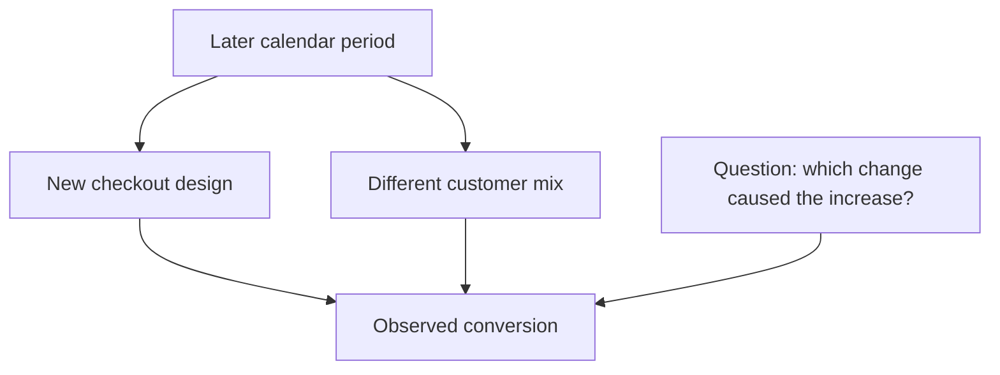
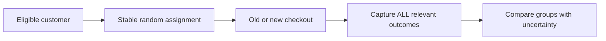

# CS120 — Mathematical and Statistical Thinking for Software Engineers

## Lecture 04: Experiments, Evidence, and Causality

*Why a dashboard can confidently announce a 12% conversion improvement that never happened, how randomized experiments separate causes from coincidences, and why statistical significance is neither proof nor a business decision.*

---

### How to listen to this lecture

In CS120-L03, we learned that a statistic describes observations, not necessarily the world that produced them. We examined distributions, sampling bias, uncertainty, and the dangers of comparing incompatible populations.

Today we take the next step. **How do we establish that changing something actually caused an observed improvement?**

We'll investigate a booking-interface redesign, follow its evidence from a misleading dashboard to a controlled experiment, and develop practical intuition for randomization, confounding, hypothesis testing, confidence intervals, and experimental integrity.

The objective isn't to turn you into a professional statistician. It's to make you the engineer who can examine an impressive experiment report and determine whether its conclusion is justified.

The spoken lecture contains the reasoning. The detailed calculations, experiments, and final interview glance card follow afterward.

---

# Part I — Intuition

*The product team redesigned checkout, and bookings went up. Before celebrating, we need to answer one awkward question: what would have happened without the redesign?*

### Imagine two doors into the same hotel

Our booking platform has an old checkout page and a beautifully redesigned one. The old page requires several steps. The new page has a cleaner layout and fewer forms. After release, the dashboard reports that conversion grew from five percent to 5.6 percent.

That's a twelve-percent **relative** increase, or 0.6 **percentage points** in absolute terms. Both statements describe the same observed difference. But neither tells us its cause.

Imagine you run a physical hotel and install a shiny new entrance. Bookings increase the following week. Did the entrance cause the improvement—or did a festival begin across the street? Perhaps more wealthy travelers arrived, or prices fell, or a competing hotel closed.

The old-versus-new comparison changed **time** as well as **entrance**. That makes the conclusion uncertain.

In our website, the same issue appears with devices. Suppose mobile customers convert at three percent and desktop customers at seven percent. Before release, the visitor mix was half mobile and half desktop, giving five percent overall. After release, desktop traffic rises to 65 percent. Even if neither device group improves at all, the overall conversion becomes 5.6 percent.

The interface could be completely innocent of the apparent lift.

The first picture illustrates the problem: the release and the changing customer mix travel together, both potentially influencing conversion.



The general issue is **confounding**. An observed effect may have several plausible causes, and our comparison doesn't isolate the one we care about.

### 1. We need two versions of the same world

What do we actually want to know? For every customer who saw the redesign, we'd like to know whether they would also have booked using the old checkout, in precisely the same circumstances.

But we cannot give the same person two separate realities at the same moment. A customer either experiences one checkout or the other. The alternative outcome is unobserved. Statisticians call it the **counterfactual**.

We can still learn about average effects if we create two comparable groups. Think of splitting arriving travelers randomly between two clearly marked doors. One group uses the old entrance; the other uses the new. Both groups arrive during the same time period and under broadly similar conditions.

On the website, we assign eligible customers randomly to **control** (old checkout) and **treatment** (new checkout). Random assignment won't produce perfectly identical groups, but it helps avoid systematically sending more valuable, eager, or desktop-heavy customers to one version.

This is the basic purpose of an A/B experiment: **create a comparison where the treatment—not who received it—is the main systematic difference**.

### 2. A person is not an HTTP request

Now imagine our website randomly assigns every request rather than every customer. A traveler sees the new checkout, clicks Back, and suddenly sees the old one. The next refresh switches again.

We aren't measuring the experience of one coherent checkout design anymore. We're measuring an inconsistent mixture.

For this feature, a stable customer-level assignment may be more appropriate, with careful handling of anonymous visitors and repeat sessions. Then we can ask how many *assigned eligible customers* completed a booking during a defined period.

This is also why choosing the denominator matters. If we count only customers who successfully loaded the new checkout, a crash that prevents the page from opening could make treatment users disappear from our statistics. We would accidentally exclude the people who had the worst experience.

The experiment must record assignments in a way that doesn't depend on successful treatment behavior.

### 3. Even random groups will differ by chance

Suppose each group has ten thousand customers. The old checkout produces five hundred bookings; the new checkout produces five hundred sixty.

That sounds promising. But imagine running the same experiment repeatedly in a world where both checkouts are equally effective. Some random splits would still produce more bookings in one group than the other. Randomness doesn't guarantee identical outcomes.

We therefore need a way to judge whether our observed difference is larger than the ordinary variation expected under a defined no-effect model. This is where **hypothesis tests** and **confidence intervals** enter.

The crucial intuition isn't a formula. It's that an experiment produces an *estimate*, not the truth etched into stone. A point estimate can look positive while a plausible range of effects includes no improvement or even slight harm.

A small **p-value** is not the probability that the new design works. It concerns how surprising the data would be under a specified null-hypothesis model and testing procedure. And a “statistically significant” improvement might be too small to justify the cost of building or maintaining the feature.

### 4. The measuring machine can lie

Now picture a real A/B test engine with several stages: assign a customer, show the version, record relevant events, then count bookings.

Every stage can fail. What if the new version crashes more often? What if some browser types don't send exposure events? What if analysts accidentally exclude customers who abandon checkout?

The second diagram shows that a result is only trustworthy if the comparison survives the entire measurement process.



Suppose assignment was meant to be half-and-half, but we record noticeably fewer treatment customers than controls. This may be a **sample ratio mismatch**. It could signal broken bucketing, missing telemetry, or biased inclusion. Before celebrating conversion, investigate why the expected groups aren't represented as intended.

Likewise, peeking at an ordinary fixed-horizon p-value every hour and stopping at the first favorable moment can produce more false discoveries than the nominal threshold promises. Searching through twenty metrics and reporting only the prettiest one creates another opportunity for coincidence to masquerade as improvement.

A trustworthy experiment decides important rules before inspecting the results.

### 5. Winning means more than clicking Book

Imagine the new page increases completed bookings but hides the cancellation policy, creates duplicate payments, or increases support complaints. We can't call that a success simply because the conversion metric improved.

So we choose one clear **primary metric** to represent the goal and additional **guardrail metrics** to catch unacceptable harm. Then we weigh effect size, uncertainty, product value, costs, and applicability to future customers.

An experiment is a tool for making a better decision. It doesn't make the decision for us.

### Your mental checkpoint

**Question A:** Conversion rose after the launch. Does that prove causation? **No.** Other changes might explain it.

**Question B:** Why assign customers randomly to old and new designs? **To make the groups comparable in expectation**, reducing systematic confounding.

**Question C:** Can a statistically convincing conversion lift still be a bad release? **Yes.** It might be practically tiny or harm payment correctness, users, or reliability.

Carry one picture into Part II: **two doors admitting comparable travelers at the same time**, with a trustworthy clerk recording everyone assigned to each door. The technical statistics are how we evaluate the difference *after* building a fair comparison.

*The intuition pass ends here.*

---

# Part II — Deep Dive

# 1. The Redesign That Increased Conversion by 12%

It's Tuesday afternoon, and the product team at our hotel-booking company has excellent news.

Six weeks ago, the company began redesigning the checkout experience.

The old booking flow had several steps. Customers selected their dates, reviewed room details, entered contact information, selected payment options, and finally confirmed the reservation.

The new flow is cleaner.

It combines several screens, removes unnecessary fields, displays the total price more prominently, and makes the payment button impossible to miss.

Designers love it.

Developers appreciate the reduced component complexity.

Management hopes it will improve booking conversion.

The team finally deploys the redesign.

One week later, the analytics dashboard delivers the result everyone wanted.

Before the redesign, 5% of visitors completed a booking.

After the redesign, 5.6% completed a booking.

The product manager announces:

"We improved conversion by twelve percent."

The CTO asks whether the improvement is real.

The product manager points toward the dashboard.

"There are thousands of visitors. The numbers are right there."

And indeed, the arithmetic is correct.

Conversion increased by 0.6 percentage points, from 5% to 5.6%.

Relative to the original 5% conversion rate, that's a 12% improvement.

But the CTO asked a different question.

Not whether the number increased.

Whether the redesign caused the increase.

Those are not equivalent statements.

The dashboard establishes that two periods had different measured conversion rates.

It does not, by itself, establish why.

Perhaps the interface improved.

Perhaps the customer population changed.

Perhaps the company ran a marketing campaign that attracted more purchase-ready visitors.

Perhaps pricing changed.

Perhaps one external supplier became more reliable.

Perhaps the difference is merely ordinary statistical variation.

Or perhaps the analytics system is counting something differently after the deployment.

A 12% increase is an observation.

"The redesign caused a 12% increase" is a causal claim.

**An observed difference is not automatically an effect of the change that happened nearby.**

This distinction is the foundation of experimental reasoning.

---

# 2. The Impossible Question: What Would Have Happened Otherwise?

Let's formulate what we actually want to know.

Imagine one particular customer visiting our booking platform.

We could show that customer the old interface.

Or we could show them the new interface.

Suppose the customer books under the new interface.

Did the redesign cause their purchase?

We don't know.

Perhaps they would have booked with the old interface too.

Now suppose another customer abandons the new checkout.

Would they have completed the old one?

Again, we don't know.

To determine the individual causal effect perfectly, we'd like to observe the same customer, in the same circumstances, at the same moment, experiencing both versions independently.

But reality doesn't provide that experiment.

The customer experienced one version.

We cannot directly observe the alternative outcome for that exact situation.

That unobserved alternative is called the **counterfactual**.

## 2.1 Potential outcomes

We can imagine two potential outcomes for each customer.

One describes whether they would book if shown the old interface.

The other describes whether they would book if shown the new interface.

The causal effect for that customer is the difference between those potential outcomes.

For example, a customer who would book with either interface receives no change in the binary booking outcome.

A customer who would book only with the new interface has a positive effect.

A customer who would book only with the old interface has a negative effect.

But we observe only one of those outcomes for a given customer in the actual experiment.

This is the **fundamental problem of causal inference**.

We want to compare two possible worlds, but we can observe only one realization for each experimental unit.

So how can we learn anything?

By comparing appropriately constructed groups.

## 2.2 The goal is estimating an average causal effect

We usually don't need to know the causal effect for every individual customer.

We want to know whether, on average, offering the redesigned checkout increases the probability of completing a booking.

That's a population-level question.

If we can create two comparable groups—one receiving the old interface and one receiving the new—we can compare their outcomes.

But the word *comparable* is doing enormous work.

Two groups can differ in hundreds of characteristics.

Some differences are visible, such as location, device type, or acquisition channel.

Others are difficult to measure, such as purchase intention, familiarity with the platform, or willingness to spend.

A good experiment tries to prevent those differences from systematically favoring one version.

That leads to randomization.

---

# 3. The First Investigation: The Customers Changed

Before designing a new experiment, let's investigate the original dashboard.

The team compares one week before release with one week after release.

The overall conversion rate increased from 5% to 5.6%.

But we examine the traffic composition.

Before release, half the visitors used mobile devices and half used desktop devices.

After release, only 35% used mobile devices, while 65% used desktop devices.

That's a substantial change.

Now suppose mobile users convert at 3%, while desktop users convert at 7%.

These rates remain unchanged before and after the redesign.

Let's calculate what happens.

Before the release, the traffic is evenly divided.

Half convert at 3%, and half at 7%.

The overall conversion rate is 5%.

After the release, the traffic contains more desktop users.

Thirty-five percent convert at the mobile rate of 3%.

Sixty-five percent convert at the desktop rate of 7%.

The overall conversion becomes 5.6%.

Exactly the number on the dashboard.

We have reproduced the entire twelve-percent relative increase without improving either device category.

In this simplified explanation, the interface achieved nothing.

The apparent improvement came from the changed population.

## 3.1 Confounding

A **confounding variable** is a factor that complicates interpretation because it relates to the proposed cause and the observed outcome.

In our before-and-after comparison, time period is connected to both the interface version and changes in customer composition.

The new interface exists only in the later period.

But the later period also contains a different device mix.

We cannot isolate the interface effect simply by comparing overall conversion rates.

Perhaps a marketing campaign brought more desktop traffic.

Perhaps a holiday ended and mobile browsing declined.

Perhaps acquisition-channel spending changed.

The before-and-after comparison mixes all those influences together.

This doesn't prove the redesign had zero effect in reality.

It demonstrates that the dashboard's observed improvement has at least one plausible explanation unrelated to the redesign.

The original evidence is insufficient.

## 3.2 The relationship to Simpson's paradox

This should sound familiar from CS120-L03.

There, we learned that aggregate statistics can change when subgroup proportions change, even if the behavior within each subgroup remains unchanged.

The same effect can mislead a causal investigation.

The overall conversion improvement may reflect traffic composition rather than improved performance within comparable populations.

Separating results by device reveals the problem in our example.

But what about customer intent?

What about acquisition channel?

What about differences we haven't measured?

Simply examining more and more subgroups isn't guaranteed to eliminate confounding.

We need a design that addresses comparability from the beginning.

> **Sticky note #1:** A before-and-after comparison changes at least two things: the product and the time. The challenge is determining which differences actually caused the outcome.

---

# 4. Randomization: Let Chance Build Comparable Groups

Suppose we decide to run a proper A/B test.

Half of eligible customers will receive the existing checkout interface.

The other half will receive the redesigned interface.

We assign customers randomly.

The old version is the **control**.

The new version is the **treatment**.

Why is randomization so useful?

Because assignment no longer depends systematically on customer characteristics.

Under a correctly implemented randomized experiment, customers aren't sent to the new interface because they have newer phones, higher incomes, greater purchase intention, or stronger preferences for the company.

Those characteristics can still differ between groups by chance.

But the assignment mechanism doesn't deliberately favor one group.

This changes the logic of the comparison.

## 4.1 Balance in expectation

Imagine randomly dividing a very large customer population.

We expect both groups to contain similar proportions of mobile and desktop users.

We also expect broadly comparable distributions of other characteristics, including some we never measured.

Not perfect equality.

Randomness does not guarantee that every characteristic is identically distributed in a particular finite sample.

But it prevents the assignment mechanism from systematically sorting customers according to those characteristics.

This is why randomized experiments provide a powerful foundation for causal inference.

If the groups differ primarily through random assignment to treatment, differences in their outcomes can be attributed to treatment with quantifiable uncertainty, assuming the experiment's other validity conditions hold.

## 4.2 Randomization is not alternating requests

A developer suggests a simple implementation.

The first request gets Version A.

The second gets Version B.

The third gets Version A.

And so on.

That creates equal request counts.

But it's not the same as random assignment of customers.

Suppose traffic arrives in bursts with predictable patterns.

Suppose requests from one customer are frequent.

Suppose different endpoints produce different sequences.

Alternation could become related to meaningful characteristics of the traffic.

More importantly, the same customer might see different checkout versions during the same purchase journey.

A better design assigns a stable treatment to an appropriate experimental unit, usually through a controlled randomization or deterministic hashing procedure based on a suitable identifier.

We need to decide what that unit is.

---

# 5. The Unit of Randomization: Requests, Sessions, or Customers?

This sounds like an implementation detail.

It isn't.

It determines what causal effect the experiment can estimate.

Imagine assigning each HTTP request independently.

A customer opens the checkout page and receives the new interface.

They refresh the page and receive the old interface.

They navigate backward and receive the new one again.

The experience becomes inconsistent.

The treatment is no longer one coherent interface.

It is a random sequence of interface fragments.

That's not the product we intended to evaluate.

## 5.1 Customer-level assignment

For a checkout redesign, stable customer-level assignment may be appropriate.

A customer receives the same interface throughout the experiment.

Their repeated sessions and requests belong to the same treatment group.

This reduces cross-version contamination and makes the unit of analysis easier to understand.

But not every visitor has an authenticated customer ID.

Anonymous users may require stable experiment identifiers stored in a cookie or another appropriate mechanism.

Cross-device behavior complicates matters further.

One person may use a phone and a laptop.

If those environments receive different assignments, the same real-world customer can experience both versions.

Whether that matters depends on the experiment and product.

The assignment design needs to reflect the intended causal question.

## 5.2 The unit of analysis

Suppose we randomize by customer but calculate statistical uncertainty as though every page view were an independent observation.

That's a mistake.

A customer may produce many page views, all influenced by the same assigned treatment and customer characteristics.

Treating those repeated observations as independent can make uncertainty estimates artificially small.

If the experiment randomizes by customer, customer-level outcomes are often a natural starting point for analysis.

For example:

Did this assigned customer complete a booking during the defined observation window?

More sophisticated analysis is possible, but it must respect the dependence and assignment structure.

The important principle is:

**The unit of randomization and the unit of statistical analysis must be compatible.**

## 5.3 Interference between users

There's an additional complication.

What if one customer's treatment affects another customer's outcome?

Imagine an experiment in a marketplace with limited hotel inventory.

Version B makes some customers book earlier.

That could reduce the availability seen by customers in Version A.

Now the groups aren't completely independent.

The treatment has changed the environment experienced by other participants.

This violates the simple assumption that each customer's outcome depends only on their own treatment.

In causal inference, this is part of the problem of **interference**.

Sometimes it is negligible.

Sometimes it is central, especially in marketplaces, social networks, auctions, and shared-resource systems.

The experiment may need a different randomization strategy, such as assigning by a sufficiently isolated geographical market or another appropriate cluster.

But cluster-level randomization introduces its own statistical and operational costs.

There is no universal experiment-assignment key.

The right unit follows from how the feature affects the system.

---

# 6. What Are We Actually Measuring?

We've designed random assignment.

Now the product manager asks:

"What's our success metric?"

The obvious answer is booking conversion.

But even that phrase contains ambiguity.

Conversions divided by what?

Page views?

Checkout visits?

Unique customers?

Started reservations?

Payment attempts?

An experiment can be randomized correctly and still report misleading results if the metric is poorly defined.

## 6.1 The denominator is part of the experiment

Suppose the redesign causes more visitors to reach the final checkout screen.

If we calculate conversion only among visitors who reached that final screen, we're conditioning on an event affected by the redesign.

The treatment may change which users enter the denominator.

That can distort the comparison.

For example, imagine the redesign helps hesitant customers advance further into checkout.

Those additional customers may be less likely to complete payment.

The final-screen conversion rate could decrease even while total completed bookings increase.

We need a metric tied to the original business question.

One useful candidate might be the fraction of eligible randomly assigned customers who complete a qualifying booking within a specified period.

That preserves a denominator determined before the treatment has affected customer behavior.

This approach is closely related to **intention-to-treat analysis**.

We analyze outcomes according to assigned treatment, even when some customers don't actually interact with every changed component.

The resulting estimate concerns the effect of being assigned the redesigned experience under the experiment's implementation.

## 6.2 Assignment versus exposure

There is an important distinction between being assigned to a version and actually encountering it.

A customer might be assigned to Version B but never open checkout.

Another might open checkout but experience a rendering failure before the new component appears.

A third might see only part of the treatment.

We should record these events separately.

Assignment telemetry tells us which group the customer belongs to.

Exposure telemetry tells us whether the relevant experience was delivered or encountered.

Analysis restricted to exposed customers can be useful, but careless exposure filtering can introduce selection bias if exposure itself depends on treatment.

For a triggered analysis, the inclusion rule should reflect an eligible opportunity defined independently of the treatment's effects.

We must not simply retain customers who clicked the new button and compare them with everyone who saw the old interface.

That's comparing selected behavior, not equivalent randomized populations.

## 6.3 Primary metrics and guardrails

A well-designed experiment typically identifies a primary outcome before starting.

For our booking redesign, that might be completed bookings per eligible customer.

But maximizing bookings at any cost would be foolish.

What if the new checkout creates more accidental reservations?

What if payment failures increase?

What if cancellation rates rise?

What if users encounter confusing price disclosures?

We therefore define **guardrail metrics**.

They might include payment error rates, cancellation behavior, customer-support contacts, page responsiveness, refund rates, and relevant accessibility or correctness failures.

The primary metric represents the improvement we seek.

Guardrails represent important outcomes we must not damage while pursuing it.

A redesign that increases conversion but produces invalid payment behavior is not a successful engineering release.

---

# 7. The Actual Randomized Experiment

The company now runs a properly randomized experiment.

For illustration, imagine the outcome is one qualifying booking per assigned customer during the observation window.

Each group contains ten thousand eligible assigned customers.

The control group produces 500 bookings.

The treatment group produces 560.

Control conversion is 5%.

Treatment conversion is 5.6%.

Once again, the dashboard reports a twelve-percent relative lift.

But this time, the comparison comes from randomized groups rather than different calendar periods.

That's a substantial improvement in evidence quality.

Have we proved the redesign causes a twelve-percent improvement?

Not quite.

Random assignment addresses systematic confounding.

It does not eliminate random sampling variability.

Even if the redesigned interface has no real effect, one randomly assigned group may produce more bookings than the other simply by chance.

We need to understand whether the observed difference is sufficiently large relative to the uncertainty.

This brings us to hypothesis testing.

## 7.1 Absolute versus relative lift

First, let's avoid a surprisingly common reporting mistake.

Control conversion is 5%.

Treatment conversion is 5.6%.

The **absolute difference** is 0.6 percentage points.

The **relative improvement** is twelve percent, because 0.6 is twelve percent of the original 5%.

These are different ways to express the same observed comparison.

Saying "conversion improved by twelve percentage points" would be incorrect.

That would imply a rise from 5% to 17%.

The distinction matters greatly when presenting product results.

A 12% relative improvement sounds enormous.

An absolute improvement of 0.6 percentage points may sound modest.

Neither phrasing alone tells us the financial or statistical significance of the result.

We should report both.

## 7.2 The statistical question

Imagine the null hypothesis:

"The redesign has no effect on the conversion probability in the target experimental population."

Under that hypothesis, random assignment can still produce different observed conversion rates.

The question is how unusual our observed difference would be if there were genuinely no treatment effect under the chosen statistical model.

For two independently randomized groups with ten thousand customers each, a conventional large-sample comparison of proportions gives a two-sided p-value of approximately 0.058 for the observed 500-versus-560 outcome.

That is about 5.8%.

We haven't crossed the conventional 5% threshold.

Yet we're close.

What should we conclude?

We have observed a positive difference.

The randomized design makes that difference potentially informative about causality.

But under this ordinary testing framework, the evidence doesn't meet the prespecified 5% significance criterion.

That does **not** prove the redesign has no effect.

It means this experiment hasn't provided sufficiently strong evidence, by that criterion, to reject the no-effect hypothesis.

And this is where many experiment reports go wrong.

---

# 8. What a P-Value Actually Means

The term **p-value** causes an astonishing amount of confusion.

Let's define it carefully.

A p-value measures how incompatible the observed data, or data more extreme according to the specified test statistic, would be with a particular null-hypothesis model.

In our example, a p-value around 0.058 means that if the null model were true and the statistical assumptions held, an outcome at least as extreme as the one observed would occur with a probability of roughly 5.8%.

It does not mean there is a 5.8% probability that the null hypothesis is true.

Those statements are very different.

## 8.1 The conditional direction matters

Remember CS120-L02.

The probability of observing evidence under a hypothesis isn't the same as the probability that the hypothesis is true given the evidence.

A p-value concerns the first direction.

It does not automatically give us a posterior probability that the hypothesis is correct.

To assign probabilities directly to hypotheses, we would need an appropriate inferential framework, such as a Bayesian model with explicit prior assumptions.

A conventional p-value isn't secretly doing that calculation.

## 8.2 Statistical significance is a decision convention

Why do people use 0.05?

It's a widely adopted convention, not a law of nature.

The threshold controls a particular kind of long-run error rate under the specified testing procedure.

If the null hypothesis is true, and we repeatedly run properly designed tests using a 5% significance rule, approximately 5% of those tests can falsely reject it under ideal assumptions.

Such a false rejection is called a **Type I error**, or false positive.

A **Type II error**, or false negative, occurs when a test fails to reject a false null hypothesis.

These risks pull in different directions.

Demanding extremely strong evidence before declaring an improvement can reduce false positives but may increase the probability of missing real effects unless we gather enough data.

A significance threshold should reflect the experiment's objectives and consequences.

## 8.3 A p-value isn't an effect size

Imagine an experiment involving millions of customers.

It detects a conversion increase of 0.01 percentage points.

With enough observations, that tiny effect could become statistically significant.

But is it valuable?

Perhaps not.

The engineering and business costs of maintaining the feature might exceed the benefit.

Conversely, a small experiment may observe a large potential improvement but remain too uncertain to establish it reliably.

Statistical significance concerns evidence against a statistical hypothesis.

**Practical significance concerns whether the size and consequences of the effect matter.**

A good decision needs both.

---

# 9. Confidence Intervals: The Effect Could Be Smaller—or Larger

Instead of focusing exclusively on a significance threshold, let's estimate the range of effects compatible with our observations.

Our measured conversion difference is positive 0.6 percentage points.

Under a simple independent-binomial approximation, a 95% confidence interval for the absolute difference is approximately:

From negative 0.02 percentage points to positive 1.22 percentage points.

This is a useful result.

The interval includes zero.

So the data remains compatible, under the interval-construction assumptions, with no improvement and even a tiny negative effect.

But it also remains compatible with a substantially larger positive improvement.

The point estimate of 0.6 percentage points is only one summary.

The uncertainty range is wide enough to affect our decision.

## 9.1 What the interval tells the CTO

Suppose management asks whether to deploy the redesign permanently.

A careless response is:

"The result isn't significant, so the feature doesn't work."

That's not justified.

Another careless response is:

"The point estimate is twelve percent, so the feature is a clear success."

That's also not justified.

A better response is:

"We observed a positive effect, but the sample doesn't yet distinguish a negligible effect from a commercially meaningful improvement with the confidence level we planned to use."

Now we can discuss what additional evidence or decision framework is needed.

Perhaps the implementation is inexpensive and low-risk.

Perhaps there are strong reasons to favor the redesign independently of conversion.

Perhaps the experiment should continue according to a correctly defined testing plan.

Perhaps guardrail metrics reveal harm that makes the decision obvious.

The confidence interval doesn't make the business decision.

It clarifies the range of plausible effect sizes supported by the statistical procedure.

## 9.2 Confidence isn't certainty

In CS120-L03, we discussed the frequentist interpretation of confidence intervals.

The 95% refers to the long-run coverage behavior of the interval procedure under its assumptions.

It isn't simply the probability that a fixed unknown effect lies inside this one realized interval.

That distinction remains important.

But in ordinary engineering communication, we can still use confidence intervals to express uncertainty as long as we're clear about what the method supports.

The important improvement over a bare p-value is that the interval makes the **possible magnitude of the effect** visible.

---

# 10. How Much Data Do We Need?

The product manager now asks:

"Fine. How many customers would we need to run a convincing experiment?"

This is a question about **statistical power**.

Power is the probability that a test will detect a specified real effect by rejecting the null hypothesis, under the assumed model and testing procedure.

Imagine we care about detecting an increase from 5.0% to 5.5% conversion.

That's an absolute lift of 0.5 percentage points and a relative lift of ten percent.

We choose a two-sided 5% significance threshold.

We want 80% power for that target effect.

Under a simple independent two-group proportion-test approximation, we would need on the order of thirty thousand customers per group.

The exact requirement depends on the calculation method, assumptions, allocation ratio, and any adjustments for dependence or multiple testing.

But the scale is informative.

A few hundred customers may be nowhere near enough.

## 10.1 Minimum detectable effect

The effect we plan to detect is sometimes called the **minimum detectable effect**, or MDE.

It should be chosen before the experiment based on what would matter for the business.

If management only cares about improvements greater than one percentage point, the required sample may be much smaller than if we want to detect an increase of 0.05 percentage points.

Smaller effects require more information to distinguish from noise.

Similarly, stricter false-positive thresholds or higher desired power generally increase the required sample size.

The important point is that the experiment's duration should be linked to the size of effect we care about, baseline conversion, expected traffic, and design assumptions.

Not simply to how quickly the dashboard produces an attractive graph.

## 10.2 Sample-size planning isn't a guarantee

Suppose we calculate that thirty thousand customers per group should provide adequate power.

Does the experiment automatically become trustworthy after reaching that count?

No.

Randomization might be broken.

The treatment may be delivered incorrectly.

Tracking might be biased.

Customers might interact across groups.

The traffic population might change.

And the actual effect may differ from the planning assumption.

Sample-size planning addresses one part of uncertainty.

It doesn't replace experiment integrity.

---

# 11. Peeking: The Experiment That Became Significant for Six Minutes

Now imagine our experiment runs for several days.

The product manager refreshes the dashboard repeatedly.

At noon, the p-value is 0.12.

At 14:00, it's 0.08.

At 15:30, it drops to 0.047.

The manager immediately announces success and stops the experiment.

Would that be valid?

Not under an ordinary fixed-horizon testing plan.

Here's why.

## 11.1 Every additional opportunity to stop changes the procedure

A fixed-horizon hypothesis test is usually designed around a specified analysis point or sample size.

Its error-rate guarantees assume that testing procedure.

If we repeatedly inspect accumulating data and stop whenever a favorable p-value crosses the threshold, we've changed the procedure.

Even when the treatment has no effect, random fluctuations can temporarily produce promising results.

Repeated opportunities to declare victory can increase the false-positive rate beyond the intended nominal level.

This is sometimes called **optional stopping** or **peeking**.

The problem isn't that looking at the dashboard is morally forbidden.

It's that the significance calculation may no longer have the error properties we assumed.

## 11.2 Sequential testing is possible

We don't have to pretend experiments can never be monitored before their planned end.

In fact, production experiments should be monitored for serious harm.

We can also design statistically valid sequential experiments.

Group-sequential methods, alpha-spending procedures, and certain always-valid inference methods support repeated analyses under specified rules.

But the monitoring and stopping procedure must be part of the design.

It's not enough to calculate an ordinary fixed-sample p-value every hour and declare success at the first convenient moment.

## 11.3 Safety stopping is different from success fishing

Suppose the new checkout causes a severe payment error.

Should we keep the experiment running merely to protect the statistical protocol?

Of course not.

User safety, financial correctness, and production reliability can justify stopping immediately.

That is why guardrail metrics and predetermined safety rules matter.

We distinguish stopping because the treatment is causing unacceptable harm from repeatedly searching for a favorable improvement signal.

Those are different decisions.

> **Sticky note #2:** An experiment's stopping rule is part of its statistical method. Changing the rule after seeing favorable data changes what the result means.

---

# 12. Multiple Comparisons: Eventually Something Looks Amazing

Our product manager now discovers another opportunity.

Instead of measuring only booking conversion, why not examine twenty metrics?

Button clicks.

Form completion.

Payment initiation.

Time on page.

Return visits.

Booking completion.

Upsell selection.

Coupon usage.

And a dozen others.

Surely at least one will show a convincing improvement.

That is precisely the problem.

## 12.1 The multiple-testing trap

Suppose all twenty metrics have no genuine effect.

For simplicity, imagine that each hypothesis test independently has a 5% chance of producing a false-positive result under its null model.

What's the probability that at least one of the twenty tests produces a false positive?

We can calculate the probability that none does.

That is ninety-five percent multiplied by itself twenty times.

The probability of at least one false positive is therefore approximately 64%.

That's an enormous difference from the apparent 5% threshold applied to each individual test.

The independence assumption is simplified; real product metrics are often correlated.

But the underlying problem remains.

Searching through enough comparisons creates opportunities to discover patterns that are merely random fluctuations.

## 12.2 Choose the primary outcome first

One practical defense is to choose a primary success metric before running the experiment.

That metric should represent the principal business question.

Secondary metrics may provide useful diagnostic information.

But we should distinguish prespecified confirmatory analysis from exploratory analysis performed after seeing the data.

If we inspect twenty different breakdowns and discover that customers using one obscure browser converted dramatically better, that may suggest a hypothesis worth investigating.

It doesn't automatically establish a reliable treatment effect in that subgroup.

## 12.3 Corrections and false discovery

Statistical procedures exist for handling multiple comparisons.

Bonferroni adjustment is a simple approach that controls the probability of at least one false rejection across a specified family of tests, though it can be conservative.

Other approaches control different error quantities, such as the expected proportion of false discoveries among reported discoveries.

We don't need to memorize their derivations here.

The practical habit is more important.

**When many hypotheses were examined, a single impressive p-value may be far less impressive than it appears.**

Always ask how many comparisons were considered and whether the highlighted result was selected after the data was observed.

---

# 13. The Experiment That Wasn't Randomized After All

Now the investigation takes another turn.

Suppose our experiment was configured to assign customers equally between the old and new checkout.

We expect a 50/50 split.

But the experiment report contains ten thousand observed customers in the control group and only 9,200 in the treatment group.

The team initially dismisses the difference.

"Random assignment doesn't guarantee perfect equality."

True.

But large deviations from the expected allocation can signal a serious problem.

This is called **sample ratio mismatch**, or SRM.

## 13.1 Why SRM matters

Under a correctly implemented 50/50 randomization, the observed assignment counts should fluctuate around equal proportions according to the corresponding sampling distribution.

For a large experiment, a sufficiently extreme imbalance is unlikely to be ordinary random variation.

The exact threshold should be evaluated statistically, not by simply demanding identical counts.

A significant SRM can indicate a failure somewhere in assignment, execution, logging, or analysis.

Perhaps the assignment algorithm is wrong.

Perhaps users in the new variant encounter an early error and disappear before telemetry is recorded.

Perhaps some clients never log their exposure.

Perhaps the analysis excludes treatment customers under a condition that depends on treatment behavior.

These are very different mechanisms.

But they share one consequence.

The two observed datasets may no longer represent comparable randomized populations.

## 13.2 The missing treatment users

Imagine the redesign contains a JavaScript error affecting some mobile browsers.

Those customers fail to load checkout.

The analytics system records experiment participation only after the page initializes successfully.

Affected treatment customers never enter the analytics dataset.

The dashboard now compares all recorded control customers against only treatment customers whose checkout successfully loaded.

The treatment group appears more successful partly because its failures disappeared from the denominator.

This is a particularly dangerous form of selection bias.

The worse a user experiences the treatment, the more likely they may be to vanish from the measurement.

The experiment could appear beneficial while actually harming customers.

## 13.3 Assignment must be independently observable

A reliable experiment platform should distinguish assignment from successful feature exposure.

The assignment record needs to be sufficiently independent of the changed code path that a failure in the treatment doesn't selectively erase participants.

We also need to analyze the expected allocation ratio and investigate substantial mismatches before trusting the outcome metrics.

This is not a hypothetical concern invented for teaching.

Real large-scale experimentation platforms treat SRM as a major integrity diagnostic because missing or selectively included users can reverse apparent treatment effects.

The lesson is severe:

**If the data-collection process changes who counts as a participant, even impeccable statistical arithmetic can produce a misleading conclusion.**

---

# 14. A/A Testing: Can the Experiment Platform Find a Difference That Isn't There?

How do we establish trust in our experimentation machinery?

One useful technique is an **A/A test**.

Instead of comparing an old interface with a new one, we randomly assign customers to two groups that receive the same product experience.

If both groups truly receive equivalent behavior, we expect their measured outcomes to differ only through ordinary sampling variation and any instrumentation or implementation defects.

A/A tests help reveal problems in assignment, data collection, metric definitions, and statistical calibration.

For example, if one nominally identical group consistently reports more conversions than the other, something deserves investigation.

Perhaps assignment correlates with device characteristics.

Perhaps one logging pipeline drops events.

Perhaps some users change experiment buckets between visits.

Or perhaps the analysis code is wrong.

A/A tests don't prove the platform is perfect.

Finite tests cannot establish every possible correctness property, as we learned in CS120-L01.

But they provide valuable evidence that the experiment machinery behaves as expected when no genuine product difference should exist.

## 14.1 An experiment is also a software system

This deserves emphasis.

The experiment service has code.

The assignment mechanism has state.

The logging pipeline has failure modes.

Metrics are computed through transformations.

Users may interact through multiple sessions and devices.

And deployment logic may expose treatment inconsistently.

Every one of these components can introduce bias.

A/B testing isn't performed outside software engineering.

It's another production system that requires testing, monitoring, and clear contracts.

---

# 15. The Limits of Experimental Evidence

Suppose we finally run a trustworthy experiment.

Assignment is valid.

Instrumentation passes integrity checks.

The intended sample size is reached.

The observed improvement is statistically convincing.

Can we conclude that the redesigned checkout will always improve conversion everywhere?

No.

We've estimated a causal effect under particular experimental conditions.

Generalizing to different populations and environments introduces another question: **external validity**.

## 15.1 Today's customers versus tomorrow's

Imagine the experiment ran during a summer campaign.

Most customers were booking leisure travel on desktop computers.

The company now wants to deploy the redesign globally throughout the year.

Will the effect remain identical for business travelers, mobile users, returning customers, and customers in different markets?

Perhaps not.

The experimental effect is an average over the population and conditions actually represented.

That average can change when the population changes.

The interface could be especially helpful on desktop and less helpful on mobile.

It could work well for simple bookings but poorly for complicated multi-room reservations.

Before making broad claims, we should examine how representative the experiment is of the intended rollout.

## 15.2 Treatment effects can differ across groups

A treatment doesn't necessarily have one universal effect.

For example, simplifying checkout might help first-time customers.

But experienced customers might prefer detailed controls that were removed.

The overall average effect combines those different responses.

Subgroup analysis can help identify such differences.

But exploring many subgroups after seeing the data risks multiple-testing problems.

We should distinguish prespecified questions from exploratory discoveries that require confirmation.

The objective isn't to forbid subgroup analysis.

It's to avoid treating every interesting pattern as established truth.

## 15.3 Novelty and long-term behavior

Customers may respond differently when a feature is new.

Perhaps the redesign attracts attention for a few days.

Perhaps unfamiliar controls initially reduce conversion until users adapt.

Perhaps the real business effect depends on long-term repeat usage rather than one checkout attempt.

A short experiment estimates a short-term effect under its observation window.

It doesn't automatically establish a long-term effect.

For some features, longer observation and appropriate follow-up measures are necessary.

And for marketplace features, interference between customers may require more sophisticated experimental designs.

Randomization is powerful.

It is not a universal escape from every causal question.

---

# 16. The Decision Meeting: Did the Redesign Work?

Let's return to the CTO.

We began with a dashboard claiming a twelve-percent relative improvement.

Our investigation revealed several possibilities.

The original before-and-after comparison was confounded by a changed device mix.

A properly randomized example with ten thousand customers per group still produced an uncertain result, despite the same measured 12% lift.

An experiment with a sample ratio mismatch could be untrustworthy regardless of how attractive its conversion metric appeared.

And even a statistically convincing result would still require assessment of business value, guardrail metrics, and applicability to the intended rollout population.

So what should we do?

## 16.1 Separate four questions

A disciplined decision considers four distinct issues.

**First: Was the experiment valid?**

Check assignment, inclusion, instrumentation, sample-ratio integrity, and whether the analysis matched the experimental design.

**Second: What effect was observed?**

Report the absolute and relative differences, the sample size, and the relevant uncertainty.

**Third: Is the effect important?**

Translate the possible improvement into expected business value, maintenance cost, user impact, and risks.

**Fourth: Does the result generalize?**

Consider the target population, operating conditions, heterogeneity, and longer-term effects.

A compelling product decision needs appropriate answers to all four.

## 16.2 Sometimes the correct decision is another experiment

Suppose the redesign is inexpensive to maintain and introduces no measured harm.

The observed conversion improvement is positive but uncertain.

A larger, properly planned experiment might be worthwhile.

Or management might decide to ship for non-conversion reasons, such as accessibility or maintainability, while acknowledging that the causal conversion benefit remains unproven.

That can be a rational decision.

What would be unreasonable is claiming certainty that the experiment doesn't support.

Similarly, a statistically significant conversion improvement accompanied by severe payment failures might justify rejecting the redesign.

The statistical result isn't a command.

It's evidence used in a broader engineering and business decision.

## 16.3 What should the engineer say in an interview?

Imagine an interviewer asks:

"We launched a new checkout and conversion increased by twelve percent. How would you verify that the release caused it?"

An excellent answer begins with the definition of the metric and the comparison design.

Was this a before-and-after observation or a randomized experiment?

What is the unit of assignment?

Are groups comparable?

Was assignment stable?

Do the denominators include every relevant customer?

Are telemetry and sample ratios trustworthy?

What was the absolute difference?

What uncertainty surrounds the estimate?

Was the analysis prespecified, or did the team keep checking until something became significant?

Are there important guardrail regressions?

And does the measured effect apply to the intended rollout?

You don't need to recite every statistical formula from memory.

You need to know which threats to validity matter and how you would investigate them.

**That is the real purpose of statistical literacy for engineers: knowing what conclusions the evidence permits.**

---

# 17. The Oral Examination

Answer these questions aloud before reading the solutions.

Your job is not merely to calculate a statistic. Explain what the evidence supports, which assumptions matter, and what you would investigate before making a product decision.

## Challenge 1 — The twelve-percent lift

A booking interface changes conversion from 5.0% to 5.6%.

What is the absolute change?

What is the relative change?

Does this observation alone establish that the redesign caused the improvement?

## Challenge 2 — The changing traffic mix

Before a release, traffic consists of 50% mobile visitors and 50% desktop visitors.

After the release, the mix becomes 35% mobile and 65% desktop.

Mobile conversion remains 3%, and desktop conversion remains 7%.

Calculate the overall conversion before and after.

What does this tell you about the claimed improvement?

## Challenge 3 — The randomized experiment

A randomized A/B test assigns ten thousand customers to each variant.

The control group records 500 bookings.

The treatment group records 560.

The approximate two-sided p-value is 0.058 under an ordinary difference-in-proportions test.

What does that p-value mean?

Can we conclude that the treatment has no effect?

## Challenge 4 — The misleading denominator

The team calculates conversion among customers who clicked the new checkout button.

The control group is measured among all customers who visited checkout.

Why is this comparison invalid?

How would you define a more appropriate population and denominator?

## Challenge 5 — The request-level experiment

A developer assigns each HTTP request independently to Version A or B.

The same customer can see both versions during one booking journey.

What problems can this create?

What alternative randomization unit might be more appropriate?

## Challenge 6 — The experiment that stopped early

A team plans to run an experiment for two weeks.

It checks an ordinary fixed-sample p-value every hour.

On day four, the p-value falls below 0.05, and the team stops the experiment and declares success.

What's the statistical problem?

Does that mean production safety monitoring must stop until day fourteen?

## Challenge 7 — The suspicious sample ratio

An experiment configured for equal allocation records ten thousand control users and 9,200 treatment users.

What would you investigate?

Why is it dangerous to interpret the conversion results before diagnosing the mismatch?

## Challenge 8 — Significant but irrelevant

An experiment involving millions of users finds a statistically significant conversion increase of 0.01 percentage points.

The feature requires an expensive additional infrastructure service.

Would you ship it?

What additional information is needed?

---

# 18. Solutions and Discussion

## Solution 1 — Absolute, relative, and causal change

The absolute change is positive 0.6 percentage points.

The relative change is twelve percent of the original conversion rate.

Neither calculation establishes causation.

If the comparison is between two different periods, traffic composition, marketing, pricing, seasonality, and other changes could explain the difference.

A suitable randomized experiment or other credible causal design is needed.

## Solution 2 — Confounding through device mix

Before release, the overall conversion rate is half of 3% plus half of 7%, equaling 5%.

After release, it is 35% of 3% plus 65% of 7%, equaling 5.6%.

The full observed increase can arise from changed traffic composition even though neither device category improved.

This doesn't prove the interface had zero effect in the real world.

It shows that the aggregate before-and-after comparison cannot establish the claimed causal effect.

## Solution 3 — P-value interpretation

Under the specified null model and test assumptions, a p-value of approximately 0.058 means that a difference at least as extreme as observed would occur with probability about 5.8% if the null hypothesis were true.

It does not mean the null hypothesis has a 5.8% chance of being correct.

The result does not satisfy a prespecified 5% two-sided significance criterion.

That isn't proof of no effect.

The estimate remains uncertain, and the confidence interval is compatible with both negligible and meaningful positive effects.

## Solution 4 — Post-treatment selection

Clicking the new button is an outcome potentially affected by treatment.

Selecting only customers who clicked it changes the treatment population in a way that the control comparison doesn't match.

This creates selection bias and undermines randomization.

A better primary analysis might use all eligible assigned customers and a consistently defined conversion outcome within a prespecified observation window.

Any triggered analysis must use an eligibility condition that is comparable across variants and not improperly dependent on treatment outcomes.

## Solution 5 — Randomization unit

Request-level assignment can expose one customer to several versions of the same workflow.

This contaminates treatment and can create inconsistent behavior.

Repeated requests from one person are also statistically dependent.

Stable customer-level assignment may be more appropriate.

If the feature affects other customers through shared resources, even customer-level randomization may require an interference-aware design.

## Solution 6 — Peeking

Ordinary fixed-horizon p-values generally don't preserve their intended false-positive guarantees when the experiment is repeatedly inspected and stopped at the first favorable result.

A prespecified sequential-testing procedure can support repeated analyses.

Safety monitoring should continue; serious harm can justify early stopping under appropriate operational rules.

Preventing customer harm and fishing for significance are different purposes.

## Solution 7 — Sample ratio mismatch

Investigate assignment logic, persistent identifiers, eligibility, variant delivery, missing telemetry, post-treatment filtering, and data joins.

An extreme mismatch may indicate that participants are being included or excluded differently across variants.

Those missing users may have different outcomes, producing biased conversion estimates.

The integrity issue must be understood before trusting the reported treatment effect.

## Solution 8 — Practical significance

Statistical significance doesn't establish business value.

A tiny effect may be detectable with a huge sample but still be too small to justify the infrastructure, operational cost, and risks.

Estimate the expected economic impact using absolute effect size and relevant transaction volume.

Consider confidence intervals, guardrails, maintenance cost, reliability, and the intended rollout population.

A decision should reflect practical consequences, not merely a low p-value.

---

# 19. The Mental Model Worth Keeping

An experiment attempts to answer a **causal question**.

An observed difference alone describes what happened, not why.

The **counterfactual** is the outcome that would have occurred under the alternative treatment.

**Randomization** helps construct comparable groups so observed differences can be attributed to the treatment with quantifiable uncertainty.

**Confounding** occurs when other factors complicate the relationship between treatment and outcome.

The **unit of randomization** determines what receives treatment and must be respected in analysis.

A **primary metric** expresses the main outcome we want to improve.

**Guardrail metrics** protect against important harms.

A **p-value** describes compatibility of evidence with a null-hypothesis model; it is not the probability the hypothesis is true.

A **confidence interval** expresses uncertainty in an estimated effect under a defined procedure.

**Power** concerns the ability to detect a specified real effect.

**Multiple testing and optional stopping** can inflate false-positive conclusions when an ordinary statistical procedure is used outside its intended design.

And **sample ratio mismatch** warns that the experiment's assignment, execution, or data collection may have compromised the comparison.

The most useful decision process is:

**Define the causal question. Choose the experimental unit. Randomize correctly. Establish trustworthy measurement. Specify metrics and stopping rules. Estimate the effect and uncertainty. Evaluate practical impact. Check whether the result generalizes.**

The deepest principle is:

**Evidence that two things changed together is not evidence that one caused the other—unless the comparison design supports that conclusion.**

That is the difference between reading a dashboard and understanding an experiment.

---

# 20. Next Lecture — Mathematical Models of Real Systems

We've now built four complementary forms of mathematical thinking.

Logic helps us reason about correctness.

Probability helps us reason about uncertain outcomes.

Statistics helps us interpret measurements and sampling uncertainty.

Experiments help us investigate causality.

But software engineers also need another skill.

They need to construct useful mathematical models of systems that haven't been built, haven't failed, or haven't yet experienced their expected workload.

Imagine a backend with apparently abundant CPU capacity.

Traffic increases by twenty percent.

Latency suddenly explodes.

Why didn't performance degrade gradually?

Why doesn't adding more workers necessarily fix the problem?

And how can a few simple quantities reveal whether our design has enough capacity?

In **CS120-L05 — Mathematical Models of Real Systems**, we'll examine rates, queues, utilization, bottlenecks, Little's Law, Amdahl's Law, and practical capacity estimation.

That final lecture will bring the entire course together.

We'll use mathematics not merely to describe systems that already exist, but to predict how they might behave when conditions change.

---

## Optional Practical Lab — Building a Trustworthy A/B Experiment

*The spoken lecture ends here. The following exercises are intended for visual study, calculation, implementation experiments, and interview revision.*

### Lab A — Calculate absolute and relative lift

A checkout experiment produces the following outcomes.

| Variant | Assigned customers | Completed bookings | Conversion |
|---|---:|---:|---:|
| Control | 10,000 | 500 | 5.0% |
| Treatment | 10,000 | 560 | 5.6% |

Calculate the absolute difference in percentage points, relative lift, and incremental bookings per ten thousand eligible customers.

Then explain why a relative improvement of twelve percent is not the same as an absolute improvement of twelve percentage points.

### Lab B — Reproduce the confounding example

Use the following device-level data to calculate overall conversion before and after a release.

| Period | Mobile share | Desktop share | Mobile conversion | Desktop conversion |
|---|---:|---:|---:|---:|
| Before | 50% | 50% | 3% | 7% |
| After | 35% | 65% | 3% | 7% |

Explain how the overall rate changes despite stable subgroup behavior.

Then construct a second example where every subgroup improves but the overall aggregate decreases.

### Lab C — Calculate uncertainty in the randomized result

The following Python program computes the observed difference, a simple approximate confidence interval, and a conventional two-sided z-test p-value for two independent proportions.

```python
from math import sqrt, erfc

n_control, bookings_control = 10_000, 500
n_treatment, bookings_treatment = 10_000, 560

p_control = bookings_control / n_control
p_treatment = bookings_treatment / n_treatment
difference = p_treatment - p_control

se = sqrt(
    p_control * (1 - p_control) / n_control
    + p_treatment * (1 - p_treatment) / n_treatment
)

ci_low = difference - 1.96 * se
ci_high = difference + 1.96 * se

pooled = (
    (bookings_control + bookings_treatment)
    / (n_control + n_treatment)
)

se_null = sqrt(
    pooled * (1 - pooled)
    * (1 / n_control + 1 / n_treatment)
)

z = difference / se_null
p_value = erfc(abs(z) / sqrt(2))

print("Control conversion:", p_control)
print("Treatment conversion:", p_treatment)
print("Absolute difference:", difference)
print("Approximate 95% CI:", (ci_low, ci_high))
print("Two-sided p-value:", p_value)
```

Explain why the confidence interval includes zero and why the p-value is slightly above 0.05.

This uses approximate large-sample methods, not a universal statistical engine suitable for every experimental design.

### Lab D — Simulate experiments with no actual effect

Using Python, simulate many A/B experiments where both groups have the same true conversion probability.

For each experiment, draw binomial outcomes and perform a conventional 5% two-sided hypothesis test.

Count how frequently the null hypothesis is falsely rejected.

Under appropriate assumptions and sample sizes, the frequency should be near the nominal false-positive rate.

Now modify the simulation so each experiment is checked repeatedly, stopping at the first nominally significant result.

Observe what happens to the false-positive frequency.

The purpose is to understand optional stopping experimentally.

### Lab E — Design stable assignment in TypeScript

Design an experiment-assignment function that returns the same variant for the same stable user identifier and experiment identifier.

Its requirements include reproducible assignment, approximate configured allocation, isolation between experiments, and appropriate handling of anonymous users.

Avoid using a fresh call to `Math.random()` on every HTTP request.

Explain why an ordinary noncryptographic deterministic hash may be suitable for experiment bucketing under appropriate assumptions, while security-sensitive decisions require different mechanisms.

Discuss how identifier changes across devices can affect assignment consistency.

### Lab F — Detect sample ratio mismatch

An experiment is configured for 50% control and 50% treatment.

Its recorded assignment counts are ten thousand and 9,200.

Construct a chi-square goodness-of-fit calculation against the expected equal allocation.

Then investigate possible engineering causes.

Consider assignment failure, telemetry loss, eligibility filters, variant-specific exceptions, and missing anonymous identifiers.

Explain why rebalancing the counts manually without understanding the cause wouldn't necessarily repair the bias.

### Lab G — Design the experiment scorecard

Create a scorecard specification for the checkout experiment.

Include a prespecified primary metric, denominator, randomization unit, observation period, minimum practically important effect, statistical analysis plan, and safety stopping conditions.

Add guardrails for payment errors, cancellation behavior, customer-support contacts, and checkout latency.

Distinguish metrics used for final treatment decisions from exploratory diagnostics.

### Lab H — The multiple-comparisons simulation

Simulate twenty independent hypothesis tests with no real treatment effects.

Each uses a nominal 5% significance threshold.

Estimate how often at least one false-positive result appears.

Compare the simulation against the theoretical probability of at least one false positive under independence.

Then apply a simple familywise adjustment such as Bonferroni and observe how the false-positive behavior changes.

Discuss why lower false-positive rates can come at the cost of lower power.

### Lab I — Review a flawed experiment

A team reports the following:

- Assignment occurs on every page request.
- The new checkout is shown to users on newer browsers first.
- Conversion is calculated only for customers whose checkout page loaded successfully.
- The experiment is stopped when a favorable p-value appears.
- Twenty outcome metrics are explored, but only the best result appears in the final presentation.
- The product manager reports a twelve-percent relative lift without the absolute difference or confidence interval.

Prepare an architecture and statistical review.

Identify each threat to validity, explain which causal conclusion it undermines, and design a replacement experiment.

Your review is successful when it describes not only better calculations, but a trustworthy assignment and measurement system.

---

## Further Reading — Optional Technical References

1. Ron Kohavi, Diane Tang, and Ya Xu, *Trustworthy Online Controlled Experiments* — A practical reference for designing and interpreting large-scale A/B tests.
2. [Microsoft Research — Diagnosing Sample Ratio Mismatch in A/B Testing](https://www.microsoft.com/en-us/research/articles/diagnosing-sample-ratio-mismatch-in-a-b-testing/) — Experiment-integrity failures and differential diagnosis.
3. [Microsoft Research — Patterns of Trustworthy Experimentation](https://www.microsoft.com/en-us/research/articles/patterns-of-trustworthy-experimentation-during-experiment-stage/) — Guardrails and monitoring during experiments.
4. [NIST Engineering Statistics Handbook](https://www.itl.nist.gov/div898/handbook/) — Hypothesis tests, confidence intervals, and experimental methods.
5. [OpenStax — Introductory Statistics 2e](https://openstax.org/details/books/introductory-statistics-2e) — Sampling, proportions, hypothesis testing, and statistical uncertainty.
6. [Google — Controlled Experiments on the Web](https://research.google/pubs/controlled-experiments-on-the-web-survey-and-practical-guide/) — Experimentation principles and practical challenges.
7. [Microsoft Research — Experimentation Platform](https://www.microsoft.com/en-us/research/group/experimentation-platform-exp/) — Research and engineering practices for controlled experiments.
8. Judea Pearl and Dana Mackenzie, *The Book of Why* — An accessible introduction to causal reasoning.
9. Scott Cunningham, *Causal Inference: The Mixtape* — A deeper treatment of causal inference designs and assumptions.
10. David Spiegelhalter, *The Art of Statistics* — Practical reasoning about data, evidence, and uncertain conclusions.

---

## Dense Cheatsheet — Interview Glance Card

*Fenced for voice-reader skipping. This is the rapid visual reference for experiment design, statistical interpretation, and causal reasoning.*

```text
CS120-L04 — EXPERIMENTS, EVIDENCE & CAUSALITY / INTERVIEW GLANCE CARD

CORE DISTINCTION
  Observation:       B conversion > A conversion
  Causal claim:      B CAUSED higher conversion
  Difference != causal effect without credible comparison design.
  Counterfactual = what SAME unit would do under alternative treatment.
  Can't observe both potential outcomes for same unit at same moment.

BEFORE/AFTER TRAP
  Old conversion = 5.0%
  New conversion = 5.6%
  Absolute lift  = +0.6 percentage points
  Relative lift  = +12%
  Could be device mix / campaign / season / pricing / supplier health.

CONFOUNDING EXAMPLE
  Before: 50% mobile @3%, 50% desktop @7% => 5.0%
  After:  35% mobile @3%, 65% desktop @7% => 5.6%
  NO subgroup improvement, yet +12% aggregate relative lift.
  Observational comparison mixes treatment with changing population.

RANDOMIZATION
  Control      old experience
  Treatment    new experience
  Random assignment makes groups comparable IN EXPECTATION.
  Finite groups need not be exactly identical.
  Stable assignment unit (customer/session/cluster as appropriate).
  Don't randomly switch one customer's variant per HTTP request.
  Randomization unit and analysis unit must be compatible.
  Shared inventory/network effects may create INTERFERENCE.

METRIC DESIGN
  Specify BEFORE launch:
    Eligible population
    Assignment unit
    Primary outcome
    Denominator / observation window
    Guardrail outcomes
    Target minimum important effect
    Analysis/stopping rules

  Intent-to-treat: analyze by assigned variant.
  Assignment != exposure.
  Filtering only treatment users who clicked new button
    creates post-treatment selection bias.
  Don't change denominator based on treatment success.

EFFECT SIZE
  Control:   500 / 10k = 5.0%
  Treatment: 560 / 10k = 5.6%
  Absolute   +0.006 = +0.6 percentage points
  Relative   0.006 / 0.05 = +12%
  Increment  +60 bookings per 10k assigned users
  Statistical importance != financial/operational importance.

HYPOTHESIS TESTING
  H0: no treatment effect under specified model
  p-value: probability under H0 of result AT LEAST AS EXTREME
           according to chosen test statistic and assumptions.
  NOT: probability that H0 is true.
  NOT: probability improvement is real.
  Alpha=0.05 is a convention/predefined error tolerance, not magic.

  Example independent two-proportion test:
    500/10k versus 560/10k
    two-sided p ≈ 0.058
    Does NOT cross prespecified 0.05 threshold.
    Doesn't prove zero effect.

UNCERTAINTY
  Difference ≈ +0.60 percentage points.
  Approx 95% CI ≈ [-0.02, +1.22] percentage points.
  Includes zero; plausible range spans negligible and useful effect.
  95% frequentist coverage refers to repeated INTERVAL PROCEDURE,
    not a 95% posterior probability for fixed parameter.

ERRORS & POWER
  Type I error   reject true null (false positive).
  Type II error  fail to reject false null (false negative).
  Power          P(reject H0 | specified real effect/model).
  MDE            target effect worth detecting.
  Smaller MDE / higher power / stricter alpha → more sample.
  Baseline 5%, target 5.5%, alpha .05 two-sided, power .80:
    order of ~30k users PER group under simple assumptions.

PEEKING / STOPPING
  Repeatedly checking fixed-sample p-values and stopping at p<.05
    inflates false-positive risk.
  Use prespecified fixed horizon OR valid sequential procedure.
  Safety monitoring can stop severe harm early.
  Fishing for positive significance != safety response.

MULTIPLE TESTING
  20 independent null tests each alpha .05:
    P(at least one false positive) = 1 - .95^20 ≈ 64%.
  Predeclare primary hypothesis.
  Exploratory subgroup/metric findings need qualification.
  Adjust familywise or false-discovery error as appropriate.
  P-hacking: choose metrics/segments/stopping rules after seeing data.

EXPERIMENT INTEGRITY
  SRM = sample ratio mismatch.
  Expected 50/50 but observed 10k vs 9.2k → investigate statistically.
  Possible causes: bucketing bugs, lost events, exposure filtering,
                   broken treatment clients, bad IDs/data joins.
  Don't trust treatment results with unexplained significant SRM.
  A/A test: identical variants to detect platform/logging problems.
  Assignment telemetry should survive variant-specific UI failures.

GUARDRAILS
  Booking conversion up but payment errors up? Could be harmful.
  Monitor refunds, cancellations, support, latency, correctness.
  Primary effect AND guardrail impact shape shipping decision.
  Negative user impact may require early stop.

VALIDITY
  Internal validity: did design isolate causal treatment effect?
  External validity: will effect generalize beyond tested users/period?
  Heterogeneous effects: mobile vs desktop, new vs returning users.
  Interference: treated users may affect controls in shared marketplace.
  Novelty/learning: short-term behavior may differ from long-term.

ENGINEERING REVIEW — TEN QUESTIONS
  1. What causal claim are we evaluating?
  2. Randomized or before/after?
  3. Who/what was assigned? Stable across visits?
  4. Could users affect each other?
  5. Is denominator defined BEFORE treatment influences outcomes?
  6. Any sample ratio mismatch or selective telemetry loss?
  7. Absolute lift, relative lift, sample size, uncertainty?
  8. Prespecified test, power and stopping rule?
  9. Multiple comparisons or post-hoc segments?
  10. Is effect practically valuable, safe, and generalizable?

SENIOR LINE
  "I'd verify randomization and experiment telemetry first, define
   the unit and outcome before analyzing, then report absolute and
   relative lift with uncertainty. Statistical significance alone
   doesn't establish practical value or justify rollout."
```
