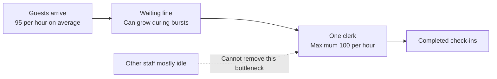
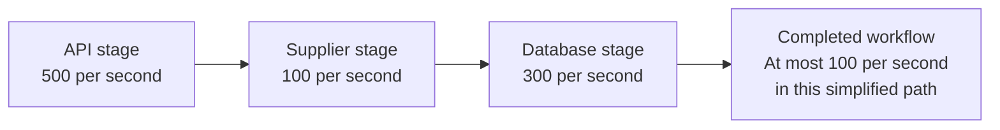

# CS120 — Mathematical and Statistical Thinking for Software Engineers

## Lecture 05: Mathematical Models of Real Systems

*Why a server with plenty of spare CPU can collapse under a modest traffic increase, how queues turn milliseconds into seconds, and how a handful of mathematical relationships can reveal the limits of an architecture before production discovers them for you.*

---

### How to listen to this lecture

The previous four lectures gave us tools for reasoning about correctness, probability, measurements, and causality. Today we'll use mathematics for a different purpose: **building simplified models that help us understand and predict how software systems behave**.

We'll investigate a hotel-booking service whose latency explodes even though most of its computing resources remain idle. That mystery will lead us through rates, queues, Little's Law, utilization, bottlenecks, parallelism, capacity estimates, and the limitations of mathematical predictions.

You don't need to memorize every equation on the first listen. Focus on what each relationship says about the system, what assumptions make it useful, and when those assumptions stop matching reality.

---

# Part I — Intuition

*The hotel lobby is crowded, customers are waiting, and the computers seem nearly idle. Where did all the time go?*

### Picture one clerk who can process a hundred guests a minute

Imagine a hotel lobby with one check-in desk. The clerk can check in one guest every thirty-six seconds, so the desk can process up to one hundred guests per hour if it stays continuously busy.

Now imagine guests arriving at irregular intervals. Sometimes nobody is waiting. Sometimes several families arrive together. If the clerk is busy, newcomers stand in line.

Let's say ninety-five guests arrive each hour on average. The desk can process a hundred. Technically, the capacity still exceeds demand.

But there's almost no breathing room. A small arrival burst builds a queue, and the clerk may take a long time to clear it. Even though the actual check-in procedure still takes about thirty-six seconds, the guest's *total wait plus service* can become much longer.

Now translate the lobby into software. The clerk is a constrained dependency—perhaps a supplier integration. Guests are requests. The line is a queue. The rest of the hotel, with its largely idle staff, represents your application servers whose CPUs are mostly free while they wait.

The first picture makes the bottleneck obvious. An idle restaurant kitchen can't process customers who are stuck waiting at the one check-in desk.



This is why system-wide CPU utilization can remain low while response times collapse. A small part of the process determines the speed of the whole journey.

### 1. Three quantities explain most of the mystery

Start with the guests entering the lobby. Their average arrival rate is **ninety-five per hour**.

The clerk's maximum processing rate is **one hundred per hour** under our simplifying assumption.

The desk's average demand relative to its capacity is **95 percent**. We call that *utilization*.

At low utilization, the clerk regularly has quiet moments and can handle bursts quickly. Near full utilization, bursts can accumulate into waiting lines. A small reduction in clerk speed—or a small increase in arrivals—can make the line grow dramatically.

The key distinction: **service time** is how long the clerk actively processes one guest. **Response time** is how long a guest spends waiting plus being served. The second can be far larger than the first.

In the full lecture, we'll use a simplified mathematical queue model to illustrate why waiting time rises steeply near saturation. That formula depends on specific assumptions about how guests arrive and how long each check-in takes; it isn't a universal law of every queue.

### 2. Little's Law counts people in the lobby

Imagine our hotel processes sixty guests per hour during a stable afternoon. Every guest spends an average of half an hour inside the check-in area, including waiting and service.

How many guests are in that area on average?

Sixty guests per hour, multiplied by half an hour, gives **thirty guests**.

No advanced probability required. If guests flow through at that average rate and remain for that average time, the area contains about thirty guests on average under suitable stable conditions.

This relationship is called **Little's Law**. In engineering language it connects the average number of jobs in a system, its flow rate, and the average time each job spends there.

Now suppose the service keeps completing sixty requests per minute while the average time inside the API rises from one second to five seconds. The number of requests in progress grows fivefold. Those requests may be waiting on an external dependency, holding memory or connections even while doing little CPU work.

Little's Law doesn't tell us *why* the time increased. It connects the quantities once we measure them for the same system boundary.

### 3. Adding clerks only helps when the job can be shared

Our hotel manager hires five more lobby employees. Will check-in become six times faster?

Not if only one employee is authorized to use the legacy check-in terminal and every reservation must pass through that terminal. More people standing around it won't create more processing capacity.

Now imagine another task: cleaning one hundred independent rooms. Multiple cleaners can genuinely divide the work. But perhaps one supervisor must inspect every room at the end. That sequential inspection limits the total speedup.

This is the intuition behind **Amdahl's Law**: when part of a fixed job cannot be divided among workers, that serial part limits the improvement from adding more workers.

For a whole backend, there may be several stages with different capacities. Making the fast stage faster doesn't increase throughput if a slower mandatory stage still controls the rate. We call that stage the **bottleneck**.

The second picture compares those ideas without calculations.



The entire pipeline cannot sustainably complete more than the bottleneck stage if every operation must pass through it and the stages behave as assumed.

### 4. Estimates need a map of the actual work

Suppose our website receives a million searches per day. Divide by the seconds in a day: about twelve searches per second on average. That sounds easy.

But perhaps evening peaks reach thirty times the daily average. Now we're around 350 searches per second. Suppose every search triggers two supplier calls. That is around 700 supplier operations per second before caching, retries, or filtering.

Now our earlier single processing lane obviously cannot handle the demand. We need either less work per request, more genuinely independent supplier capacity, or a controlled way to shed, defer, or prioritize work.

This calculation is called a **back-of-the-envelope estimate**. It won't predict tomorrow perfectly. It reveals the order of magnitude and the assumptions worth checking.

If caching avoids half the calls, the result changes substantially. If the supplier enforces one global rate limit regardless of worker count, hiring more workers changes little. Changing each assumption and seeing how the answer moves is called **sensitivity analysis**.

This is why a model is useful even when it is incomplete. Its job is to make our assumptions inspectable, not to manufacture certainty.

### 5. A queue can't solve an impossible workload

Imagine two hundred guests arriving each hour while the one clerk can serve only one hundred. Unless arrivals stop or something changes, the line grows by roughly one hundred guests each hour.

An infinite waiting room would merely hide the failure for a while. In software, unbounded queues consume memory, retain stale requests, and eventually produce timeouts. Retrying every timed-out operation can add even more work.

Sometimes the responsible design is to limit incoming work, reject excess requests clearly, or preserve capacity for critical operations. This is **backpressure and admission control**: don't promise to complete work that your system cannot reasonably finish.

Of course, a rejected customer is not a success. But a prompt refusal can be safer than an endless queue that eventually makes every customer fail.

### Your mental checkpoint

**Question A:** The servers show 20% CPU usage, but requests are slow. Must there be spare capacity where it matters? **No.** A particular shared dependency may be saturated.

**Question B:** If throughput stays stable but requests spend longer inside the system, what usually happens to in-flight work? **It increases**, by Little's Law under stable comparable conditions.

**Question C:** What happens if incoming demand sustainably exceeds a resource's completion capacity? **Backlog grows** unless work is rejected, abandoned, or moved elsewhere.

Carry one picture into Part II: **the crowded lobby, one limiting clerk, and a line of guests waiting**. The equations explain that picture. They do not replace it.

*The intuition pass ends here.*

---

# Part II — Deep Dive

# 1. The Server That Had Plenty of CPU and Still Collapsed

It's Monday, 11:17 in the morning.

Our hotel-booking platform has just launched a successful marketing campaign.

Traffic to the website is increasing. Customers are searching for destinations, comparing hotels, and checking room availability.

The infrastructure dashboard looks reassuring.

The application runs on several reasonably powerful servers.

Across the backend fleet, average CPU utilization is below twenty percent.

Memory usage is stable.

There are no obvious database crashes.

Yet customers are beginning to complain.

Hotel availability searches, which ordinarily finish in a few tens of milliseconds, are now taking several hundred milliseconds.

A little later, some requests take more than a second.

Then timeouts begin.

The operations team reaches for the usual solution.

Add application instances.

The autoscaler doubles the backend fleet.

CPU utilization drops even further.

Latency barely improves.

Someone suggests increasing the HTTP timeout.

Someone else proposes adding Redis.

Another engineer wants to migrate the inventory service to a more powerful database.

You ask a different question.

**How much work can the slowest part of this request path actually complete per second?**

The team examines distributed traces.

Most of the request is fast.

The Node.js service validates input, checks customer permissions, and prepares a request to an external inventory integration.

That integration has a constrained processing stage. For this particular supplier, inventory checks pass through one serialized processing lane.

The lane can complete approximately one hundred checks per second when operating continuously.

Under light traffic, each check receives service quickly.

But the marketing campaign has increased incoming work to approximately ninety-five checks per second.

The supplier integration is now operating near its sustainable capacity.

Requests begin waiting for their turn.

The application servers aren't doing much CPU work because they're waiting for a dependency.

The database isn't necessarily overloaded.

The bottleneck is a queue in front of a constrained resource.

And here's the extraordinary part.

In a simple mathematical model, a service whose average processing time is ten milliseconds can produce an average response time of two hundred milliseconds when incoming traffic reaches ninety-five percent of its capacity.

At ninety-nine percent utilization, the same model predicts an average response time of one second.

We haven't made the actual processing operation a hundred times slower.

We've made requests wait behind one another.

This is one of the most important lessons in performance engineering.

**A system can collapse from waiting long before its overall CPU graph looks alarming.**

Today we're going to understand why.

---

# 2. Start With Units: The Simplest Way to Catch Bad Reasoning

Before examining queues, let's establish a discipline that sounds almost too elementary to mention.

Always attach units to quantities.

Requests per second.

Milliseconds per request.

Bytes per event.

Connections per instance.

Gigabytes per day.

A number without a unit is frequently an invitation to make a mistake.

Imagine an engineer says:

"Our service handles one hundred requests."

What does that mean?

One hundred requests per second?

Per minute?

Per deployment?

Simultaneously?

The distinction changes everything.

## 2.1 Rates describe quantities per unit of time

Suppose our backend receives six thousand requests per minute.

Divide by sixty.

That's one hundred requests per second.

Now imagine each request requires ten milliseconds of exclusive processing time on a particular constrained resource.

One second contains one thousand milliseconds.

If each operation requires ten milliseconds, a single continuously busy processing lane can theoretically complete one hundred such operations per second.

The arrival rate and maximum service rate are equal.

There is no spare capacity.

That's already a warning.

We haven't needed any sophisticated mathematics.

We've only made the units agree.

## 2.2 Service time is not response time

Here's an important distinction.

**Service time** is the time a particular resource actively spends processing a job under the chosen model.

**Waiting time** is the time the job spends waiting before receiving that service.

**Response time** includes waiting and service, along with any other stages inside the measurement boundary.

Suppose a job requires ten milliseconds of actual service.

If it waits 190 milliseconds in a queue, its total time at that stage is 200 milliseconds.

An application log measuring only the ten-millisecond operation may correctly report that processing is fast.

The customer still waits 200 milliseconds.

In a real backend, a request can pass through several queues and service stages.

That is why deciding exactly what a timer includes is as important as calculating its value.

## 2.3 Sanity-check with dimensions

Imagine someone proposes this capacity formula:

"Requests per second multiplied by seconds per request gives requests per second."

That cannot be right.

The units multiply to a dimensionless ratio:

Requests per second, multiplied by seconds per request.

The units cancel.

The result describes how much processing capacity the incoming work demands relative to a unit of service capacity.

This habit is called **dimensional analysis**.

It's extremely useful.

If an equation intended to produce gigabytes instead produces gigabytes per second, something is missing.

If a concurrency estimate still contains a time unit, something is wrong.

You can catch many architectural-calculation mistakes before opening a calculator simply by inspecting the units.

---

# 3. Arrival Rate, Service Rate, and Utilization

Let's model our constrained inventory-processing lane.

We'll use three quantities.

The arrival rate is the average number of jobs entering the stage per second.

The service rate is the number of jobs the stage could complete per second while continuously busy under our model.

Utilization describes the fraction of the stage's potential capacity being demanded or used.

Mathematics commonly uses the Greek letter lambda for arrival rate and mu for service rate.

We can express utilization as:

\[\rho=\frac{\lambda}{\mu}\]

For our example, lambda is ninety-five requests per second.

Mu is one hundred requests per second.

Therefore, utilization is 0.95, or 95%.

This tells us that the processing lane has very little spare capacity.

But notice what it doesn't tell us.

It doesn't tell us the exact response time.

It doesn't reveal whether arrivals are smooth or bursty.

It doesn't say whether every operation takes exactly ten milliseconds or some operations take much longer.

And it doesn't tell us whether requests abandon the queue or time out.

For those questions, we need more information.

## 3.1 The difference between average utilization and safe capacity

Suppose the incoming rate is fifty requests per second.

A resource capable of one hundred requests per second has substantial spare capacity.

Now increase the rate to ninety-five.

The resource remains theoretically capable of keeping up on average.

But almost all of its capacity is already committed.

A small burst can temporarily push arrivals above the service rate.

The excess work must wait.

If the resource was idle, it could absorb that burst immediately.

Near saturation, it has fewer opportunities to catch up.

The relationship between utilization and latency is therefore not generally linear.

Going from fifty to sixty percent utilization may be harmless.

Going from ninety-five to ninety-nine percent may be disastrous.

That is the mystery we need to explain.

---

# 4. The Queue Is Where Waiting Time Comes From

Imagine a supermarket with one cashier.

Customers arrive at irregular intervals.

Each customer needs some amount of processing time.

When the cashier is free, the next customer receives service immediately.

When the cashier is busy, new customers wait.

A backend dependency behaves similarly.

The jobs might be HTTP requests, database operations, messages, or tasks waiting for a worker.

The essential structure is the same.

An arrival process creates work.

A service mechanism consumes work.

A queue holds jobs that cannot yet be served.

## 4.1 Averages don't describe the arrival pattern

Suppose twenty customers arrive over ten minutes.

That's two customers per minute on average.

But imagine eighteen arrive during the first minute.

The remaining two arrive later.

The average arrival rate is modest.

The first minute still produces a queue.

Software traffic behaves this way constantly.

Users click buttons after receiving a notification.

Scheduled jobs begin together.

Cache entries expire simultaneously.

Retries synchronize after a dependency failure.

A marketing campaign creates a burst of requests.

The average workload may fit within capacity while short-lived bursts exceed it.

Queueing therefore depends on variation as well as averages.

## 4.2 Variation in service time matters too

Now imagine most inventory checks take five milliseconds.

But some take fifty.

Those long operations keep the processing lane occupied while additional requests accumulate.

Even if the average service time remains modest, variability can increase waiting.

Two resources with the same average processing rate can produce different latency distributions because their service times fluctuate differently.

This is why a capacity model based solely on average service time is an approximation.

The distribution of arrivals and service times can matter enormously.

## 4.3 Queueing doesn't create useful work

A customer waiting for the cashier isn't purchasing additional groceries.

A request waiting for a database connection isn't performing useful database work.

A task waiting for a worker isn't moving toward completion.

The system has accumulated **work in progress**.

That work consumes resources indirectly.

Queued requests may retain memory, file descriptors, timeouts, tracing state, and other application resources.

Even when they aren't actively using CPU, they aren't free.

A large queue can therefore make a system unhealthy long before all available processors are busy.

---

# 5. Why Latency Explodes Near Saturation

We can now introduce a deliberately simplified queueing model.

It's called an **M/M/1 queue**.

The name describes its assumptions.

Arrivals follow a Poisson process.

Service times are exponentially distributed.

There is one processing server or lane.

The model usually assumes a sufficiently large waiting area and a stable arrival rate below service capacity.

These assumptions won't perfectly describe most production systems.

That's fine.

We aren't treating the formula as an oracle.

We're using the model to understand an important mechanism.

Under these assumptions, the mean total time a job spends in the queue and service stage is:

\[W=\frac{1}{\mu-\lambda}\]

This is a mathematical result specific to the model.

Here, mu is the service rate and lambda is the arrival rate, expressed in the same units.

## 5.1 Begin with light traffic

Suppose the resource can serve one hundred requests per second.

Incoming traffic averages fifty per second.

The difference between service capacity and arrival rate is fifty per second.

The formula predicts a mean time in the stage of one-fiftieth of a second.

That's twenty milliseconds.

The average actual service time is ten milliseconds.

The remaining mean time is queueing delay.

At 50% utilization, the stage is still quite responsive.

## 5.2 Increase utilization

Now increase arrivals to eighty requests per second.

The model predicts an average time of fifty milliseconds.

At ninety requests per second, it predicts one hundred milliseconds.

At ninety-five requests per second, it predicts two hundred milliseconds.

At ninety-eight, it predicts five hundred milliseconds.

At ninety-nine, it predicts one second.

Remember that the mean service time hasn't changed.

The resource still processes jobs at its original speed when working on them.

The increasing latency comes from the waiting required before service.

This is the mathematical shape of our production incident.

## 5.3 What happens at full saturation?

Now suppose incoming work averages one hundred requests per second.

The resource can serve one hundred.

In the idealized model, there is no meaningful long-run spare capacity.

The stationary mean waiting time does not remain finite.

The formula's denominator approaches zero.

If arrivals exceed service capacity, the queue grows over time unless the system rejects, abandons, or redirects work.

For example, if 110 requests arrive each second and at most one hundred are completed, the backlog grows by approximately ten requests per second while those rates continue.

After one minute, that's roughly six hundred additional waiting jobs.

After one hour, it would be thirty-six thousand—if the system retained them all.

Real systems usually have finite queues, timeouts, memory limits, or admission controls.

They won't allow unlimited growth without consequences.

Instead, requests begin failing, timing out, or being rejected.

The important principle is that **a resource operating at or above sustained capacity cannot make its backlog disappear merely by waiting longer**.

## 5.4 Do not worship the formula

This M/M/1 relationship is a teaching model, not a universal law of servers.

If arrivals are carefully scheduled, service times are nearly constant, several workers operate in parallel, or the system has finite queues and timeouts, the numerical results change.

For example, deterministic service times generally create different queueing behavior from exponentially distributed service times with the same mean.

The curve's qualitative lesson remains valuable.

As utilization approaches capacity, variability and limited spare capacity can produce severe waiting.

But a real capacity decision requires measurements or a model suitable for the actual architecture.

> **Sticky note #1:** Near a bottleneck's capacity, a small increase in offered load can produce a very large increase in waiting time. The bottleneck doesn't need to process each job more slowly for the system to become slow.

---

# 6. Little's Law: Counting the Work That Is Already Inside

Now let's introduce a surprisingly powerful relationship.

It's called **Little's Law**, named after John Little.

Under suitable long-run stability conditions, it relates three quantities.

The average number of jobs inside a system.

The average rate at which jobs enter and flow through that system.

The average time each job spends inside it.

The relationship is:

\[L=\lambda W\]

L represents the average number of jobs in the chosen system.

Lambda represents the effective average arrival or throughput rate at that boundary.

W represents the average time spent inside the same boundary.

This formula is remarkably general.

It does not require the specific Poisson arrival and exponential service-time assumptions of the M/M/1 model.

But it does require consistent definitions and appropriate stability or averaging conditions.

## 6.1 The restaurant analogy

Imagine a restaurant serving an average of thirty customers per hour.

Each customer spends an average of two hours inside.

How many customers are inside on average?

Thirty customers per hour multiplied by two hours gives sixty customers.

The result is sixty.

No complicated probability calculation required.

The same principle applies to software.

Suppose our backend completes eighty requests per second.

Each request spends an average of a quarter of a second inside the measured request-processing boundary.

The average number of requests in that boundary is twenty.

Eighty per second multiplied by 0.25 seconds.

Twenty concurrent requests, on average.

## 6.2 The beautiful connection to our queue

Return to the M/M/1 example.

Arrival rate is ninety-five per second.

Mean total time in the queue-and-service stage is 0.2 seconds.

Little's Law tells us that the average number of jobs inside that stage is nineteen.

That includes both the job receiving service and the jobs waiting.

One request may be actively processed.

Many others are simply waiting for their turns.

This explains why an application can have many outstanding requests but little CPU activity.

Concurrency counts work in progress.

It does not imply that every outstanding operation is executing simultaneously on a CPU.

## 6.3 Why Little's Law matters operationally

Suppose we observe that throughput remains stable at one hundred requests per second, while average response time grows from 100 milliseconds to one second.

Little's Law suggests the average number of in-flight requests grows from about ten to about one hundred, assuming the same stable measurement boundary and relevant completed throughput.

The service is accumulating more concurrent work.

That may increase memory pressure, connection counts, and other resource use.

We can reason about that relationship without knowing every implementation detail.

But here's the crucial caveat.

## 6.4 Little's Law does not predict latency from utilization alone

Little's Law tells us how average concurrency, throughput, and elapsed time are related.

It does not tell us what the response time must be for a given arrival rate.

The M/M/1 formula provided a latency prediction because we added assumptions about arrivals, service times, and the number of processing lanes.

These are different kinds of mathematical relationships.

Little's Law is primarily a conservation-style relationship for work in a stable system.

An M/M/1 queue is a particular stochastic performance model.

Do not confuse them.

And when a system is unstable, with an ever-growing backlog, ordinary steady-state averages may not exist.

Blindly substituting the offered arrival rate into Little's Law during overload can produce misleading conclusions.

We must define the boundary and use rates compatible with the actual flow through it.

---

# 7. Concurrency Is Not Throughput

Now suppose the backend has a configurable connection pool.

The pool allows twenty concurrent operations against a database.

A developer proposes increasing it to two hundred.

Surely ten times as many simultaneous operations must produce ten times as much throughput?

Not necessarily.

Concurrency measures how many operations can be in progress.

Throughput measures how many operations complete per unit of time.

The two are related, but not interchangeable.

## 7.1 A useful lower-bound calculation

Imagine a dependency operation takes an average of fifty milliseconds of service occupancy.

We want to complete two hundred such operations per second.

How much average concurrency would we need if the work can be processed independently?

Using Little's Law for the service stage, two hundred operations per second multiplied by 0.05 seconds gives ten operations in service on average.

That's a useful theoretical starting point.

But operating with exactly ten available concurrent slots would leave little margin under that idealized calculation.

Real service times vary.

Requests arrive in bursts.

Resources may need headroom.

We might choose a larger limit after measuring the dependency's actual behavior.

However, opening fifty or one hundred concurrent operations does not guarantee higher throughput if the dependency itself can process only a limited amount of work.

The limit must reflect downstream capacity.

## 7.2 The shared database bottleneck

Imagine twenty application instances.

Each has a database connection pool of twenty.

The deployment can now establish up to four hundred application database connections.

If we double the number of instances, we may create up to eight hundred connections.

But suppose the database's practical throughput limit is determined by a hot row, storage throughput, or a limited set of CPU-intensive queries.

More connections may simply create more competition.

Lock waiting increases.

Memory overhead rises.

Query latency worsens.

The application adds concurrency while the database's useful throughput barely changes.

The correct solution may involve reducing concurrency, shortening transactions, changing an access pattern, or eliminating unnecessary database work.

This is a deeply important engineering habit.

**When a resource is saturated, adding more callers usually increases waiting before it increases useful work.**

---

# 8. Bottlenecks Determine the System's Capacity

Our booking request crosses several stages.

The API validates input.

It performs a database lookup.

It contacts the inventory supplier.

It creates a reservation.

It may communicate with a payment service.

Each stage has its own capacity.

Imagine an oversimplified pipeline in which every request must visit three stages.

The first can process five hundred requests per second.

The second can process one hundred.

The third can process three hundred.

What's the maximum sustainable pipeline throughput if every request must pass through all three and there are no other constraints?

It cannot exceed one hundred requests per second.

The second stage is the bottleneck.

Making the first stage twice as fast doesn't change that limit.

We have improved a component without improving the complete system's capacity.

## 8.1 The minimum-capacity intuition

For a simple mandatory sequential pipeline, the maximum sustainable rate is bounded by the slowest stage's capacity.

This gives us a useful first approximation.

But real systems complicate the model.

Some requests bypass certain stages.

Others fan out into several downstream calls.

Some operations run in parallel.

Different requests consume different amounts of work.

And shared resources can create interference across several stages.

Nevertheless, identifying the resource with the tightest demand-to-capacity ratio is a powerful starting point.

## 8.2 Bottlenecks move

Suppose we improve the inventory supplier integration.

Its capacity rises from one hundred checks per second to four hundred.

Wonderful.

Now the database can process only three hundred reservation-related operations per second under the relevant workload.

The database becomes the new bottleneck.

If we optimize the database, payment processing might become the next constraint.

System performance is therefore not about eliminating one permanent bottleneck.

It's about understanding how constraints interact and how they change as the architecture evolves.

That is why performance work should be iterative.

Measure.

Find the current limiting mechanism.

Improve it.

Measure again.

The next constraint may be somewhere else.

---

# 9. Amdahl's Law: Why Eight Cores Don't Make Everything Eight Times Faster

Let's shift from throughput to the time required to perform one computational task.

Imagine a report-generation process.

Thirty percent of its execution must occur sequentially.

The remaining seventy percent can, in principle, be divided among multiple workers.

A developer proposes using eight CPU cores instead of one.

What speedup should we expect?

This is the problem addressed by **Amdahl's Law**.

## 9.1 The serial fraction

Suppose the original program takes one hundred seconds.

Thirty seconds belong to work that cannot be parallelized under the chosen implementation.

Seventy seconds belong to work that can be distributed.

If we have eight workers and the parallel portion divides perfectly, that seventy-second portion falls to 8.75 seconds.

But the thirty-second serial portion remains.

Total execution time becomes 38.75 seconds.

The speedup is roughly 2.58 times.

Not eight times.

And that's before accounting for coordination overhead.

## 9.2 The mathematical relationship

Let s represent the fraction of original execution time that remains serial.

Let N represent the number of parallel workers.

Under the simplified assumptions, speedup is:

\[\text{Speedup}=\frac{1}{s+(1-s)/N}\]

For our example, s is 0.30 and N is eight.

The formula gives approximately 2.58.

Now imagine adding an unlimited number of workers.

The parallelizable portion could approach zero elapsed time in the idealized model.

But the serial thirty percent remains.

The maximum theoretical speedup approaches one divided by 0.30.

That's about 3.33 times.

No number of CPU cores eliminates the sequential portion.

## 9.3 The practical lesson

When someone proposes horizontal scaling, ask what work can actually be divided.

Some operations can be distributed easily.

Independent image transformations are an example.

Others coordinate through shared mutable state.

A highly contended inventory record can serialize critical updates.

A global lock can prevent concurrent progress.

A single external rate-limited API may cap useful throughput.

But be precise: Amdahl's Law concerns the speedup of a fixed workload divided into serial and parallel portions. It does not directly predict every multi-service system's throughput or queueing behavior.

We use it as a conceptual guide to the limits of parallelism.

We use workload-specific queueing and capacity models for the rest.

> **Sticky note #2:** Adding processors accelerates the work that can use them. It cannot eliminate sequential dependencies, shared bottlenecks, or the coordination introduced by parallel execution.

---

# 10. Optimization as Arithmetic: Make the Expensive Part Matter

Amdahl's reasoning also explains why many code optimizations barely improve application performance.

Imagine an API request takes one hundred milliseconds.

Eighty milliseconds are spent waiting for a database query.

Twenty milliseconds are spent in application logic.

A developer spends two days making the application logic twice as fast.

The twenty milliseconds become ten.

The total request now takes ninety milliseconds.

The developer made part of the code twice as fast.

The overall request improved by only about eleven percent.

The optimization may still be worthwhile, especially at large scale.

But it didn't address the dominant cost.

## 10.1 Optimize the critical path

Now imagine another engineer reduces the database wait from eighty milliseconds to twenty.

The original application work remains twenty.

Total latency becomes forty milliseconds.

That is a much larger end-to-end improvement.

Of course, real requests include several stages, and resource usage can overlap.

If two independent calls run in parallel, the response may wait primarily for the slower branch rather than the sum of their durations.

This introduces the notion of a **critical path**.

The critical path is the sequence of dependent operations whose combined duration determines when the overall operation can finish.

Optimizing work outside that path may reduce resource consumption without materially improving the measured response time.

That can still be valuable.

But it solves a different problem.

## 10.2 Don't optimize what you haven't measured

A JavaScript loop might look inefficient.

A SQL query might look complicated.

A network request might seem suspicious.

But appearances aren't measurements.

Before optimizing, establish how much time or resource demand the component contributes.

Then estimate the maximum possible improvement.

If a function accounts for one percent of the total latency, even eliminating it completely cannot improve that request's latency by more than roughly one percent under the simple sequential model.

This is an excellent sanity check before spending days on micro-optimizations.

---

# 11. Back-of-the-Envelope Capacity Planning

Let's return to our travel platform.

Management expects search traffic to grow substantially.

We don't yet have the final architecture.

But we can still construct a first approximation.

This is called a **back-of-the-envelope estimate**.

It is deliberately simple.

Its purpose is not to produce an exact future prediction.

It's to discover orders of magnitude, likely constraints, and assumptions that need verification.

## 11.1 From daily traffic to requests per second

Suppose the platform handles one million search requests per day.

There are 86,400 seconds in a day.

Divide one million by 86,400.

The average is approximately 11.6 searches per second.

That sounds easy to handle.

But it's misleading to design only for the daily average.

Traffic varies by hour, geography, campaign, and user behavior.

Suppose peak traffic is thirty times the daily average.

Now peak demand is about 347 searches per second.

That's an entirely different capacity question.

We should measure the actual peak-to-average ratio rather than assume thirty is universally appropriate.

But the example illustrates how quickly a sensible-looking average can hide meaningful bursts.

## 11.2 Convert requests into downstream demand

Now suppose each search request triggers two inventory checks against an external supplier.

At a peak search rate of 347 per second, the architecture creates approximately 694 supplier checks per second.

If some requests perform additional retries, the number can rise further.

But if a cache avoids many supplier calls, actual demand may be lower.

The correct estimate therefore depends on the fan-out per request, cache-hit behavior, retry rates, and which operations genuinely reach the dependency.

This is why system capacity must be calculated from **workload composition**, not merely the count of incoming HTTP requests.

One request isn't always one unit of downstream work.

## 11.3 Apply a headroom target

Suppose one independent worker can sustainably perform one hundred supplier checks per second under the measured workload.

If we need 700 checks per second, seven workers would nominally provide 700 checks per second.

But that puts the group at full theoretical utilization, assuming perfectly balanced independent work.

That's fragile.

Instead, suppose we target no more than 70% utilization for the planning scenario.

Each worker then contributes seventy checks per second at that target.

Seven hundred divided by seventy gives ten workers.

This is a first-pass estimate, not a deployment prescription.

It assumes workers can operate independently, requests distribute appropriately, and the supplier doesn't impose a shared global rate limit.

If the supplier allows only 500 checks per second across all workers, adding more workers won't achieve 700.

The architectural constraint lies elsewhere.

Our estimate has done its job by exposing the question we need to investigate.

---

# 12. Storage and Network Estimates Use the Same Reasoning

The same approach works for data volume.

Imagine our platform ingests three hundred analytics events per second.

Each serialized event averages one kilobyte.

How much raw event data arrives in one day?

Three hundred events per second multiplied by one kilobyte gives approximately three hundred kilobytes per second.

Multiply by 86,400 seconds.

That's about 25.9 gigabytes per day using decimal units.

Over thirty days, that's approximately 778 gigabytes of raw payload.

Now imagine three replicated copies.

The payload alone represents roughly 2.3 terabytes across replicas for thirty days, under the simplifying assumption of three complete copies.

And we haven't accounted for indexes, logs, compaction, metadata, backups, compression, or retention behavior.

The physical storage requirement may be higher or lower than a naive multiple of raw payload size depending on the system and configuration.

But our estimate has established the correct scale.

This is vastly better than casually assuming the data will fit in a tiny volume forever.

## 12.1 Network throughput

Suppose an API returns 200 kilobytes per response and serves two hundred such responses per second.

That's approximately forty megabytes per second of application payload.

In bits, it's around 320 megabits per second.

Actual network usage will also depend on protocol overhead, compression, retries, and other traffic.

Again, the calculation isn't complicated.

The difficult part is making sure the assumptions reflect reality.

Are responses compressed?

Do customers retrieve the same cached assets?

Is the traffic local to one cloud region?

Does each request trigger additional network calls?

The estimate gives us a starting point.

The system architecture determines how much traffic actually crosses each boundary.

---

# 13. Growth Models: Thirty Percent More Every Month Isn't Thirty Percent Forever

Now suppose the analytics team reports that event volume grows by ten percent every month.

Management asks whether the current infrastructure will remain sufficient for a year.

A developer calculates ten percent multiplied by twelve months and predicts 120% additional traffic.

That is a linear approximation.

But if each month's growth applies to the previous month's larger volume, the process is **compound growth**.

After one month, the workload is multiplied by 1.10.

After two months, it is multiplied by 1.10 again.

After twelve months, the multiplier is:

\[(1.10)^{12}\]

That's approximately 3.14.

The workload more than triples.

## 13.1 Linear and compound growth describe different assumptions

A linear model adds a fixed absolute amount each period.

A compound model multiplies by a fixed factor.

Neither is inherently correct.

A startup's growth might accelerate, slow, fluctuate seasonally, or plateau.

An event-ingestion workload may grow because the number of customers increases, because each customer generates more events, or because instrumentation starts collecting additional information.

These are different mechanisms.

A useful forecast should consider which variables drive demand.

## 13.2 Growth can affect more than data volume

Suppose event volume triples.

Storage grows.

But so might ingestion throughput, index maintenance, compaction work, backup time, and analytical query cost.

Some costs scale roughly linearly with data volume under appropriate conditions.

Others change abruptly when working sets exceed memory, partitions become hot, or operational limits are reached.

This is why capacity forecasts should consider the complete resource path.

A threefold increase in records doesn't guarantee exactly threefold cost.

The physical architecture matters.

---

# 14. Sensitivity Analysis: Which Assumption Controls the Answer?

Here's a mathematical habit that pays for itself quickly.

After producing an estimate, change the assumptions.

See which ones matter most.

This is called **sensitivity analysis**.

Return to our M/M/1 example.

Service capacity is one hundred jobs per second.

Arrival rate is ninety-five.

Predicted average time is two hundred milliseconds.

Now imagine we optimize the constrained operation so its average service time falls from ten milliseconds to eight.

Under the same simplified exponential-service model, service capacity becomes 125 jobs per second.

Arrival rate remains ninety-five.

The predicted mean time in the stage becomes approximately thirty-three milliseconds.

That's roughly six times better than before.

But the underlying service operation improved by only twenty percent in elapsed time.

Why such a large end-to-end gain?

Because we moved the system away from saturation.

We didn't merely make service faster.

We also removed much of the queueing pressure.

## 14.1 Nonlinear benefits and risks

Now consider the reverse.

If service capacity falls slightly while the arrival rate remains near the previous limit, queueing delay may increase dramatically.

This is why a seemingly harmless deployment can trigger severe latency regressions near saturation.

Perhaps a new logging operation adds a millisecond of work.

Perhaps a database query becomes slightly slower.

Perhaps a downstream provider reduces its rate limit.

At low utilization, the difference may be barely visible.

Near saturation, the same change can produce enormous waiting.

The system's sensitivity depends on where it operates relative to its constraints.

## 14.2 Which unknown deserves measurement?

Suppose our capacity estimate depends on five assumptions.

Average event size.

Peak-to-average traffic ratio.

Requests per customer.

Cache-hit rate.

Supplier operation duration.

Which should we measure first?

The answer depends on how strongly each uncertainty affects the predicted bottleneck.

If changing the assumed cache-hit rate from 80% to 60% doubles the expected load on an expensive dependency, that assumption deserves serious attention.

If changing average event size by ten percent barely affects total infrastructure cost, it may be less urgent.

This is the practical purpose of sensitivity analysis.

Not to produce an impressive spreadsheet.

To identify which unknowns are worth reducing through experiments or measurement.

---

# 15. When the Model Disagrees With Production

Suppose our model predicts an average latency of fifty milliseconds.

Production reports two hundred.

What should we conclude?

Not automatically that mathematics has failed.

And not automatically that the monitoring system is broken.

We should investigate which assumption is incorrect or which mechanism the model omitted.

Perhaps there are multiple queues.

Perhaps service times aren't independent.

Perhaps the workload contains expensive outliers.

Perhaps the arrival rate is bursty.

Perhaps retries amplify traffic.

Perhaps the resource is shared with another service.

Perhaps the reported CPU metric averages across cores while one specific thread is saturated.

Or perhaps our measurement boundaries don't match.

A mathematical model is useful partly because it forces assumptions into the open.

When its prediction fails, we can investigate those assumptions systematically.

## 15.1 Calibration

A good engineering model should be compared against measurements.

Suppose we estimate request demand from traffic counts and expected dependency calls.

We can compare the result with actual dependency request metrics.

If the observed demand is larger, perhaps retries or background work were omitted.

If it is smaller, perhaps caching or request filtering reduces the workload.

The model can then be revised.

This is **calibration**.

We don't need a perfect model from the beginning.

We need one that captures the important mechanisms and becomes more reliable as evidence accumulates.

## 15.2 Prediction ranges are better than fake precision

Suppose the exact peak-to-average traffic ratio is uncertain.

Instead of claiming the system will require exactly eleven workers in six months, we might evaluate several scenarios.

Conservative traffic.

Expected traffic.

High-growth traffic.

Then estimate capacity under each.

The resulting range makes uncertainty visible.

It helps management understand the consequences of different assumptions.

A precise-looking forecast built from guesses isn't automatically more informative than a well-explained range.

The purpose is to support a decision.

Not to disguise uncertainty with decimal places.

---

# 16. Load Testing: Don't Let the Test Generator Change the Question

Before deploying our revised architecture, we perform a load test.

A test client sends requests to the booking API.

The system performs well.

Management approves the release.

Then real customers arrive.

Latency rises much sooner than the benchmark predicted.

What happened?

One possibility is that the load generator accidentally reduced pressure whenever the backend became slow.

## 16.1 Closed-loop load generation

Imagine a test client that sends one request, waits for its response, then sends the next.

When the backend is fast, the client sends requests frequently.

When the backend slows, the client automatically sends fewer requests.

The offered load decreases precisely when the system becomes stressed.

This is a **closed-loop** workload.

Closed-loop behavior isn't inherently wrong.

It can accurately model certain interactive systems in which users wait for one operation before performing another.

But it doesn't represent every workload.

## 16.2 Open-loop load generation

Now imagine a workload source that schedules requests according to an external arrival process.

It continues offering requests at a specified rate independently of how quickly earlier requests finish.

This is an **open-loop** workload.

It is useful for examining what happens when incoming demand remains high while response time increases.

The number of in-flight requests may grow.

Queues may accumulate.

Timeouts may rise.

Different load-generation models answer different questions.

## 16.3 Coordinated omission

There's another subtle measurement failure.

Suppose the test client records latency only for requests it actually starts.

During a long stall, it cannot schedule new requests as intended.

The measurement process omits the additional waiting that would have occurred under the originally intended arrival schedule.

This is known as **coordinated omission**.

The resulting latency distribution can look much healthier than the experience implied by a continuously offered workload.

Correcting for it requires an appropriate measurement design.

Not every client and benchmark is equally affected, and the correction depends on the workload semantics.

The key lesson is that **a benchmark can accidentally change the demand pattern when the system slows, then report the resulting improvement as if it were real capacity**.

When interpreting load tests, ask what the generator actually did during overload.

---

# 17. Backpressure: Sometimes the Best Calculation Says "No"

Our supplier-processing stage can sustain one hundred checks per second.

Traffic temporarily demands two hundred.

We have several choices.

Queue everything.

Add processing capacity if genuinely available.

Reduce the work required per request.

Serve a degraded response where acceptable.

Or reject some work immediately.

That last option can feel uncomfortable.

A backend is supposed to serve customers, not refuse them.

But accepting work that cannot be completed within a useful deadline isn't necessarily helpful.

It can make the system less reliable for everyone.

## 17.1 Why unbounded queues are dangerous

Suppose incoming work exceeds processing capacity by fifty jobs per second.

The queue grows.

Each new job waits longer.

Eventually, customers time out.

But perhaps the backend continues processing operations for customers who have already abandoned their requests.

Now the system consumes scarce resources on work that no longer provides value.

Meanwhile, fresh requests join the end of an enormous backlog.

This is a recipe for cascading overload.

## 17.2 Admission control

A bounded queue establishes a limit on how much work the system will retain.

When the limit is reached, the system must apply a policy.

It may reject low-priority work.

It may respond with an appropriate overload error.

It may ask a client to retry later where safe.

Or it may use a cheaper approximation for operations that permit degraded behavior.

This is **admission control**.

It recognizes that capacity is finite.

For booking operations, the policy must be particularly careful.

We shouldn't create an ambiguous business commitment and then casually discard the corresponding work.

But for nonessential analytics or speculative prefetching, dropping or deferring work may be entirely appropriate.

## 17.3 Reliability isn't maximum acceptance

Imagine two systems facing overload.

System A accepts every request, allows its queues to grow, and eventually causes widespread timeouts.

System B rejects excess low-priority requests quickly while preserving capacity for critical operations.

Which is more reliable?

The answer depends on the service contract, but System B may provide a much better outcome.

It serves fewer requests initially, yet protects the operations it promises to complete.

This is a powerful architectural distinction.

**The goal is not to accept the maximum amount of work. It is to complete the maximum amount of useful work while preserving the system's guarantees.**

---

# 18. The Final Capacity Review

Let's return to our original incident.

We began with an apparently healthy backend.

Average CPU utilization was low.

Memory usage was stable.

But inventory-check latency was climbing rapidly.

The mistake was treating total server utilization as though it represented the capacity of every relevant resource.

Our investigation found a constrained processing stage.

The stage could sustainably complete about one hundred checks per second.

Incoming demand approached that rate.

The system accumulated a queue.

A simple queueing model explained why average waiting time could rise dramatically near saturation.

Little's Law connected throughput, latency, and average work in progress.

Amdahl's Law reminded us that adding processing resources can't accelerate work that remains sequential.

And capacity estimates showed us how daily traffic, peak ratios, fan-out, and service duration affect demand.

## 18.1 What would we actually change?

First, we verify the bottleneck with production telemetry.

We distinguish supplier processing time from time spent waiting in our integration queue.

We measure effective arrival rates, service completions, queue depth, timeout rates, and downstream capacity.

Then we evaluate interventions.

Can requests be coalesced?

Can a suitable result be cached safely?

Can the supplier support more independent processing lanes?

Can the operation's service time be reduced?

Can nonessential checks be omitted?

Can overload be rejected or delayed before enormous queues form?

If the supplier enforces a hard global rate limit, adding application instances won't solve the underlying problem.

We may need a business-level capacity agreement or a different architecture.

But we don't know the correct intervention until we identify the actual constraint.

## 18.2 A model is a map, not a verdict

The mathematics helped us discover likely behavior.

It did not automatically establish what production was doing.

Real systems have noisy arrivals, changing workloads, multiple queues, distributed dependencies, retries, and failures.

A model is deliberately simpler.

Its value is that we can reason about its assumptions and consequences.

We use it to predict where problems might appear.

We test those predictions.

And we revise the model when evidence reveals a missing mechanism.

That is the scientific part of engineering.

---

# 19. The Oral Examination

Before reading the solutions, answer these questions aloud.

For each problem, identify the units, state the assumptions, explain the mechanism, and distinguish what the calculation proves from what it merely suggests.

## Challenge 1 — The overloaded queue

A processing lane completes an average of one hundred jobs per second when continuously busy.

Incoming demand averages ninety-five jobs per second.

Under an M/M/1 model, estimate the mean time a job spends in the queue-and-service stage.

Why is that time much larger than the ten-millisecond mean service time?

## Challenge 2 — Little's Law

A stable service completes eighty requests per second.

Requests spend an average of 250 milliseconds inside a defined processing boundary.

How many requests are inside that boundary on average?

What assumptions make the calculation meaningful?

## Challenge 3 — The misleading CPU dashboard

A Node.js API runs on sixteen-core servers.

Average host CPU utilization is 15%.

Yet request latency is very high.

Name at least four plausible bottlenecks compatible with those observations.

What would you measure next?

## Challenge 4 — The dangerous connection pool

Twenty application instances each open up to twenty PostgreSQL connections.

The team doubles the number of instances and observes worse database latency.

What changed?

Why might a smaller connection pool improve the overall system?

## Challenge 5 — Amdahl's Law

A fixed computational task spends thirty percent of its original execution time in a sequential stage.

The remaining seventy percent can be perfectly parallelized.

What is the ideal speedup using eight workers?

What's the theoretical maximum speedup if the number of workers becomes arbitrarily large?

## Challenge 6 — The traffic estimate

A platform handles one million searches daily.

Assume peak demand is thirty times the daily average.

Approximately how many search requests per second arrive at peak?

If each search produces two supplier checks, what's the corresponding supplier demand before caching or retries?

## Challenge 7 — The moving bottleneck

A pipeline contains three mandatory stages capable of 500, 100, and 300 jobs per second.

What bounds the original throughput?

If the middle stage improves to 400 jobs per second, which stage becomes the bottleneck?

Why isn't the improvement necessarily a fourfold system-throughput gain?

## Challenge 8 — The misleading benchmark

A load generator sends a request only after the previous one completes.

When the backend slows, the generator automatically reduces the rate of new requests.

The benchmark reports moderate latency even though a production burst causes long queues.

What's wrong with interpreting the benchmark as proof of production capacity?

How would you investigate?

---

# 20. Solutions and Discussion

## Solution 1 — M/M/1 waiting time

The model uses a service rate of one hundred jobs per second and arrival rate of ninety-five.

The mean time in the stage is one divided by their difference.

That's one-fifth of a second, or two hundred milliseconds.

Mean service time remains ten milliseconds, but jobs often wait behind earlier arrivals.

The numerical answer relies on the M/M/1 assumptions: Poisson arrivals, exponential service times, one service lane, and a stable queue with arrival rate below service capacity.

It isn't a universal formula for every processing system.

## Solution 2 — Average concurrency

Little's Law gives average jobs in the system as throughput multiplied by mean time inside the same boundary.

Eighty per second multiplied by 0.25 seconds equals twenty.

The result is approximately twenty in-flight requests.

The system should be stable over the relevant measurement horizon, and the counted throughput, concurrency, and latency must describe the same population and boundary.

It does not imply that twenty requests are simultaneously consuming CPU.

## Solution 3 — Low CPU, high latency

Possible explanations include a saturated database connection pool, a hot database lock, an external dependency with a low throughput limit, event-loop blockage concentrated on one process or core, storage I/O waits, or excessive queueing.

Measure latency at individual stages, queue wait times, actual dependency throughput, CPU per process or core, event-loop delay, and resource-specific utilization.

Overall host CPU average isn't sufficient evidence of spare capacity at every bottleneck.

## Solution 4 — Connection pool amplification

The initial deployment allows up to four hundred application database connections.

Doubling instances may raise that number to eight hundred.

More connections can increase contention, memory overhead, lock waiting, and I/O pressure without increasing useful query throughput.

Smaller pools can reduce competing work and apply backpressure before the shared database becomes overloaded.

The appropriate size depends on measured workload and dependency capacity.

## Solution 5 — Amdahl's Law

The ideal speedup is one divided by 0.30 plus 0.70 divided by eight.

That equals approximately 2.58 times.

With infinitely many workers, the parallel portion approaches zero, leaving the serial thirty percent.

The theoretical maximum speedup approaches one divided by 0.30, or about 3.33 times.

Real coordination overhead can reduce speedup further.

## Solution 6 — Peak request demand

One million searches per day corresponds to approximately 11.6 searches per second on average.

Thirty times that value gives approximately 347 searches per second at peak.

Two supplier checks per search produce approximately 694 supplier checks per second before caching, retries, and other workload changes.

This is an illustrative demand estimate, not proof that the supplier can sustain the load.

## Solution 7 — Pipeline bottlenecks

The original simple pipeline is bounded by the middle stage's one hundred jobs per second.

After improving that stage to four hundred, the third stage, at three hundred, becomes the limiting capacity.

The idealized pipeline limit rises from one hundred to three hundred, a threefold increase.

Actual throughput may be lower because of workload variation, contention, or other constraints.

Improving one stage doesn't automatically produce an equal improvement in the whole system.

## Solution 8 — Closed-loop load testing

The generator's offered arrival rate decreases when response times increase.

It may fail to reproduce a production workload where demand continues independently of the backend's ability to respond.

Measurements may also suffer from coordinated omission if intended requests during stalls aren't represented appropriately.

Evaluate the intended workload model, actual achieved arrival rate, errors, timeouts, in-flight work, and latency distribution.

An appropriate open-loop test may be useful where production arrivals are externally driven, but the test must match the real workload's semantics.

---

# 21. The Mental Model Worth Keeping

Mathematical modeling helps software engineers turn vague architectural concerns into explicit relationships.

**Arrival rate** describes how quickly work enters a system.

**Service rate** describes how quickly a constrained resource can process it.

**Utilization** compares demand with capacity.

**Queues** accumulate when work arrives faster than it can immediately be served.

**Little's Law** relates average throughput, time in a stable system, and average concurrency.

**Queueing models** use additional assumptions to estimate waiting and response time.

**Amdahl's Law** explains why the sequential portion of a fixed computation limits parallel speedup.

**Bottleneck analysis** identifies the resource whose capacity constrains the complete operation.

**Capacity estimates** convert business workload into resource demand.

**Sensitivity analysis** reveals which uncertain assumptions most strongly affect a prediction.

And **calibration** compares the model against observed reality.

The method worth keeping is:

**Define the workload. Attach units. Identify the limiting resource. Model the relationship. Check the assumptions. Estimate with headroom. Measure reality. Revise the model.**

Three questions recover most of this lecture:

1. **Where is the work waiting?** The slowest visible operation may be waiting for a different resource entirely.
2. **What limits sustainable completion rate?** Total CPU utilization is not a substitute for measuring the actual bottleneck.
3. **Which assumption would break this estimate?** A model without explicit assumptions is merely an unexplained number.

The deepest principle is:

**Mathematics doesn't make an architecture predictable by magic. It makes the relationships between assumptions, constraints, and outcomes explicit enough to reason about.**

That's a powerful form of engineering understanding.

---

# 22. End of CS120 — From Mathematical Intuition to Engineering Judgment

We've completed **CS120 — Mathematical and Statistical Thinking for Software Engineers**.

The five lectures form one connected foundation.

In L01, we learned to formulate correctness properties, identify invariants, and construct counterexamples.

In L02, we explored probability, base rates, conditional evidence, independence, and risk.

In L03, we studied distributions, sampling bias, percentiles, and uncertainty.

In L04, we investigated experiments and the distinction between observing a difference and establishing its cause.

And today, we used mathematical relationships to reason about system capacity, resource limits, waiting, and growth.

These subjects may appear different.

But they share one habit.

**Make the assumptions visible before trusting the conclusion.**

A proof depends on its premises.

A probability depends on its model.

A statistic depends on its data.

An experiment depends on its design.

A capacity forecast depends on its workload and resource assumptions.

Once you recognize that pattern, many engineering discussions become easier to navigate.

You may not remember a particular formula during an interview.

But you can still ask which quantities matter, what the units are, which assumptions are plausible, and what evidence would establish the answer.

That's mathematical fluency in the service of engineering.

### Where we go next

In the broader programme, this foundation supports **CS220 — Programming Languages, Memory, and Execution**, **CS320 — Operating Systems, Concurrency, and Runtimes**, **CS430 — Distributed Systems and Reliable Workflows**, and eventually **SE460 — Performance Engineering**.

Those courses explore more specialized mechanisms.

CS120 gives us a common way to reason about them.

And when a production dashboard confidently announces that everything is healthy while customers wait five seconds for a response, we'll know that the first question isn't necessarily whether the company needs more servers.

It might simply be:

"What's the arrival rate, and where's the queue?"

---

## Optional Practical Lab — Model the System Before Buying More Servers

*The spoken lecture ends here. The remaining material is intended for visual study, calculations, terminal experiments, and later interview revision.*

### Lab A — Check the units

For each scenario, calculate the result and verify that the units are sensible.

1. A service handles 7,200 requests per minute. Convert to requests per second.
2. An operation occupies one worker for 25 milliseconds. Estimate the ideal maximum completion rate of one continuously busy worker.
3. A stable service completes 240 requests per second with a mean response time of 150 milliseconds. Estimate average in-flight requests.
4. An event stream produces 500 records per second, each averaging 1,500 bytes. Estimate decimal gigabytes of raw payload produced per day.

Before using a calculator, write the units alongside each quantity.

### Lab B — Watch the M/M/1 curve

The following Python program calculates the mean response time predicted by a stable M/M/1 queue with a service rate of one hundred jobs per second.

```python
service_rate = 100.0

print("arrival/s  utilization  mean_latency_ms")

for arrival_rate in [20, 50, 70, 80, 90, 95, 98, 99]:
    utilization = arrival_rate / service_rate
    mean_seconds = 1 / (service_rate - arrival_rate)

    print(
        f"{arrival_rate:>9}"
        f"{utilization:>13.0%}"
        f"{mean_seconds * 1000:>17.1f}"
    )
```

Plot utilization against mean response time.

Explain why the curve grows increasingly steep near full utilization.

Then state the model assumptions that prevent these numbers from being universal production predictions.

### Lab C — Build a queue simulator

Create a small discrete-event simulation in Python or TypeScript.

Represent every job by an arrival time and a service duration.

For a single first-in-first-out processing lane, calculate when each job begins service and when it completes.

The recurrence is simple: a job starts when both it has arrived and the processing lane is free.

First, simulate evenly spaced arrivals and constant service times.

Then introduce random arrivals and variable service durations.

Compare average waiting time, total response time, and queue length.

For a more advanced extension, simulate exponential interarrival and service times and compare long-run behavior with the M/M/1 prediction.

Do not expect a short simulation to match theoretical steady-state results exactly.

### Lab D — Verify Little's Law

Take a stable simulated workload.

Measure the average completion throughput, mean elapsed time inside the queue-and-service stage, and time-averaged number of jobs in that stage.

Check whether the measurements approximately satisfy:

\[L=\lambda W\]

Be careful to measure the same boundary.

Distinguish the number of jobs waiting from the number waiting plus receiving service.

Then run a deliberately overloaded simulation in which backlog keeps growing.

Explain why ordinary steady-state averages are no longer appropriate.

### Lab E — Calculate concurrency requirements

Suppose a dependency receives 300 operations per second.

Each operation occupies a concurrency slot for an average of 40 milliseconds.

Calculate the average occupied slots implied by Little's Law.

Then estimate how many slots would be required if the design targeted 60% average utilization of the slot capacity under an idealized workload.

Explain why this is only a starting point.

What happens if service times are highly variable?

What happens if the dependency imposes a shared total-throughput limit independent of client concurrency?

### Lab F — Amdahl's Law

Use this function to estimate ideal parallel speedup.

```python
def amdahl_speedup(serial_fraction: float, workers: int) -> float:
    return 1 / (
        serial_fraction + (1 - serial_fraction) / workers
    )

for serial_fraction in [0.05, 0.10, 0.30, 0.50]:
    for workers in [2, 4, 8, 16, 64]:
        print(
            serial_fraction,
            workers,
            round(amdahl_speedup(serial_fraction, workers), 3),
        )
```

Plot speedup against worker count for several serial fractions.

Explain why curves flatten.

Then identify an example where adding workers creates additional coordination overhead, making the real speedup worse than the ideal model.

### Lab G — Capacity and growth worksheet

Imagine a SaaS platform with the following assumptions.

| Quantity | Assumption |
|---|---:|
| Current search traffic | 1 million/day |
| Peak-to-average ratio | 30 |
| Downstream checks per search | 2 |
| Cache-hit rate for supplier checks | 50% |
| Sustainable checks per worker | 100/second |
| Planning utilization target | 70% |
| Monthly traffic growth | 10% |

Estimate peak downstream demand today.

Then estimate demand after six and twelve months of compound growth.

Calculate a first-pass number of workers required under the stated utilization target.

Finally, repeat the calculations assuming cache-hit rate drops to 20%.

Which assumption most strongly affects required capacity?

### Lab H — Estimate storage volume

A data pipeline ingests 300 events per second at an average serialized payload of one kilobyte.

Estimate raw data volume for one day, thirty days, and one year.

Then evaluate hypothetical storage arrangements with replication, indexes, compression, and backups.

Do not simply multiply raw payload volume by replica count and present the result as exact physical storage consumption.

Write down which overheads or savings your model omits.

### Lab I — Open-loop versus closed-loop testing

Design two workloads for a service with a configurable processing rate.

One load generator sends a new request only after the previous request finishes.

The other schedules requests at a fixed external arrival rate regardless of response completion.

Increase offered traffic beyond the server's sustainable capacity.

Compare achieved throughput, average in-flight requests, response latency, rejections, and timeouts.

Explain why the two test designs can produce different conclusions.

Investigate how coordinated omission may affect latency measurements in a delayed request generator.

### Lab J — The architecture review

Your company proposes doubling the number of Node.js instances because p99 latency has increased from 300 milliseconds to three seconds.

The available evidence shows:

- Average fleet CPU utilization is below 25%.
- Database connection-pool waiting time has increased dramatically.
- Query execution time is mostly unchanged.
- The number of application instances has already increased.
- Database connections have nearly doubled.
- Request arrival rate rose 20%.

Prepare a five-minute diagnosis.

Identify the likely limiting mechanism.

Explain why more instances might make things worse.

Propose a controlled experiment.

State what observations would confirm or contradict your hypothesis.

Finally, explain which mathematical relationship helps predict how an increase in waiting time affects the number of requests in progress.

---

## Further Reading — Optional Technical References

1. [MIT — Queueing Models](https://web.mit.edu/1.041/www/lectures/L8-queuing-models-2024sp.pdf) — Little's Law and queueing-model assumptions.
2. [Cambridge — Stochastic Networks Lecture Notes](https://www.statslab.cam.ac.uk/~frank/STOCHNET/LNSN_corr/book.pdf) — A deeper mathematical treatment of queueing and Little's Law.
3. [MathWorks — M/M/1 Queueing System](https://www.mathworks.com/help/simevents/ug/m-m-1-queuing-system.html) — A practical model with theoretical and measured waiting-time behavior.
4. [Cornell — Amdahl's Law](https://cvw.cac.cornell.edu/parallel/efficiency/amdahls-law) — Parallel speedup limits and underlying assumptions.
5. [Google SRE — Handling Overload](https://sre.google/sre-book/handling-overload/) — Overload control, graceful degradation, and failure containment.
6. [Google SRE — Service Level Objectives](https://sre.google/sre-book/service-level-objectives/) — Turning service behavior into measurable objectives.
7. [Brendan Gregg — USE Method](https://www.brendangregg.com/usemethod.html) — Resource utilization, saturation, and error analysis.
8. [Prometheus — Histograms and Summaries](https://prometheus.io/docs/practices/histograms/) — Latency distributions and metrics aggregation.
9. [Gil Tene — How NOT to Measure Latency](https://www.youtube.com/watch?v=lJ8ydIuPFeU) — Coordinated omission and realistic latency measurement.
10. Neil J. Gunther, *Guerrilla Capacity Planning* — Practical quantitative methods for system capacity and scalability.
11. Martin Kleppmann, *Designing Data-Intensive Applications* — Performance, distributed systems, and the costs of system complexity.

---

## Dense Cheatsheet — Interview Glance Card

*Fenced for voice-reader skipping. Use this as the rapid visual review; revisit the lecture when a relationship or assumption needs rebuilding.*

```text
CS120-L05  MATHEMATICAL MODELS OF REAL SYSTEMS — INTERVIEW GLANCE CARD

CORE IDEA
  Model = explicit simplified relationship among quantities.
  Assumptions determine when the prediction is useful.
  Measure reality; revise the model when evidence disagrees.
  Use UNITS to catch nonsensical equations.

RATES & TIME
  Arrival rate λ: jobs entering per second
  Service rate μ: maximum jobs completed per second by one
                  continuously busy modeled processing lane
  Service time S: time occupying that resource per job
  Waiting time Wq: time spent before receiving service
  Total time W:   queue time + service time (at defined boundary)
  Throughput X:  completed jobs per second

  μ ≈ 1/E[S] for one continuously busy service lane.
  Arrival rate != completion rate when backlog changes.

UTILIZATION
  ρ = λ / μ  for a stable single-lane model
  50/s arrivals; 100/s service -> ρ = 50%
  95/s arrivals; 100/s service -> ρ = 95%

  100% theoretical utilization = no spare capacity.
  High utilization + variability -> long waits.
  Overall CPU utilization != utilization of the bottleneck.

M/M/1 QUEUE — SPECIFIC STOCHASTIC MODEL
  Assumes Poisson arrivals, exponential service times, one server,
  infinite waiting capacity, FIFO-style ordinary model, λ < μ.
  Mean TOTAL time W = 1 / (μ - λ)
  Mean SERVICE time = 1 / μ
  Mean QUEUE wait Wq = 1/(μ - λ) - 1/μ
                      = ρ/(μ - λ)

  μ = 100 jobs/s; mean service = 10 ms

  λ/jobs/s   ρ     Mean total W
       50   50%         20 ms
       80   80%         50 ms
       90   90%        100 ms
       95   95%        200 ms
       98   98%        500 ms
       99   99%       1000 ms

  Formula NOT universal for all real queues.
  Near saturation waiting can explode even if service time unchanged.
  λ >= μ indefinitely -> unstable/unbounded backlog in infinite queue.
  Finite production queues instead reject, abandon, or time out work.

LITTLE'S LAW — MORE GENERAL
  L = λ * W
  L = mean jobs inside chosen system
  λ = effective mean flow rate through SAME system boundary
  W = mean time a job spends inside SAME boundary

  Example: 80 requests/s * .25 s = 20 in-flight requests.
  Example: 95/s * .2 s = 19 jobs in M/M/1 queue+service.

  Applies under suitable steady-state/long-run conditions.
  Does NOT require Poisson arrivals/exponential service times.
  Doesn't independently PREDICT latency from utilization.
  Don't use offered load as throughput in unstable backlogs.
  Waiting queue Lq = λ * Wq with matching boundary/flows.

CONCURRENCY vs THROUGHPUT
  Concurrency: jobs in progress / simultaneous slot occupancy
  Throughput:  jobs completed per second
  At λ = 200/s and mean slot occupancy S = .05 s:
     average occupied slots = 10 (ideal stable model)
  At target 60% average utilization:
     provision roughly 10/.60 ≈ 17 slots, THEN validate
  More slots won't fix a shared downstream processing limit.

BOTTLENECKS
  Mandatory pipeline capacities: 500, 100, 300 jobs/s
  Throughput bounded by slowest stage = 100 jobs/s
  Improve middle stage to 400 -> new bound = 300 jobs/s
  Bottlenecks MOVE after optimizations.
  Shared locks, rate limits, DB pools can bottleneck with low host CPU.

AMDAHL'S LAW — FIXED WORKLOAD SPEEDUP
  Serial fraction s
  Parallel workers N
  Speedup = 1 / [s + (1-s)/N]
  With s=.30, N=8: ~2.58x ideal speedup
  Infinite workers: max 1/s = 3.33x
  Assumes fixed workload, ideal division, no extra coordination cost.
  Parallel cores != removal of inherently serial work.
  Don't use Amdahl as a universal multi-service throughput formula.

CRITICAL PATH
  Sequential time: sum of dependent stages (simplified)
  Parallel fan-out: often waits for slowest required branch
  Optimize time on the critical path to improve end-to-end latency.
  1% of total time -> removing it yields at most ~1% latency improvement
  under simple fixed sequential model.

CAPACITY ESTIMATION
  1 day = 86,400 seconds
  1,000,000 requests/day = ~11.6 requests/s average
  If peak/average = 30x -> ~347 requests/s peak
  2 supplier calls/request -> ~694 supplier calls/s peak
  Cache hits/retries/fan-out change downstream demand.

  Independent worker capacity=100/s
  Target utilization=70% -> 70/s planning capacity/worker
  700/s demand -> ~10 workers, IF workload can distribute
  and no external/global bottleneck exists.

DATA & BANDWIDTH
  300 events/s * 1 kB * 86,400 s/day ≈ 25.9 GB raw/day
  30 days ≈ 778 GB raw (decimal units)
  Replication/indexes/WAL/backups/compression alter physical storage.
  200 kB/response * 200/s ≈ 40 MB/s ≈ 320 Mb/s payload.

GROWTH
  Linear: +fixed absolute quantity each period
  Compound: multiply by (1+r) each period
  Future workload = current * (1+r)^n
  +10% per month for 12 months:
     1.1^12 ≈ 3.14x, NOT 2.2x
  Real growth can vary, plateau, or change workload mix.

SENSITIVITY ANALYSIS
  Vary assumptions: service time, traffic peaks, cache-hit rate,
  event size, retry rate, fan-out, concurrency.
  Ask which change most affects capacity/cost.
  M/M/1 example:
     λ=95/s, μ=100/s -> W=200 ms
     speed up service: μ=125/s -> W≈33.3 ms
  20% lower mean service time can yield ~6x lower modeled latency
  near a saturated queue.
  This is nonlinear queueing benefit, NOT universal speedup claim.

LOAD TESTING
  Closed-loop: request -> wait for response -> next request
               offered load decreases when service slows.
  Open-loop:   arrivals scheduled independently of completions
               exposes sustained offered demand and growing backlog.
  Choose model matching REAL traffic.
  Coordinated omission: unscheduled/missing requests during stalls
                        can make measured tail look too healthy.
  Measure actual arrivals, completions, errors, timeouts, queues, p99.

BACKPRESSURE
  Offered load > sustainable capacity:
    queue grows -> waits rise -> timeouts -> resource pressure.
  Bounded queues / concurrency / load shedding protect critical work.
  Don't process abandoned work indefinitely.
  Fast rejection can be more reliable than slow universal timeout.
  Booking side effects still require durable outcome/idempotency rules.

MODEL VALIDATION
  1. Define the question and system boundary.
  2. Identify arrivals, service demand, and resource limits.
  3. Make units explicit.
  4. Write assumptions (independence, steady state, traffic mix).
  5. Estimate normal/peak/failure scenarios.
  6. Find bottleneck and headroom.
  7. Measure in production / realistic load tests.
  8. Calibrate; revise invalid assumptions.
  9. State range + sensitivity, not fake precision.

SENIOR LINE
  "I'd translate traffic into resource-specific demand, find the
   bottleneck, use Little's Law and queueing intuition to explain
   work in progress and latency, estimate capacity with headroom,
   then validate assumptions against measured production behavior."
```