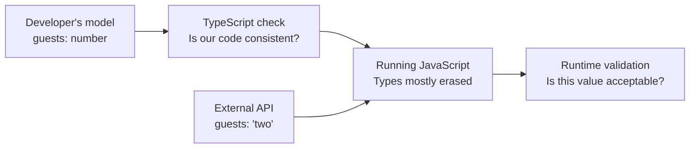
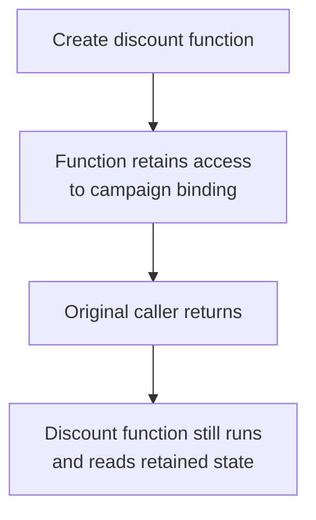

# CS220 — Programming Languages, Memory, and Execution
## Lecture 01: Programming Languages and Abstraction

*From source code to machine execution, from types to runtime reality, and from convenient abstractions to the engineering responsibilities they conceal.*

**Estimated study time:** 75–95 minutes, including experiments and exercises.

---

### How to listen to this lecture

Written for continuous listening first, then for on-screen re-reading. Theme: **what the compiler believes ≠ what the runtime does.** Sticky-note callouts mark where static claims stop protecting you. Near the end, answer the oral challenges **out loud** before reading solutions. The TypeScript lab lives after the spoken lecture ends — keep it for a screen session.

By the end, you should be able to say what a programming language actually is (syntax, semantics, implementation), why TypeScript types mostly erase at runtime, how trust boundaries and validation close the gap, what closures retain, and which questions to ask before trusting an abstraction.

---

# Part I — Intuition

*One reservation reaches three different checkpoints. The first two trust the label on the package; only the last discovers what is actually inside.*

### The picture to carry in your head

Imagine a hotel accepting bookings from another company's API. A request arrives with a customer name, a number of guests, and a total price. Your TypeScript code describes the expected shape perfectly. The outside world, unfortunately, has never agreed to obey your TypeScript definitions.

The picture below follows one booking from a developer's idea of the data to the value the program actually receives. The diagram matters less than the distinction: the compiler checks the program's stated rules, while the running application still has to examine information coming from outside those rules.



## 1. A beautifully labeled parcel

Our booking service expects a simple object. It knows the guest count should be a number, the price should follow an agreed representation, and the arrival date should be a calendar date. The developer writes an interface and lets the editor and compiler check every function using it.

A colleague accidentally treats the guest count as a string inside the code. TypeScript complains. Wonderful: we found a contradiction before running the application. Another colleague tries to pass a booking object without a required property. Again, the compiler complains.

It's tempting to conclude that bookings now have the correct shape. But that is a stronger promise than we earned. The compiler checked what our program *claims* about values. It didn't inspect every future packet arriving from the internet.

Imagine a parcel at a warehouse. Someone has printed a label saying **TWO GLASS BOTTLES**. A warehouse worker can check that the label has the required fields and follows the company's formatting rules. They cannot establish that there are actually two glass bottles inside without opening the parcel.

In software, static types are rather like well-enforced labeling rules. They prevent many internal misunderstandings. Runtime validation is what happens when we open the parcel.

## 2. The parcel travels through a different company

At noon, the supplier changes its API. Instead of sending the numeric guest count `2`, it sends the text `"2"`. Later, a broken integration sends `"two"`.

Your TypeScript interfaces remain unchanged. Compilation succeeds. The application starts. Only when actual data reaches an operation expecting a number do we discover the disagreement.

We haven't learned that TypeScript is useless. We've learned that a guarantee has a boundary. Within the assumptions of correctly typed application code, the compiler checks certain relationships. Across an untrusted boundary, the program needs evidence about the value it received.

This is why the simplest useful mental model of a programming language has three pieces: **what you can write**, **what the written program means**, and **how a computer makes that meaning happen**.

What you can write is syntax. What it means is semantics. How it executes is implementation. Those are different questions, even when one programming tool makes them feel seamless.

**Checkpoint:** If a JSON response arrives with `guests: "two"`, will a TypeScript interface by itself reject that packet? No. The running application needs an actual check or parser at the boundary.

## 3. Same behavior, different machinery

Now imagine rewriting our booking calculation in Python, Java, or Rust. The arithmetic requirement stays the same. The language rules and execution strategies can be very different.

Some languages check more properties before the application starts. Others defer more checks until execution. Some translate into a form executed by a virtual machine; others often produce machine code ahead of time. Some perform optimization while the program runs.

Those implementation choices don't change the business question: can we trust the guest count, and is the computed booking valid? They change how mistakes are detected, how memory and execution are managed, and what the programmer is required to express.

Think of different kitchens following the same reservation's meal order. One kitchen checks every instruction against a formal checklist before anyone cooks. Another relies more heavily on the chef noticing problems during preparation. The meals might be equally delicious, or equally wrong. The preparation systems make different mistakes easier or harder to catch.

The technical lecture will describe compilation, interpretation, static and dynamic typing, and JIT compilation precisely. For now, keep the distinction between **the rule**, **the value**, and **the mechanism executing the rule**.

## 4. Abstraction: useful packaging, dangerous assumptions

Our team doesn't want to repeat price calculations everywhere. So it introduces a helpful booking function. Other modules call it without knowing how discounts and taxes are calculated. That is an abstraction: a useful interface concealing implementation details.

But a clear interface can conceal a wrong assumption. Suppose the function silently assumes every price is already in euros. Another team supplies a price in pounds. The function produces a plausible number and nobody notices the missing conversion.

The abstraction successfully hid its implementation. It also hid information that mattered to correctness. A good abstraction doesn't merely reduce visible code; it preserves the distinctions callers need.

Types can help us express some of those distinctions. We might prevent developers from passing an arbitrary string as a currency, or from mixing a hotel identifier with a customer identifier. But no ordinary type declaration automatically establishes that an external payment actually succeeded.

Another invisible detail appears when a function remembers information from its surrounding scope. Imagine creating a discount-calculation callback while the current campaign is active. The callback can continue referring to the variables it captured after the function that created it has returned. This is a **closure**—not a magical copied photograph of every value, but a function with access to retained bindings.

Closures are useful. They can also preserve stale assumptions or keep objects alive longer than expected. The specific behavior depends on what was captured and how that binding later changes.

The next picture shows how one simple function can keep a connection to data that outlives the scope where it was created. The reference is useful until that retained state is no longer wanted.



## 5. The mental replay

Our booking enters the system. A developer's types describe what valid data should look like. A compiler checks many relationships in the source code. The running application receives actual values and validates untrusted ones. The runtime executes the program through its own machinery. Abstractions make the system manageable, while also requiring us to inspect the assumptions they conceal.

There's no need to memorize all the names of type-system features before this picture feels comfortable. The whole lesson is that different tools can make *different kinds of claims* about the same computation.

### Three questions before the Deep Dive

1. **What can a compile-time type check tell us?** That our program is consistent with certain declared and inferred rules, under its assumptions; not that arbitrary outside data is valid.
2. **What should happen at an API boundary?** Treat incoming information as untrusted until it has been checked against the runtime contract.
3. **Why can a helpful abstraction cause bugs?** It may conceal assumptions or distinctions that callers still need for correctness.

*The intuition pass ends here.*

---

# Part II — Deep Dive

# 1. The Code That Passed Every Check and Still Crashed

> **Case file #006** — *02:17 AM. TypeScript green. Production on fire.*

It's 02:17 in the morning.

Your hotel reservation platform has started rejecting bookings from one particular integration partner.

The frontend works.

The database is healthy.

AWS reports no infrastructure problems.

Your monitoring system indicates that requests are reaching the backend successfully.

But every request involving this partner eventually produces the same error:

`TypeError: availableRooms.toFixed is not a function`

That's peculiar.

Your backend is written in TypeScript.

The relevant interface declares `availableRooms` as a `number`:

```typescript
interface PartnerAvailability {
  hotelId: string;
  availableRooms: number;
  currency: string;
}
```

And the code that processes the response asserts the JSON as that interface — with no runtime check:

```typescript
async function getAvailability(
  hotelId: string
): Promise<PartnerAvailability> {
  const response = await fetch(
    `https://partner.example/availability/${hotelId}`
  );

  if (!response.ok) {
    throw new Error("Partner request failed");
  }

  return await response.json() as PartnerAvailability;
}
```

Later, another function formats the result by calling `toFixed` on `availableRooms`:

```typescript
const availability = await getAvailability("H-142");

const remaining = availability.availableRooms.toFixed(0);
```

TypeScript approves.

Your IDE is happy.

The compiler reports no type errors.

The code was reviewed, tested, and deployed.

And yet production has become a tiny bonfire.

You inspect the actual HTTP response. The partner sent `availableRooms` as the string `"3"`, not a number:

```json
{
  "hotelId": "H-142",
  "availableRooms": "3",
  "currency": "EUR"
}
```

The compiler believed `availableRooms` was a number; the runtime held the string `"3"`, and the `as` cast performed no check:

```text
  COMPILER'S STORY              RUNTIME'S STORY
  ────────────────              ───────────────
  availableRooms: number        availableRooms: "3"  (string)
  .toFixed() is fine            .toFixed is not a function
         │                              │
         └──── as PartnerAvailability ──┘
                    (no runtime check)
```

There it is.

The partner has sent `"3"` as a string rather than `3` as a number.

JavaScript strings don't have a `toFixed()` method.

So the code crashes.

Perhaps you're thinking: fine, the integration partner violated the API contract. We should validate the response.

Correct.

But we're interested in something deeper.

**Why did TypeScript accept the code at all?**

We explicitly declared that `availableRooms` was a number.

We gave the function a return type.

We used a typed interface.

Surely the programming language should have protected us?

To understand the answer, we need to examine what programming languages actually are, what compilers can prove, and what survives when our programs begin executing.

Because here's the central mystery:

> **Sticky note #1**
>
> Your source code contains information that the running program may not contain at all.

> ✓ Room 1 complete — types erased, partner lied, boom

---

# 2. A Programming Language Is an Agreement Between Humans and Machines

Let's begin with something familiar.

You write `const total = price + tax;`.

You understand what this means. Or at least you think you do. The computer, however, doesn't possess an innate understanding of prices, taxes, or addition as human concepts.

At the lowest level, a conventional CPU executes instructions according to its architecture: instructions move data, perform arithmetic, manipulate memory, compare values, and change execution flow.

So how does your TypeScript statement become something a processor can execute?

There must be a translation or interpretation process, and before that can happen, the language's rules need to define what the statement means. This brings us to three fundamental components of a programming language — syntax, semantics, and implementation:

```text
  THREE PARTS OF A LANGUAGE
  ─────────────────────────
  1. Syntax        what programs may look like
  2. Semantics     what valid programs mean
  3. Implementation how meanings become executable behavior
```

## Syntax: What programs are allowed to look like

Consider `const result = 2 + 3;`. That's valid TypeScript syntax.

Now consider `const = result + 2 3;`. It isn't. The language has grammatical rules describing which sequences of tokens form valid statements and expressions. These rules are called **syntax**.

Syntax is important, but it's also the least intellectually interesting part of programming languages for our purposes.

You can learn a new language's syntax relatively quickly; understanding its execution model and semantics is the more substantial challenge.

## Semantics: What programs mean

Consider `"5" + 2`. In JavaScript, this produces `"52"`.

Why?

Because JavaScript defines rules for how the `+` operator behaves with different operand types.

Now consider `"5" - 2`. This produces `3`.

Two expressions, two meanings under the language's semantics:

- **`"5" + 2`** → `"52"` — `+` with a string concatenates.
- **`"5" - 2`** → `3` — `-` coerces both sides to numbers.

The subtraction operator follows different conversion rules. That's not a random inconsistency introduced by a broken computer; it's a consequence of the language's specified semantics.

**Semantics determine the meaning and behavior of valid programs.**

Different programming languages can assign different meanings to similar-looking code.

This is particularly obvious when comparing JavaScript, Python, Java, C++, and Rust, which differ in their type systems, memory management, object models, error handling, concurrency models, and many other semantic properties.

A programmer learning a new language isn't merely learning different punctuation. They're learning a different collection of rules about what programs can express and how execution behaves.

## Implementation: How those meanings become executable behavior

Finally, a language needs an implementation: a compiler, interpreter, virtual machine, runtime, or some combination of them.

This implementation is responsible for making valid programs behave according to the language's rules.

The distinction matters because **a language specification and a particular implementation are not the same thing**. JavaScript is standardized through ECMAScript, but it can execute in different engines, including V8, SpiderMonkey, and JavaScriptCore.

Those engines use different implementation techniques and optimization strategies, yet they aim to preserve the same externally observable language semantics for conforming programs.

And that leads us to an important idea. Two implementations can execute the same language in radically different ways while producing equivalent observable results.

The implementation is allowed to be clever. It isn't allowed to casually change what your program means.

> ✓ Room 2 complete — syntax / semantics / implementation

---

# 3. What Actually Happens When You Run TypeScript?

Let's follow a small TypeScript discount function — numbers in, number out — from your editor toward the CPU.

```typescript
function calculateDiscount(
  price: number,
  discount: number
): number {
  return price * (1 - discount);
}
```

There are several distinct stages, and they are often misunderstood because the word *compilation* is used rather loosely in everyday conversation.

## Stage one: Parsing the source

A compiler begins by analyzing the source code. First, it recognizes tokens, for example:

- `function`
- `calculateDiscount`
- `(`
- `price`
- `:`
- `number`

Then it organizes the tokens according to the language grammar. One common internal representation is an **abstract syntax tree**, or AST. Conceptually, the function becomes an abstract syntax tree with a multiply and a subtract:

```text
FunctionDeclaration
  Name: calculateDiscount
  Parameters:
    price: number
    discount: number
  ReturnType: number
  Body:
    ReturnStatement
      Multiply
        price
        Subtract
          1
          discount
```

This isn't the exact internal structure of the TypeScript compiler, but it illustrates the idea.

The compiler is no longer looking at source code merely as a string of characters; it has constructed a structured representation of the program.

This structure enables much of what modern development tools do: syntax highlighting, code navigation, refactoring, static analysis, autocomplete, type checking, and compiler transformations. Even many sophisticated code-generation tools manipulate some form of syntax tree.

## Stage two: Type checking

The TypeScript compiler can now analyze relationships between expressions and types. Our function promises to accept numbers and return a number. If we attempt `calculateDiscount("100", 0.2);`, TypeScript reports a type error: the string `"100"` isn't assignable to the declared `number` parameter.

Notice what makes this useful: the compiler identifies the problem without executing the function, reasoning about the program's declared and inferred types.

This is **static analysis** — the information is available before the program runs. But static analysis has boundaries, and we'll return to those shortly.

## Stage three: Producing executable JavaScript

In a conventional TypeScript build, the compiler or another tool emits JavaScript. Our function may become plain JavaScript with the type annotations stripped:

```javascript
function calculateDiscount(price, discount) {
  return price * (1 - discount);
}
```

The type annotations are gone: no `price: number`, no `discount: number`, no return type.

Those annotations helped us analyze the program, but they aren't ordinary runtime JavaScript values. This is called **type erasure**: most TypeScript type constructs disappear when the code is transformed into JavaScript.

There are exceptions for TypeScript-specific features that require runtime JavaScript generation, such as traditional enums, but interfaces and type annotations are erased.

And here's an important modern detail: recent Node.js versions can execute many TypeScript files directly by stripping erasable type syntax. That doesn't change the underlying principle.

Node's built-in type stripping does not perform TypeScript type checking, so running a `.ts` file and checking its type correctness are separate operations.

## Stage four: JavaScript execution

Now the JavaScript engine takes over. Let's use V8, the engine employed by Chrome and Node.js. A simplified execution pipeline runs from TypeScript source through checking and JavaScript emission into V8 and finally the CPU:

```text
TypeScript source
       |
       v
Type checking / transformation
       |
       v
JavaScript source
       |
       v
V8 parser
       |
       v
Internal representation
       |
       v
Bytecode and execution
       |
       v
Optimized machine code
       |
       v
CPU
```

V8 uses multiple execution tiers.

Its Ignition interpreter executes bytecode, while other tiers, including Sparkplug, Maglev, and higher-level optimizing compilation machinery, generate machine code with different trade-offs between compilation cost and execution speed.

We don't need to memorize those names. The important idea is that JavaScript execution is not simply a choice between "interpreted" and "compiled": modern engines use both as parts of one execution strategy, and code may move between tiers as the engine learns more about its behavior.

We'll explore this more deeply in CS220-L03.

## A compiler isn't necessarily a single transformation

In a real full-stack project, several tools may participate: a TypeScript compiler can check types; a bundler can construct a dependency graph and combine modules; a transformer can rewrite syntax; a minifier can remove unnecessary names or formatting; a runtime can parse and execute the resulting JavaScript; and an optimizing compiler inside the runtime can generate more efficient machine code.

These are separate responsibilities, even if a build system combines them behind one command. That's why `npm run build` can conceal a surprisingly elaborate pipeline.

Four stages, four representations:

- **Source** — what you wrote.
- **Checked** — what the type checker believed.
- **Emitted** — JavaScript without most types.
- **Executed** — what the engine actually runs.

The practical lesson is that **source code, checked code, emitted code, and executed code are different representations of a program**.

When something goes wrong, knowing which stage is responsible can save a great deal of debugging time.

> **Sticky note #2**
>
> Type erasure: most TypeScript types don't ride along into the running program.

> ✓ Room 3 complete — parse → check → emit → execute

---

# 4. Compiled Versus Interpreted: A False Dichotomy

You may remember being taught something like this:

C is compiled. Python is interpreted. JavaScript is interpreted. Java runs on a virtual machine.

The classification is useful as a first approximation, but it becomes misleading if treated as an absolute property of the language. Let's examine why.

## Compilation is translation

A compiler transforms one representation of a program into another.

For example:

- High-level source into native machine code.
- High-level source into bytecode.
- TypeScript into JavaScript.
- One intermediate representation into another.

Compilation doesn't necessarily mean producing a standalone executable that directly runs on a CPU, and it doesn't necessarily happen only before an application starts.

## Interpretation is execution

An interpreter executes a program representation by examining instructions and performing the corresponding behavior. That representation might be source code, bytecode, or another intermediate form.

A system can compile source into bytecode and then interpret that bytecode; later, it can compile frequently executed portions into machine code. That's a common pattern in modern managed runtimes — compile, interpret, then JIT the hot paths:

```text
  Often both, not either/or
  ─────────────────────────
  source ──compile──► bytecode ──interpret──► results
                           │
                           └── JIT compile hot paths ──► machine code
```

## JIT compilation

JIT means **just-in-time compilation**: instead of compiling every possible operation into optimized machine code ahead of time, a runtime can optimize during execution, because it can observe how the program actually behaves. Consider a polymorphic `add` that may see numbers, strings, or coercions:

```javascript
function add(a, b) {
  return a + b;
}
```

JavaScript allows several behaviors here: numbers can be added, strings concatenated, and other values participate through coercion rules. The engine must preserve those semantics. But if an application calls `add()` millions of times with small numbers, an optimizing engine can specialize for that observed behavior, emitting efficient machine code guarded by checks on its assumptions, and fall back to general execution if they stop holding. CS220-L03 examines V8 tiers in hardware terms.

> ✓ Room 4 complete — compiled vs interpreted is a spectrum

---

# 5. Static Types, Dynamic Values, and the Limits of Certainty

Let's return to our broken hotel integration.

Remember this line? `return await response.json() as PartnerAvailability;`

It looks reassuring. It contains a type, the editor recognizes that type, autocomplete works, and the code compiles. But what does `as PartnerAvailability` actually do?

It tells TypeScript to treat the expression as that type for static analysis. It does not inspect the JSON object and transform it into a valid `PartnerAvailability`.

It does not convert strings to numbers, check that every required property exists, or verify the business meaning of the values.

Most importantly, **a type assertion is not runtime validation**. Assert `unknown` data whose `availableRooms` is the string `"3"`, then call `toFixed`:

```typescript
interface PartnerAvailability {
  availableRooms: number;
}

const data: unknown = {
  availableRooms: "3"
};

const availability =
  data as PartnerAvailability;

console.log(availability.availableRooms.toFixed(0));
```

TypeScript can accept the assertion. At runtime, the property is still a string, and calling `toFixed()` throws.

This illustrates a critical limit of TypeScript's type system: it can analyze what the program's types say should be true, but it cannot automatically guarantee that arbitrary external data actually satisfies those claims.

## Static typing versus dynamic typing

There's a common misconception that dynamically typed languages don't have types. That's incorrect: JavaScript values have runtime types. `typeof 42` is `"number"`, `typeof "hello"` is `"string"`, `typeof true` is `"boolean"`.

Objects, functions, symbols, big integers, and other values also have defined runtime characteristics.

Static TypeScript and dynamic JavaScript values answer different questions:

- **When checked** — static typing mostly before run; dynamic typing at runtime.
- **What it knows** — the static system knows declared and inferred types; the runtime knows actual values.
- **Survives into JavaScript?** — most static types are erased; runtime values are real.

JavaScript is dynamically typed because type-related behavior is largely determined and checked at runtime rather than requiring every variable's type to be statically established before execution.

TypeScript adds a static type system on top of JavaScript, which provides useful compile-time guarantees under the assumptions of that type system.

But the runtime values are still JavaScript values, and TypeScript deliberately permits some operations that are not fully type-safe, such as assertions and use of `any`.

So TypeScript isn't a magical proof that a program cannot fail. It's a very useful analytical tool with known limits.

## Why static types are valuable anyway

Don't underestimate what TypeScript accomplishes. Consider a large application containing hundreds of functions, APIs, data models, and UI components.

Without static types, many incorrect assumptions about values may only become apparent when a particular execution path runs.

With TypeScript, a substantial class of mismatches can be detected earlier.

Changing the shape of an interface can reveal affected callers, renaming a property can expose broken references, discriminated unions can reveal unhandled states, and generics can preserve relationships between inputs and outputs. These are major advantages.

The trick is understanding what guarantees you're actually receiving. Static types reduce uncertainty. They don't eliminate reality.

> **Sticky note #3**
>
> `as SomeType` is a compiler hint, not a runtime check.

> ✓ Room 5 complete — static claims ≠ dynamic values

---

# 6. The Boundary Between Trusted and Untrusted Information

Now we can fix our hotel integration properly.

Instead of pretending that the remote service has returned the expected shape, we'll treat its response as untrusted data.

A good starting type is `unknown`. Unlike `any`, `unknown` forces us to establish what a value is before using it in operations that require a more specific type.

Let's define the expected result — hotel ID, integer room count, and currency:

```typescript
interface PartnerAvailability {
  hotelId: string;
  availableRooms: number;
  currency: string;
}
```

Now write a small runtime parser that rejects non-objects and invalid fields before returning a typed value:

```typescript
function parseAvailability(
  input: unknown
): PartnerAvailability {
  if (
    typeof input !== "object" ||
    input === null
  ) {
    throw new Error("Expected an object");
  }

  if (
    !("hotelId" in input) ||
    typeof input.hotelId !== "string"
  ) {
    throw new Error("Invalid hotel ID");
  }

  if (
    !("availableRooms" in input) ||
    typeof input.availableRooms !== "number" ||
    !Number.isInteger(input.availableRooms) ||
    input.availableRooms < 0
  ) {
    throw new Error("Invalid room count");
  }

  if (
    !("currency" in input) ||
    typeof input.currency !== "string"
  ) {
    throw new Error("Invalid currency");
  }

  return {
    hotelId: input.hotelId,
    availableRooms: input.availableRooms,
    currency: input.currency
  };
}
```

Now fetch the partner endpoint, treat the JSON as `unknown`, and parse before trusting it:

```typescript
const response = await fetch(endpoint);

if (!response.ok) {
  throw new Error(`HTTP ${response.status}`);
}

const raw: unknown = await response.json();

const availability = parseAvailability(raw);
```

This is substantially safer.

The runtime parser checks that the required values satisfy the declared structural constraints, and after successful parsing the rest of the application can work with a properly typed object.

Notice the architecture we're creating — untrusted JSON passes through runtime validation before typed application logic:

```text
External system
      |
      v
Untrusted JSON
      |
      v
Runtime validation
      |
      v
Validated domain object
      |
      v
Typed application logic
```

This is a trust boundary. We don't blindly assume that external information matches our expectations; we establish the relevant properties before relying on them.

In a production application, we'd probably use a schema-validation library rather than manually writing dozens of property checks.

And we'd refine the schema to validate business constraints too. Is the currency supported? Is the hotel identifier valid? Can the room count exceed the hotel's capacity?

Should the integration reject an invalid field, or apply an explicitly documented conversion? Those decisions depend on the domain, but the conceptual architecture remains the same.

## The dangerous alternative: `any`

Now consider typing the JSON as `any` and calling `toFixed` with no validation:

```typescript
const data: any = await response.json();

return data.availableRooms.toFixed(0);
```

TypeScript permits this, because `any` effectively opts out of meaningful type checking for the relevant operations.

It's useful in certain integration or migration scenarios, but it can silently undermine large sections of otherwise carefully typed code. A helpful distinction is attitude toward uncertainty:

- **`any`** — don't check this.
- **`unknown`** — we don't know this yet.

Those are very different attitudes toward uncertainty.

For external APIs, file contents, messages, and other untrusted inputs, `unknown` is often the more appropriate starting point.

> **Sticky note #4**
>
> At the trust boundary: `unknown` → validate → then trust.

> ✓ Room 6 complete — validate before you believe

---

# 7. Type Systems Can Express Business Rules

So far, types have mainly described primitive shapes: strings, numbers, objects. But more expressive type systems can encode relationships and constraints.

This is where TypeScript becomes particularly interesting for experienced developers.

Imagine modeling a booking result.

A naive interface might look like this — one blob of optionals that allows invalid combinations:

```typescript
interface BookingResult {
  success: boolean;
  reservationId?: string;
  error?: string;
  retryable?: boolean;
}
```

It seems reasonable.

But consider the possible states.

Could `success` be true while `reservationId` is undefined? Yes.

Could `success` be true while `error` contains `"Payment failed"`? Yes.

Could a failed booking contain a reservation ID? Yes.

The interface allows all these combinations.

Some may be meaningful, but many are probably invalid for our domain.

We've represented the data without fully expressing its rules.

## Discriminated unions

Now consider an alternative — three mutually exclusive shapes keyed by `status`:

```typescript
type BookingResult =
  | {
      status: "confirmed";
      reservationId: string;
    }
  | {
      status: "sold_out";
      alternatives: string[];
    }
  | {
      status: "payment_failed";
      retryable: boolean;
    };
```

Optional fields allow many invalid combinations; the union admits only three valid shapes:

```text
  One blob of optionals          Three valid shapes
  ─────────────────────          ──────────────────
  success?                       confirmed → reservationId
  reservationId?                 sold_out  → alternatives
  error?                         payment_failed → retryable
  retryable?
       │
       └── many invalid combos allowed
```

This representation describes three distinct valid shapes: a confirmed booking contains a reservation ID, a sold-out result contains alternatives, and a payment failure contains information about retryability.

Switch on `status` and let TypeScript narrow which fields exist in each branch:

```typescript
function describeBooking(
  result: BookingResult
): string {
  switch (result.status) {
    case "confirmed":
      return `Booking ${result.reservationId} confirmed`;

    case "sold_out":
      return `${result.alternatives.length} alternatives`;

    case "payment_failed":
      return result.retryable
        ? "Payment can be retried"
        : "Payment cannot be retried";
  }
}
```

TypeScript can narrow the type according to the `status` field. Within the `"confirmed"` branch, it knows that `reservationId` exists; within the `"payment_failed"` branch, it knows that `retryable` exists.

This is called a **discriminated union**, and it provides more than autocomplete: it makes certain invalid combinations harder to construct accidentally.

## Making invalid states unrepresentable

There's a useful design philosophy:

> **Sticky note #5**
>
> Represent the domain so that invalid states cannot be expressed using the intended types.

Of course, JavaScript runtime behavior and unsafe TypeScript assertions can still bypass the model.

And not every business invariant can be encoded statically.

But the philosophy is valuable.

Instead of building one enormous interface containing dozens of optional properties, define the actual states your system supports.

This is particularly helpful for payments, booking workflows, authentication, background job states, UI state machines, and agent execution statuses. Imagine an AI agent whose state is modeled as:

`pending | running | waiting_for_approval | completed | failed`

Each state might have different required properties.

A discriminated union lets the compiler help enforce those distinctions inside the application.

That's a much more useful application of static typing than merely annotating every variable with `string` or `number`.

> ✓ Room 7 complete — make invalid states hard to type

---

# 8. Structural Typing: The Strange Freedom of TypeScript

Here's another important TypeScript feature.

Its type compatibility is primarily **structural**.

That means compatibility depends largely on the required members of a type, rather than simply on whether two values were explicitly declared to belong to the same named class or interface.

Consider two interfaces that require the same members — `id` and `email` strings — under different names:

```typescript
interface Customer {
  id: string;
  email: string;
}

interface Employee {
  id: string;
  email: string;
}
```

Assign an `Employee` value to a `Customer` variable:

```typescript
const employee: Employee = {
  id: "E-42",
  email: "employee@example.com"
};

const customer: Customer = employee;
```

TypeScript accepts this. Why? Because the two types have compatible structures: both require an `id` string and an `email` string.

But semantically, customers and employees are different concepts, and the compiler doesn't inherently know that distinction.

This is another example of the gap between structural representation and domain meaning.

## The problem with identifiers

Consider `type CustomerId = string;` and `type ReservationId = string;`.

Pass a `CustomerId` into a function that expects a `ReservationId`:

```typescript
function cancelReservation(
  id: ReservationId
): void {
  // ...
}

const customerId: CustomerId = "C-42";

cancelReservation(customerId);
```

This is accepted.

Both aliases describe strings.

But perhaps we wanted to prevent customer IDs from being passed where reservation IDs are expected.

One TypeScript technique is to introduce **branded types** — string intersected with a phantom brand so the two IDs stop being assignable:

```typescript
type ReservationId =
  string & { readonly __brand: "ReservationId" };

type CustomerId =
  string & { readonly __brand: "CustomerId" };
```

Now the two types are incompatible under normal checked assignments.

The brand is a compile-time distinction.

It doesn't add a runtime property to the string.

A carefully designed constructor or parser can validate identifiers at the boundary and return the branded type.

Assertions can still bypass the distinction, so this isn't a security mechanism.

But it can be a useful way to encode domain meaning more precisely.

## Should you brand every primitive value?

Absolutely not.

You could spend the next five years inventing type-level distinctions for every string and integer in your application.

Your colleagues would eventually stage an intervention.

Use stronger type modeling where it prevents meaningful errors.

Customer IDs versus reservation IDs may be worth distinguishing.

A random internal string used once in a small helper function probably isn't.

This leads to an important principle:

> **Sticky note #6**
>
> A type system is most useful when it expresses important domain relationships—not when it maximizes the number of type declarations.

> ✓ Room 8 complete — same shape ≠ same meaning (brand when it matters)

---

# 9. Generics: Preserving Relationships Without Knowing the Concrete Types

Let's briefly revisit generics.

Not because you need a basic TypeScript tutorial, but because they illustrate a deeper idea.

Suppose we write a generic `first` that returns `T | undefined` from a `T[]`:

```typescript
function first<T>(
  items: T[]
): T | undefined {
  return items[0];
}
```

What does the generic type parameter `T` accomplish? It expresses a relationship between the input and output.

If we pass an array of customers, the result is a customer or undefined; if we pass an array of numbers, a number or undefined.

The function doesn't need to know the specific type in advance, but the compiler preserves the relationship.

Now compare it with an `any`-typed version that discards the input/output relationship:

```typescript
function first(items: any[]): any {
  return items[0];
}
```

`first<T>(items: T[]): T | undefined` keeps the relationship. `first(items: any[]): any` has the same runtime behavior but discards the story.

This version can execute the same runtime operation.

But it discards useful information about the relationship between input and output types.

The generic version allows the compiler to retain that connection.

That's the deeper purpose of generics.

They let us express algorithms and abstractions that operate across different types while preserving meaningful type relationships.

This is closely connected to **parametric polymorphism**.

The function's behavior is generalized over a type parameter.

Generics are useful in collections, API responses, repositories, event handlers, reusable components, result types, and countless other structures.

But they can also be abused.

If understanding a function requires mentally evaluating a gigantic recursive conditional type, the abstraction may have become more expensive than the problem it was intended to solve.

Type-level sophistication is not automatically engineering quality.

> ✓ Room 9 complete — generics preserve relationships

---

# 10. Closures: How a Function Remembers a World That No Longer Exists

Now let's leave TypeScript's type system and investigate JavaScript itself.

Imagine a function that creates retry policies — a shared `maxAttempts` binding behind `shouldRetry` and `updateLimit`:

```typescript
function createRetryPolicy(
  initialLimit: number
) {
  let maxAttempts = initialLimit;

  return {
    shouldRetry(attempt: number) {
      return attempt < maxAttempts;
    },

    updateLimit(newLimit: number) {
      maxAttempts = newLimit;
    }
  };
}
```

We create a policy with limit 3, then lower the limit to 2 and ask again:

```typescript
const policy = createRetryPolicy(3);

console.log(policy.shouldRetry(2));
// true

policy.updateLimit(2);

console.log(policy.shouldRetry(2));
// false
```

Nothing especially mysterious so far.

But think about what happened.

The function `createRetryPolicy()` finished executing. Its local variable `maxAttempts` was declared inside that function, and ordinarily we think of local variables as belonging to a function invocation.

So why can `shouldRetry()` and `updateLimit()` still access `maxAttempts` after the outer function has returned? Because JavaScript functions form **closures**. The outer call returns, but the lexical environment with `maxAttempts` stays alive:

```text
  createRetryPolicy() returns
         │
         ▼
  ┌─────────────────────┐
  │ lexical environment │  ← still alive
  │   maxAttempts = …   │
  └──────────┬──────────┘
             │ retained by
       shouldRetry / updateLimit
```

A closure combines a function with access to its surrounding lexical environment. The returned functions retain access to the relevant variable bindings created during the invocation of `createRetryPolicy()`.

Those bindings can remain alive for as long as they're reachable through the closures — an important part of JavaScript's execution model.

## Closures capture bindings, not necessarily snapshots

Here's a subtle distinction.

Close over a mutable `timeout` variable, change it after the function is created, then call the function:

```javascript
let timeout = 1000;

const getTimeout = () => timeout;

timeout = 5000;

console.log(getTimeout());
// 5000
```

The closure doesn't necessarily freeze the original value of `timeout` at the moment the function was created. It accesses the variable binding, which now contains 5000 — that's why the result changes.

Now compare a snapshot of the primitive against a live read of `config.timeout`:

```javascript
const config = {
  timeout: 1000
};

const capturedTimeout = config.timeout;

const getCaptured = () => capturedTimeout;
const getLive = () => config.timeout;

config.timeout = 5000;

console.log(getCaptured());
// 1000

console.log(getLive());
// 5000
```

What each closure sees:

- **`getCaptured`** — a snapshot of the primitive (`1000`).
- **`getLive`** — the live property on the object (`5000`).

These two closures behave differently: one uses a previously extracted primitive value, the other reads a property from the same object each time.

This difference can create surprisingly subtle bugs in asynchronous code, event handlers, configuration systems, and long-lived application services.

A closure doesn't simply preserve "the state of the world when it was created."

It preserves access to particular bindings, whose values may or may not change.

## The classic loop problem

Push three callbacks from a `var` loop, then invoke them all:

```javascript
const callbacks = [];

for (var i = 0; i < 3; i++) {
  callbacks.push(() => i);
}

console.log(callbacks.map(fn => fn()));
// [3, 3, 3]
```

Why? Because `var` uses function scope rather than block scope. All three callbacks refer to the same `i` binding, and by the time we invoke them, the loop has finished and `i` is 3.

Now replace `var` with `let` so each iteration gets its own binding:

```javascript
const callbacks = [];

for (let i = 0; i < 3; i++) {
  callbacks.push(() => i);
}

console.log(callbacks.map(fn => fn()));
// [0, 1, 2]
```

With `let` in this loop form, each iteration receives its own binding.

The callbacks now observe the expected values.

This isn't merely trivia about old JavaScript syntax.

It's an example of how lexical environments determine what a function actually refers to.

## Closures and memory

Closures also have consequences for memory management.

Suppose you register a long-lived event handler that captures a large object: as long as the handler remains reachable, the objects it retains may also remain reachable, even if the function that created them finished executing long ago.

This doesn't mean closures inherently cause memory leaks; they're a normal language feature. But long-lived callbacks, listeners, timers, and retained references can accidentally keep data alive longer than intended.

We'll investigate that properly in CS220-L02, when we explore memory management and garbage collection. For now, remember:

> **Sticky note #7**
>
> A function's behavior depends not only on its code and explicit arguments, but sometimes on the environment it retains access to.

That's a powerful capability.

And another reason that seemingly simple functions can behave differently depending on their surrounding state.

> ✓ Room 10 complete — closures keep bindings, not always snapshots

---

# 11. Programming Paradigms: Different Ways to Organize Thought

Languages aren't merely different ways to write loops — they encourage different ways of structuring computation. Modern languages, JavaScript especially, usually support several paradigms at once.

**Imperative** — explicit state and control flow:

```typescript
let total = 0;
for (const item of items) {
  total += item.price;
}
```

Often the clearest expression of a computation. Nothing wrong with it.

**Declarative** — describe the desired result; leave strategy to the system:

```sql
SELECT SUM(price)
FROM invoice_items
WHERE invoice_id = 42;
```

We express *what*; the planner chooses much of *how*. Abstraction hides implementation details — it does not eliminate cost. A declarative query can still be disastrously expensive; execution plans still matter.

**Functional** — pure functions, immutability, composition, explicit effects. A pure function returns the same result for the same inputs with no externally observable side effects:

```typescript
function calculateTotal(prices: number[]): number {
  return prices.reduce((sum, price) => sum + price, 0);
}
```

Contrast `chargeCustomer`, which hits a payment provider — calling it twice may charge twice. Useful architectures often separate deterministic domain calculations from side-effecting operations. A SaaS cannot be entirely pure; the goal is to control and understand effects, not eliminate them.

**Object-oriented** — combine state and behavior. A `RetryPolicy` class encapsulating `maxAttempts` resembles our earlier closure-based retry policy. Class versus functions-and-closures is not automatically superior; choose whichever makes intended behavior easier to understand, extend, and maintain.

What each paradigm emphasizes:

- **Imperative** — explicit steps and mutation.
- **Declarative** — *what*, not *how*.
- **Functional** — pure calculation, controlled effects.
- **OOP** — state and behavior together.

Paradigm wars are usually unproductive. A Vue app mixes reactive and declarative patterns; a Node service may combine functional utilities, OOP domain models, and imperative orchestration; SQL is declarative; workers perform side effects. Choose tools; don't force every problem into one ideology.

> ✓ Room 11 complete — paradigms are tools, not religions

---

# 12. Abstraction: The Superpower That Can Conceal Disaster

Let's return to a familiar situation.

You have a database repository.

It exposes a find that loads customers with nested reservations:

```typescript
const customers = await repository.find({
  relations: {
    reservations: true
  }
});
```

Very convenient. You don't need to write SQL manually; the ORM handles object mapping and relationship loading. That's an abstraction.

It allows you to think in terms of customers and reservations rather than directly manipulating database rows. And often, that's extremely useful.

But imagine you later loop over every customer's reservations and read only the length:

```typescript
for (const customer of customers) {
  console.log(customer.reservations.length);
}
```

Depending on the ORM configuration and loading strategy, related data may be loaded eagerly, fetched in batches, or requested lazily.

A different repository or loading pattern could introduce repeated database queries. The source code may look harmless while the underlying database workload becomes expensive.

The abstraction has hidden important implementation behavior.

This is a **leaky abstraction**: an abstraction is leaky when details of its underlying implementation become relevant to understanding or using it correctly.

## All abstractions have boundaries

Every familiar abstraction still leaves something underneath:

- **Database ORM** — doesn't erase network latency or query cost.
- **Cloud platform** — doesn't erase server failures.
- **HTTP client** — doesn't erase unreliable remotes.
- **Promise** — doesn't erase the need for real parallelism.
- **AI agent framework** — doesn't erase auth or idempotency of tools.
- **Type annotation** — doesn't erase the need to validate external JSON.

An abstraction simplifies how we interact with a system.

But it can't eliminate the fundamental constraints of the system underneath.

This is why experienced engineers benefit from understanding the layers they ordinarily don't need to touch.

You don't have to implement a PostgreSQL B-tree.

But understanding how indexes work helps you reason about query performance.

You don't have to write a JavaScript engine.

But understanding the event loop, memory model, and JIT compilation helps you diagnose difficult runtime behavior.

You don't have to construct your own TLS implementation.

But understanding network boundaries and protocols helps you design reliable services.

> **Sticky note #8**
>
> The purpose of deeper CS knowledge isn't to abandon abstractions. It's to recognize when you need to look beneath them.

## The abstraction budget

There's also a more mundane problem.

Every abstraction introduces concepts that developers must understand.

A simple function might require understanding its arguments and result; a sophisticated framework might require understanding decorators, lifecycle hooks, dependency injection, metadata, generated code, and implicit state transitions.

Sometimes the framework is worth it.

Sometimes a small amount of duplicated straightforward code would have been easier to maintain.

Consider an application with three simple services.

Do you really need an elaborate generic repository framework, dynamic service registry, plugin architecture, and decorator-based dependency injection system? Perhaps not.

Abstraction is valuable when it removes more complexity than it introduces. That's an engineering judgment, and it's particularly important in the era of AI-generated code.

An AI assistant can construct elaborate architectures remarkably quickly. It can also introduce unnecessary layers with equal enthusiasm.

The ability to generate abstractions cheaply doesn't make those abstractions cheap to understand or maintain.

> ✓ Room 12 complete — abstractions hide cost until they leak

---

# 13. The Most Important TypeScript Design Habit

Let's return to our booking system one more time.

I want to connect several ideas from today's lecture.

Imagine the application receives a booking request.

It needs to:

1. Validate the request.
2. Check availability.
3. Calculate a price.
4. Reserve inventory.
5. Charge the customer.
6. Confirm the reservation.

Some parts of that workflow are relatively straightforward calculations. Others interact with external state. We can divide the system accordingly.

## Pure domain logic

For example, `calculatePrice` is pure arithmetic over cents — no database, no payment provider:

```typescript
interface PriceBreakdown {
  baseAmountCents: number;
  feeAmountCents: number;
  totalAmountCents: number;
}

function calculatePrice(
  baseAmountCents: number,
  feeAmountCents: number
): PriceBreakdown {
  return {
    baseAmountCents,
    feeAmountCents,
    totalAmountCents:
      baseAmountCents + feeAmountCents
  };
}
```

This is deterministic arithmetic over assumed-valid inputs, subject to the integer range and domain constraints discussed in CS110-L02. It's easy to test, easy to reason about, and doesn't require a database or payment provider.

## External side effects

Now consider `confirmBooking` — validation, inventory, payments, and recovery from partial failures:

```typescript
async function confirmBooking(
  request: BookingRequest
): Promise<BookingResult> {
  // Validate and authenticate.
  // Check inventory.
  // Perform state changes.
  // Interact with payment systems.
  // Recover from partial failures.
}
```

This operation is substantially more complicated. It interacts with state that can change independently, it must handle failures, some actions may be irreversible, and the order of operations matters.

And simply calling the function twice may produce unacceptable consequences.

A strong architecture keeps these distinctions visible.

Don't hide an external payment charge behind a function that appears to be an ordinary calculation.

Don't rely on a static type annotation to establish that a remote service behaved correctly.

Don't use a generic helper that silently retries operations whose side effects may not be safe to repeat.

Those are examples of abstraction concealing important semantics.

## The senior engineer's responsibility

At a high level, a senior engineer should be able to answer a checklist at the trust boundary — what is trusted, what needs validation, what is deterministic, what mutates external state:

```text
  CHECKLIST AT THE BOUNDARY
  ─────────────────────────
  □ Which values are trusted?
  □ Which values require validation?
  □ Which functions are deterministic?
  □ Which operations modify external state?
  □ Which errors can occur?
  □ Which guarantees are static?
  □ Which need runtime checks?
  □ Which need transactions / coordination?
```

These are not merely TypeScript questions.

They are software architecture questions.

And they're much more important than whether a function was written using a class or an arrow expression.

> ✓ Room 13 complete — separate pure logic from side effects

---

# 14. The Oral Examination

Pause the lecture for each one.

Answer **out loud** — as if an interviewer were across the table — before you listen to or read the solutions.

They're designed to reinforce practical judgment rather than obscure compiler trivia.

### Challenge A — The Type-Safe API That Isn't

**Suggested time: 10 minutes**

Your frontend and backend share a TypeScript interface. It declares `id` and `checkInDate` as strings and `guests` as a number:

```typescript
interface Reservation {
  id: string;
  checkInDate: string;
  guests: number;
}
```

Both applications compile successfully.

A production incident occurs because the backend sends an object that matches the primitive shape but violates business meaning — `checkInDate` is `"tomorrow"` and `guests` is `-3`:

```json
{
  "id": "R-42",
  "checkInDate": "tomorrow",
  "guests": -3
}
```

The object satisfies the primitive shape of the interface.

But its business meaning is invalid.

Questions:

1. Why didn't TypeScript prevent this?
2. Which constraints belong in runtime validation?
3. Which constraints belong in domain modeling?
4. Could a database constraint help?
5. Should the system use the same type for incoming requests and fully validated domain objects?

### Challenge B — The Invisible Closure

**Suggested time: 8 minutes**

You have a service that creates callbacks during startup.

Each callback uses the current configuration value.

Later, the application reloads its configuration without restarting.

Some callbacks continue using old settings.

Others use the new settings.

What might explain the difference?

Consider closures over variables versus captured primitive values.

How would you design configuration access to make the behavior explicit?

### Challenge C — The ORM That Made Everything Slow

**Suggested time: 10 minutes**

Your Node.js application uses an ORM.

A developer introduces a clean-looking repository abstraction.

After deployment, average API latency doubles.

CPU utilization remains moderate.

Database query count increases dramatically.

Questions:

1. What implementation details might the abstraction be hiding?
2. How would you investigate?
3. Would you immediately remove the ORM?
4. How could you preserve the abstraction while fixing the performance problem?
5. What would you document to prevent the issue from returning?

### Challenge D — Choosing the Right Abstraction

**Suggested time: 10 minutes**

You are reviewing code generated by an AI assistant.

It introduces:

- A generic repository layer.
- A dependency injection container.
- A service registry.
- A command bus.
- An event dispatcher.
- Several factories.
- An abstract base service class.

The application currently has three endpoints and one database table.

Is this good architecture?

What evidence would justify the complexity?

How would you decide which abstractions to keep?

What are the costs of introducing abstractions before the underlying variation and requirements are understood?

---

# 15. Solutions and Discussion

*Listen or read only after you have answered each challenge out loud.*

### Solution A — Shared interfaces

The interface only says that:

- `id` is a string.
- `checkInDate` is a string.
- `guests` is a number.

It doesn't guarantee that the string contains a valid calendar date or that the number is positive. Runtime validation should establish those constraints at trust boundaries.

Domain modeling can represent important distinctions, such as validated dates or positive guest counts, and database constraints can protect critical invariants at the persistence layer.

Using separate input types and validated domain types can clarify which guarantees have already been established.

### Solution B — Stale configuration

Some callbacks may close over mutable bindings or objects that get updated; others may capture the value of a property at construction time. A configuration reload can therefore affect them differently.

One solution is to make configuration access explicit through a stable provider interface.

Another is to deliberately rebuild dependent services when configuration changes. The key is defining whether callbacks should use a snapshot or live configuration.

### Solution C — ORM performance

Possible explanations include lazy-loading queries, N+1 patterns, unnecessary relationship loading, poorly indexed predicates, or excessive object mapping.

Investigate query counts, execution times, and generated SQL. An ORM is not automatically the problem; the problem may be the queries produced by a particular usage pattern.

You might preserve the repository abstraction while changing its data-loading strategy, introducing batching, optimizing queries, or adding appropriate indexes.

The most valuable follow-up is documenting the performance expectations and adding tests or observability that detect regression.

### Solution D — Overengineering

Architecture should be justified by requirements. Three endpoints and one table don't automatically require a sophisticated application framework.

Some abstractions may be useful because they isolate important boundaries or simplify testing; others may merely introduce indirection.

A strong review would ask:

- What concrete problem does each abstraction solve?
- What change does it make easier?
- What complexity does it introduce?
- Is the anticipated variation real or speculative?
- Can the design evolve incrementally?

The best architecture isn't the one with the most patterns. It's the one that makes the system's important behavior understandable and its likely changes manageable.

---

# 16. The Mental Model Worth Keeping

Back to 02:17.

TypeScript said `availableRooms` was a number. The partner sent a string. The runtime crashed.

A validation bug on the surface — and a lesson about layers underneath.

Languages separate syntax, semantics, and implementation; the source you write is not what ultimately executes. Compilers and runtimes do different jobs, and "compiled versus interpreted" is rarely a clean split. Static types analyze programs; they do not automatically validate external reality — assertions are not runtime checks. Domain modeling can eliminate invalid states; TypeScript's structural compatibility can still treat different domain concepts as compatible. Closures retain lexical environments. Paradigms are tools. Abstractions simplify and conceal.

Correctness is layered: compiler, runtime validation, database constraints, transactions. No single layer solves everything.

There is a historical pattern. Higher-level languages, operating systems, garbage collection, databases, frameworks, cloud platforms, and now AI assistants each make certain work easier. The underlying machinery doesn't disappear.

You can use an ORM until the database is slow. TypeScript until a runtime value violates the assumed type. AI until it wraps an incorrect assumption in a beautiful abstraction. The more powerful the tools, the more valuable it is to know where their guarantees end.

Remember these durable distinctions:

- **Source ≠ checked ≠ emitted ≠ executed** — four representations of one program.
- **Types mostly erase; assertions aren't validation** — `as SomeType` is a compiler hint, not a runtime check.
- **Trust boundaries: `unknown` → parse → domain type** — establish properties before you rely on them.
- **Discriminated unions make invalid states harder** — model the states you actually support.
- **Structural typing ≠ domain identity** — brand carefully where the mix-up would matter.
- **Closures keep bindings** — snapshot versus live access is a design choice, not trivia.
- **Abstractions leak; budget complexity** — every layer hides cost until the cost becomes the bug.
- **Separate pure logic from side effects** — deterministic calculation and external mutation are different jobs.

> **The master sticky note**
>
> A strong engineer doesn't need to work at the lowest level all the time. They need to know when the higher-level model is no longer telling the whole story.

Distinguish what the source says, what the static analyzer can establish, what the runtime executes, and what the real-world system does. Related — not identical.

> ✓ All rooms visited. Types told a story. Runtime told another.

---

# 17. Next Lecture — CS220-L02: Memory: The Invisible Battlefield

We've learned that TypeScript's story and the runtime's story can diverge — and that closures retain environments after the functions that created them have returned.

But what happens to those retained bindings in memory? When does the garbage collector reclaim them? What does the heap look like when a long-lived callback keeps a large object alive? And why do memory problems so often look like performance problems until you inspect the right layer?

In **CS220-L02**, we'll study memory as the invisible battlefield — allocation, reachability, garbage collection, and the engineering habits that keep living state from becoming a silent leak.

---

## Optional Practical Lab — Make TypeScript Lie to You

*The spoken lecture ends here. The remaining material is a screen-first investigation worksheet.*

Let's experiment with the difference between static claims and runtime behavior.

You can use the TypeScript Playground or a small local TypeScript project.

**Suggested time: 15–20 minutes.**

> **Gym rules:** predict before you run. Challenge spoilers are in Solutions and Discussion above; lab answers follow the experiments.

### Experiment A — The assertion that proves nothing

Assert `unknown` data as a `User` whose `id` is declared as a number, then call `toFixed` on it:

```typescript
interface User {
  id: number;
  name: string;
}

const raw: unknown = {
  id: "42",
  name: "Anna"
};

const user = raw as User;

console.log(user.id.toFixed(0));
```

Before executing it, predict:

1. Does TypeScript accept the assertion?
2. Does the runtime value of `id` change?
3. What happens when the final line executes?
4. What would proper validation need to establish?

### Experiment B — Structural typing

Assign an `Employee` value to a `Customer` variable when both interfaces require only `id` and `email` strings:

```typescript
interface Customer {
  id: string;
  email: string;
}

interface Employee {
  id: string;
  email: string;
}

const employee: Employee = {
  id: "E-1",
  email: "employee@example.com"
};

const customer: Customer = employee;
```

Predict whether TypeScript accepts the assignment.

Then consider:

Would the result change if the two interfaces were declared in different modules?

Why or why not?

How could we deliberately make the types incompatible?

### Experiment C — The living closure

Create two counters with `createCounter`, increment `a` twice and `b` once, then read both currents:

```javascript
function createCounter() {
  let value = 0;

  return {
    increment() {
      value++;
    },

    current() {
      return value;
    }
  };
}

const a = createCounter();
const b = createCounter();

a.increment();
a.increment();
b.increment();

console.log(a.current());
console.log(b.current());
```

Predict the output.

Where is the counter state stored conceptually?

Why doesn't calling `createCounter()` twice create one shared counter?

What happens to the state when no reachable references to the returned functions remain?

### Experiment D — Compile-time readonly versus runtime mutation

Declare a `Settings` object whose `timeout` is `readonly` at the TypeScript level:

```typescript
interface Settings {
  readonly timeout: number;
}

const settings: Settings = {
  timeout: 1000
};
```

TypeScript will reject `settings.timeout = 5000;`.

But what does `readonly` mean at runtime?

Does the emitted JavaScript automatically freeze the object?

What happens if another JavaScript function mutates the underlying object?

Try comparing TypeScript's `readonly` with JavaScript's `Object.freeze()`.

Remember that `Object.freeze()` is shallow.

It prevents certain mutations to the frozen object itself, but doesn't recursively freeze every nested object.

This experiment illustrates the difference between a compile-time restriction and runtime enforcement.

### Lab solutions

*Read after attempting the experiments.*

**Experiment A — Type assertions.** TypeScript accepts the assertion from `unknown` to `User`, but no runtime conversion occurs. The `id` property remains the string `"42"`, so calling `toFixed()` throws. Runtime validation should establish that the value is an object with the required properties and valid types. Additional domain validation may be needed depending on what the identifier represents.

**Experiment B — Structural typing.** TypeScript accepts the assignment because the two interfaces have compatible structures; declaring them in different modules doesn't inherently change that. TypeScript's compatibility model is primarily structural. Branded types or other deliberate distinctions can make semantically different values incompatible under ordinary checked assignments.

**Experiment C — Closures.** The output is `2` then `1`. Each call to `createCounter()` creates a new lexical environment with its own `value` binding, and the returned functions retain access to the corresponding binding. When the functions and their retained environments are no longer reachable, the garbage collector may reclaim their associated memory, though the exact timing of reclamation is not generally guaranteed.

**Experiment D — Readonly.** TypeScript's `readonly` expresses a static restriction on assignments through the checked type. It doesn't automatically freeze the object at runtime, and JavaScript code, unsafe assertions, or other aliases can still mutate an ordinary object. `Object.freeze()` provides runtime protection against certain property modifications, but it is shallow and has its own semantics. The distinction is between the compiler's model and runtime enforcement.

> ✓ Lab complete — static claims versus runtime behavior checked

## Dense Cheatsheet — Interview Glance Card

*Fenced so voice readers skip it. Skim on screen when revising; open sections above only when a row fails to spark.*

```text
CS220-L01  PROGRAMMING LANGUAGES & ABSTRACTION — INTERVIEW GLANCE CARD

CORE MODEL
  Language = syntax + semantics + implementation
  Syntax        what programs may look like
  Semantics     what valid programs mean (JS: "5"+2 → "52"; "5"-2 → 3)
  Implementation compiler/interpreter/VM that preserves observable meaning
  Spec ≠ one engine   ECMAScript vs V8 / SpiderMonkey / JSC

PIPELINE (four representations of one program)
  Source → Checked (types) → Emitted (JS, most types gone) → Executed (engine/CPU)
  Type erasure: interfaces / annotations disappear; enums may emit runtime JS
  Node type-stripping ≠ type checking (separate operations)
  Compiled vs interpreted: spectrum — often bytecode + interpret + JIT hot paths

STATIC TYPES vs RUNTIME VALUES
  Static typing     analyze declared/inferred types before run
  Dynamic typing    JS values have runtime types (typeof…)
  as SomeType       compiler hint — NOT validation / conversion
  any               opt out of checking; unknown → must narrow first
  Trust boundary    external JSON → unknown → parse/validate → domain type
  Shared TS interface across FE/BE ≠ business validity (dates, positive guests)

DOMAIN MODELING
  Optional blob     many invalid combos (success + no id, …)
  Discriminated union   status keys distinct shapes; narrowing in switch
  Goal              make invalid states hard to represent
  Structural typing Customer ≈ Employee if same required members
  type Alias = string   still assignable across names
  Branded types     string & { __brand: … } — compile-time only; not security
  Generics          preserve input↔output relationships (≠ any[])
  Brand sparingly   where mix-ups matter (CustomerId vs ReservationId)

CLOSURES
  Function + retained lexical environment (bindings may outlive creator)
  Capture bindings, not necessarily snapshots (live vs extracted primitive)
  var loop          one shared i → [3,3,3]; let per-iteration → [0,1,2]
  Memory            long-lived callbacks retain reachable graphs (→ L02)

PARADIGMS (tools, not religions)
  Imperative explicit steps   Declarative what-not-how
  Functional pure + controlled effects   OOP state+behavior together

ABSTRACTION TRAPS
  Leaky abstraction   ORM hides N+1 / lazy loads; types hide untrusted JSON
  Abstraction budget  complexity must buy more than it costs
  Separate            pure domain calc ↔ external side effects
  Layers of correctness: compiler, runtime validation, DB constraints, transactions

SENIOR CHECKLIST AT A BOUNDARY
  Trusted? Need validation? Deterministic? Mutates external state?
  Errors? Static vs runtime guarantees? Need coordination/transactions?

TRAP LINES
  "TypeScript approved" ≠ partner sent a number
  as / any / readonly ≠ runtime enforcement (Object.freeze is shallow)
  Fixing race in one process ≠ multi-instance inventory (→ CS320)

SENIOR LINE: know what the source claims, what static analysis can prove,
             what the runtime executes, and what the real system still must enforce.
```
