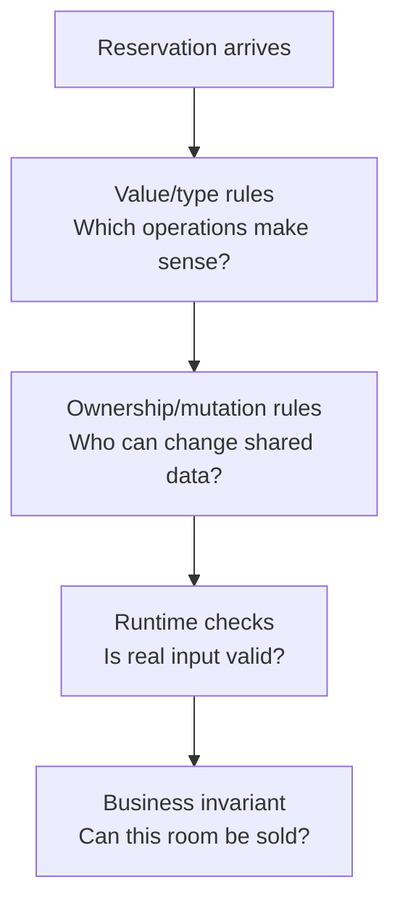
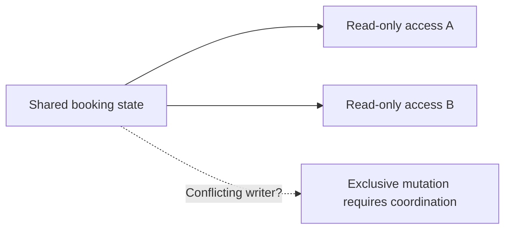

# CS220 — Programming Languages, Memory, and Execution

## Lecture 04: Type Systems, Ownership, and Language Design

*Why TypeScript, Java, Go, Python, and Rust can all be typed languages yet make radically different promises about what a program is allowed to do.*

**Estimated study time:** 75–100 minutes, including the optional practical lab.

---

### How to listen to this lecture

This lecture has two progressive parts.

**Part I — Intuition** uses a simple booking-system analogy to establish what types, ownership, and runtime validation are trying to accomplish. It is deliberately accessible and requires no knowledge of Rust, Java, or Go.

**Part II — Deep Dive** compares how real languages express and enforce those guarantees. We'll distinguish static correctness from runtime truth, explore structural and nominal typing, develop ownership and borrowing from first principles, and examine why stronger type systems still cannot enforce every business invariant.

The optional practical lab contains cross-language examples to examine on screen. The Dense Cheatsheet at the end is fenced for voice-reader skipping.

---

# Part I — Intuition

*Five programming languages receive the same booking system. They agree on the business rules, but they disagree about which mistakes should be impossible to write and which must be discovered while the program runs.*

### The picture to carry in your head

Imagine five engineering teams building the same hotel-booking service. Every team must accept a reservation, identify a hotel and a customer, and update a booking record. The important business rules are identical.

But each team gets a different set of tools for describing what programs are allowed to do. TypeScript, Python, Java, Go, and Rust all support meaningful program structure. Their type systems and resource-management designs make different promises.

Think of five factories assembling the same product. One uses paper labels to distinguish different components. Another uses connectors designed so certain components cannot fit in the wrong place. A third tracks who is allowed to hold or change a part at each moment.

None of those systems proves the finished product will delight customers. They prevent different classes of assembly mistakes.

The first diagram distinguishes three kinds of questions a language design may help answer: does a value fit, can references be shared safely, and does the runtime input actually satisfy the claimed business rule?



## 1. Why a hotel ID and a customer ID aren't always interchangeable

Our first bug looks ridiculous. A developer calls a booking function using a customer ID where a hotel ID belongs. Both values are strings, so the function receives something that looks perfectly normal.

The compiler cannot necessarily tell that `"H-123"` and `"C-123"` represent different kinds of things. If both parameters are declared as ordinary strings, swapping them may satisfy the declared rules while breaking the business logic.

Now imagine creating distinct conceptual types for customer IDs and hotel IDs. In some languages and designs, the compiler can reject accidental mixing even if both ultimately use strings internally.

That is one reason programming languages have type systems. Types can express more than memory representation. They can express the relationships and distinctions a program should respect.

But languages disagree about what makes two types compatible.

In TypeScript, objects are generally checked structurally: an object can satisfy an interface by having the required shape, even without explicitly declaring that it implements that interface. Java commonly uses explicitly declared class and interface relationships, though Java also has other forms of type compatibility. Go uses structural interface satisfaction under its rules. Python often allows dynamic use of values, with optional type annotations checked by external tools rather than enforced as ordinary runtime barriers.

You don't need the entire set of rules yet. The first idea is that **same shape** and **same declared identity** are two different ways to decide whether something fits.

## 2. The compiler doesn't know whether a room really exists

Suppose we declare a value to be a `HotelId`. Great. That may prevent accidentally using a `CustomerId` in its place. But it doesn't establish that the referenced hotel exists in PostgreSQL right now.

Similarly, a type representing a confirmed reservation can make certain local program states easier to reason about. It doesn't independently guarantee that the payment provider completed the charge or that another service hasn't consumed the last room.

Types can exclude some invalid arrangements of code. They cannot automatically observe every fact in the outside world.

The boundary matters. A program may compile perfectly and still receive malformed JSON, a stale database result, or a payment response that means something different from what we assumed.

**Checkpoint:** If a booking function accepts a correctly typed `HotelId`, must that hotel exist in the database? No. Type-level identity and runtime existence are different claims.

## 3. Who is allowed to change the reservation object?

Now imagine two parts of the application sharing the same mutable booking object. One component updates the customer's selected dates. Another component calculates the price using the same object. If changes occur at an unexpected moment, the price calculation may use inconsistent information.

The difficult part isn't that the object has a particular type. The difficult part is that more than one part of the program can reference and mutate the same information.

Think of a shared paper reservation form. Two clerks both have access. One crosses out the travel dates while the other is reading the price. Even if each clerk follows a valid set of instructions, their combined behavior may be wrong.

Some languages and libraries address this with conventions: avoid mutation, copy values, coordinate access, and document ownership. Other language designs enforce stronger rules at compile time.

Rust is an interesting example. Its ownership and borrowing system constrains how references to data can be used. In ordinary safe Rust, you generally cannot hold an active mutable reference while simultaneously using conflicting references to the same data. The compiler checks these relationships as part of deciding whether the program is valid.

That doesn't mean Rust makes booking logic correct. It doesn't prevent you from charging the wrong price because the formula was wrong. It does make certain memory-safety and aliasing mistakes much harder or impossible within the guarantees of safe Rust.

The second diagram returns to the shared form. Multiple readers can inspect a stable state, but a writer needs appropriate exclusive access under this simplified borrowing picture.



## 4. Why stricter isn't always automatically better

Imagine using a language with stronger compile-time restrictions for a quick data-import script. You may gain useful guarantees but also spend more time expressing ownership relationships, lifetimes, and valid state transitions.

Now imagine a financial service managing long-lived state across many workers. The same restrictions might prevent a costly category of concurrency or memory-safety errors.

The trade-off depends on the workload, team, surrounding ecosystem, and what kinds of errors matter most.

A dynamic language can be an excellent tool when rapid iteration and flexible data manipulation are valuable, particularly with good validation and testing. A statically typed language can catch many inconsistencies earlier. Runtime checks are still essential at untrusted boundaries, even in languages with strict static types.

The useful question isn't "Which language is strongest?" It is **which guarantees this language makes, what cost it imposes, and which important risks remain outside those guarantees**.

## 5. The mental replay

Five teams build the same reservation service. One type system compares object shapes. Another emphasizes declared identities. A third constrains ownership and mutable borrowing. Some checks happen before execution, others during execution. Every implementation must still validate outside data and enforce business invariants at the correct boundary.

The Deep Dive will compare type inference, generics, structural and nominal typing, mutability, aliasing, borrowing, and compile-time guarantees. All of them belong to one family of questions: **what invalid behavior can we exclude before the program runs?**

### Three questions before the Deep Dive

1. **Why might two string IDs deserve different types?** Their runtime representation can be identical while their domain meanings are different.
2. **What additional problem does ownership address?** Who may hold, share, and mutate references to data without unsafe interference.
3. **Can the strictest compiler prove a remote payment succeeded?** No. That is an external business fact requiring runtime protocols and checks.

*The intuition pass ends here.*

---

# Part II — Deep Dive

# 1. Five Languages, Three Bugs, One Booking System

Our five engineering teams have finished implementing the same hotel-booking service.

The TypeScript team works with Node.js.

The Python team uses a conventional web framework and type annotations.

The Java team has built a service around records, interfaces, and domain classes.

The Go team uses defined types, structs, and interfaces.

And the Rust team has adopted ownership, borrowing, and explicit result types.

All five implementations compile, type-check where the relevant checking tools are used, and pass their test suites.

Then production experiences three incidents.

In the first, a customer identifier is accidentally supplied where a hotel identifier belongs.

In the second, a reservation's dates change unexpectedly between price calculation and confirmation.

In the third, a confirmed reservation is created even though the external payment provider never completed the payment.

These bugs look related because they all concern invalid booking states.

But they have different causes.

The first is a failure to distinguish semantically different values.

The second concerns shared mutable data and unexpected changes.

The third concerns facts that live outside the program's static type system.

This is the architecture of today's lecture.

**Type compatibility, ownership, and runtime truth are separate dimensions of correctness.**

Different languages place different restrictions on each dimension.

A language might catch the first mistake during compilation.

A different language might make the second mistake impossible through ordinary safe references.

But the third requires a sound business workflow regardless of programming language.

We need to understand why.

---

# 2. What Is a Type System Actually Proving?

Let's begin with a statement you've probably heard countless times.

"TypeScript is statically typed. Python is dynamically typed."

Correct, but incomplete.

A type system is a collection of rules governing which values and operations are considered compatible in a program.

Depending on the language, these rules may be checked before execution, during execution, or through a combination of both.

A static type checker analyzes program expressions without needing to execute every possible runtime path.

A dynamic language checks the actual values involved when relevant operations occur.

But dynamic typing does not mean having no types.

And static typing does not mean eliminating runtime errors.

## 2.1 Python has types

Imagine a Python program that adds two integers.

The operation succeeds.

Now imagine it attempts to add an integer directly to an incompatible object.

Python may raise a runtime exception because the particular operation isn't supported by the values involved.

Those values have types.

Python simply allows many programs to proceed without first statically proving that every relevant operation is type-compatible.

Optional annotations and tools such as mypy or Pyright can add static checks.

But ordinary Python execution does not automatically enforce arbitrary annotations as runtime contracts.

So the meaningful question isn't whether Python has types.

It does.

The question is **when and how the rules are enforced**.

## 2.2 TypeScript makes promises about source code

In TypeScript, we write declarations describing expected values.

The compiler can identify many invalid assignments, missing members, and incompatible operations.

That is extremely valuable.

But TypeScript's ordinary type declarations are removed when code becomes JavaScript.

The runtime doesn't automatically perform all those static checks.

If a network request returns malformed JSON, the runtime object doesn't magically acquire the properties declared by a TypeScript interface.

And TypeScript's type system intentionally accepts certain patterns that are not fully sound, primarily to accommodate JavaScript's flexibility.

We'll return to soundness shortly.

## 2.3 Java, Go, and Rust choose different boundaries

Java and Go perform substantial static type checking and preserve meaningful runtime type information for many operations, though their compilation and execution models differ.

Rust statically checks types and also uses ownership, borrowing, and other rules to prevent categories of memory-unsafe operations in safe code.

But all these languages still execute operations that can fail dynamically.

Files can disappear.

Databases can reject writes.

Network connections can time out.

External records can become stale.

Even a perfect static check of the program's local types cannot establish that a hotel exists in a remote database at the moment you attempt a reservation.

The compiler's proof is always about a defined set of properties.

**The mistake is assuming that passing one set of checks proves a larger property that the checker never examined.**

---

# 3. Types as Sets of Allowed Values—and Sets of Allowed Operations

A useful first approximation is to imagine a type as describing a collection of values and the operations permitted on them.

An integer type represents values with integer-like behavior.

A string type represents text-like values.

A reservation record describes a structured collection of fields.

But different languages interpret compatibility between these types differently.

Suppose we have two objects.

One represents a hotel.

The other represents a supplier.

Both expose a property called `id` containing a string.

If a function only requires an object with an `id: string` property, both may fit that structural requirement.

That can be useful.

But perhaps the function is supposed to receive a hotel rather than a supplier.

Now structural compatibility alone may be insufficient to express the intended domain distinction.

## 3.1 Type compatibility is not domain compatibility

Let's distinguish two questions.

"Does this value support the operations the function requires?"

And:

"Does this value represent the correct business concept?"

These are related but not identical.

Suppose a booking function accepts two strings, one for the customer ID and one for the hotel ID.

The type checker sees two strings.

It has no inherent reason to reject swapping their positions.

But our business model does.

The language might let us define more precise types to express that distinction.

The exact mechanism varies.

Some languages use nominal types.

Others allow us to construct type-level markers.

Some provide defined types based on primitive representations.

Some rely on optional static annotations.

What matters is that the type system can only distinguish concepts that we've actually represented in its rules.

---

# 4. Structural Versus Nominal Typing: Shape or Identity?

Here's the first major language-design comparison.

**Structural typing** determines compatibility from the shape or required capabilities of a value.

**Nominal typing** determines certain compatibility relationships from explicitly established type identity or declarations.

Neither philosophy is universally superior.

They solve different problems conveniently.

## 4.1 TypeScript: compatibility by shape

Imagine an interface describing an object with a `name` property.

A separately defined class also has a compatible `name` property.

TypeScript can generally allow an instance of that class to be used where the interface is expected, even if the class never explicitly declares that it implements the interface.

That's structural typing.

The value fits because it has the required members.

This is especially convenient in JavaScript ecosystems, where objects are frequently constructed anonymously, composed dynamically, or received from libraries.

But there is a trade-off.

Two unrelated domain concepts can accidentally have identical structures.

Imagine `HotelId` and `CustomerId` are both aliases for `string`.

Those aliases don't automatically become distinct nominal types.

The compiler will generally allow their values to be interchanged.

To distinguish them, we need to introduce additional type information.

A common TypeScript technique is **branded types**, using a marker that differentiates otherwise identical primitive representations.

The marker can prevent many accidental misuses in statically checked code.

But that marker isn't necessarily a runtime property.

And an explicit assertion can bypass the compiler's intended protection.

## 4.2 Java: declared identities

Now imagine the same booking service written in Java.

We can declare a record named `HotelId` that wraps a string.

Then declare another record named `CustomerId` that also wraps a string.

These are distinct types.

Passing a `CustomerId` to a function expecting `HotelId` is rejected by ordinary static type checking.

Their internal representations may be similar.

Their declared identities are not.

That's useful for business domains with many semantically distinct identifiers.

But declaring a record doesn't automatically validate its contents.

An identifier can still contain an invalid value unless its construction rules check that property.

We might enforce nonblank values through a constructor.

We still cannot prove the corresponding database record exists just because the identifier object is well formed.

## 4.3 Go: a surprisingly interesting hybrid

Go doesn't fit neatly into the simplistic slogan that an entire language must be either structural or nominal.

Go supports **defined types** with distinct identities.

For example, `HotelID` and `CustomerID` can be separate defined types whose underlying representation is a string.

That lets the compiler reject accidental mixing in many contexts, with explicit conversion possible where permitted.

But Go's interfaces work differently.

A type implements an interface by satisfying its required method set under the language's rules.

It doesn't need an explicit `implements` declaration.

So Go combines nominal distinctions for defined types with structural interface satisfaction.

That's a useful reminder.

Real programming languages often make different compatibility choices in different parts of the type system.

## 4.4 Python: several possibilities

In Python, we might define distinct runtime classes for hotel IDs and customer IDs.

Those objects would carry explicit runtime class identity.

Alternatively, we can use `typing.NewType` to express a distinction for a static type checker.

But `NewType` ordinarily returns its underlying input unchanged at runtime.

The distinction is primarily static.

Python also supports structural interface-style checking through `Protocol` and compatible static-analysis tools.

So Python gives us several modeling approaches, with different enforcement characteristics.

## 4.5 Rust: distinct types with explicit construction

Rust also supports distinct wrapper types.

A `HotelId` newtype around a string is different from a `CustomerId` newtype.

Safe ordinary code cannot accidentally supply one where the other is expected without a relevant conversion or explicit operation.

Rust's type system makes that distinction enforceable during compilation.

But once again, a correctly typed `HotelId` doesn't mean the referenced hotel still exists.

And a function that accepts a `HotelId` still needs to handle database errors.

The important conclusion is:

**Nominal identity protects meaning only to the extent that the type's construction and usage rules actually encode that meaning.**

---

# 5. The Cost of Making Two Things Different

Let's consider whether every string should become its own special type.

Why not define a new type for customer names, hotel names, addresses, currencies, descriptions, authentication tokens, and every other field?

Because abstractions also impose costs.

The more distinctions we introduce, the more conversions, constructors, validation paths, and interfaces we may need.

Some distinctions are valuable.

Mixing a payment amount with a percentage could cause a serious bug.

Mixing a hotel ID with a customer ID can lead to incorrect data access.

Mixing an ordinary string with a verified authentication token can undermine security assumptions.

Other distinctions may provide little additional value relative to their complexity.

The choice depends on how dangerous accidental interchangeability would be.

## 5.1 A useful criterion

Ask:

"If someone passes the wrong kind of value here, will the language notice?"

If the answer is no, and the consequences are serious, a domain-specific type may be worthwhile.

But the type must have a trustworthy construction path.

Imagine declaring `ValidatedPrice` and allowing every caller to construct it freely from an arbitrary number.

The name sounds reassuring.

It doesn't establish any real guarantee.

We should create validated domain values through constructors or functions that check relevant requirements.

That transforms a naming convention into a meaningful local invariant.

For money, this might include currency, allowed range, and a representation appropriate for exact financial calculations.

For dates, it might include check-in preceding check-out.

For identifiers, it might include syntactic validity.

None of those checks can automatically guarantee external facts such as available inventory.

---

# 6. Type Inference: Less Writing, Not Less Checking

Now consider a different language feature.

**Type inference** allows a compiler or type checker to determine type information from surrounding code.

This doesn't necessarily weaken type safety.

A Rust program may infer the type of a local variable and still subject it to strict static checks.

Go may infer local variable types from initializers.

TypeScript infers types throughout the program.

Java supports forms of local type inference.

And Python static checkers can infer information from annotated and unannotated expressions.

So the presence of type annotations and the strength of static checking aren't the same thing.

## 6.1 An annotation is not a proof of truth

Imagine writing a TypeScript function that declares it returns a `HotelId`.

The type checker may verify that the function's statically known return expression satisfies the declared type.

But if the function uses an unchecked type assertion, the programmer can override part of that analysis.

Similarly, Python annotations don't generally force runtime input validation.

A declared type is useful when the system actually preserves the relevant contract.

It is not a magical source of truth.

## 6.2 Why inference is sometimes undesirable

An inferred type can be perfectly accurate while making an important public contract less obvious to human readers.

For example, in a large backend, a function's explicit return type may help document the abstraction boundary and catch accidental changes during refactoring.

Inside a small local calculation, inference may be clearer and more maintainable.

This is not an argument for annotating everything.

It's about distinguishing local implementation details from meaningful architectural contracts.

**Type inference changes how types are expressed. It does not tell us whether the system has proved the business rule we care about.**

---

# 7. Generics: Preserving Relationships Between Values

In CS220-L01, we introduced TypeScript generics.

Now let's examine the deeper concept.

Imagine a function that receives a collection of values and returns its first element.

If we describe its input as a collection of arbitrary objects and its output as an arbitrary object, we've lost useful information.

The caller might pass hotel records but receive an output typed merely as an unknown object.

We know the output is supposed to have the same element type as the input.

A **generic type parameter** lets us express that relationship.

Informally:

"If this function receives a collection of T, its result is a T or an explicit absence value."

The symbol T isn't one particular type.

It stands for a type chosen or inferred for the specific use.

## 7.1 Generic relationships versus loose compatibility

Imagine a function that pairs two values of the same type.

A non-generic design accepting arbitrary values might permit unrelated inputs.

A generic signature can express a relationship that both inputs are supposed to satisfy.

But here is a subtle point.

Different type systems infer, constrain, and compare generic type parameters in different ways.

A TypeScript generic may infer a union or broader compatible type in certain contexts.

Go supports generic functions with type constraints.

Java supports parameterized classes and methods with its own type-checking and compatibility rules.

Rust expresses many generic requirements through traits.

Python's typing system also supports generic annotations checked by compatible tooling.

They all provide forms of abstraction over types, but their expressiveness and enforcement differ.

## 7.2 Generics don't validate business rules

Suppose a generic repository returns a value typed as `Reservation`.

That relationship is useful.

But perhaps the database returned a row containing an invalid monetary amount.

The generic type relationship doesn't independently prove the row was semantically valid.

Or imagine a collection whose values have a correct static type but represent stale business state.

The type checker knows their declared structure.

It cannot know whether they still describe current reality.

Generics preserve selected relationships in the type model.

They do not replace runtime validation, transaction isolation, or business constraints.

## 7.3 Parametric polymorphism

The broader concept is called **parametric polymorphism**.

We write an operation in terms of parameters representing types, rather than writing separate implementations for each concrete type.

A generic data structure may work for customer records, hotel records, and reservation records.

But it can perform only operations supported by its declared type relationships or constraints.

This lets us separate universally reusable structure from type-specific behavior.

The deeper value is architectural.

Generics allow reusable code while preserving information that untyped or loosely typed abstractions might discard.

But abstraction comes with limits.

---

# 8. Product Types and Sum Types: Designing Valid States

Now let's turn from compatibility to state modeling.

Our booking workflow contains several possible statuses.

Pending.

Awaiting payment.

Confirmed.

Cancelled.

Expired.

A naïve representation might store a status string plus several optional fields.

For example, it might contain a `confirmed` flag, a `paymentId`, an `expiresAt` timestamp, and a `cancelled` flag.

That seems convenient.

But how many combinations are possible?

What happens if both `confirmed` and `cancelled` are true?

What if `confirmed` is true but the payment reference is absent?

What if a pending booking carries a cancellation timestamp that shouldn't exist yet?

We've created an enormous space of possible object states.

Many are meaningless.

## 8.1 Product types combine requirements

A record containing a hotel identifier, customer identifier, and stay interval combines several pieces of data.

Conceptually, this is a **product type**.

A value must supply all required components.

It's a useful representation for information that belongs together.

But optional fields and independent flags can accidentally multiply the number of representable combinations.

## 8.2 Sum types express alternatives

Instead, imagine modeling a booking as exactly one of several distinct variants.

Pending booking, with the data relevant to a pending state.

Confirmed booking, with required confirmation data.

Cancelled booking, with cancellation information.

This is the intuition behind a **sum type**.

A value belongs to one alternative or another.

Languages express this idea differently.

TypeScript uses discriminated unions.

Rust uses enums with data-carrying variants.

Java can use sealed hierarchies and records to model a restricted family of alternatives.

Python can model tagged variants through classes and static unions, though ordinary runtime enforcement depends on implementation.

Go can model states through interfaces and concrete types, but exhaustiveness and closed-set guarantees differ from Rust's ordinary enum matching.

The essential idea is independent of syntax.

Instead of representing every possible combination of flags, we represent the alternatives the business actually permits.

## 8.3 Exhaustiveness checking

Suppose we add a new booking status: `refunded`.

In a language supporting useful exhaustiveness checks over a closed set of variants, the compiler or type checker may identify places where the new case hasn't been handled.

That's powerful.

It makes state-model evolution visible.

But it doesn't automatically prove the transition rules are correct.

A program might handle every case and still allow the wrong transition.

For example, cancelling an already refunded reservation might be prohibited by business policy.

We still need to encode or enforce that rule.

> **Sticky note #1:** A good type model reduces the number of invalid states the program can represent. It does not automatically reduce the number of invalid business decisions to zero.

---

# 9. The Boundary Where Static Types Stop Helping

Let's revisit the third production incident.

Our booking system creates a confirmed reservation even though payment hasn't completed.

The reservation object is well typed.

Its status is `confirmed`.

Its payment reference is a string.

Its hotel identifier has the correct domain type.

And its stay dates are valid.

How can the system still be wrong?

Because the type checker doesn't know what actually happened at the payment provider.

## 9.1 Declared types versus observed facts

Imagine an external API responds with JSON.

Our program expects an object containing a payment status.

TypeScript interfaces do not transform arbitrary JSON into trusted domain data.

Python annotations don't automatically enforce the structure either.

Java's deserialization library must validate or map actual input correctly.

Go's decoder can populate expected structures, but field validity and domain rules still need checking.

Rust's deserialization mechanisms can enforce substantial structural constraints, but the program still needs business validation and error handling.

Different languages and libraries offer different mechanisms.

The common requirement is the same.

**Untrusted data must become trusted domain data through an explicit, appropriate validation boundary.**

## 9.2 Structural validation isn't semantic validation

Suppose the JSON says:

"Payment status: succeeded."

Perhaps the status field contains one of the allowed values.

That's structural validity.

But what if the message was forged?

What if it corresponds to a different payment operation?

What if the provider later reverses the operation?

What if our application confused an authorization with a final capture?

Those are semantic and protocol questions.

A type checker cannot establish them merely from the field's shape.

The system needs authentication of relevant messages, correct transaction identity, state-transition rules, and authoritative reconciliation.

This is why using Rust instead of TypeScript doesn't automatically fix a distributed payment workflow.

The program may become safer with respect to certain local memory and aliasing errors.

The external business protocol remains a separate correctness obligation.

---

# 10. Mutable Aliasing: The Bug Hidden Behind Two Innocent References

Now let's investigate the second incident.

Our booking service holds one reservation object.

The pricing component reads its dates.

The customer-interface component can update those dates.

Both components retain references to the same mutable object.

A price is calculated.

Then the dates change.

Then the system confirms the reservation using a combination of old and new assumptions.

The code might be perfectly type compatible.

Every field is a valid date or monetary amount.

But the operation is semantically inconsistent.

This is a problem of **aliasing and mutation**.

## 10.1 What is an alias?

An alias is another way to refer to the same underlying object or storage.

Suppose one variable refers to a reservation object.

We assign that reference to another variable.

Now both may refer to the same mutable object.

Updating a field through one reference can change what the other observes.

In JavaScript, assigning an object reference doesn't automatically clone the object.

In Java, object references can similarly refer to the same mutable object.

In Python, ordinary assignment binds another name to the same object.

In Go, values and reference-like structures have different copying and sharing behavior; copying a slice, for example, can leave both slice headers referring to the same underlying array.

These languages make different choices about object representation.

But the underlying danger is familiar.

Two parts of the program can observe and modify shared state in ways that violate the assumptions of one operation.

## 10.2 `const` is not deep immutability

A common JavaScript misconception is that declaring an object with `const` makes its contents immutable.

It doesn't.

The variable binding cannot be reassigned, but the referenced object may still be modified.

Likewise, TypeScript's `readonly` declarations primarily constrain statically checked write operations.

They don't automatically freeze the runtime object.

And a shallow readonly view doesn't necessarily prevent mutation through another alias or through nested mutable structures.

The system may need immutable data representations, cloning at appropriate boundaries, encapsulation, or explicit coordination.

This isn't a reason to reject TypeScript.

It's a reason to understand what its guarantees actually cover.

## 10.3 When does aliasing become a race?

We should distinguish an aliasing bug from a **data race**.

Shared references can cause unexpected mutation even in a single-threaded program.

For example, one callback modifies an object before another callback reads it.

That may be a logical sequencing problem.

A data race is a more specific concurrency problem involving conflicting unsynchronized accesses to shared memory under the relevant memory model.

Rust's ownership and type rules are particularly interesting because they address this lower-level problem through static guarantees in safe code.

Let's examine how.

---

# 11. Rust Ownership: Giving Data an Accountable Owner

In languages with garbage collection, developers often don't need to explicitly determine when an object's storage is released.

The runtime handles memory reclamation according to its reachability or related rules.

Rust takes a different approach.

Its ownership system tracks which part of the program owns certain values and how those values may be accessed.

For ordinary owned values, there's an ownership relationship that controls moves and destruction.

When ownership moves, the original binding may no longer be used as though it still owns that value.

This allows the language to manage many resources deterministically without requiring a general tracing garbage collector.

But that's not the whole story.

The most educational part is how Rust constrains references.

## 11.1 Borrowing without transferring ownership

Suppose we have a reservation value.

A function needs to examine it but not take ownership.

Rust can allow the function to borrow the value through an immutable reference.

The function gains temporary access without becoming its owner.

Another function may also borrow the value immutably, subject to the relevant lifetime rules.

Several readers can inspect the same state.

Now imagine a function needs to change the reservation.

Rust can allow a mutable borrow.

But an active mutable borrow generally excludes conflicting access through other references to the same value.

That is the familiar rule from Part I.

**Many readers, or one exclusive writer, within the ordinary safe-borrowing model.**

It's not the only ownership mechanism Rust provides.

But it's the essential intuition.

## 11.2 Why exclusivity matters

Return to our shared booking form.

One component reads the dates.

Another attempts to change them.

If the reader's reference is still active and a conflicting mutable borrow is requested, ordinary safe Rust rejects that usage.

The compiler doesn't wait for a rare production interleaving to demonstrate the problem.

It examines how references may be used.

This can exclude classes of invalid shared-memory access before execution.

The power comes from encoding a meaningful restriction into the language's type and borrowing rules.

The cost is that developers must express sharing and mutation in ways the checker can verify.

Sometimes that requires redesigning data flow rather than merely silencing a compiler error.

## 11.3 Lifetimes: How long is a reference valid?

A reference must not outlive the data it refers to.

Imagine returning a reference to a local temporary value that will be destroyed when a function returns.

That would create a dangling reference in an unrestricted pointer model.

Rust's lifetime reasoning prevents ordinary safe code from creating such invalid references.

You may encounter explicit lifetime annotations.

Their purpose is not to keep objects alive magically.

They express or constrain relationships about how long references must remain valid.

The compiler uses those relationships to reject references that could outlive their referents.

Many lifetime relationships can be inferred.

Explicit annotations become necessary in some situations where the relationship needs to be stated.

## 11.4 Ownership is not the same as copying

A common beginner misconception is that moving ownership necessarily means copying an entire data structure.

That isn't generally true.

For certain owned values, a move transfers responsibility without duplicating the underlying heap allocation.

The exact machine-level behavior depends on the value and compiler transformations.

The semantic distinction is the important one.

After a move, the previous binding may no longer be used to access the moved value.

The language prevents multiple ordinary owners from independently acting as though each has unrestricted responsibility for the same resource.

---

# 12. Does Rust Make Concurrency Correct?

Here's the tempting conclusion.

If Rust prevents conflicting ordinary references, perhaps Rust programs cannot have race conditions.

That would be wonderful.

It is also false.

Rust's safe concurrency guarantees help prevent **data races**.

They don't eliminate every possible **logical race condition**.

## 12.1 A business race can occur without a memory race

Imagine two independent application instances.

Each receives a request for the last room.

Each reads availability from PostgreSQL.

Each concludes that one room remains.

Each attempts to create a reservation.

No unsafe local memory access is required.

The programs may be written entirely in safe Rust.

The race occurs between separate database operations and separate processes.

Rust's borrow checker doesn't enforce a global inventory invariant across distributed application instances.

We still need an authoritative atomic conditional update, transaction, or appropriate reservation protocol.

This is one of the most important distinctions of the lecture.

**Memory safety is not distributed business correctness.**

## 12.2 Safe sharing still exists

Rust doesn't prohibit all shared mutable state.

It provides controlled mechanisms.

A program can use synchronized shared ownership, such as an atomic reference-counted pointer combined with a mutex.

The mutex controls access to the protected value.

A type such as `RefCell` can allow interior mutability with dynamic borrowing checks in single-threaded contexts.

These mechanisms trade different kinds of flexibility, runtime checking, and synchronization cost.

The existence of interior mutability doesn't make Rust's ordinary reference rules meaningless.

It means the language provides explicit abstractions for situations where simpler borrowing restrictions aren't sufficient.

Some checked properties move from compile time to runtime enforcement.

## 12.3 Safe code can still deadlock

Suppose two threads each acquire one mutex and then wait for another.

They may deadlock.

The language can prevent certain memory-unsafe accesses while still allowing a logically incorrect synchronization protocol.

Similarly, a program may starve tasks, hold locks too long, or perform operations in the wrong business order.

A strong type system narrows the space of possible mistakes.

It doesn't make that space empty.

> **Sticky note #2:** Rust's ownership model is a major advance in controlling memory and aliasing. It does not prove that an application has correct transactions, correct prices, or correct distributed workflows.

---

# 13. The Deep Question: Which Guarantees Should Be Static?

We've now seen several kinds of correctness properties.

Some are naturally local and structural.

A hotel identifier shouldn't be confused with a customer identifier.

A function should receive a value with certain required operations.

A state machine should contain only permitted variants.

A reference shouldn't outlive the value it borrows.

These can often be expressed through types and checked before execution.

Other properties depend on runtime information.

A date must be within an allowed booking range.

A monetary amount must satisfy current pricing rules.

An external message must be valid and authenticated.

A hotel must still exist in the database.

These require runtime checks or suitable external guarantees.

Still other properties depend on concurrency and distributed state.

Inventory must not be oversold.

An idempotent payment operation must not be duplicated.

A committed reservation must remain consistent with authoritative inventory.

Those generally require atomic state transitions, constraints, and reliable workflows at the correct boundary.

## 13.1 The three-checkpoint model

Here's a useful way to organize the entire subject.

**Checkpoint one: compile-time rules.**

What incorrect values, calls, or reference usages can the programming language reject before execution?

**Checkpoint two: runtime validation.**

What facts about actual input and local state must be checked while the program runs?

**Checkpoint three: authoritative business enforcement.**

What rules must remain true across database transactions, services, and concurrent operations?

These checkpoints overlap.

A strong design uses them together.

For example, a reservation request might use a distinct `HotelId` type.

A runtime validator checks the actual incoming identifier format and stay dates.

A database transaction enforces the inventory allocation invariant.

An external payment workflow reconciles uncertain outcomes.

No single layer replaces the others.

## 13.2 Stronger types can simplify runtime code

Even when runtime checks remain necessary, better types can improve design.

Suppose the HTTP controller receives raw untrusted JSON.

It validates the payload and converts the result into a domain-specific command type.

Downstream functions can accept that validated command rather than repeatedly inspecting arbitrary values.

This concentrates validation at a known boundary.

But be precise about the trust promise.

If downstream code can fabricate the supposedly validated type through unrestricted constructors or unsafe assertions, the guarantee weakens.

Encapsulation and controlled construction are therefore important companions to rich type models.

---

# 14. Choosing a Language Is Choosing a Set of Trade-Offs

Now imagine management asks whether the booking service should be rewritten in Rust.

The argument is that Rust has stronger guarantees.

That's true for certain categories of correctness.

But it isn't enough to justify a migration.

We need to identify the actual problem.

## 14.1 When TypeScript may be appropriate

TypeScript fits naturally into a JavaScript-heavy web organization.

It supports expressive modeling, strong tooling, incremental adoption, and efficient sharing of domain types between related parts of a system.

Its structural typing is particularly convenient for flexible interfaces.

But we should recognize its intentionally unsound edges, erased static types, and dependence on explicit runtime validation for untrusted input.

A team comfortable with TypeScript can build highly reliable services by combining rich domain modeling with runtime checks, database constraints, and disciplined architecture.

## 14.2 When Python may be appropriate

Python can be excellent for data processing, automation, research, and many backend applications.

Its dynamic object model and extensive ecosystem support rapid exploration.

Optional static type checking can add meaningful development-time guarantees.

But the presence of annotations doesn't mean all values have been validated at runtime.

A Python team should decide how extensively to adopt static checking, which boundaries need runtime validation, and where explicit domain classes or protocols improve correctness.

## 14.3 When Java may be appropriate

Java offers mature static typing, strong nominal modeling through class and record identities, extensive tooling, and well-established enterprise ecosystems.

Records, interfaces, sealed hierarchies, and generics can express substantial domain structure.

But Java object references can still alias mutable state.

Nullability and runtime validation require care.

And static type compatibility doesn't guarantee distributed business correctness.

Java's suitability depends on its ecosystem, operational requirements, team expertise, and integration needs.

## 14.4 When Go may be appropriate

Go favors a comparatively small language design and straightforward systems programming.

Defined types can distinguish domain concepts.

Implicit interface satisfaction enables flexible composition.

Explicit error handling makes many failure paths visible.

But Go's ordinary type system doesn't provide Rust-style ownership restrictions.

Shared memory and concurrent access still require appropriate synchronization.

Its design is often attractive for infrastructure services and networked applications, but that preference should be tied to actual engineering requirements.

## 14.5 When Rust may be appropriate

Rust offers strong compile-time guarantees around ownership, borrowing, and memory safety within safe code.

That can be especially valuable for low-level systems, performance-sensitive components, and software where memory safety is a major risk.

The trade-off includes additional constraints on program structure and a potentially steeper learning curve for unfamiliar teams.

Rust doesn't automatically make distributed workflows correct.

And the cost of a rewrite may exceed the benefit if the real problem lies in application-domain logic or database transactions.

## 14.6 The architecture decision

We should select a language for the failure modes and constraints of the workload, not because one language has an impressive reputation.

Ask which errors matter most.

Can the chosen type system represent the important distinctions?

What must still be checked at runtime?

How does the language support safe mutation and concurrency?

Does the team have the necessary expertise?

Which libraries and operational tools are available?

And what measurable problem would adopting another language solve?

That is a better language-selection framework than arguing about which syntax looks more elegant.

---

# 15. A Practical Pattern: Make Boundaries Explicit

Let's now design a small but coherent booking service, independently of any particular language.

An incoming request arrives from outside the trusted application boundary.

It contains a hotel identifier, stay dates, customer information, and perhaps a payment-operation identifier.

The request is initially untrusted.

Our first step is validation.

We verify its expected structure and relevant local business constraints.

We convert the validated values into explicit domain types.

The booking service receives those types.

It performs the authoritative inventory operation.

And the resulting state transition is recorded durably.

If the workflow requires an external payment provider, that step uses a properly designed protocol and state machine.

The different kinds of correctness are now assigned to appropriate mechanisms.

## 15.1 Why this design scales across languages

In TypeScript, we might represent domain values through branded identifiers and discriminated unions.

In Python, we might use runtime-validated domain classes plus optional static checking.

In Java, we might use records and sealed hierarchies.

In Go, we might use defined identifier types, structs, interfaces, and explicit validation.

In Rust, we might use newtypes, enums, results, ownership, and borrowing.

The syntax changes.

The architectural responsibilities remain recognizable.

This is the most important reason to study programming languages comparatively.

It reveals which problems belong to the domain and which are merely consequences of a particular language's design.

---

# 16. The Three Production Incidents, Revisited

Let's resolve the incidents from our opening scene.

## 16.1 The swapped identifiers

A customer ID was supplied where a hotel ID belonged.

The general solution is to represent semantically different identifiers distinctly where the risk justifies it.

TypeScript may use branding.

Java may use separate record types.

Go may use distinct defined types.

Python may use static `NewType` or actual wrapper classes, depending on the required runtime behavior.

Rust may use distinct newtypes.

This reduces accidental interchangeability.

But correctly typed identifiers still require runtime existence and authorization checks.

## 16.2 The changing reservation dates

Two components shared mutable state.

The price was calculated using assumptions that became stale after another mutation.

We need a design that protects the relevant operation from unexpected changes.

That might involve immutable snapshots, copying, controlled mutation, an ownership-aware API, or synchronization at the appropriate boundary.

Rust's safe borrowing rules can prevent certain conflicting local reference usages.

Other languages can enforce similar design intentions through APIs, conventions, or synchronization mechanisms.

But if the price becomes stale because another service changes authoritative inventory, we need a distributed or transactional solution.

## 16.3 The false payment confirmation

The application marked a reservation as confirmed without establishing the required external payment outcome.

No ordinary static type declaration can prove that an independent payment provider completed its operation.

The workflow needs authoritative status handling, stable operation identities, secure message validation, retries where safe, and reconciliation for uncertain outcomes.

A rich type model can make the workflow's states and permitted local transitions clearer.

It cannot replace the protocol.

The three incidents therefore require three different classes of protection.

**Domain-specific types. Controlled state mutation. Authoritative runtime and distributed-state enforcement.**

Those are the real lessons.

---

# 17. The Oral Examination

Answer these questions aloud before reading the discussion.

Your goal is not to recite a language feature. Explain which correctness property it enforces, what it doesn't enforce, and what trade-offs follow.

### Challenge 1 — Two identical strings

A TypeScript booking function accepts a hotel identifier and a customer identifier as ordinary strings.

A developer swaps the arguments, and the program still type-checks.

How could TypeScript make the mistake harder?

How would Java, Go, Python, and Rust approach the same distinction?

### Challenge 2 — Same shape, different meaning

Two object types have identical public fields.

Under TypeScript's ordinary structural compatibility rules, are they necessarily treated as distinct?

How does that differ from two separately declared Java record types?

Why might a structural approach still be desirable?

### Challenge 3 — A typed but nonexistent hotel

A function receives a properly constructed `HotelId`.

The referenced hotel was deleted from the database one second earlier.

Did the type system fail?

Which mechanism must establish whether the hotel currently exists?

### Challenge 4 — The shared object

Two parts of a program reference the same mutable reservation object.

One calculates a price while another changes the travel dates.

Explain why correct field types don't prevent the logical bug.

How can an ownership system help, and what alternatives exist?

### Challenge 5 — Rust and double booking

Two independent Rust services read the final available room from PostgreSQL.

Both attempt to confirm a booking.

Does Rust's borrow checker prevent the resulting business race?

What mechanism should enforce inventory correctness?

### Challenge 6 — Static versus runtime validation

A Python function declares that its argument is a `HotelId` created through `typing.NewType`.

A caller supplies a value at runtime without running a static type checker.

Will the annotation necessarily prevent an incorrect value?

What would you use to enforce runtime validation?

### Challenge 7 — Generics and domain correctness

A generic repository returns a value typed as `Reservation`.

The record has a valid shape but contains a payment status inconsistent with the authoritative payment provider.

What did the generic abstraction preserve?

What did it fail to establish?

### Challenge 8 — Choosing the language

A team proposes rewriting a TypeScript booking service in Rust to eliminate a double-booking incident caused by two processes making non-atomic database updates.

Would you approve the rewrite as the primary fix?

Explain which Rust guarantees are relevant and which are not.

---

# 18. Solutions and Discussion

### Solution 1 — Distinct identifier types

TypeScript can use branded or opaque-style types with controlled construction to distinguish domain IDs that share the same runtime representation.

Java can use separately declared records or classes.

Go can use distinct defined types.

Python can use `NewType` with static checking or actual wrapper classes for runtime identity.

Rust can use distinct newtype structs.

These approaches reduce accidental mixing under their respective type rules, but they don't prove that the identifier refers to an existing or authorized business entity.

### Solution 2 — Shape versus identity

Under ordinary structural compatibility, TypeScript compares the required members rather than treating every declared object type as nominally distinct.

Separate Java record types have distinct nominal identities, even when their components have similar types.

Structural typing is valuable for flexible interfaces, reusable abstractions, and integrating objects with compatible capabilities without requiring explicit declarations.

### Solution 3 — External existence

The type system hasn't necessarily failed.

It may have established that the value belongs to the locally defined identifier type.

Database existence is a runtime fact that can change independently of the program.

The application must query or operate against the authoritative database using a consistency and transaction strategy appropriate to the business requirement.

### Solution 4 — Aliasing and mutation

Both references can have correct static types while accessing the same mutable object.

One mutation can invalidate assumptions used by another operation.

Ownership restrictions can prevent certain conflicting reference usages.

Other solutions include immutable snapshots, controlled API boundaries, copying, synchronization, or transactional coordination, depending on where the shared state lives.

### Solution 5 — Distributed business race

Rust's borrow checker doesn't coordinate independent services through a shared PostgreSQL database.

The race concerns authoritative database state and interleaving operations.

The database transaction or atomic conditional update must enforce inventory allocation correctness.

Rust's memory-safety guarantees remain valuable but address a different class of errors.

### Solution 6 — Python annotations

`typing.NewType` provides a distinction for compatible static type checkers.

At runtime, it ordinarily returns the underlying value rather than enforcing a new runtime type identity.

If the application requires runtime validation, it should use explicit validation logic, controlled constructors, or an appropriate validation library.

### Solution 7 — Type relationship versus external truth

The generic repository preserved a relationship between the declared input or stored entity type and the returned value's static type.

It did not establish that the record was semantically consistent with an independent external payment system.

That requires runtime checks, authoritative state reconciliation, or appropriate transactional and distributed workflow mechanisms.

### Solution 8 — Choosing the right fix

I wouldn't approve a language rewrite as the primary solution.

Rust's ownership guarantees can prevent certain memory-unsafe and aliasing mistakes.

But two separately executing processes can still make conflicting database decisions.

The immediate fix is to enforce the inventory invariant at the authoritative transactional boundary.

A language migration could be evaluated separately if the service has other requirements that genuinely benefit from Rust's guarantees.

---

# 19. The Mental Model Worth Keeping

A type system defines which values and operations a program considers compatible.

Different languages make different choices about how those relationships are represented and enforced.

**Static typing** checks selected properties before execution.

**Dynamic typing** checks actual values and operations during execution.

**Structural typing** focuses on required shape and capabilities.

**Nominal typing** uses declared identity for relevant compatibility relationships.

**Type inference** reduces explicit annotations without necessarily reducing static checking.

**Generics** preserve relationships between types while allowing reusable implementations.

**Product and sum types** help represent data and valid alternatives.

**Ownership and borrowing** constrain how values and references may be shared, moved, and modified.

**Runtime validation** establishes properties of actual input and observed external state.

**Authoritative business enforcement** preserves invariants across concurrent operations, databases, and distributed workflows.

The most useful design questions are:

1. **Which invalid states can this type model exclude?**
2. **Who can access or mutate the underlying data?**
3. **Which guarantees are checked statically, and which require runtime enforcement?**
4. **Which facts live outside the program and must be established through a protocol or transaction?**

The deepest principle is:

**A language doesn't make software correct by itself. It defines which classes of mistakes are prevented, which remain possible, and which responsibilities belong to the application and its surrounding systems.**

Understanding those boundaries makes you a stronger engineer even when you never change your primary programming language.

---

# 20. Next Lecture — One Program, Many Runtimes

We've compared the rules languages use to describe and constrain programs.

But two languages can express the same algorithm and still execute it very differently.

Imagine implementing an expensive pricing calculation in TypeScript, Python, Java, Go, and Rust.

The inputs are identical.

The algorithm is conceptually identical.

Yet execution speed, memory behavior, concurrency, and operational characteristics may differ dramatically.

Why?

Because the type system isn't the whole programming language.

There is also the runtime.

In **CS220-L05 — One Program, Many Runtimes**, we'll investigate what happens after code is accepted by the language's rules.

We'll compare V8, CPython, the JVM, Go, and native compilation strategies.

The central question will shift from:

"What can the language prevent me from writing?"

To:

"What machinery actually executes the program I wrote?"

---

## Optional Practical Lab — Five Languages, One Domain

*The spoken lecture ends here. The remaining material is intended for screen-based code exploration, experiments, and interview revision.*

### Lab A — TypeScript: Make Two Strings Mean Different Things

This example demonstrates why ordinary type aliases don't create nominal distinctions.

```typescript
type HotelId = string;
type CustomerId = string;

function loadHotel(id: HotelId) {
  return `Loading hotel ${id}`;
}

const customerId: CustomerId = "C-123";

// Compiles: both aliases are just string.
console.log(loadHotel(customerId));
```

Now introduce a branded type.

```typescript
declare const hotelIdBrand: unique symbol;
declare const customerIdBrand: unique symbol;

type HotelId = string & {
  readonly [hotelIdBrand]: true;
};

type CustomerId = string & {
  readonly [customerIdBrand]: true;
};

function loadHotel(id: HotelId) {
  return `Loading hotel ${id}`;
}

declare const customerId: CustomerId;

// Type error: CustomerId is not HotelId.
loadHotel(customerId);
```

Explain why this prevents the accidental substitution during ordinary static checking.

Then explain why branding doesn't automatically validate a string arriving from JSON.

Design a controlled constructor that checks the required ID format and returns a branded value only after validation.

### Lab B — Java: Nominal Records

Java can model identifiers through distinct record declarations.

```java
record HotelId(String value) {}
record CustomerId(String value) {}

class BookingService {
    static void loadHotel(HotelId id) {
        System.out.println(id.value());
    }

    public static void main(String[] args) {
        CustomerId customerId = new CustomerId("C-123");

        // Compile-time type error if uncommented:
        // loadHotel(customerId);
    }
}
```

Explain why the two record types aren't interchangeable.

Then add compact constructor validation rejecting blank identifiers.

Discuss why a validated record still doesn't prove that its referenced database row exists.

### Lab C — Go: Defined Types and Structural Interfaces

Go supports distinct defined types.

```go
package main

import "fmt"

type HotelID string
type CustomerID string

func loadHotel(id HotelID) {
    fmt.Println("Loading hotel:", id)
}

func main() {
    var customerID CustomerID = "C-123"

    // Compile-time error if uncommented:
    // loadHotel(customerID)

    // An explicit conversion is allowed:
    loadHotel(HotelID(customerID))
}
```

Why is the explicit conversion permitted?

Why might it be dangerous if used indiscriminately?

Now define a `Notifier` interface with a `Notify(string) error` method, and a concrete type providing that method.

Show that the concrete type satisfies the interface without an explicit `implements` declaration.

Explain why defined-type identity and structural interface satisfaction can coexist in one language.

### Lab D — Python: Static Hints Versus Runtime Behavior

Python's `NewType` is useful to static type checkers, but it does not introduce a new runtime wrapper class.

```python
from typing import NewType

HotelId = NewType("HotelId", str)
CustomerId = NewType("CustomerId", str)

def load_hotel(hotel_id: HotelId) -> None:
    print("Loading hotel:", hotel_id)

customer_id = CustomerId("C-123")

# A compatible static checker should flag this.
# Ordinary Python execution does not reject it
# merely because of the NewType annotation.
load_hotel(customer_id)
```

Run this code.

Then check it using mypy or Pyright.

Compare the behavior.

Next, implement an actual runtime wrapper class or dataclass with validation.

Explain the difference between compile-time or tooling-level distinctions and runtime identity.

### Lab E — Rust: Ownership and Borrowing

This example uses one owned string and a shared immutable reference.

```rust
fn read_name(name: &String) {
    println!("{}", name);
}

fn main() {
    let mut hotel = String::from("Old Town Hotel");

    read_name(&hotel);

    hotel.push_str(" Residence");

    println!("{}", hotel);
}
```

Now investigate conflicting active references.

```rust
fn main() {
    let mut hotel = String::from("Old Town Hotel");

    let reader = &hotel;

    let writer = &mut hotel;

    // The immutable borrow is used after the
    // conflicting mutable borrow was created.
    println!("{}", reader);

    writer.push_str(" Residence");
}
```

Explain why this code is rejected under Rust's borrowing rules.

Then modify it so the immutable borrow's last use occurs before the mutable borrow begins.

Explain why the corrected version is safe under ordinary borrowing semantics.

### Lab F — Rust: Two Distinct Newtypes

Model hotel and customer identifiers as separate types.

```rust
#[derive(Debug)]
struct HotelId(String);

#[derive(Debug)]
struct CustomerId(String);

fn load_hotel(id: HotelId) {
    println!("Loading hotel: {}", id.0);
}

fn main() {
    let customer_id = CustomerId(String::from("C-123"));

    // Compile-time type error if uncommented:
    // load_hotel(customer_id);

    let hotel_id = HotelId(String::from("H-456"));
    load_hotel(hotel_id);
}
```

Explain what guarantee the compiler establishes.

Then implement a constructor requiring a prefix such as `H-`.

Does the compiler automatically know that a string satisfies that prefix requirement?

Or does the constructor perform runtime validation before producing a trusted domain value?

### Lab G — State Modeling: Flags Versus Variants

Design a booking representation that distinguishes pending, confirmed, and cancelled reservations.

First, use a naive object containing independent optional fields.

Identify at least three meaningless combinations that the representation permits.

Then redesign the model using a TypeScript discriminated union.

```typescript
type Booking =
  | {
      status: "pending";
      holdExpiresAt: string;
    }
  | {
      status: "confirmed";
      confirmationCode: string;
    }
  | {
      status: "cancelled";
      cancellationReason: string;
    };
```

Write a function that handles every variant.

Introduce a fourth variant and configure an exhaustiveness check that makes an unhandled case visible during compilation.

Explain why this catches incomplete case handling but doesn't automatically prove valid state transitions.

### Lab H — Shared Mutable State

Create one TypeScript reservation object and two references pointing toward it.

One function reads the dates.

Another mutates them.

Demonstrate that a `const` binding doesn't make the object immutable.

Then try `Readonly<T>`.

Determine which mutations become type errors and which remain possible through other aliases or nested mutable structures.

Discuss when immutable snapshots, deep copying, or controlled mutation would be appropriate.

### Lab I — Design the Real Booking Boundary

Create an architecture sketch containing:

- An HTTP controller receiving unknown JSON.
- A runtime validation layer.
- A domain command containing `HotelId`, `CustomerId`, and a stay interval.
- A booking service.
- A transactional database operation that claims inventory.
- An external payment workflow.
- A durable reservation state.

For each layer, identify which properties it establishes.

Classify the properties as static type guarantees, runtime validation, transaction guarantees, or external protocol guarantees.

Then answer:

"If we rewrite the service in Rust, which guarantees become stronger automatically, and which require the same application design as before?"

That distinction is the capstone of this lecture.

---

## Further Reading — Optional Technical References

1. [TypeScript Handbook — Type Compatibility](https://www.typescriptlang.org/docs/handbook/type-compatibility) — Structural typing and intentionally unsound compatibility decisions.
2. [TypeScript Handbook — Object Types](https://www.typescriptlang.org/docs/handbook/2/objects) — `readonly`, structural object types, and limitations.
3. [TypeScript Handbook — Generics](https://www.typescriptlang.org/docs/handbook/2/generics.html) — Preserving type relationships through reusable abstractions.
4. [Python — typing](https://docs.python.org/3/library/typing.html) — `NewType`, `Protocol`, generic typing, and runtime limitations of annotations.
5. [Go Language Specification](https://go.dev/ref/spec) — Defined types, method sets, interface implementation, and type parameters.
6. [Java Language Specification — Classes](https://docs.oracle.com/javase/specs/jls/se25/html/jls-8.html) — Class identity and record declarations.
7. [Java Language Specification — Types, Values, and Variables](https://docs.oracle.com/javase/specs/jls/se25/html/jls-4.html) — Java's type relationships and representation rules.
8. [The Rust Programming Language — Understanding Ownership](https://doc.rust-lang.org/book/ch04-00-understanding-ownership.html) — Ownership, moves, and borrowing.
9. [The Rust Programming Language — References and Borrowing](https://doc.rust-lang.org/book/ch04-02-references-and-borrowing.html) — Shared and exclusive borrowing rules.
10. [The Rust Programming Language — Interior Mutability](https://doc.rust-lang.org/book/ch15-05-interior-mutability.html) — Runtime borrowing checks and controlled mutation.
11. Benjamin C. Pierce, *Types and Programming Languages* — Deeper theory behind type systems and language design.
12. Steve Klabnik and Carol Nichols, *The Rust Programming Language* — Practical ownership and type-system reasoning.

---

## Dense Cheatsheet — Interview Glance Card

*Fenced for voice-reader skipping. Use this card for quick comparison of language guarantees and the mistakes they can or cannot prevent.*

```text
CS220-L04 — TYPE SYSTEMS, OWNERSHIP & LANGUAGE DESIGN

THREE QUESTIONS
  1. Does this value fit the expected contract?
  2. Who may read/mutate shared data?
  3. What facts require runtime/authoritative verification?

STATIC vs DYNAMIC
  Static: check selected compatibility rules before execution.
  Dynamic: check values/operations at runtime.
  Dynamic typing != no types.
  Static typing != no runtime errors.

  TypeScript static checks; ordinary types erased into JavaScript.
  Python runtime types; annotations optional and not auto-enforced.
  Java/Go/Rust compile-time checking with different guarantees.
  All languages still need runtime validation of external facts.

STRUCTURAL vs NOMINAL
  Structural: compatible required shape/capabilities.
  Nominal: declared type identity/relationships matter.
  TypeScript: structurally typed objects, with exceptions.
  Java: distinct records/classes, nominal identities.
  Go: distinct defined types + implicitly satisfied interfaces.
  Python: runtime classes, static NewType, Protocol.
  Rust: distinct struct/newtypes + trait-based abstractions.

DOMAIN IDENTIFIERS
  HotelId != CustomerId semantically.
  Both represented as string != they should be interchangeable.
  TS: brands / opaque-like markers (compile-time only).
  Java: separate records/classes.
  Go: type HotelID string; type CustomerID string.
  Python: NewType (static), wrappers (runtime).
  Rust: distinct newtype structs.
  Identifier type does NOT prove DB row currently exists.

TYPE INFERENCE
  Compiler infers a type from expression/context.
  Inference is not necessarily weaker checking.
  Explicit public signatures can clarify contracts.
  Type assertions/casts can weaken meaningful guarantees.

GENERICS
  Parametric polymorphism: code abstracted over type T.
  Preserve relationships: List<T> -> T / absence.
  Constraints limit supported operations for generic values.
  TypeScript, Java, Go, Rust, Python differ in expression/enforcement.
  Generic repository<T> doesn't validate external database truth.

PRODUCT / SUM TYPES
  Product: value combines fields (hotel, customer, dates).
  Sum: one variant among alternatives.
  TS discriminated union; Rust enum; Java sealed hierarchy.
  Model legal states, reduce optional-field contradictions.
  Exhaustiveness catches some unhandled cases.
  Exhaustive handler != correct business transitions.

RUNTIME BOUNDARY
  JSON from network is untrusted data regardless of static type.
  Validate structure + semantic constraints + authentication.
  Convert validated data into trusted domain representations.
  Domain types need controlled construction.
  Properly typed "confirmed" != payment provider actually paid.
  Database state and payment protocol remain authoritative concerns.

ALIASING
  Two references may point to one mutable object.
  Correct types don't prevent unexpected mutation.
  JS const prevents rebinding, NOT object mutation.
  TS readonly is generally compile-time and often shallow.
  Python and Java object references can alias.
  Go slices/maps and other structures may share underlying state.
  Use snapshots, controlled mutation, ownership, synchronization.

RUST OWNERSHIP
  Owned value has responsible owner in ordinary model.
  Moves transfer ownership semantics.
  Borrow &T       immutable reference
  Borrow &mut T   exclusive mutable reference under borrowing rules
  Many active readers OR one conflicting writer (simplified model).
  Lifetimes ensure references don't outlive referents.
  Safe Rust prevents ordinary memory-unsafe aliasing/data races.
  Move != necessarily deep copy.
  Ownership != distributed transaction.

INTERIOR MUTABILITY
  RefCell<T>: dynamic borrow checks; can panic on violation.
  Rc<T>: shared ownership, not thread-safe by itself.
  Arc<T>: atomic reference-counted shared ownership.
  Mutex<T>: synchronized mutation.
  Safe Rust can still deadlock or have logical race conditions.

DATA RACE vs BUSINESS RACE
  Data race: unsynchronized conflicting accesses to same memory.
  Business race: two valid operations produce invalid global outcome.
  Two Rust instances both book last room via non-atomic SQL:
    borrow checker DOES NOT prevent double booking.
  Atomic conditional DB operation / transaction required.

LANGUAGE SELECTION
  TypeScript: rich web-domain modeling, structural flexibility,
              static erasure and intentional unsoundness.
  Python: dynamic development, optional typing, runtime validation.
  Java: nominal modeling, mature static typing, shared mutable refs.
  Go: distinct defined types, implicit interfaces, explicit errors,
      synchronization still necessary for shared mutation.
  Rust: ownership/borrowing, safe memory guarantees, stronger local
        constraints; external protocol correctness still required.

THREE ENFORCEMENT BOUNDARIES
  A. COMPILE TIME: valid types, permissible references, legal variants.
  B. RUNTIME: actual JSON, value constraints, authenticated input.
  C. AUTHORITATIVE: DB invariants, atomic writes, payment reconciliation.

SENIOR INTERVIEW LINE
  "I'd choose types that encode meaningful domain distinctions,
   keep mutation and ownership explicit, validate untrusted values
   at runtime, and enforce business invariants at the authoritative
   state boundary. Strong typing helps, but doesn't replace correct
   database transactions or distributed protocols."
```
