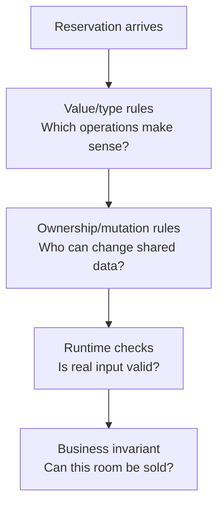
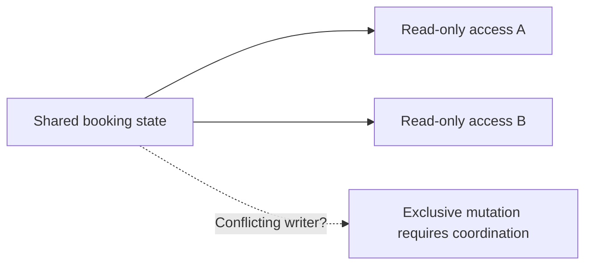

# CS220 — Programming Languages, Memory, and Execution
## Lecture 04: Type Systems, Ownership, and Language Design

*Why TypeScript, Java, Go, Python, and Rust can all be “typed” and still make radically different promises about what a program is allowed to do.*

---

# Part I — Intuition

*Five programming languages receive the same booking system. They agree on the business rules, but they disagree about which mistakes should be impossible to write and which must be discovered while the program runs.*

### The picture to carry in your head

Imagine five engineering teams building the same hotel-booking service. Every team must accept a reservation, identify a hotel and a customer, and update a booking record. The important business rules are identical.

But each team gets a different set of tools for describing what programs are allowed to do. TypeScript, Python, Java, Go, and Rust all support meaningful program structure. Their type systems and resource-management designs make different promises.

Think of five factories assembling the same product. One uses paper labels to distinguish different components. Another uses connectors designed so certain components cannot fit in the wrong place. A third tracks who is allowed to hold or change a part at each moment.

None of those systems proves the finished product will delight customers. They prevent different classes of assembly mistakes.

The first diagram distinguishes three kinds of questions a language design may help answer: does a value fit, can references be shared safely, and does the runtime input actually satisfy the claimed business rule?

## 1. Why a hotel ID and a customer ID aren't always interchangeable

Our first bug looks ridiculous. A developer calls a booking function using a customer ID where a hotel ID belongs. Both values are strings, so the function receives something that looks perfectly normal.

The compiler cannot necessarily tell that `"H-123"` and `"C-123"` represent different kinds of things. If both parameters are declared as ordinary strings, swapping them may satisfy the declared rules while breaking the business logic.

Now imagine creating distinct conceptual types for customer IDs and hotel IDs. In some languages and designs, the compiler can reject accidental mixing even if both ultimately use strings internally.

That is one reason programming languages have type systems. Types can express more than memory representation. They can express the relationships and distinctions a program should respect.

But languages disagree about what makes two types compatible.

In TypeScript, objects are generally checked structurally: an object can satisfy an interface by having the required shape, even without explicitly declaring that it implements that interface. Java commonly uses explicitly declared class and interface relationships, though Java also has other forms of type compatibility. Go uses structural interface satisfaction under its rules. Python often allows dynamic use of values, with optional type annotations checked by external tools rather than enforced as ordinary runtime barriers.

You don't need the entire set of rules yet. The first idea is that **same shape** and **same declared identity** are two different ways to decide whether something fits.

## 2. The compiler doesn't know whether a room really exists

Suppose we declare a value to be a `HotelId`. Great. That may prevent accidentally using a `CustomerId` in its place. But it doesn't establish that the referenced hotel exists in PostgreSQL right now.

Similarly, a type representing a confirmed reservation can make certain local program states easier to reason about. It doesn't independently guarantee that the payment provider completed the charge or that another service hasn't consumed the last room.

Types can exclude some invalid arrangements of code. They cannot automatically observe every fact in the outside world.

The boundary matters. A program may compile perfectly and still receive malformed JSON, a stale database result, or a payment response that means something different from what we assumed.

**Checkpoint:** If a booking function accepts a correctly typed `HotelId`, must that hotel exist in the database? No. Type-level identity and runtime existence are different claims.

## 3. Who is allowed to change the reservation object?

Now imagine two parts of the application sharing the same mutable booking object. One component updates the customer's selected dates. Another component calculates the price using the same object. If changes occur at an unexpected moment, the price calculation may use inconsistent information.

The difficult part isn't that the object has a particular type. The difficult part is that more than one part of the program can reference and mutate the same information.

Think of a shared paper reservation form. Two clerks both have access. One crosses out the travel dates while the other is reading the price. Even if each clerk follows a valid set of instructions, their combined behavior may be wrong.

Some languages and libraries address this with conventions: avoid mutation, copy values, coordinate access, and document ownership. Other language designs enforce stronger rules at compile time.

Rust is an interesting example. Its ownership and borrowing system constrains how references to data can be used. In ordinary safe Rust, you generally cannot hold an active mutable reference while simultaneously using conflicting references to the same data. The compiler checks these relationships as part of deciding whether the program is valid.

That doesn't mean Rust makes booking logic correct. It doesn't prevent you from charging the wrong price because the formula was wrong. It does make certain memory-safety and aliasing mistakes much harder or impossible within the guarantees of safe Rust.

The second diagram returns to the shared form. Multiple readers can inspect a stable state, but a writer needs appropriate exclusive access under this simplified borrowing picture.

## 4. Why stricter isn't always automatically better

Imagine using a language with stronger compile-time restrictions for a quick data-import script. You may gain useful guarantees but also spend more time expressing ownership relationships, lifetimes, and valid state transitions.

Now imagine a financial service managing long-lived state across many workers. The same restrictions might prevent a costly category of concurrency or memory-safety errors.

The trade-off depends on the workload, team, surrounding ecosystem, and what kinds of errors matter most.

A dynamic language can be an excellent tool when rapid iteration and flexible data manipulation are valuable, particularly with good validation and testing. A statically typed language can catch many inconsistencies earlier. Runtime checks are still essential at untrusted boundaries, even in languages with strict static types.

The useful question isn't "Which language is strongest?" It is **which guarantees this language makes, what cost it imposes, and which important risks remain outside those guarantees**.

## 5. The mental replay

Five teams build the same reservation service. One type system compares object shapes. Another emphasizes declared identities. A third constrains ownership and mutable borrowing. Some checks happen before execution, others during execution. Every implementation must still validate outside data and enforce business invariants at the correct boundary.

The Deep Dive will compare type inference, generics, structural and nominal typing, mutability, aliasing, borrowing, and compile-time guarantees. All of them belong to one family of questions: **what invalid behavior can we exclude before the program runs?**

### Three questions before the Deep Dive

1. **Why might two string IDs deserve different types?** Their runtime representation can be identical while their domain meanings are different.
2. **What additional problem does ownership address?** Who may hold, share, and mutate references to data without unsafe interference.
3. **Can the strictest compiler prove a remote payment succeeded?** No. That is an external business fact requiring runtime protocols and checks.

*The intuition pass ends here.*

---

# Part II — Deep Dive

### Status — Planning Stub

Full voice-first manuscript not yet authored.

### Learning Objective

Compare how languages encode correctness in their type systems and memory models — static versus dynamic typing, structural versus nominal types, inference, generics, mutability, ownership, and borrowing — and explain what each design can and cannot enforce at compile time.

### Opening Problem

Two services implement the same booking invariant. One relies on TypeScript interfaces and runtime validation; another is rewritten in a language with ownership rules. Both compile. Only one class of bugs becomes structurally impossible — and the team needs to know which, and why.

### Planned Coverage

Static and dynamic typing revisited comparatively; structural versus nominal typing; type inference; generics and parametric polymorphism; mutability and aliasing; ownership, borrowing, and lifetimes as a contrasting design; what compilers can prove versus what remains a runtime or protocol concern. Sustained cross-language comparison, not language tutorials.

### Scope Boundaries

CS220-L01 already covers TypeScript erasure, validation boundaries, and local type-system habits. This lecture widens the design space across languages. CS220-L05 covers runtimes, bytecode, GIL, and concurrency trade-offs. CS320 covers OS threads and scheduling in depth.

### Expected Understanding

State what a given language’s type or ownership model guarantees; name a bug class that model cannot catch; choose a language feature (nominal types, ownership, runtime checks) for a concrete invariant without treating any one language as universally superior.

### Planned Manuscript Structure

1. Narrative hook and sustained engineering case study.
2. Technical development of the underlying mechanisms.
3. Practical trade-offs and realistic failure scenarios.
4. Oral examination.
5. Solutions and discussion.
6. The Mental Model Worth Keeping.
7. Next Lecture or course-completion transition.
8. Optional Practical Lab, after the spoken lecture ends.
9. Further Reading.
10. Dense Cheatsheet — Interview Glance Card, last, inside one fenced text block.

<!-- Full manuscript to be generated later. -->
