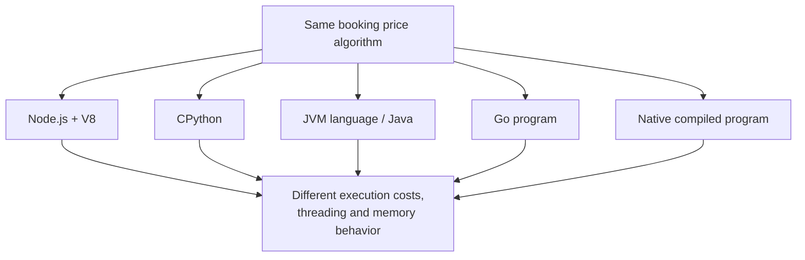
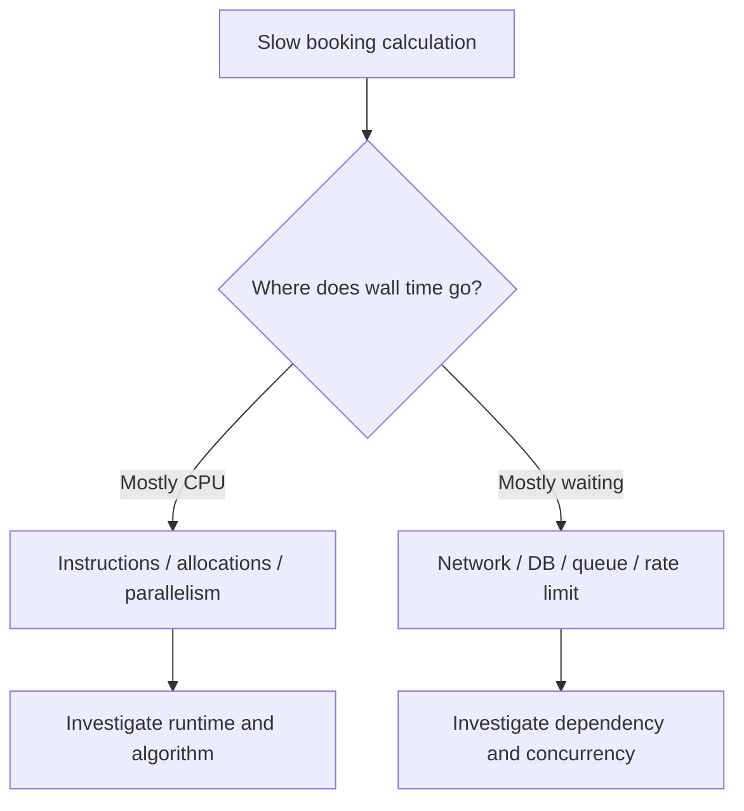

# CS220 — Programming Languages, Memory, and Execution
## Lecture 05: One Program, Many Runtimes

*The same CPU-heavy booking calculation in Node.js, CPython, the JVM, Go, and native code — why wall time, concurrency, and failure modes diverge even when the algorithm is identical.*

---

# Part I — Intuition

*The same pricing algorithm runs in five languages. Why doesn't it take the same time? Imagine five kitchens following the same recipe but using entirely different staff, tools, and working arrangements.*

### The picture to carry in your head

Our hotel company calculates prices from nightly rates, discounts, occupancy rules, and taxes. The engineering team wants to speed up a CPU-heavy batch calculation. Someone suggests rewriting it in Python. Another favors Go. Someone mentions Java's JIT compiler. A fourth says native code must always win.

They're all discussing the same logical calculation, but they're making assumptions about what happens below the source code.

Imagine giving five kitchens the same recipe and the same pile of ingredients. Each must deliver the same meal. But one kitchen employs a coordinator who translates the recipe as work arrives. Another uses a detailed set of precompiled instructions. One can employ several cooks at once; another has a rule limiting which cook may execute a particular part of the recipe at a time.

A recipe doesn't tell you how a kitchen is organized. Source code doesn't tell you the full behavior of its runtime either.

The picture below separates the program's logical work from the machinery that carries it out.

## 1. Translating the recipe

The CPU executes machine instructions. None of our ordinary high-level languages is literally the CPU's native instruction set. Something must bridge the gap.

JavaScript in a typical Node.js environment is handled by V8, which can interpret an intermediate representation and compile frequently executed paths into machine code. Standard CPython commonly compiles Python source to bytecode that its interpreter executes. Java code is commonly compiled to JVM bytecode, and the JVM can use interpretation and just-in-time compilation. Go is typically compiled ahead of time into native machine code while still using a runtime for important services.

These are simplified descriptions, and versions and implementations matter. The point isn't to memorize an absolute ranking of languages. It's to recognize that **different execution systems carry out the same algorithm through different mechanisms**.

A JIT compiler can invest work in optimizing hot code based on runtime observations. Ahead-of-time compilation can perform substantial optimization before execution. Interpreters may be flexible and convenient while incurring dispatch or representation overhead for particular workloads. The trade-offs depend on the program.

**Checkpoint:** If the same mathematical function has identical Big O complexity in Python and Go, must it take identical wall-clock time? No. The abstract growth pattern doesn't specify runtime overhead, representations, or compilation strategies.

## 2. The kitchen has to manage its ingredients

Now imagine our batch processor creates millions of temporary objects. Some runtimes automatically manage the lifetime of allocated objects through tracing garbage collection. CPython commonly uses reference counting supplemented by a cyclic garbage collector. Rust's ownership system often determines when values can be released without a tracing garbage collector, though actual allocation behavior depends on the types and libraries in use.

This changes memory behavior. It can also affect performance.

A tracing garbage collector may periodically do work to identify and reclaim objects. Reference counting maintains counts as references change and needs additional techniques for cycles. Ownership rules can allow deterministic release of many resources but require constraints on how programmers share and mutate values.

These aren't just matters of theoretical style. They influence memory overhead, latency, ergonomics, and what types of mistakes the language or runtime helps prevent.

But no memory-management strategy guarantees your business logic is correct. A perfectly managed array can contain incorrect prices.

## 3. CPU work and waiting are different jobs

Next, imagine our company has two workloads.

The first repeatedly calculates prices for a million combinations. It's CPU-heavy: most time is spent executing instructions.

The second requests current room availability from hundreds of external suppliers. It's I/O-heavy: much time is spent waiting for responses rather than computing.

For an I/O-heavy workload, concurrency can help one worker start new tasks while earlier requests wait. Node.js is particularly familiar here: its event loop coordinates asynchronous operations even though ordinary JavaScript execution in one event-loop thread isn't automatically parallel.

For CPU-heavy work, the important question is how many computations can actually execute at the same time. Simply starting many promises on one JavaScript thread doesn't turn CPU execution into parallel work. Worker threads or separate processes can provide actual parallel computation where appropriate.

For standard GIL-enabled CPython, multiple threads don't usually execute Python bytecode in parallel across CPU cores within one interpreter. Threads can still be useful for I/O, and some native operations release the GIL. CPython also has free-threaded build options, so "Python threads can never execute in parallel" is not a timeless universal claim about every configuration.

Go uses lightweight goroutines scheduled by its runtime onto operating-system threads. JVM implementations have their own thread models and runtime services. Every choice affects how concurrent work is expressed and executed, but none creates free processing capacity in a saturated dependency.

## 4. One recipe, two types of slowness

Return to the pricing service. Suppose one implementation is slow because the CPU spends enormous time converting object representations and dispatching operations. Another is slow because it makes one network request for each price calculation. Rewriting the second service in a faster compiled language might make little difference if network waiting dominates.

We need to understand which type of work is expensive before choosing a new runtime.

For the CPU-heavy batch, inspect CPU profiles, allocations, actual parallelism, warmup, and steady-state execution. For the supplier integration, inspect network waits, concurrency limits, connection reuse, external rate limits, and caching.

A language benchmark performed on one machine doesn't establish how a complete application will behave in production.

Here's the second picture. The same observed delay can be mostly active computation or mostly waiting. Changing the language directly targets only some of those costs.

## 5. Runtime choice is not a personality contest

Engineers love arguing about language speed. The arguments are fun because each language has distinctive strengths, ergonomic choices, and performance characteristics.

But the correct comparison starts with a workload, a target environment, and the resources the application actually needs.

A small Python data-processing script may be excellent because the relevant libraries do the expensive numerical work in optimized native code. Go can simplify handling many concurrent tasks while keeping deployment straightforward. Java can benefit from mature JIT optimization for long-running workloads. Node.js can be effective for I/O-intensive services, with worker threads or separate processes used for CPU parallelism. Native code can be highly efficient for particular workloads while adding memory-management and development complexity.

The point is not that all runtimes are equally fast. They aren't. The point is that **the language name is not enough information to predict a program's runtime behavior**.

## 6. The mental replay

One pricing algorithm enters five different execution environments. Each translates and executes the logic differently. They manage memory differently. They coordinate concurrency differently. Their overhead and optimization opportunities differ. Yet all are still limited by the same external hardware and dependencies.

The technical lecture will compare bytecode and machine code, interpretation and JIT, AOT compilation, garbage collection and reference counting, Python's GIL and free-threaded configurations, goroutine scheduling, and workload-specific performance measurement.

The mental picture remains one recipe, five kitchens—and the question **where is each kitchen actually spending its time?**

### Three questions before the Deep Dive

1. **Why doesn't one algorithm imply one execution speed?** Different implementations produce different machine-level work, memory behavior, and runtime overhead.
2. **Why do threads help I/O-bound work even when they don't provide CPU parallelism?** One task can wait while another progresses.
3. **What should you measure before migrating the program to another language?** CPU versus waiting time, allocation behavior, true bottlenecks, and representative workload performance.

*The intuition pass ends here.*

---

# Part II — Deep Dive

### Status — Planning Stub

Full voice-first manuscript not yet authored.

### Learning Objective

Compare major runtime and compilation strategies — interpreters, bytecode VMs, JIT and AOT compilation, garbage collection versus reference counting, GILs, threads, and schedulers — and explain how those choices change performance and concurrency for the same logical program.

### Opening Problem

A team ports a CPU-bound pricing routine from Node.js to Python “for data science,” then to Go “for parallelism,” and is surprised that none of the speedups or slowdowns match folklore. The algorithm is the same; the runtimes are not.

### Planned Coverage

JavaScript/V8 revisited briefly; CPython and the GIL; JVM bytecode and JIT; Go’s compilation model and goroutine scheduler at a conceptual level; native/AOT compilation; garbage collection versus reference counting; when threads help CPU work and when they do not. Prefer one sustained comparative experiment over separate language tutorials.

### Scope Boundaries

CS220-L02–L03 already cover memory and V8/CPU execution in depth for the JavaScript ecosystem. CS220-L04 covers type and ownership design. CS320 covers OS scheduling, virtual memory, and concurrency primitives. SE460 covers systematic performance engineering. This lecture builds comparative runtime literacy, not production fluency in four languages.

### Expected Understanding

Given a workload (CPU-bound, I/O-bound, mixed), predict which runtime constraints matter; explain why “add more threads” fails under a GIL; contrast bytecode+JIT with AOT/native trade-offs; name what to measure before blaming the language.

### Planned Manuscript Structure

1. Narrative hook and sustained engineering case study.
2. Technical development of the underlying mechanisms.
3. Practical trade-offs and realistic failure scenarios.
4. Oral examination.
5. Solutions and discussion.
6. The Mental Model Worth Keeping.
7. Next Lecture or course-completion transition.
8. Optional Practical Lab, after the spoken lecture ends.
9. Further Reading.
10. Dense Cheatsheet — Interview Glance Card, last, inside one fenced text block.

<!-- Full manuscript to be generated later. -->
