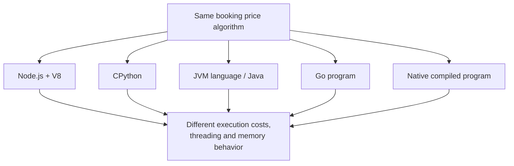
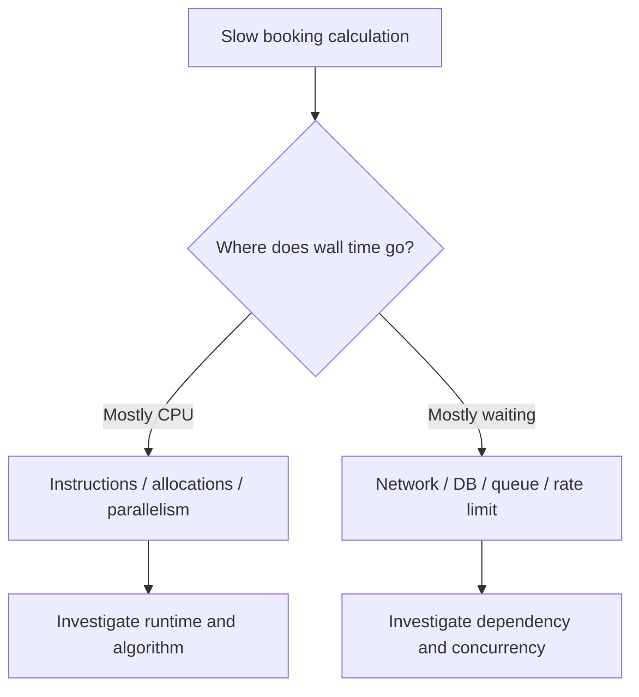

# CS220 — Programming Languages, Memory, and Execution

## Lecture 05: One Program, Many Runtimes

*The same CPU-heavy booking calculation in Node.js, CPython, the JVM, Go, and native code — why wall time, concurrency, and failure modes diverge even when the algorithm is identical.*

**Estimated study time:** 80–100 minutes, including the optional practical lab.

---

### How to listen to this lecture

This lecture completes CS220 by connecting the rules of programming languages to the machinery that actually executes programs.

**Part I — Intuition** compares five kitchens preparing the same recipe. It establishes a mental model of compilation, runtime overhead, memory management, and concurrency.

**Part II — Deep Dive** follows one computationally expensive hotel-pricing operation through Node.js, Python, Java, Go, and Rust. We'll examine their execution strategies, memory-management systems, parallelism, and the circumstances in which a language migration genuinely helps.

We'll also learn why performance comparisons become misleading when the supposed implementations of the same algorithm don't actually perform the same work.

The oral examination comes after the spoken narrative. The practical experiments, references, and dense interview glance card follow the spoken-end marker.

---

# Part I — Intuition

*The same pricing algorithm runs in five languages. Why doesn't it take the same time? Imagine five kitchens following the same recipe but using entirely different staff, tools, and working arrangements.*

### The picture to carry in your head

Our hotel company calculates prices from nightly rates, discounts, occupancy rules, and taxes. The engineering team wants to speed up a CPU-heavy batch calculation. Someone suggests rewriting it in Python. Another favors Go. Someone mentions Java's JIT compiler. A fourth says native code must always win.

They're all discussing the same logical calculation, but they're making assumptions about what happens below the source code.

Imagine giving five kitchens the same recipe and the same pile of ingredients. Each must deliver the same meal. But one kitchen employs a coordinator who translates the recipe as work arrives. Another uses a detailed set of precompiled instructions. One can employ several cooks at once; another has a rule limiting which cook may execute a particular part of the recipe at a time.

A recipe doesn't tell you how a kitchen is organized. Source code doesn't tell you the full behavior of its runtime either.

The picture below separates the program's logical work from the machinery that carries it out.



## 1. Translating the recipe

The CPU executes machine instructions. None of our ordinary high-level languages is literally the CPU's native instruction set. Something must bridge the gap.

JavaScript in a typical Node.js environment is handled by V8, which can interpret an intermediate representation and compile frequently executed paths into machine code. Standard CPython commonly compiles Python source to bytecode that its interpreter executes. Java code is commonly compiled to JVM bytecode, and the JVM can use interpretation and just-in-time compilation. Go is typically compiled ahead of time into native machine code while still using a runtime for important services.

These are simplified descriptions, and versions and implementations matter. The point isn't to memorize an absolute ranking of languages. It's to recognize that **different execution systems carry out the same algorithm through different mechanisms**.

A JIT compiler can invest work in optimizing hot code based on runtime observations. Ahead-of-time compilation can perform substantial optimization before execution. Interpreters may be flexible and convenient while incurring dispatch or representation overhead for particular workloads. The trade-offs depend on the program.

**Checkpoint:** If the same mathematical function has identical Big O complexity in Python and Go, must it take identical wall-clock time? No. The abstract growth pattern doesn't specify runtime overhead, representations, or compilation strategies.

## 2. The kitchen has to manage its ingredients

Now imagine our batch processor creates millions of temporary objects. Some runtimes automatically manage the lifetime of allocated objects through tracing garbage collection. CPython commonly uses reference counting supplemented by a cyclic garbage collector. Rust's ownership system often determines when values can be released without a tracing garbage collector, though actual allocation behavior depends on the types and libraries in use.

This changes memory behavior. It can also affect performance.

A tracing garbage collector may periodically do work to identify and reclaim objects. Reference counting maintains counts as references change and needs additional techniques for cycles. Ownership rules can allow deterministic release of many resources but require constraints on how programmers share and mutate values.

These aren't just matters of theoretical style. They influence memory overhead, latency, ergonomics, and what types of mistakes the language or runtime helps prevent.

But no memory-management strategy guarantees your business logic is correct. A perfectly managed array can contain incorrect prices.

## 3. CPU work and waiting are different jobs

Next, imagine our company has two workloads.

The first repeatedly calculates prices for a million combinations. It's CPU-heavy: most time is spent executing instructions.

The second requests current room availability from hundreds of external suppliers. It's I/O-heavy: much time is spent waiting for responses rather than computing.

For an I/O-heavy workload, concurrency can help one worker start new tasks while earlier requests wait. Node.js is particularly familiar here: its event loop coordinates asynchronous operations even though ordinary JavaScript execution in one event-loop thread isn't automatically parallel.

For CPU-heavy work, the important question is how many computations can actually execute at the same time. Simply starting many promises on one JavaScript thread doesn't turn CPU execution into parallel work. Worker threads or separate processes can provide actual parallel computation where appropriate.

For standard GIL-enabled CPython, multiple threads don't usually execute Python bytecode in parallel across CPU cores within one interpreter. Threads can still be useful for I/O, and some native operations release the GIL. CPython also has free-threaded build options, so "Python threads can never execute in parallel" is not a timeless universal claim about every configuration.

Go uses lightweight goroutines scheduled by its runtime onto operating-system threads. JVM implementations have their own thread models and runtime services. Every choice affects how concurrent work is expressed and executed, but none creates free processing capacity in a saturated dependency.

## 4. One recipe, two types of slowness

Return to the pricing service. Suppose one implementation is slow because the CPU spends enormous time converting object representations and dispatching operations. Another is slow because it makes one network request for each price calculation. Rewriting the second service in a faster compiled language might make little difference if network waiting dominates.

We need to understand which type of work is expensive before choosing a new runtime.

For the CPU-heavy batch, inspect CPU profiles, allocations, actual parallelism, warmup, and steady-state execution. For the supplier integration, inspect network waits, concurrency limits, connection reuse, external rate limits, and caching.

A language benchmark performed on one machine doesn't establish how a complete application will behave in production.

Here's the second picture. The same observed delay can be mostly active computation or mostly waiting. Changing the language directly targets only some of those costs.



## 5. Runtime choice is not a personality contest

Engineers love arguing about language speed. The arguments are fun because each language has distinctive strengths, ergonomic choices, and performance characteristics.

But the correct comparison starts with a workload, a target environment, and the resources the application actually needs.

A small Python data-processing script may be excellent because the relevant libraries do the expensive numerical work in optimized native code. Go can simplify handling many concurrent tasks while keeping deployment straightforward. Java can benefit from mature JIT optimization for long-running workloads. Node.js can be effective for I/O-intensive services, with worker threads or separate processes used for CPU parallelism. Native code can be highly efficient for particular workloads while adding memory-management and development complexity.

The point is not that all runtimes are equally fast. They aren't. The point is that **the language name is not enough information to predict a program's runtime behavior**.

## 6. The mental replay

One pricing algorithm enters five different execution environments. Each translates and executes the logic differently. They manage memory differently. They coordinate concurrency differently. Their overhead and optimization opportunities differ. Yet all are still limited by the same external hardware and dependencies.

The technical lecture will compare bytecode and machine code, interpretation and JIT, AOT compilation, garbage collection and reference counting, Python's GIL and free-threaded configurations, goroutine scheduling, and workload-specific performance measurement.

The mental picture remains one recipe, five kitchens—and the question **where is each kitchen actually spending its time?**

### Three questions before the Deep Dive

1. **Why doesn't one algorithm imply one execution speed?** Different implementations produce different machine-level work, memory behavior, and runtime overhead.
2. **Why do threads help I/O-bound work even when they don't provide CPU parallelism?** One task can wait while another progresses.
3. **What should you measure before migrating the program to another language?** CPU versus waiting time, allocation behavior, true bottlenecks, and representative workload performance.

*The intuition pass ends here.*

---

# Part II — Deep Dive

# 1. The Performance Report That Started a Language War

It's Wednesday morning at our travel-booking company.

The pricing team has developed a computationally expensive operation.

For each hotel, it evaluates possible combinations of dates, occupancy, available discounts, taxes, cancellation policies, and supplier pricing rules.

The production booking request usually evaluates only a small number of possibilities. But the company also runs a large offline process that recalculates millions of possible offers, preparing data for search results, recommendations, and analytical comparisons.

The routine began life in Node.js.

It worked well enough.

Then the catalogue grew.

The daily batch started missing its processing deadline.

One engineer recommended Python, arguing that data-processing workloads belong in Python.

Another suggested Go because goroutines are lightweight.

A Java engineer mentioned the JVM's mature JIT compiler.

A Rust enthusiast argued that native machine code and ownership-based memory management would eliminate the overhead.

The engineering manager authorized an experiment.

Five teams implemented the same pricing rules.

All implementations passed the functional tests.

And the first benchmark produced wildly different results.

The Go and Rust implementations seemed very fast.

The Java implementation started slowly but improved after repeated runs.

The Node.js implementation was respectable once warmed up, but CPU-heavy calculations blocked its application thread during the original deployment.

The Python implementation appeared dramatically slower when written as ordinary object-heavy Python loops.

Then another Python engineer replaced the inner calculation with a vectorized native library.

Its execution time fell substantially.

Suddenly, the neat language ranking collapsed.

Was Python fast or slow?

Was Java interpreted or compiled?

Was Node.js single-threaded or multithreaded?

Was Go's performance caused by compilation or concurrency?

Was Rust winning because of ownership, machine code, or the specific algorithm someone wrote?

The uncomfortable answer is that all those questions mix together different mechanisms.

To understand the results, we need to separate them.

**A program has an algorithm, a representation, an execution engine, a memory-management strategy, and a concurrency model. Performance emerges from their interaction with the workload and the machine.**

Language comparisons become useful only when we know which component of that interaction we're evaluating.

---

# 2. The CPU Doesn't Execute TypeScript, Python, Java, or Rust

Let's begin beneath the programming language.

A processor executes instructions belonging to its instruction set architecture.

On a conventional server, these might be instructions for an x86-64 or ARM64 processor.

They load values, perform arithmetic, compare data, move information, and control execution.

The CPU doesn't have a special operation named "calculate the final hotel booking price."

Our program must eventually be represented through machine operations that the processor can execute.

The path from human-readable source code to those operations varies.

Some languages normally use a compiler to produce native machine code before the program starts.

Others use a bytecode interpreter.

Still others combine interpretation with compilation during execution.

And many use several of these strategies within one runtime.

## 2.1 Source, intermediate representation, and machine code

Imagine our pricing rule in ordinary language.

Take a nightly rate.

Multiply it by the number of nights.

Apply the eligible discount.

Add the relevant taxes.

Return the final amount.

A language implementation needs to translate that meaning into executable behavior.

One route is to compile source code directly into native machine code.

Another is to compile source code into an intermediate representation, often called bytecode, which an execution engine interprets.

A third uses intermediate code initially and later compiles frequently executed operations into native code.

Even native compilers commonly use multiple internal representations while optimizing a program.

The important distinction isn't merely the number of translation stages.

It's **when the stages execute, what information each stage has, and what costs remain during program execution**.

## 2.2 Compilation doesn't imply efficiency

Suppose a native compiler generates machine code for an algorithm that performs one hundred million unnecessary comparisons.

The result may still be slow.

Meanwhile, a Python program might call an optimized native library that performs the same computation using a much more efficient algorithm.

That Python program could finish sooner.

The outer language name didn't determine the result.

The amount of work and the execution path did.

This is why benchmarks need to compare equivalent algorithms and representations before attributing results to runtime architecture.

---

# 3. Node.js: JavaScript Is Not the Whole Runtime

We already studied V8 in CS220-L03.

Here, we'll focus on how JavaScript execution fits inside the larger Node.js environment.

Node.js typically uses V8 to execute JavaScript.

V8 can interpret bytecode and compile hot code into machine instructions, using optimization techniques informed by observed program behavior.

But Node.js isn't just V8.

It also includes native libraries, runtime APIs, event-loop machinery, operating-system interfaces, and facilities for asynchronous operations.

That distinction matters when we discuss parallelism.

## 3.1 One ordinary JavaScript execution thread

Imagine our original pricing routine runs inside an ordinary Node.js HTTP request handler.

It loops over five million candidate combinations.

Every iteration performs more JavaScript calculations.

The operation takes two seconds.

During that time, the application's main JavaScript thread is busy performing the calculation.

Other callbacks scheduled on the same event-loop thread must wait for an opportunity to execute.

Customers may see increased API latency even if their own requests have little computational work.

This is why CPU-intensive work can be particularly troublesome when placed directly on the primary event-loop thread.

## 3.2 Promises don't make CPU work parallel

A developer attempts to fix the problem by dividing the calculations into eight promises and using `Promise.all`.

But suppose every promise starts a synchronous CPU-heavy function.

The JavaScript calculations still run on the same ordinary execution thread.

Creating promises doesn't automatically create processor threads.

Even if the work is scheduled in separate callbacks, the calculations don't become parallel merely because they are represented as asynchronous tasks.

This is the distinction between **concurrency** and **parallelism**.

Concurrency concerns managing multiple tasks that may progress over overlapping periods.

Parallelism concerns operations actually executing simultaneously.

Promises express asynchronous results and coordination.

They are not inherently parallel-computation primitives.

## 3.3 What Node.js does while waiting

Now compare the pricing loop with a supplier API request.

The application initiates an asynchronous network operation.

The JavaScript thread doesn't need to spend the entire wait repeatedly checking whether a packet arrived.

The runtime can rely on operating-system readiness or completion mechanisms and other appropriate facilities.

Some Node.js operations also use native worker-pool threads; this is especially relevant for particular filesystem, DNS, cryptographic, and compression APIs.

Not all asynchronous operations use one identical mechanism.

But the architectural idea remains the same.

The runtime can coordinate waiting tasks without dedicating one continuously executing JavaScript thread to each wait.

That makes Node.js attractive for many network-heavy applications.

It does not make CPU work disappear.

## 3.4 Worker threads

For CPU-intensive JavaScript, Node.js offers worker threads.

A worker can execute JavaScript in parallel with the main thread.

Workers have their own JavaScript execution contexts and can exchange messages.

They may transfer suitable memory buffers or share explicitly designed memory regions where appropriate.

But starting a worker has overhead.

Sending data between workers has costs.

Sharing memory introduces synchronization responsibilities.

And creating one new worker for every tiny calculation would usually be wasteful.

A worker pool can amortize startup and manage bounded concurrency.

For our pricing batch, a pool of workers might be appropriate if the workload can be partitioned into sufficiently large independent chunks.

**Node.js can execute JavaScript in parallel. What it does not do is turn ordinary promise scheduling into automatic CPU parallelism.**

---

# 4. CPython: Why an Interpreter Can Be Slower Than the Arithmetic It Performs

Now let's examine the Python implementation.

The team writes a straightforward function.

For each pricing candidate, it reads several object attributes, performs arithmetic, checks discount rules, and appends a result.

The code is readable.

But the plain Python loop performs many operations through CPython's object and bytecode execution machinery.

That can introduce considerable overhead compared with a tightly optimized native loop operating on compact numerical values.

Why?

## 4.1 Python objects carry behavior

In ordinary Python, integers are objects with well-defined language semantics.

Attribute access, arithmetic, iteration, and method invocation can involve interpreter machinery.

The runtime must implement Python's dynamic object model correctly.

This flexibility is valuable.

But certain operations involve more steps than a simple native instruction operating on a fixed-width machine integer.

For a small number of calculations, the overhead may be irrelevant.

For hundreds of millions of tiny operations, it can become important.

A hot loop may spend more time handling object representation and execution dispatch than performing the underlying arithmetic.

Modern CPython versions also contain adaptive specialization and other interpreter optimizations, so this is not a claim that every Python operation always follows one fixed slow path.

The relevant question remains how much overhead the particular workload incurs.

## 4.2 CPython bytecode

A typical CPython execution path compiles source into an internal code representation containing bytecode instructions.

Its interpreter executes those instructions.

That doesn't mean Python source is translated again from scratch for every loop iteration.

Nor does it mean CPython never performs optimizations.

It means the common execution strategy differs from the usual ahead-of-time native compilation of a Go or Rust program.

Bytecode execution provides a flexible implementation model.

But an inner loop dominated by many small Python-level operations may be expensive.

## 4.3 The native-library surprise

Now the second Python engineer replaces the loop with operations provided by an optimized numerical library.

The outer program remains Python.

But much of the expensive work may execute inside compiled native code.

That code can use compact numerical representations, vectorized operations, optimized memory access, and sometimes multiple threads.

The bottleneck has moved out of the interpreter's ordinary Python-level loop.

So saying "Python is slow" is a poor explanation.

A more meaningful statement is:

"This particular Python implementation spends most of its time executing object-heavy operations through CPython, whereas the alternative moves more work into optimized native code."

That identifies a mechanism we can test.

The same distinction applies to machine-learning libraries, scientific computing, image processing, and other Python ecosystems.

**The language that orchestrates a computation may not be the language executing its hottest operations.**

---

# 5. The Global Interpreter Lock: What It Actually Restricts

Now the pricing team proposes parallelizing the Python version.

They create several threads.

Each thread handles part of the pricing workload.

The team expects eight threads to use eight CPU cores simultaneously.

But under a conventional GIL-enabled CPython interpreter, that expectation is usually wrong for CPU-bound Python code.

The reason is the **Global Interpreter Lock**, or GIL.

## 5.1 The traditional CPython model

In the traditional GIL-enabled CPython configuration, a thread must hold the relevant interpreter lock to execute Python code in that interpreter.

Multiple OS threads can exist.

The runtime can switch between them.

But they don't ordinarily execute CPU-bound Python bytecode simultaneously across several cores within one interpreter.

That is the limitation.

It doesn't mean Python supports only one operating-system thread.

It doesn't mean all threads are useless.

And it doesn't mean every native operation performed from Python is serialized behind the GIL.

Those are common misunderstandings.

## 5.2 Why threads still help I/O-heavy Python

Suppose our Python backend contacts ten suppliers.

Each request spends most of its time waiting for a remote response.

A thread initiating a blocking I/O operation can release the GIL while waiting.

Other threads can make progress.

Therefore, Python threads can be useful for I/O-bound workloads even in a traditional GIL-enabled interpreter.

The point is that the threads aren't all trying to execute Python bytecode continuously.

Much of their elapsed time is spent waiting outside that execution path.

This is the same fundamental distinction we've seen with Node.js.

Waiting and computation consume different kinds of capacity.

## 5.3 Native extensions can release the GIL

Some computational libraries perform work in native code while releasing the GIL.

That can allow CPU-intensive native computations to overlap across threads.

But it's library-specific.

A pure-Python loop doesn't automatically gain parallel execution merely because another library can release the lock.

When evaluating a Python service, we must know where the expensive work actually executes.

## 5.4 Multiprocessing

One established approach to CPU parallelism in Python is to use separate processes.

Each process has its own interpreter and relevant execution state.

Several processes can execute Python computations on multiple cores.

But there are costs.

Processes require resources.

Data must be transferred or shared through suitable mechanisms.

Serialization can become expensive.

Process startup can be significant.

And distributing tiny tasks may cost more than it saves.

A process pool is often more appropriate than launching a new process for each request.

The general trade-off resembles Node.js worker pools: parallelism is useful only when the work is sufficiently independent and substantial to justify coordination overhead.

---

# 6. Python's Newer Story: Free-Threaded CPython

We need to update an old piece of conventional wisdom.

For many years, developers repeated the rule:

"Python threads cannot run CPU-bound Python code in parallel."

That was a useful description of the standard GIL-enabled CPython configuration.

But it isn't a timeless statement about every Python implementation or modern configuration.

Starting with Python 3.13, CPython has supported optional **free-threaded builds** that can run without the GIL.

This enables multiple threads to execute Python code in parallel on available CPU cores.

The distinction matters.

## 6.1 Build support and actual runtime state

A Python installation may be a conventional GIL-enabled build or a build that supports free threading.

A free-threaded build can also run with the GIL enabled under some circumstances.

For example, compatibility behavior involving certain extension modules may cause the GIL to be enabled.

Therefore, checking only the language version isn't sufficient.

We need to know the interpreter build and whether the GIL is actually active.

Modern CPython provides mechanisms to inspect those properties.

## 6.2 Removing the GIL doesn't make all code scale

Imagine our pricing workload contains heavy contention around one shared data structure.

Several threads repeatedly update the same dictionary.

Removing the GIL doesn't eliminate the need for safe synchronization.

Nor does it remove cache contention, memory-allocation overhead, or other shared-resource limits.

Some objects use internal synchronization.

Some third-party extensions may not be fully prepared for free-threaded execution.

And the free-threaded runtime may introduce overhead relative to the conventional build for certain single-threaded workloads.

So the correct modern statement is:

**Conventional GIL-enabled CPython restricts ordinary CPU-bound Python execution across threads, while free-threaded CPython provides a different execution option whose benefits depend on workload and compatibility.**

This is precisely why we should avoid reducing runtime comparisons to slogans.

A version and configuration change can invalidate an oversimplified rule.

---

# 7. The JVM: Compile Before Running, Optimize While Running

Now the Java team presents its results.

Their implementation doesn't immediately dominate the benchmark.

The first run is relatively slow.

Later runs are faster.

The performance team initially suspects caching.

But the JVM itself may also be changing how the program executes.

## 7.1 Java bytecode isn't native machine code

A typical Java compilation process produces JVM bytecode.

The bytecode represents operations for the Java Virtual Machine rather than instructions tied directly to one particular processor architecture.

The JVM executes those operations using its implementation strategies.

A common high-performance JVM, HotSpot, can interpret code and compile selected operations into native machine code while the program runs.

That is just-in-time compilation.

The program can begin execution before every relevant method has been compiled into its most optimized form.

## 7.2 Tiered compilation

HotSpot can use different compilation tiers.

Early execution may emphasize startup speed and gathering information about behavior.

Later compilation can invest more work in optimization.

Frequently executed methods or paths become candidates for increasingly optimized machine code.

This can create warmup behavior.

The first thousand pricing calculations may not have the same execution characteristics as the next million.

If a benchmark measures only the first few invocations, it may overemphasize startup and compilation overhead.

If it measures only a long-running warmed-up process, it may underrepresent short-lived serverless or command-line workloads.

Neither measurement is inherently wrong.

They answer different questions.

## 7.3 Runtime profiling enables optimization

A JIT compiler has a useful source of information.

It can observe which types and paths are common during execution.

For example, perhaps the pricing routine frequently operates on a small number of predictable object shapes.

The JVM may optimize operations based on observed behavior and guarded assumptions.

If a previously uncommon case appears, an optimization may need to be reconsidered or execution may transition to another path.

This resembles some of the optimization concepts we studied with V8.

But exact mechanisms differ across runtime implementations and versions.

The broader principle is that a JIT can trade runtime compilation cost for better execution of selected hot code.

## 7.4 The startup-versus-steady-state trade-off

Imagine two applications.

One is a long-running pricing worker that executes continuously for weeks.

The other is a short-lived command-line program that starts, calculates ten prices, and exits.

A runtime with substantial warmup overhead might perform very well for the first workload.

The same warmup cost could dominate the second.

This is why "Java is fast" and "Java starts slowly" can both describe different aspects of a particular JVM configuration.

Modern JVMs also offer options affecting startup, compilation, memory, and deployment.

But the right configuration follows the workload.

The key lesson is to measure the part of the lifecycle the real application actually experiences.

---

# 8. Java Threads and Virtual Threads: Two Different Problems

The Java team now attempts to parallelize the pricing batch.

Unlike ordinary GIL-enabled CPython, conventional JVM threads can execute Java code simultaneously on different CPU cores when the scheduler and hardware permit.

That sounds straightforward.

But adding more threads doesn't guarantee speedup.

## 8.1 CPU-bound work

If the pricing tasks are independent and there are enough CPU cores available, dividing the work across several threads can reduce elapsed time.

But parallel execution introduces coordination, memory traffic, and scheduling overhead.

Beyond the available computing capacity, more threads may make the program slower.

And if all threads contend for one shared lock or database resource, the bottleneck remains.

## 8.2 Virtual threads

Modern Java also supports virtual threads.

They are useful for writing large numbers of concurrent tasks, especially when many tasks spend time waiting on blocking operations.

The runtime schedules virtual threads onto a smaller or dynamically managed set of platform threads according to its implementation.

But virtual threads are not magic extra CPU cores.

A CPU-heavy computation still consumes processor time.

Creating ten thousand virtual threads does not make ten thousand expensive pricing calculations execute simultaneously.

Virtual threads can improve scalability for certain I/O-oriented programming styles without creating additional hardware execution capacity.

This distinction is almost identical to the difference between asynchronous concurrency and CPU parallelism in other runtimes.

**A cheap task abstraction helps us manage work. It doesn't create free processing power.**

---

# 9. Go: A Native Program With a Runtime Scheduler

Now the Go implementation enters the discussion.

Go is commonly compiled ahead of time into native machine code.

That sounds similar to languages often described as having minimal runtimes.

But Go still provides a substantial runtime library.

It manages goroutines, scheduling, garbage collection, memory allocation, and other services.

The compiled program and its runtime cooperate.

## 9.1 Goroutines aren't ordinary one-to-one OS threads

A goroutine is a lightweight unit of concurrent Go execution.

We can create many goroutines without requiring one permanent operating-system thread per goroutine.

The Go runtime schedules runnable goroutines onto OS threads.

This is often described through the runtime's G, M, and P concepts.

G represents a goroutine.

M represents an OS thread.

P represents a scheduling resource that allows Go code to execute.

The exact scheduler implementation evolves, but this conceptual model is useful.

The runtime manages how many goroutines execute, wait, and resume.

A goroutine may block on I/O while others continue.

And multiple goroutines can execute CPU work simultaneously across cores where the runtime and available resources permit.

## 9.2 GOMAXPROCS

Go exposes a setting called `GOMAXPROCS`.

Conceptually, it controls how many logical processors may execute ordinary Go code simultaneously, with important runtime-specific details.

It doesn't simply equal the number of goroutines.

A program may have one thousand goroutines while only a limited number are executing Go code at a given moment.

For CPU-heavy work, the effective parallel execution capacity matters.

For I/O-heavy work, a large number of waiting goroutines may be entirely appropriate.

This is why interpreting goroutine count as CPU parallelism is a mistake.

## 9.3 The goroutine trap

Suppose the pricing team creates one goroutine per hotel offer.

There are ten million offers.

The team celebrates how easy concurrency is in Go.

But each goroutine has overhead.

Scheduling millions of tiny operations may cost more than dividing the work into large chunks.

Shared result channels or locks may become contended.

Memory allocation can increase.

And the total CPU work remains the same or greater.

A bounded worker pool may be a better design.

The relevant question is the granularity of work.

How much useful computation does each scheduled task perform relative to the cost of scheduling and coordinating it?

Goroutines make concurrency relatively convenient.

They don't remove the need to design it.

---

# 10. Rust and Native Compilation: Not Quite "No Runtime"

Now consider Rust.

A typical Rust program is compiled ahead of time into native machine code.

Its ownership and borrowing system can allow many resources to be managed without a general tracing garbage collector.

That can support predictable resource lifetimes and efficient execution in suitable workloads.

But saying "Rust has no runtime" is misleading.

A Rust program still interacts with the operating system.

It may use allocation libraries, thread libraries, async executors, standard-library services, and other runtime components.

The more precise statement is that ordinary Rust does not require a language-wide tracing garbage collector or managed virtual machine to execute most programs.

That distinction matters.

## 10.1 The optimizer can see concrete operations

Imagine pricing calculations using fixed-width integer values.

A native compiler may optimize arithmetic, loops, memory access, and function calls with knowledge of the selected target architecture and program representations.

It may inline functions, remove unnecessary calculations, vectorize suitable loops, and rearrange operations while preserving the applicable language semantics.

This can produce efficient machine code.

But it isn't automatic proof of maximum speed.

A Rust program with inefficient data access patterns can be slower than an optimized implementation in another language.

And compilation settings matter enormously.

Rust's development-oriented debug builds and optimized release builds may exhibit dramatically different performance.

Comparing a Rust debug binary with a warmed-up JVM application would be a poor way to evaluate language performance.

## 10.2 Ownership and performance

Rust's ownership model can affect how programs are structured and how memory is managed.

But ownership isn't a universal speedup switch.

A program may still allocate excessively.

It may copy data unnecessarily.

It may use expensive synchronization.

It may wait on external I/O.

And it may have a poor algorithm.

Ownership helps establish important safety properties and often enables predictable resource management.

Performance still depends on the generated work and the system around it.

## 10.3 C and C++ as a related reference point

It's useful to distinguish Rust from traditional native languages such as C and C++.

They can also compile ahead of time into efficient machine code.

But C and C++ commonly place more responsibility on developers to avoid certain memory-safety errors, although modern C++ offers RAII, ownership conventions, and resource-managing abstractions.

Rust seeks stronger enforcement of memory and aliasing guarantees through its ordinary safe language subset.

That affects safety and engineering design.

It does not guarantee that Rust will always outperform well-written C++ or vice versa.

---

# 11. Garbage Collection, Reference Counting, and Ownership Revisited

We've now discussed five execution environments.

Let's compare how they manage memory.

In CS220-L02, we studied stack, heap, garbage collection, and retention.

Here, we need only connect those concepts to runtime choices.

## 11.1 Tracing garbage collection

V8, HotSpot, and Go's standard runtime use forms of tracing garbage collection.

Broadly, the runtime identifies objects that remain reachable and reclaims storage that is no longer needed.

Implementations differ substantially.

They may divide objects into generations, perform parts of collection concurrently, compact memory, or use different strategies based on object lifetimes.

Garbage collection reduces the need for explicit deallocation of ordinary heap objects.

But it doesn't eliminate memory-management costs.

The runtime must track and process objects.

High allocation rates can consume CPU and memory bandwidth.

And a garbage collector cannot reclaim objects that remain reachable even though the application no longer needs them.

## 11.2 Reference counting in CPython

CPython commonly uses reference counting.

As references to an object are created or removed, the runtime maintains counts.

When an object's reference count reaches zero under the relevant implementation semantics, its storage can often be reclaimed promptly.

But cycles can prevent reference counts from reaching zero.

Therefore, CPython also uses a cyclic garbage collector to detect and reclaim appropriate cyclic garbage.

Reference counting has different costs from tracing collection.

Reference-count updates can consume resources.

Shared-reference management becomes more complicated under concurrency.

And prompt object reclamation doesn't automatically mean deterministic release of every external resource in every circumstance.

Important resources such as files and network connections should generally be managed through explicit lifetime constructs rather than relying on eventual object destruction.

## 11.3 Rust and ownership-based lifetimes

Rust commonly manages values according to ownership and scope.

When an owned value goes out of scope, its destructor may run, releasing resources it owns.

This is a form of deterministic resource management.

But not every Rust value lives on the stack.

Heap allocation remains common.

Reference counting is available through appropriate smart pointers.

Cycles can still create retention issues in certain reference-counted structures.

And memory-safety guarantees don't automatically protect against resource exhaustion or poor allocation patterns.

The meaningful comparison is not "garbage collection versus perfect memory."

It's a comparison of how each system assigns responsibility for resource lifetime and which costs are paid during execution.

> **Sticky note #1:** Memory management is part of performance, but an object being correctly reclaimed doesn't prove the program used memory efficiently. Safe resource management and efficient algorithms are separate properties.

---

# 12. The Same Algorithm May Not Be the Same Computation

We're now ready for a particularly important benchmark trap.

The five teams claim to have implemented the same pricing algorithm.

But did they?

Let's examine a simple calculation.

Multiply nightly rate by number of nights.

Apply a discount.

Round according to the currency's pricing rules.

Sum all offers.

Easy.

Now look at the numeric representations.

JavaScript's ordinary `Number` uses double-precision floating-point semantics.

Python integers can represent arbitrarily large values, subject to available memory and implementation limits.

Java commonly uses fixed-width primitive integer types such as `int` and `long`.

Go also supports fixed-width integer types.

Rust has explicit fixed-width integer types such as `i64` and `u64`.

These choices can produce different behavior.

## 12.1 Overflow

Suppose the workload multiplies sufficiently large integers.

A fixed-width integer representation may overflow.

Different languages and compiler modes have different overflow behavior.

Python's ordinary integers can grow to represent much larger mathematical values.

Java's primitive integer operations have defined fixed-width overflow behavior.

Go's integer semantics distinguish signed and unsigned types and define relevant overflow behavior.

Rust provides different behavior depending on operation and build configuration, as well as explicit checked, wrapping, saturating, and overflowing arithmetic APIs.

If one implementation silently wraps and another produces the mathematically correct large integer, they are not computing the same result.

A benchmark declaring the wrapping implementation faster would be misleading if the business requires exact arithmetic.

## 12.2 Floating-point versus exact money

Suppose a team uses floating-point arithmetic for financial values.

Another uses integer minor units.

A third uses decimal arithmetic.

They may produce different results around rounding boundaries.

The correct choice depends on the financial contract.

If our workload requires exact currency calculations, the benchmark must preserve that requirement.

We can't award a performance victory to an implementation that discards necessary precision.

## 12.3 Data structure differences

Imagine the Python version stores each pricing candidate as a dictionary.

The Rust version stores compact fixed-field structs.

The Java implementation uses objects.

The Go implementation uses slices of structs.

The Node.js version uses arrays of objects.

Even if every version runs a similar loop, their memory layouts may differ.

The number of allocations may differ.

Cache locality may differ.

Iteration costs may differ.

The benchmark is now comparing several things at once.

Language execution.

Object representation.

Allocation patterns.

Data layout.

Potentially even the algorithms themselves.

That's not necessarily an invalid application benchmark.

But we must identify what the results actually establish.

---

# 13. Big O Doesn't Predict Runtime Rankings

Our pricing algorithm has a particular asymptotic complexity.

Suppose each candidate requires a constant amount of work, and we process N candidates.

The algorithm is O(N).

Now implement it in five languages.

All five remain O(N) under the same abstract work model.

Yet one implementation may process several million candidates per second while another processes far fewer.

How is that possible?

Because Big O describes how work grows as the problem size grows.

It doesn't specify every constant cost involved in performing that work.

One implementation might incur more dynamic dispatch.

Another may allocate less memory.

A JIT may optimize repeated operations.

A native compiler may vectorize a loop.

A different representation may use CPU caches more efficiently.

And a parallel implementation may execute independent chunks simultaneously.

The asymptotic growth class can remain unchanged.

The actual execution time can differ substantially.

But there's another trap.

## 13.1 Changing algorithms dwarfs changing languages

Suppose the original implementation performs a linear search through a list of ten thousand discounts for every hotel offer.

The team moves the code from Python to Rust but preserves the same repeated search.

Another engineer keeps Python and replaces the repeated searches with a suitable indexed lookup.

The Python version might now perform far less work.

The optimization changed the algorithm and data structure.

That improvement can dominate language-level differences.

This is why senior engineers usually investigate algorithmic complexity and data access patterns before recommending a language rewrite.

A faster runtime executing unnecessary work is often the wrong optimization.

---

# 14. Parallelizing the Pricing Batch: A Controlled Thought Experiment

Let's design a fair parallel workload.

We have eight million independent pricing candidates.

Each candidate can be calculated without modifying shared state.

We divide them into eight batches of one million candidates.

Now compare several approaches.

In Node.js, one main-thread loop processes the batches sequentially.

An alternative implementation distributes the batches across a worker pool.

In ordinary GIL-enabled CPython, pure-Python threads may not provide the desired CPU parallelism, but separate worker processes can.

A free-threaded CPython build may permit parallel threads under appropriate conditions.

In Java, independent tasks may execute across several platform threads.

In Go, goroutines can execute across available logical processors.

In Rust, threads or suitable parallel libraries can divide the work.

Which will be fastest?

We still don't know.

## 14.1 Parallel work introduces new costs

The input may need to be partitioned or transferred.

Workers must be created or reused.

Results must be collected.

Errors must be handled.

Shared structures may need synchronization.

And the CPU has a finite number of cores and finite memory bandwidth.

Amdahl's Law tells us that any sequential portion of a fixed workload limits speedup.

Even fully independent chunks may experience memory contention or scheduling overhead.

## 14.2 Too much parallelism can be worse

Suppose the machine provides eight cores.

We launch one hundred CPU-heavy workers.

They compete for execution time.

The operating system switches among them.

Caches may be disturbed.

Memory bandwidth may saturate.

The application may spend additional time coordinating work.

More runnable tasks don't create more cores.

A bounded worker count, informed by the actual computational bottleneck, may perform better.

## 14.3 Container limits complicate the experiment

Now place the service in a container.

The host has thirty-two cores.

But the container is limited to a much smaller CPU allocation.

A benchmark that inspects only the host's core count might create far too many workers.

CPU quotas, affinity, runtime processor limits, and scheduler behavior can affect how much parallel work actually executes.

This connects directly to CS320.

The runtime requests computational resources.

The operating system and deployment environment determine which resources are available.

We must distinguish the runtime's concurrency model from the hardware capacity it actually receives.

---

# 15. The Second Workload: Thousands of Supplier Requests

Now imagine the pricing service needs fresh inventory information.

For each hotel, it contacts an external supplier.

The operation spends most of its time waiting for network responses.

The CPU performs comparatively little work.

What changes?

Quite a lot.

## 15.1 I/O concurrency can matter more than raw language speed

Suppose each supplier response takes 200 milliseconds.

If we send requests strictly one at a time, we wait for each response before starting the next.

One hundred requests can therefore take a long time.

But if the supplier permits suitable concurrency, we can overlap waiting periods.

Node.js can initiate multiple asynchronous requests.

Python can use `asyncio` or threads.

Java can use thread-based or asynchronous APIs, including virtual threads for suitable workloads.

Go can use goroutines.

Rust can use asynchronous runtimes or threads.

These implementations may all overlap I/O effectively.

The source language's raw loop speed may be much less important than how efficiently the program manages connections, concurrency, and response processing.

## 15.2 More requests don't mean more supplier capacity

Suppose the supplier allows only fifty concurrent requests per customer account.

Creating five hundred tasks doesn't make the supplier ten times faster.

It may cause throttling.

It may trigger retries.

It may increase queueing latency.

It may even overload the supplier.

The application should respect relevant concurrency limits and apply backpressure.

This is a system architecture concern shared across languages.

A runtime with cheap tasks makes expressing high concurrency easier.

It does not increase the downstream service's capacity.

## 15.3 Thread count isn't the whole comparison

Imagine our Java implementation uses virtual threads.

Our Go implementation uses goroutines.

Our Node.js implementation uses asynchronous callbacks and promises.

All may handle many waiting operations efficiently.

But their memory usage, scheduling overhead, diagnostics, failure handling, and integration libraries differ.

A useful comparison must measure the specific system under representative conditions.

We shouldn't assume that one concurrency abstraction is universally superior merely because it creates more tasks or uses fewer OS threads.

---

# 16. A Runtime Is an Operational Decision, Not Just a Performance Decision

So far, we've concentrated on execution speed.

But a production runtime affects much more.

Consider deployment.

Some systems primarily distribute source files and require an interpreter or runtime installation.

Others distribute bytecode and require a compatible virtual machine.

Some produce native binaries with particular target-platform requirements.

Packaging, dependency management, startup behavior, and operational tooling vary.

## 16.1 Startup and memory footprint

Imagine a short-lived serverless function.

Startup latency may matter greatly.

The runtime must initialize.

Dependencies may need loading.

JIT compilation or other warmup may occur.

Now imagine a long-running backend process.

Startup is a tiny fraction of its lifecycle.

Steady-state throughput, latency, allocation behavior, and garbage collection may matter more.

The same runtime choice can be excellent for one workload and less attractive for the other.

## 16.2 Deployment and ecosystem constraints

A Python data-processing service may depend on native libraries with platform-specific wheels or extensions.

A Go application may be distributed as a compiled binary, subject to its build and linking choices.

A Java service may rely on a managed JVM installation or a prepared runtime image.

A Node.js service depends on a compatible Node environment and potentially native addons.

A Rust service may compile for a selected target and link against appropriate system libraries.

None of these considerations is inherently decisive.

But they influence deployment complexity, security updates, portability, build times, and incident response.

## 16.3 Observability

Different runtimes provide different profiling and diagnostic tools.

Node.js supports CPU profiling, heap inspection, event-loop metrics, and other instrumentation.

Python provides profilers, allocation tools, tracing facilities, and ecosystem-specific diagnostics.

Java has mature tooling for recording and inspecting runtime behavior.

Go provides CPU and heap profiles, execution tracing, and runtime metrics.

Rust applications can use native profilers, tracing libraries, and other platform tools.

A runtime should be evaluated partly by whether the team can diagnose it under production conditions.

A program that's fast in a benchmark but opaque during an incident may be a poor operational trade-off.

---

# 17. Benchmarking Five Runtimes Without Fooling Yourself

Our engineering manager now asks for a final benchmark.

The goal is to compare pricing throughput accurately enough to support a language-selection decision.

We need a fair experimental design.

Let's establish the rules.

## 17.1 Define one mathematical contract

Every implementation receives equivalent input data.

Every implementation must calculate the same business result.

The monetary representation must meet the same correctness requirements.

Overflow behavior must not silently change the result.

Rounding rules must match.

The final checksum or aggregate output must agree.

Otherwise, we're comparing different programs.

## 17.2 Separate workloads

We should not combine every possible task into one ambiguous benchmark.

Instead, evaluate distinct scenarios.

A CPU-bound calculation with representative pricing rules.

A memory-intensive calculation creating temporary data.

An I/O-heavy supplier simulation.

And perhaps an end-to-end service scenario containing realistic serialization, dependency calls, and concurrency.

This reveals which runtime choices help which workload.

One language may perform well on the raw computation.

Another may provide more convenient or efficient I/O coordination.

The application may care about both.

## 17.3 Normalize the environment

Run on comparable hardware.

Control CPU limits.

Use appropriate optimized compilation settings.

Record runtime and compiler versions.

Account for warmup.

Avoid unrelated background load when possible.

Separate startup time from steady-state throughput.

Repeat measurements rather than trusting one run.

And record both wall-clock time and relevant CPU consumption.

A multithreaded program can finish faster in wall-clock time while consuming more aggregate CPU time.

That's not a contradiction.

It means the program used more processor resources simultaneously.

## 17.4 Benchmark the work, not the optimizer's ability to remove it

If a benchmark calculates a value that is never observed, an optimizer may eliminate some or all of the computation where language semantics permit.

This can create absurdly fast results.

A proper benchmark must ensure the intended result is observable and required.

But adding elaborate logging inside the hot loop can distort performance.

We should use an appropriate result checksum or similarly lightweight observable outcome.

The benchmark should also confirm that each implementation produces the correct result.

## 17.5 Avoid hidden differences

Suppose one implementation uses compact arrays of integers.

Another uses millions of dynamically allocated maps.

The first may be faster primarily because of data layout.

That's useful information for application engineering.

But it isn't a pure comparison of language execution overhead.

We should label the benchmark accordingly.

A good study might include both:

An equivalent-representation comparison where practical.

And an idiomatic implementation comparison representing how each team would realistically write and maintain the service.

Those answer different questions.

## 17.6 Report a distribution, not one winning number

One run may be affected by CPU frequency changes, memory pressure, compilation activity, or scheduler noise.

Repeat experiments.

Report distributions or appropriate summary statistics.

Inspect outliers.

For long-running services, measure sustained throughput and tail latency under representative load.

For batch jobs, measure end-to-end elapsed time and resource consumption.

For serverless workloads, measure cold-start behavior where relevant.

The winner should be the implementation that best satisfies the actual engineering requirement—not necessarily the one with the smallest microbenchmark duration.

---

# 18. The Benchmark Results: What Can We Conclude?

Suppose the team completes the study.

We won't invent a universal ranking or pretend that all installations of these languages behave identically.

Instead, let's imagine the benchmark reveals the following qualitative patterns.

The object-heavy CPython loop has substantial interpreter overhead.

The vectorized Python implementation performs much better by moving the hot computation into native code.

The Java implementation benefits from warmup and optimized long-running execution.

The Node.js implementation performs well enough sequentially but needs appropriate worker-thread or process arrangements for CPU parallelism.

The Go implementation uses multiple cores efficiently when the workload is partitioned appropriately.

The optimized Rust implementation performs strongly, especially with compact representations and limited allocation.

What conclusions are justified?

## 18.1 Runtime architecture matters

Yes.

Compilation strategy, object representation, memory management, and concurrency mechanisms influence performance.

Different runtimes make different trade-offs.

These differences are real.

## 18.2 Implementation choices matter just as much

Also yes.

The Python team's largest improvement came from moving work into a suitable native execution path.

The Node.js team's parallelism required an explicit worker arrangement.

The Go team still needed bounded concurrency.

The Java team needed an appropriate warmup and measurement horizon.

The Rust team needed correct optimized build settings.

A language name doesn't encode those choices.

## 18.3 The benchmark doesn't justify rewriting the booking platform

Not automatically.

Suppose pricing calculations account for five percent of total request latency.

Even eliminating that work completely would have limited impact on ordinary request latency under a simple sequential model.

Perhaps the rest of the time is spent waiting for external suppliers or database operations.

Replacing the complete service would create substantial engineering cost while improving a small part of the critical path.

A better design might isolate the CPU-heavy pricing calculation behind a batch worker or native library while retaining the rest of the Node.js application.

Alternatively, perhaps the pricing batch is a major business bottleneck requiring a specialized service.

Then a separate runtime may be justified.

The decision depends on measured resource demand, operating cost, maintainability, and actual product requirements.

**The correct question is not "Which language won?" It is "Which implementation meets our required workload at an acceptable total engineering cost?"**

---

# 19. An Architecture That Uses More Than One Runtime

Let's consider a realistic outcome.

Our company keeps the public booking API in Node.js.

The team understands it.

Its asynchronous I/O model suits the API's dependency-heavy workload.

The pricing batch moves to a separate processing service optimized for heavy computation.

Perhaps that service uses Go, Java, Rust, or Python with native numerical libraries, depending on the measured workload and team capabilities.

The services communicate through a well-defined contract.

Data formats are explicit.

Business invariants remain enforced by the authoritative systems.

Monitoring covers both services.

Is this automatically better than one-language architecture?

No.

It introduces a new deployment boundary.

The services need versioned contracts, error handling, observability, and operational ownership.

But if the batch workload is sufficiently specialized, the division can be valuable.

The architecture separates different kinds of work.

The public API focuses on responsive request handling.

The compute service focuses on throughput and resource efficiency.

This is a common pattern in mature software systems.

Different runtimes can coexist because different workloads benefit from different execution models.

But using several languages is justified by requirements, not by a desire to collect technologies.

---

# 20. The Senior Engineer's Runtime Decision Framework

Now imagine you're interviewing for a senior backend role.

The interviewer asks:

"Our Python service is slow. Should we rewrite it in Go?"

An inexperienced answer might be:

"Yes, Go is compiled and Python is interpreted."

That's not a sufficient engineering argument.

A stronger answer begins by identifying the workload.

Is the service CPU-bound or I/O-bound?

Does the expensive code execute as ordinary Python bytecode, inside a native extension, or in external services?

Is it limited by the GIL in the actual deployed configuration?

Does it already use multiprocessing?

Are database or network waits dominating wall time?

What happens to memory allocation and garbage collection?

Could an algorithmic improvement remove more work than a language rewrite?

How much code would need migration?

What would the migration cost in bugs, operational complexity, and developer productivity?

And what benchmark would establish success?

## 20.1 The useful shortlist

For CPU-heavy numerical work, investigate algorithms, data representations, native libraries, and real parallel execution.

For high-concurrency I/O, investigate task scheduling, connection management, limits, and dependency behavior.

For allocation-heavy workloads, investigate object lifetimes, allocation rates, and garbage-collection costs.

For short-lived processes, investigate startup and warmup.

For large distributed systems, investigate the actual bottleneck before blaming the language.

And for every migration, evaluate the correctness and maintenance implications.

That's a much stronger mental model than any language-ranking chart.

---

# 21. The Oral Examination

Answer these questions aloud before reading the solutions.

A strong answer distinguishes language semantics from runtime implementation details and identifies what must be measured.

### Challenge 1 — One algorithm, different speed

A Python implementation and a Go implementation both use an O(N) loop to calculate N prices.

The Go version finishes substantially faster.

Does that prove Go uses a better algorithm?

What mechanisms might explain the difference?

### Challenge 2 — The Promise.all optimization

A Node.js backend performs eight CPU-intensive synchronous calculations.

The developer wraps them in promises and calls `Promise.all`.

Will the calculations automatically execute on eight CPU cores?

What would be required for real parallel JavaScript execution?

### Challenge 3 — Python threads and the GIL

A conventional GIL-enabled CPython service launches eight threads running CPU-bound pure-Python loops.

Why might it fail to scale across eight cores?

What alternatives could improve CPU parallelism?

How does free-threaded CPython change the answer?

### Challenge 4 — Python suddenly gets fast

A slow Python loop is rewritten to use a vectorized numerical library.

Runtime falls dramatically.

The language is still Python.

Explain why this isn't contradictory.

What execution path should we investigate?

### Challenge 5 — Java warmup

A Java pricing benchmark is slow during the first few invocations and substantially faster after repeated execution.

What runtime mechanism might explain this?

Which benchmark result is relevant to a long-running batch service?

Which is relevant to a short-lived command-line tool?

### Challenge 6 — Goroutines and cores

A Go service launches ten thousand goroutines on a machine with eight available CPU cores.

Does it execute ten thousand CPU-intensive functions simultaneously?

What does the runtime scheduler actually provide?

Why might a bounded worker pool perform better?

### Challenge 7 — The native-code trap

A Rust implementation uses fixed-width integer arithmetic and silently produces a different result from a Python implementation using arbitrary-precision integers.

The Rust version is faster.

Can we declare it the performance winner?

What must be corrected before comparing?

### Challenge 8 — Architecture judgment

A Node.js booking API spends 90% of its request time waiting for external suppliers and 10% performing local application work.

Management proposes rewriting it in Rust to reduce latency.

Would you recommend the migration?

What measurements and alternative interventions would you consider?

---

# 22. Solutions and Discussion

### Solution 1 — Complexity versus constant cost

Both implementations may have the same asymptotic algorithmic complexity while executing different machine-level operations.

Possible explanations include interpreter overhead, object representations, dynamic dispatch, allocation behavior, compiler optimization, CPU cache locality, and build configuration.

The result does not establish that Go uses a better algorithm.

We must inspect what each implementation actually does and verify equivalent outputs.

### Solution 2 — Promises aren't CPU threads

Promises represent asynchronous results and coordination.

They do not automatically provide CPU parallelism for synchronous JavaScript calculations on the same event-loop thread.

For genuine parallel CPU work, the application can use worker threads, processes, or an appropriate native execution path.

The overhead and work granularity must be measured.

### Solution 3 — Conventional and free-threaded CPython

Ordinary GIL-enabled CPython restricts concurrent execution of Python code by multiple threads within the relevant interpreter.

CPU-heavy pure-Python loops may therefore fail to utilize several cores effectively.

Separate processes, native code releasing the GIL, or an appropriately configured free-threaded CPython build may provide alternatives.

Free-threaded builds can allow true parallel Python execution, but compatibility, shared-state synchronization, and runtime overhead still matter.

### Solution 4 — Native numerical execution

The vectorized implementation may move the expensive inner computation from ordinary Python-level iteration into optimized native code.

That code can use compact data representations, vectorization, and other optimizations.

The Python program orchestrates work while native instructions execute its hot operations.

The relevant performance comparison concerns execution paths, not merely source-language names.

### Solution 5 — JIT compilation

HotSpot may interpret and compile selected code through its tiered compilation system.

Frequently executed operations can become more optimized as runtime information becomes available.

A long-running service should be evaluated using appropriate steady-state behavior, while also recording relevant startup costs.

A short-lived tool may care more about time to first useful result and total execution time, including startup.

### Solution 6 — Scheduling versus physical execution

Goroutines are lightweight concurrent tasks scheduled by the Go runtime onto OS threads.

The number of goroutines can greatly exceed the number executing CPU work at one instant.

Actual simultaneous execution depends on logical processor capacity, available CPU resources, and scheduling.

A bounded worker pool can reduce excessive scheduling, memory, and coordination overhead.

### Solution 7 — Correctness before performance

We cannot treat a faster but incorrect result as equivalent to the required calculation.

The implementations must agree on numeric range, overflow, precision, rounding, and business semantics.

Only after establishing equivalent work and correct output can we use timing differences to evaluate performance.

### Solution 8 — Optimize the actual bottleneck

A rewrite is not the first intervention I'd recommend.

If 90% of request time is external waiting, accelerating all local work to zero would improve the complete response time by at most about 10% under the simplified sequential model.

Investigate supplier latency, connection reuse, request fan-out, caching, concurrency limits, timeouts, and critical-path behavior.

A language migration might become justified by other measured requirements, but the available evidence doesn't support it as the primary latency fix.

---

# 23. The Mental Model Worth Keeping

A programming language defines the rules of the program.

A runtime or execution environment turns those rules into actual behavior on a machine.

Different systems make different choices.

**Interpreters** execute intermediate operations through runtime machinery.

**Ahead-of-time compilers** prepare machine code before execution.

**JIT compilers** translate selected code during execution, potentially using observed behavior to guide optimization.

**Node.js and V8** combine optimized JavaScript execution with event-loop-driven asynchronous work and optional CPU-parallel workers.

**CPython** commonly executes bytecode and uses reference counting with cyclic garbage collection. Its traditional GIL restricts CPU-bound Python threading, while free-threaded builds provide another option.

**HotSpot** uses JVM bytecode, interpretation, runtime profiling, and tiered compilation.

**Go** commonly compiles to native code while using a runtime scheduler, goroutines, and garbage collection.

**Rust** commonly compiles ahead of time and uses ownership-based resource management rather than a language-wide tracing garbage collector.

These distinctions influence runtime overhead, startup, memory usage, concurrency, and operational behavior.

But none eliminates the importance of algorithms, data layout, hardware, dependencies, or correctness.

The most useful decision sequence is:

**Identify the workload. Find where time is spent. Understand the execution path. Check resource and concurrency constraints. Compare correct implementations. Measure under representative conditions. Choose the simplest architecture that meets the requirement.**

Three questions recover most of this lecture:

1. **Who is actually executing the expensive work?** The interpreter, JIT-compiled code, native library, background worker, or remote dependency?
2. **What can really happen in parallel?** Tasks existing concurrently are not necessarily calculations executing simultaneously.
3. **Does changing the runtime address the bottleneck?** An optimized language cannot eliminate waiting on an unchanged external service.

The deepest principle is:

**The same algorithm can run through very different machinery, but performance belongs to the complete execution path—not to the language name printed on the source file.**

---

# 24. End of CS220 — From Source Code to the Machine

We've completed **CS220 — Programming Languages, Memory, and Execution**.

The course began by asking what a programming language actually is.

We distinguished source code from runtime behavior, type declarations from validation, and abstractions from the mechanisms they conceal.

We then examined memory.

The stack, heap, garbage collector, object reachability, allocation behavior, and the ways programs accidentally retain resources.

Next, we descended toward the processor.

Instructions, caches, branch prediction, JIT compilation, CPU profiling, and the difference between apparent and actual execution cost.

In L04, we widened the perspective beyond JavaScript.

We explored structural and nominal typing, generics, ownership, borrowing, and the boundaries of compile-time guarantees.

Finally, we've compared the execution systems behind several major programming languages.

Together, these lectures establish a continuous chain.

Human intention becomes source code.

Language rules constrain what that code can express.

Compilers and runtimes translate it into executable behavior.

Memory-management systems coordinate the lifetime of data.

The operating system allocates resources.

And processors execute machine instructions.

At every stage, new constraints and trade-offs appear.

Understanding that chain changes how we think about software performance and correctness.

A runtime error is no longer merely "something went wrong."

A slow application isn't automatically evidence of a slow language.

A type checker isn't a magical correctness guarantee.

And concurrency doesn't imply parallel computation.

## Where we go next

The natural continuation is **CS230 — Computer Networks and Web Protocols**, which explains how separate running programs communicate across machines.

After that, **CS320 — Operating Systems, Concurrency, and Runtimes** develops the machinery beneath threads, scheduling, memory, and I/O in greater depth.

Those courses take the program we've examined and place it into the wider system.

For now, the mental model worth carrying forward is simple.

When looking at unfamiliar software, ask three things:

**What rules define this program?**

**What machinery executes it?**

**And where does the work actually happen?**

That is the beginning of language-independent engineering fluency.

---

## Optional Practical Lab — One Workload, Five Execution Models

*The spoken lecture ends here. The following exercises are intended for screen-based experiments. Don't read the code as part of the spoken lecture; run, inspect, and compare it deliberately.*

### Lab A — Define the workload before implementing it

Create a deterministic pricing workload that processes an array of candidate nightly rates.

For each candidate:

1. Multiply the rate by a stay length.
2. Apply one of several discount percentages.
3. Apply a fixed tax rule.
4. Add the resulting amount to a checksum.

To avoid accidental differences in floating-point behavior, begin with integer minor units and a specified rounding convention.

Constrain the inputs so intermediate calculations fit safely within the numeric representations used by each implementation.

Every language version must return the same checksum.

Record input generation rules, data volume, compiler/runtime versions, and numeric assumptions.

### Lab B — Node.js: CPU-bound sequential execution

This example performs a deliberately repetitive integer-style calculation using JavaScript numbers. It is an execution experiment, not a production financial calculation.

```javascript id="8rfx2g"
import { performance } from "node:perf_hooks";

function calculate(iterations) {
  let checksum = 0;

  for (let i = 0; i < iterations; i++) {
    const rate = 1000 + (i % 1000);
    const nights = 1 + (i % 7);
    const gross = rate * nights;
    const discount = Math.trunc(gross * (i % 5) / 100);

    checksum += gross - discount;
  }

  return checksum;
}

const started = performance.now();
const result = calculate(10_000_000);
const elapsed = performance.now() - started;

console.log({ result, elapsedMs: elapsed });
```

Run the program several times and compare results.

Increase input size.

Observe CPU usage and elapsed time.

Explain why the operation blocks ordinary JavaScript execution on that event-loop thread.

For strict cross-language equivalence, verify that the checksum remains within JavaScript's exact-integer range.

### Lab C — Node.js worker threads

Modify the implementation to divide the input among several workers.

Use a worker pool rather than launching a fresh worker for every calculation.

Each worker should return a partial checksum.

Combine the results and verify equality with the sequential version.

Measure total wall-clock time including worker startup, work distribution, and result collection.

Run with one, two, four, and eight workers, respecting available CPU resources.

Explain when parallelism improves performance and when overhead dominates.

### Lab D — CPython: ordinary loops

Implement the same deterministic calculation using Python.

```python id="5puz2r"
from time import perf_counter

def calculate(start: int, end: int) -> int:
    checksum = 0

    for i in range(start, end):
        rate = 1000 + (i % 1000)
        nights = 1 + (i % 7)
        gross = rate * nights
        discount = gross * (i % 5) // 100
        checksum += gross - discount

    return checksum

started = perf_counter()
result = calculate(0, 10_000_000)
elapsed = perf_counter() - started

print(result, elapsed)
```

Compare with the Node.js implementation after verifying the numeric behavior.

Don't conclude that a language is globally faster based on this one benchmark.

Examine what operation dominates the execution time.

### Lab E — Python threads versus processes

Use `ThreadPoolExecutor` and `ProcessPoolExecutor` to process independent chunks.

For the process-pool version, define the worker function at module scope and use a proper `if __name__ == "__main__":` entry-point guard.

Measure:

- Sequential execution.
- Several threads.
- Several processes.

Compare wall-clock time and resource consumption.

Explain the role of the traditional GIL in the threaded result.

Discuss process startup and data-transfer overhead.

### Lab F — Inspect free-threaded CPython

If a suitable free-threaded CPython installation is available, inspect its configuration.

```python id="m7zpd5"
import sys
import sysconfig

print(sys.version)
print("Build supports free threading:",
      sysconfig.get_config_var("Py_GIL_DISABLED"))

if hasattr(sys, "_is_gil_enabled"):
    print("GIL currently enabled:",
          sys._is_gil_enabled())
```

Compare a CPU-bound threaded workload under conventional and free-threaded configurations.

Record whether the GIL is actually disabled, not merely whether the interpreter version supports the feature.

Check extension-module compatibility before interpreting results.

Discuss why removing the GIL doesn't remove the need for synchronization around shared mutable state.

### Lab G — Java: Warmup and execution

Implement the same computation in Java using primitive numeric types.

First, measure total elapsed time for a single run in a fresh JVM process.

Then run repeated iterations inside the same process.

Compare early and later execution times.

Investigate how compilation warmup may affect results.

For a more rigorous benchmark, consider a framework such as JMH, which is designed to address many common Java microbenchmark pitfalls.

Do not interpret a few manually timed iterations as a definitive performance comparison.

### Lab H — Go: Goroutine worker pools

Implement the pricing calculation using Go.

Begin with a sequential version.

Then create a bounded number of worker goroutines.

Distribute nonoverlapping chunks and collect partial checksums.

Experiment with different worker counts and available logical processor settings.

Compare wall-clock time and resource usage.

Explain why creating one goroutine per individual candidate may perform poorly.

For a deeper investigation, use Go's CPU profiling and execution-tracing tools.

### Lab I — Rust: Debug versus release

Implement the equivalent calculation in Rust.

Use explicit numeric types and checked or otherwise carefully specified arithmetic.

First, run an ordinary debug build.

Then run an optimized release build.

Compare execution time and checksum.

Explain why build configuration affects performance and why the compiler must preserve the selected arithmetic semantics.

For a parallel extension, divide the workload into nonoverlapping chunks using suitable threads or a parallel-computation library.

### Lab J — Benchmark integrity review

Prepare a comparison report across all tested implementations.

Include:

- Equivalent input sizes and checksum results.
- Numeric representations and overflow assumptions.
- Runtime/compiler versions.
- Build configuration.
- Startup and warmup treatment.
- Sequential versus parallel execution.
- CPU limits and available cores.
- Peak memory or allocation behavior.
- Repeated timing measurements.

Then answer:

"Which differences are likely caused by runtime execution strategy, and which are caused by implementation or benchmark design?"

If the answer is uncertain, state which experiment would distinguish the explanations.

### Lab K — The language-rewrite architecture review

Your company operates a Node.js booking API and a CPU-heavy nightly-pricing batch.

The API spends most of its time waiting for external supplier responses.

The pricing batch performs millions of independent calculations.

Management proposes rewriting both systems in Rust.

Prepare a short architecture review.

For each workload, identify the measured bottleneck, plausible alternative approaches, expected benefits, correctness requirements, and operating costs.

Make a recommendation that distinguishes between retaining the API runtime and potentially specializing the batch-processing workload.

The goal isn't to defend one favorite language.

It's to defend a measurable engineering decision.

---

## Further Reading — Optional Technical References

1. [Node.js — Worker Threads](https://nodejs.org/api/worker_threads.html) — Parallel JavaScript execution and worker-pool considerations.
2. [Node.js — The Event Loop](https://nodejs.org/en/learn/asynchronous-work/event-loop-timers-and-nexttick) — How Node.js schedules asynchronous work.
3. [V8 — Documentation](https://v8.dev/docs) — JavaScript execution, optimization, and runtime internals.
4. [Python — Threading](https://docs.python.org/3/library/threading.html) — Traditional GIL behavior and thread-based concurrency.
5. [Python — Free-Threaded Execution](https://docs.python.org/3/howto/free-threading-python.html) — Modern optional free-threaded CPython builds and limitations.
6. [Python — Concurrent Futures](https://docs.python.org/3/library/concurrent.futures.html) — Thread and process executors.
7. [Python — Data Model](https://docs.python.org/3/reference/datamodel.html) — Python objects and implementation details.
8. [Oracle — Java HotSpot VM Performance Enhancements](https://docs.oracle.com/en/java/javase/25/vm/java-hotspot-virtual-machine-performance-enhancements.html) — JIT and tiered compilation.
9. [OpenJDK — Java Microbenchmark Harness](https://openjdk.org/projects/code-tools/jmh/) — Benchmark methodology for JVM workloads.
10. [Go — Runtime Scheduler Internals](https://go.dev/src/runtime/HACKING) — Goroutines, threads, and scheduler resources.
11. [Go — A Guide to the Garbage Collector](https://go.dev/doc/gc-guide) — Memory-management costs and tuning.
12. [Go — Profiling Go Programs](https://go.dev/blog/pprof) — Investigating actual runtime behavior.
13. [The Rust Programming Language — Ownership](https://doc.rust-lang.org/book/ch04-00-understanding-ownership.html) — Ownership-based resource management.
14. [Rust — The Cargo Book: Profiles](https://doc.rust-lang.org/cargo/reference/profiles.html) — Debug and release compilation behavior.
15. Brendan Gregg, *Systems Performance* — CPU, memory, latency, and system-level profiling.
16. Martin Kleppmann, *Designing Data-Intensive Applications* — Why execution costs must be considered within complete system architecture.

---

## Dense Cheatsheet — Interview Glance Card

*Fenced for voice-reader skipping. Use this as a compact visual refresher rather than another listening chapter.*

```text
CS220-L05 — ONE PROGRAM, MANY RUNTIMES / INTERVIEW GLANCE CARD

CORE DISTINCTIONS
  Algorithm     abstract steps / complexity
  Language      program semantics, types, expression rules
  Compiler      transforms representations / produces executable form
  Runtime       machinery executing code, managing tasks/memory
  OS/hardware   schedules threads, supplies CPU/memory/I/O resources

  SAME O(N) does NOT imply same wall time.
  SAME source-level operation does NOT imply same machine-level work.
  Faster but numerically WRONG != successful optimization.

EXECUTION STRATEGIES
  Interpreter   executes intermediate operations via runtime machinery
  Bytecode      portable/intermediate executable representation
  JIT           compile selected code DURING execution
  AOT           compile before execution
  JIT tradeoff  runtime profiling/optimization vs warmup cost
  AOT tradeoff  prepared native code vs compile-time/platform choices

NODE.JS / V8
  JS execution via V8; bytecode + optimized machine code for hot paths
  Main event-loop thread executes ordinary JS callbacks sequentially
  async I/O      allows overlap while waiting
  Promise.all    NOT automatic CPU parallelism
  worker_threads parallel JS in separate execution contexts
  workers        startup/message/serialization/synchronization costs
  native pool    some filesystem/DNS/crypto/compression operations
  network I/O    often OS event-notification mechanisms
  CPU-heavy JS   may block event loop unless moved/offloaded

CPYTHON
  Typical execution: source -> code object/bytecode -> interpreter
  Dynamic object operations may cost more than tight native loops
  Ordinary int  arbitrary precision (subject to resources)
  Common memory: reference counting + cyclic GC
  Standard GIL-enabled build:
    only one thread at a time executes Python code per interpreter
    ordinary CPU-bound Python threads don't scale across cores
    I/O threads help; C/native code may release GIL
  CPU alternatives:
    processes / native vectorized libraries / free-threaded build
  Free-threaded CPython (from 3.13 optional):
    supports parallel Python threads with GIL disabled
    check BUILD and current GIL runtime state
    third-party extensions may re-enable GIL
    locks/synchronization still required for shared state
    extra overhead and library compatibility matter

JVM / HOTSPOT
  Java source -> JVM bytecode -> interpreted/JIT native execution
  Tiered compilation: warmup/profile/optimize hot code
  Startup measurement != warmed-up steady-state measurement
  Java platform threads can run CPU code on multiple cores
  Virtual threads are lightweight task abstraction for concurrency
  Virtual threads != additional CPU capacity
  GC, JIT compilation, object allocation affect latency/throughput
  Benchmark warmed-up workloads appropriately (JMH)

GO
  Common toolchain: AOT native compilation + substantial runtime
  Goroutines scheduled onto OS threads
  G/M/P model:
    G = goroutine
    M = OS thread
    P = scheduling/execution resource
  GOMAXPROCS relates to simultaneous Go execution resources
  10,000 goroutines != 10,000 running CPU computations
  Go's standard runtime uses tracing/concurrent GC
  Bounded workers often better than one goroutine per tiny task

RUST / NATIVE
  Typically AOT native compilation
  Ownership + borrowing enable deterministic resource lifetimes
  No language-wide tracing GC required for ordinary code
  Rust still uses OS/runtime libraries, allocation, threads, async libs
  Heap allocations still occur; reference-counted cycles are possible
  Debug build != optimized release build
  Memory safety != optimal runtime speed
  Rust safe code can still have logical/distributed race conditions

MEMORY MANAGEMENT
  Tracing GC      find reachable objects, reclaim unreachable ones
  Reference count track owners/references; cyclic GC may be needed
  Ownership       compile-time constraints on lifetimes and borrowing
  GC costs        scanning, allocations, pauses, CPU/memory overhead
  RC costs        count maintenance, cycles, concurrency complexity
  Ownership costs constraints on program/data sharing design
  Reachable != useful; retention problems possible in every model

CPU VS I/O
  CPU-bound       time dominated by computation
  I/O-bound       time dominated by waiting for dependencies
  Concurrency     managing several tasks in overlapping time
  Parallelism     several computations execute simultaneously
  Async != parallel
  Goroutine != CPU core
  Promise != CPU thread
  Python I/O threads work even with conventional GIL
  Node worker threads / Java threads / Go goroutines / Rust threads
    can provide CPU parallelism under suitable resource conditions

WORK DISTRIBUTION
  Divide independent work into chunks
  Avoid excessive worker/task creation
  Measure scheduling, transfer, serialization, aggregation overhead
  Workers > available cores can increase contention
  Shared DB/rate limit may cap entire system regardless of language
  Container CPU quota may be smaller than host CPU count

NUMERIC & DATA SEMANTICS
  JavaScript Number = IEEE-754 double; integers exact only in safe range
  Python int = arbitrary-precision integer
  Java primitive ints/longs = fixed-width with defined wrap semantics
  Go fixed-width integer semantics differ by type
  Rust fixed-width arithmetic behavior depends on operation/config
  Money: exact representation + agreed rounding
  Identical algorithm claim requires identical RESULTS and rules
  Struct-of-arrays vs dictionary-of-objects changes cache/alloc behavior
  A comparison can measure representation as much as runtime

BENCHMARK HYGIENE
  1. Same business contract and correct output
  2. Same algorithmic work where claiming runtime comparison
  3. Representative data and data layout
  4. Optimized builds / runtime and compiler versions recorded
  5. Startup separated from warm steady state
  6. Same hardware, cores, quotas and environmental conditions
  7. Repeated measurements, inspect variation
  8. Wall time vs total CPU time distinguished
  9. Prevent compiler eliminating unused computations
 10. Include allocation, memory and transfer overhead
 11. CPU, I/O and end-to-end workloads separately evaluated
 12. Report scope of claims honestly

ARCHITECTURAL DECISIONS
  Slow Node API waiting on supplier? Fix dependency path first.
  CPU-heavy Node batch? Worker pool, algorithm, native option.
  Pure Python CPU loop? Native library/processes/free-threaded variant.
  Go goroutine explosion? Bound work; measure scheduling/GC.
  Java benchmark varies? Analyze warmup/JIT and lifecycle.
  Rust benchmark looks slow? Check release build and semantics.
  Language migration? Requires measured, relevant benefit exceeding cost.

SEVEN DIAGNOSTIC QUESTIONS
  1. Where is wall time actually spent?
  2. CPU execution, memory allocation, or waiting?
  3. Which runtime/version/build/config executes it?
  4. Is the computation really parallel?
  5. Are numbers/results semantically equivalent?
  6. What fixed resources or downstream limits dominate?
  7. Is a rewrite better than improving algorithm or boundaries?

SENIOR LINE
  "I'd separate the algorithm from its runtime, inspect actual CPU
   and waiting costs, verify correct equivalent results, and benchmark
   representative workloads. The language matters, but the execution
   path and bottleneck determine whether a rewrite makes sense."
```
