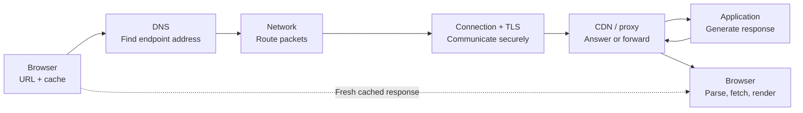

# CS230 — Computer Networks and Web Protocols

## Lecture 01: The Journey of a Web Request

*From a few characters in an address bar to a functioning application on your screen.*

---

# Part I — Intuition

*The browser is not a pipe connected to your Node.js server. It is the conductor of a small orchestra, and not every instrument plays every time.*

Look at the opening diagram for half a minute, then listen. This pass builds one mental picture. Part II develops the same picture with full technical depth.

### The picture to carry in your head

First, look at the complete journey. These are **responsibilities**, not a claim that every page load executes every step in sequence. Caches, existing connections, parallel resource requests, and HTTP/3 change the details.



**The one question:** At which boundary did the expected thing stop happening?

---

### 1. The 43-millisecond server and the five-second page

You maintain a travel-booking website. A customer opens a hotel page. Five seconds pass before anything useful appears. Your API logs confidently report a 43-millisecond response.

Both observations can be true. The API measured one small part of a much longer operation. The customer measured the experience from navigation to visible content. Imagine timing a train's movement between two stations while ignoring the time you spent finding the platform, changing trains, and walking to your destination.

Let's follow the customer's action without getting trapped by terminology. They type an address. The browser first interprets what they want. Is this a search term or a URL? Is the page already known? Does the browser have an applicable fresh cached response? Is there a service worker that might handle the request? A navigation can produce some useful content before any new request reaches your backend.

If the browser needs the network, it needs a destination address. A name such as `stays.example` is convenient for people, but packets need network addresses. DNS supplies the relevant answer, perhaps from a cache rather than a fresh series of DNS queries. DNS does not download the page. It answers the naming question.

Next the machine has to deliver traffic toward that address. Routing is about where to send packets next. It doesn't tell us what HTTP response means, whether the user is authorized, or why JavaScript takes a long time to execute.

Then comes a usable transport connection and, for HTTPS, security negotiation. With a typical HTTPS-over-TCP setup, establishing a TCP connection and negotiating TLS involve messages and time. On a reused connection, much of that work may already be done. HTTP/3 has a different transport foundation, QUIC, and integrates its security handshake differently. The user-facing task remains the same: communicate with the endpoint reliably and securely enough for the chosen protocol.

Only now should we ask which server actually handles the request. The browser might contact a CDN edge, a reverse proxy, or a load balancer. A cache hit may end the journey right there. On a cache miss, the edge forwards the request toward the origin. The Node.js service might respond in 43 milliseconds, while the customer has already paid hundreds of milliseconds elsewhere.

Finally, the browser must do something with the response. HTML is not a finished page. The browser parses it, discovers stylesheets, scripts, images, and fonts, requests more resources, executes JavaScript, constructs a layout, and paints pixels. Some tasks overlap; others depend on earlier results. A fast API can coexist with a slow page because the browser is still working.

### 2. Three clocks, three different stories

Picture three stopwatches. The first starts when a customer navigates. The second measures one network request. The third measures the time the API handler spends producing a response.

If they show five seconds, eight hundred milliseconds, and forty-three milliseconds, none must be lying. They have different boundaries. The mistake is comparing them as though they measure the same interval.

**Checkpoint:** A page paints late, but the API responds quickly. Must the database be the bottleneck? No. Inspect navigation timing, critical resources, frontend work, proxies, and network stages before choosing a culprit.

Now imagine the page loads instantly on refresh. Perhaps DNS and connection setup were reused, content came from a browser cache or CDN, or previously downloaded resources remained usable. The same URL doesn't imply the same network journey every time.

One more puzzle: the browser displays a substantial part of the website while offline. Does that prove it contacted your server? No. Cache storage and service workers can enable that behavior. The browser can use information it already possesses.

### 3. What each layer promises—and doesn't

DNS offers naming answers; it doesn't establish connectivity. IP routing offers forwarding decisions; it doesn't guarantee an application response. TCP offers a reliable ordered byte stream when a connection succeeds; it doesn't promise the remote business operation will succeed. TLS protects an authenticated encrypted communication channel under appropriate validation; it doesn't decide whether an API user is authorized. HTTP carries application requests and responses; it doesn't guarantee that the frontend has finished rendering. A CDN may answer a request without the origin ever seeing it.

This distinction is the mental map. Every layer solves one problem and depends on neighboring layers. A symptom may appear at the outermost layer while the cause sits far below it—or entirely inside the browser after the network has finished.

### 4. The small investigation

A user reports a five-second page load. Don't begin by naming protocols. Ask where the five seconds went.

Did the browser actually issue a network request? If so, what address did it resolve, and was a fresh connection needed? Did a CDN respond or forward the request? How long did the request spend waiting for the first response bytes? Once bytes arrived, how long until useful pixels appeared?

Now take the original 43-millisecond API number and put it in the appropriate box. It measures application work on one request. It isn't a measurement of DNS, network travel, edge processing, all page resources, or rendering.

**Checkpoint:** If a browser has the HTML but the page is still blank, which responsibility owns the next question? Primarily browser resource loading and rendering, not DNS resolution of the original HTML request.

### 5. The sixty-second replay

A user asks for a page. The browser checks what it already knows. DNS may help locate an endpoint. The system routes traffic there. A transport and secure channel allow communication. An edge service may return a cached response or forward the request. The application produces data when needed. The response comes back. The browser performs more work to turn that data into a page.

If you can visualize those steps and say **which one is not implied by the others**, you have the skeleton of the whole networking course. CS230-L02 through L11 fill in individual boxes. They aren't eleven unrelated subjects.

#### Three questions before L01

1. Can a browser render useful content without contacting the origin on this navigation? **Yes**—for example, from a usable cache or through service-worker behavior.
2. Does a 43-millisecond API handler prove a page should load in 43 milliseconds? **No**—it measures only one component.
3. If an HTTP response arrives successfully, is the browser necessarily done? **No**—parsing, resources, scripts, layout, and paint may still be pending.


### Pocket map — screen reference

```text
USER NAVIGATION
  Browser checks local state/cache/service worker
  DNS: name → endpoint address, maybe cached
  IP: packets → next hop → destination
  Transport: TCP (or QUIC for HTTP/3) communication
  TLS: identity + encrypted integrity-protected channel
  Edge: CDN/proxy may answer or forward
  Origin: app/db generate response when needed
  Browser: parse/resources/JS/layout/paint

MEASUREMENT BOUNDARIES
  Page load != request duration != backend handler duration
  Cache hit may omit DNS, origin, or connection establishment
  Debug the FIRST boundary where expectation diverges
```

*The intuition pass ends here.*

---

# Part II — Deep Dive

# 1. The Mystery of the Fast Server and the Slow Website

Imagine you're responsible for a hotel-booking platform.

Vue frontend, Node.js backend, PostgreSQL, services on AWS. Architecture reasonable, code reasonably clean. Then a customer reports:

> "Your website takes five seconds to load. Sometimes it's instantaneous. Sometimes I just stare at a white screen."

You investigate. Backend logs: the relevant API took **43 milliseconds**. Database fast, CPU low, memory plentiful.

You open the site yourself. Four seconds. Refresh: half a second. Refresh again: almost instantaneous. Disconnect from the internet and refresh once more — a substantial portion still appears, and your server logs show nothing.

The application has managed to be slow despite a fast backend, fast despite no new backend request, and partially functional with no network at all. All three can be perfectly legitimate.

To understand why, we need to dismantle one of the most familiar operations in software engineering: **opening a website**.

There is no single operation called "open website." What happens is a coordinated sequence involving operating systems, caches, naming systems, network protocols, cryptography, routing, application servers, and browser engines. Some steps are sequential. Some overlap. Some are skipped because earlier work can be reused. Some happen thousands of kilometers away; others happen entirely inside the browser.

A useful question to carry through this lecture:

**At what point does the browser actually need your application server?**

It might need it immediately, eventually, several times, or not at all.

By the end of this lecture, you should be able to narrate a full page load as a sequence of responsibilities — naming, routing, transport, security, HTTP, edge caches, application work, and browser rendering — and locate which boundary owns a mysterious delay.

---

# 2. Before the Network: What Did the User Actually Ask For?

Our customer enters: `https://stays.example.com/search?city=Berlin&guests=2#results`

This looks like a single address. Technically, it contains several separate instructions:

```text
https://stays.example.com/search?city=Berlin&guests=2#results
│       │                 │      │                    │
│       │                 │      │                    └─ Fragment
│       │                 │      └─ Query string
│       │                 └─ Path
│       └─ Hostname
└─ Scheme
```

### The scheme

`https` tells the browser to use HTTP semantics over a secure transport. It does not mean the browser will necessarily use TCP — modern HTTPS may use HTTP/2 over TLS over TCP, or HTTP/3 over QUIC over UDP.

### The hostname

`stays.example.com` identifies the host. **A hostname is not an IP address** — it may need resolving into one or more network addresses. It also matters for TLS certificate verification and for telling shared infrastructure which website the user intended.

### The path

`/search` identifies the requested resource. A server might route it to a search controller; a static host might return the same HTML for thousands of frontend routes and let Vue decide what `/search` means. The path does not necessarily correspond to a physical file.

### The query string

`city=Berlin&guests=2` supplies parameters. Path and query become part of the HTTP request target. Backend, frontend, or both may use them. Practical consequence: query strings are not inherently private — they can appear in history, logs, and observability systems. HTTPS protects them in transit; that does not make them secret from the receiving infrastructure.

### The fragment

`#results` is **not transmitted to the server** as part of the HTTP request target. The client interprets it — scroll to an element, or participate in frontend routing. Change only `#results` to `#reviews` and the browser may update presentation without requesting another document.

Parse the URL with the browser `URL` constructor and log `origin`, `pathname`, `search`, and `hash` separately.

```javascript
const url = new URL(
  "https://stays.example.com/search?city=Berlin&guests=2#results"
);

console.log(url.origin);   // "https://stays.example.com"
console.log(url.pathname); // "/search"
console.log(url.search);   // "?city=Berlin&guests=2"
console.log(url.hash);     // "#results"
```

For web security, an **origin** is `scheme + hostname + port` (HTTPS default: 443). So `https://example.com` and `https://example.com:443` are the same origin; `http://example.com` and `https://api.example.com` are not. These distinctions matter for CORS later.

A URL serves several audiences: naming cares about the hostname; connection machinery about address and port; the HTTP server about authority, path, headers, and query; the browser about all of those, plus the fragment.

**The URL is not merely an address. It's a compact set of instructions for several layers of machinery.**

---

# 3. The First Surprising Question: Does the Browser Even Need the Network?

Simplified explanations usually start with DNS. But that's not necessarily the browser's first meaningful decision. Before an expensive network journey, a modern browser may already possess much of what it needs.

**Situation A: First-ever visit** — Never seen this site. Probably needs to discover the server, establish a connection, obtain the HTML. Useful baseline.

**Situation B: Ordinary refresh** — May already know the address, have a reusable connection, and have cached the document and resources. Depending on caching rules: reuse, validate, or fetch anew.

**Situation C: Back button** — The back/forward cache may restore an entire suspended document, including substantial application state, without repeating navigation. Closer to resuming a page than retrieving HTML from a cache.

**Situation D: Client-side route change** — Inside the Vue app, clicking from `/search` to `/bookings` can update the view in JavaScript without a new HTML document. It might call an API — or use data already present.

There is also the **service worker**: browser-managed JavaScript that can intercept requests and return cached responses or fetch from the network. An offline-capable app might keep displaying its shell with no network — one explanation for our mysterious offline refresh.

We haven't contacted a server yet, and already have several execution paths. Throughout this lecture we'll follow a **cold network navigation**: the browser genuinely needs a document, has no suitable cache, and no reusable connection. Later we put the shortcuts back in.

---

# 4. DNS: Asking Where a Name Lives

Internet routing does not operate on `stays.example.com`. At the IP layer, machines use numerical addresses — say `203.0.113.42` (a documentation-only example). Translating a hostname into address information is **DNS resolution**.

It's often called the internet's phone book. That analogy is fine for about fifteen seconds. Then it hides the interesting parts.

## 4.1 Why DNS exists

You could visit `https://203.0.113.42/` instead of a name. Inconvenient for humans — but convenience isn't the deepest problem. The real problem is **indirection**.

What happens when you move hosts? When a server fails? When European users should hit European infrastructure and American users American? When the same service has twenty public IPs?

Hardcoding an address couples identity to a particular network location. DNS separates them: the customer knows a stable name; infrastructure can change the addresses behind it.

> Separate *what something is called* from *where its implementation currently lives*.

Not quite modern service discovery — but the architectural motivation is related.

## 4.2 Who answers the DNS question?

The browser may already have DNS information. The OS may have caches or local overrides. If not, the request goes to a configured **recursive resolver** (ISP, public provider, or organization). Modern browsers may also use encrypted DNS rather than the OS's traditional path.

With no cached information, the resolver walks the hierarchy:

```text
Browser → Recursive Resolver
              ├── Root DNS      → Ask .com
              ├── .com DNS      → Ask example.com
              └── Authoritative → Address information
```

The root doesn't know our hotel app; it refers to `.com`. The TLD refers to `example.com`'s authoritative servers. Those may return an address, or an alias requiring another lookup.

**DNS is a distributed, hierarchical naming system** — not one gigantic global database. Authority is delegated.

## 4.3 DNS records: Not every answer is an address

An **A** record maps a name to an IPv4 address. An **AAAA** record maps a name to an IPv6 address. A **CNAME** record is an alias pointing to another name. Here the hotel hostname is a CNAME into a CDN name that then answers with A and AAAA addresses:

```text
stays.example.com
        └── CNAME → distribution.example-cdn.net
                           ├── A    → IPv4
                           └── AAAA → IPv6
```

Useful when integrating a CDN: you control the name; address information may ultimately come from another organization. A DNS response can contain more than one destination; the client may choose among them.

## 4.4 DNS caching: The first major shortcut

Records carry a **TTL**. A resolver can reuse an answer until it expires — so the hierarchy isn't walked from the root on every page load. Browsers and OSes may retain DNS information too.

**Operational consequence:** You update DNS to a new IP and terminate the old infrastructure immediately. Some users keep connecting to the old destination until caches expire. The new software may be flawless; the failure is in the relationship between **naming, caching, and infrastructure lifecycle**.

## 4.5 DNS doesn't necessarily tell you where the backend lives

Resolving `stays.example.com` might produce a CDN edge address. It does not necessarily reveal your application server's IP, your database's location, a Lambda environment, or the path between CDN and origin.

DNS tells the client how to reach an advertised endpoint. **It does not promise to reveal the architecture behind that endpoint.** Increasingly, that endpoint is only the front door.

---

# 5. IP Routing: Finding the Front Door

We have an address. The laptop is on Wi-Fi in Vilnius; the destination might be a European edge. Distinguish two concepts developers casually combine:

**DNS answers: Where should I send traffic?**  
**IP routing answers: How can this packet move toward that destination?**

## 5.1 Packets, not magical continuous connections

At the IP layer, information travels in packets — addressing plus payload. Large responses are divided into units suitable for transmission. Routers forward toward destinations using routing information: `Laptop → Wi-Fi → ISP → Transit/peering → Destination → CDN edge or server`

Each router doesn't need a complete picture of the internet — only enough to choose a next hop. Complex global behavior from many local forwarding decisions.

## 5.2 Routers don't normally care about your Vue application

A router forwarding an ordinary IP packet doesn't need to know the payload is `GET /search?city=Berlin`. It cares about network-layer information. Middleboxes (NAT, firewalls) complicate the picture, but the distinction remains: the network forwards packets; transport manages endpoint communication; HTTP gives application messages their meaning. Same infrastructure, many kinds of applications.

## 5.3 Physical distance is a real performance constraint

No amount of clever TypeScript eliminates propagation delay. In fiber, light travels at roughly two-thirds of vacuum speed — about **200 km/ms**. For 5,000 km of fiber path, one-way ≈ 25 ms, round trip ≈ 50 ms — before real routes, equipment, queues, and application work.

Many network operations require a **round trip**: client sends, server responds, only then can the client continue. Several sequential round trips before useful data make geography expensive.

**Round-trip time (RTT)** is the time for information to travel out and a response or acknowledgment to return. We'll explore it in CS230-L02. Keep one intuition:

> A 60-millisecond RTT can be more damaging than it looks, because an application may need several sequential exchanges before anything useful appears.

---

# 6. TCP: Turning Unreliable Packet Delivery into a Reliable Conversation

IP can deliver packets. It does not guarantee arrival, uniqueness, or order. Applications generally don't want to solve reliability from scratch. For decades, **TCP (Transmission Control Protocol)** has provided a reliable, ordered **byte stream** between endpoints.

TCP does not understand HTTP, JSON, or application messages. It transports bytes. Chunk boundaries written by the sender need not match what the receiver sees; higher-level protocols define message boundaries.

## 6.1 A connection needs two endpoints

`Client: 192.168.1.42:53144`, then `Server: 203.0.113.42:443`

IP address plus port. Server uses 443 (conventional HTTPS); the client's OS chooses a temporary local port. Private client addresses typically go through NAT. A TCP connection is identified by the two addresses, two ports, and transport context — how one machine keeps many conversations separate.

A **socket** is the OS interface and endpoint abstraction for these services. A Node.js server listening on a port works through OS networking facilities, not by inspecting electrical signals on a cable.

## 6.2 The famous three-way handshake

Client and server exchange SYN, then SYN-ACK, then ACK — after that the TCP connection is established:

```text
Client                                  Server
   ─────────── SYN ───────────────────────►
   ◄────────── SYN-ACK ────────────────────
   ─────────── ACK ───────────────────────►
               Connection established
```

Both sides establish connection state for reliable, ordered communication. Establishing a fresh TCP connection ordinarily costs about **one RTT** before the client can proceed with the usual application-level handshake. At 80 ms RTT, that's already meaningful — and we still haven't sent HTTP.

## 6.3 TCP is doing much more than the handshake

Sequence numbers, acknowledgments, retransmission. **Flow control** (can the receiver accept more?) and **congestion control** (can the path safely carry more?) are related but different. The receiver might be fine while the path is congested, or vice versa. Mechanisms in the next session.

## 6.4 Why connection reuse matters

A page with HTML, CSS, JS, images, fonts might need thirty resources. Establishing a new TCP connection for each is usually wasteful. Modern HTTP reuses connections; HTTP/2 multiplexes multiple exchanges over one TCP connection. After paying setup once, later requests can reuse it — one reason a warm load beats a cold one. Reuse avoids repeated setup; it doesn't eliminate all network latency. And before HTTPS can proceed, we still have a security problem.

---

# 7. TLS: How Do You Know You're Talking to the Right Server?

A TCP connection to an address does not prove the machine represents the intended website, nor prevent someone on the path from reading or altering unprotected data. Transmitting auth cookies and payment info in the clear is not an attractive business model.

**TLS (Transport Layer Security)** authenticates a peer and establishes encrypted, integrity-protected communication. For ordinary HTTPS, the browser authenticates the server. Client certificates exist but ordinary sites usually use application-level credentials instead.

## 7.1 The problem with simply encrypting everything

Encrypt with what key? If client and server have never met, they share no secret. Sending a key in plaintext defeats the purpose. And even with key exchange: how does the browser know it talked to the legitimate server rather than an impersonator?

TLS must (1) establish keys securely and (2) authenticate the intended server. Encryption without authentication still leaves room for an active impersonator.

## 7.2 The TLS 1.3 handshake

In outline: the browser sends ClientHello; the server answers with ServerHello, certificate material, and Finished; the client Finished completes setup; then protected application traffic can flow:

```text
Browser                                  Server
ClientHello (crypto, key agreement, prefs)
   ─────────────────────────────────────►
                            ServerHello, key agreement,
                            Certificate, proof, Finished
   ◄─────────────────────────────────────
Client Finished
   ─────────────────────────────────────►
        Protected application traffic
```

Over an established TCP connection, a normal full TLS 1.3 handshake generally lets the client send application data after roughly **one additional RTT** — more efficient than several older arrangements.

**Key agreement:** Commonly ephemeral Diffie–Hellman. Participants derive shared secrets without transmitting the shared secret itself. An observer recording handshake messages should not derive the session keys.

**Server authentication:** The certificate carries identity (including valid DNS names) and a chain of trust. The browser checks validity for the hostname, period, trusted chain, private-key proof, and applicable policy. The server cannot simply announce "I'm stays.example.com."

**Symmetric encryption:** After key agreement, bulk traffic uses efficient symmetric crypto. Asymmetric techniques establish authenticated keying material; symmetric protects the bytes.

## 7.3 What TLS does and doesn't protect

TLS protects communication between browser and the endpoint it connects to — often a CDN edge that **terminates TLS**, inspects or caches the request, then opens a separate protected connection to origin. Spoken simply: browser to CDN is TLS A; CDN to application is a different TLS B:

`Browser ──TLS A──► CDN / Proxy ──TLS B──► Application`

Different keys; the browser's TLS does not necessarily extend to the Node.js process or database. "HTTPS enabled" is not a complete security analysis — know where encryption terminates and how subsequent hops are protected.

TLS also doesn't make all metadata invisible. IP addressing remains necessary; traditional DNS may be observable; some handshake metadata can leak information (encrypted DNS and Encrypted ClientHello can reduce exposure where supported). TLS protects important properties; it doesn't make the network disappear.

## 7.4 Which HTTP version will we use?

**ALPN (Application-Layer Protocol Negotiation)** lets client and server choose an application protocol (`h2`, `http/1.1`, …). HTTP/3 is different: it runs over QUIC, which integrates TLS 1.3 into its own connection establishment.

Avoid assuming every HTTPS navigation is `TCP → TLS → HTTP`:

```text
                 HTTPS
         ┌─────────┴─────────┐
    HTTP/1.1 or HTTP/2     HTTP/3
         │                   │
       TLS                 QUIC (with TLS)
         │                   │
        TCP                 UDP
         └─────────┬─────────┘
                   IP
```

QUIC provides multiplexed streams, transport-level loss recovery, and integrated secure setup. A lost packet does not force every independent QUIC stream to wait the way HTTP/2 streams can stall behind TCP head-of-line blocking. HTTP/3 can perform better under certain conditions — not universally, not magically. Different transport trade-offs, not a cheat code against physics.

For this investigation, assume **HTTP/2 over TLS over TCP**. The secure connection is ready. Finally, we can ask for a webpage.

---

# 8. HTTP: The Actual Request

HTTP is an **application-layer protocol**: requests, responses, methods, headers, status codes. It doesn't move electrical signals, implement IP routing, or recover lost transport packets.

## 8.1 What a request looks like

HTTP/1.1-style notation (readable; not how HTTP/2 literally serializes):

```http
GET /search?city=Berlin&guests=2 HTTP/1.1
Host: stays.example.com
Accept: text/html
Accept-Language: en-US,en;q=0.9
Accept-Encoding: gzip, br
Cookie: session=abc123
```

**`GET`** — Request a representation. By convention, safe: shouldn't itself request a state-changing business operation (logging is fine; charging a card is not). Matters for caching, prefetching, retries, API design.

**Request target** — Path and query. `#results` has disappeared; the fragment stays on the client.

**`Host`** — Intended HTTP authority. One IP can serve `stays.example.com`, `admin.example.com`, and `api.example.com`; the host distinguishes them. HTTP/2 and HTTP/3 use `:authority` and related mechanisms.

**`Accept` / `Accept-Encoding`** — Preferred media types; willingness to accept compressed representations (`gzip`, `br`). Fewer bytes help when bandwidth is constrained.

**`Cookie`** — Stored state associated with the request, subject to cookie rules. HTTP exchanges are fundamentally independent; cookies and server sessions reconstruct the illusion of a long-running relationship. Details in the security session.

## 8.2 HTTP/2 doesn't literally send this text

HTTP/2 uses binary framing, compressed headers, and multiplexed streams. Conceptual method, target, headers, and semantics remain; bytes on the wire differ.

**HTTP semantics and HTTP message serialization are not the same thing.** Semantics say what a request means; the version determines how messages are represented and carried.

---

# 9. The Server You Contact Is Probably Not Your Application Server

In development, a Node.js process may receive traffic directly. Production often has layers in front: `Browser → CDN / Reverse Proxy → (cache hit?) → WAF → Load Balancer / Gateway`, then `       → Application → Redis / PostgreSQL / external services`

Conceptual, not mandatory. What matters: several independent systems may participate in one browser request.

## 9.1 Reverse proxies

Accept client traffic and forward toward backends. May terminate TLS, route, load-balance, manipulate headers, compress, rate-limit, cache, filter, manage connections. To the browser, the proxy may *be* the server; to the app, it's an upstream forwarder. Distinguish **client-facing** from **origin** infrastructure.

## 9.2 CDN: Bringing content closer to the user

A **CDN** serves content from locations nearer users. A JS bundle `/assets/app.a91f3.js` is identical for every visitor — why should Vilnius repeatedly fetch it from a distant origin? Cache at the edge; on hit, origin never regenerates or retransmits.

Simplest powerful technique: instead of optimizing the origin to repeat the same work, avoid requiring it.

**Caching isn't free.** Personal booking data cached with a careless key can leak across customers. Availability cached for ten minutes can be fast but wrong. A content-hashed static bundle is an excellent long-lived cache candidate; a personalized summary is not; search sits in the middle. Correctness depends on the product's guarantees.

## 9.3 The invisible cache hit

Customer receives a cached document from the CDN. Request never reaches Node.js. Backend logs empty. Website works. No contradiction.

**The public service is larger than the application process.**

---

# 10. Inside the Application: Where the Famous 43 Milliseconds Came From

Assume the request reaches the app: `HTTP → Routing → Middleware → Auth → Validation → Business logic`, then `    → DB / deps → Serialize → Response`

A tiny Express-style handler: require a `city` query param, otherwise return 400; otherwise load hotels and respond with JSON.

```typescript
app.get("/api/hotels", async (req, res) => {
  const city = String(req.query.city ?? "");
  if (!city) {
    return res.status(400).json({ error: "city is required" });
  }
  const hotels = await hotelService.findHotels(city);
  return res.json({ hotels });
});
```

You measure controller execution: **43 ms**. Useful for that portion of the lifecycle. It does **not** necessarily include DNS, TCP/QUIC setup, TLS, transit, CDN, load-balancer queues, response transfer, frontend assets, JS/rendering, or later API calls. It might miss queue wait before the controller, or Lambda init outside the measured handler.

**Every measurement has boundaries.** When someone says "our backend responds in 43 milliseconds," ask: **"Measured from where to where?"** That question begins serious performance engineering.

---

# 11. The HTTP Response: The Server Finally Answers

A successful response might begin with status `HTTP/1.1 200 OK`, then headers such as `Content-Type`, `Content-Encoding`, and `Cache-Control`, followed by the HTML body.

```http
HTTP/1.1 200 OK
Content-Type: text/html; charset=utf-8
Content-Encoding: br
Cache-Control: private, no-cache

<!doctype html>
...
```

**Metadata** (status, headers) and **content** (body). Illustrative notation, not an HTTP/2 frame dump.

## 11.1 The status code

A few codes appear constantly on this journey. **200** means success. **301** and **302** are permanent and temporary redirects. **304** means a cached representation is still valid. **401** and **403** cover authentication required and forbidden access. **404** means not found. **500** and **503** cover server error and temporary unavailability.

Redirects matter for performance. `http://stays.example.com` → `301` to HTTPS may require another exchange and possibly another connection setup. With HSTS, browsers that already know the policy may upgrade to HTTPS without the insecure request first. A redirect isn't a harmless config line — it can add a sequential step.

## 11.2 `Content-Type`

`text/html`, `application/json`, `text/javascript` — how the client should interpret the body. `200 OK` isn't enough for a working page: an HTML error page returned to a frontend expecting JSON often surfaces as `Unexpected token '<'`. HTTP succeeded; application expectations didn't meet.

## 11.3 `Content-Encoding`

Compressed responses are decompressed before interpretation. HTML/CSS/JS compress well; many images/videos are already compressed. Trade-offs: CPU cost; doesn't eliminate setup or propagation latency; shrinking 600→400 bytes won't rescue a two-second DB wait.

## 11.4 An HTTP response can be streamed

The server need not finish the entire response before the browser receives bytes. The browser may parse early HTML, discover stylesheets and scripts, and continue receiving — overlapping work. Streaming helps when early bytes are useful; it isn't automatically beneficial.

**Server and browser can sometimes work concurrently.** The lifecycle isn't one giant sequence where each participant waits for every previous one to finish.

---

# 12. The Browser Has Received HTML. Why Isn't the Website Ready?

Receiving HTML ≠ displaying an interactive application. The first document may be almost empty: a stylesheet link, a module script, and a blank `#app` div — the booking UI arrives only after those assets run:

```html
<!doctype html>
<html>
  <head>
    <link rel="stylesheet" href="/assets/app.css">
    <script type="module" src="/assets/app.js"></script>
  </head>
  <body>
    <div id="app"></div>
  </body>
</html>
```

Tiny document, returned almost instantly — empty container plus references. No functional booking UI yet.

## 12.1 HTML parsing

The browser builds a **DOM** — an in-memory structured tree of nodes, not a string. Browser APIs and JavaScript inspect and manipulate it. Structure alone doesn't determine layout or appearance.

## 12.2 CSS processing

Stylesheets drive fonts, colors, dimensions, positioning, layout, visibility. Rough stages for SE240-L01:

**DOM** — structure? **Style** — which rules? **Layout** — dimensions and positions? **Paint** — what to draw? **Composite** — how surfaces combine?

Browsers optimize and reuse work; they still must interpret and lay out content.

## 12.3 JavaScript enters the picture

Obtain JS, parse/compile, execute. Vue initializes, builds UI, then may fetch `/api/hotels?city=Berlin`, parse JSON, and assign `hotels.value`:

```typescript
const response = await fetch("/api/hotels?city=Berlin");
const data = await response.json();
hotels.value = data.hotels;
```

HTML done; results still wait on the API. If that takes 500 ms — or only starts after a large bundle downloads and runs — delays stack.

## 12.4 A webpage is a dependency graph

HTML fans out into CSS, JavaScript (which may init, call an API, then render), fonts, and images — some in parallel, some on the critical path:

```text
HTML
 ├── CSS
 ├── JavaScript → init → API → render results
 ├── Fonts
 └── Images
```

Some branches concurrent; others not. The API can't start until relevant JS runs (unless architecture starts it earlier).

**Time to a user-visible milestone depends on the critical dependency path, not total work.** Three independent 200 ms image downloads in parallel ≈ 200 ms elapsed; three sequential 200 ms steps ≈ 600 ms.

Optimize the wrong resource and accomplish nothing: cut an off-critical-path image from 500 ms to 50 ms and perceived effect may be negligible. Senior performance work is identifying **which dependencies control the user's experience**.

---

# 13. The Timeline: Where the Milliseconds Disappear

Cold browser, HTTP/2 over new TLS 1.3/TCP. Hypothetical, simplified:

```text
DNS                 30 ms
TCP                 60 ms   (≈ 1 RTT)
TLS                 60 ms   (≈ 1 RTT)
Request travel      30 ms
Backend             43 ms
Response travel     30 ms
-------------------------
Total              253 ms
```

Roughly **253 ms before the first response bytes**, despite a 43 ms backend. Teaching model, not a browser-trace prediction — but the backend is only a fraction, and page loading has barely begun.

## 13.1 Time to First Byte

**TTFB** — time until the first response byte, from the start of the navigation/request under the relevant definition. Can include redirects, connection setup, and more. Not synonymous with backend execution. Poor TTFB can come from distance, DNS, connection, TLS, redirects, CDN/proxy, queues, app work, or upstream deps. A server-side timer alone cannot explain browser navigation latency.

## 13.2 What happens after TTFB?

Hypothetical additions: HTML transfer/parse 70 ms, required resources 180 ms, JS init 450 ms, critical API 250 ms, rendering 80 ms — not all strictly sequential. Important milestone maybe a second or more; backend still says 43 ms. Both correct; different scopes.

## 13.3 First paint isn't interactivity

Milestones differ: first bytes, first visible content, largest contentful paint, document milestones, interactive, background work. A skeleton can appear immediately while the main thread is blocked; or the UI can be interactive while images still download.

"The page loaded in 800 ms" is often inadequate — loaded how, and what could the user do? Core Web Vitals in SE240-L05. Principle for now:

**Fast data delivery, fast visual rendering, and fast interaction are different engineering objectives.**

---

# 14. HTTP/1.1, HTTP/2, and HTTP/3: Why the Transport History Matters

Modern pages need many resources. How those requests share connections shaped protocol evolution.

## 14.1 HTTP/1.1: Reuse, limited concurrency per connection

Persistent connections avoid a fresh TCP connection per request, but no modern-style independent stream multiplexing. Pipelining proved problematic in practice; browsers traditionally opened multiple TCP connections per origin — workable, with costs in state, setup, and congestion control.

## 14.2 HTTP/2: Multiple streams over one TCP connection

Binary framing and multiplexed streams interleaved on one TCP connection — a substantial improvement. Complication: TCP is one ordered byte stream. Lost bytes can delay delivery of later bytes, stalling multiple HTTP/2 streams. **Transport-level head-of-line blocking.** Multiplexing fixes an application-protocol limit; it cannot erase TCP's ordered stream.

## 14.3 HTTP/3: A different transport foundation

HTTP/3 uses **QUIC** (commonly over UDP) with its own secure, reliable features and independently managed streams. Loss on one stream need not block delivery on others. TLS 1.3 is integrated; resumption can be more efficient (0-RTT early data exists, with replay considerations — not automatically safe for arbitrary state-changing operations).

Put briefly: HTTP/1.1 and HTTP/2 commonly ride TCP with TLS, while HTTP/3 rides QUIC over UDP. HTTP/1.1 has no native multiplexed streams; HTTP/2 and HTTP/3 do. TCP head-of-line blocking applies to HTTP/1.1 and can stall multiple HTTP/2 streams after loss, whereas independent QUIC streams avoid that form of blocking. All three reuse connections; only the transport underneath changes.

HTTP/3 should not always beat HTTP/2. Network conditions, implementations, intermediaries, and UDP restrictions (fallback to TCP-based HTTP) all matter. Modern HTTP evolution isn't only cleverer headers — it's how numerous independent exchanges share transport.

---

# 15. Reconstructing the Entire Journey

Put the pieces in order for a cold visit: interpret the URL, check local state, possibly DNS, then TCP or QUIC, TLS where applicable, HTTP request and response, then frontend work before the UI is ready:

```text
BROWSER: interpret URL → local state/policies → need network?
    ▼
DNS: resolve destination (caches + hierarchy)
    ▼
NETWORK: route toward endpoint
    ▼
TRANSPORT: TCP or QUIC
    ▼
SECURITY: authenticate, protect
    ▼
HTTP REQUEST: method, target, headers, body
    ▼
EDGE: CDN/proxy/routing/security/cache → hit? return
    ▼ (miss / dynamic)
APPLICATION: route, auth, logic, deps, produce response
    ▼
HTTP RESPONSE: status, headers, body over protected connection
    ▼
BROWSER: decode, parse, load resources, execute JS, render,
         further requests as needed → VISIBLE PAGE
```

Simplified. Reality overlaps loading with parsing; reuse skips setup; service workers intercept; caches bypass the network; redirects restart navigation; HTTP/3 takes a different path; useful content can appear before everything finishes.

The diagram's value isn't that every navigation hits every box — it identifies responsibilities and boundaries. When something goes wrong, ask which boundary is failing. "The website is slow" becomes a tractable investigation.

---

# 16. A Production Investigation: The Mystery Revisited

Observations that seemed contradictory are now clues:

1. Backend ≈ 43 ms  
2. Page sometimes several seconds  
3. Reload much faster  
4. Some content offline  
5. Some loads leave no backend logs  

## 16.1 Why the first visit is slow

HTML arrives reasonably quickly. Large JS bundle → startup → only then fetch hotel data. Third-party resources too. Critical path: `HTML → download JS → execute startup → fetch results → render`

Bundles larger than needed; expensive modules on the initial path; too much synchronous init; API starts late. The 43 ms timer was never the right explanation for a four-second load.

## 16.2 Why the second visit is faster

Cached static resources, available DNS, reused connections, possibly less repeated browser work, retained state or data. Fewer initialization costs. No miracle.

## 16.3 Why the backend sometimes sees nothing

CDN satisfies static assets; client-side routing skips new HTML; service worker may handle fetches locally. No app-server log ≠ no meaningful browser work — work happened elsewhere.

## 16.4 Why the website works partially offline

Service worker serves the shell; some data already present; live availability may fail. Partially functional, nothing magical — enough local resources to reconstruct part of the experience.

## 16.5 The real architectural lesson

"The JS bundle was too large" is incomplete. The deeper issue was a poorly understood **critical path** — important work depended on downloading and executing that bundle before useful results.

Improvements might include: code-split nonessential modules; avoid expensive init on the critical path; render useful content earlier; start essential fetches sooner; cut sequential dependencies; cache static assets well; profile JS execution, not only transfer; consider different rendering/data-loading strategies.

These don't all solve the same problem — bytes, CPU, round trips, earlier work, concurrency, or what the user sees while waiting. Decide based on which part of the journey actually owns the delay.

---

# 17. The Oral Examination

We now have enough knowledge to examine a page load like an engineer rather than merely recognize its vocabulary.

Before reading the solutions, try answering these questions out loud. Imagine that a senior engineer is interviewing you and will challenge any hand-waving.

### Challenge 1 — The Empty Server Logs

Frontend at `https://app.example.com`. User clicks between pages normally; Node.js logs show no matching requests. Logging failure? Give at least three legitimate explanations.

### Challenge 2 — The Geographical Performance Mystery

App servers in Frankfurt. Germany median document TTFB 120 ms; Australia 410 ms; app processing ≈ 35 ms for both. What accounts for the difference? Would more CPU necessarily fix it? What architectural changes might help?

### Challenge 3 — The DNS Migration

`api.example.com` TTL one hour. You update DNS. Five minutes later some traffic still hits old infrastructure. Colleague: "DNS is broken." Correct? What should the migration plan have accounted for?

### Challenge 4 — The Fast HTTP Response, Slow User Interface

HTML TTFB 90 ms, HTML download 15 ms, main JS 850 KB compressed, JS startup 1100 ms, critical API 240 ms (starts only after startup). Blank page until results. Manager: "Optimize the backend query by 20 ms?" Evaluate. What first?

### Challenge 5 — The HTTPS Misconception

"HTTPS means encrypted from browser all the way to Node.js." Architecture: `Browser → Cloud CDN → Load Balancer → Node.js`. Necessarily correct? What else do you need?

### Challenge 6 — The HTTP/3 Question

"Why was HTTP/3 created if HTTP/2 already multiplexes?" Explain HTTP/2's remaining transport limitation. Don't just say HTTP/3 is faster — which mechanism changed and why it matters.

### Challenge 7 — The Unnecessary Round Trip

`http://example.com` redirects to `https://example.com`. Why can the redirect increase latency? When might the browser avoid the initial insecure request?

---

# 18. Solutions and Discussion

### Solution 1 — Empty server logs

Not automatically a failure. **Client-side routing**; **browser cache / service worker**; **CDN cache**; also: frontend already has data and makes no request. Inspect the Network panel. Distinguish user-visible navigation from backend processing.

### Solution 2 — Geographical performance

Distance increases RTT — visible in connection, TLS, and request/response. More CPU doesn't remove propagation delay. Helps: CDN for cacheable content; fewer sequential round trips; connection reuse; better protocol/connection handling; services closer to users where consistency allows; keep user-visible work off unnecessary remote critical paths. "Deploy everything everywhere" isn't automatic — replication and consistency cost real complexity.

### Solution 3 — DNS migration

Expected behavior. Caches may retain the old address until TTL (and policies) allow. Plan a transition: lower TTL in advance; validate new infra; change DNS; keep old infra up; monitor until old destination isn't needed. Don't assume perfectly synchronized global changes.

### Solution 4 — Slow UI

A 20 ms backend win is unlikely to matter next to 1100 ms JS startup and a large bundle. Investigate: unnecessary modules in the initial bundle; long main-thread tasks; earlier API start; content before full init; code splitting / alternate rendering. The 240 ms API is delayed behind 1100 ms of startup — removing a dependency or overlapping work beats shaving backend milliseconds.

### Solution 5 — HTTPS boundaries

Not necessarily. TLS may terminate at CDN, then again at the load balancer; Node.js hop may or may not be encrypted. Inspect termination points and protocols per hop. Public HTTPS ≠ end-to-end protection through the stack.

### Solution 6 — HTTP/3

HTTP/2 multiplexes over TCP's one ordered byte stream; loss can delay unrelated streams. QUIC's independent streams avoid that form of HOL blocking, with integrated secure setup. Benefit depends on conditions and implementations. The point is a changed transport mechanism, not a newer acronym.

### Solution 7 — The redirect

Another request-response (and possibly connection/protocol work) as a sequential dependency. Applicable HSTS (including preload) can upgrade HTTP→HTTPS locally and skip the insecure round trip. Every unnecessary sequential network exchange is an opportunity for more latency.

---

# 19. The Mental Model Worth Keeping

The useful result isn't memorizing acronyms — it's separation of responsibilities.

**Where is the service?** DNS discovers destinations.

**How does information get there?** IP routing moves packets.

**Reliable exchange?** TCP or QUIC transport.

**Secure conversation?** TLS-related authentication and protection.

**Express the request?** HTTP semantics.

**Who handles it?** CDN, proxy, balancer, app — or a combination.

**Become a webpage?** Browser interprets, executes, lays out, renders.

**Why slow then fast?** Different paths, reuse, and dependencies.

Underneath:

**The time spent executing application code is not the same as the time required to deliver an application experience.**

A website is a distributed system extending into the user's browser. See that system and performance bugs, network failures, caching anomalies, and strange browser behavior become less mysterious.

Not "Why is my website slow?" but:

**Which dependency on the critical path is responsible for the delay, and what mechanism determines its cost?**

---

# 20. Next Lecture — Networking for Software Engineers

Two servers, gigabit links, same app, fast CPUs. Large file transfer: excellent throughput. Tiny requests: one feels instant, the other painfully slow. Bandwidth enormous, code identical, CPUs idle — where did the time go?

Packets, round trips, congestion windows, loss recovery, routing, connection establishment. Why more bandwidth often fails to fix latency; why a little packet loss can hurt a lot; why measuring a network is harder than a speed test.

In **CS230-L02**, we'll investigate networking for software engineers — why fast connections can still feel slow.

---

## Optional Practical Lab — Watch the Browser Do It

*The spoken lecture ends here. The remaining material is a screen-first investigation worksheet and technical references.*

A recent desktop browser and a terminal suffice. Results vary by site, browser, network, and privacy settings.

### Lab A — The network waterfall

DevTools → **Network** → preserve log if you want redirects → reload. Inspect the main document's timing (Queueing, DNS, connection, SSL, waiting, download — browser categories, not universal protocol phases).

If the backend took 43 ms but the document took 600 ms: connection setup? Redirect? Waiting? Slow body? Fast document, late JS?

**Useful comparison:** reload normally, then with **Disable cache**. Some resources re-download — but OS DNS, CDN, connection reuse, and service workers are distinct. A truly cold navigation is harder than Ctrl+R.

### Lab B — Discover the protocol

Enable the **Protocol** column. Look for `h2`, `h3`, `http/1.1`. Different origins may differ. How many separate network origins does one page involve? One visual product may talk to many services.

### Lab C — Navigation timing in JavaScript

In DevTools, read the navigation timing entry and print DNS, connect, TLS, TTFB, and total durations.

```javascript
const navigation =
  performance.getEntriesByType("navigation")[0];

console.table({
  dns:
    navigation.domainLookupEnd -
    navigation.domainLookupStart,
  connection:
    navigation.connectEnd -
    navigation.connectStart,
  tls:
    navigation.secureConnectionStart > 0
      ? navigation.connectEnd -
        navigation.secureConnectionStart
      : 0,
  waitingAfterRequest:
    navigation.responseStart -
    navigation.requestStart,
  responseTransfer:
    navigation.responseEnd -
    navigation.responseStart,
  totalToFirstByte:
    navigation.responseStart -
    navigation.startTime
});
```

Milliseconds. Cautions: TLS is an API approximation; `waitingAfterRequest` includes more than server CPU; connection phases can be zero when reused; privacy limits can apply. Reload and compare — formulate an explanation before looking things up.

**Thought experiment:** DNS/connection/TLS all 0 ms, waiting 380 ms, transfer 12 ms. Reasonable: no fresh DNS/connection work on this path; substantial time after the request starts. **Not** proven: Node.js spent 380 ms. Timing narrows investigation; it rarely proves root cause alone.

### Lab D — From the terminal

From the terminal: resolve the name with `nslookup` or `dig`, then probe HTTPS with `curl -I` / `curl -v`, and optionally print timing fields with `curl -w`.

```bash
nslookup example.com
# or: dig example.com

curl -I https://example.com
curl -v https://example.com

curl -sS -o /dev/null \
  -w "DNS: %{time_namelookup}s\nConnect: %{time_connect}s\nTLS: %{time_appconnect}s\nTTFB: %{time_starttransfer}s\nTotal: %{time_total}s\n" \
  https://example.com
```

On Windows PowerShell, use `curl.exe` for the real executable. Curl timings are cumulative from transfer start — e.g. TCP phase ≈ `time_connect - time_namelookup`; TLS ≈ `time_appconnect - time_connect` in a conventional TCP/TLS case. Reuse, proxies, and HTTP/3 alter meanings.

Compare browser vs curl. Differences may come from cookies, cache, service workers, protocol choice, reuse, auth, headers, extensions, proxies. Curl investigates network/HTTP well; it cannot perfectly reproduce a browser session.

### Lab E — Find an unexpected request

Click between SPA routes: new HTML? Only API? Nothing? Full reload on the destination and compare.

**Application navigation** (frontend) and **document navigation** (browser) can look identical to the user and behave very differently inside.

### Lab F — Explain your observations

Write or speak a short diagnosis covering:

1. Which stages owned the main document's delay.
2. Which HTTP version carried major resources.
3. How a second visit differed from a cold-ish first visit.
4. Whether browser timing and curl timing told the same story.
5. Whether a route change required a new document request.

The objective is to practice separating browser experience from backend request logs.

---

## Further Reading — Optional Technical References

The lecture is self-contained. These help for deeper exploration.

1. [MDN — How Browsers Work](https://developer.mozilla.org/en-US/docs/Web/Performance/Guides/How_browsers_work)
2. [MDN — Navigation and Resource Timing](https://developer.mozilla.org/en-US/docs/Web/Performance/Guides/Navigation_and_resource_timings)
3. [MDN — Overview of HTTP](https://developer.mozilla.org/en-US/docs/Web/HTTP/Guides/Overview)
4. [RFC 8446 — TLS 1.3](https://www.rfc-editor.org/rfc/rfc8446.html)
5. [RFC 9000 — QUIC](https://www.rfc-editor.org/rfc/rfc9000.html)
6. [RFC 9114 — HTTP/3](https://www.rfc-editor.org/rfc/rfc9114.html)
7. [web.dev — Time to First Byte](https://web.dev/articles/ttfb)
8. [MDN — Service Worker Fetch Events](https://developer.mozilla.org/en-US/docs/Web/API/ServiceWorkerGlobalScope/fetch_event)

---

## Dense Cheatsheet — Interview Glance Card

*Fenced so voice readers skip it. Skim on screen when revising; open sections above only when a row fails to spark.*

```text
CS230-L01  JOURNEY OF A WEB REQUEST — INTERVIEW GLANCE CARD

CORE QUESTION
  At what point does the browser actually need your application server?
  Immediately / eventually / several times / not at all — all legitimate.

URL = INSTRUCTIONS, NOT ONE ADDRESS
  Scheme     https → HTTP semantics over secure transport
             (HTTP/2+TLS+TCP or HTTP/3+QUIC+UDP — not “always TCP”)
  Hostname   stays.example.com — name, not IP; TLS identity + Host/:authority
  Path       /search — resource; may be SPA route, not a disk file
  Query      city=… — part of request target; HTTPS ≠ secret from logs/history
  Fragment   #results — CLIENT ONLY; never sent as HTTP request target
  Origin     scheme + hostname + port (HTTPS default 443) — CORS later

BEFORE THE NETWORK
  Cold visit     discover, connect, fetch document
  Refresh        DNS/conn/cache may reuse → validate or refetch
  Back/forward   bfcache may restore suspended page (≠ cache hit)
  SPA route      JS view change; may skip new HTML; maybe API or local data
  Service worker intercept → cache/offline shell without origin

DNS — WHERE A NAME LIVES
  Indirection: stable name ≠ fixed network location
  Path: stub/browser → recursive resolver → root → TLD → authoritative
  A / AAAA   IPv4 / IPv6 addresses (possibly many)
  CNAME      alias → another name (CDN common)
  TTL        caches reuse until expiry — cut old infra early → “DNS broken”
  DNS reveals advertised endpoint, NOT backend/DB/Lambda architecture

IP ROUTING vs DNS
  DNS: where should I send traffic?
  IP:  how can this packet move toward that destination?
  Routers forward packets; they don’t care about GET /search
  Fiber ≈ 200 km/ms → 5000 km ≈ 25 ms one-way / ~50 ms RTT floor
  RTT hurts when many SEQUENTIAL round trips precede useful bytes

TCP — RELIABLE BYTE STREAM
  Connection = (src IP, src port, dst IP, dst port) + transport context
  Socket = OS endpoint abstraction
  Handshake SYN → SYN-ACK → ACK ≈ 1 RTT before app data (typical)
  Does NOT understand HTTP/JSON; message boundaries are higher-layer
  Reuse / HTTP/2 multiplexing: avoid paying setup per resource

TLS — RIGHT PEER + PROTECTED BYTES
  Encrypt without authenticate → still impersonation risk
  TLS 1.3 over TCP: often ~1 extra RTT before app data
  Certificate: hostname, validity, chain, private-key proof
  Termination: Browser──TLS A──►CDN──TLS B──►App  (different keys)
  “HTTPS enabled” ≠ end-to-end through Node/DB
  ALPN picks h2 / http/1.1; HTTP/3 integrates TLS inside QUIC

HTTP — APPLICATION MEANING
  Method + target + headers + body; Host/:authority selects virtual host
  GET conventionally safe; Cookie reconstructs “session” illusion
  Semantics ≠ wire serialization (HTTP/2 binary frames)
  Status: 200 / 301·302 / 304 / 401·403 / 404 / 500·503
  Redirects add sequential steps; HSTS may skip insecure first hop
  Content-Type / Content-Encoding; streaming overlaps server+browser work

EDGE BEFORE YOUR APP
  Browser → CDN / reverse proxy → (cache?) → WAF → LB → App → deps
  Cache hit: empty backend logs + working site — no contradiction
  Public service > application process
  Cache carefully: hashed static OK; personal data + bad key = leak

MEASUREMENT BOUNDARIES
  “Backend 43 ms” ≠ page experience
  Ask: measured from where to where?
  Misses: DNS, TCP/QUIC, TLS, transit, CDN, queues, transfer, JS, APIs

AFTER HTML — CRITICAL PATH
  DOM → style → layout → paint → composite
  HTML fans out: CSS, JS→init→API→render, fonts, images
  Elapsed ≈ critical dependency path, not sum of all work
  Parallel 3×200 ms ≈ 200 ms; sequential 3×200 ms ≈ 600 ms
  TTFB = first response byte (def. includes redirects/setup…) ≠ server CPU
  Fast delivery ≠ fast paint ≠ fast interaction

HTTP VERSIONS (SAME LANGUAGE, DIFFERENT MACHINERY)
  1.1  reuse; limited concurrency; multi-conn workaround
  2    multiplex over ONE TCP ordered stream → TCP HoL under loss
  3    QUIC/UDP; independent streams; TLS integrated; 0-RTT (replay care)
  Diagnose PERFORMANCE at transport; CORRECTNESS at HTTP semantics

COLD JOURNEY (RESPONSIBILITIES)
  URL → local state → DNS → route → TCP/QUIC → TLS → HTTP req
  → edge/cache? → app → HTTP resp → parse/load/JS/render → page

MYSTERY REVISITED
  Slow first: critical path HTML→big JS→startup→API late
  Fast reload: caches, DNS, conn reuse
  No logs: CDN / SPA / SW / client already has data
  Offline shell: SW + local data

SENIOR LINE: which critical-path dependency owns the delay, and what
             mechanism sets its cost? App code time ≠ experience time.
```

