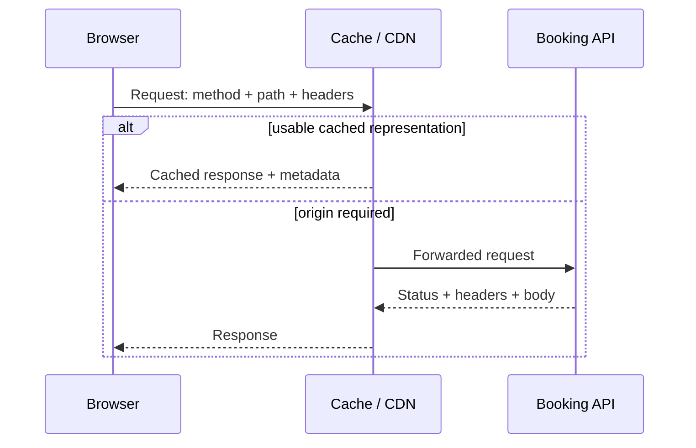

# CS230 — Computer Networks and Web Protocols

## Lecture 03: HTTP: The Protocol That Runs the Web

*Why the web's supposedly simple request-response protocol is actually a sophisticated system of rules, promises, and carefully negotiated misunderstandings.*

---

# Part I — Intuition

*The same network can produce a correct cached page, a duplicate payment, or leaked customer data. The difference is what the participants believed the HTTP exchange meant.*

Look at the opening diagram for half a minute, then listen. This pass builds one mental picture. Part II develops the same picture with full technical depth.

### The picture to carry in your head



**The question:** What does each participant think it is permitted to do with this request and response?

---

### 1. The network works; the application still goes wrong

You open the booking website and inspect a request to fetch hotel information. The browser sends a request; the server responds. At first glance, HTTP looks like a glorified envelope for JSON.

But the envelope has meaning. The method declares the intended kind of operation. The path identifies a target resource. Headers provide conditions and metadata. The status reports the outcome of that HTTP exchange. The body carries a representation when one is supplied.

HTTP does not itself guarantee that a reservation wasn't accidentally created twice or that private information is safe to cache. Those are obligations the application and its intermediaries must fulfill.

Imagine three incidents. The browser receives a `304 Not Modified` without a fresh response body but still displays a page. A timed-out reservation POST is retried and creates two bookings. A shared CDN returns another user's personal booking data. All three are possible without faulty routing or TCP.

The actors disagreed about HTTP semantics.

### 2. Method means intention

A **GET** request is intended to retrieve a representation without requesting a change to the resource's state. It's called safe in HTTP semantics. A GET endpoint secretly creating a charge violates the expectation that retrieval is safe.

A **POST** submits data for processing under the resource's own rules. It often creates something, but its semantics are broader than creation. A generic POST is not inherently idempotent.

A **PUT** requests that a resource's state be created or replaced with the supplied representation, under the server's rules. **DELETE** requests removal of the association with a target resource. PUT and DELETE are idempotent in their intended semantics: applying the same request repeatedly has the same intended effect on server state as applying it once. That doesn't promise identical response statuses or guarantee no logging or side effects elsewhere.

When the frontend retries a booking POST because the response was lost, it may create a second booking. The transport failure doesn't prove the first business operation failed.

**Checkpoint:** If your payment POST times out, does sending it again necessarily repeat only the response? **No.** You need a business idempotency key, durable operation identity, or reconciliation mechanism appropriate to the provider and API.

### 3. Status doesn't tell the whole business story

A `200` or `201` means something about the HTTP operation. A `404` says the target wasn't found or isn't disclosed as available. A `409` can represent a conflict with current resource state. A `500` reports a server-side error.

But what if an HTTP response never arrives? The caller cannot conclude from the timeout alone whether the booking was committed. A process could have completed work and lost the response. An HTTP status is evidence only when you actually receive it.

Also distinguish protocol success from business success. An HTTP `200` could contain an application-level rejection if the API was designed that way, though a carefully designed API should avoid unnecessary ambiguity.

### 4. Caching: asking whether yesterday's answer is still usable

Imagine requesting a public hotel photo. A CDN or browser cache can retain a response and later reuse it according to its caching rules. That avoids contacting the origin for every visit.

But caches need to know when content is fresh and when it requires validation. A response can carry caching metadata, and a representation can have an **ETag** identifying its version.

On a later request, the client may say, in effect, "I have version X; send a new body only if the current representation differs." The client sends a conditional request with `If-None-Match`. If the condition indicates the cached version is still applicable, the server can respond `304 Not Modified` without retransmitting the representation body.

The browser still displays the content because **it already has the body**. The 304 tells it that reusing the stored representation is valid under the relevant HTTP rules.

**Checkpoint:** Does `304` mean the server forgot to send the page? **No.** It participates in a conditional exchange with an existing cached representation.

### 5. Conditional writes are a different trick

ETags can also help prevent lost updates. Imagine two admins editing the same hotel description. Each reads version 12. The first saves an update, producing a newer version. The second tries to save their stale edit.

With a suitable conditional write using `If-Match`, the server can require that the resource version still matches what the client edited. If it doesn't, the server can reject the update, commonly with `412 Precondition Failed`.

Notice the same validator now serves a different purpose. `If-None-Match` on a GET commonly avoids downloading an unchanged representation; `If-Match` on a write can prevent overwriting a version that changed in the meantime.

The exact application design must enforce those conditions correctly. A decorative ETag header with no corresponding write check doesn't prevent races.

### 6. The dangerous cache

Now imagine the CDN caches `/api/me/reservations` as though it were a public hotel listing. Customer A receives their private booking list. The shared cache stores it under an insufficiently specific cache key. Customer B asks the same URL and receives the cached response.

The HTTP exchange succeeded. The product committed a data leak.

For personalized information, the application must use appropriate cache-control behavior and cache configuration. `Cache-Control: private` restricts storage by shared caches; `no-store` prevents storage by compliant caches. Their semantics differ, and the policy must reflect the data and threat model. If using a private cache or a deliberately shared cache of variants, keys and `Vary` behavior require careful design.

Authorization decisions cannot be delegated to an accidentally shared representation.

### 7. The minute-long replay

A client sends an HTTP method, target, headers, and maybe a body. A server or intermediary interprets the request's semantics. The response contains status, metadata, and sometimes a representation body. Caches may satisfy retrievals without consulting the origin. Validators can avoid retransmitting unchanged content or protect against stale writes. Retries of operations with side effects need explicit business correctness. Private representations must not leak through shared caching.

HTTP is not merely how bytes travel. It's an agreement about what participants may infer and reuse.

#### Three questions before L03

1. Why can `304 Not Modified` render a complete page? **The cache already stores the body.**
2. Does an HTTP timeout prove a booking did not occur? **No.** The result may be ambiguous.
3. What makes a shared CDN dangerous for `/api/me`? **Reusing a private representation for a different user without proper cache policy and isolation.**


### Pocket map — screen reference

```text
REQUEST  method + target + headers + optional body
RESPONSE status + headers + optional body
GET      retrieval, safe semantics
POST     process submission; not inherently idempotent
PUT      create/replace with idempotent intended semantics
DELETE   idempotent intended removal semantics
304      cached body reused after conditional validation
ETag     representation validator
IF-NONE-MATCH    conditional retrieval / revalidation
IF-MATCH         conditional mutation / avoid stale overwrite
TIMEOUT          outcome UNKNOWN, not automatically failure
CACHE            reuse under declared rules; private data needs policy
```

*The intuition pass ends here.*

---

# Part II — Deep Dive

# 1. Three Strange Incidents at a Hotel Booking Company

It's Monday morning, and your hotel-booking platform has three production incidents. The first is merely confusing.

A developer opens Chrome DevTools and notices that requests for the application's JavaScript bundle are returning: `HTTP/2 304 Not Modified`

Yet the application loads perfectly. How can the browser render JavaScript that the server apparently didn't send?

The second incident is considerably worse.

A customer confirms a hotel reservation. The API request times out. The frontend automatically retries it.

The customer now has **two reservations**.

The third incident is downright alarming.

A CDN serves a customer a response containing another customer's personal booking information.

Three different problems. Three different symptoms.

But all three involve misunderstanding something fundamental about HTTP.

The first involves conditional requests and caching. The second involves the semantics of HTTP methods and retries. The third involves how HTTP responses interact with shared intermediaries.

What's particularly interesting is that none of these problems requires a broken TCP implementation, faulty DNS, or a malfunctioning browser. Every component might be operating exactly as designed.

The application developers simply made assumptions that the protocol never promised to uphold.

To understand these incidents, we need to examine HTTP not merely as a way to send JSON, but as a contract governing how clients, servers, browsers, and intermediaries communicate.

By the end of this lecture, you should be able to explain what HTTP methods promise, what status codes actually report, how caching and conditional requests work, and where application guarantees still have to be built on top of the protocol.

---

# 2. HTTP Is a Language, Not a Transportation System

In our previous lectures, we followed a request through DNS, IP routing, TCP, TLS, and the browser. Let's establish where HTTP fits.

Imagine sending a letter internationally. The postal system handles transportation.

Addresses tell it where the letter should go. But the postal system doesn't determine the meaning of the letter.

It might contain a birthday invitation, a legal notice, or an invoice. Similarly, TCP and QUIC transport application data, while HTTP defines what that data means.

A request might say: `GET /api/hotels/4812 HTTP/1.1`, `Host: stays.example.com`, and `Accept: application/json`

And the server might respond with `HTTP/1.1 200 OK`, `Content-Type: application/json`, and a small JSON body for hotel 4812 in Berlin with three available rooms:

```http
HTTP/1.1 200 OK
Content-Type: application/json

{
  "id": 4812,
  "name": "Hotel Berlin",
  "availableRooms": 3
}
```

This exchange contains several distinct ideas. The **method** expresses the requested operation.

The **target** identifies the resource. The **headers** carry metadata about the request or response.

The **status code** describes the outcome. The **body** carries a representation or other content.

Importantly, HTTP doesn't require the resource to be a physical file.

`/api/hotels/4812` might correspond to a PostgreSQL record, a dynamically assembled view, or information aggregated from several services.

A resource is a conceptual target identified by a URI. The server decides how to produce its representation.

## 2.1 Resources and representations

This distinction is subtle but useful. Imagine the resource: `/api/hotels/4812`

One client requests: `Accept: application/json`

Another requests: `Accept: text/html`

A server supporting both formats could return two different representations of the same conceptual resource. The hotel is the resource.

JSON and HTML are representations. This separation is part of HTTP's underlying design.

It's also why HTTP is more flexible than the simplistic mental model:

> URL in, JSON out.

That pattern is common in modern APIs, but it's only one application of the protocol.

---

# 3. HTTP Methods: What Exactly Are You Asking the Server to Do?

Let's investigate the second production incident: the duplicate reservation. Our frontend sends a `POST` to `/api/reservations` with a JSON body naming the hotel, room, and customer:

```http
POST /api/reservations
Content-Type: application/json

{
  "hotelId": 4812,
  "roomId": 73,
  "customerId": 901
}
```

The server successfully creates the reservation. But before the response reaches the browser, the connection fails.

The frontend retries. A second reservation is created.

Why? Because **receiving no response is not proof that the operation failed**.

HTTP methods have important semantics governing how clients and intermediaries should interpret requests. Two particularly important properties are *safety* and *idempotency*.

## 3.1 Safe methods

A method is considered **safe** when its defined semantics are essentially read-only. The client isn't requesting a business-state change.

For example: `GET /api/hotels`

requests information. But: `POST /api/reservations`

requests an action that changes application state. Safe doesn't mean the server literally performs no writes.

A GET request might produce logs, update metrics, or increment internal counters. What matters is that the client didn't request those side effects as the purpose of its operation.

Why is safety important? Because browsers, crawlers, caches, and other software may automatically retrieve resources.

Imagine designing this endpoint: `GET /api/delete-account?userId=123`

It deletes a customer's account. Now imagine a crawler following every link it discovers.

Congratulations. You've developed a remarkably efficient account-deletion service.

The problem isn't that the URL contains the word `delete`. The problem is that you've assigned destructive semantics to a method other software is entitled to treat as safe.

## 3.2 Idempotency: An exceptionally useful mathematical idea

An operation is **idempotent** when repeating it has the same intended effect as performing it once. Consider: `Set room price to €150.`

Execute it once: `Price = €150`

Execute it ten times: `Price = €150`

The intended final state remains the same. Now consider: `Increase room price by €10.`

Execute it once: `Price = €160`

Execute it ten times: `Price = €250`

Not idempotent. The distinction is independent of whether an operation modifies state.

An operation can change state and still be idempotent. In HTTP, the standard methods have these general properties.

**GET** is safe and idempotent: it retrieves a representation.

**HEAD** is likewise safe and idempotent: it retrieves response metadata without the content body.

**POST** is neither safe nor guaranteed idempotent: it submits data or requests processing.

**PUT** is not safe, but it is idempotent: it creates or replaces the resource state at a target URI.

**PATCH** is not safe and not guaranteed idempotent: it applies partial modifications.

**DELETE** is not safe, but it is idempotent: it removes a resource. Deleting the same resource twice should have the same intended final effect as deleting it once — the resource is gone.

That doesn't require identical responses. The first deletion might return `204 No Content`.

A subsequent attempt might return `404 Not Found`. Idempotency concerns the intended effect, not necessarily the response.

Likewise, PATCH *can* be designed to be idempotent, but it isn't guaranteed to be. Compare these two partial updates: `{"price": 150}`

and: `{"increasePriceBy": 10}`

The first may be idempotent. The second is not.

The exact behavior depends on the patch format and application contract.

## 3.3 Why idempotency matters for retries

In distributed systems, a client can lose the response to a request that the server successfully completed. That creates uncertainty.

Suppose the browser creates a reservation, the server saves it, the response is lost on the way back, and the browser retries — so a second reservation is saved:

```text
Browser                         Server
   │                               │
   │──── Create reservation ──────►│
   │                               │
   │                         Reservation saved
   │                               │
   │     Response is lost      X   │
   │                               │
   │──── Retry reservation ───────►│
   │                               │
   │                         Another reservation saved
```

The network cannot tell the browser whether the first operation committed successfully. For consequential operations, applications need stronger business-level guarantees.

One common mechanism is an **idempotency key**. The frontend sends: `POST /api/reservations`, `Idempotency-Key: booking-attempt-92b71`, and `Content-Type: application/json`

If the request is retried, it uses the same key. The backend maintains a durable record associating that key with the operation's result.

A properly designed implementation ensures that concurrent requests using the same key cannot independently perform the same business operation.

It should also detect incompatible attempts to reuse a key with different request contents. This is not magic provided automatically by HTTP.

It's an application-level guarantee built on top of HTTP. The important lesson:

**HTTP method semantics tell clients what they may generally assume. Critical business guarantees must still be implemented by the application.**

---

# 4. Status Codes: The Server's Account of What Happened

A status code tells the client how the server handled the request. HTTP organizes status codes into five families: informational responses in the 1xx range, successful outcomes in 2xx, redirections in 3xx, client errors in 4xx, and server errors in 5xx.

The numbers are familiar to every web developer. The interesting part is knowing which outcome each code actually represents.

## 4.1 Success does not always mean completion

Consider three responses.

`HTTP/1.1 200 OK`

The request succeeded and the server returned a representation or other response content.

`HTTP/1.1 201 Created`, then `Location: /api/reservations/9821`

The request succeeded and created a resource.

`HTTP/1.1 202 Accepted`

The request has been accepted for processing, but processing has not necessarily finished. That last distinction is especially important for asynchronous backend systems.

Suppose a customer requests a large CSV export. Your API adds a job to a BullMQ queue.

The export may require several minutes.

Returning `200 OK` with a JSON body saying the export is queued isn't inherently impossible, but `202 Accepted` communicates the asynchronous processing state more precisely. For example, status `202 Accepted`, JSON content type, and a body with job id `exp-981`, status `queued`, and a `statusUrl` to poll:

```http
HTTP/1.1 202 Accepted
Content-Type: application/json

{
  "jobId": "exp-981",
  "status": "queued",
  "statusUrl": "/api/exports/exp-981"
}
```

The response isn't promising that the export completed. It's acknowledging that processing was accepted.

Of course, the job can subsequently fail. The application needs a way to report the final outcome.

## 4.2 Understanding important failure codes

A few status codes appear constantly in API design, and their distinctions matter.

**400** usually means the request was malformed or invalid. **401** relates to missing or unacceptable authentication credentials. **403** means the request was understood, but access is forbidden. **404** means the target resource was not found.

**409** signals a conflict with the current resource state. **412** means an HTTP request precondition failed — a more specific contract than a general conflict. **422** indicates that validly structured content cannot be processed as instructed. **429** means too many requests.

On the server side, **500** is an unexpected failure. **502** means a gateway received an invalid upstream response. **503** means the service is temporarily unavailable. **504** means a gateway did not receive a timely upstream response.

Don't treat these as an exhaustive mapping from every business error to one mandatory HTTP code. Some situations admit reasonable design choices.

But certain distinctions are meaningful. For example, `401` and `403` aren't interchangeable.

A `401` response relates to HTTP authentication and requires an appropriate authentication challenge under the protocol. A browser application may handle authentication differently at the application level, but it shouldn't lose track of HTTP's semantics.

A `409 Conflict` might indicate that someone is attempting to modify a booking whose state no longer permits the requested transition.

A `412 Precondition Failed` has a more specific meaning: a conditional request failed its HTTP precondition. We'll soon see why that difference matters.

## 4.3 The suspicious `200 OK`

Here's an API response — notice both the status line and the headers that matter for caching and content type:

```http
HTTP/1.1 200 OK
Content-Type: application/json

{
  "success": false,
  "error": "Database unavailable"
}
```

Is it valid to return JSON containing an error? Certainly.

But should an internal database failure normally be represented as HTTP 200? No.

That's misleading. The HTTP layer reports success while the application's own body reports failure.

This can confuse monitoring, HTTP-aware clients, intermediaries, and retry policies. A coherent error contract could instead return:

```http
HTTP/1.1 503 Service Unavailable
Content-Type: application/problem+json

{
  "type": "https://api.example.com/problems/unavailable",
  "title": "Service temporarily unavailable",
  "status": 503
}
```

`application/problem+json` is a standardized format for describing HTTP API problems.

You aren't required to use it, but a consistent error model is valuable.

**Status codes should describe the HTTP operation's outcome. Response bodies can provide additional detail, not contradict it.**

---

# 5. Headers: The Protocol's Negotiation Mechanism

HTTP headers are sometimes treated like miscellaneous key-value metadata. In reality, they define much of HTTP's most interesting behavior.

Let's take a conditional request — the browser asks for a script only if its validator no longer matches:

```http
GET /api/hotels/4812
Accept: application/json
Accept-Language: de-DE
Accept-Encoding: br, gzip
Authorization: Bearer eyJ...
```

Several negotiations and declarations are taking place. The client is effectively saying:

- I would like JSON.
- I prefer German.
- I understand Brotli and gzip content encodings.
- Here are credentials for this request.

The server might respond with `HTTP/1.1 200 OK`, JSON content type, German content language, Brotli encoding, and a private no-cache directive:

```http
HTTP/1.1 200 OK
Content-Type: application/json
Content-Language: de-DE
Content-Encoding: br
Cache-Control: private, no-cache
```

The response says:

- This representation is JSON.
- Its language is German.
- Its content is Brotli-compressed.
- It has particular caching restrictions.

## 5.1 `Accept` versus `Content-Type`

These two headers are frequently confused.

**Accept** describes which response media types the client can accept.

**Content-Type** describes the media type of the content in the message being sent.

For example: `POST /api/reservations`, `Content-Type: application/json`, and `Accept: application/json`

The first says:

"I'm sending JSON."

The second says:

"I want a JSON response."

These are separate declarations. An API that receives an unsupported request media type can respond with `415 Unsupported Media Type`.

A server unable to provide an acceptable response representation may respond with `406 Not Acceptable`. In practice, servers vary in how aggressively they perform content negotiation.

## 5.2 Compression

Consider a large JSON response: `Accept-Encoding: br, gzip`

If the server supports Brotli, it may respond: `Content-Encoding: br`

The response body is compressed. The browser decompresses it before handing the representation to application code.

Compression reduces the number of transmitted bytes, often substantially for repetitive text. But it doesn't reduce network RTT or eliminate server processing.

And don't confuse content encoding with HTTP message framing.

The mechanisms used to transport HTTP messages differ between HTTP/1.1, HTTP/2, and HTTP/3, independently of whether the representation is gzip- or Brotli-compressed.

## 5.3 Cookies: Giving HTTP a memory

HTTP doesn't intrinsically maintain a user's application session between requests. Cookies provide one common mechanism for continuity.

A server may respond: `Set-Cookie: session=abc123; Path=/; Secure; HttpOnly; SameSite=Lax`

The browser stores the cookie subject to browser policy. Subsequent matching requests may carry: `Cookie: session=abc123`

The server can associate this identifier with session information. This is how an otherwise independent sequence of HTTP exchanges can participate in a continuous logged-in experience.

The cookie itself is not necessarily the session data. Often it's merely an opaque identifier pointing to server-side state.

`Secure`, `HttpOnly`, and `SameSite` control different aspects of cookie handling. They are important security mechanisms, which we'll explore properly in SE310-L02.

For now, notice how much application behavior can emerge from HTTP metadata rather than the JSON response body.

---

# 6. Caching: When the Best Request Is the One You Don't Make

Let's return to our first production incident. The browser receives: `HTTP/2 304 Not Modified`

Yet the website works. Why?

Because HTTP supports caching, and **a cached representation can be reused without downloading the entire content again**. This is one of HTTP's most important design features.

Let's consider a JavaScript bundle: `/assets/app.8bc29f.js`

Suppose it's 400 KB. Thousands of users request it every minute.

If every visit required the origin application to generate and transmit those 400 KB again, the infrastructure would perform vast amounts of redundant work. Caching avoids much of that repetition.

But caching introduces a difficult question.

**How does a client know whether its existing copy is still correct?**

HTTP offers several mechanisms.

## 6.1 Freshness: How long may the response be reused?

A response might contain: `Cache-Control: public, max-age=3600`

This permits storage in shared caches, subject to the complete HTTP caching rules, and declares a freshness lifetime of 3,600 seconds.

While the stored response remains fresh, a cache may satisfy a matching request without contacting the origin.

After it becomes stale, the cache may need to validate the response or retrieve a new one. Caching is not limited to the browser.

There may be several layers between browser and origin — CDN, reverse proxy, application — each able to cache or rewrite:

```text
Browser
   │
   ├── Browser HTTP cache
   │
   ▼
CDN cache
   │
   ▼
Reverse proxy cache
   │
   ▼
Origin application
```

A request might stop at any suitable layer. This is why backend logs alone cannot always tell you how frequently a resource is accessed.

## 6.2 The confusing directives

Some of the most important cache directives are notoriously easy to misinterpret.

**`max-age=300`** means the response is fresh for approximately five minutes.

**`public`** allows shared caches to store the response, subject to other rules.

**`private`** prevents shared caching of the full response, though private caches may still store it.

**`no-cache`** means a stored response must be validated before reuse.

**`no-store`** means conforming caches must not store the response.

**`s-maxage=300`** specifies freshness for shared caches, overriding relevant general freshness settings.

The most misleading name here is `no-cache`. It does **not** mean "do not store this response."

It means the stored response cannot be reused to satisfy another request without successful validation.

If you want to prohibit HTTP caching of sensitive response data, `no-store` is the more appropriate directive. Even then, `no-store` is not a complete security or privacy mechanism.

It doesn't prevent data from existing in application memory, logs, screenshots, or other locations outside ordinary HTTP cache control.

## 6.3 Why content-hashed filenames are so useful

Consider: `/assets/app.8bc29f.js`

The filename includes a value derived from the build output. If the contents change, the build generates a different filename.

For example: `/assets/app.f291a0.js`

That gives us a beautiful property. The old URL continues to identify the old asset.

The new URL identifies the new asset. We can therefore serve versioned static resources with a long caching lifetime: `Cache-Control: public, max-age=31536000, immutable`

The `immutable` directive tells supporting clients that the representation is not expected to change during its freshness lifetime. This can be highly effective for build assets.

But applying the same strategy to: `/index.html`

could be disastrous if that document needs to point users toward newly deployed JavaScript bundles. You might serve an old HTML document that references files no longer available.

A common deployment pattern therefore treats HTML differently from versioned static assets. The important architectural idea is:

**Choose caching policies according to how a resource changes, not merely according to how frequently it's requested.**

---

# 7. Conditional Requests: The Strange Beauty of HTTP 304

Suppose the browser previously downloaded: `GET /assets/app.js`

The response included validators and cache directives; listen for `ETag` / `Last-Modified` / `Cache-Control` if you glance at the block:

```http
HTTP/1.1 200 OK
ETag: "version-42"
Cache-Control: no-cache
Content-Type: text/javascript
```

The browser stores the representation. Later, it needs the resource again.

Because the cached response requires validation before reuse, the browser sends: `GET /assets/app.js`, then `If-None-Match: "version-42"`

The server checks the current representation. If the entity tag still matches, it can respond: `HTTP/1.1 304 Not Modified`, then `ETag: "version-42"`

No response body is needed. The client already possesses the content.

The server merely confirms that the stored representation remains valid. Conceptually the browser keeps its copy and skips downloading the bytes again:

```text
Browser                              Server
   │                                    │
   │ Already has version 42             │
   │                                    │
   │── Is version 42 still current? ───►│
   │                                    │
   │◄── Yes. 304 Not Modified ──────────│
   │                                    │
   ▼                                    │
Reuse stored representation             │
```

The browser can therefore display the resource without downloading its body again. Mystery solved.

### But what exactly is an ETag?

An **entity tag**, or ETag, is a validator identifying a selected representation version. It is generally opaque to clients.

It might be derived from a content hash, revision number, or another server-defined mechanism. The client shouldn't assume it can interpret the value.

HTTP also supports `Last-Modified`, a timestamp-based validator. For example: `Last-Modified: Wed, 21 Oct 2026 10:00:00 GMT`

A subsequent request can use: `If-Modified-Since: Wed, 21 Oct 2026 10:00:00 GMT`

ETags often provide more precise version identification than modification timestamps. A timestamp may lack sufficient resolution to distinguish multiple changes occurring close together.

A strong ETag can distinguish representation changes more reliably, provided the server generates it correctly.

There are also weak ETags, prefixed with `W/`, which express semantic equivalence rather than requiring byte-for-byte identity. For now, the essential distinction is between two caching approaches:

**Freshness:** "My stored response is still young enough to use."

**Validation:** "I asked whether my stored response is still current."

A fresh cache hit can avoid contacting the server entirely. A successful conditional request can avoid retransmitting the response body, but it still incurs a network exchange.

That's why freshness caching and conditional validation can have very different latency characteristics.

---

# 8. ETags Have Another Trick: Preventing Lost Updates

Here's where HTTP becomes unexpectedly elegant. We usually encounter ETags in the context of caching.

But they can also help protect concurrent updates. Imagine two hotel administrators editing the same listing.

The current room price is €150. Both retrieve: `GET /api/hotels/4812`

The server responds — status plus the headers that tell caches what they may reuse:

```http
HTTP/1.1 200 OK
ETag: "revision-7"

{
  "price": 150
}
```

Administrator A changes the price to €160. Administrator B changes it to €170.

Without concurrency protection, two admins can overwrite each other — last write wins, first edit vanishes:

```text
Original price: €150

Admin A saves €160
        ↓
Database price: €160

Admin B saves €170
        ↓
Database price: €170
```

Administrator A's change has been silently overwritten. This is a **lost update**.

HTTP provides a useful mechanism: `If-Match`. Administrator A sends an update only if the current ETag still matches:

```http
PUT /api/hotels/4812
If-Match: "revision-7"
Content-Type: application/json

{
  "price": 160
}
```

The server checks whether the current representation still matches revision 7. It does.

The update succeeds, advancing the resource version. Administrator B then sends the same style of conditional update with a now-stale ETag:

```http
PUT /api/hotels/4812
If-Match: "revision-7"
Content-Type: application/json

{
  "price": 170
}
```

But the current representation is no longer revision 7. The server can reject the update: `HTTP/1.1 412 Precondition Failed`

Now the frontend can tell Administrator B that the resource has changed and offer to refresh or reconcile the conflicting edits. This is an example of **optimistic concurrency control**.

Rather than locking the resource for the entire editing session, the application allows concurrent work and verifies the assumed version at update time.

There's a crucial implementation requirement, however. The version check and state modification must be performed atomically with respect to competing updates.

If the backend checks the version, releases control, and only later performs the write, another update can slip into the gap. HTTP supplies the conditional contract.

The application and database must enforce it correctly. This is a beautiful example of how a concept initially encountered as a caching mechanism also connects to database concurrency and correctness.

---

# 9. The Dangerous Cache: How One Customer Sees Another's Data

Let's return to the third production incident. A customer receives someone else's booking details.

Suppose your API returns: `GET /api/my-reservations`

The response contains personalized JSON — customer 901 and their reservations, such as Hotel Berlin room 73:

```json
{
  "customerId": 901,
  "reservations": [
    {
      "hotel": "Hotel Berlin",
      "room": 73
    }
  ]
}
```

A CDN sits in front of the application. If the infrastructure incorrectly treats this personalized response as publicly reusable, it could return the same body to another customer.

The precise failure depends on the caching configuration and request handling.

Conforming shared caches have restrictions, particularly for requests containing `Authorization`, but careless application headers or CDN-specific configuration can defeat the intended isolation.

This is why personalized responses require deliberate cache policy design. For example: `Cache-Control: private, no-store`

This disallows shared caching and instructs conforming caches not to store the response.

Not every personalized response requires this exact policy. Some private browser caching can be useful and appropriate.

The point is to decide intentionally.

## 9.1 Cache keys matter

A cache needs to decide when two requests should be considered equivalent for reuse.

The URL is a central part of that decision, along with the request method and any relevant additional cache-key dimensions. Consider a site returning different HTML based on language.

Two users request: `GET /hotels`

One sends: `Accept-Language: en-US`

The other sends: `Accept-Language: de-DE`

If the server returns different representations based on language, it can communicate that variation using: `Vary: Accept-Language`

A conforming HTTP cache then takes the specified request-header value into account when deciding whether a stored response matches a later request.

Without an appropriate variation policy, caching could cause a German-speaking user to receive an English representation intended for another request.

And now we see why HTTP caching is much more than putting data into Redis.

Caching requires defining **which requests are equivalent, how long responses remain valid, and under what conditions they may be reused**.

Get those three questions wrong, and caching can become a source of stale data, inconsistent behavior, or security vulnerabilities.

---

# 10. HTTP Versions: Same Meaning, Different Machinery

In CS230-L02, we discussed HTTP/1.1, HTTP/2, and HTTP/3 from a networking perspective. Let's briefly connect them to the application protocol itself.

Consider the request: `GET /api/hotels/4812`

Its intended HTTP semantics don't fundamentally change between those versions. The server is still being asked to retrieve a representation.

A `404` still means the target resource wasn't found. An `ETag` can still validate a cached representation.

The distinction lies largely in how the messages are encoded and transported.

### HTTP/1.1

Uses a textual message format with request and response start lines, headers, and message framing.

Persistent connections allow multiple exchanges to reuse TCP connections, although ordinary browser usage doesn't multiplex independent requests over one HTTP/1.1 connection.

### HTTP/2

Uses binary frames and multiplexed streams over a connection. It supports efficient header compression and interleaved data transfer for multiple requests.

This improves connection utilization, but TCP-level packet loss can still interfere with multiple streams.

### HTTP/3

Runs over QUIC, which provides independently managed streams and integrates TLS-based security. It avoids TCP's connection-wide ordered-byte-stream bottleneck.

Here's the useful abstraction spoken plainly: HTTP semantics — methods, statuses, headers, and caching — sit above the transport machinery. HTTP/1.1 and HTTP/2 commonly ride TCP with TLS, while HTTP/3 rides QUIC over UDP.

```text
                HTTP Semantics
       Methods, statuses, headers, caching
                       │
         ┌─────────────┼─────────────┐
         │             │             │
      HTTP/1.1       HTTP/2        HTTP/3
         │             │             │
       TCP+TLS       TCP+TLS         QUIC
                                      │
                                     UDP
```

As a developer designing an API, you usually don't need to write entirely different business logic for each HTTP version.

That's one of the great advantages of separating application semantics from transport mechanisms. But when diagnosing performance, the transport differences absolutely matter.

---

# 11. Putting HTTP to Work: Designing a Reservation API

Let's combine the ideas into one practical example. You're designing an API for a hotel-booking service.

It needs to support searching for rooms, retrieving individual hotel details, creating reservations, and modifying bookings. A reasonable starting point might be:

Search hotels with **GET** `/api/hotels?city=Berlin`. Retrieve hotel details with **GET** `/api/hotels/4812`. Create a reservation with **POST** `/api/reservations`. Fetch one with **GET** `/api/reservations/9821`. Replace editable reservation details with **PUT** `/api/reservations/9821`. Cancel with **POST** `/api/reservations/9821/cancel`.

Why use POST for cancellation rather than simply DELETE? Because cancellation is often a business operation, not literal resource deletion.

The reservation might need to remain in the database permanently for financial, auditing, or customer-service reasons.

Cancellation may trigger refunds, notifications, fee calculations, and status transitions. A domain-specific POST action can express those semantics clearly.

A DELETE endpoint could also be reasonable under a different domain model, but treating every business cancellation as physical deletion is a poor abstraction.

## 11.1 Search results and caching

Hotel search results change frequently. You might decide to allow very short-lived shared caching for anonymous search results: `Cache-Control: public, s-maxage=10`

This could reduce backend traffic during popular searches. But you'd need to consider variation by search parameters, currency, language, and any personalized pricing rules.

And critically, a cached search result should not be treated as an authoritative guarantee that a room can still be booked.

Final availability must be checked under appropriate transactional guarantees. That belongs partly to the database and business workflow, not merely HTTP.

## 11.2 Reservation creation and retries

Creating a reservation is a consequential operation. You might require: `POST /api/reservations`, `Idempotency-Key: 4f9a71...`, and `Content-Type: application/json`

The backend uses the key to prevent duplicate execution of the same logical booking attempt. If the client loses the response, it can retry using the same key.

The backend returns the recorded outcome rather than creating another reservation. The design still needs rules for key lifetime, concurrent attempts, failure recovery, and mismatched payloads.

HTTP provides the delivery contract; your business service provides the correctness guarantee.

## 11.3 Editing a reservation

A customer opens an editable reservation. The server returns a representation with: `ETag: "revision-12"`

The customer modifies the guest name. The frontend submits: `PUT /api/reservations/9821`, then `If-Match: "revision-12"`

If another process changed the reservation in the meantime, the backend can reject the stale update with `412`. This provides a clean way to expose optimistic concurrency control through HTTP.

## 11.4 Operational failures

Suppose a critical upstream hotel-provider integration is unavailable. The booking API should not report: `200 OK`

while burying a failure inside the JSON body. An appropriate 5xx response and structured error can tell clients and monitoring systems that the request failed at the service level.

But whether the client should retry depends on more than the status code. An automatic retry of a state-changing operation requires knowledge of its idempotency guarantees.

And some failures may require reconciliation rather than immediate retrying.

That's the difference between designing an endpoint that merely works under normal conditions and designing one that behaves correctly under uncertainty.

---

# 12. The Oral Examination

We now have enough knowledge to examine HTTP like an engineer rather than merely recognize its vocabulary.

Before reading the solutions, try answering these questions out loud. Imagine that a senior engineer is interviewing you and will challenge any hand-waving.

### Challenge 1 — The Misleading Cache Directive

A backend engineer wants to prevent responses containing personal financial information from being stored in HTTP caches. They add: `Cache-Control: no-cache`

Is that sufficient? What would you change?

### Challenge 2 — The Duplicate Reservation

A frontend sends a POST request to create a booking. The request times out.

Should it automatically retry? What information is missing?

### Challenge 3 — The Mysterious 304

A browser receives `304 Not Modified` with no response body. How can it still render the requested resource?

What would happen if the browser didn't already possess an appropriate stored representation?

### Challenge 4 — Two Administrators

Two administrators retrieve the same hotel listing. Both see revision 12.

One changes the price. The other changes the description.

Should the second update automatically overwrite the first? What HTTP mechanism could help prevent accidental loss of changes?

### Challenge 5 — API Status Semantics

Your backend accepts a report-generation request and adds a job to a queue. The report won't be ready for several minutes.

Which HTTP response would you choose, and how would the frontend discover when the report is ready?

---

# 13. Solutions and Discussion

### Solution 1 — Misleading cache directive

No.

`no-cache` permits storage but requires validation before reuse.

For sensitive responses that should not be stored by conforming HTTP caches, `Cache-Control: no-store` is more appropriate.

Adding `private` can make the intended restriction on shared caching explicit, although `no-store` already prohibits caching by both private and shared caches.

These headers are not substitutes for access control, transport security, or careful handling of sensitive data elsewhere in the system.

### Solution 2 — Duplicate reservation

Not blindly. The timeout doesn't prove that the reservation wasn't created.

The client needs an application-level guarantee such as an idempotency key or a reliable way to retrieve the authoritative outcome of the original operation.

Without such a mechanism, retrying could create duplicates.

### Solution 3 — Mysterious 304

The browser already has the response body in its cache. The `304` validates that stored representation, allowing it to be reused without retransmitting the body.

A `304` isn't a replacement for the original representation. Without an appropriate stored response, the client would need to obtain the content through another suitable request.

### Solution 4 — Two administrators

Not automatically. One approach is to return an ETag with the fetched representation.

Updates then include `If-Match` with the version originally retrieved. If the representation has changed, the server can return `412 Precondition Failed`.

The frontend can then offer a conflict-resolution flow. A more sophisticated application might merge independent changes, but that requires explicit domain logic rather than silently overwriting data.

### Solution 5 — API status semantics

`202 Accepted` is an appropriate response for asynchronous processing.

The response could include a job identifier and a status URL. The frontend might poll that endpoint, subscribe to server-sent events, or use another notification mechanism.

The important distinction is that accepting the request isn't the same as completing the report.

---

# 14. The Mental Model Worth Keeping

HTTP is a **language of intent and outcomes**, not merely a way to ship JSON.

Its major responsibilities can be remembered through five questions:

- **What are you asking?** Methods communicate intended operations, including safety and idempotency assumptions.
- **What happened?** Status codes report the HTTP outcome; response bodies should enrich that report, not contradict it.
- **How is the representation described?** Headers negotiate format, language, encoding, authentication, and caching policy.
- **May this answer be reused?** Freshness, validation, variation, and shared-versus-private rules decide whether caches help or harm.
- **What must the application still guarantee?** Exactly-once business effects, atomic concurrency checks, and privacy boundaries are not free gifts from the protocol.

Those semantics remain broadly consistent across HTTP/1.1, HTTP/2, and HTTP/3 despite different transports.

The senior-level lesson is that **correct API design requires understanding what the protocol guarantees, what it merely permits, and what your application must enforce itself**.

A POST is not exactly-once business execution. A 200 does not mean an asynchronous workflow finished. An ETag only prevents lost updates if the precondition is enforced atomically. A CDN must not cache arbitrary responses merely because caching is fast.

HTTP gives you a powerful vocabulary and useful contracts. You still have to build a correct system around them.

---

# 15. Next Lecture — DNS: The Internet's Distributed Naming System

We've learned what HTTP asks servers to do and how its semantics help clients and servers cooperate.

But one crucial part of the journey deserves a much closer investigation: how does the client discover the destination in the first place?

In **CS230-L04**, we'll examine DNS as a distributed naming system, investigate its hierarchy of authority and caches, and discover why changing one record can produce dramatically different behavior across the internet.

The question is no longer simply what DNS returns. It's who supplied that answer, when they learned it, and whether the information is still valid.

---

## Optional Practical Lab — Make HTTP Reveal Its Machinery

*The spoken lecture ends here. The remaining material is a screen-first investigation worksheet and technical references.*

You can investigate these mechanisms using your browser and terminal. No elaborate environment is required.

### Lab A — Inspect response headers

Open a terminal and execute: `curl -I https://developer.mozilla.org/`

On Windows PowerShell, use `curl.exe` if needed. Examine the response headers.

Look for:

```text
content-type
cache-control
etag
last-modified
vary
content-encoding
```

Not every response includes all of them. Try a second website.

Compare their cache policies. Can you explain why an HTML document might use different caching rules from a versioned JavaScript asset?

### Lab B — Find a real 304

Open Chrome DevTools. Visit a familiar website.

In the Network panel, select a static resource. Inspect its caching headers and any validator such as `ETag`.

Reload the page under conditions that cause the browser to validate the cached resource. If you observe `304 Not Modified`, inspect the request headers.

Do you see `If-None-Match` or `If-Modified-Since`?

Remember that Chrome's DevTools can itself influence caching behavior, and a normal reload doesn't guarantee exactly which caching path the browser will take.

### Lab C — Inspect a request's actual HTTP version

Enable the Protocol column in Chrome's Network panel. Observe whether resources use HTTP/2 or HTTP/3.

Then consider:

If a request uses HTTP/3, does that change the meaning of its `ETag`, `Cache-Control`, or `404` response? It shouldn't.

The HTTP semantics remain consistent even though the message transport differs.

### Lab D — Design your own idempotent operation

Imagine an endpoint:

```http
POST /api/wallet/4812/add-credit

{
  "amount": 20
}
```

Now imagine that the response is lost. What happens if the client retries?

Design a revised API that can safely tolerate the same logical operation being submitted more than once.

Consider whether you'd use a client-supplied operation identifier, an idempotency key, or an alternative resource-oriented design.

### Lab E — Explain your observations

Write or speak a short diagnosis covering:

1. Which cache and content headers you observed.
2. Whether a `304` involved validators such as `If-None-Match`.
3. Which HTTP version carried the request.
4. How your idempotent wallet design prevents duplicate credits.
5. What the protocol guaranteed versus what the application still had to enforce.

The objective is to practice separating HTTP semantics from the browser tooling used to observe them.

---

## Further Reading — Optional Technical References

1. [RFC 9110 — HTTP Semantics](https://www.rfc-editor.org/rfc/rfc9110.html) — Methods, status codes, representation metadata, and conditional requests.
2. [RFC 9111 — HTTP Caching](https://www.rfc-editor.org/rfc/rfc9111.html) — Cache storage, freshness, validation, and directives.
3. [RFC 9457 — Problem Details for HTTP APIs](https://www.rfc-editor.org/rfc/rfc9457.html) — Standardized error-response representations.
4. [MDN — HTTP Overview](https://developer.mozilla.org/en-US/docs/Web/HTTP/Guides/Overview) — Practical reference for HTTP fundamentals.
5. [MDN — HTTP Caching](https://developer.mozilla.org/en-US/docs/Web/HTTP/Guides/Caching) — Browser and intermediary caching behavior.

---

## Dense Cheatsheet — Interview Glance Card

*Fenced so voice readers skip it. Skim on screen when revising; open sections above only when a row fails to spark.*

```text
CS230-L03  HTTP — INTERVIEW GLANCE CARD

CORE MODEL
  HTTP vs transport   TCP/QUIC move bytes; HTTP assigns meaning
                      (method, target, headers, status, body)
  Resource            Conceptual URI target — not “a file on disk”
  Representation      One concrete encoding (JSON, HTML, …) via negotiation
  Contract layers     Protocol permits/promises X; APPLICATION still enforces
                      exactly-once effects, atomic version checks, privacy

METHODS — SAFE?  IDEMPOTENT?  EFFECT
  GET     yes   yes   Retrieve a representation
  HEAD    yes   yes   Same metadata as GET, no body
  POST    no    NO*   Submit / process / create (*not guaranteed)
  PUT     no    yes   Create or REPLACE full state at the URI
  PATCH   no    NO*   Partial update (*{"price":150} may be; {"increaseBy":10} not)
  DELETE  no    yes   Remove — 2nd delete: same intended end state (gone);
                      responses may differ (204 then 404)

  Retry trap:  no response ≠ failed. Blind POST retry → duplicates.
               Fix: Idempotency-Key + durable key→result; reject mismatched reuse;
               concurrent-safe.
  Safety trap: never put destructive work on GET — crawlers/caches auto-fetch.

STATUS CODES — OUTCOME (body enriches, never contradicts)
  200  Success + content          NEVER bury real failures in {"success":false}
  201  Created                    often + Location
  202  Accepted for processing    NOT finished — job id + statusUrl; poll/SSE
  304  Not Modified               no body; client REUSES stored representation
  400  Malformed / invalid
  401  Auth missing/unacceptable  HTTP auth challenge — ≠ 403
  403  Understood, forbidden
  404  Not found
  406  No acceptable representation   (Accept negotiation)
  409  Conflict with current state    domain conflict (illegal transition…)
  412  Precondition failed            If-Match etc. — more specific than 409
  415  Unsupported request media type
  422  Well-formed but unprocessable
  429  Too many requests
  500  Unexpected server failure
  502  Bad upstream via gateway
  503  Temporarily unavailable        prefer over “200 + error JSON”
  504  Gateway timeout
  Prefer coherent errors (e.g. application/problem+json).

HEADERS — NEGOTIATION, NOT DECORATION
  Accept / Content-Type              want response type / type of THIS body
  Accept-Language / Content-Language preferred vs actual
  Accept-Encoding / Content-Encoding compression offer vs applied (br, gzip)
                                     ≠ HTTP framing/version
  Authorization                      credentials for this request
  Cache-Control                      freshness / storage / validation policy
  ETag / Last-Modified               validators
  If-None-Match / If-Modified-Since  “still current?” → often 304
  If-Match                           “update only if version matches” → else 412
  Vary                               extra request dims in the cache key
  Set-Cookie / Cookie                continuity (Secure, HttpOnly, SameSite)

CACHING — FRESHNESS vs VALIDATION vs DANGER
  Freshness (max-age, s-maxage)   still young enough?  → may NEVER contact origin
  Validation (ETag/LM + cond.)    still current?       → RTT, but no body on 304
  Variation (Vary)                which dims inequivalent? wrong Vary → wrong body

  Directive     Myth              Reality
  max-age=N     TTL               fresh ~N seconds
  public        anyone may cache  shared caches allowed (other rules apply)
  private       don’t share       no shared full-response cache; private may store
  no-cache      “don’t cache!”    MAY store; MUST revalidate before reuse
  no-store      don’t keep        conforming caches MUST NOT store (≠ full privacy)
  s-maxage      shared TTL        shared freshness; overrides relevant general
  immutable     never changes     don’t expect change during freshness (hashed assets)

  Assets: content-hashed names → long max-age + immutable.
          HTML entrypoints → short/careful (stale HTML → missing bundles).
  Personal data: often private, no-store. Shared CDN of /api/my-reservations
          without isolation → cross-customer leaks.
  Cache key = method + URL + relevant Vary dims (+ CDN config).
  Caching ≠ “put in Redis.”

CONDITIONAL REQUESTS & CONCURRENCY
  Freshness hit:     use stored body, no origin trip
  Validation hit:    If-None-Match → 304 → reuse stored body
  Lost-update guard: GET → ETag → PUT/PATCH + If-Match → 412 if stale

  ETag: opaque validator (hash/revision/…). Weak W/ = semantic equivalence.
  Last-Modified / If-Modified-Since: coarser; clock resolution can miss close edits.
  Optimistic concurrency: concurrent edits OK; version check ATOMIC with write.
  HTTP supplies the contract; DB/app must close the check-then-act race.

HTTP VERSIONS — SAME LANGUAGE, DIFFERENT MACHINERY
  1.1  textual; TCP(+TLS); persistent; no true browser multiplexing
  2    binary frames; multiplexed streams; HPACK; TCP HoL under loss
  3    QUIC/UDP; independent streams; TLS integrated
  Semantics (methods/status/ETag/cache) unchanged across versions.
  Diagnose PERFORMANCE at transport; CORRECTNESS at semantics.

RESERVATION API PATTERNS
  Search    GET + short s-maxage if anonymous; vary params/currency/lang;
            cache ≠ bookable truth
  Create    POST + Idempotency-Key; retry returns recorded outcome
  Edit      PUT/PATCH + If-Match → 412 on conflict
  Cancel    often domain POST …/cancel (transition/refunds/audit) ≠ literal DELETE
  Outage    honest 5xx + structured error; retry only if safe/idempotent

FIVE QUESTIONS THAT RECOVER THE LECTURE
  1. What are you asking?           (method → safe? idempotent?)
  2. What happened?                 (status honest? body enriching?)
  3. How is the representation described?  (headers / negotiation)
  4. May this answer be reused?     (freshness, validation, Vary, private/shared)
  5. What must the app still guarantee?
     (exactly-once effects, atomic preconditions, privacy)

SENIOR LINE: know what HTTP guarantees, what it permits, and what YOU enforce.
```

