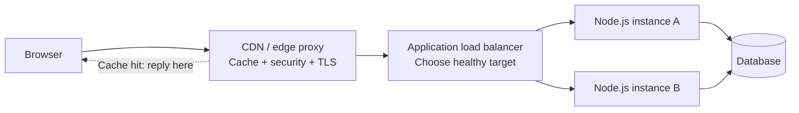

# CS230 — Computer Networks and Web Protocols

## Lecture 08: Proxies, Load Balancers, and Modern Web Transport

*Why the server your browser contacts is probably not your application server, how intermediaries transform requests, and why modern HTTP is an entire transportation system hiding behind a familiar interface.*

**Estimated study time:** 75–90 minutes, including the optional practical lab.

---

# Part I — Intuition

*Your browser may never speak directly to your backend. Every intermediary can improve performance—and accidentally become part of your application's correctness and security.*

Look at the opening diagram for half a minute, then listen. This pass builds one mental picture. Part II develops the same picture with full technical depth.

### The picture to carry in your head



**The question:** Which participant actually handled the request, and which parts of the message or connection could it change?

---

### 1. The request that never reached Node.js

A customer opens a hotel page. The browser reports a fast successful response. Your Node.js server logs show nothing. How can that be?

The public hostname doesn't necessarily resolve to your application instance. It may lead to a **CDN edge**, which acts as a reverse proxy. If it has a fresh usable cached representation, the edge can answer the browser without contacting the origin.

That is an architectural feature. A response can come from the network edge while the backend remains uninvolved.

Now imagine the request is for a personalized reservation list. If the edge mistakenly reuses a response cached for another user, the same optimization becomes a serious information leak.

The crucial mental model is that proxies are **participants**, not invisible wires.

### 2. Forward proxy versus reverse proxy

A forward proxy acts on behalf of the client side: a corporate network might route employee web requests through one. A reverse proxy acts in front of servers: clients connect to it as the public endpoint for an origin or application service.

A reverse proxy can terminate TLS, inspect HTTP metadata, choose an upstream service, retry requests under configured policy, cache responses, enforce limits, or transform headers.

Those capabilities are useful and dangerous precisely because the proxy understands more than packet forwarding.

**Checkpoint:** If Node.js has no log for a request that returned `200`, must the customer's report be wrong? **No.** The response may have been served entirely by the CDN.

### 3. Load balancing: which backend gets the work?

Suppose two Node.js instances can serve the same API. A load balancer decides where to send a connection or request, depending on its operating layer and implementation.

A **Layer 4** load balancer generally makes decisions using transport-level information, such as addresses and ports, without interpreting the complete HTTP message. A **Layer 7** HTTP-aware load balancer can route based on application-level information such as hostnames, paths, headers, and other protocol properties.

Both are load balancers, but they don't make identical promises. Also, a health check telling you a process is alive doesn't prove it can successfully complete a booking. Readiness and service correctness are stronger questions.

Sticky sessions try to keep a client associated with a particular backend. Sometimes they're needed, but they can hide unwanted process-local state and make balancing, failover, or scaling more awkward. If possible, build application correctness around shared authoritative state rather than assuming one process will own a customer forever.

### 4. The connection isn't necessarily end-to-end

Imagine the browser establishes TLS with the CDN. The CDN may then open another connection to the load balancer, which may open another connection to Node.js. Each hop can have its own transport and TLS state.

The browser isn't necessarily sharing one uninterrupted TCP connection with the application process.

That explains several otherwise mysterious observations: the application may see the load balancer as the TCP peer; upstream and downstream timeouts can differ; and the proxy may return an error before the backend ever receives the request.

If a proxy returns `504 Gateway Timeout`, investigate which upstream exchange timed out. The status does not prove that the backend executed and returned a 504 itself.

### 5. Where did the real client IP go?

A Node.js backend behind an HTTP reverse proxy often sees the proxy's address as the network peer. The proxy may add metadata such as `X-Forwarded-For` or standardized `Forwarded` headers to convey upstream client information.

But those headers are not automatically trustworthy when supplied by arbitrary clients. Correct interpretation requires a defined trusted-proxy chain and configuration that discards or handles untrusted input appropriately.

If your fraud engine treats any caller-provided `X-Forwarded-For` value as ground truth, an attacker may forge their apparent origin.

**Checkpoint:** Why does the backend's socket peer address differ from the customer's address? **Because an intermediary opened a separate upstream connection.**

### 6. Caching: only when the representation is shareable

A public hotel image is a good candidate for shared caching under suitable rules. A private booking list is not. HTTP caching behavior depends on policy, response metadata, and the key used to identify representations.

A CDN must understand which responses are public and which depend on user identity, authorization, cookies, or request headers. `Cache-Control: private` or `no-store` can be relevant according to the desired policy. `Vary` helps identify which request-header differences select different representations, but it isn't an automatic substitute for a safe authorization and caching design.

Another edge case is the **cache stampede**. A popular cached item expires; many simultaneous misses hit the origin. The cache meant to reduce load suddenly concentrates traffic. Coalescing, jittered expiration, and bounded fallback may help.

### 7. HTTP versions are different transportation machinery

HTTP/1.1 commonly uses persistent TCP connections, but each connection's request/response handling has practical ordering constraints. HTTP/2 allows multiple logical streams to be multiplexed over one TCP connection, reducing certain application-level blocking patterns.

However, because HTTP/2 over TCP depends on one ordered TCP byte stream, loss of a TCP segment can delay delivery of bytes needed by several streams. That's transport-level head-of-line blocking.

HTTP/3 carries HTTP semantics over QUIC, which uses UDP underneath and provides independently recoverable reliable streams. Losing data for one QUIC stream need not block unrelated streams in the same way as a missing TCP segment beneath HTTP/2, although shared congestion and other bottlenecks still exist.

Remember the distinction: **HTTP method and status semantics remain HTTP; the transportation machinery changes.**

### 8. Streaming and timeouts

Not all responses need to be buffered until completion. Streaming lets a server or proxy deliver a response incrementally, but intermediaries may buffer, time out, transform, or terminate streams according to configuration.

If an AI or report-generation endpoint stops streaming through a proxy, don't assume the backend stopped producing data. Inspect each intermediary's behavior and timeout boundary.

Likewise, an automatic proxy retry of a side-effecting request may create a duplicate operation if the first upstream attempt succeeded but its response vanished. Network convenience doesn't erase application idempotency.

### 9. The minute-long replay

The browser connects to an edge endpoint. The edge may answer from cache or forward. A load balancer chooses an available backend. Separate network connections can exist between hops. Every intermediary may add latency, modify headers, terminate TLS, enforce policy, or return its own error. HTTP/2 and HTTP/3 change how simultaneous application exchanges share transport machinery. The debugging question is not merely "Did the server respond?" but "Which server, through which boundary, answered or failed?"

#### Three questions before L08

1. Can a CDN serve a valid response while Node.js sees no request? **Yes**, on a suitable cache hit.
2. Is an `X-Forwarded-For` header automatically evidence of client identity? **No**, only trusted proxy processing can justify its interpretation.
3. Does HTTP/3 mean HTTP is unreliable because QUIC uses UDP? **No**, QUIC implements transport reliability and streams above UDP.


### Pocket map — screen reference

```text
FORWARD PROXY    client-side intermediary
REVERSE PROXY    server-side public intermediary
CDN              distributed edge cache/reverse proxy
L4 BALANCER      transport/address/port-based routing
L7 BALANCER      HTTP-aware routing/headers/host/path
HEALTH CHECK     signal, not proof full business operation works
TLS TERMINATION  separate secure channel ends at this hop
X-FORWARDED-FOR  client chain metadata; trust only defined proxies
CACHE HIT        origin may see no request
504              an intermediary may have timed out upstream
HTTP/1.1        persistent connections; older multiplexing constraints
HTTP/2          multiplexed streams on TCP; TCP loss HOL remains
HTTP/3          HTTP over QUIC; streams built above UDP
STREAMING        intermediaries may buffer or time out

An intermediary isn't an invisible wire.
```

*The intuition pass ends here.*

---

# Part II — Deep Dive

### How to listen to this lecture

Written for continuous listening first, then for on-screen re-reading. Theme: **intermediaries are programmable participants** — a CDN, load balancer, or HTTP version change can alter correctness, security, and identity, not merely latency. Bold takeaways mark where a “faster” hop quietly became part of the application’s behavior.

Near the end, answer the oral challenges **out loud** before reading the solutions. The practical lab lives after the spoken lecture ends — keep it for a screen-and-terminal session.

---

# 1. The Reservation That Belonged to Someone Else

It's Monday morning at a hotel-booking company, and production has never looked healthier.

Your new infrastructure is performing beautifully. The application has been placed behind a global CDN, an application load balancer distributes requests across several backend instances, and HTTP/3 is enabled at the edge.

Response times have improved dramatically. Origin-server traffic is lower, CPU utilization is comfortable, and the operations team is celebrating its latest performance improvements.

Then customer support receives an alarming report.

A customer opens their account and discovers a hotel reservation they never made. The reservation belongs to someone else.

The customer refreshes the page. The mysterious reservation remains.

They log out, log back in, and try again. The problem persists for several minutes before disappearing.

Your first instinct is to investigate application authorization.

Perhaps an endpoint forgot to check ownership. Perhaps a database query omitted the tenant identifier. Maybe the new deployment introduced a race condition.

But the backend logs contain something peculiar.

The affected customer's request never reached the Node.js application.

The CDN logs, however, show that it was served successfully with a cache hit.

That raises a deeply uncomfortable question.

**How can a CDN know which reservations belong to a particular customer if the backend never receives the request?**

The answer is that it doesn't necessarily know.

A misconfigured intermediary has cached an authenticated customer's private API response and reused it for another customer.

The response was served quickly. TLS encryption worked. HTTP returned `200 OK`. No packet was lost, and no TCP connection failed.

Every transport mechanism operated as designed.

The system was still catastrophically wrong.

This incident exposes a truth that is easy to miss when learning networking one protocol at a time.

A modern web request isn't necessarily one uninterrupted conversation between a browser and an application server.

It may cross several independently managed connections, each involving intermediaries capable of terminating TLS, translating protocols, changing headers, buffering content, reusing connections, choosing backend instances, or answering requests without contacting the origin at all.

Our task today is to understand those intermediaries as active participants in the application architecture.

We'll begin by examining what proxies and load balancers actually do, then investigate CDN caching, the evolution from HTTP/1.1 to HTTP/3, and how streaming protocols behave when intermediaries get involved.

Finally, we'll return to the mysterious reservation and reconstruct exactly how the architecture failed.

---

# 2. The Illusion of One Continuous Connection

Imagine a browser requesting:

`https://stays.example.com/api/me/reservations`

The browser displays the requested page, and the user sees their reservations.

It's natural to imagine one network connection stretching from the browser to the Node.js backend.

But our infrastructure might look like this:

Browser, CDN, load balancer, backend service, and database.

How many network connections exist?

Potentially several.

The browser establishes a connection to the CDN edge. The CDN might establish a separate connection to an origin-facing load balancer. The load balancer may establish another connection to an application target.

The backend then establishes its own database connection.

These conversations have different endpoints, connection states, timeout policies, and sometimes entirely different protocols.

The request's **application-level meaning** may survive the journey, but the transport connection ordinarily does not remain one continuous entity.

## 2.1 A request can cross multiple protocols

Suppose the browser connects to the CDN using HTTP/3 over QUIC.

The CDN's connection to the origin load balancer uses HTTP/2 over TCP and TLS.

The load balancer forwards HTTP/1.1 requests to a Node.js backend over another TCP connection.

This arrangement is entirely possible.

The browser speaks HTTP/3, yet the Node.js application receives HTTP/1.1.

The application may never know that HTTP/3 was used on the client-facing connection.

That is because HTTP defines application semantics that can be preserved across different transport arrangements.

A GET request remains a request to retrieve a representation. Status codes and ordinary end-to-end HTTP semantics remain broadly consistent, even though the message encoding and connection machinery differ.

An intermediary can receive a request using one HTTP version and forward an equivalent request using another.

It isn't merely relaying electrical signals.

It is participating in protocol processing.

## 2.2 The meaning of a hop

Each communication segment between adjacent participants is often called a **hop**, although the word can mean different things in network-layer and application-layer discussions.

At the IP layer, a hop commonly means forwarding through a router.

At the HTTP architecture level, we often discuss the connection between one intermediary and the next.

These distinctions matter because different information exists at different layers.

A router normally forwards packets according to network addressing and routing information.

An HTTP reverse proxy can inspect the request method, hostname, path, headers, and sometimes the body.

It can therefore make decisions that an ordinary IP router cannot.

For example, a router generally does not know whether a request is attempting to retrieve hotel availability or create a reservation.

An HTTP proxy can distinguish those operations, subject to its configuration and the traffic it can decrypt.

This extra information creates powerful capabilities.

It also creates new opportunities for mistakes.

---

# 3. Proxies: The Middlemen That Change Everything

Let's establish a precise definition.

A **proxy** is an intermediary that communicates with another endpoint on behalf of a client or service.

There are several varieties, and the terminology reflects which side the intermediary represents and what behavior it provides.

## 3.1 Forward proxies

Imagine a company whose employees access the internet through a centralized corporate proxy.

An employee's browser sends requests through that proxy rather than connecting directly to every external destination.

The proxy may enforce access policies, record approved connection metadata, provide caching, or apply organizational security controls.

This is a **forward proxy**.

It primarily acts on behalf of clients.

The user or their network configuration often determines that requests should pass through it.

A forward proxy can also use the HTTP CONNECT method to establish a tunnel toward a destination. In ordinary HTTPS proxying, this may allow the client's TLS connection to pass through the proxy without the proxy decrypting the HTTPS application data.

But some enterprise systems deliberately perform TLS inspection instead, which introduces a different trust and connection arrangement.

The important point is that using a proxy doesn't automatically tell us whether the intermediary can inspect the protected application data.

That depends on its behavior.

## 3.2 Reverse proxies

Now consider our hotel-booking platform.

Customers connect to `stays.example.com`, but the public endpoint actually belongs to a reverse proxy.

The proxy accepts incoming requests and forwards them to backend services selected according to its configuration.

This is a **reverse proxy**.

It primarily acts on behalf of the server-side infrastructure.

The client might never know which application instance processes its request.

A reverse proxy can provide TLS termination, path-based routing, connection reuse, compression, caching, request filtering, and protection against certain forms of excessive traffic.

Nginx, Envoy, HAProxy, cloud application load balancers, and many CDN edge services can perform reverse-proxy roles.

A reverse proxy is not necessarily a separate physical machine. It may be software running alongside other components, a dedicated infrastructure service, or a managed cloud resource.

## 3.3 Proxies versus gateways

The word **gateway** is widely used in networking, but its precise meaning depends on the context.

Your home network's default gateway is commonly a router that forwards packets toward other networks.

An API gateway, by contrast, usually operates at the application layer.

It may route HTTP requests, validate authentication tokens, apply rate limits, enforce request policies, or transform messages.

A gateway can therefore be a specialized reverse proxy, but the word doesn't identify one universal implementation.

When an architect says, "The traffic passes through a gateway," the next question should be:

**At what layer does it operate, and what responsibilities does it actually perform?**

Without that information, the architecture diagram tells us very little.

---

# 4. Layer Four and Layer Seven: Two Different Ways to Balance Traffic

Suppose our application runs on four backend instances.

We want incoming traffic to be distributed among them.

A **load balancer** selects backend destinations according to some routing policy.

But not all load balancers make their decisions using the same information.

A crucial distinction is between transport-level and application-level balancing.

## 4.1 Layer-four load balancing

A layer-four load balancer operates primarily using transport-level information such as IP addresses, ports, and protocols.

It may distribute TCP connections or UDP flows among backend targets.

It doesn't necessarily inspect HTTP methods, paths, or cookies.

Imagine that several application servers listen on TCP port 443.

A layer-four load balancer can select which server should receive a new connection.

Depending on its implementation, it may forward packets, perform address translation, or proxy transport connections.

Its decisions can be efficient because it need not fully interpret HTTP messages.

However, that same property limits the information it can use.

If the load balancer cannot inspect decrypted HTTP content, it cannot independently decide that requests beginning with `/api/payments` should go to one service while requests beginning with `/api/search` should go to another.

## 4.2 Layer-seven load balancing

A layer-seven load balancer understands application-protocol information.

For HTTP, this includes details such as the request hostname, path, method, and headers.

Our platform might configure rules such as:

Requests for `/api/search` go to the search service.

Requests for `/api/reservations` go to the booking service.

Requests for `/images` go to an image-processing or storage-facing service.

These are application-aware routing decisions.

The load balancer may also perform TLS termination, authentication integration, redirects, header manipulation, and health checks.

This additional intelligence is useful, but it changes the trust model.

The intermediary may need access to plaintext HTTP messages, so it generally terminates the relevant TLS connection when inspecting encrypted requests.

The more responsibility we place in the load balancer, the more important its configuration becomes.

A mistake in an application instance can affect one deployment.

A mistake in a shared ingress layer can affect every service behind it.

## 4.3 Load balancing is not automatically scaling

Here's a subtle misconception.

Suppose we place a load balancer in front of a database server.

Have we scaled the database?

No.

We have added an intermediary.

If all traffic ultimately reaches one saturated database, the bottleneck remains.

Even when several backend application instances exist, their shared dependencies may become overloaded as traffic increases.

A load balancer distributes work among available targets.

It does not manufacture unlimited capacity.

The system's throughput remains constrained by its actual bottlenecks, including databases, connection pools, CPU, network capacity, external APIs, and synchronization requirements.

This distinction will become especially important in CS430, where we investigate scaling distributed systems.

---

# 5. How Does a Load Balancer Choose a Server?

Let's imagine four identical Node.js backend instances.

Each can process incoming requests, and all are registered as healthy targets.

How should new traffic be distributed?

There isn't one universally optimal algorithm.

The correct decision depends on what is being balanced: connections, individual requests, active work, or something more application-specific.

## 5.1 Round robin

A simple strategy is **round robin**.

The load balancer selects targets in sequence: first server, second server, third server, fourth server, then back to the first.

This can distribute incoming assignments reasonably evenly when targets have similar capacity and work is approximately uniform.

But consider two requests.

One retrieves a small account profile.

Another generates an expensive report requiring several seconds of processing.

Counting each request as one equal unit of work ignores their different costs.

A server receiving several expensive requests might become overloaded while another server processes many inexpensive requests comfortably.

Round robin distributes assignments.

It does not directly equalize actual resource consumption.

## 5.2 Least connections or least outstanding requests

Another strategy considers how much work each target currently has.

A least-connections algorithm can favor the target with fewer active connections.

For request-aware balancing, some systems consider outstanding requests instead.

These can be useful approaches when connection or request durations vary.

But neither metric is perfect.

One long-lived WebSocket connection may consume little CPU.

One ordinary HTTP request may trigger an expensive database operation.

Two active connections are not necessarily equivalent to two units of work.

The algorithm's effectiveness depends on how well its chosen metric approximates actual load.

## 5.3 Weighted balancing

Suppose three servers have four CPU cores each, while a fourth has sixteen.

Equal distribution may not be appropriate.

A weighted algorithm allows traffic to be assigned according to configured relative capacity.

But configured weights should reflect measured behavior rather than blindly mirroring CPU counts.

The larger instance may still share a database bottleneck or have different memory characteristics.

Weights describe a routing policy, not a guarantee of equivalent processing capacity.

## 5.4 Consistent hashing and affinity

Sometimes we want related requests to reach a consistent destination.

An intermediary might use a hash of a selected key to assign traffic to backend targets.

**Consistent hashing** can reduce how much of the key space moves when targets are added or removed, compared with naïve hash-modulo strategies.

This can be useful for certain distributed caches, sharded workloads, or affinity requirements.

But using consistent hashing doesn't remove the need to handle target failures and membership changes.

Nor does it automatically guarantee perfect distribution.

The architecture must still define what happens when the selected destination disappears.

---

# 6. Sticky Sessions: The Tempting Shortcut

Imagine a user logs into our booking application.

Their session information is stored only in the memory of backend instance A.

The next request is routed to backend instance B.

The new instance doesn't recognize the session.

The user appears to have been logged out.

A developer suggests enabling **sticky sessions**.

With session affinity, the load balancer attempts to direct requests belonging to the same client or session toward the same backend target.

That might be accomplished through cookies, hashing, or another configured mechanism.

The immediate problem appears solved.

But we've introduced a new dependency.

What happens when instance A crashes?

What happens when the platform scales down?

What happens during a deployment?

If essential session state exists only inside one instance's memory, the user may lose continuity when that instance becomes unavailable.

Sticky sessions reduce the frequency of the problem.

They do not eliminate the underlying dependency on local state.

A more resilient design often stores important shared session information in an appropriate external system or uses a suitable stateless authentication architecture.

This doesn't mean session affinity is inherently wrong.

Long-lived stateful connections, specialized protocols, and certain performance optimizations may benefit from affinity.

But affinity should be an intentional architectural choice rather than a bandage for an application that cannot tolerate ordinary target changes.

**A load balancer can influence where requests go. It cannot guarantee that a particular process will live forever.**

---

# 7. Health Checks: Alive Is Not the Same as Ready

Now imagine our backend deployment contains four instances.

One has lost its database connectivity.

Its process remains alive. Its HTTP listener still accepts connections.

The load balancer periodically requests `/health`, and the application returns `200 OK`.

From the load balancer's perspective, the instance is healthy.

From the customer's perspective, every reservation request routed to that instance fails.

What went wrong?

The health check answered the wrong question.

## 7.1 Liveness versus readiness

A **liveness** check asks whether a process or component is alive enough that restarting it might be appropriate if it stops responding.

A **readiness** check asks whether the instance should currently receive new work.

Those are different judgments.

An application might be alive while initializing connections, loading configuration, or preparing internal state.

It may therefore need to remain unready until it can serve requests appropriately.

Conversely, a temporarily unavailable external dependency doesn't always justify restarting an otherwise healthy process.

If every application instance restarts whenever a shared database becomes unavailable, a brief dependency outage can trigger an unnecessary restart storm.

Health checks must be designed around the operational meaning of health.

## 7.2 Why checking every dependency can backfire

Suppose our readiness endpoint fails whenever an external payment provider is unavailable.

The provider experiences a brief outage.

Every application instance reports itself unready.

The load balancer now has no healthy targets, even though customers could still search hotels, inspect reservations, and use unrelated features.

The health-check design has converted a partial dependency failure into a platform-wide availability failure.

A better strategy distinguishes critical local readiness conditions from the health of external services.

Different endpoints and operations may also have different dependency requirements.

The correct choice depends on the architecture, but one principle is universal.

**A health check is a routing-control mechanism, not a magical proof that every business workflow will succeed.**

## 7.3 Connection draining

What happens when we deploy a new application version?

A backend instance may need to stop receiving new traffic while completing requests already in progress.

This is often called **connection draining**, or graceful deregistration.

The load balancer stops assigning new work to a target but allows existing requests or connections to continue for some configured period, depending on the service and protocol.

The application must also cooperate.

It may need to stop accepting new requests, complete in-flight work, and close connections gracefully.

For long-lived connections, such as WebSockets or streaming responses, this becomes more complicated.

A deployment cannot always wait indefinitely for every connection to close.

The system needs explicit policies for draining, reconnection, and state recovery.

This is why rolling deployments are not merely container orchestration events.

They are network and application lifecycle operations.

---

# 8. The Client IP Address That Wasn't the Client's

Our backend now receives requests through a CDN and load balancer.

A developer checks a request's network-level source address.

Instead of the customer's address, they see an address belonging to the load balancer.

That's expected.

An HTTP reverse proxy generally establishes or reuses a separate connection to its backend.

The backend therefore observes the proxy as its immediate network peer.

But sometimes the application needs the original client IP address.

For example, it might use the address for operational analysis, abuse detection, or approximate geographical information.

How can that information survive the intermediary chain?

## 8.1 Forwarded client information

A common convention is the `X-Forwarded-For` HTTP header.

A proxy can add information about the client address it observed.

When several proxies participate, the header may contain a sequence of addresses.

There is also a standardized `Forwarded` header, which can carry information including client and proxy addresses and other request properties.

Other common conventions include `X-Forwarded-Proto`, which can indicate the original request scheme, and `X-Forwarded-Host`, which can communicate host information.

These headers help preserve context that would otherwise disappear when requests pass through new transport connections.

But they create a serious trust problem.

## 8.2 A header is not proof

Imagine an internet client sends this header:

`X-Forwarded-For: 127.0.0.1`

If your backend blindly trusts the leftmost value, it might believe the request originated from localhost.

Now imagine that the application grants special treatment to local addresses or uses client IP information to enforce rate limits.

An attacker may exploit the forged header to bypass those controls.

The underlying problem is that an ordinary HTTP client can send headers.

A header's existence does not prove that a trusted proxy supplied it.

## 8.3 Establishing a trusted proxy boundary

A robust deployment defines which intermediaries are trusted to provide forwarding information.

The backend should ordinarily be reachable only through the intended ingress path, or otherwise distinguish traffic from trusted proxies.

The edge should normalize, remove, or append forwarding information according to a deliberate policy.

When the backend interprets an address chain, it should select the relevant client address based on trusted proxy positions or explicitly trusted proxy networks, rather than assuming that the leftmost value is authoritative.

This becomes especially important when some requests pass through a CDN while others bypass it.

Different paths can produce different forwarding chains.

Misconfigured trust rules can lead to incorrect client identities, unreliable rate limiting, and security vulnerabilities.

### Why the original scheme matters

There's another subtle issue.

Suppose the browser uses HTTPS to communicate with the load balancer.

The load balancer forwards plaintext HTTP to the backend.

The backend sees an HTTP connection and concludes that the original client used HTTP.

It generates an absolute redirect to an `http://` URL or incorrectly configures a cookie that should have been marked Secure.

Trusted forwarding metadata can help the application reconstruct the external request scheme.

But the trust boundary must be correct.

An attacker-controlled `X-Forwarded-Proto` header should not be allowed to dictate sensitive security behavior.

The lesson is larger than client IP addresses.

**Every time an intermediary replaces a connection, information about the original request becomes metadata that must be preserved and trusted deliberately.**

---

# 9. TLS Termination: Where Encryption Ends and Begins Again

In CS230-L07, we investigated how TLS authenticates endpoints and establishes protected communication.

Now we need to apply those ideas to an intermediary-heavy architecture.

Imagine our browser connects to the CDN using HTTPS.

The CDN terminates the TLS connection.

That means it decrypts the protected HTTP traffic at the edge.

The CDN may need the plaintext request to inspect the path, evaluate caching rules, apply a web application firewall, or determine which origin should receive the request.

If the CDN needs to contact the origin, it can establish another TLS connection.

The browser's connection and the CDN's origin connection are separate security relationships.

## 9.1 End-to-end versus hop-by-hop protection

Developers sometimes say that HTTPS provides end-to-end encryption.

That description can be misleading when the intended endpoints aren't clearly identified.

TLS protects communication between the participants in a particular TLS connection.

If a CDN terminates TLS, the CDN is one of those participants.

The browser is not maintaining one uninterrupted TLS session all the way to the Node.js application.

The CDN can access the decrypted HTTP contents and may send them onward over a separately protected connection.

This can be secure when the intermediary is trusted and the architecture is configured appropriately.

But it must be understood.

## 9.2 Re-encryption is not the same as uninterrupted encryption

Suppose the CDN connects to the load balancer using TLS.

The load balancer then connects to the backend using another TLS session.

We now have encryption on every application transport hop.

Nevertheless, each TLS-terminating intermediary can access the plaintext contents.

That may be intentional.

But no amount of hop-by-hop encryption makes those intermediaries unable to inspect information they are required to process.

If a business requirement calls for confidentiality from intermediaries themselves, additional application-level protection or a different architecture may be necessary.

## 9.3 TLS passthrough

An alternative is **TLS passthrough**, in which an intermediary forwards encrypted traffic without terminating the TLS session.

This can preserve TLS authentication between the original client and a backend endpoint.

However, the intermediary then loses access to most encrypted application information.

It generally cannot inspect the HTTP path or body to perform ordinary layer-seven routing and caching.

The correct choice depends on what the intermediary must accomplish.

You cannot simultaneously demand that a proxy inspect and cache arbitrary encrypted HTTP content while preventing it from accessing that content.

Architectural requirements have consequences.

---

# 10. The CDN: A Globally Distributed Reverse Proxy

Now we reach the center of our production incident.

A **Content Delivery Network**, or CDN, is often described as a system for serving static files closer to users.

That's true, but modern CDNs can perform considerably more sophisticated functions.

They operate geographically distributed edge infrastructure that receives requests and can cache content, terminate TLS, route traffic, enforce policies, and sometimes execute application logic.

A CDN is therefore often a globally distributed reverse-proxy system, not merely a remote folder containing images.

## 10.1 Edge versus origin

Imagine the main application infrastructure is in Frankfurt.

A customer in Vilnius requests a JavaScript bundle.

Without an effective CDN cache, the request might travel to the origin infrastructure in Frankfurt.

With a CDN, a nearby edge location may already possess the bundle.

The edge can return it immediately without contacting Frankfurt.

This can reduce latency and origin bandwidth consumption.

For static assets with content-hashed filenames, long caching lifetimes are often appropriate because changing the content normally produces a new filename.

But APIs are more complicated.

The result of a search query might depend on prices, inventory, filters, localization, or time.

A reservation response might depend on the authenticated customer.

And a payment operation must not be repeated or answered from an inappropriate cached response.

The CDN needs an explicit policy identifying which representations can be reused and under which conditions.

## 10.2 Cache keys: What makes two requests equivalent?

Suppose two customers request:

`GET /api/hotels?city=Paris`

If the response represents public hotel descriptions that don't depend on user identity, sharing a cached response may be perfectly reasonable.

Now suppose both customers request:

`GET /api/me/reservations`

The URL is identical.

But the meaning of *me* depends on the authenticated session.

If the CDN treats the URL as the only relevant cache key, it may regard these two requests as interchangeable.

They aren't.

The correct response for customer A can differ completely from the correct response for customer B.

A cache key is therefore more than a performance implementation detail.

**It defines which requests the system considers equivalent for response reuse.**

If the equivalence rule ignores a dimension that changes the response, caching can become incorrect.

If that missing dimension represents identity or authorization, the result can become a security incident.

---

# 11. The Dangerous Cache: Reconstructing the Data Leak

Let's investigate the precise configuration that caused our mysterious reservation.

The application exposes:

`GET /api/me/reservations`

Authentication uses a session cookie.

When customer A requests the endpoint, the application correctly authenticates customer A and returns only their reservations.

The authorization logic is correct.

The database query includes the appropriate customer identity.

No one has forgotten a tenant filter.

Unfortunately, a caching middleware applied to the API response is configured incorrectly.

It marks the response as reusable by shared caches for several minutes.

The CDN is also configured to cache GET responses under the relevant API path, using a cache key that doesn't distinguish the authenticated session.

This is a dangerous combination.

## 11.1 Customer A populates the cache

Customer A requests their reservations.

The CDN has no cached response, so it forwards the request to the origin.

The backend authenticates customer A.

It returns customer A's reservation data.

The CDN stores that response under a key representing the request URL.

So far, the customer sees correct information.

The response itself came from a properly authorized backend operation.

The failure occurs during storage.

The intermediary has been allowed to retain private information under an insufficiently specific key.

## 11.2 Customer B receives the cached response

A moment later, customer B requests the same URL.

The CDN finds a fresh cached response associated with that request target.

Because its cache policy doesn't vary the response according to the relevant identity, it considers customer A's stored response reusable.

It returns that response immediately.

The backend never receives customer B's request.

Consequently, the backend never gets an opportunity to authenticate customer B or perform its normal authorization checks.

The CDN has effectively answered a personalized application request without possessing the necessary authorization context.

Customer B receives customer A's private data.

This is why the application logs appear clean.

The backend didn't leak the data directly.

The intermediary reused a response that should never have been stored for shared delivery in that form.

## 11.3 The Cache-Control misunderstanding

HTTP provides response caching directives, including `public`, `private`, `no-store`, and `no-cache`.

Their meanings matter.

`private` indicates that a response is intended for a private cache rather than a shared cache, subject to the precise directive semantics.

`no-store` instructs compliant caches not to store the response.

`no-cache` is misleadingly named: it can permit storage but requires successful validation before reuse.

`public` allows a shared cache to store and reuse a response according to the applicable rules, including in circumstances where shared caching would otherwise be restricted.

For personalized reservation data, an appropriate policy is generally to prevent storage by shared intermediaries, often using `Cache-Control: no-store` when the response is sensitive.

But security cannot depend only on the origin sending a correct header.

The CDN's cache configuration must also be correct, and the system should test that sensitive responses never become shared across customer identities.

One nuance is especially important.

HTTP normally restricts shared-cache reuse of responses to requests containing an `Authorization` header unless explicit response directives permit it.

A request authenticated through a Cookie header does not receive an identical blanket protection merely because a cookie exists.

And explicitly configured CDN behavior can introduce additional risks regardless of the intended application semantics.

You must understand both the HTTP caching rules and the actual CDN configuration.

## 11.4 Why Vary isn't a universal authorization solution

HTTP's `Vary` response header can indicate that a representation depends on specific request headers.

For example, a response might vary by `Accept-Encoding` because different compression encodings are available.

That's a legitimate cache-key dimension.

But using `Vary` as an improvised replacement for proper private-data caching policy is dangerous.

Cookie values and authentication state may change, vary in complex ways, or contain sensitive information.

A response containing private reservation data should not be placed into a broadly shared cache merely because someone hopes that the cache key includes enough identifying information.

For security-sensitive responses, preventing shared caching is usually the cleaner default.

Caching personalized content can be designed safely in specialized architectures, but the isolation properties must be explicit and verified.

## 11.5 Fixing the leak

The immediate response should contain the incident.

Disable inappropriate shared caching for the affected endpoints and invalidate any sensitive responses already stored at the edge.

Ensure the origin emits correct caching directives.

Review the CDN's cache policies and identify other authenticated routes that may have been covered by the same configuration.

Then examine logs and other available evidence to determine whether private responses were served to unintended users.

The security team should assess the exposure according to the organization's incident-response obligations.

Crucially, do not merely fix the application's authorization middleware.

The application may have enforced authorization perfectly whenever it received a request.

The vulnerability lived in a layer that could bypass the application entirely by serving cached content.

That is the architectural lesson.

**An intermediary capable of answering a request becomes part of the system's security and correctness boundary.**

---

# 12. Caching Has Another Problem: The Stampede

Not all CDN failures involve privacy.

Sometimes a cache behaves correctly but creates an unexpected load problem.

Imagine a popular hotel-search endpoint whose cached response expires after thirty seconds.

Thousands of clients request the same search results.

As long as the cache entry is fresh, the CDN can serve them efficiently.

But what happens at the exact moment the entry expires?

If every incoming request independently triggers an origin fetch, the application may receive a sudden burst of identical requests.

This is a **cache stampede**, sometimes called a thundering herd.

The cache was supposed to protect the origin.

Instead, its expiration created a synchronized demand spike.

## 12.1 Collapsing identical requests

One mitigation is request coalescing.

When several requests need the same uncached representation, an intermediary can send one appropriate request toward the origin while other compatible requests wait for its result.

This is often called collapsed forwarding.

But it must respect response equivalence and caching rules.

Combining requests that actually depend on different authorization contexts would reintroduce the security problem we just investigated.

Performance optimizations are safe only when the underlying equivalence assumptions are correct.

## 12.2 Stale responses and background revalidation

Another technique is serving stale cached content temporarily while refreshing it in the background.

HTTP supports mechanisms such as `stale-while-revalidate` through an extension directive.

For content where slight staleness is acceptable, this can smooth latency and reduce synchronized origin pressure.

But consider real-time hotel inventory.

Would serving a thirty-second-old availability result be acceptable?

Perhaps for preliminary search results, if the application later rechecks availability before booking.

Would serving a stale reservation-confirmation response be acceptable?

That depends on the workflow, and it may be unacceptable if the user needs a definitive current outcome.

Caching policy must reflect business meaning.

The web protocol cannot decide whether stale inventory is harmless or whether stale payment status is dangerous.

## 12.3 Origin shielding

Large CDN deployments may use an additional caching tier between edge locations and the origin.

An **origin shield** can consolidate repeated origin requests from many edges.

This reduces the number of independent cache misses reaching the application infrastructure.

But every extra cache layer introduces more places where content can remain stored or stale.

Purge operations, cache keys, TTLs, and validation behavior must be understood across the hierarchy.

A global cache purge is not necessarily one instantaneous operation.

Much like DNS caching, distributed cache state may take time to converge.

The important principle is that caching moves work and state away from the origin.

That can improve performance enormously.

It also means correctness depends on systems outside the application process.

---

# 13. HTTP/1.1: The Era of Persistent Connections

We've spent much of this course discussing HTTP semantics.

Now let's examine how HTTP messages are transported.

Start with HTTP/1.1.

An ordinary HTTP/1.1 request has a textual structure: a request line, headers, and an optional message body.

Responses follow a corresponding structure.

HTTP/1.1 supports persistent connections, allowing several request-response exchanges to reuse one TCP connection.

This avoids paying the TCP and TLS establishment cost for every individual request.

But HTTP/1.1 has an important limitation.

It doesn't provide the modern multiplexing model used by HTTP/2 and HTTP/3.

## 13.1 Why sequential requests become expensive

Imagine a browser loading a page that requires an HTML document, several stylesheets, JavaScript files, fonts, and images.

If every resource requires a fresh TCP connection, the browser incurs repeated setup overhead.

With persistent connections, multiple resources can reuse already established connections.

However, ordinary HTTP/1.1 use typically allows only one outstanding request-response exchange at a time per connection.

HTTP/1.1 defined pipelining, where a client could send several requests before receiving their responses.

But responses still had to be returned in the corresponding order, and pipelining encountered deployment and interoperability difficulties.

Consequently, browsers generally avoided widespread reliance on HTTP/1.1 pipelining.

Instead, they commonly opened several parallel connections to the same origin, within practical limits.

This was a compromise.

It allowed parallel resource transfers but consumed additional connections, memory, buffers, congestion-control state, and server resources.

## 13.2 Head-of-line blocking at the HTTP layer

Suppose several requests share one HTTP/1.1 connection using pipelining.

The first request produces a slow response.

Even if the server could prepare a later response quickly, it cannot freely send that response ahead of the earlier one without violating the required response ordering.

The later response waits behind the earlier one.

This is **application-protocol head-of-line blocking**.

HTTP/2 was designed, in part, to escape this constraint.

But its solution would expose another form of head-of-line blocking lower in the transport stack.

---

# 14. HTTP/2: Multiple Conversations Inside One TCP Connection

HTTP/2 preserves HTTP semantics but changes how messages are represented and transported.

Instead of relying on the familiar textual HTTP/1.1 wire format, HTTP/2 uses a binary framing layer.

This allows multiple logical streams to share one TCP connection.

The key word is **multiplexing**.

## 14.1 Streams and frames

Imagine the browser needs three resources.

One is a stylesheet.

Another is a JavaScript bundle.

The third is an image.

With HTTP/2, these exchanges can occupy separate streams within one connection.

The connection carries frames associated with different stream identifiers.

A sender can interleave frames belonging to different requests and responses.

It doesn't need to finish sending the entire response for one resource before transmitting data belonging to another.

This removes the ordinary HTTP/1.1 constraint that independent responses on one connection must be delivered sequentially at the application framing level.

The browser can make progress on several resources concurrently.

## 14.2 HTTP/2 is still using TCP

Here's the catch.

All those logical HTTP/2 streams are carried inside one TCP byte stream.

TCP guarantees delivery of that byte stream in order.

If a TCP segment disappears, the receiver must recover the missing byte range before later bytes become available as a continuous stream to HTTP/2.

Even if the later bytes belong to another HTTP request, the higher-level protocol may be unable to process them until the transport gap is repaired.

We already encountered this in CS230-L06.

HTTP/2 solves HTTP-level response ordering constraints through multiplexing.

It does not eliminate TCP's connection-wide ordered-byte-stream behavior.

That is a different form of head-of-line blocking.

## 14.3 Header compression

HTTP requests often contain repetitive headers.

Think about cookies, user-agent information, accepted encodings, authentication-related headers, and other metadata repeated across many requests.

HTTP/2 uses **HPACK** to compress header fields efficiently.

This can reduce overhead, particularly when many requests share similar metadata.

But compression state introduces implementation complexity, and implementations must handle resource limits and security considerations carefully.

The point isn't that HTTP/2 makes every request dramatically smaller.

It's that its framing and compression mechanisms are designed for modern workloads containing many related HTTP exchanges.

## 14.4 Flow control and priorities

HTTP/2 also includes flow-control mechanisms.

A receiver can limit how much data another endpoint sends at the stream and connection levels.

This helps prevent one peer from overwhelming the other's buffering capacity.

The protocol also has mechanisms for communicating scheduling priorities.

Why does prioritization matter?

Imagine the browser needs a critical stylesheet before it can render meaningful content.

At the same time, it wants to download several large images located far below the visible part of the page.

Treating all resources equally may produce worse user-perceived performance than giving the stylesheet earlier access to the available capacity.

HTTP/2's original priority model proved complicated and inconsistently implemented, and a newer extensible prioritization scheme provides alternative signaling.

These are preferences and scheduling mechanisms, not absolute guarantees that a particular resource always goes first.

The application and browser still need sensible resource dependencies and loading behavior.

An efficient transport cannot compensate for a badly organized page that discovers critical resources too late.

---

# 15. HTTP/3: Changing the Transport Foundation

HTTP/2's multiplexing is useful.

But consider a mobile user on an unstable network with occasional packet loss.

Several HTTP/2 streams share one TCP connection.

A lost TCP segment can delay progress across those streams, even when subsequent packets carry data belonging to otherwise independent requests.

What if we could avoid imposing one transport-wide ordered byte stream?

This is one of the motivations behind HTTP/3.

HTTP/3 uses **QUIC** as its transport foundation.

QUIC typically operates over UDP, but implements sophisticated transport functionality itself, including secure connection establishment, acknowledgments, loss recovery, congestion control, and multiple independently managed streams.

## 15.1 Independent QUIC streams

Imagine three HTTP/3 requests, each using a separate QUIC stream.

A packet containing data for stream A is lost.

Another packet containing data for stream B arrives successfully.

Provided the necessary stream B data is available and protocol dependencies are satisfied, the receiver can continue processing stream B without waiting for the missing bytes from stream A.

This avoids TCP's connection-wide ordered-byte-stream bottleneck.

But don't turn that into the myth that HTTP/3 is immune to packet loss.

All streams still share network capacity and connection-level congestion constraints.

Loss can reduce the sender's permitted transmission rate and affect overall throughput.

Higher-level dependencies may also create blocking.

The improvement concerns **the independence of stream data delivery**, not the elimination of every resource or scheduling dependency.

## 15.2 QUIC and TLS 1.3

QUIC integrates TLS 1.3 into its connection establishment and key-management design.

This allows a modern secure transport handshake without layering a separate TLS record protocol over an already established TCP connection.

Under appropriate conditions, a new QUIC connection can become ready for secure application data with fewer sequential setup stages than a fresh TCP-plus-TLS arrangement.

Resumption and carefully controlled early-data features can provide further latency opportunities.

But these are optimizations governed by security and compatibility requirements.

A server handling payment creation should not indiscriminately accept replayable early data just because the transport supports it.

## 15.3 How does a browser discover HTTP/3?

An HTTPS URL doesn't normally contain an explicit HTTP version.

The user visits the same logical resource regardless of whether HTTP/1.1, HTTP/2, or HTTP/3 is used.

For HTTPS over TCP, the browser and server can negotiate HTTP/2 or HTTP/1.1 using ALPN during the TLS handshake.

HTTP/3 requires a QUIC connection, typically over UDP.

One discovery mechanism is **Alt-Svc**, which allows an HTTP origin to advertise an alternative service endpoint capable of supporting HTTP/3.

Another mechanism uses DNS HTTPS resource records, which can advertise service-connection parameters including supported application protocols.

A client may also use previously retained information about an origin's HTTP/3 support.

The exact process depends on browser behavior, DNS support, server configuration, and connection policy.

A client cannot assume that every HTTPS server supports HTTP/3 merely because HTTP/3 exists.

## 15.4 What if UDP is blocked?

Some networks restrict UDP traffic.

A corporate firewall might allow ordinary HTTPS over TCP port 443 while blocking or interfering with QUIC traffic.

What happens when a browser tries HTTP/3 and cannot establish the connection?

A well-designed client can fall back to a suitable TCP-based HTTP version.

This is why HTTP/3 deployments commonly coexist with HTTP/2 or HTTP/1.1 support.

The existence of the HTTP/3 option does not guarantee that every request actually uses it.

When investigating performance, inspect the negotiated protocol rather than assuming that a deployment setting reveals the client's real transport.

## 15.5 Is HTTP/3 always faster?

No.

The benefit depends on network conditions, connection setup, loss characteristics, implementation quality, server capacity, and many other factors.

On a low-latency network with very little packet loss and warm connections, the improvement may be small.

On certain mobile or lossy networks, QUIC's architecture can provide meaningful advantages.

But an HTTP/3 deployment can also underperform if its implementation, configuration, or surrounding infrastructure is inefficient.

Protocol choice should be evaluated using measurements that reflect actual user conditions.

A new protocol is a new set of mechanisms and trade-offs.

It is not a magical speed button.

---

# 16. Streaming: When a Response Shouldn't Wait Until the End

So far, our examples have mostly involved ordinary request-response exchanges.

The client sends a request.

The server performs work.

The server returns a complete response.

But what if the response is generated incrementally?

Imagine a service producing an AI-generated report.

The first paragraph is ready after one second.

The complete report will require another thirty seconds.

Would it make sense to force the user to wait until everything is finished?

Not necessarily.

Streaming allows the server to send available data progressively.

But the transport and intermediary architecture must preserve the intended behavior.

## 16.1 Streaming is not one particular protocol

Several technologies support different forms of incremental communication.

**Chunked HTTP/1.1 responses** can transmit a body without requiring the sender to know its complete length in advance.

**HTTP/2 and HTTP/3** support incremental data delivery through their framing and stream mechanisms.

**Server-Sent Events**, commonly abbreviated SSE, provide a browser-facing event stream over HTTP.

**WebSockets** support bidirectional application messaging over a long-lived connection.

**gRPC streaming** provides message-oriented streaming within its RPC model, commonly using HTTP/2.

These approaches are not interchangeable, even though all can involve data arriving over time.

The appropriate choice depends on whether communication is one-way or bidirectional, whether messages need structured framing, how clients reconnect, and what infrastructure supports the protocol.

## 16.2 Server-Sent Events

Suppose our application wants to display live progress for a report-generation job.

The client makes an HTTP request.

The server responds with a stream of events using the media type `text/event-stream`.

As new progress information becomes available, the server sends additional events.

The connection can remain open for an extended period.

This is useful when the server primarily needs to push updates to the client.

Browsers provide an EventSource API for ordinary SSE consumption.

The model is conceptually simpler than a fully bidirectional messaging protocol.

But there is an important complication.

## 16.3 The proxy that buffered everything

Imagine the backend emits one SSE event every second.

In development, the browser receives each event immediately.

In production, the browser sees nothing for thirty seconds.

Then all the events arrive at once.

What happened?

A reverse proxy may be buffering the upstream response.

Instead of forwarding each small piece of data immediately, it accumulates data before sending it downstream.

Buffering can improve efficiency for ordinary HTTP responses.

It can reduce the overhead associated with sending numerous small chunks and allow an intermediary to manage slow clients or upstream connections more effectively.

For a real-time stream, however, excessive buffering defeats the purpose.

The application produced incremental data, but the intermediary changed the delivery behavior.

Depending on the infrastructure, the solution may involve disabling response buffering for the streaming route, ensuring that appropriate flush behavior occurs, and configuring timeouts for long-lived connections.

One must also consider compression, intermediary response transformations, and the behavior of any CDN in the path.

**Streaming requires cooperation from every relevant hop.**

The backend calling a flush operation does not guarantee that the user receives the bytes immediately.

## 16.4 WebSockets

WebSockets provide a different communication model.

A WebSocket connection supports bidirectional messages between client and server.

In the traditional HTTP/1.1 establishment model, a client initiates a protocol upgrade handshake. Once established, the connection carries WebSocket frames rather than ordinary independent HTTP responses.

Other standardized establishment mechanisms exist for HTTP/2 and HTTP/3 environments.

WebSockets are useful for chat systems, collaborative editing, real-time dashboards, and other applications requiring frequent bidirectional communication.

But long-lived connections create operational responsibilities.

Load balancers need suitable connection handling.

Idle timeouts must be considered.

Deployments need reconnection and draining strategies.

And applications need to define how clients recover when a connection disappears.

A WebSocket connection is not a guarantee of eternal connectivity.

## 16.5 gRPC and HTTP/2

gRPC is commonly implemented using HTTP/2.

It supports RPC-style communication, often with Protocol Buffers for message serialization.

It can provide unary requests and several streaming patterns.

HTTP/2's multiplexing allows multiple RPC streams to share a connection.

But gRPC doesn't eliminate network boundaries or transport failures.

A backend can still receive a request, perform a business operation, and lose its response before the caller receives confirmation.

Streaming RPCs must still handle backpressure, cancellation, deadlines, and reconnection where appropriate.

The application protocol changes the interface.

It does not abolish distributed-systems uncertainty.

---

# 17. Timeouts, Retries, and the Intermediary Failure Chain

Now consider an API call passing through three HTTP-aware intermediaries.

The browser contacts the CDN.

The CDN contacts the load balancer.

The load balancer contacts the backend.

Each participant may have its own timeout policy.

The CDN may allow a particular amount of time for the origin to respond.

The load balancer may impose a connection-idle timeout.

The backend's HTTP server may have request or response timeouts.

The application might also enforce an overall business-operation deadline.

These values are related but not equivalent.

## 17.1 The difference between 502, 503, and 504

When an intermediary cannot provide a successful response, several HTTP status codes become relevant.

A **502 Bad Gateway** indicates that a server acting as a gateway or proxy received an invalid response from an upstream server.

A **503 Service Unavailable** commonly indicates that the server is temporarily unable to handle the request, perhaps because of overload or maintenance.

A **504 Gateway Timeout** indicates that a gateway or proxy did not receive a timely response from an upstream server needed to complete the request.

These distinctions are useful, but real deployments can have provider-specific behavior.

A load balancer might generate an error before the request reaches the application.

The application might itself return a 503.

A CDN might return a cached error, a custom error page, or an internally generated status according to its configuration.

If the browser receives a 504, that doesn't automatically prove the Node.js handler ran for too long.

Perhaps the load balancer couldn't establish an upstream connection.

Perhaps the backend response was delayed by a connection-pool wait.

Perhaps an intermediary had a shorter timeout than the application expected.

The error's origin matters.

## 17.2 Retries can multiply traffic

Suppose the browser retries a request after a timeout.

The CDN also retries unsuccessful origin requests under some configured conditions.

The load balancer or service client may apply another retry policy.

Now one logical user operation can produce several backend attempts.

With multiple retrying layers, the number of attempts can grow rapidly.

If three independent layers each permit multiple attempts, the worst-case amplification can be much larger than the user intended.

This is especially dangerous during overload.

An already struggling service receives additional work because callers interpret slowness as a reason to retry.

The resulting traffic can deepen the overload and cause further retries.

This is a **retry storm**.

Robust systems use bounded retries, appropriate backoff, jitter where relevant, deadlines, and explicit policies about which operations may be repeated.

They also distinguish between transport uncertainty and business correctness.

A reservation-creation request must not be blindly retried by every intermediary.

Some intermediaries deliberately avoid retrying requests with non-idempotent semantics, but the system's actual configuration still needs to be examined.

## 17.3 The retry budget belongs to the overall operation

Imagine a user-facing request with a two-second deadline.

The browser spends 300 milliseconds establishing connectivity.

The CDN spends another 200 milliseconds selecting and contacting the origin.

The backend then has its own work to perform.

If an intermediary begins a retry without considering the original deadline, the operation may continue long after the result remains useful to the user.

A coherent system propagates appropriate time budgets and cancellation signals through its components.

But remember that cancellation is not necessarily rollback.

A proxy abandoning an upstream request does not guarantee that a backend has stopped processing it.

The backend might already have committed a reservation.

Application-level idempotency remains necessary.

---

# 18. Observability: How to Find Which Hop Is Slow

We now understand why a request may travel through several independent connections.

That creates an observability problem.

The browser measures four seconds.

The CDN reports an origin-fetch duration of three seconds.

The load balancer reports substantial time waiting for a target.

The Node.js application logs only forty milliseconds of handler execution.

Who is wrong?

Possibly nobody.

Each observer is measuring a different portion of the system.

## 18.1 Time to First Byte isn't application processing time

Time to First Byte, or TTFB, is commonly used to describe the interval until the client receives the first response byte, under the relevant measurement definition.

That time can include connection establishment, TLS negotiation, request transmission, intermediary processing, origin communication, backend work, and the first part of the response path.

It is not simply the database query duration or the Node.js handler execution time.

A fast application handler can coexist with poor browser TTFB.

The delay might occur before the request reaches the handler.

Or it might occur while the response travels back.

## 18.2 Correlation across intermediaries

A useful architecture propagates a request or trace identifier across the relevant services and intermediaries.

If the browser reports a particular request identifier, engineers can attempt to locate the corresponding CDN event, load-balancer record, backend trace, and downstream dependency calls.

Not every provider exposes identical identifiers, and not every proxy automatically preserves tracing information.

Instrumentation must be configured intentionally.

Distributed tracing standards such as W3C Trace Context and tooling such as OpenTelemetry can help correlate application operations across service boundaries.

But trace correlation has its own trust and privacy considerations.

Untrusted incoming trace metadata should not be accepted without appropriate policy, and sensitive information should not be placed into identifiers or logs casually.

## 18.3 Cache hits create missing application traces

Now return to our original incident.

Customer B's request never reached Node.js because the CDN served a cached response.

That absence is expected behavior for a cache hit.

A system that observes only application-server logs cannot fully reconstruct the customer's experience.

The CDN is participating in request processing, so its behavior must be observable.

This is why an architecture diagram should eventually become an observability diagram.

For each component, ask:

What decisions can it make?

What failures can it introduce?

What information can we collect to investigate those decisions?

And how can we correlate its observations with the rest of the request journey?

If a component can change the user-visible result, it deserves an appropriate place in the system's operational model.

---

# 19. Designing a Sensible Production Architecture

We've examined many capabilities.

Now let's assemble them into a coherent design for a hotel-booking SaaS application.

Suppose customers are distributed across Europe.

The platform serves static frontend assets, public hotel information, authenticated reservation data, and transactional booking operations.

We want strong performance without sacrificing correctness.

## 19.1 Static assets

JavaScript bundles, stylesheets, fonts, and images can be served through a CDN.

For content-hashed static assets, long-lived caching is often highly effective.

The deployment process creates new filenames when content changes, allowing old cached versions to coexist safely until no longer referenced.

This reduces origin load and improves global performance.

## 19.2 Public search responses

Public hotel-description endpoints may be good caching candidates.

But the team needs to identify which dimensions affect the representation.

Language, currency, destination, search filters, and other relevant parameters may influence the response.

Availability and prices may also change frequently.

The cache policy should be based on the business's tolerance for staleness, with authoritative revalidation before irreversible actions where necessary.

A cached search result can be useful even when the final booking workflow needs fresher information.

## 19.3 Authenticated account data

Reservation lists, customer profiles, and other private account information should not be casually stored in shared caches.

The default should prioritize isolation and correctness.

If specialized private caching is desired, its identity partitioning and invalidation rules must be deliberately designed and tested.

An endpoint containing `/me/` in its path is an especially strong hint that the response depends on authentication context.

No generic rule should assume that every GET response is safe for public reuse.

## 19.4 Transactional operations

Payment and reservation creation should be handled by appropriate application services with explicit idempotency and failure-reconciliation behavior.

Infrastructure retries should be constrained by the semantics of the operation.

The system may employ a load balancer, but selecting a healthy application instance doesn't ensure exactly-once business execution.

That guarantee requires application and data-layer design.

## 19.5 Real-time updates

For notification or progress streams, the platform may use SSE, WebSockets, or another suitable mechanism.

The ingress architecture needs appropriate support for long-lived connections, streaming delivery, idle behavior, and graceful deployment handling.

A generic proxy configuration optimized for buffering short ordinary responses may not be suitable for a real-time stream.

## 19.6 The security boundaries

TLS should protect external communication.

Trusted ingress components should authenticate their upstream and downstream peers as appropriate.

The application must correctly interpret trusted forwarding information.

Direct backend access should be restricted according to the intended architecture.

And no intermediary should become an unexamined shortcut around authentication or authorization.

The final design isn't simply a list of technologies.

It is a set of explicit responsibilities and constraints.

Every layer should exist because it provides a useful capability that justifies its cost and complexity.

---

# 20. Completing the Incident: The Fastest Data Leak in the Company

Let's return one final time to the customer who saw someone else's reservation.

The investigation reveals that the backend authorization logic was correct.

Customer A requested their reservations.

The origin authenticated customer A and returned the appropriate response.

But a generic caching policy incorrectly marked the result as suitable for shared caching.

The CDN's cache configuration allowed that endpoint to be cached under a key that did not distinguish authenticated users.

When customer B requested the same path, the CDN supplied customer A's cached response.

TLS worked on the browser-to-CDN connection.

The HTTP response was valid.

The result was delivered exceptionally quickly.

And the application was still fundamentally insecure.

The team disables shared caching for sensitive authenticated endpoints, invalidates potentially affected edge objects, and reviews related caching policies.

It also establishes integration tests that make requests under distinct customer identities and verify that no private representation is reused across those identities.

The incident response includes determining the scope of potential exposure and preserving the necessary evidence.

A second change improves observability.

The company adds structured edge logs and request-correlation mechanisms so that future customer-visible responses can be investigated even when no backend request occurred.

A third change improves deployment discipline.

CDN configuration is reviewed and tested like application code, particularly when a change alters caching, authentication boundaries, or forwarding behavior.

The postmortem's conclusion is not that CDNs are dangerous or that caching should be abandoned.

Caching is one of the most valuable performance mechanisms on the web.

The problem was an incorrect assumption about equivalence.

The system treated two requests with the same URL as though they were interchangeable, even though their correct responses depended on different authenticated identities.

That assumption was embedded in infrastructure configuration instead of application code.

But the location of the mistake didn't make it any less real.

**Infrastructure is part of the program. Its rules are executable application behavior.**

Once you understand that, the architecture becomes much easier to reason about.

---

# 21. The Oral Examination

Now it's time to reconstruct the mechanisms without relying on recognition.

Answer the following questions aloud before reading the solutions.

Treat them as conversations with an experienced interviewer. Explain not just what you would do, but which observation supports your diagnosis.

### Challenge 1 — The request that never reached the backend

A customer receives a valid `200 OK` response containing incorrect data.

The backend has no matching request log.

The request passed through a CDN.

Give several plausible explanations for the missing backend log, and explain how you would distinguish them.

### Challenge 2 — The load balancer that didn't fix performance

A team deploys four Node.js instances behind a round-robin load balancer.

Throughput improves slightly, but database latency becomes much worse.

Why might adding application instances make the system slower?

What measurements would you collect before scaling further?

### Challenge 3 — The forged client address

Your backend reads the leftmost value of `X-Forwarded-For` and uses it for rate limiting.

The service is reachable directly from the internet as well as through a CDN.

What is the security problem?

How should trusted client-address derivation be designed?

### Challenge 4 — The HTTP/2 mystery

A browser loads several resources through HTTP/2 over one TCP connection.

One TCP segment is lost.

Requests on different HTTP/2 streams experience delays.

Why can that happen despite HTTP/2 multiplexing?

What changes when HTTP/3 uses QUIC?

### Challenge 5 — HTTP/3 in the real world

Your team enables HTTP/3 at the CDN.

Some users continue connecting through HTTP/2.

A developer says the deployment must be broken.

Is that conclusion justified?

Explain how HTTP/3 can be discovered and why a client might use a TCP-based alternative.

### Challenge 6 — The streaming API that doesn't stream

A Node.js backend sends an SSE event every second.

Locally, events appear immediately.

In production, events arrive in batches every twenty seconds.

The backend logs show no delay in generating the events.

What intermediary behavior would you investigate?

How would you design a safe streaming route?

### Challenge 7 — The overlapping timeouts

A CDN has an origin-response timeout shorter than the backend's maximum request duration.

A reservation request triggers an upstream timeout, and the CDN returns an error.

The backend may still complete the reservation afterward.

What does the customer actually know?

What would make retries and reconciliation safe?

### Challenge 8 — Sticky sessions and failure recovery

An application stores sessions in local process memory and depends on load-balancer affinity.

A rolling deployment causes users to lose their sessions.

Why doesn't sticky routing guarantee continuity?

What architectural changes could make the system more resilient?

### Challenge 9 — The caching trade-off

You operate three endpoints:

- Public hotel descriptions.
- Personalized reservation lists.
- Frequently changing hotel availability.

Which responses might be cached by a shared CDN?

What constraints matter for each?

Why isn't one universal caching rule sufficient?

---

# 22. Solutions and Discussion

*Read this section after answering out loud. The practical lab appears after the spoken lecture ends.*

### Solution 1 — Missing backend logs

The request may have been served from a CDN cache, answered by a service worker or browser cache, rejected or redirected by an intermediary, or routed toward a different backend than expected.

An observability failure is also possible.

Inspect browser network details, CDN request and cache-status logs, routing decisions, and application trace identifiers.

A missing backend log alone doesn't establish that the request failed or never traversed the public edge.

### Solution 2 — Scaling and database performance

Adding application instances can increase the number of concurrent requests and database connections.

The database may become saturated, experience lock contention, or spend more time waiting for CPU, I/O, or connection resources.

The load balancer distributes application traffic but doesn't remove the shared dependency bottleneck.

Measure database connection counts, query latency, lock waits, pool saturation, request concurrency, and actual throughput before choosing the next intervention.

### Solution 3 — Forwarded address trust

A direct internet client can supply a forged `X-Forwarded-For` header.

Blindly trusting the leftmost address allows attackers to influence rate limiting and other IP-based decisions.

Restrict backend access to trusted ingress paths where appropriate, configure the proxies to normalize forwarding metadata, and derive the relevant client address according to explicitly trusted proxy addresses or positions.

Security decisions must not depend on unverified client-supplied forwarding metadata.

### Solution 4 — HTTP/2 versus HTTP/3

HTTP/2 multiplexes independent logical streams inside one TCP byte stream.

TCP's ordered delivery means missing bytes can prevent later data from becoming available to HTTP/2, even when that data belongs to another logical stream.

HTTP/3 uses QUIC, which provides independently ordered transport streams.

Loss affecting one stream does not inherently block delivery of available data from unrelated streams.

However, congestion control, shared network capacity, and higher-layer dependencies can still affect multiple streams.

### Solution 5 — HTTP/3 fallback

Not every client or network will use HTTP/3.

Clients may discover support through Alt-Svc, DNS HTTPS records, retained origin information, or other supported mechanisms.

If UDP connectivity is unavailable, the QUIC connection fails, the server configuration lacks support, or the client's policy prefers another approach, a TCP-based HTTP version may be used.

Verify actual protocol negotiation rather than inferring it from a CDN feature toggle.

### Solution 6 — Buffered streaming

An intermediary may be buffering the response rather than forwarding each event as it becomes available.

Other possibilities include compression buffering, application flushing behavior, and timeout or streaming-support configuration.

Inspect each hop between the backend and client.

Configure the appropriate route to preserve incremental delivery, avoid inappropriate response buffering, and support long-lived connections and backpressure.

Verify the result from the actual client, not merely from backend logs.

### Solution 7 — Timeouts and reservation outcome

The customer knows that a timely, successful response was not received.

That doesn't prove the reservation was not created.

The backend may continue processing after an intermediary abandons the request.

Use a stable operation identifier, proper idempotency enforcement, and a reliable method for querying or reconciling the operation's final state.

Bounded retries should respect the business semantics and the overall deadline.

### Solution 8 — Sticky sessions

Affinity influences routing but cannot guarantee that an application instance survives deployments, scaling events, or failures.

If important session state exists only in the process's memory, losing the instance can lose the session.

Possible improvements include storing shared session state in an appropriate persistent or distributed system, using suitable stateless authentication designs, and supporting graceful connection draining and reconnection.

Affinity can remain an optimization, but it shouldn't be the only mechanism preserving correctness.

### Solution 9 — Caching policies

Public hotel descriptions are often good CDN caching candidates, with suitable cache keys and freshness policies.

Personalized reservations should generally be excluded from shared caching, especially when they contain sensitive customer information.

Hotel availability may benefit from carefully controlled short-lived caching when the business can tolerate some staleness, provided final booking operations validate authoritative availability before committing.

Each endpoint has different correctness, freshness, and security requirements.

A universal cache rule ignores those differences.

---

# 23. The Mental Model Worth Keeping

A modern web request is often a journey through multiple independently managed communication boundaries.

At each boundary, an intermediary may terminate one connection and establish another.

**Proxies** act on behalf of clients or servers and may inspect, modify, forward, or sometimes answer HTTP requests.

**Load balancers** select destinations according to transport-level or application-level routing policies.

**CDNs** place caching and application-aware processing closer to users, reducing latency and origin demand while introducing distributed state that must remain correct.

**HTTP/1.1** supports persistent connections but lacks modern stream multiplexing.

**HTTP/2** multiplexes logical requests and responses over a TCP connection, improving concurrency while retaining TCP's ordered-stream constraints.

**HTTP/3** uses QUIC to support independent transport streams, integrated secure setup, and different behavior under packet loss.

**Streaming protocols** require every relevant intermediary to preserve incremental delivery and appropriate connection lifecycle behavior.

The architectural insight worth keeping is this:

**An intermediary is not simply a transparent pipe. It is a programmable participant that can change performance, security, availability, and correctness.**

Whenever you introduce a proxy, CDN, or load balancer, ask four questions.

What information can it inspect?

What decisions can it make?

What state does it maintain?

And what happens when its assumptions are wrong?

Those questions will take you further than memorizing a list of cloud services or HTTP features.

---

# 24. Next Lecture — Network Forensics for Software Engineers

We've spent the last several lectures investigating the individual mechanisms that make modern networking possible.

We now understand DNS resolution, IP routing, NAT, TCP connections, TLS authentication, proxies, load balancing, caching, and modern HTTP transports.

But production incidents rarely announce which mechanism has failed.

Instead, you see symptoms.

A website loads in Germany but fails in Australia.

One API endpoint intermittently returns 504.

A WebSocket disconnects every minute.

An HTTPS request succeeds from your laptop but fails from a Docker container.

Or a supposedly healthy backend never receives the requests customers insist they sent.

In **CS230-L09 — Network Forensics for Software Engineers**, we'll investigate a collection of realistic production incidents using the reasoning developed throughout this course.

The challenge will no longer be explaining individual protocols.

It will be deciding which evidence to collect, distinguishing competing hypotheses, and identifying the real failure without randomly changing infrastructure settings.

The theory is nearly complete.

Now we have to prove we can use it.

---

## Optional Practical Lab — Investigating Modern Web Infrastructure

*The spoken lecture ends here. The remaining material is designed for terminal experiments, visual review, and practical interview preparation.*

## Lab A — Identify the negotiated HTTP version

Ask curl to report the HTTP version it negotiated with a public HTTPS origin:

```bash
curl -sS -o /dev/null \
  -w "HTTP version: %{http_version}\n" \
  https://example.com/
```

On Windows, invoke `curl.exe` and use `NUL` as the output destination if appropriate.

Compare different destinations.

Remember that the protocol used between your client and the public endpoint doesn't necessarily reveal what protocol the endpoint uses to communicate with its backend.

## Lab B — Inspect CDN behavior

Fetch only response headers from a public site that uses a CDN, and look for caching or intermediary clues:

```bash
curl -I https://example.com/
```

Depending on the provider and configuration, useful headers may include `Age`, `Via`, `Cache-Control`, and provider-specific cache-status fields.

Not every CDN exposes identical information.

The absence of a particular header is not conclusive proof that no intermediary exists.

Repeat the request and compare responses.

## Lab C — Explore connection reuse

Issue three consecutive HTTPS requests in one curl invocation and watch the verbose trace for connection reuse:

```bash
curl -v \
  https://example.com/ \
  https://example.com/ \
  https://example.com/
```

Look for evidence that the same connection is being reused.

Discuss which conditions might prevent reuse, including server behavior, connection closure, different origins, protocol choices, and intermediary policies.

## Lab D — Test HTTP/2 and HTTP/3

Request HTTP/2 explicitly and inspect the negotiated protocol in the response headers:

```bash
curl --http2 -I https://cloudflare.com/
```

Then attempt HTTP/3 over QUIC on the same origin:

```bash
curl --http3 -I https://cloudflare.com/
```

Some curl builds lack HTTP/3 support.

Inspect actual connection information rather than assuming a command-line option guarantees the negotiated protocol.

If HTTP/3 fails, consider both client capability and UDP network reachability.

## Lab E — Build a tiny reverse proxy

This tiny Node.js server returns the path, the socket peer address, and any `X-Forwarded-For` value it sees:

```javascript
const http = require("node:http");

http.createServer((req, res) => {
  res.writeHead(200, {
    "Content-Type": "application/json"
  });

  res.end(JSON.stringify({
    path: req.url,
    remoteAddress: req.socket.remoteAddress,
    forwardedFor: req.headers["x-forwarded-for"] ?? null
  }));
}).listen(3000, "127.0.0.1");
```

This Nginx reverse proxy listens on port 8080, forwards to the local backend, and sets forwarding headers:

```nginx
server {
    listen 8080;

    location / {
        proxy_pass http://127.0.0.1:3000;

        proxy_set_header Host $host;
        proxy_set_header X-Forwarded-For $proxy_add_x_forwarded_for;
        proxy_set_header X-Forwarded-Proto $scheme;
    }
}
```

Use an isolated local environment.

Send requests through Nginx and compare the backend's observed network peer and forwarded information.

Then attempt to provide your own `X-Forwarded-For` header.

Investigate why the backend must not simply trust arbitrary values supplied by clients.

## Lab F — Reproduce a buffering problem

Create an HTTP endpoint that periodically writes text or SSE-compatible events.

Place it behind a reverse proxy with response buffering enabled.

Observe how data reaches the client.

Then configure the proxy appropriately for incremental delivery and compare the results.

With Nginx, relevant mechanisms include the `proxy_buffering` directive and, in supported configurations, the `X-Accel-Buffering` response header.

Consider how compression and connection timeouts may also influence observations.

The objective is to understand that server-side writes do not automatically translate into immediate client-visible delivery.

## Lab G — Design caching policies

Decide a shared-cache policy for each of these endpoints before you look at any answers:

```text
GET /assets/app-a1b2c3.js
GET /api/hotels?city=Berlin
GET /api/me/reservations
POST /api/reservations
GET /api/reports/stream
```

For each endpoint, decide:

1. Whether it should be eligible for shared caching.
2. Which request properties affect response equivalence.
3. What freshness or invalidation requirements exist.
4. Whether authentication changes the caching policy.
5. Whether streaming or long-lived communication changes intermediary behavior.

Explain your reasoning as though reviewing a production CDN configuration.

## Lab H — Trace a request across multiple hops

Use this multi-hop path as the model when the browser reports four seconds and Node.js reports fifty milliseconds:

```text
Browser
   |
   | HTTP/3, TLS
   v
CDN
   |
   | HTTP/2, TLS
   v
Application Load Balancer
   |
   | HTTP/1.1
   v
Node.js API
   |
   | Database protocol
   v
PostgreSQL
```

Design a diagnostic plan that identifies which connection or intermediary owns the missing time.

Include the role of browser timing, CDN edge and origin logs, load-balancer metrics, application traces, and downstream dependency measurements.

Do not assume that durations reported by separate observers can simply be added without accounting for their definitions and overlapping intervals.

The goal is to develop an evidence-based model of the complete request path.

---

## Further Reading — Optional Technical References

1. [RFC 9110 — HTTP Semantics](https://www.rfc-editor.org/rfc/rfc9110.html) — HTTP intermediaries, message forwarding, connection-specific fields, and gateway behavior.
2. [RFC 9111 — HTTP Caching](https://www.rfc-editor.org/rfc/rfc9111.html) — Shared caches, response reuse, cache keys, freshness, and authorization-related caching rules.
3. [RFC 9112 — HTTP/1.1](https://www.rfc-editor.org/rfc/rfc9112.html) — HTTP/1.1 messaging, connection management, and framing.
4. [RFC 9113 — HTTP/2](https://www.rfc-editor.org/rfc/rfc9113.html) — Binary frames, streams, multiplexing, and flow control.
5. [RFC 9114 — HTTP/3](https://www.rfc-editor.org/rfc/rfc9114.html) — HTTP over QUIC and HTTP/3 connection establishment.
6. [RFC 9000 — QUIC Transport](https://www.rfc-editor.org/rfc/rfc9000.html) — QUIC streams, connection identifiers, migration, and transport state.
7. [RFC 9218 — Extensible Prioritization Scheme for HTTP](https://www.rfc-editor.org/rfc/rfc9218.html) — Request and response scheduling across HTTP versions.
8. [RFC 9460 — SVCB and HTTPS DNS Records](https://www.rfc-editor.org/rfc/rfc9460.html) — DNS-based discovery of service parameters and supported protocols.
9. [RFC 7239 — Forwarded HTTP Extension](https://www.rfc-editor.org/rfc/rfc7239.html) — Standardized forwarding metadata across proxies.
10. [RFC 5861 — HTTP Cache-Control Extensions for Stale Content](https://www.rfc-editor.org/rfc/rfc5861.html) — Stale-while-revalidate and stale-if-error behavior.
11. [RFC 6455 — WebSocket Protocol](https://www.rfc-editor.org/rfc/rfc6455.html) — WebSocket communication over established connections.
12. [MDN — Server-Sent Events](https://developer.mozilla.org/en-US/docs/Web/API/Server-sent_events/Using_server-sent_events) — SSE implementation and browser behavior.
13. [MDN — X-Forwarded-For](https://developer.mozilla.org/en-US/docs/Web/HTTP/Reference/Headers/X-Forwarded-For) — Forwarded address chains and security considerations.
14. [Nginx — Proxy Module](https://nginx.org/en/docs/http/ngx_http_proxy_module.html) — Reverse proxying, buffering, connection behavior, and upstream configuration.
15. [AWS — Application Load Balancers](https://docs.aws.amazon.com/elasticloadbalancing/latest/application/introduction.html) — Practical layer-seven load balancing in AWS.

---

## Dense Cheatsheet — Interview Glance Card

*Fenced so voice readers skip it. Skim on screen when revising; open sections above only when a row fails to spark.*

```text
CS230-L08  PROXIES / LB / CDN / HTTP VERSIONS — INTERVIEW GLANCE CARD

CORE MODEL
  One browser "request" ≠ one continuous connection to Node —
               many hops: Browser → CDN → LB → backend → DB; protocols may differ
  App semantics can survive; transport identity of the connection usually does not
  Intermediary = programmable participant (route/cache/headers/TLS) — not a pipe
  Infrastructure rules = executable application behavior

PROXIES
  Forward    on behalf of clients (corp egress); CONNECT tunnel may pass TLS;
             TLS inspection = different trust model
  Reverse    on behalf of server infra (TLS term, routing, cache, filter…)
  Gateway    ambiguous: IP router vs API gateway (L7) — ask layer + responsibilities

LOAD BALANCING
  L4         IP/port/protocol; efficient; no path/cookie-aware HTTP routing alone
  L7         method/host/path/headers; often TLS terminate to inspect
  ≠ scaling  distributes among targets; doesn't invent DB/API capacity
  Algorithms round-robin (assignments ≠ equal cost); least-conn / outstanding reqs
               (metric ≈ load?); weighted; consistent hash / affinity
  Sticky     affinity hides local-session pain; crash/scale/deploy still lose state —
               prefer external session / stateless auth; LB ≠ immortal process

HEALTH / DRAIN
  Liveness ≠ readiness; alive+listening can still fail all business work
  Over-checking external deps → partial outage → empty healthy pool
  Health check = routing control — not proof every workflow succeeds
  Connection draining: stop new work; finish in-flight; long-lived (WS/stream) need policy

CLIENT IDENTITY AFTER PROXY
  Backend sees proxy as peer; X-Forwarded-For / Forwarded / X-Forwarded-Proto|Host
  Header ≠ proof — clients can forge; trust only configured proxy boundary;
               pick client addr by trusted positions/networks — not "leftmost always"
  Wrong scheme guess → http redirects / insecure cookies if Proto untrusted

TLS AT INTERMEDIARIES
  Terminate at CDN/LB → plaintext there; re-encrypt ≠ continuous client↔app TLS
  Passthrough preserves end TLS; loses ordinary L7 path/body inspect & cache

CDN / CACHE
  Globally distributed reverse proxy — not only static files
  Cache key = equivalence for reuse; URL-only for /api/me/* → cross-customer leak
  Auth Cookie ≠ same shared-cache restriction as Authorization header
  Cache-Control: private / no-store / no-cache (store+revalidate) / public
  Sensitive: prefer no-store + CDN policy; Vary ≠ universal auth fix
  Stampede on expiry → coalescing / stale-while-revalidate / origin shield
               (only if equivalence & business staleness OK)
  Intermediary that answers = security/correctness boundary

HTTP VERSIONS
  1.1  textual; persistent; no modern mux; pipelining rare → parallel conns
       HTTP-layer HoL if ordered pipeline
  2    binary frames; stream mux; HPACK; flow/priority; STILL one TCP ordered stream
       → TCP loss can block other streams (transport HoL)
  3    HTTP over QUIC; independent stream delivery; TLS 1.3 integrated;
       discover Alt-Svc / HTTPS DNS / prior knowledge; UDP block → fall back
       Not always faster — measure; ≠ immune to loss/congestion/deps

STREAMING
  Chunked / H2-H3 frames / SSE (text/event-stream) / WebSockets / gRPC streams
  Proxy buffering can batch SSE — flush + disable buffer per route; every hop must cooperate
  WS: upgrade/long-lived → idle timeouts, drain, reconnect; not eternal
  gRPC on H2: still deadlines/cancel/backpressure/uncertain outcomes

TIMEOUTS / RETRIES / OBSERVABILITY
  502 bad/invalid upstream via gateway; 503 unavailable; 504 gateway timeout
  Status origin matters — may never hit Node
  Multi-layer retries → amplification / retry storm; bound + backoff; respect idempotency
  Cancel ≠ remote rollback; overall deadline / budget across hops
  TTFB ≠ handler time; correlate IDs across CDN/LB/app; cache hit → no app span

DESIGN SNIPPET
  Hashed static → long CDN TTL; public search → keyed+freshness; /me → no shared cache;
  transactions → idempotency; streams → streaming-capable ingress

SENIOR LINE: ask what an intermediary can inspect, decide, store —
             and what breaks when its equivalence assumptions are wrong.
```
