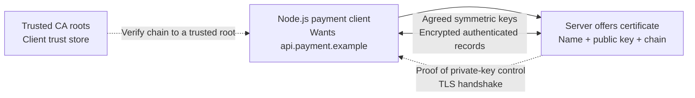

<!--
EDITORIAL-TODO: P3 / AUDIT_DENSITY
Previously measured at approximately 64 spoken minutes.
Future TODO: Examine repetitive introductions to cryptographic primitives versus
necessary explanations of handshake mechanics, identity verification, certificate
chains, trust, and termination boundaries.
Maintain a coherent cryptographic mental model.
Do not apply automatic word-count reductions.
-->


# CS230 — Computer Networks and Web Protocols

## Lecture 08: TLS and the Architecture of Trust

*How two strangers establish a secret across a hostile network, why certificates deserve your trust, and why the little padlock in your browser is considerably less reassuring than it looks.*

---

# Part I — Intuition

*Encryption is easy to misunderstand because a perfectly encrypted conversation can still be with the wrong person.*

Look at the opening diagram for half a minute, then listen. This pass builds one mental picture. Part II develops the same picture with full technical depth.

### The picture to carry in your head



**The question:** Even if nobody can read our encrypted messages, how do we know the receiver is the intended payment provider?

---

### 1. The suspiciously effective security fix

A payment integration that worked for months begins failing after the provider changes certificate configuration. Node.js reports a certificate validation error. Someone discovers that disabling verification makes every request succeed.

The dashboard returns to green. The payment API responds. It looks fixed.

But you've removed one of the central reasons HTTPS is trusted. Encryption alone doesn't tell the client **who holds the other end of the connection**. An attacker controlling the network might negotiate an encrypted session with your client. The resulting bytes could be well protected from other observers while flowing straight to the attacker.

TLS must solve several distinct problems. **Confidentiality** prevents outsiders from reading protected application data. **Integrity** detects unauthorized changes to protected data. **Authentication** helps the client determine which server it is talking to. These are not interchangeable.

A secure payment connection needs all the relevant guarantees together.

### 2. Two kinds of cryptography, two jobs

Imagine a simple lockbox. If both parties already share the same secret key, **symmetric encryption** can efficiently protect large amounts of traffic. Modern TLS uses symmetric authenticated encryption for application data after establishing the session keys.

The difficulty is how two strangers acquire a shared secret across an untrusted network without exposing it to an eavesdropper.

**Public-key cryptography** introduces different roles for public and private keys. Public information can be shared openly; the private key must remain controlled by its owner. Digital signatures can prove possession of an appropriate private key and authenticate parts of a protocol transcript when correctly verified.

Modern TLS 1.3 ordinarily uses an ephemeral Diffie–Hellman key agreement, commonly ECDHE, to establish shared secret material. The peers exchange public key-agreement values, derive matching secrets, and turn those into symmetric traffic keys. The server separately authenticates itself with certificate-based credentials and the handshake's signature and verification steps.

The key insight isn't the algebra. It's that **establishing a secret** and **establishing an identity** are distinct jobs that must be connected securely.

### 3. A certificate isn't an identity badge that certifies itself

Now imagine the server offers a certificate claiming to be `api.payment.example`. Why should the client believe the name?

A certificate binds identifying information, such as relevant DNS names, to a public key through signatures and a chain of trust. The client validates the certificate chain toward an appropriate trusted root, checks that the certificate is valid for the intended hostname and usage, checks validity periods and other required conditions, and verifies the relevant TLS handshake proof.

A root certificate is trusted because the client's trust configuration accepts it for appropriate purposes—not merely because any certificate announces that it is trustworthy.

A system may use different trust stores or different configured policies. A browser and a Node.js process can therefore disagree about the same server certificate. One environment may possess an intermediate certificate or root configuration that the other lacks.

**Checkpoint:** If Chrome opens the provider's site successfully, must the Node.js API integration validate the provider's TLS chain successfully? **No.** Their trust stores and validation contexts can differ.

### 4. What the handshake accomplishes

Picture a client starting a secure connection. It proposes supported TLS parameters and, for TLS 1.3, supplies key-agreement information. The server replies with its selection and its own key agreement. Through the handshake, the client checks the server's certificate and cryptographic proofs. Both sides derive symmetric keys bound to the negotiated session.

Once the handshake is successful under appropriate authentication checks, the application can exchange encrypted, integrity-protected records. A passive observer on the path shouldn't be able to read the protected HTTP body, and unauthorized modifications should be detected.

That doesn't mean *everything* about the connection is invisible. IP-level routing information remains necessary; some metadata can be exposed depending on protocol features and deployment. TLS also doesn't prevent the endpoint itself from mishandling data or the application from making incorrect authorization decisions.

Security guarantees always have boundaries.

### 5. Why the bad workaround is so dangerous

When you disable server-certificate validation, your code may continue negotiating encryption. But it no longer reliably rejects an impostor offering its own certificate for the wrong identity.

This is especially dangerous for payments, credentials, and private customer data. The appropriate fix is to investigate the certificate chain, hostname, trust configuration, time, intermediates, client settings, and provider deployment. The goal is to restore secure validation, not to silence the error by discarding authentication.

A certificate-renewal incident can be operationally annoying. That doesn't justify replacing authentication with blind trust.

**Checkpoint:** What exactly would "the connection is encrypted" fail to prove? **That the other endpoint is the genuine intended server.**

### 6. Where TLS can end

Now imagine the browser contacts a public load balancer over HTTPS. The load balancer terminates TLS and forwards the request to a backend service over another connection.

The browser's TLS session authenticates and protects communication with the TLS endpoint at that load balancer. The connection between the load balancer and backend is a **separate** security boundary and can use its own TLS or another permitted arrangement according to the infrastructure and threat model.

This is why drawing one unbroken padlock around a request path is misleading. A request may traverse several separately authenticated and encrypted channels.

Mutual TLS, or mTLS, adds another possibility: both parties authenticate with certificates, not just the server. It's useful for some service-to-service identity designs, but it doesn't replace the application's authorization policies.

### 7. Resumption is faster, not conceptually magic

A new secure connection can perform an expensive handshake. Later connections may be able to resume earlier session information under the protocol's rules. TLS 1.3 can also support 0-RTT early data in some resumptions.

But 0-RTT has special replay considerations. Sending a non-idempotent payment or reservation action as replayable early data would require extremely careful protocol and application safeguards. Optimization never erases business semantics.

### 8. The minute-long replay

The client wants to contact a specific hostname. The server presents credentials. The client verifies the trust chain and that the certificate applies to the intended name and purpose. The TLS 1.3 handshake establishes fresh symmetric secrets and authenticates the server. Protected application bytes then flow. A certificate error indicates that part of the authentication contract failed. Disabling validation doesn't repair the contract—it discards it.

#### Three questions before L08

1. Can encrypted communication be with an attacker? **Yes**, if authentication is missing or defective.
2. Why does TLS use symmetric cryptography after the handshake? **Efficient bulk protection using established session keys.**
3. What is the danger of `rejectUnauthorized: false` for a Node.js HTTPS client? **It disables the normal server-certificate verification safeguard.**


### Pocket map — screen reference

```text
CONFIDENTIALITY   outsiders cannot read protected application data
INTEGRITY         tampering with protected records is detected
AUTHENTICATION    peer proves expected server identity
SYMMETRIC KEYS    efficient record protection
ECDHE             derive shared secret over untrusted network
CERTIFICATE       identity-name ↔ public-key binding via trust chain
TRUST STORE       client roots/policies for validation
HOSTNAME CHECK    cert must apply to intended service name
TLS TERMINATION   new trust boundary; backend connection separate
mTLS              client and server certificate authentication
RESUMPTION        reduce handshake cost, subject to protocol rules
0-RTT             early data; special replay risk

Encryption != authentication != application authorization.
```

*The intuition pass ends here.*

---

# Part II — Deep Dive

# 1. The Security Fix That Made Everything Insecure

It's a Tuesday morning, and your hotel-booking platform is experiencing a production incident.

Your backend communicates with an external payment provider over HTTPS. The integration has worked reliably for months, processing thousands of transactions without problems.

Then, suddenly, a portion of the requests begin failing.

The application logs contain an unfamiliar error:

`UNABLE_TO_VERIFY_LEAF_SIGNATURE`

The payment provider insists everything is operational. Its status page is green, its API servers are responding, and visiting its website through Chrome works perfectly.

Your Node.js application disagrees.

One engineer suspects a network problem. Another blames a recent deployment. Someone notices that the provider renewed its TLS certificate the previous evening.

Then a developer discovers a workaround.

In Node.js, certificate verification can be disabled for a TLS connection. The developer changes the HTTPS client configuration to use:

`rejectUnauthorized: false`

The errors disappear immediately.

The payment integration works again. Requests complete, customers can pay, and the production dashboard returns to green.

The developer proudly announces that the certificate problem has been fixed.

Unfortunately, the team has just removed one of the most important security protections in the entire payment flow.

The connection may still be encrypted, but the client no longer verifies that the server possesses an identity it should trust.

An attacker capable of intercepting the network connection could potentially impersonate the payment provider, negotiate a perfectly functional encrypted connection with the application, and receive sensitive requests intended for someone else.

The encryption would be real.

The authentication would be missing.

And that distinction is the heart of today's lecture.

Transport Layer Security, or TLS, is often introduced as the protocol that encrypts HTTPS traffic. That's true, but it is an incomplete explanation that hides the most interesting engineering problems.

TLS must solve several challenges simultaneously. It must establish shared secrets between machines that have never communicated. It must authenticate the intended peer. It must protect messages from modification. And it must accomplish all of this over a network that may be observed or manipulated by adversaries.

To understand TLS properly, we'll reconstruct how those guarantees are established, examine the machinery of public-key cryptography and digital certificates, and investigate where the resulting trust begins and ends.

By the conclusion, you should be able to explain a TLS 1.3 handshake, reason about certificate validation failures, understand forward secrecy, and evaluate the security boundaries of a modern cloud application.

More importantly, you should understand why disabling certificate verification is not a harmless compatibility fix.

It changes the security properties of the system.

---

# 2. Three Security Problems, Not One

Imagine that your application is about to send a payment request to a remote server.

The request contains customer information, transaction identifiers, and details necessary to process the payment.

The packets will cross networks you do not control.

What could go wrong?

An attacker might observe the traffic and read its contents.

An attacker might modify the request in transit.

Or an attacker might convince your application that it is communicating with the legitimate payment provider when, in reality, it is communicating with an impostor.

These are different threats, and a secure communication protocol needs defenses against all three.

## 2.1 Confidentiality

The first requirement is **confidentiality**.

An observer who captures the network traffic should not be able to recover the protected application data.

Imagine someone monitoring traffic on an untrusted Wi-Fi network.

They might see packets traveling between your laptop and a remote server. Without encryption, they could potentially inspect HTTP headers, request bodies, session tokens, and other sensitive information.

TLS uses encryption to prevent such passive observers from reading protected traffic.

But encryption alone doesn't establish who is receiving the information.

An attacker can also establish an encrypted connection.

That leads to the second requirement.

## 2.2 Authentication

**Authentication** establishes the identity of the communicating peer.

For ordinary HTTPS, the client needs confidence that it is communicating with a server authorized to represent the requested hostname.

When your application connects to `payments.example.com`, it isn't sufficient for some machine to respond from the IP address returned by DNS.

An attacker might have manipulated network routing, compromised DNS resolution, or gained control of an intermediary.

The client needs stronger evidence that the endpoint is entitled to represent `payments.example.com`.

TLS commonly provides this through certificate-based server authentication.

The server presents a certificate containing its public key and identity information. The client validates that certificate under a trusted certification system, and the server demonstrates possession of the corresponding private key.

We'll examine that process carefully.

## 2.3 Integrity

The third requirement is **integrity**.

Even if an attacker cannot read the contents of a request, perhaps they can modify its encrypted representation in transit.

Suppose a payment request specifies a transaction amount or destination account.

If an attacker could silently alter that information, confidentiality would provide little comfort.

Modern TLS protects the integrity of application records using authenticated encryption.

A receiver can detect unauthorized changes to protected records instead of accepting modified data as legitimate.

These three properties—confidentiality, authentication, and integrity—are related but distinct.

And they are not the same as **authorization**.

A server can be correctly authenticated while the user making the request has no permission to access a particular reservation.

TLS can establish that a client is communicating securely with the intended API. It cannot determine whether a customer should be allowed to inspect another customer's booking.

That decision belongs to application authorization, which we investigate in SE310.

The separation matters because security failures often arise when developers assume that one protective mechanism somehow provides all the others.

---

# 3. Symmetric Encryption: The Easy Part With a Difficult Prerequisite

Let's begin with encryption itself.

Imagine two applications that already possess the same secret key.

The client wants to send confidential information to the server.

It uses the shared key with a suitable encryption algorithm, producing ciphertext.

The server uses the appropriate key and algorithm to recover the original plaintext.

An attacker who captures the ciphertext should not be able to recover the plaintext without the necessary secret information, assuming the algorithm and its implementation are secure.

This is **symmetric cryptography**.

The same shared secret, or keys derived from a shared secret, is used by both sides for protecting and recovering messages.

Symmetric encryption is generally efficient enough to protect large quantities of network traffic.

That makes it well suited for transferring HTML, JSON, images, API requests, database responses, and other application data.

But we have a problem.

Our client and payment provider have never met.

They don't already possess a shared secret.

How can they establish one?

## 3.1 Why simply sending the key doesn't work

Suppose the client generates a random secret key.

It then sends that key to the server and begins encrypting messages.

Unfortunately, an observer monitoring the connection could capture the key during its initial transmission.

The subsequent encryption would offer little protection against that observer.

We cannot safely bootstrap confidential communication by transmitting the required secret in plaintext.

Perhaps the server could publish an encryption key that anyone can use, while keeping a different key private?

Now we're approaching public-key cryptography.

But before moving there, let's clarify what modern TLS actually does when encrypting application data.

## 3.2 Encryption must also detect tampering

Modern TLS 1.3 uses authenticated encryption algorithms, commonly abbreviated **AEAD**.

That stands for Authenticated Encryption with Associated Data.

Examples include AES-GCM and ChaCha20-Poly1305.

Conceptually, an AEAD algorithm accepts a secret key, a nonce, plaintext, and possibly additional information that must be authenticated without necessarily being encrypted.

It produces ciphertext together with an authentication tag.

When the receiver processes the protected record, it verifies the authentication information.

If the ciphertext or authenticated associated data has been improperly modified, verification fails, and the record is rejected.

This combines confidentiality and integrity protection.

The nonce is important because modern encryption schemes depend on using keys and nonces according to carefully defined rules. Reusing nonce-key combinations inappropriately can catastrophically undermine some AEAD algorithms.

TLS therefore specifies record-protection procedures rather than leaving developers to invent their own combinations of encryption primitives.

For ordinary application engineers, the important lesson is not to manually assemble cryptographic algorithms unless they are implementing a specialized protocol with appropriate expertise.

Use well-maintained TLS libraries.

The protocol's security depends on details that are easy to underestimate.

---

# 4. Public-Key Cryptography: A Different Kind of Secret

Symmetric encryption works beautifully when both parties already possess suitable secret keys.

But the internet needs secure communication between strangers.

Public-key cryptography provides important tools for solving that problem.

In a public-key system, an entity possesses a pair of related keys.

One is public and can be shared.

The other is private and must remain secret.

Different public-key algorithms support different operations. Some support encryption, others support digital signatures, and still others support key agreement.

These purposes should not be confused.

## 4.1 Public-key encryption

With a suitable public-key encryption scheme, someone can encrypt information using the recipient's public key.

Only the holder of the corresponding private key should be able to decrypt it.

This provides a useful way to send confidential information to someone without previously sharing a symmetric secret.

Historically, some TLS versions supported key-establishment techniques involving RSA encryption.

Modern TLS 1.3 does not use RSA key transport for ordinary connection establishment.

Instead, it uses modern key-agreement mechanisms and separates authentication from the establishment of traffic secrets.

That distinction is important because developers sometimes imagine that HTTPS simply encrypts the entire conversation using the server certificate's public key.

It doesn't.

Public-key cryptography participates in establishing and authenticating the connection, while efficient symmetric algorithms protect the bulk application traffic.

## 4.2 Digital signatures: Proving possession without revealing the key

A digital signature serves a different purpose.

An entity uses its private signing key to produce a signature over specified information.

Someone possessing the corresponding public key can verify that signature.

A valid signature provides evidence that the signer possessed the appropriate private key and signed the relevant information, subject to the assumptions of the algorithm and key security.

The private key itself is not revealed by the signature.

Imagine a payment provider possessing a private signing key.

Its public key can be distributed through a certificate.

During a TLS handshake, the server can sign information associated with the handshake.

The client verifies the signature using the certified public key.

This helps demonstrate that the server possesses the private key corresponding to the identity represented by the certificate.

But a new question appears.

How does the client know that the public key really belongs to the payment provider?

An attacker could generate their own key pair and announce that their public key belongs to `payments.example.com`.

Cryptography can verify the relationship between keys and signatures.

It cannot, by itself, establish that a particular key belongs to a particular organization or hostname.

For that, we need an identity system.

Before examining certificates, however, we need one more cryptographic mechanism.

---

# 5. Diffie–Hellman: Establishing a Shared Secret Across a Public Network

Imagine two strangers, Alice and Bob.

They want to establish a shared secret over a network that an attacker can observe.

They cannot meet privately beforehand, and they don't have a previously shared encryption key.

Is it possible for them to exchange public information and still arrive at a common secret unknown to the observer?

Surprisingly, yes.

This is the central idea behind **Diffie–Hellman key agreement**.

## 5.1 The mathematical trick

In simplified terms, both participants agree on public mathematical parameters.

Alice generates a private random value and calculates a corresponding public value.

Bob independently generates his own private random value and calculates another public value.

They exchange those public values.

Alice combines Bob's public value with her own private value using the specified mathematical operation.

Bob combines Alice's public value with his own private value.

The mathematics ensures that both arrive at the same shared result.

An observer who sees the public parameters and exchanged public values should not be able to efficiently calculate that result without solving a computationally difficult problem.

Modern TLS commonly uses **Elliptic Curve Diffie–Hellman**, which relies on elliptic-curve group operations rather than the classical finite-field construction.

The detailed mathematics is interesting, but the engineering idea is more important for this course.

Both endpoints contribute private information.

Neither needs to transmit its private contribution.

Yet both can derive shared keying material.

## 5.2 Why this doesn't automatically authenticate anyone

We now have a technique for establishing a shared secret.

Is the connection secure?

Not necessarily.

Imagine an attacker sitting between Alice and Bob.

Alice believes she's exchanging public key-agreement information with Bob.

But the attacker intercepts Alice's public value and substitutes their own.

The attacker independently performs a similar exchange with Bob.

Now the attacker possesses one shared secret with Alice and another shared secret with Bob.

Alice and Bob may each believe they've established a private connection with the other.

In reality, the attacker can potentially decrypt information received from one side and re-encrypt it for the other.

This is a **man-in-the-middle attack**.

The key insight is devastatingly simple.

**Secure key agreement without authentication can establish a secret with the wrong person.**

Diffie–Hellman solves the problem of agreeing on secret material across an observable channel.

It doesn't independently solve the problem of identifying the intended peer.

TLS combines key agreement with authenticated handshake information to prevent this form of impersonation under its security assumptions.

And that brings us to the certificate system.

## 5.3 Ephemeral keys and forward secrecy

Modern TLS 1.3 ordinarily uses ephemeral Diffie–Hellman key agreement.

Ephemeral means that the key-agreement secrets are generated for a particular handshake rather than using one permanent agreement secret for all future connections.

Why does that matter?

Imagine an attacker records encrypted HTTPS traffic for six months.

They cannot decrypt it today.

But suppose that one year later, they steal the payment provider's long-term certificate private key.

Can they decrypt those old recorded conversations?

With properly established TLS 1.3 connections using fresh ephemeral Diffie–Hellman secrets, compromise of the certificate's authentication key alone should not reveal the old traffic secrets.

The ephemeral key-agreement material was separate and should no longer be available.

This property is called **forward secrecy**, often described as perfect forward secrecy in older terminology.

It does not mean that no compromise can ever reveal past traffic.

If an attacker captures actual session secrets, compromises an endpoint during a session, or obtains relevant resumption secrets, different risks arise.

The narrower and useful guarantee is that compromise of a long-term authentication key should not retroactively reveal properly protected earlier sessions whose ephemeral secrets remain uncompromised.

This is one of the reasons TLS 1.3's key-establishment design is such an improvement over older approaches.

---

# 6. Digital Certificates: Binding Identity to a Public Key

Return to our payment provider.

The server possesses a public and private key pair.

It can demonstrate possession of its private key through a digital signature.

But our client still needs to know whether the public key is legitimately associated with the requested hostname.

A **digital certificate** provides a signed statement connecting identity information with a public key.

For ordinary HTTPS, certificates commonly use the X.509 format.

A certificate contains several pieces of information, including the subject public key, identity information, issuer, validity period, signature algorithm, and various extensions governing permitted uses and constraints.

The critical idea is that the certificate isn't simply the server declaring its own identity.

It's an assertion signed by an issuer whose authority can be evaluated.

## 6.1 Certificate authorities

A **Certificate Authority**, or CA, is an entity that issues certificates under a defined trust framework.

Suppose a recognized CA verifies that an applicant controls `payments.example.com` according to its certificate-issuance procedures.

It can issue a certificate containing the appropriate DNS identity and the applicant's public key.

The CA signs the certificate using its private key.

A client possessing the appropriate CA public key can verify that signature.

But why should the client trust that CA?

Because the client or its platform maintains a set of trusted certificate authorities and associated policies.

This collection is often called a **trust store**.

Operating systems, browsers, and application runtimes may use different trust stores or validation implementations.

That detail explains why the same HTTPS endpoint can work in one environment and fail in another.

The systems may possess different trusted roots, different intermediate certificates, or different certificate-validation behavior.

## 6.2 The chain of trust

In practice, public HTTPS certificates are often issued through intermediate certificate authorities rather than directly by a root.

Imagine a chain containing three certificates.

At the bottom is the leaf certificate for `payments.example.com`.

It was issued and signed by an intermediate CA.

The intermediate CA certificate was, in turn, issued and signed by a higher authority whose root certificate is trusted by the client.

Conceptually, the client must build a path from the service leaf certificate up through an intermediate CA to a root it already trusts:

```text
Trusted Root CA
       |
       v
Intermediate CA
       |
       v
payments.example.com
```

The client validates a certification path toward a trusted root.

This process involves more than checking whether each signature is mathematically correct.

A proper validator examines requirements such as certificate validity periods, permitted uses, basic constraints, applicable policies, and the relationship between issuers and subjects.

The leaf certificate also has to be appropriate for the service identity the client intended to contact.

A valid chain to a trusted CA is not sufficient if the certificate belongs to some unrelated website.

## 6.3 Why roots are special

Root certificates are commonly self-signed.

At first glance, that sounds suspicious.

Didn't we just say that an entity cannot establish its own trustworthiness merely by signing its own certificate?

Correct.

The root's self-signature is not what makes a client trust it.

The trust comes from the client's decision to include that root as a trust anchor under its trust-store policy.

This is the foundation of the public Web PKI.

The system relies on a set of selected authorities whose certificates and issuance behavior are governed by rules, audits, and trust-program requirements.

It is a managed institutional trust system built on cryptographic mechanisms.

The cryptography can verify signatures and keys.

The trust programme determines which authorities are accepted and under what conditions.

That's an important distinction because no amount of elegant mathematics eliminates the need to decide whom to trust.

---

# 7. Certificate Validation: What the Client Must Actually Check

Now imagine our Node.js application connecting to `payments.example.com`.

The server presents a certificate chain.

What does the client need to verify?

A successful certificate validation process must establish that a suitable chain leads to a trusted authority, that the certificates satisfy their relevant constraints, and that the server's identity matches the identity the application intended to contact.

The details are complex, but several checks matter particularly often in production.

## 7.1 The hostname must match

Suppose the server presents a valid certificate for:

`www.example.com`

But our application requested:

`payments.example.com`

The certificate may be perfectly legitimate, properly signed, and unexpired.

Nevertheless, it does not necessarily establish the identity of the requested payment service.

For modern publicly trusted TLS service identity verification, DNS names are represented in the certificate's **Subject Alternative Name**, or SAN, extension.

The client compares the intended hostname against the relevant permitted identity information.

A certificate containing `payments.example.com` may establish that identity.

A certificate containing only `www.example.com` generally does not.

This is why connecting directly to a server's IP address can produce a certificate error when the certificate is valid only for a DNS hostname.

The requested reference identity has changed.

There are standards for verifying IP address identities when appropriate IP address information appears in the certificate, but an ordinary DNS-name certificate shouldn't be assumed to validate every address that resolves to it.

## 7.2 Wildcard certificates have limits

A certificate might contain a wildcard identity such as:

`*.example.com`

Such an identity can match an appropriate single subdomain label, such as `api.example.com`, under the applicable matching rules.

It does not automatically match every possible nested hostname.

For example, it generally does not cover:

`internal.api.example.com`

Nor does `*.example.com` ordinarily cover the bare apex name `example.com`.

Wildcards are useful, but they aren't unrestricted universal certificates for an organization's namespace.

## 7.3 Validity periods

Certificates have validity boundaries.

If the current trusted system time falls outside the certificate's valid period, the client may reject it.

This explains a familiar production failure: an otherwise healthy service becomes inaccessible because its certificate expired.

But it also explains a less obvious one.

If a client machine's clock is badly incorrect, it may reject a certificate that is valid for correctly configured clients.

Certificate-related incidents therefore sometimes originate from the client's environment rather than the remote server.

Accurate system time is part of dependable security infrastructure.

## 7.4 Key usage and constraints

A certificate also carries information governing how it may be used.

For example, an intermediate CA certificate must be suitable for issuing further certificates.

A server certificate must satisfy the applicable requirements for server authentication.

The validator cannot simply accept any correctly signed certificate for any purpose.

Otherwise, a certificate intended for one role could be abused in another.

The exact rules depend on certificate extensions, path-validation requirements, and application policies.

For application engineers, the practical principle is enough:

**A certificate is not merely a signed public key. It's a signed statement with an identity, validity period, and permitted uses.**

---

# 8. The TLS 1.3 Handshake: Reconstructing the Entire Conversation

We now possess the essential ingredients.

Symmetric encryption protects application traffic efficiently.

Diffie–Hellman establishes shared secret material without transmitting that material directly.

Digital signatures help authenticate the server's possession of a private key.

Certificates and trust stores connect that public key to an intended service identity.

TLS 1.3 combines those mechanisms into a carefully designed handshake.

Let's reconstruct a typical full handshake over an already established TCP connection, using certificate-based server authentication and ephemeral Diffie–Hellman.

## 8.1 ClientHello: The client proposes the conversation

The client begins by sending a **ClientHello** message.

It advertises supported TLS capabilities and cryptographic parameters.

In a modern TLS 1.3 handshake, this can include supported cipher suites, supported key-agreement groups, a key share, and other extensions.

The client may also provide the intended hostname through **Server Name Indication**, or SNI.

Why does SNI matter?

Imagine a load balancer serving hundreds of HTTPS hostnames on one public IP address.

Before it can choose the appropriate certificate, the server needs to know which hostname the client intends to contact.

SNI provides that information during the handshake.

In ordinary TLS, SNI has historically been visible in the ClientHello. Newer mechanisms such as Encrypted ClientHello can conceal certain handshake identity information when supported and correctly deployed.

For the basic handshake, we'll assume ordinary visible SNI.

The ClientHello may also offer application protocols through **Application-Layer Protocol Negotiation**, abbreviated ALPN.

For example, the client might indicate support for HTTP/2 and HTTP/1.1.

The server can select an appropriate protocol as part of the negotiation.

Notice that the parties are already making decisions about cryptography and application communication before any ordinary HTTP request has been sent.

## 8.2 ServerHello: The server selects the cryptographic parameters

The server responds with a **ServerHello**.

It selects compatible cryptographic parameters and supplies its own key-agreement information.

At this point, the client and server have enough information, together with their private ephemeral key-agreement material, to derive a shared secret.

This isn't yet the final traffic key used to protect all future application data.

TLS uses a structured **key schedule** to derive separate keys and secrets for different phases and directions of the connection.

The protocol uses cryptographic key-derivation machinery based on HKDF, the HMAC-based Extract-and-Expand Key Derivation Function.

Conceptually, the key schedule turns appropriate shared secret material and handshake context into the cryptographic keys required for the connection.

This avoids treating one raw shared secret as a universal key for every cryptographic purpose.

In TLS 1.3, handshake protection begins early. Many subsequent server handshake messages are encrypted using derived handshake traffic keys.

## 8.3 Certificate: The server presents its identity

The server sends its certificate information.

Typically, it supplies a leaf certificate together with necessary intermediate certificates.

The client attempts to build and validate a certification path to an appropriate trust anchor.

It checks the requested identity, certificate validity, constraints, and other relevant policy requirements.

But merely presenting a certificate isn't enough.

An attacker could copy a public certificate from a legitimate server and present it elsewhere.

Certificates contain public information.

The attacker still needs to prove possession of the corresponding private key.

## 8.4 CertificateVerify: Proving possession and binding the handshake

The server sends a **CertificateVerify** message.

In the usual certificate-based TLS 1.3 handshake, this includes a digital signature over carefully constructed handshake-related information.

The client verifies it using the authenticated public key from the server certificate.

This establishes that the server possesses the appropriate signing key and binds authentication to the handshake context.

That second property is essential.

Without securely binding the authentication to the key-agreement exchange, an attacker might manipulate negotiation or substitute cryptographic information while presenting unrelated valid identity material.

TLS doesn't treat authentication and key agreement as independent decorations.

They are integrated into the authenticated handshake.

## 8.5 Finished: Confirming the handshake

The server sends a **Finished** message, which contains cryptographic verification information derived from the handshake secrets and transcript.

The client verifies it.

The client then sends its own Finished message using the appropriate client-side handshake secret.

These messages help confirm that the endpoints possess the expected cryptographic secrets and agree on the authenticated handshake transcript.

After the relevant handshake requirements are satisfied, application data can be exchanged using the derived application traffic keys.

In outline, the client sends **ClientHello**; the server answers with **ServerHello**, derives handshake keys, then sends **EncryptedExtensions**, **Certificate**, **CertificateVerify**, and **Finished**; the client validates the chain, hostname, and signatures, sends its own **Finished**, and only then exchanges protected application records:

```text
Client                              Server

ClientHello
    ------------------------------->

                         ServerHello
    <-------------------------------

     Shared handshake keys derived

                 EncryptedExtensions
                        Certificate
                  CertificateVerify
                           Finished
    <-------------------------------

Validate chain, identity,
signature, and Finished

Finished
    ------------------------------->

       Protected application data
```

This diagram omits several protocol details and exceptional paths, but it captures the fundamental sequence.

For ordinary HTTPS over a fresh TCP connection, the TCP handshake costs approximately one round trip, and a full TLS 1.3 handshake normally adds about one more round trip before the client sends its protected HTTP request.

Connection resumption and QUIC can change the latency story.

The important achievement is that two machines that began without a shared application secret have now established authenticated, integrity-protected, encrypted communication.

And the client didn't have to transmit its secret key over the network.

---

# 9. What TLS Actually Protects After the Handshake

We've established the keys.

The client can now send an HTTP request.

What happens to the bytes?

TLS provides a **record layer** that protects application data using the negotiated cryptographic mechanisms.

For TLS 1.3, application records are protected with authenticated encryption.

The endpoints maintain record-protection state, including the relevant keys and sequence-related information used in constructing the cryptographic nonces.

The receiver verifies and decrypts records before delivering their contents to the higher-level application protocol.

But TLS does not make every observable property of network communication disappear.

## 9.1 What an observer can still see

Suppose an attacker passively captures packets between your browser and a website.

Assuming modern TLS is operating correctly, the attacker should not be able to read the protected HTTP request and response contents.

However, the network-layer destination addresses remain visible on the path.

Packet sizes and timing can also reveal information about traffic patterns.

Some handshake information may be visible, depending on the negotiated protocol and extensions.

For example, ordinary SNI can reveal the hostname the client intends to contact unless protected by an appropriate mechanism.

DNS queries may reveal further information unless suitable DNS privacy mechanisms are used.

TLS protects particular communication contents and protocol properties.

It doesn't make the fact that communication is occurring completely invisible.

## 9.2 TLS termination changes the protection boundary

Now consider our hotel-booking platform.

The customer visits the website through HTTPS.

The browser establishes TLS with a CDN edge server.

The CDN decrypts the request so it can inspect HTTP information, apply routing policies, potentially use caching, and communicate with the origin infrastructure.

The CDN may then establish another TLS connection toward the application's load balancer.

Or the connection between those systems might use plaintext HTTP, depending on the configuration.

The browser's HTTPS connection therefore doesn't automatically imply one uninterrupted encrypted channel reaching the application's Node.js process.

There may be several independent connections and TLS security boundaries.

A common production path terminates TLS more than once — the browser's session to the CDN edge is one encrypted hop, and the CDN's session toward origin is a separate one:

```text
Browser
   |
   | TLS connection A
   v
CDN edge
   |
   | TLS connection B
   v
Load balancer
   |
   | HTTP or TLS connection C
   v
Node.js backend
```

Each intermediary that terminates TLS gains access to the plaintext carried by that connection.

That is often intentional and necessary for the architecture.

But it means the intermediary must be included in the system's trust model.

An organization can configure encryption between multiple hops, but it should also validate endpoint identity and enforce appropriate access controls.

Encryption between two servers is not sufficient if either server is communicating with an unauthenticated impostor.

## 9.3 The padlock doesn't certify the entire application

A browser's secure-connection indicator tells you something about its connection to a particular web origin.

It does not certify that the website is honest, that the application is free from vulnerabilities, or that every internal connection is encrypted.

A phishing website can possess a perfectly valid HTTPS certificate for its own domain.

The certificate establishes that the connection is authenticated according to the relevant hostname and trust rules.

It doesn't establish that the site's operator has good intentions.

Likewise, HTTPS does not protect information after a trusted endpoint decrypts it and mishandles it internally.

A compromised backend can leak data even when every external request uses TLS 1.3.

Transport security is essential.

It is not a substitute for application security.

---

# 10. The Certificate Lifecycle: Why Trust Requires Operations

A certificate works today.

Does that mean it will work forever?

Of course not.

Publicly trusted certificates have limited validity periods and must be replaced before they expire.

Certificates may also need replacement because the private key was compromised, domain ownership changed, issuance requirements evolved, or infrastructure was reorganized.

This creates an operational lifecycle involving issuance, installation, renewal, monitoring, and eventual retirement.

## 10.1 Certificate issuance

An organization requests a certificate from a CA.

For an ordinary domain-validated certificate, the CA verifies that the requester has appropriate control over the domain using accepted validation mechanisms.

That might involve publishing a DNS record or responding to a challenge through a controlled HTTP endpoint.

The CA then issues a certificate binding the relevant domain identity to the applicant's public key.

Automated protocols such as **ACME** make issuance and renewal practical at scale.

Instead of manually obtaining and replacing certificates, infrastructure can request, install, and renew them through automated workflows.

But automation introduces its own dependencies.

The domain validation must succeed. The certificate must be delivered to the correct system. The corresponding private key must be available where needed and protected appropriately. The application or proxy must begin serving the new certificate.

A successful certificate issuance event does not guarantee that every production endpoint has started using the new certificate.

## 10.2 The missing intermediate certificate

Now return to our opening incident.

Suppose the payment provider renews its leaf certificate but configures one of its TLS servers to present the leaf without the necessary intermediate certificate.

The certificate itself may be legitimate.

The private key may be correct.

The issuer may be trusted through an appropriate chain.

But some clients cannot build that chain from the certificates they already possess.

The result may be a validation error.

Different clients can behave differently.

A browser may already have cached an intermediate certificate, or its platform may be able to retrieve one from information in the leaf certificate.

A Node.js application using a different certificate store or validation behavior may fail.

This is a plausible explanation for the frustrating observation that the payment provider works in Chrome but fails in the backend.

The correct investigation is to inspect the actual certificate chain served by the endpoint and compare it with the client's trust and validation environment.

The fix may be to configure the server to present the necessary intermediate certificate chain correctly.

Disabling verification would merely suppress the symptom by discarding the protection.

## 10.3 Certificate revocation

What if a certificate's private key is compromised before its expiration?

Waiting for the certificate to expire may be unacceptable.

Certificate ecosystems therefore include revocation mechanisms.

Two important examples are Certificate Revocation Lists, or CRLs, and the Online Certificate Status Protocol, or OCSP.

These mechanisms can communicate information about certificates that should no longer be accepted.

But real-world revocation checking is complicated.

Clients may have limited connectivity to status services. Some implementations tolerate unavailable revocation information under certain policies. Browsers and operating systems employ different approaches, including locally distributed revocation information and other protective mechanisms.

Consequently, revocation behavior should not be imagined as one perfect global switch that makes a compromised certificate instantly unusable everywhere.

Shorter-lived certificates can reduce the period during which a compromised credential remains valid, although they increase the importance of reliable automated renewal.

This is a recurring theme in security engineering.

The theoretical security property is only one part of the problem.

The operational system must maintain that property through deployments, failures, rotations, and unexpected conditions.

## 10.4 Certificate Transparency

Public Web PKI also uses **Certificate Transparency**, or CT.

Certificate Transparency provides publicly auditable logs of issued certificates.

The idea is that unexpected or suspicious certificate issuance should not remain invisible.

An organization can monitor certificate logs for certificates issued for its domains, potentially detecting certificates it did not authorize.

CT doesn't prevent every possible misissuance or compromise by itself.

It creates visibility and accountability within the certificate ecosystem.

That is an important architectural distinction.

Cryptography can validate a certificate's signature.

Certificate Transparency helps make the activity of certificate issuers observable.

Trust benefits from both technical enforcement and independent scrutiny.

---

# 11. Mutual TLS: When the Server Must Authenticate the Client

So far, we've concentrated on ordinary HTTPS.

The client authenticates the server.

But what if the server also needs strong cryptographic evidence of the client's identity?

This is where **mutual TLS**, usually abbreviated mTLS, becomes useful.

## 11.1 Server authentication versus mutual authentication

In a typical public website, the server presents a certificate.

The browser validates that certificate.

The browser generally doesn't present its own client certificate.

Instead, the application authenticates the user through mechanisms such as sessions, cookies, or tokens.

With mutual TLS, the server also requests and validates a client certificate.

The client proves possession of the appropriate private key.

The result is transport-level authentication in both directions, subject to the configured trust and identity policies.

For example, a company might issue client certificates to authorized internal services.

An API gateway can require a valid client certificate before accepting traffic from a backend worker.

This can be useful in service-to-service architectures where both endpoints are managed within an organization's infrastructure.

## 11.2 Why mTLS doesn't replace application authorization

Imagine two internal services.

The inventory service possesses a valid client certificate issued by the company's internal CA.

The reservation service authenticates that certificate successfully.

Can the inventory service now perform every operation supported by the reservation API?

Not necessarily.

The certificate establishes a particular client or workload identity under the chosen trust model.

The application still needs to determine which operations that identity is permitted to perform.

For example, the inventory service may be allowed to read reservation availability but not issue refunds.

The distinction remains the same as in ordinary HTTPS.

Authentication answers who the peer is.

Authorization answers what the peer is allowed to do.

## 11.3 Internal PKI is an architecture, not just a certificate directory

Operating mTLS at scale requires lifecycle management.

Services need identities and certificates. Private keys must be protected. Certificates must be renewed or rotated. Trust roots and intermediate authorities must be managed.

When workloads are created and destroyed dynamically, certificate issuance and replacement need to be automated.

Systems such as service meshes and workload-identity platforms can automate parts of this process.

But mTLS introduces complexity as well as security benefits.

A broken certificate rotation process can disrupt communication across entire service fleets.

A compromised internal CA can undermine the identity system.

And poorly designed identity mapping can allow an authenticated service to receive excessive permissions.

The real security benefit comes from a coherent identity and authorization architecture—not simply from turning on certificate requirements.

---

# 12. TLS Resumption, Session Tickets, and Zero-RTT Data

Establishing a new encrypted connection costs time and computational work.

Can we avoid repeating every part of the handshake when a client reconnects to a familiar server?

TLS 1.3 supports mechanisms for **session resumption**.

A previous authenticated connection can establish information that allows future connections to use a pre-shared key, commonly abbreviated PSK.

The server may provide session-ticket information that the client can later use when attempting resumption.

A resumed handshake can reduce overhead compared with a completely fresh handshake.

But it is still a new TLS connection with its own negotiated state.

## 12.1 Why session resumption matters

Imagine a browser repeatedly connecting to the same service.

Without connection reuse or resumption, every new connection would require the ordinary establishment and authentication work.

For applications making frequent short-lived connections, this could add noticeable latency.

Connection reuse remains valuable because it avoids repeated establishment entirely when a suitable connection is still available.

Resumption helps when a new connection is required but previous session information can be reused safely.

These are related but different optimizations.

## 12.2 Zero-RTT early data

TLS 1.3 also supports a feature called **zero-RTT early data**.

In an appropriate resumed connection, the client can send some application data before the new handshake has fully completed.

This may reduce latency.

But it introduces a security trade-off.

Early data has different replay-protection properties from normal application data sent after the handshake.

Under certain circumstances, an attacker may be able to replay early application data.

Suppose the early request tells a payment service to transfer money or create a reservation.

If replayed and accepted as a new operation, it could cause duplicate business effects.

This is why zero-RTT data requires careful application-protocol restrictions and appropriate replay defenses.

Even a seemingly read-only operation needs to be evaluated according to its actual side effects and security model.

A modern protocol can offer lower latency without making that optimization universally safe.

The senior engineering question is not merely whether the transport supports zero-RTT.

It is whether the application's operation is safe under the threat and replay model that zero-RTT introduces.

## 12.3 Security and speed aren't separate engineering problems

This is a useful general principle.

Connection reuse, session resumption, early data, certificate validation, and identity management all affect latency and operational behavior.

A security mechanism may add work but prevent catastrophic failures.

An optimization may reduce latency but weaken assumptions that an application previously relied upon.

Good engineering evaluates the complete system.

A payment API that responds ten milliseconds faster but occasionally processes duplicated transactions is not an improvement.

---

# 13. Diagnosing TLS Failures Without Disabling Security

Now let's become practical.

Imagine that a TLS connection fails.

What should you investigate?

The temptation is to classify every failure as a certificate problem.

But TLS negotiation can fail for several fundamentally different reasons.

## 13.1 Trust-chain problems

The server may present an incomplete chain.

The client may not trust the relevant root authority.

The certificate may be expired or not yet valid.

An intermediate certificate may be inappropriate, expired, or constrained in a way that prevents the path from validating.

An application runtime might use a different trust store from the operating system or browser.

These problems are related to certificate path validation.

The correct investigation should inspect the presented certificate chain, the intended trust anchors, and the client's validation behavior.

## 13.2 Hostname mismatches

The certificate may be valid for a different hostname.

This is especially common when an endpoint hosts multiple services behind one IP address.

A client connects to an address but sends the wrong SNI hostname, or attempts to verify the certificate against an IP address rather than the intended DNS name.

The server may present its default certificate instead of the one intended for the application.

This can produce a name-mismatch error even though the server possesses a valid certificate for the correct service.

A useful investigation compares three values.

What hostname did the application intend to contact?

What server name did it send during TLS negotiation?

And which identities are actually contained in the presented certificate?

A mismatch among these values can explain the failure.

## 13.3 Protocol and cipher incompatibility

The client and server also need compatible TLS versions, key-agreement groups, signature algorithms, and cipher suites.

TLS 1.3 is the preferred modern choice where supported.

TLS 1.2 remains relevant for compatibility with systems that cannot use TLS 1.3.

TLS 1.0 and TLS 1.1 have been formally deprecated and should not be negotiated.

If an older service requires obsolete cryptographic capabilities, the answer isn't automatically to weaken every application's TLS policy.

The engineering team should evaluate how to upgrade or isolate the legacy dependency, and whether continued operation is acceptable under the organization's risk requirements.

Certificate validation is only one component of TLS security.

Negotiated cryptographic strength matters too.

## 13.4 Corporate interception and unexpected certificates

Sometimes the endpoint you're authenticating isn't the original website.

Corporate network environments may use authorized TLS interception infrastructure.

Such systems terminate a client's TLS connection, inspect traffic under organizational policies, and establish another connection toward the remote service.

This commonly relies on an enterprise-managed root certificate trusted by the client.

The application may therefore observe a certificate issued by the organization's inspection system rather than the public website's normal CA.

Whether this is acceptable depends on the environment, organizational controls, and application security requirements.

A certificate issued by an unexpected authority deserves investigation.

But it isn't necessarily evidence of a malicious attacker.

The essential question remains: which system is being trusted, and why?

## 13.5 The dangerous workaround

Return to our developer's proposed fix:

`rejectUnauthorized: false`

Disabling certificate authorization checks in a Node.js TLS client undermines its normal ability to reject untrusted or mismatched server identities.

Even if encryption remains active, an active attacker may be able to impersonate the remote server.

This is particularly dangerous for payment integrations, authentication systems, and internal APIs carrying secrets.

If a development environment uses a private CA or self-signed test certificate, the better approach is to configure an appropriate trust anchor and ensure that identity validation remains meaningful.

Do not solve a broken trust relationship by deciding to trust everyone.

That's not debugging.

That's surrender.

---

# 14. Solving the Payment Provider Incident

We now return to the incident that opened the lecture.

Our Node.js backend reports certificate verification failures.

The provider's website works in Chrome.

The provider renewed its certificate the previous evening.

And disabling certificate verification makes the backend requests succeed.

What does this evidence tell us?

First, it suggests the application can establish basic network connectivity to the provider.

The failure is associated with TLS authentication rather than an inability to route packets.

Second, the fact that Chrome succeeds does not prove that every TLS client should succeed.

Browsers and application runtimes may have different certificate stores, cached intermediate certificates, validation implementations, and policies.

We examine the certificate chain served by the provider's API endpoint.

The leaf certificate is correctly issued for the payment hostname.

It is within its validity period.

But the server is not presenting the necessary intermediate certificate.

Some clients can still construct a valid chain because they already possess or can obtain the missing intermediate.

Our Node.js environment cannot construct the required path using the information available under its validation behavior.

The result is a certificate verification error.

We confirm the discrepancy using a TLS inspection tool and compare the chain presented by different endpoints, if the provider operates more than one.

The correct fix is for the payment provider to configure its TLS endpoint to present the appropriate certificate chain.

If necessary, the client-side team can also verify that its trusted CA bundle is correctly maintained, without indiscriminately trusting arbitrary servers.

After the provider corrects the configuration, the Node.js application validates the chain successfully.

The requests resume without disabling security.

### The postmortem

The incident exposed two problems.

The first was a server-side certificate-chain deployment defect.

The second was the internal team's willingness to treat certificate validation as an obstacle rather than a security requirement.

The team updates its integration monitoring to distinguish DNS resolution failures, TCP connection failures, TLS negotiation errors, and application-level HTTP errors.

It also establishes an explicit rule: production certificate verification must not be disabled as a quick workaround.

Changes to trust configuration require a clear explanation of which identity is trusted, which authority establishes that trust, and how the resulting relationship is maintained.

The most important outcome isn't that the payment integration works again.

It's that the team can now explain **why the connection deserves to be trusted**.

---

# 15. The Oral Examination

Before moving into the solutions, try answering these questions aloud.

For each one, imagine that an interviewer asks you to justify your reasoning rather than simply define a term.

### Challenge 1 — Encryption without authentication

A developer argues that disabling certificate verification is safe because TLS still encrypts the network traffic.

Explain what's wrong with this argument.

Describe a plausible attack that encryption alone would not prevent.

### Challenge 2 — The key-exchange problem

Two machines have never communicated before, and an attacker can observe their network traffic.

How can they establish shared secret material without transmitting that secret directly?

Why doesn't Diffie–Hellman key agreement, by itself, authenticate the remote machine?

### Challenge 3 — The stolen private key

An attacker records HTTPS traffic for several months.

Later, they obtain the server's certificate private key.

Can they decrypt all previously recorded TLS 1.3 traffic?

Explain the role of ephemeral key agreement and identify important limitations of the guarantee.

### Challenge 4 — The certificate chain

A server presents a leaf certificate for `api.example.com`, signed by an intermediate CA.

The client trusts an appropriate root CA, but the server omits the intermediate certificate.

Why might some clients succeed while others fail?

Would an expired intermediate necessarily be harmless merely because the leaf certificate remains valid?

### Challenge 5 — The hostname mismatch

An application resolves `payments.example.com` to an IP address and successfully establishes a TCP connection.

During TLS negotiation, the server presents a valid certificate for `www.example.com`.

Should the client accept it?

How do SNI and certificate hostname validation contribute to the outcome?

### Challenge 6 — The misleading HTTPS diagram

Your architecture is:

Browser, then CDN, then load balancer, then Node.js backend.

The browser shows a secure HTTPS connection.

An engineer concludes that the request is necessarily encrypted continuously from the browser to the Node.js process.

Evaluate the claim.

Where might TLS terminate, and what would you inspect?

### Challenge 7 — Mutual TLS and authorization

An internal worker possesses a valid client certificate issued by the organization's private CA.

It authenticates successfully to a financial API using mutual TLS.

Does that mean the worker should be able to issue refunds?

What additional security decision is required?

### Challenge 8 — Zero-RTT and business correctness

A team enables TLS 1.3 zero-RTT early data for a booking API.

A developer proposes allowing reservation-creation requests to use early data to reduce latency.

What risk does this introduce?

How would you evaluate whether an operation is suitable for early data?

---

# 16. Solutions and Discussion

### Solution 1 — Encryption without authentication

Encryption protects data from parties lacking the relevant keys.

But an attacker who impersonates the server may establish their own encrypted connection with the client.

If the client does not authenticate the server identity, it may send confidential requests to the attacker.

A man-in-the-middle attacker can potentially maintain one encrypted connection with the client and another with the legitimate server, inspecting or modifying application data between the two.

Server identity verification prevents the client from blindly accepting an impostor as the intended endpoint.

### Solution 2 — Key agreement

Diffie–Hellman allows endpoints to exchange public values derived from private secrets.

Each endpoint combines the other's public value with its own private contribution to derive shared secret material.

A passive observer should not be able to compute that secret efficiently under the algorithm's security assumptions.

However, without authentication, an active attacker can substitute public key-agreement values and establish separate secrets with each endpoint.

TLS binds authenticated server identity to the handshake and its negotiated cryptographic context.

### Solution 3 — Compromised certificate key

Properly established TLS 1.3 sessions using fresh ephemeral Diffie–Hellman key agreement provide forward secrecy with respect to later compromise of the server's certificate authentication key alone.

An attacker who steals that key afterward should not automatically obtain the session secrets needed to decrypt previously recorded traffic.

But forward secrecy has limits.

Compromise of actual traffic secrets, relevant session-resumption material, or endpoints during the session can create different risks.

And stealing a certificate private key may enable future impersonation until the key's use is effectively prevented.

### Solution 4 — Missing intermediate

The client needs a valid certification path to an appropriate trust anchor.

Some clients might already have the intermediate certificate cached or be capable of obtaining it through other permitted mechanisms.

Others might depend on the server supplying the necessary certificate.

If the intermediate is unavailable, path construction can fail.

If an intermediate is expired or violates necessary constraints, that can invalidate the certification path even when the leaf certificate itself remains within its validity period.

The complete path matters.

### Solution 5 — Hostname mismatch

A valid certificate for an unrelated hostname does not establish the requested service identity.

The client should reject the connection unless the certificate contains another appropriate identity matching the requested service under the relevant validation rules.

SNI helps the server select the correct certificate in multi-hostname environments.

Hostname verification determines whether the presented certificate is valid for the service the client intended to contact.

They are related but different mechanisms.

### Solution 6 — HTTPS termination

The browser's HTTPS connection may terminate at the CDN edge.

The CDN can establish a separate connection toward the origin or load balancer.

That connection may use TLS or plaintext HTTP.

The load balancer may terminate TLS again before forwarding traffic to the backend.

The correct investigation identifies each connection boundary, its transport protection, the authenticated endpoints, and the entities that can inspect decrypted application data.

A secure browser connection does not automatically certify every downstream hop.

### Solution 7 — Mutual TLS

Mutual TLS can authenticate the worker's client identity.

It does not independently determine whether that identity may perform a particular business operation.

The financial API must authorize the worker according to relevant permissions, policies, and request context.

A valid client certificate should not become a universal permission token.

### Solution 8 — Zero-RTT replay

TLS 1.3 early data has different replay-protection properties from ordinary post-handshake application traffic.

An attacker may be able to replay early application data under certain conditions.

If the data requests creation of a reservation, replay could produce duplicate side effects unless the application and infrastructure provide appropriate defenses.

Operations must be assessed for replay safety, including their actual business semantics.

For side-effecting operations such as reservation creation, normal post-handshake transmission combined with robust idempotency and reconciliation is generally the safer design.

---

# 17. The Mental Model Worth Keeping

TLS is an architecture for establishing protected communication between endpoints that may begin without shared secrets.

Its security depends on several mechanisms working together.

**Key agreement** allows endpoints to derive shared secret material without sending that material directly across the network.

**Digital signatures** help prove possession of an authentication key and bind that authentication to the handshake.

**Certificates and trust stores** establish a relationship between public keys and intended service identities.

**Symmetric authenticated encryption** protects subsequent application data efficiently and detects unauthorized modification.

**Ephemeral key agreement** helps protect earlier sessions against later compromise of long-term authentication keys.

But the protection has boundaries.

TLS authenticates a particular endpoint under a particular trust model.

It doesn't guarantee application correctness, authorization, honest business behavior, or continuous encryption through every intermediary.

An HTTPS certificate is not a universal security certificate for the entire software system.

The most important principle is this:

**Encryption without authenticated identity can create a perfectly private conversation with an attacker.**

And the companion principle is equally important:

**A secure connection protects data between its endpoints. It does not determine what those endpoints are allowed to do with the data.**

Once you understand these distinctions, TLS errors become comprehensible rather than mysterious, and security decisions become engineering decisions instead of rituals.

---

# 18. Next Lecture — Proxies, Load Balancers, and CDNs

We've followed packets across networks, established transport connections, and investigated how TLS secures communication.

But modern applications rarely consist of one browser talking directly to one application server.

Between them may stand a CDN, a reverse proxy, an API gateway, multiple load balancers, and perhaps a service mesh.

Each intermediary can change routing, caching, connection reuse, protocol negotiation, and even the identity that the backend believes is making the request.

In **CS230-L09 — Proxies, Load Balancers, and CDNs**, we'll explore how those components cooperate — and leave modern HTTP transport, streaming, and intermediary timeouts for CS230-L10.

The connection is secure.

Now let's discover just how many systems might be standing in the middle of it.

---

# Optional Practical Lab — Inspecting TLS in the Real World

*The spoken lecture ends here. The following investigation is designed for visual study, terminal experimentation, and later revision.*

## Lab A — Inspect a live TLS connection

Use OpenSSL to connect to a public HTTPS endpoint on port 443 with SNI, print the presented certificate chain, and treat verification failures as errors:

```bash
openssl s_client \
  -connect example.com:443 \
  -servername example.com \
  -showcerts \
  -verify_return_error
```

Inspect the certificate chain, subject names, issuer information, negotiated protocol version, and verification result.

The `-servername` option supplies SNI.

Note that `openssl s_client` is primarily a diagnostic tool. Supplying SNI does not by itself guarantee that the command verifies the certificate against the intended hostname.

For an explicit hostname-verification test, add `-verify_hostname` with the same name you used in SNI:

```bash
openssl s_client \
  -connect example.com:443 \
  -servername example.com \
  -verify_hostname example.com \
  -verify_return_error
```

## Lab B — Inspect certificate identity and validity

Pipe the session output through `openssl x509 -noout -text` to read the leaf certificate's subject, issuer, validity window, and extensions:

```bash
openssl s_client \
  -connect example.com:443 \
  -servername example.com \
  </dev/null 2>/dev/null \
  | openssl x509 -noout -text
```

Look for the Subject Alternative Name extension.

Identify the certificate's validity interval, issuer, and public-key algorithm.

A valid signature and a valid hostname are different requirements.

## Lab C — Compare TLS versions

If supported by the server and your OpenSSL installation, force TLS 1.3 with `-tls1_3` and note the negotiated protocol and cipher:

```bash
openssl s_client \
  -connect example.com:443 \
  -servername example.com \
  -tls1_3
```

Repeat the same connection with `-tls1_2` and compare what changes in the handshake summary:

```bash
openssl s_client \
  -connect example.com:443 \
  -servername example.com \
  -tls1_2
```

Observe the negotiated protocol, cipher suite, and handshake details.

Do not assume that every modern endpoint allows both versions.

## Lab D — Investigate SNI behavior

Compare connections with and without an explicit server name.

First connect with SNI set to the hostname you intend to reach:

```bash
openssl s_client \
  -connect example.com:443 \
  -servername example.com
```

Then repeat to the same IP and port with `-noservername` so the client omits SNI:

```bash
openssl s_client \
  -connect example.com:443 \
  -noservername
```

The results depend on the server's configuration.

Some infrastructure presents a default certificate when SNI is absent. Other deployments may reject the connection or present a certificate that happens to match.

The purpose is to understand how virtual hosting affects TLS certificate selection.

## Lab E — Inspect HTTPS timing with curl

Use curl to print TCP connect time, TLS handshake time (`time_appconnect`), and total transfer time for one HTTPS request:

```bash
curl -sS -o /dev/null \
  -w "TCP: %{time_connect}s\nTLS: %{time_appconnect}s\nTotal: %{time_total}s\n" \
  https://example.com
```

On Windows, use `curl.exe` and adapt the output destination or shell quoting as necessary.

The timing variables represent cumulative milestones from the beginning of the transfer.

Compare repeated requests and discuss how connection reuse, resumption, network latency, and application behavior may influence the results.

## Lab F — Inspect a certificate mismatch safely

In a controlled local environment, create a development TLS endpoint using a certificate issued for a different test hostname.

Attempt to connect using a client that performs normal certificate validation.

Observe the identity verification failure.

Then repeat using the hostname that the certificate actually covers, provided the client trusts the appropriate development CA.

The objective is to distinguish two independent questions:

1. Is the certificate chain trusted?
2. Does the certificate identify the intended endpoint?

Avoid disabling verification as a workaround. Configure explicit development trust where necessary.

## Lab G — Analyze a cloud TLS architecture

Map each hop in this sample cloud path — note where HTTPS ends and where plaintext HTTP might appear before the backend container:

```text
Browser
   |
   | HTTPS
   v
CDN
   |
   | HTTPS
   v
Application Load Balancer
   |
   | HTTP
   v
Backend container
```

Evaluate the architecture.

Which components can inspect plaintext application data?

Which TLS connections authenticate which endpoints?

What changes if the backend hop also uses TLS?

Would adding TLS necessarily prevent the CDN from observing request contents?

How should the backend determine the original client IP address without trusting arbitrary headers from internet clients?

The goal is to identify actual trust boundaries instead of assuming HTTPS provides uninterrupted end-to-end protection through every system.

## Lab H — Prepare a certificate incident runbook

Design a short troubleshooting procedure for a production TLS connection failure.

Include checks for:

- DNS resolution and destination selection.
- Basic TCP connectivity.
- Requested SNI hostname.
- Presented certificate chain.
- SAN identity matching.
- Certificate validity periods.
- Trust-store differences.
- TLS version and algorithm compatibility.
- Endpoint-specific certificate deployment differences.
- Recent certificate rotation or configuration changes.

For each observation, explain what it establishes and what it does not establish.

A senior-level diagnosis should narrow the failure to a particular protocol boundary before recommending changes.

---

## Further Reading — Optional Technical References

1. [RFC 8446 — TLS 1.3](https://www.rfc-editor.org/rfc/rfc8446.html) — Handshake design, key schedule, authenticated encryption, and session resumption.
2. [RFC 5280 — Internet X.509 PKI](https://www.rfc-editor.org/rfc/rfc5280.html) — Certificate format, extensions, certification paths, and validation.
3. [RFC 9525 — Service Identity in TLS](https://www.rfc-editor.org/rfc/rfc9525.html) — Modern hostname and service-identity verification guidance.
4. [RFC 9325 — Recommendations for Secure TLS and DTLS](https://www.rfc-editor.org/rfc/rfc9325.html) — Protocol and cryptographic deployment best practices.
5. [RFC 8996 — Deprecating TLS 1.0 and TLS 1.1](https://www.rfc-editor.org/rfc/rfc8996.html) — Why obsolete protocol versions should no longer be negotiated.
6. [RFC 8555 — ACME](https://www.rfc-editor.org/rfc/rfc8555.html) — Automated certificate management and domain validation.
7. [RFC 6962 — Certificate Transparency](https://www.rfc-editor.org/rfc/rfc6962.html) — Auditable public certificate logging.
8. [RFC 7301 — TLS ALPN](https://www.rfc-editor.org/rfc/rfc7301.html) — Application protocol negotiation within TLS.
9. [MDN — TLS](https://developer.mozilla.org/en-US/docs/Web/Security/Transport_Layer_Security) — Practical browser-oriented TLS security overview.
10. [OpenSSL s_client Documentation](https://docs.openssl.org/master/man1/openssl-s_client/) — Inspecting TLS handshakes, certificate chains, and negotiated parameters.

---

## Dense Cheatsheet — Interview Glance Card

*Fenced so voice readers skip it. Skim on screen when revising; open sections above only when a row fails to spark.*

```text
CS230-L08  TLS / TRUST — INTERVIEW GLANCE CARD

THREE PROPERTIES (+ what TLS is NOT)
  Confidentiality   observers without keys can't read protected app data
  Authentication    peer is who you intended (hostname / identity under trust model)
  Integrity         unauthorized modification of protected records detected (AEAD)
  ≠ Authorization   authenticated API ≠ permission to act (app / SE310)
  Encryption alone without auth → private conversation with an ATTACKER
  rejectUnauthorized:false = discard identity verification — not a "compat fix"

CRYPTO LAYERS
  Symmetric / AEAD   bulk traffic (AES-GCM, ChaCha20-Poly1305); key+nonce rules;
                     use TLS libraries — don't DIY primitives
  Public-key pair    public shareable; private secret; encryption ≠ signatures ≠
                     key agreement (different ops)
  TLS 1.3            NO RSA key transport for ordinary setup; DH key agreement +
                     separate authentication; cert pubkey ≠ "encrypt whole HTTP"
  Digital signature  prove private-key possession without revealing key;
                     binds auth to handshake context (CertificateVerify)

DIFFIE-HELLMAN + FORWARD SECRECY
  Exchange public values; both derive shared secret; passive observer can't
  Without authentication → MITM: attacker runs DH with each side
  Ephemeral DH (TLS 1.3) → forward secrecy: later steal of cert auth key alone
                     should NOT decrypt earlier recorded sessions
  Limits: stolen session/resumption secrets, live endpoint compromise differ;
          stolen cert key still enables FUTURE impersonation until stopped

CERTIFICATES / PKI
  X.509 cert         signed statement: identity + pubkey + validity + uses/constraints
  CA + trust store   client trusts selected roots (OS/browser/runtime may differ)
  Chain              leaf ← intermediate(s) ← trusted root; validate path + policy
  Root self-signed   trust = inclusion as trust anchor — not the self-signature math
  Hostname / SAN     intended name must match SAN; valid www ≠ payments
  Wildcard *.ex.com  one label (api.ex.com); not nested internal.api…; not apex ex.com
  Validity / clock   expired or client clock wrong → reject
  Key usage          CA vs server auth constraints matter; signed key ≠ any purpose
  Missing intermediate → Chrome OK / Node fail (cached/fetch vs presented chain)
  ACME               automate issue/renew; issue ≠ every endpoint serving new cert
  Revocation         CRL / OCSP — imperfect/global; shorter certs shrink exposure window
  CT                 public logs → visibility of issuance; not sole prevention

TLS 1.3 HANDSHAKE (over TCP; ~+1 RTT full)
  ClientHello   suites/groups/key share; SNI (hostname → cert pick; historically
                visible; ECH can hide); ALPN (e.g. h2 / http/1.1)
  ServerHello   select params + key share → derive via HKDF key schedule
  Then (often encrypted): EncryptedExtensions, Certificate, CertificateVerify,
                Finished; client validates chain/identity/sig/Finished; client Finished
  Cert alone insufficient — must prove private key; bind to handshake
  Record layer  AEAD app records after; sizes/timing/addrs/SNI/DNS still leakable

PROTECTION BOUNDARIES
  TLS = one connection's endpoints — CDN terminate → separate hop to origin
  Hop-by-hop re-encrypt ≠ uninterrupted end-to-end; terminator sees plaintext
  Passthrough   keeps client↔backend TLS; intermediary loses L7 inspect/cache
  Padlock       hostname auth under PKI — not honesty, vuln-free app, or all hops

mTLS
  Client cert both ways → transport identity; still need app authorization
  Internal PKI = lifecycle (issue/rotate/protect keys) — broken rotation = outage

RESUMPTION / 0-RTT
  PSK / tickets → cheaper new connection ≠ connection reuse
  0-RTT early data → lower latency + REPLAY risk; side-effect ops unsafe without
                     protocol restrictions + defenses

DIAGNOSE (don't disable verify)
  Trust-chain / hostname+SNI / version+ciphers (prefer 1.3; 1.0/1.1 deprecated)
  Compare: intended host | SNI sent | SANs on presented cert
  Corporate intercept = enterprise root — unexpected CA deserves investigation
  Dev: configure trust anchor; keep identity checks meaningful

SENIOR LINE: encryption without authenticated identity ≠ trust;
             secure hop ≠ what endpoints may do with the data.
```
