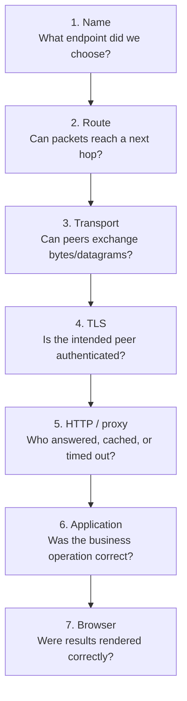

# CS230 — Computer Networks and Web Protocols

## Lecture 09: Network Forensics for Software Engineers

*Seven production mysteries, dozens of misleading clues, and the difference between knowing networking theory and actually knowing what to do when everything stops working.*

**Estimated study time:** 90–120 minutes, including experiments and exercises.

---

# Part I — Intuition

*Network debugging is not remembering fifty commands. It is locating the first place where observed behavior diverges from expected behavior.*

Look at the opening diagram for half a minute, then listen. This pass builds one mental picture. Part II develops the same picture with full technical depth.

### The picture to carry in your head



This is a diagnostic ladder, not a guarantee that every request proceeds through all stages sequentially or that a failure always belongs to exactly one box.

**The question:** What is the smallest observation that distinguishes competing explanations?

---

### 1. The incident room

It's Thursday morning at our hotel-booking company. Customers report that searches are slow, some payment calls fail, and one API works in a browser but not in the backend.

The team's first ideas are familiar: restart containers, raise timeouts, clear DNS, disable certificate validation, add servers.

None is yet a diagnosis.

A diagnostic observation might be "The browser received an HTTP 504 from the edge." A proposed explanation might be "Node.js is overloaded." The explanation could be right, but the observation doesn't establish it. The 504 may originate at a proxy while the backend never received the request.

**Don't confuse observation with explanation.** That is the whole incident-forensics method.

### 2. Start by defining the expected path

For one failing request, define the source, destination, transport, expected protocol, and intended result. Did the customer try to load HTML, query an API, upload a file, or create a reservation?

Then ask which components should participate. Browser, DNS, local gateway, internet network, CDN, load balancer, Node.js, database, supplier.

A useful diagram can be drawn on paper in thirty seconds. It need not match every internal packet. It should make clear which boundary could conceivably prevent the desired outcome.

Now walk through the boundaries and seek evidence.

### 3. Name: did we choose the expected endpoint?

A DNS lookup maps a hostname to relevant records, sometimes through cached results. A hostname can resolve successfully but to an old deployment after a migration.

If London reaches the old API while Vilnius reaches the new API, compare resolved addresses and resolver paths. An authoritative record showing the new address doesn't prove every recursive resolver discarded its valid cached earlier answer.

But if both clients resolve the same intended endpoint, stop blaming DNS without evidence. The next problem may be routing or something above it.

**Checkpoint:** A successful DNS answer proves the hostname lookup returned data. Does it prove HTTPS works? **No.** It establishes only the naming stage.

### 4. Route and transport: can the peers actually communicate?

A client needs a route toward its destination. Network policy must permit the traffic. Relevant NAT state may be required for the return path. Even with a correct destination address, a missing VPC default route or blocked egress can prevent any useful connection.

Then distinguish transport establishment from application response. A successful TCP handshake indicates an initial transport connection was established; it doesn't prove TLS trust, valid credentials, or a successful booking.

A failed connect attempt could reflect several causes. `Connection refused` often indicates an active refusal or no listener at that endpoint, though intermediaries can complicate interpretation. A timeout can mean filtering, unreachable path, stalled responses, or other conditions. The error string is a clue, not a complete topology map.

### 5. TLS: an authenticated connection or just encrypted bytes?

Suppose Chrome opens the payment provider successfully while a Node.js service reports a certificate-chain error. The problem may be trust-store or certificate-chain differences between the clients, not a generic inability to reach the internet.

Disabling verification isn't diagnosis or repair. It hides a failure in endpoint authentication.

Compare the intended hostname, presented certificate, chain, trust roots, and TLS configuration. If the client authenticates the correct server and completes TLS successfully, proceed upward to HTTP and the application.

### 6. Intermediaries: who actually emitted the status?

A browser receives a 504. The Node.js application has no trace of that request. The right next question is where the status originated and which upstream exchange timed out.

A CDN or reverse proxy can return a response without forwarding a request; it can also generate an error due to its own upstream timeout or policy. An HTTP `200` from a cache isn't proof that your origin service processed anything just now.

Correlate request IDs, timestamps, proxy access logs, origin traces, and upstream timing measurements where available. Identify the first hop where the expected request stopped progressing.

**Checkpoint:** If the edge logs a timeout contacting an upstream target while the backend has no matching request, where should you investigate first? **At that edge-to-upstream boundary**, not in a speculative database query.

### 7. The strange case of small requests working

A service establishes TCP connections and processes tiny requests, but large responses or uploads hang. That pattern suggests different possibilities from a simple DNS failure.

One candidate is a Path MTU Discovery problem: an oversized packet is dropped on a path, and necessary ICMP feedback doesn't reach the sender, leading to a black-hole-like failure for larger traffic. But this is only a hypothesis; TLS framing, proxy buffering, server body-size limits, and application timeouts can also produce size-dependent symptoms.

Find a test that distinguishes them. Can you reproduce with a controlled payload size? Does the request reach the proxy or application? Do packet captures or network error counters show retransmissions or ICMP feedback? Does changing an intermediary's buffering behavior alter the result?

The goal isn't to be the first person to name MTU. It's to select evidence that rules competing mechanisms in or out.

### 8. The first request after idle fails

Now the failure looks like `ECONNRESET` after an idle period. The next request succeeds. Inspect connection reuse and intermediary idle timeouts.

Your HTTP client may select a pooled TCP connection that the peer or load balancer has already closed. A fresh connection works. That explanation fits the pattern, but test it by comparing failures with and without reuse, examining close timing, and correlating proxy settings.

And remember the business boundary: a failed response to a booking POST doesn't prove the supplier did not process the request. Transport diagnosis and idempotent reconciliation belong in the same incident plan.

### 9. The network succeeds, the booking is still wrong

Imagine every technical boundary is healthy. DNS resolves. TCP connects. TLS validates. HTTP returns `200`. Yet the customer receives another person's reservation details.

This is not a reason to run traceroute. The failure can live in authorization, cache keys, request handling, or state management. Network protocols can transport a perfectly formed but incorrect business response.

A sound diagnostic method stops escalating network hypotheses once the evidence shows that the network did its job. The application contract may be the thing that failed.

### 10. The five-step investigation habit

First, reproduce a narrowly defined symptom and identify the observation boundary. Second, draw the expected sequence of participants. Third, write two or three plausible mechanisms, not twenty unranked possibilities. Fourth, choose the next observation that would distinguish those mechanisms. Fifth, update the explanation after seeing evidence, and record the final reproduction and fix.

This is the same scientific reasoning from CS120: hypotheses must survive tests, and a successful measurement says only what its boundary actually measures.

### 11. The minute-long replay

When networking fails, don't walk down a memorized list of commands in random order. Ask where the client intended to go, which route it used, whether transport worked, whether TLS authenticated the peer, which proxy handled the HTTP request, whether the application returned the correct business outcome, and whether the browser rendered it.

For each answer, distinguish observed evidence from an inferred cause. Investigate the first boundary where expected behavior diverged.

#### Three questions before L09

1. Does an HTTP 504 prove Node.js sent an error? **No.** The proxy could have emitted it.
2. Does a certificate error justify disabling verification? **No.** Diagnose the validation failure.
3. Why is a single packet trace not the same as an end-to-end diagnosis? **It covers a specific interface, place, and time; other boundaries may behave differently.**


### Pocket map — screen reference

```text
OBSERVATION     What the system actually showed
HYPOTHESIS      Proposed mechanism explaining the observation
TEST            New evidence that distinguishes hypotheses

DNS             Correct current endpoint? Cache/delegation differences?
ROUTE           Usable next hop, NAT, policy, return path?
TRANSPORT       Handshake, reuse, retransmits, timeouts?
TLS             Intended hostname, certificate, chain, trust store?
HTTP / PROXY    Which hop answered, forwarded, cached, timed out?
APP             Did the business invariant and authorization hold?
BROWSER         Did resources, scripts and rendering complete?

Do not fix a layer until evidence implicates it.
```

*The intuition pass ends here.*

---

# Part II — Deep Dive

### How to listen to this lecture

Written for continuous listening first, then for on-screen re-reading. The theme today is forensic method: **observe → form a hypothesis → choose a discriminating test.** Do not confuse an observation with an explanation. Bold takeaways mark ideas worth pausing on. Near the end, answer the challenges **out loud** before reading the solutions.

By the end, you should be able to separate symptoms from mechanisms, locate the boundary where expected behavior changes, and pick the next observation that most effectively reduces uncertainty. The optional lab lives after the spoken lecture ends — keep it for a screen-and-terminal session.

---

# 1. Welcome to the Incident Room

It's Thursday, 9:17 in the morning.

You're the senior backend engineer responsible for a hotel-booking platform operating across several European markets.

The application serves hundreds of thousands of customers, integrates with external suppliers, processes payments, and runs behind a fairly sophisticated infrastructure: CDN, load balancers, containerized services, databases, and various third-party APIs.

Your monitoring dashboard is mostly green.

CPU utilization is acceptable. Database connections are stable. No significant increase in application exceptions has been reported.

And yet customer support is filling with complaints.

Users in London report that hotel searches take several seconds. Some customers cannot complete reservations. One integration fails only when requests originate from Kubernetes. Another works perfectly for small requests but mysteriously hangs when uploading larger documents.

A frontend developer insists the problem is DNS.

A backend developer wants to increase timeouts.

An infrastructure engineer suggests restarting the ingress controller.

Someone proposes disabling TLS certificate verification because an external supplier's API has suddenly stopped working.

And somebody, inevitably, suggests clearing Redis.

Redis has done absolutely nothing wrong, but apparently every software incident must involve Redis being interrogated.

You open your laptop.

Where do you begin?

This final lecture of CS230 is about answering that question.

We have already studied DNS, IP addressing, routing, NAT, TCP, TLS, HTTP, load balancers, and modern web transport. We understand the individual mechanisms well enough to explain how they operate.

But engineering is not a multiple-choice examination in which every problem arrives conveniently labeled with its underlying protocol.

Real incidents present symptoms.

A symptom might have dozens of possible explanations. Several explanations may produce almost identical observations. And the most obvious explanation is often merely the one that happens to be familiar to the person investigating.

The objective of network forensics is not to memorize an enormous troubleshooting checklist.

It is to learn how to reason from incomplete evidence, locate the boundary where expected behavior changes, and choose the next observation that most effectively separates competing hypotheses.

Today, we will investigate seven incidents.

Some will involve genuine network failures. Others will turn out to be application problems wearing very convincing networking disguises.

In each case, we'll begin with the information available to the engineer, develop plausible explanations, investigate discriminating evidence, and reach a defensible conclusion.

The incidents are fictional, but the failure mechanisms are real.

By the end, you should be able to approach an unfamiliar networking problem without immediately reaching for a restart command and hoping for divine intervention.

---

# 2. The First Rule of Forensics: Don't Confuse an Observation With an Explanation

Before investigating our first incident, we need a method.

Imagine someone tells you:

"The network is slow."

What information have they actually provided?

Very little.

Perhaps a webpage takes five seconds to render. Perhaps an API request spends four seconds waiting for a database. Perhaps the browser is loading a large JavaScript bundle. Perhaps the TCP connection repeatedly retransmits missing data.

All these situations might produce the same user complaint.

But their causes, evidence, and remedies are completely different.

A useful investigator separates three things.

**The observation** is what was actually measured or reported.

**The hypothesis** is a proposed mechanism that could explain the observation.

**The diagnosis** is the explanation supported by enough evidence to justify the conclusion and corresponding action.

Consider a simple example.

Observation: an HTTPS request takes four seconds.

Hypothesis: the network path has excessive latency.

Test: measure connection establishment separately from the time waiting for the HTTP response, then compare with server-side timing and intermediary logs.

Perhaps the connection establishes in one hundred milliseconds, but the server takes another three seconds to answer.

The original network hypothesis now looks less likely as a complete explanation.

But we're not finished.

The server might have spent three seconds performing application work. Or a load balancer might have spent most of that time waiting for an available backend connection.

Our next test must distinguish those possibilities.

The key principle is:

**A good investigation reduces uncertainty. A poor investigation merely produces more activity.**

Restarting services, increasing timeouts, changing DNS records, and disabling security checks are actions.

They are not explanations.

Sometimes an immediate mitigation is necessary before the root cause is understood. But even then, the investigator should distinguish restoring service from establishing why it failed.

## 2.1 Think in boundaries, not products

Developers often organize their mental models around technologies.

"Maybe it's Nginx."

"Maybe it's AWS."

"Maybe it's Node.js."

These are guesses about products, not failure mechanisms.

A more useful approach is to think about boundaries.

A browser must resolve a name, select an address, establish transport communication, negotiate security, send an HTTP request, wait for intermediaries and application services, and receive a response.

At each transition, there is an expected behavior.

The first task is to discover where the expected behavior stops.

Did the client obtain the intended IP address?

Did the connection reach the selected destination?

Did the transport handshake complete?

Did TLS authenticate the expected server?

Did the request reach the correct intermediary?

Did the backend receive the complete request?

Did the backend produce a response?

Did that response reach the client?

Different evidence answers different questions.

The objective is not to investigate every layer every time.

It is to use the earliest meaningful observations to narrow the investigation quickly.

## 2.2 The most useful measurement is often a comparison

Suppose one customer cannot access your API.

If every customer is affected, you might suspect a shared production failure.

If only one office is affected, local routing, DNS configuration, or corporate network policies become more plausible.

If requests work over IPv4 but fail over IPv6, the difference is highly informative.

If requests work from your laptop but fail from a Kubernetes pod, the execution environment becomes central.

If the first request after a long idle period fails but the second succeeds, connection reuse deserves attention.

These differences are not minor details.

They are often the strongest clues available.

A good investigator tries to construct **controlled comparisons**: two requests that differ in one relevant dimension.

That might mean the same hostname from different networks, the same endpoint using different address families, the same request with a fresh versus reused connection, or the same application operation through the CDN versus directly to a testable origin endpoint.

The closer the requests are otherwise, the more useful the comparison becomes.

---

# 3. Case One: The Backend Is Fast, but the Website Takes Four Seconds

Our first incident begins with a familiar complaint.

Customers report slow hotel searches.

The browser network panel shows that an API response takes approximately 2.5 seconds.

Meanwhile, the Node.js application's logs report an average handler execution time of only 43 milliseconds.

The backend team presents this measurement as proof that their service is healthy.

The frontend team insists that the delay must occur somewhere in the network.

Both teams are making the same mistake.

They're treating one measurement as though it describes the entire request.

## 3.1 Reconstruct the client timeline

We select one slow request and inspect its timing from the browser.

DNS resolution takes approximately 20 milliseconds.

The TCP connection is established around 120 milliseconds after the request begins.

TLS negotiation completes around 210 milliseconds.

The first response byte arrives around 2,400 milliseconds.

The response finishes shortly afterward.

These are cumulative timing milestones, not independent durations that should be added together.

The important observation is that connection establishment completed relatively quickly.

Most of the elapsed time occurred after the secure connection was ready, before the first response byte arrived.

That narrows the problem.

But it does not prove that the Node.js application spent two seconds processing the request.

The interval can contain request transmission, intermediary processing, waiting for an upstream connection, queueing before an application handler, backend execution, and response propagation.

We need another observer.

## 3.2 Follow the request through the intermediaries

The CDN logs show that the request was forwarded to the origin rather than served from cache.

The load balancer reports that it waited approximately two seconds for the target to begin responding.

The application log reports 43 milliseconds.

The discrepancy is now more interesting.

The load balancer experienced roughly two seconds of waiting, but the application's measured handler duration was tiny.

What happens before an HTTP handler begins executing?

The networking stack must accept or process incoming data. The runtime must schedule the relevant application callback. The request may also pass through middleware or other stages not covered by the handler's timer.

A narrow timer surrounding business logic does not measure everything that happened before that timer started.

And now we discover a crucial clue.

The affected Node.js instance reports severe event-loop delay during the same interval.

## 3.3 The actual culprit

A new application feature performs a large synchronous data transformation inside the main Node.js event loop.

The operation occasionally occupies the event loop for nearly two seconds.

While that synchronous work runs, other incoming requests cannot progress through their ordinary JavaScript handlers promptly.

The operating system may already have accepted their TCP connections and buffered incoming data.

The load balancer is waiting.

The client is waiting.

But the application handler timer hasn't started yet.

Once the event loop becomes available, the request handler executes in 43 milliseconds.

The log proudly announces that the request was fast.

The user experienced several seconds of delay.

Both measurements are individually correct.

They describe different intervals.

## 3.4 How do we prove it?

We compare slow requests with event-loop-delay measurements from the same application instances and time periods.

We inspect application traces and identify where instrumentation begins.

We examine CPU usage at the process and core level, rather than relying exclusively on average utilization across the entire machine.

We profile the synchronous operation and reproduce its effect under controlled load.

Finally, we move the expensive work away from the latency-sensitive event loop, reduce its synchronous duration, or redesign the workflow appropriately.

The long client wait disappears.

The backend handler still reports around 43 milliseconds.

This case illustrates an extremely useful principle:

**A fast measurement of one stage does not prove the stages before and after it are fast.**

A misleadingly healthy application log can coexist with a real application bottleneck.

And a problem that looks like network latency can originate entirely inside the runtime.

---

# 4. Case Two: The DNS Migration That Split Europe in Half

Our next incident begins after a deployment.

The company's API previously pointed to an older environment.

At noon, the infrastructure team changes DNS records to direct clients toward a new load balancer.

The new environment has been tested and appears healthy.

But half an hour later, some customers still connect to the old infrastructure.

Others reach the new environment successfully.

The team concludes that DNS propagation is broken.

Let's investigate that claim.

## 4.1 What does the authoritative server say?

We query the authoritative DNS servers for the API hostname.

They consistently return the new destination.

This establishes that the relevant authoritative configuration is now publishing the expected information.

It doesn't establish what every recursive resolver currently returns.

Nor does it prove that every application has performed a fresh lookup.

We need to separate authoritative data, resolver caches, client caches, and existing connections.

## 4.2 Compare the actual client resolution paths

An affected customer uses a recursive resolver that cached the old address shortly before the migration.

The record originally carried a one-hour TTL.

The team reduced that TTL to sixty seconds at the same moment it changed the address.

Unfortunately, the cached copy still has much of its original lifetime remaining.

A different resolver, which had no cached answer, obtains the new address immediately.

Both behaviors are compatible with ordinary DNS caching.

The change did not instantly rewrite previously distributed answers.

But we need to avoid another trap.

A browser may use DNS over HTTPS and consult a different resolver from the one used by a terminal command.

A browser may also reuse an existing connection without performing a new lookup.

Therefore, a successful terminal DNS query does not automatically establish which address a particular browser connection used.

We inspect the affected application's actual destination where possible.

## 4.3 A discriminating test

We deliberately connect to the new destination while preserving the original HTTPS hostname.

This bypasses the ordinary DNS address-selection step for that test.

If the new endpoint works correctly, it strengthens the hypothesis that the application itself is healthy and that the affected client is still selecting the old destination.

We then compare the recursive resolver's response and remaining TTL with the authoritative answer.

The evidence supports cached old address information.

The immediate operational mitigation is to preserve working service at the old destination while the transition completes.

The long-term fix is to prepare DNS migrations by reducing relevant TTLs sufficiently in advance, maintaining overlapping infrastructure, and verifying traffic rather than assuming a configuration update is globally instantaneous.

### The more dangerous variation

Imagine the old destination has already been decommissioned.

Now a user with a cached old address connects to an endpoint that no longer presents the expected certificate or no longer accepts connections.

The resulting symptoms might look like a TLS failure or a connection timeout.

Those are real observed failures.

But their underlying cause is the relationship between stale destination information and prematurely retired infrastructure.

This illustrates why network incidents frequently cross conceptual layers.

An outdated DNS answer can produce a transport or TLS error.

The layer where the error becomes visible is not necessarily the layer where the original mistake occurred.

---

# 5. Case Three: Small Requests Work, but Large Requests Disappear

Our third incident is particularly unpleasant.

An application deployed inside a corporate network communicates with an external document-processing API.

Small requests work.

The service responds to health checks.

A simple GET request succeeds.

The TCP handshake completes, and TLS negotiation appears normal.

But uploading a larger document causes the request to stall.

The backend eventually times out.

The remote API reports that it never received a complete request.

One developer suspects JSON serialization.

Another believes the external API imposes an undocumented request-size limit.

A third suggests increasing the timeout from thirty seconds to two minutes.

But the relationship between request size and failure is too consistent to ignore.

## 5.1 Begin with the most revealing observation

We run controlled requests of different sizes through the same network path.

A small payload succeeds.

A slightly larger payload also succeeds.

Beyond a certain size, the connection stalls.

We repeat the test with a fresh connection.

The behavior persists.

We test the same remote service from a network that doesn't use the company's VPN.

Large requests succeed there.

Now we have a more specific hypothesis.

Something in the corporate network path behaves differently when packets become sufficiently large.

That suggests investigating the path's **Maximum Transmission Unit**, or MTU.

## 5.2 What the packet capture reveals

We collect a packet capture at the sending endpoint during a failed upload.

The initial TCP handshake completes.

Small protocol exchanges are acknowledged.

Then larger TCP data segments are transmitted.

The sender does not observe the expected progress acknowledgments for some of that data.

It retransmits.

The application waits.

But a capture at the sender tells us only what the sender transmitted and received.

It cannot prove exactly where the missing data disappeared.

We need to compare observations or investigate the path's packet-size constraints.

## 5.3 The hidden tunnel overhead

The application communicates through a VPN.

That VPN encapsulates traffic inside additional protocol headers.

The effective packet-size limit through the tunnel is smaller than the sender's original assumptions.

Under normal circumstances, Path MTU Discovery should help the endpoints adapt to the path.

But the company's firewall drops certain ICMP messages communicating that packets cannot be forwarded at their current size.

The sender never receives the information needed to reduce its packet size through the traditional discovery mechanism.

As a result, sufficiently large packets repeatedly disappear.

Small packets continue working.

The connection looks healthy until it carries enough data to expose the path-size problem.

This is a **Path MTU black hole**.

## 5.4 Proving the diagnosis

We reproduce the failure while varying packet-size-related behavior under controlled conditions.

We examine the tunnel configuration and effective MTU.

We verify whether required ICMP error messages are being generated and whether they can reach the sender.

We compare packet behavior on either side of the tunnel where appropriate capture access exists.

As a controlled diagnostic or mitigation, reducing the TCP maximum segment size can sometimes help establish whether packet size is involved.

But the durable correction is to repair the path's MTU handling, relevant control-message filtering, or packetization configuration.

We do not simply increase the HTTP timeout.

That would give the sender more time to retransmit packets that the path cannot deliver.

### Why this case matters

The connection succeeded.

TLS succeeded.

Small HTTP requests succeeded.

Even ping might succeed.

Yet a real application operation failed.

A simplistic checklist that stops after confirming connection establishment would declare the network healthy.

It isn't.

**Successful delivery of some packets does not prove that all packet sizes and traffic patterns can traverse the same path.**

That distinction is particularly important in systems using VPNs, containers, overlays, tunnels, and complex cloud networking.

---

# 6. Case Four: The 504 That Never Reached Node.js

It's now early afternoon.

The booking platform begins returning intermittent HTTP 504 responses.

Users complain that some reservation requests fail after approximately five seconds.

The backend engineers inspect their logs and find no matching requests for many of the failures.

Their first conclusion is that the logging system must be broken.

But remember what a 504 actually represents.

It is a gateway or proxy reporting that it did not receive a timely response from an upstream system needed to complete the request.

It does not identify which upstream step failed.

And it doesn't establish that the intended application handler ever ran.

## 6.1 Find who generated the 504

The first question is not "Why was the backend slow?"

It is "Which component generated this response?"

We examine the relevant reverse proxy logs.

The proxy attempted to establish a connection to an application target, but the connection did not complete before the configured upstream connection timeout.

Its upstream response-header timing has no normal value because no HTTP response headers were received.

The backend logs are absent because the request never reached the application handler.

This immediately narrows the investigation.

We should not begin by optimizing database queries.

The failure occurred before normal application processing.

## 6.2 Why only some requests?

The load balancer distributes requests among several backend targets.

Most targets are reachable.

But one recently deployed instance resides in a new network environment with an incorrect security rule.

The reverse proxy can route toward the target's address, but the network policy silently drops connection attempts to the intended application port.

No TCP reset is returned.

The proxy waits, retransmits or continues the connection attempt according to its networking implementation, and eventually reaches its configured timeout.

Requests sent toward other targets succeed.

The incident is intermittent because only some assignments select the affected target.

## 6.3 The discriminating evidence

We compare successful and failed requests according to the selected upstream target.

Failures cluster around the same destination or target group.

A connection test from the relevant proxy-side environment toward the affected backend port fails.

The same test toward healthy targets succeeds.

Packet-level evidence shows connection attempts without successful completion.

We inspect route tables, security policies, target health information, and service listening configuration.

Eventually, the missing rule is identified and corrected.

The affected target becomes reachable.

The 504 responses disappear.

### Why increasing the timeout would have been foolish

Increasing the proxy timeout from five seconds to thirty seconds might make the application appear to fail more slowly.

It would not repair a blocked connection.

The distinction between a timeout and its underlying mechanism is crucial.

A timeout is a boundary imposed by one component.

It is not a diagnosis.

And because gateways and load balancers can generate HTTP errors independently of application code, the returned status code must always be interpreted in the context of the component that produced it.

---

# 7. Case Five: The First Request Fails, the Second Succeeds

Our next incident concerns an external supplier integration.

A Node.js service maintains persistent HTTPS connections through a connection pool.

Most requests work.

But after the service remains idle for a while, the next request occasionally fails with a connection reset.

A retry often succeeds immediately.

The supplier's API is healthy, and fresh connections work normally.

This pattern should sound familiar from CS230-L06.

Now we need to investigate it like a production engineer.

## 7.1 Construct competing hypotheses

Perhaps the supplier restarts idle backend processes.

Perhaps an intermediary closes connections after a timeout.

Perhaps the client's connection pool reuses stale sockets.

Perhaps the network temporarily drops traffic.

Or perhaps the application sends invalid requests after inactivity.

Each explanation suggests a different test.

We start by correlating failures with the amount of time since the connection was last used.

The correlation is strong.

Almost all failures occur after an idle interval exceeding roughly one minute.

That is already more informative than the raw error message.

## 7.2 Compare fresh and reused connections

We instrument the HTTP client to record whether a request used a fresh connection or a pooled one.

We also observe connection close and error events.

Fresh connections succeed consistently.

Failures occur during attempts to reuse connections that have been idle long enough to exceed an intermediary's configured idle timeout.

We inspect the network path and discover that the relevant load balancer closes or expires idle connections sooner than the client's retention configuration expects.

Depending on timing and implementation, a clean closure may have been received but not yet processed by the pool, or intermediary state may have expired without a usable closure signal.

The precise failure mechanism still deserves verification.

But the evidence now strongly supports a connection-lifecycle problem.

## 7.3 The correct intervention

The team aligns connection reuse and idle-retirement policies with the behavior of the infrastructure.

It verifies that the client library handles closed sockets correctly and uses appropriate transport keepalive mechanisms where useful.

It also distinguishes retries for read-only operations from retries for business operations with side effects.

That last distinction is essential.

A connection reset after sending a reservation request does not prove that the supplier failed to create the reservation.

The client may have lost the response after the supplier committed the operation.

A retry could create a duplicate.

So the team establishes idempotency and outcome-reconciliation mechanisms for reservation creation.

The result is not merely fewer connection errors.

It is a system that handles uncertainty without compromising business correctness.

### What this case teaches

The pattern of failures matters.

"Intermittent ECONNRESET" provides relatively little information.

"Only reused connections idle for more than sixty seconds fail, and fresh connections succeed" is a powerful diagnostic observation.

The second description points directly toward specific transport lifecycle mechanisms.

Good incident reports describe conditions under which the problem appears, not merely the error strings produced when it does.

---

# 8. Case Six: HTTPS Works in Chrome but Fails in Node.js

The company uses another external provider.

One morning, the backend reports:

`UNABLE_TO_VERIFY_LEAF_SIGNATURE`

Yet visiting the same provider's website through Chrome succeeds.

A colleague concludes that Node.js has a bug.

Another proposes disabling TLS certificate verification.

We already investigated the security consequences of that approach in CS230-L07.

Let's focus on the forensic method.

## 8.1 Which TLS connection are we actually comparing?

The browser may use different DNS resolution, select a different IP address, negotiate a different TLS configuration, or contact a different hostname from the backend.

It may also use a different trust store or certificate-path-building implementation.

Before comparing their results, we need to establish whether they are actually connecting to equivalent endpoints under equivalent identity requirements.

We inspect the resolved destinations, intended hostname, SNI, presented certificates, and trust configuration.

The backend uses the payment API hostname.

The browser test originally used the provider's marketing website.

Those are not even necessarily the same TLS endpoint.

After correcting the comparison, we find that the API endpoint presents an incomplete certificate chain.

## 8.2 The missing intermediate

The server's leaf certificate identifies the intended hostname and is within its validity period.

But the server omits an intermediate certificate needed by some clients to construct a trusted certification path.

Chrome may succeed because its environment already possesses the intermediate or obtains it through supported mechanisms.

The Node.js runtime cannot establish the necessary chain using its available trust information.

The verification failure is therefore meaningful.

The backend isn't being overly cautious.

It is refusing a connection whose server identity cannot be adequately established under its current validation environment.

## 8.3 The fix

The provider corrects the certificate-chain configuration.

The backend validates the connection successfully.

No certificate verification is disabled.

The more general lesson is that two clients reporting different TLS results does not automatically imply that one is wrong.

They may have different trust stores, certificate-path-building behavior, endpoints, or negotiated parameters.

An investigator identifies those differences rather than choosing whichever result is more convenient.

**Making a security error disappear is not the same as resolving the security problem.**

---

# 9. Case Seven: The HTTP Request Succeeded, but the Customer Still Received the Wrong Answer

Our final case combines networking, HTTP, caching, and application correctness.

A customer requests their reservations.

The browser receives `200 OK`.

The response arrives quickly.

The TLS connection is valid.

But the reservation data belongs to another customer.

The backend logs show no matching request.

If we assume all user-visible responses originate from the application server, the evidence looks impossible.

But we know from CS230-L08 that a CDN or another shared cache can answer requests independently.

## 9.1 Search for the component that produced the response

We inspect the response and edge logs.

The CDN reports a cache hit.

The backend did not receive the request because the intermediary served a stored representation.

We then inspect the cache policy.

The endpoint is authenticated and personalized, but the CDN has been configured to reuse cached GET responses based on an insufficient cache key.

The cache does not distinguish the customers whose responses differ.

A previous customer's private response was stored and then served to another user.

This isn't a transport failure.

It is a correctness and confidentiality failure caused by an intermediary.

## 9.2 Evidence preservation matters

The immediate priority is to stop exposing private data.

The team disables the dangerous shared-caching behavior and invalidates affected cached objects.

But it must also preserve enough evidence to determine the exposure.

That may include relevant edge logs, cache configuration changes, request identifiers, and deployment history.

Sensitive records should not be copied casually into chat messages, tickets, or unprotected logs.

Investigation must respect data-access controls and retention requirements.

A packet capture or HTTP log can contain authentication tokens, cookies, query parameters, personal information, or other secrets.

The fact that data is useful for debugging doesn't make it harmless to collect.

## 9.3 The final lesson

The system correctly delivered bytes.

It correctly established a secure connection.

It correctly returned an HTTP response.

It even improved response latency.

The result was still wrong.

This is why a networking course must eventually reconnect to application semantics.

Protocol success is not the same as business success.

And an intermediary capable of answering requests is part of the application's trusted computing system, whether developers think of it as application code or not.

---

# 10. The Investigator's Toolkit: What Each Observation Can Actually Prove

We've investigated seven incidents.

Now let's extract the common method.

Tools such as curl, dig, traceroute, ping, tcpdump, Wireshark, browser developer tools, and distributed tracing systems are extremely useful.

But no single tool provides a complete view of the request.

The central skill is knowing which question a tool can answer and where its visibility ends.

## 10.1 Browser developer tools

The browser's Network panel can reveal information about request timing, connection setup, response headers, transfer size, caching, and protocol negotiation.

But it observes the browser's perspective.

It cannot directly explain what happened inside a backend service unless additional instrumentation exposes that information.

Also, the browser may serve data from its own cache or a service worker without contacting the expected network endpoint.

A visible page transition doesn't guarantee that a new HTTP request occurred.

And different browser timing fields may overlap, represent cumulative milestones, or reflect implementation-specific behavior.

Interpret the measurement definitions before drawing conclusions.

## 10.2 Curl

Curl is exceptionally useful for making controlled requests.

It can show DNS resolution, connection behavior, TLS negotiation, HTTP response headers, and timing milestones.

One particularly valuable capability is recording the elapsed time to specific phases of the request.

For ordinary fresh HTTPS over TCP, you can examine the time until name resolution completes, TCP connection establishment completes, TLS negotiation completes, and the first response byte arrives.

These values are generally cumulative from the beginning of the transfer.

The difference between two milestones can approximate the time spent between them.

But beware of complications such as redirects, proxies, connection reuse, and protocols with different transport establishment behavior.

A connection reused from a pool doesn't incur the same fresh setup stages.

A result measured through a proxy may describe connection establishment to the proxy rather than directly to the origin.

And one successful curl request doesn't prove that the application is healthy under concurrency or sustained load.

Curl gives you a controlled observation.

It doesn't give you omniscience.

## 10.3 DNS tools

Tools such as dig and nslookup can help inspect DNS records, response codes, authoritative servers, and caching behavior.

But a terminal DNS query may not follow the exact same path as the affected browser or application.

Modern browsers can use their own resolver configuration and DNS-over-HTTPS behavior.

Applications can cache DNS results or reuse existing connections.

Therefore, distinguish what the diagnostic tool queried from what the failing application actually used.

If DNS is suspected, compare resolver responses, authoritative data, and actual destination selection.

Don't treat one public resolver's answer as proof that every client sees the same result.

## 10.4 Ping and traceroute

Ping can help measure ICMP echo round trips when the destination responds.

Traceroute-style tools can help reveal intermediate network behavior through hop-limit-based probing.

But ICMP traffic may be filtered, rate-limited, or deprioritized.

A failed ping doesn't prove that TCP port 443 is unreachable.

A missing traceroute hop doesn't prove that ordinary application packets are being dropped there.

And a slow response from one intermediate router doesn't necessarily mean that router forwards production traffic slowly.

These tools are useful clues about reachability and path behavior.

They are not automatic bottleneck detectors.

## 10.5 Packet captures

Packet captures can reveal transport behavior in extraordinary detail.

You may observe TCP handshakes, acknowledgments, retransmissions, resets, connection shutdown, DNS exchanges, and ICMP control messages.

You can sometimes identify exactly when a sender transmitted data and whether an acknowledgment returned to that capture point.

But a capture is taken from a location.

It doesn't automatically reveal what happened elsewhere.

A sender-side capture showing repeated transmissions does not prove where the packets were lost.

You may need a second capture at another point in the path.

Even then, packet capture interpretation requires care.

Modern network interfaces and operating systems use offloading mechanisms. A capture taken inside a host can show packet sizes, checksums, or segmentation behavior that differs from what appears on the physical wire.

An apparent checksum error may be an artifact of hardware offloading rather than actual corrupted network traffic.

Likewise, a capture containing encrypted TLS or QUIC traffic does not automatically reveal protected HTTP contents.

Packet captures are powerful evidence, but their interpretation depends on the capture location and system behavior.

## 10.6 Distributed tracing

Distributed tracing follows application operations across instrumented services.

A request can carry trace context through multiple components, allowing spans from different services to be associated with the same logical operation.

This is extremely useful when an API request triggers several downstream calls.

But a trace doesn't automatically include every stage of the network path.

If instrumentation begins only when a Node.js handler starts, the trace may omit time spent waiting before the handler.

If a CDN serves a cache hit, no origin application span may exist.

If a proxy doesn't propagate trace context, the trace can break at that boundary.

Distributed tracing is only as complete as the instrumentation and propagation mechanisms supporting it.

This is why a senior engineer combines observations from multiple layers instead of expecting one tracing dashboard to explain the entire system.

---

# 11. The Four Traps That Make Good Engineers Diagnose Badly

Let's examine four habits that repeatedly produce incorrect conclusions.

## 11.1 The average hides the failure

Suppose an API's average latency is 100 milliseconds.

That sounds excellent.

But what if ninety-nine percent of requests complete in 50 milliseconds while a small fraction require several seconds?

The average may conceal an experience that is unacceptable for the affected users.

Investigate latency distributions, high percentiles, error rates, and conditions correlated with slow requests.

Also be careful when interpreting percentiles across services or time windows.

Percentiles cannot generally be added or averaged to reconstruct an end-to-end percentile.

You need an appropriate distribution or direct end-to-end measurements.

For performance incidents, the tail often tells a more useful story than the mean.

## 11.2 Correlation is not automatically causation

Suppose error rates rise immediately after a deployment.

The deployment is an obvious suspect.

But perhaps a supplier API also experienced an outage at the same time.

Perhaps traffic increased because of a marketing campaign.

Perhaps the deployment changed which backend targets receive traffic, exposing an older configuration problem.

Temporal correlation helps prioritize hypotheses.

It doesn't establish causality by itself.

Look for the mechanism connecting the proposed change to the observed behavior.

A controlled rollback or comparison can provide stronger evidence, but rollback itself may carry risks if data schemas or other shared state have already changed.

## 11.3 Different clocks produce misleading timelines

Imagine the browser records one timestamp.

The CDN records another.

The application server records a third.

You subtract them and conclude that the request traveled backward in time.

Congratulations, you've invented a networking incident that appears to violate causality.

More likely, the systems' clocks are not perfectly synchronized, or you're comparing timestamps with different definitions.

Distributed systems need accurate time synchronization for many operational purposes, but wall-clock timestamps across machines should still be interpreted carefully.

Durations measured using appropriate monotonic clocks within one process can be more reliable for local elapsed time.

Cross-system analysis should account for clock uncertainty.

Trace context, correlation identifiers, and causal relationships can help reconstruct the sequence without assuming every timestamp is perfectly aligned.

## 11.4 Mitigation is not root-cause analysis

Restarting a service sometimes restores functionality.

But what did that establish?

Perhaps the process leaked connections.

Perhaps its caches contained stale state.

Perhaps the restart moved traffic to a different instance.

Perhaps the underlying failure disappeared independently during the restart.

The fact that a restart helped doesn't establish which mechanism was responsible.

Mitigation is often necessary during production incidents.

But once service is restored, the team should still investigate the evidence available and identify what must change to prevent recurrence.

Otherwise, the organization develops a collection of magical rituals rather than operational understanding.

---

# 12. Building an Incident Investigation That Others Can Reproduce

A senior engineer's job isn't merely to discover the answer personally.

It's also to communicate what was learned in a way that other engineers can verify.

A useful incident investigation records five things.

First, the **impact**: which users or operations were affected, during which period, and with what severity.

Second, the **observations**: specific measurements, error messages, affected destinations, and reproduction conditions.

Third, the **hypotheses**: plausible explanations, including those that were considered but rejected.

Fourth, the **discriminating evidence**: the observations or experiments that separate the winning explanation from alternatives.

Finally, the **resolution and prevention**: what restored service, what actually caused the incident, and which changes reduce the risk of recurrence.

Consider how much stronger this is than a typical informal incident report.

Weak report:

"The API was slow because of networking. We increased the timeout and restarted the pods. Everything seems fine."

Strong report:

"Requests routed to one newly deployed application target timed out during TCP connection establishment. Other targets remained reachable. Proxy logs showed upstream connection timeouts without backend request entries. Direct connectivity tests from the proxy environment confirmed that the affected target's application port was blocked by an incorrect security rule. Correcting the rule restored connectivity. Deployment validation will now test the intended proxy-to-target path before target registration."

The second report identifies a mechanism.

It names evidence.

It explains why the observation followed from the failure.

And it proposes a prevention strategy matched to the actual cause.

That's the difference between closing a ticket and improving a system.

---

# 13. The Senior Engineer's Decision Framework

We've reached the point where the individual incidents become one general method.

Imagine that an unfamiliar production alert appears tomorrow.

You don't yet know whether it's a network failure.

You may not even know which services are involved.

How should you proceed?

Begin by establishing the scope.

Who is affected? Is the problem global or localized? Is it limited to one operation, one deployment, one network, one browser, or one address family?

Next, identify the earliest point at which expected behavior diverges.

Does DNS return the intended information? Can a transport connection be established? Does TLS complete? Does an intermediary generate the error? Does the backend receive the request?

Then select a test that separates competing explanations.

If both routing and TLS are plausible, test basic transport connectivity independently from TLS authentication.

If both application delay and proxy delay are plausible, compare timing from the proxy and the application.

If both IPv4 and IPv6 are possible, test them separately.

If stale connection reuse is suspected, compare fresh and reused connections under otherwise similar conditions.

Once the evidence points toward a particular boundary, investigate its mechanism in detail.

Don't immediately jump from one symptom to one configuration change.

Finally, select a mitigation proportionate to the risk.

For a read-only operation, a controlled retry might be acceptable.

For a payment or reservation operation, uncertainty about completion requires stronger safeguards.

For a suspected certificate problem, disabling identity verification is generally not an acceptable production mitigation.

For a packet-size failure, increasing timeouts won't repair missing Path MTU information.

For a blocked route, restarting the application won't create a forwarding path.

The best intervention follows from the mechanism.

**Diagnosis tells you what to fix. Without diagnosis, you're merely changing things and watching what happens.**

---

# 14. The Oral Examination

This is the final examination for CS230.

The questions deliberately provide incomplete information.

Your task is to explain the hypotheses, identify the next useful test, and describe what different results would imply.

Before reading the solutions, try answering these questions out loud. Imagine that a senior engineer is interviewing you and will challenge any hand-waving. Speak complete explanations, not fragments.

### Challenge 1 — The connection that works only from your laptop

A public API works perfectly from your laptop.

The same application request fails from a Kubernetes pod.

Both environments resolve the hostname successfully.

What hypotheses would you consider?

What is the most useful next information to collect?

### Challenge 2 — Ping works, HTTPS fails

A server responds to ICMP echo requests.

An HTTPS connection to port 443 times out.

A colleague says the firewall cannot be responsible because ping works.

Evaluate the claim and describe your investigation.

### Challenge 3 — The suspicious 502

A reverse proxy returns HTTP 502.

The Node.js backend logs no request.

What could cause the proxy to generate this response?

How would you distinguish a connection refusal, an invalid upstream HTTP response, and an upstream TLS negotiation problem?

### Challenge 4 — The slow Australian customers

Customers in Germany experience a median document TTFB of 120 milliseconds.

Customers in Australia experience approximately 480 milliseconds.

Application processing time is roughly 40 milliseconds for both.

What additional evidence would you need before blaming geographical distance?

Which architecture changes might help?

### Challenge 5 — The IPv6 mystery

An application hostname has both A and AAAA records.

Requests from some networks succeed quickly.

Requests from others occasionally stall.

Forcing IPv4 makes the problem disappear.

What does this observation establish?

What does it not establish?

### Challenge 6 — The connection reset after a payment

A payment request is sent over an existing TCP connection.

The client receives ECONNRESET before any HTTP response.

Can the client conclude that no payment was created?

What must the application do to preserve correctness?

### Challenge 7 — The load balancer that made things worse

A system becomes slow under high traffic.

The team doubles the number of application instances.

Latency gets worse.

Database CPU remains moderate, but the database connection count doubles and query wait times rise.

Explain a plausible mechanism.

Why might the solution involve reducing concurrency rather than adding capacity?

### Challenge 8 — The missing logs

A user sees a successful HTTP response containing stale information.

The backend has no matching request log.

The request passed through a CDN and a browser service worker.

How do you determine which component provided the response?

Why is examining the backend alone insufficient?

---

# 15. Solutions and Discussion

*Read this section after answering out loud. The practical lab appears after the spoken lecture ends.*

### Solution 1 — Laptop versus Kubernetes

Successful DNS resolution doesn't prove connectivity.

The pod may have different routes, network policies, egress NAT configuration, proxy environment variables, certificate trust configuration, or address-family behavior.

First determine the actual resolved address, selected route, destination port, and observed failure stage from inside the pod.

Compare that with a successful request from the laptop.

A connection timeout suggests a different investigation from a TLS certificate error or HTTP 403.

Test from the failing execution environment, not merely from another machine that happens to reach the same service.

### Solution 2 — Ping versus HTTPS

ICMP echo responses and TCP connectivity are different network operations.

A firewall may allow ICMP while blocking TCP port 443.

The server may not be listening on that port, or a route or security policy may treat the protocols differently.

Test TCP connection establishment to the relevant address and port.

Inspect route selection and filtering behavior.

If the TCP handshake succeeds, continue toward TLS and HTTP rather than assuming those stages are healthy.

Ping is evidence of one form of reachability, not proof of all forms.

### Solution 3 — HTTP 502

A proxy may return 502 when it receives an invalid upstream response or encounters certain upstream communication failures that its implementation maps to that status.

Inspect the component-generated error logs and its upstream timing fields.

A connection refusal may produce an immediate networking error.

An invalid HTTP response may indicate that the connection succeeded but the received bytes violated expected protocol behavior.

An upstream TLS failure may involve certificate validation, incompatible parameters, or endpoint identity problems.

Provider-specific status mapping matters, so identify the precise proxy implementation and log reason rather than treating 502 as one universal low-level error.

### Solution 4 — Geographical latency

Physical distance creates a propagation-delay floor.

But the observed TTFB difference may also involve connection reuse, CDN cache hits or misses, routing, TLS establishment, packet loss, intermediary behavior, and origin selection.

Compare actual client timing phases and CDN or proxy logs from representative locations.

Determine whether Australian clients contact a nearby edge and whether the edge serves content locally or fetches it from Europe.

Possible improvements include caching suitable content closer to users, reducing sequential round trips, reusing connections, improving resource loading, and deploying latency-sensitive services closer to relevant users where the business and consistency requirements justify it.

More backend CPU doesn't eliminate geographical propagation delay.

### Solution 5 — IPv6 behavior

Forcing IPv4 and observing success strongly suggests that address-family selection or the IPv6 path deserves investigation.

It doesn't prove that the AAAA DNS record itself is incorrect.

The advertised IPv6 destination might have broken routing, firewall policies, service binding, or another connectivity problem.

Test IPv6 resolution, route selection, TCP or QUIC connectivity as appropriate, TLS negotiation, and application response independently.

Compare observations from successful and failing networks.

### Solution 6 — Payment reset

The client cannot infer the business outcome from ECONNRESET alone.

The remote service may have processed the request before the connection failed.

Blindly retrying could duplicate the payment.

Use an idempotency mechanism supported by the payment API, preserve the operation identity, and reconcile uncertain outcomes through the provider's status interface or other reliable workflow.

Transport errors and business outcomes must be treated as separate facts.

### Solution 7 — More instances, worse latency

Doubling application instances may double database connection demand and increase concurrent queries.

The database can become constrained by connection overhead, locks, I/O, or internal contention without necessarily reaching 100 percent CPU utilization.

Higher concurrency can increase waiting and reduce effective throughput.

Investigate connection-pool sizes, aggregate connection counts, query and lock waits, transaction duration, and the workload's concurrency characteristics.

The solution might involve reducing pool sizes, bounding concurrency, improving queries, or applying backpressure.

Adding application instances without addressing the shared bottleneck can make the system worse.

### Solution 8 — Missing backend logs

The browser might serve data from its own cache or through a service worker.

The CDN might serve a cached response without contacting the origin.

Inspect the browser's actual request source, service-worker behavior, response metadata, and CDN edge logs.

Where possible, correlate the client-visible response with edge request identifiers and cache-status information.

Backend logs are insufficient because a request can be satisfied before reaching the backend.

The observer must be located at the boundary capable of explaining the result.

---

# 16. The Mental Model Worth Keeping

Networking isn't a collection of magical protocols operating independently.

It is a layered system of naming, addressing, forwarding, transport, security, intermediaries, and application semantics.

A failure observed at one layer may originate somewhere else.

An outdated DNS answer can create a TLS error.

A missing route can make a healthy application unreachable.

A broken Path MTU mechanism can allow small requests while silently losing larger ones.

A stale TCP connection can fail even though fresh connections succeed.

A load balancer can generate a gateway error without the application receiving the request.

A CDN can serve a technically successful response that violates the application's security requirements.

And a backend can report excellent handler latency while users spend seconds waiting for the request to reach that handler.

The engineer's job is to reconstruct the relevant journey and discover the boundary where expected behavior changes.

Remember this sequence:

**Observe the symptom. Establish the scope. Identify the boundary. Form competing hypotheses. Choose a discriminating test. Collect evidence. Explain the mechanism. Apply a proportionate correction.**

That approach is more valuable than memorizing fifty troubleshooting commands.

Tools change.

Cloud providers change.

Protocols evolve.

But the discipline of separating observations, mechanisms, and conclusions remains useful everywhere.

The most important skill this course should have given you is the ability to replace the vague question—

"Why is the network broken?"

—with a much more productive one:

**"What exactly did we expect to happen next, which observation shows it didn't, and what evidence would explain why?"**

That is how a software engineer becomes someone who can confidently investigate systems rather than merely operate them.

---

# 17. Next Course — Frontend Engineering

CS230 closes here with a practical foundation: naming, addressing, routing, connection establishment, flow control, congestion, HTTP semantics, TLS authentication, the intermediaries that shape modern web communication, and the forensic method for when the system behaves unexpectedly.

You should be able to explain how a request reaches its destination, understand which guarantees the infrastructure actually provides, diagnose common connectivity and performance failures, and identify when deeper networking expertise is needed.

That is enough for a strong senior application engineer. Advanced BGP operations, provider-scale network engineering, cryptographic protocol design, high-performance packet processing, kernel network internals, and detailed QUIC implementation remain worthwhile — they are not prerequisites for the work this course prepared you to do.

Recommended next in the broader programme is often **SE240 — Frontend Engineering**: what happens inside the browser once network responses arrive, beginning with **SE240-L01 — Inside the Browser**.

If your next focus is concurrency, operating systems, and runtime behavior rather than the UI surface, **CS320** is the natural systems continuation on the Foundations track. See the recommended study order in `README.md`.

Later courses on distributed systems, cloud infrastructure, production reliability, and architecture will repeatedly build on the mental models developed here.

The network is not a peripheral concern.

It is the environment in which modern software exists.

And now, when the network starts misbehaving, you'll have a considerably better response than clearing Redis.

---

## Optional Practical Lab — The Network Forensics Workbench

*The spoken lecture ends here. The remaining exercises are intended for visual study, terminal practice, and interview revision.*

## Lab A — Collect an HTTP timing profile

Use curl to inspect request timing:

```bash
curl -sS -o /dev/null \
  -w "DNS: %{time_namelookup}s\nTCP: %{time_connect}s\nTLS: %{time_appconnect}s\nTTFB: %{time_starttransfer}s\nTotal: %{time_total}s\n" \
  https://example.com/
```

These values are cumulative milestones from the beginning of the transfer under curl's documented timing definitions.

For ordinary fresh HTTPS over TCP, the difference between the TCP and DNS milestones approximates the connection-establishment interval.

The difference between TLS completion and TTFB includes request transmission, remote processing, and first-byte return.

Beware of redirects, connection reuse, proxies, and alternative transports.

On Windows, use `curl.exe` and adjust the output destination and quoting as necessary.

Repeat the experiment and compare results rather than treating one run as representative.

## Lab B — Compare IPv4 and IPv6

Test the same hostname using different address families:

```bash
curl -4 -v https://example.com/
curl -6 -v https://example.com/
```

Investigate whether both work, which addresses are selected, and whether TLS completes.

A failed IPv6 test might indicate a problem with your local IPv6 connectivity rather than the remote service.

Compare the complete failure stage before drawing conclusions.

## Lab C — Inspect the selected network route

On Linux:

```bash
ip route get 1.1.1.1
ip route
ip -6 route
```

On Windows PowerShell:

```powershell
Get-NetRoute -AddressFamily IPv4
Get-NetRoute -AddressFamily IPv6
Test-NetConnection example.com -Port 443
```

On macOS:

```bash
route -n get 1.1.1.1
netstat -rn
```

Determine the selected interface and next hop.

Repeat after connecting to a VPN, if you use one, and observe whether routing changes.

Do not modify production routing tables merely to experiment.

## Lab D — Compare DNS resolvers

Use dig:

```bash
dig example.com A
dig example.com AAAA
dig @1.1.1.1 example.com A
dig @8.8.8.8 example.com A
```

Compare the responses, TTLs, and answer types.

Then inspect authoritative information:

```bash
dig example.com NS
dig example.com SOA
dig +trace example.com
```

Remember that `dig +trace` performs a diagnostic iterative investigation and doesn't necessarily reproduce your application's actual resolver path.

## Lab E — Test an endpoint without ordinary DNS selection

Curl's `--resolve` option can associate a hostname and port with a selected address for the request.

For example:

```bash
curl -v \
  --resolve example.com:443:YOUR_TEST_IP \
  https://example.com/
```

Replace `YOUR_TEST_IP` with an appropriate address obtained through authorized investigation.

Curl continues using the URL hostname for the ordinary HTTPS identity context.

This makes the technique useful during DNS migrations or when comparing candidate destinations.

Do not disable TLS verification to make an incorrect endpoint appear successful.

## Lab F — Inspect TCP connection state

On Linux:

```bash
ss -tan
ss -tan state established
ss -tan state time-wait
```

On Windows PowerShell:

```powershell
Get-NetTCPConnection
```

Inspect local and remote endpoints and the observed states.

Explain why an established connection isn't proof of application health.

Explain why TIME-WAIT is not automatically a leak.

And explain why a steadily growing population of long-lived CLOSE-WAIT sockets might deserve an application-lifecycle investigation.

## Lab G — Capture traffic from an authorized test environment

On Linux, a narrow TCP capture might look like:

```bash
sudo tcpdump -i any -nn 'tcp port 443'
```

Or to inspect ICMP traffic:

```bash
sudo tcpdump -i any -nn 'icmp or icmp6'
```

Perform packet captures only on systems and traffic you are authorized to inspect.

Packet captures can contain sensitive metadata and, for unencrypted protocols, application content. Store them securely and avoid collecting production secrets unnecessarily.

Use Wireshark to inspect connection establishment, resets, retransmissions, and relevant ICMP messages.

Remember that one capture location cannot establish every event that occurred throughout the network path.

## Lab H — Inspect a TLS certificate chain

Use OpenSSL:

```bash
openssl s_client \
  -connect example.com:443 \
  -servername example.com \
  -verify_hostname example.com \
  -verify_return_error
```

Inspect the certificate chain, server identity, and verification result.

If comparing a browser and an application runtime, ensure you are testing the intended hostname and equivalent endpoints.

## Lab I — Classify gateway errors

Consider three hypothetical observations.

**Incident A:** A proxy immediately fails to establish a connection to its backend and returns a gateway error.

**Incident B:** A backend receives a request but cannot process it because it is overloaded and returns Service Unavailable.

**Incident C:** A proxy establishes its upstream connection but receives no timely response and returns Gateway Timeout.

Explain the distinctions among 502, 503, and 504 under HTTP semantics.

Then explain why specific proxy products may map low-level failures to statuses differently.

Your diagnosis should use both the returned status and the originating component's detailed logs.

## Lab J — Write a complete incident report

Choose one of the seven cases from the lecture and prepare an investigation report.

Include:

1. The user-visible symptom.
2. The affected operations and environments.
3. The relevant network or application topology.
4. At least three plausible hypotheses.
5. The test that most effectively distinguishes them.
6. The observations that establish the likely cause.
7. The immediate mitigation.
8. The long-term corrective action.
9. The monitoring or deployment check that could detect the problem earlier.

The objective is to practice explaining not merely what you changed, but why your chosen explanation is more convincing than its alternatives.

---

## Further Reading — Optional Technical References

1. [RFC 9110 — HTTP Semantics](https://www.rfc-editor.org/rfc/rfc9110.html) — HTTP intermediaries and the meaning of gateway and server errors.
2. [RFC 9293 — Transmission Control Protocol](https://www.rfc-editor.org/rfc/rfc9293.html) — TCP connection lifecycle, retransmission, and connection states.
3. [RFC 2923 — TCP Problems with Path MTU Discovery](https://www.rfc-editor.org/rfc/rfc2923.html) — Path MTU black holes and related troubleshooting problems.
4. [RFC 8201 — Path MTU Discovery for IPv6](https://www.rfc-editor.org/rfc/rfc8201.html) — Packet-size discovery for IPv6 paths.
5. [RFC 1034 — Domain Names: Concepts and Facilities](https://www.rfc-editor.org/rfc/rfc1034.html) — DNS architecture and resolution behavior.
6. [RFC 2308 — Negative Caching of DNS Queries](https://www.rfc-editor.org/rfc/rfc2308.html) — DNS failure caching and related resolution behavior.
7. [RFC 8446 — TLS 1.3](https://www.rfc-editor.org/rfc/rfc8446.html) — TLS security and connection establishment.
8. [RFC 9209 — Proxy-Status HTTP Response Header](https://www.rfc-editor.org/rfc/rfc9209.html) — Structured diagnostic information from HTTP intermediaries.
9. [W3C — Trace Context](https://www.w3.org/TR/trace-context/) — Standard propagation of distributed tracing context.
10. [curl — Manual](https://curl.se/docs/manpage.html) — HTTP connection, timing, and diagnostic options.
11. [Wireshark — User's Guide](https://www.wireshark.org/docs/wsug_html_chunked/) — Packet capture and protocol analysis.
12. [OpenTelemetry — Documentation](https://opentelemetry.io/docs/) — Instrumentation, distributed tracing, and telemetry.
13. [Linux — tcpdump Manual](https://www.tcpdump.org/manpages/tcpdump.1.html) — Capturing and filtering network packets.
14. [MDN — HTTP Status Codes](https://developer.mozilla.org/en-US/docs/Web/HTTP/Reference/Status) — Practical reference for HTTP response semantics.

---

## Dense Cheatsheet — Interview Glance Card

*Fenced so voice readers skip it. Skim on screen when revising; open sections above only when a row fails to spark.*

```text
CS230-L09  NETWORK FORENSICS — INTERVIEW GLANCE CARD

METHOD
  Observation ≠ hypothesis ≠ diagnosis
  Good investigation reduces uncertainty; activity (restart / raise timeout /
               disable TLS verify / clear Redis) ≠ explanation
  Think boundaries, not product names: DNS → connect → TLS → intermediary →
               backend received? → response returned?
  Controlled comparisons: network / AF / fresh vs reuse / CDN vs origin / env
  Scope first → earliest divergence → discriminating test → mechanism →
               proportionate mitigation

CASE PATTERNS (taught)
  Fast handler / slow client     event-loop / queue before timer; LB wait; stage ≠ whole
  Split DNS after cutover        authoritative new ≠ resolver/client caches; TTL leftover;
                                 browser DoH / conn reuse ≠ dig; stale DNS → TLS/timeout look
  Small OK / large stall         Path MTU black hole (VPN overhead + dropped ICMP PTB);
                                 some packets ≠ all sizes; raise HTTP timeout won't deliver
  Intermittent 504 / no Node log which component authored 504; upstream connect timeout;
                                 one bad target (silent drop) + LB spread
  Idle first fail / next OK      stale pooled conn vs intermediary idle close (L06);
                                 instrument fresh vs reuse; idempotency for side effects
  Chrome OK / Node TLS fail      same host? SNI? trust store? missing intermediate
  Wrong private data / 200 / no backend log   shared cache key ignored auth identity (L08)

TOOL LIMITS
  Browser DevTools   client view; SW/browser cache may skip network; timing defs matter
  curl               controlled phases (namelookup/connect/appconnect/starttransfer);
                     reuse/proxy/redirects skew; one OK ≠ load health
  dig/nslookup       may ≠ app/browser resolver path; compare auth vs recursive vs used
  ping/traceroute    ICMP ≠ TCP:443; filtered hops ≠ app drop; not automatic bottleneck ID
  tcpdump/Wireshark  location-bound; sender retransmit ≠ where lost; offload artifacts;
                     encrypted payload not free; authorize + protect captures
  Distributed traces incomplete if start late / cache hit / proxy drops context

FOUR TRAPS
  Average hides tail; correlation ≠ causation; cross-host clocks mislead;
  mitigation (restart) ≠ root cause

INCIDENT WRITE-UP
  Impact → observations → hypotheses (incl. rejected) → discriminating evidence →
  resolution + prevention matched to mechanism

DECISION FRAME
  Scope → boundary → separating test → mechanism detail → risk-proportionate fix
  Read-only retry ≠ payment uncertainty; cert fail ≠ disable verify;
  MTU hole ≠ raise timeout; blocked route ≠ restart app

SENIOR LINE: "What did we expect next, which observation shows it didn't,
             and what evidence would explain why?"
```
