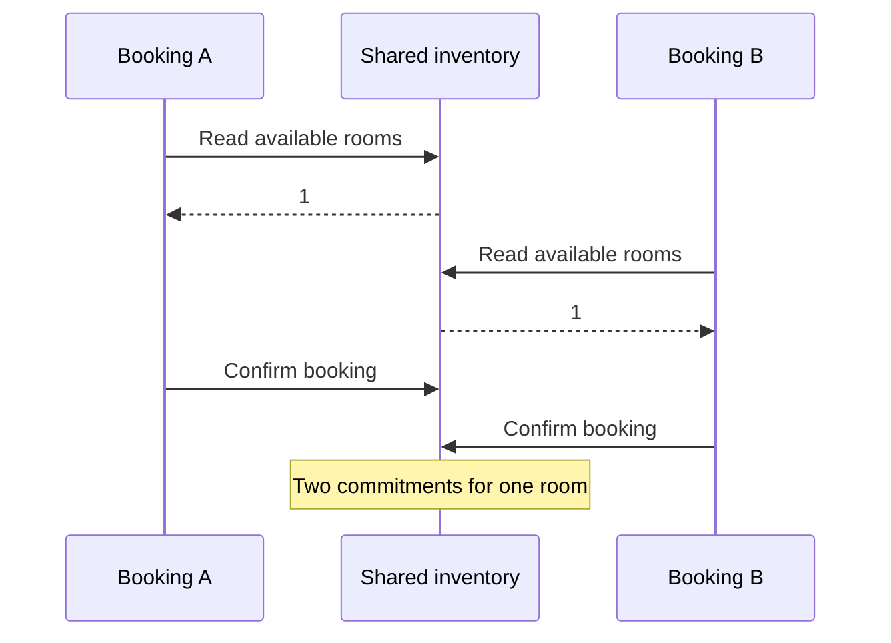
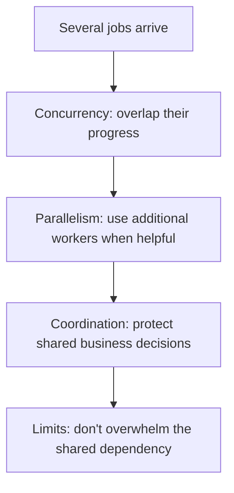

# CS320 — Operating Systems, Concurrency, and Runtimes
## Lecture 01: Concurrency, Parallelism, and Asynchrony

*The event loop, promises, threads, race conditions, synchronization, deadlocks, and the surprisingly difficult business of letting multiple things happen at once.*

**Estimated study time:** 80–100 minutes, including practical experiments.

---

### How to listen to this lecture

Written for continuous listening first, then for on-screen re-reading. Theme: **time becomes part of correctness** — and **concurrency ≠ parallelism**. Sticky-note callouts mark where a sequence that works alone fails when other work can run between its steps. Near the end, answer the oral challenges **out loud** before reading solutions. The Node.js lab lives after the spoken lecture ends — keep it for a screen session.

By the end, you should be able to say why two correct booking requests can oversell a room, how one JavaScript thread still races across `await`, what atomic updates and locks protect, why `Promise.all` and unbounded concurrency are dangerous without guardrails, and which questions to ask before trusting asynchronous orchestration.

---

# Part I — Intuition

*One hotel receptionist, two customers, and a chef who can keep several dishes moving without cooking them at the same instant. This is the picture behind concurrency, parallelism, and asynchronous JavaScript.*

### The picture to carry in your head

Imagine a small hotel with one receptionist and one room left for tonight. Two customers arrive, almost together. The receptionist checks the booking ledger for the first customer, notices that the room is available, then steps away to ask the manager for approval. While she is gone, another receptionist checks the same ledger and also finds the room available. Both later confirm a booking.

Neither receptionist made an arithmetic mistake. Both read the same correct number: one room available. The problem is that the world changed between reading the number and deciding what to do with it. **When tasks overlap, the order in which they touch shared state becomes part of correctness.**

The first diagram shows why a perfectly sensible two-step process can fail. The first check and the final reservation aren't one protected decision.



### 1. Doing several things versus doing several things at once

Picture a cook managing three dishes. She puts soup on the stove, places bread in the oven, then chops vegetables. Several tasks are **in progress**, but only one chopping action happens at a time. That's concurrency: organizing overlapping activities so progress can continue whenever another task is waiting.

Now add a second cook. One chops vegetables while the other kneads dough at exactly the same moment. That's parallelism: two computations genuinely executing simultaneously.

These ideas are related but not interchangeable. One cook can coordinate many dishes. Two cooks can perform more work in parallel, but they might also get in each other's way if both need the same cutting board.

JavaScript's event loop is rather like the first cook. A normal Node.js event-loop thread executes one JavaScript callback at a time. When an asynchronous network operation is initiated, the program can arrange to resume later and work on other callbacks meanwhile. That makes many network conversations manageable without assigning a dedicated continuously running JavaScript thread to every request.

But if one callback performs a huge synchronous calculation, the cook is stuck chopping vegetables for a very long time. Other callbacks wait. Calling the calculation from a promise doesn't magically create a second cook.

**Checkpoint:** If a Node.js server handles a thousand waiting HTTP requests, does that prove a thousand JavaScript functions are executing simultaneously? No. Many operations are waiting outside the current JavaScript execution thread.

### 2. The dangerous moment is the pause

Return to the hotel. Suppose the receptionist says, “There's one room; I'll reserve it after the manager replies.” The approval process causes a pause. Another booking can change inventory while she waits.

An `await` can create a similar opportunity. Before the await, the application observes some state. After the await, it resumes in a world where other requests, callbacks, or services may have modified the state. Single-threaded JavaScript execution does not prevent this kind of logical race.

The fix isn't to make everyone run faster. The fix is to define which operations must behave as **one indivisible decision**. A database can conditionally claim the last unit of inventory, accepting exactly one contender. Or a suitable transaction can coordinate the inventory update with creation of the booking record.

A lock is another possible tool when its scope really covers all contenders. But a mutex protecting one Node.js process doesn't automatically coordinate ten different application instances. The protection must live at the same boundary as the shared business fact.

### 3. Too many cooks can ruin the kitchen

Now imagine one hundred customers arriving and every receptionist immediately contacting the same manager. Even if there are many receptionists, the manager can answer only a limited number of calls. The queue grows.

That is what happens when code launches unlimited asynchronous requests against a database or supplier API. `Promise.all` is convenient, but a thousand promises may create a thousand competing operations. The downstream service doesn't suddenly gain extra capacity.

We therefore often limit how many operations may proceed simultaneously. Think of a restaurant allowing only a reasonable number of active orders into its kitchen. A bounded queue protects the cooks and makes overload visible.

Cancellation matters too. If a customer walks out, an expensive order still being prepared may no longer be useful. But cancelling the customer's wait isn't necessarily the same as undoing a payment or reservation that already happened. Those operations need explicit business rules.

The second diagram places the three concepts side by side. They answer different questions: is work overlapping, is it simultaneous, and is shared state protected?



### 4. The minute-long replay

Two customers request the last room. Both can progress concurrently, even if individual JavaScript callbacks execute one at a time. A pause creates an opening for the state to change. Without an atomic reservation decision, both may act on the same old observation. Adding more threads could make them run simultaneously, but wouldn't fix the business invariant by itself.

Meanwhile, thousands of waiting requests can be coordinated efficiently because waiting for I/O is different from consuming CPU. The moment every request competes for one limited dependency, however, concurrency needs a boundary.

That is the picture you should carry into L01. The terminology—microtasks, event loop, locks, semaphores, deadlocks, worker threads—explains individual parts of this scene rather than representing separate mysteries.

### Three questions before the Deep Dive

1. **Can a single-threaded program have a booking race?** Yes. Tasks can interleave around asynchronous suspension or external state changes.
2. **Does `Promise.all` turn CPU-heavy JavaScript into parallel execution?** No. CPU parallelism requires suitable workers, processes, or other parallel machinery.
3. **Where should the last-room guarantee be enforced?** At the authoritative shared-state boundary, not merely by checking a value earlier.

*The intuition pass ends here.*

---

# Part II — Deep Dive

# 1. The Last Room Was Sold Twice

It's Friday evening.

A popular hotel has one deluxe room remaining for Saturday night.

Two customers open your booking website.

One is sitting in Berlin. The other is in Stockholm.

Both select the same room type. Both enter their payment information. Both click **Book**.

The requests reach your backend almost simultaneously.

Your application checks availability, creates the reservations, and returns confirmation numbers.

Both customers receive successful confirmations.

The hotel now has two confirmed reservations for one available room.

The receptionist is going to have a wonderful Saturday.

You investigate.

There is no obvious bug in the availability calculation.

The database correctly reported one remaining room.

The reservation creation logic works.

The payment integration works.

The code has tests, and they all pass.

Here's the simplified booking path — read availability, create a reservation, then decrease inventory:

```typescript
async function bookRoom(
  hotelId: string,
  roomType: string
) {
  const available = await getAvailableRooms(
    hotelId,
    roomType
  );

  if (available <= 0) {
    throw new Error("Sold out");
  }

  await createReservation(hotelId, roomType);
  await decreaseAvailability(hotelId, roomType);

  return { status: "confirmed" };
}
```

Read it carefully.

There's nothing obviously nonsensical about any individual operation.

If one customer submits a booking, the application behaves correctly.

It checks availability.

Creates the reservation.

Decreases inventory.

Done.

So how did it sell the last room twice?

The answer is that **a sequence of individually correct operations is not necessarily correct when other operations can occur between them**.

Let's reconstruct the interleaving:

1. Customer A reads availability: 1.
2. Customer B reads availability: 1.
3. Customer A determines the room is available.
4. Customer B determines the room is available.
5. Customer A creates reservation A.
6. Customer B creates reservation B.
7. Customer A decreases availability.
8. Customer B decreases availability.
9. Both receive confirmation.

Both requests made their decisions using availability information that was valid when they read it.

But that information became outdated before they completed their operations.

This is a **race condition**.

The correctness of the outcome depends on the relative timing of multiple operations.

And race conditions are especially nasty because the code may behave correctly 99.9% of the time.

Then, under precisely the wrong timing conditions, it violates an important business rule.

> **Sticky note #1**
>
> Individually correct steps can still be wrong when other work runs between them.

You may have heard that JavaScript is single-threaded.

So how can two requests interfere with each other?

That's where our investigation begins.

---

# 2. Concurrency and Parallelism Are Not the Same Thing

These two terms are often used interchangeably, but they describe different properties of a system. Imagine a chef working in a restaurant. The chef starts cooking pasta.

While the pasta boils, the chef prepares a salad. Then the chef returns to the pasta. One chef, two dishes, overlapping progress.

That's **concurrency**. Now imagine two chefs working simultaneously. One prepares pasta while the other prepares salad.

That's **parallelism**. The distinction is important.

**Concurrency is about managing multiple activities whose execution can overlap in time.**

**Parallelism is about multiple activities actually executing at the same instant.**

> **Sticky note #2**
>
> Concurrency ≠ parallelism — overlapping progress is not the same as simultaneous execution.

A system can be concurrent without being parallel. A single CPU core can switch between several threads, giving each a share of execution time.

Those threads make progress concurrently, even though only one may execute at a particular instant on that core. A multicore processor can execute threads on different cores simultaneously.

That's actual parallelism. But there's another complication. An application doesn't always need CPU execution to make progress.

Suppose a backend sends an HTTP request to an external service. The external service can process that request while the original backend performs other work.

The backend's JavaScript thread doesn't need to sit there executing instructions throughout the network wait.

This is how asynchronous programming enables substantial concurrency without requiring one JavaScript thread per request. Let's examine that more closely.

---

# 3. Why Node.js Can Handle Thousands of Connections With One Main JavaScript Thread

Imagine you're building a conventional server.

Each incoming request needs to perform several tasks:

1. Read the HTTP request.
2. Authenticate the user.
3. Query PostgreSQL.
4. Call an external API.
5. Produce a response.

Some tasks involve actual computation. Others involve waiting. And that's a crucial distinction.

Suppose authentication requires five milliseconds of CPU work. The database query takes 80 milliseconds. The external API takes 150 milliseconds.

The response requires another five milliseconds of CPU work. If these operations occur sequentially, the request takes roughly 240 milliseconds, excluding other overhead.

But the application only performs about ten milliseconds of its own CPU work. Most of the elapsed time is waiting. What if a thousand customers send requests?

A naive design could dedicate one thread to each request and let those threads block while waiting. That approach can work, but threads consume resources and introduce scheduling overhead.

Node.js typically takes another approach. It uses an event-driven execution model with a main JavaScript thread and an event loop.

While one request waits for I/O, the JavaScript thread can execute code belonging to another request.

While A waits on the database and B waits on an API, the main JavaScript thread can run other ready work — then resume each request when its I/O completes:

```text
Time →

Request A: CPU ─── waiting for DB ───────── CPU ── done
Request B:     CPU ─── waiting for API ───────── CPU ── done
Request C:         CPU ── waiting for DB ─── CPU ── done

Main JS:   A → B → C → other callbacks → A → C → B
```

This is not a literal representation of every internal step. It illustrates the principle.

The main JavaScript thread executes a piece of work, reaches an asynchronous operation, and becomes available to process other runnable work.

When the asynchronous operation completes, its continuation becomes eligible to run.

This is why a Node.js server can handle many outstanding network operations without creating a JavaScript thread for each one. But be precise about what we've established.

Node.js doesn't make the database query execute on the JavaScript thread. PostgreSQL performs its own work. The network stack handles data transmission.

The operating system participates in asynchronous I/O. And Node.js uses native runtime infrastructure, including libuv. This brings us to the event loop.

---

# 4. The Event Loop: A Traffic Controller for Executable Work

People sometimes describe the event loop as if it's a magical engine that makes JavaScript parallel.

It isn't.

A better mental model is a scheduler that coordinates when JavaScript callbacks and continuations can execute.

Let's examine a simple program that logs `A`, schedules a zero-delay timer for `B`, then logs `C`:

```javascript
console.log("A");

setTimeout(() => {
  console.log("B");
}, 0);

console.log("C");
```

What happens?

The output is `A`, then `C`, then `B`.

Why?

Because calling `setTimeout()` doesn't immediately execute its callback.

It schedules the callback to become eligible after a minimum timing threshold.

Meanwhile, JavaScript continues executing the current code.

So `A` appears.

Then the timer is scheduled.

Then `C` appears.

Only afterward can the event loop run the timer callback.

This is fundamental.

**Scheduling work is not the same thing as executing it.**

And a timer configured for zero milliseconds doesn't mean its callback executes immediately.

It means the callback may execute when the runtime's scheduling rules permit it.

## The major Node.js event-loop phases

Node.js uses libuv to coordinate much of its asynchronous runtime behavior.

A simplified cycle walks pending callbacks, poll for I/O, check/`setImmediate`, close callbacks, then timers on the next opportunity:

```text
         ┌──────────────────┐
         │ Pending callbacks│
         └────────┬─────────┘
                  ↓
         ┌──────────────────┐
         │ Poll: I/O events │
         └────────┬─────────┘
                  ↓
         ┌──────────────────┐
         │ Check: immediate │
         └────────┬─────────┘
                  ↓
         ┌──────────────────┐
         │ Close callbacks  │
         └────────┬─────────┘
                  ↓
         ┌──────────────────┐
         │ Timers / next    │
         │ loop iteration   │
         └──────────────────┘
```

There are internal phases and scheduling details we've omitted.

But several are particularly relevant to Node.js developers.

**Poll** handles many I/O-related events.

**Check** executes callbacks scheduled through `setImmediate()`.

**Timers** handles callbacks whose timing thresholds have been reached.

Since Node.js 20, changes in libuv's scheduling mean timers generally run after polling in each loop iteration, with an initial timers pass for compatibility.

You don't need to memorize the complete phase diagram.

In fact, trying to memorize it before understanding the execution model is a particularly effective way to make computer science miserable.

The important principles are:

- JavaScript callbacks execute when the runtime schedules them.
- Long-running JavaScript prevents other callbacks on that thread from executing.
- Timers specify thresholds, not precise execution deadlines.
- I/O can progress outside the main JavaScript thread.
- Several kinds of queued work have different scheduling rules.

That last point deserves closer attention.

Because promises introduce another layer.

---

# 5. Microtasks: The Work That Gets to Cut in Line

Let's modify our previous example — same timer for `B`, plus a promise reaction that logs `C`, with synchronous `A` and `D` around them:

```javascript
console.log("A");

setTimeout(() => {
  console.log("B");
}, 0);

Promise.resolve().then(() => {
  console.log("C");
});

console.log("D");
```

Before reading further, predict the output.

It is `A`, then `D`, then `C`, then `B`.

Why does the promise callback execute before the timer?

Because JavaScript has a mechanism called the **microtask queue**.

Promise reactions are scheduled as microtasks.

When the current synchronous execution finishes, the runtime processes the relevant microtasks before proceeding to later event-loop work such as timer callbacks.

In simplified terms, current synchronous JavaScript finishes first, then the microtask queue, then later event-loop callbacks:

```text
Current synchronous JavaScript
            |
            v
      Microtask queue
            |
            v
    Event-loop callbacks
            |
            v
    More JavaScript work
```

Node.js also has a separate `process.nextTick()` queue, which follows its own rules and typically runs before ordinary promise microtasks in CommonJS execution contexts. Top-level ES module scheduling has nuances, so don't rely on one simplistic universal ordering rule for every possible environment.

For most application programming, understanding normal promise microtasks is more useful than memorizing exotic combinations of `nextTick`, timers, and `setImmediate`.

## Why microtasks exist

Promises represent values that may become available later.

When a promise settles, registered continuation logic needs to run.

But running that logic immediately inside the current execution could produce difficult and inconsistent control flow.

Microtasks provide a predictable mechanism for scheduling those continuations.

Here's another example — an `async` function that logs `B`, awaits an already-resolved promise, then logs `D`, called between synchronous `A` and `C`:

```javascript
async function example() {
  console.log("B");

  await Promise.resolve();

  console.log("D");
}

console.log("A");

example();

console.log("C");
```

The output is `A`, then `B`, then `C`, then `D`.

This reveals something important.

An `async` function begins executing synchronously.

It doesn't automatically jump onto another thread.

When it reaches `await`, execution of that function is suspended until the awaited value is available and the continuation is scheduled.

The caller can continue.

That is what happens between `B` and `D`.

## Even an already-resolved promise causes a suspension

Notice that we're awaiting `Promise.resolve()` — it's already fulfilled.

There's no network request.

No database query.

No actual waiting for external work.

Nevertheless, the `await` causes the function's continuation to be deferred.

This is because `await` participates in the asynchronous continuation machinery even when the awaited value is immediately available.

That's an important semantic detail.

It means introducing an `await` can change the relative ordering of operations.

And relative ordering is exactly where race conditions live.

---

# 6. How a Single JavaScript Thread Can Produce a Race Condition

Let's return to our hotel booking system. Many developers associate race conditions exclusively with multiple threads accessing shared memory. That's one common source.

But it isn't the only one. Asynchronous functions can interleave even when their JavaScript continuations execute on one thread.

Here's a deliberately simplified booking system that checks seats, awaits, then decrements:

```javascript
let availableRooms = 1;

async function reserve(name) {
  if (availableRooms <= 0) {
    console.log(`${name}: sold out`);
    return false;
  }

  await Promise.resolve();

  availableRooms--;

  console.log(`${name}: confirmed`);
  return true;
}
```

Now run Anna and David through `Promise.all` and print the remaining rooms:

```javascript
await Promise.all([
  reserve("Anna"),
  reserve("David")
]);

console.log("Rooms left:", availableRooms);
```

What happens? Both customers can receive confirmations. And `availableRooms` becomes -1.

Let's reconstruct it.

Anna enters `reserve()`.

She checks the availability.

It's 1.

She reaches `await` and suspends.

David enters `reserve()`.

He checks the availability.

It's still 1.

He also suspends.

Anna's continuation resumes.

She decrements availability to 0.

David's continuation resumes.

He decrements availability to -1.

Two successful reservations.

One available room.

And only one JavaScript thread executed the code.

No simultaneous JavaScript instructions were required.

The problem was that **the logical operation was split across an asynchronous boundary**, allowing another operation to observe and act on the same state before the first one completed.

That's the essential nature of the race.

## Why moving the decrement fixes this particular example

Consider checking and decrementing before any `await`, then saving afterward:

```javascript
let availableRooms = 1;

async function reserve(name) {
  if (availableRooms <= 0) {
    return false;
  }

  availableRooms--;

  await saveReservation(name);

  return true;
}
```

Within one JavaScript execution thread, with no `await` or other re-entrant behavior between the check and decrement, the first invocation performs both operations before the second invocation gets its turn.

That can prevent the original in-memory race. But don't celebrate too quickly. What if the application runs on four Node.js processes?

Or ten AWS Lambda instances? Each process may have its own copy of `availableRooms`. What if the database is the authoritative inventory source?

What if saving the reservation fails after the in-memory decrement? What if the process crashes? What if an external payment succeeds but the reservation write fails?

We've solved one tiny race within one process. We have not solved reliable booking. And this distinction is crucial.

**Correctness inside one JavaScript execution context does not automatically guarantee correctness across processes, services, databases, or machines.**

> **Sticky note #3**
>
> A local race fix is not a multi-instance inventory guarantee.

That is one of the reasons we study distributed systems separately.

---

# 7. Atomicity: Making Several Steps Behave Like One

The booking bug has a deeper structure.

We want to perform a business operation:

> Reserve a room only if capacity is available, and ensure that two concurrent requests cannot reserve the same remaining capacity.

This sounds like one operation.

But our implementation performed several independent actions:

1. Read availability.
2. Check a condition.
3. Write a reservation.
4. Update availability.

Other operations could run between those actions. What we need is a way to enforce the relevant invariant across concurrent operations. One important tool is **atomicity**.

An atomic operation behaves, from the perspective of relevant concurrent observers, as a single indivisible state transition.

You don't necessarily need every internal CPU instruction to execute simultaneously. You need the operation's externally relevant correctness guarantees to be preserved.

## A database solution

For a simplified inventory model with one row holding an available-room count, PostgreSQL can decrement only when `available > 0` and return the new count:

```sql
UPDATE room_inventory
SET available = available - 1
WHERE hotel_id = $1
  AND room_type = $2
  AND stay_date = $3
  AND available > 0
RETURNING available;
```

Under PostgreSQL's usual Read Committed behavior, concurrent updates to the same row coordinate through row-level locking.

If one request decrements the last available room from 1 to 0, a competing update must account for that change. Its `available > 0` condition won't remain true after the first committed update.

The second update affects zero rows. The application can interpret that as sold out. That's far safer than reading the number in one query and later writing a new number based on an outdated decision.

Of course, the complete booking operation must do more than decrement inventory. We also need to create the reservation.

Those changes should ordinarily be coordinated within a database transaction where possible. And a multi-night reservation introduces additional complexity.

You may need to reserve capacity across several date rows without leaving the booking half-complete. That requires a deliberate transactional design. But the central principle is now visible.

**The database must enforce the inventory rule at the point where competing requests modify authoritative state.**

A frontend check alone cannot provide that guarantee. Neither can a TypeScript type. Neither can a mutex inside one application instance when other instances can perform the same operation.

## What about locking?

Another approach is to lock the relevant row before performing the read-modify-write sequence.

PostgreSQL can select the inventory row `FOR UPDATE` so competing writers wait:

```sql
SELECT available
FROM room_inventory
WHERE hotel_id = $1
  AND room_type = $2
  AND stay_date = $3
FOR UPDATE;
```

Inside a transaction, this acquires a row-level lock that prevents conflicting writers from proceeding until the lock is released. The application can then make decisions based on the locked row.

Locks are useful, but they must be employed carefully. Long transactions can cause contention. Multiple locks can create deadlocks.

And external API calls inside long-held database transactions are usually a bad idea. Still, the important concept is straightforward.

Concurrency becomes manageable when important shared-state transitions are protected by appropriate guarantees.

---

# 8. Mutexes, Semaphores, and Locks: Three Different Ways to Coordinate Work

Let's step away from PostgreSQL and examine synchronization more generally. Imagine a shared resource that must not be modified by two operations simultaneously.

For example, a temporary in-memory ledger inside one service process. We want only one operation at a time to enter the critical section. This is where a **mutex** comes in.

Mutex is short for mutual exclusion.

## Mutex: One at a time

A mutex protects a critical section so that only one participant holds the lock at a time.

While A holds the lock and modifies state, B waits; B acquires only after A releases. Serialized access: A acquires → modifies → releases; B waits, then acquires.

A mutex doesn't automatically make the operation fast. In fact, it deliberately serializes access to protected state. But that serialization can preserve correctness.

A mutex can be useful inside one application process. However, remember the architectural boundary.

A mutex inside one Node.js instance doesn't protect a PostgreSQL row against writes from another instance. Nor does it coordinate ten independently executing serverless functions.

## Semaphore: A limited number at once

Now suppose you have a third-party API that permits only ten concurrent requests. You don't need complete mutual exclusion. You want to allow several operations concurrently, but impose a limit.

That's a natural use case for a **semaphore**. A semaphore maintains a count of available permits. Before starting an operation, a task acquires a permit.

When the operation finishes, the permit is released. If all permits are in use, additional tasks wait. A semaphore initialized with ten permits allows at most ten holders at a time.

That's useful for:

- Limiting concurrent HTTP requests.
- Controlling database-intensive work.
- Restricting resource-heavy background jobs.
- Managing access to bounded connection or worker capacity.

A mutex can be thought of as a special case of a one-permit synchronization mechanism, though mutexes may also have ownership semantics that ordinary semaphores don't.

## Locks aren't free

Every synchronization mechanism introduces costs. Tasks may wait. Contention can increase latency.

The system must handle cancellation and failure. A lock might be held longer than intended. Incorrect lock ordering can produce deadlocks.

And excessive locking can eliminate the concurrency we were trying to exploit. That's why the goal isn't "add locks everywhere."

The goal is to identify important invariants and select mechanisms that preserve them with acceptable cost. Sometimes that's a mutex. Sometimes a database transaction.

Sometimes an atomic operation. Sometimes a queue or single-owner actor. Sometimes avoiding shared mutable state altogether.

---

# 9. Deadlocks: When Everyone Waits Forever

Let's imagine two database transactions. Transaction A needs to update reservation inventory for Monday and Tuesday. Transaction B needs to update inventory for Tuesday and Monday.

They acquire locks in different orders. Transaction A locks Monday. Transaction B locks Tuesday.

Now A tries to lock Tuesday. It must wait for B. B tries to lock Monday.

It must wait for A. Neither can continue — each holds what the other needs:

```text
Transaction A                     Transaction B

Locks Monday                      Locks Tuesday
     |                                  |
     v                                  v
Wants Tuesday                     Wants Monday
     |                                  |
     +──────── WAITING ─────────────────+
                  ↑
                  |
             DEADLOCK
```

This is a **deadlock**. Two or more operations wait on resources held by one another, creating a cycle of dependencies that prevents progress.

PostgreSQL can detect transaction deadlocks and abort one transaction to break the cycle. The application must then handle the error appropriately.

In some cases, retrying the aborted transaction is sensible. But a retry must be designed around the complete business operation and its side effects.

## Consistent lock ordering

A common technique for reducing deadlocks is to acquire locks in a consistent order. For example, when reserving inventory across multiple dates, always process dates in chronological order.

Then two transactions attempting to lock the same rows are less likely to acquire them in opposite orders. This doesn't eliminate every possible deadlock in a complicated system.

But it removes a common cause.

## Deadlock versus slow execution

Not every long wait is a deadlock. Perhaps Transaction B is simply waiting while A completes an expensive update. Eventually, A commits.

B proceeds. That's lock contention, not necessarily a deadlock. The distinction matters.

A deadlock involves a cycle of waiting dependencies. Ordinary contention involves waiting for another operation that may still be able to progress.

In production, both can damage latency and throughput. But their causes and remedies differ.

---

# 10. `Promise.all`: Concurrency Without Guardrails

Let's return to everyday Node.js code. You need to retrieve information from three independent services.

A customer dashboard displays:

- Reservation details.
- Payment history.
- Loyalty points.

You await reservations, then payments, then loyalty — three independent fetches in sequence:

```typescript
const reservations = await getReservations(customerId);
const payments = await getPayments(customerId);
const loyalty = await getLoyaltyPoints(customerId);
```

This is straightforward. But the calls execute sequentially. We wait for reservations before starting payment retrieval.

Then we wait for payments before starting loyalty retrieval. If the calls are independent, that's unnecessary. Suppose each takes 200 milliseconds.

The combined latency might approach 600 milliseconds.

Instead, start all three and wait once with `Promise.all`:

```typescript
const [reservations, payments, loyalty] =
  await Promise.all([
    getReservations(customerId),
    getPayments(customerId),
    getLoyaltyPoints(customerId)
  ]);
```

Now the operations are initiated without waiting for one another.

If each takes roughly 200 milliseconds and the dependencies support concurrent execution, the combined wait may be much closer to 200 milliseconds plus overhead. That's a very useful optimization.

But notice exactly what `Promise.all()` does. It doesn't create a new JavaScript thread for every operation. It doesn't guarantee parallel CPU execution.

It coordinates the completion of multiple promises representing operations that can be in progress concurrently. For independent I/O operations, that's often ideal.

## The dangerous surprise: Rejection doesn't cancel siblings

Suppose you run charge, reservation, and confirmation email through one `Promise.all`:

```typescript
await Promise.all([
  chargeCustomer(),
  createReservation(),
  sendConfirmationEmail()
]);
```

One operation fails.

`Promise.all()` rejects.

Does that mean the other operations stop? No. The remaining operations generally continue unless they are explicitly cancelled or otherwise stopped.

You might discover that:

- The payment succeeded.
- The reservation failed.
- The confirmation email was sent.

And `Promise.all()` reported an error. That's a remarkably unpleasant business outcome. The problem isn't that `Promise.all()` is broken.

It's that we used concurrent execution without understanding the dependencies and side effects. These operations were not actually independent.

Sending confirmation depends on a successful reservation. Payment and reservation creation require an explicitly designed consistency and recovery strategy.

## The correct principle

Use concurrency when operations can safely overlap. Don't use it merely because asynchronous functions are available.

A useful question is:

**If these operations finish in any order—or one fails while the others succeed—does the business process remain correct?**

If the answer is no, you need more careful orchestration. This becomes especially important in payment systems, booking workflows, and AI agents that can execute external tools.

---

# 11. Unlimited Concurrency: The Fastest Way to Overload Your Dependencies

Now imagine you need to fetch 50,000 customer profiles.

A developer maps every customer ID into one giant `Promise.all`:

```typescript
const profiles = await Promise.all(
  customerIds.map(id => fetchCustomerProfile(id))
);
```

Beautiful. Concurrent requests! Modern JavaScript!

Maximum performance! Except you've just attempted to initiate 50,000 operations.

Whether they all become active simultaneously depends on the HTTP client, connection management, service limits, and other runtime details. But the code imposes no deliberate application-level bound.

This can create serious problems. The remote service may enforce rate limits. The connection pool may become saturated.

Memory usage may increase dramatically. Failures may cascade into retries. Queues can build up in the network client or downstream service.

And latency may actually become worse. More concurrency doesn't always mean more throughput.

## The queueing problem

Imagine a restaurant with ten cooks. With five orders, everyone is happy. With ten orders, the kitchen is busy.

With twenty orders, some customers wait. With a thousand orders arriving simultaneously, the kitchen doesn't become a hundred times faster. The queue simply becomes enormous.

The same principle applies to database connections, API requests, worker pools, and other limited resources.

If work arrives faster than the system can complete it over a sustained period, the backlog grows.

In queueing theory, the relationship between arrival rate, completion rate, and waiting time becomes crucial. We'll study it in more depth in the backend and distributed-systems courses.

For now, the important principle is:

**Concurrency must be bounded according to the capacity of the system performing the work.**

## A simple bounded approach

Suppose we want at most ten profile requests in flight from this batch at a time.

A straightforward implementation slices the IDs into batches of ten and awaits each batch:

```typescript
const batchSize = 10;
const profiles = [];

for (let i = 0; i < customerIds.length; i += batchSize) {
  const batch = customerIds.slice(i, i + batchSize);

  const results = await Promise.all(
    batch.map(id => fetchCustomerProfile(id))
  );

  profiles.push(...results);
}
```

This processes ten requests at a time, assuming each function returns a promise representing the complete operation. It's simple and understandable. But it has a limitation.

If nine requests finish quickly and one takes five seconds, the next batch doesn't start until that slow request finishes.

A worker-pool or semaphore-based implementation can maintain a more continuous level of bounded concurrency. That's usually better for large heterogeneous workloads.

The important thing is the engineering choice. We aren't trying to maximize the number of active requests.

We're trying to choose an appropriate concurrency level that produces good throughput without overwhelming dependencies.

---

# 12. Asynchrony Does Not Make CPU Work Parallel

Here's a classic trap. You have a CPU-heavy function. Perhaps it processes a large dataset.

Or calculates a difficult optimization problem. Or transforms an enormous document. You decide to make it asynchronous — a tight CPU loop wrapped in `async`:

```typescript
async function expensiveCalculation() {
  let total = 0;

  for (let i = 0; i < 500_000_000; i++) {
    total += Math.sqrt(i);
  }

  return total;
}
```

Now you run two of those through `Promise.all`:

```typescript
await Promise.all([
  expensiveCalculation(),
  expensiveCalculation()
]);
```

Will the two calculations execute in parallel on separate CPU cores? Not merely because the function is marked `async`. The function contains no `await` before or inside the expensive loop.

When invoked, it starts executing synchronously on the calling JavaScript thread. The loop occupies that thread until it completes. Only then does the function return its promise.

The second function invocation then performs its own loop. The asynchronous function declaration doesn't magically move CPU work onto another thread.

**`async/await` is primarily about composing asynchronous operations and their continuations. It isn't a mechanism for automatic CPU parallelism.**

## What if we insert an `await`?

Suppose we divide the calculation into chunks and periodically yield to the event loop. That can improve responsiveness by giving other operations opportunities to run between chunks.

But it still doesn't cause two CPU-heavy JavaScript computations to execute simultaneously on separate cores. We've improved scheduling fairness, not created parallel computation.

To use multiple CPU cores for JavaScript computation, we need another mechanism.

---

# 13. Worker Threads: Actual Parallel JavaScript Execution

Node.js provides the `worker_threads` module. Worker threads can execute JavaScript on separate threads. This makes them useful for CPU-intensive work.

For example:

- Image processing.
- Heavy parsing.
- Computational transformations.
- Simulation workloads.
- Large-scale numerical calculations.
- Certain cryptographic or analytical tasks.

Workers have separate JavaScript execution contexts. They can communicate by sending messages. They can also transfer certain memory buffers or share memory explicitly through `SharedArrayBuffer`.

Here's a simple example.

Create `worker.js` — a worker that sums square roots for `workerData.iterations` and posts the total back:

```javascript
const { parentPort, workerData } =
  require("node:worker_threads");

let total = 0;

for (let i = 0; i < workerData.iterations; i++) {
  total += Math.sqrt(i);
}

parentPort.postMessage(total);
```

Then create `main.js` — spawn two workers via promises and await both with `Promise.all`:

```javascript
const { Worker } = require("node:worker_threads");

function runCalculation(iterations) {
  return new Promise((resolve, reject) => {
    const worker = new Worker("./worker.js", {
      workerData: { iterations }
    });

    worker.once("message", resolve);
    worker.once("error", reject);

    worker.once("exit", code => {
      if (code !== 0) {
        reject(new Error(`Worker exited: ${code}`));
      }
    });
  });
}

async function main() {
  const results = await Promise.all([
    runCalculation(100_000_000),
    runCalculation(100_000_000)
  ]);

  console.log(results);
}

main().catch(console.error);
```

These calculations can now execute in separate worker threads. On a multicore machine, they may make progress in parallel. But there are costs.

Creating workers requires resources. Passing data between workers introduces overhead. Sharing memory introduces synchronization concerns.

A worker pool is generally preferable to spawning a fresh worker for every small task.

And using workers for ordinary database or HTTP requests often provides little benefit because Node.js already has efficient asynchronous I/O mechanisms.

## The libuv worker pool is another thing

Here's a distinction worth preserving. Node.js also uses a native worker pool through libuv for certain operations.

Examples include many filesystem operations, selected DNS operations, and some cryptographic and compression functions. That pool is not identical to the JavaScript `worker_threads` API.

Ordinary network socket I/O often relies on operating-system readiness mechanisms rather than assigning one worker thread to every request.

So when someone says:

"Node.js is single-threaded."

The useful response is:

"Ordinary JavaScript in one Node.js execution context runs on one main thread, but the runtime and underlying system can use other threads and asynchronous operating-system mechanisms."

That's more accurate. And it explains why a Node.js service can coordinate many concurrent I/O operations while still being vulnerable to one long-running synchronous JavaScript callback.

---

# 14. The Event Loop Can Be Starved

Let's investigate a performance problem that often surprises developers. You deploy a Node.js API. It normally responds quickly.

But occasionally, every endpoint becomes slow simultaneously. Even simple health-check requests take several seconds. The database is healthy.

The network looks fine. What happened? One possibility is that the main JavaScript thread is blocked.

Consider a function that spins the CPU for about two seconds:

```javascript
function blockForTwoSeconds() {
  const until = Date.now() + 2000;

  while (Date.now() < until) {
    // Deliberately busy
  }
}
```

If an HTTP handler invokes this function synchronously, it occupies the main JavaScript thread for approximately two seconds.

During that time, other JavaScript callbacks on the same thread cannot execute.

Incoming I/O may be handled or buffered by the operating system, but the application cannot promptly run the JavaScript needed to process that work. That's **event-loop blocking**.

## Microtask starvation

Here's a subtler version. Suppose a function queues itself again as a microtask forever:

```javascript
function keepScheduling() {
  queueMicrotask(keepScheduling);
}

keepScheduling();
```

Don't run that directly in an important application. It continually adds another microtask.

Because the runtime processes microtasks before moving on to other scheduled work, this can starve timers and I/O callbacks.

The application may remain busy processing microtasks without allowing other work to proceed normally. Similar problems can arise from recursive `process.nextTick()` scheduling.

The interesting point is that even asynchronous-looking code can monopolize scheduling resources.

## Detecting event-loop delay

Node.js provides diagnostic utilities such as `monitorEventLoopDelay()` in `node:perf_hooks`. These can help measure how much the event loop is delayed from executing scheduled work.

If your service normally has very low event-loop delay but suddenly experiences spikes of hundreds of milliseconds, that's a useful signal. It doesn't directly reveal the offending function.

But combined with CPU profiling and request tracing, it can help localize the problem.

Low request throughput can result from insufficient CPU capacity. But it can also result from a small number of operations monopolizing a critical execution thread.

The distinction matters when choosing a remedy.

---

# 15. Cancellation: When a Request Is Gone but the Work Continues

Imagine a customer opens a search page. They enter a destination. The frontend starts an API request.

Before the request finishes, they enter another destination. The frontend starts another request. Then another.

Eventually, the user navigates away. What should happen to the old requests? Maybe they should be cancelled.

But cancellation has subtleties.

Consider a frontend that attaches an `AbortController` signal to `fetch` and later calls `abort()`:

```typescript
const controller = new AbortController();

const request = fetch("/api/search", {
  signal: controller.signal
});

// Later:
controller.abort();
```

This signals cancellation to the fetch operation. But what does that actually guarantee? It doesn't necessarily mean the server has stopped processing.

Perhaps the request already reached the backend. Perhaps the backend already modified the database. Perhaps an external operation is still running.

Cancellation is not time travel. It doesn't automatically undo work that has already happened.

## Cancellation is usually cooperative

In many asynchronous systems, cancellation involves one component signaling that work is no longer wanted. The receiving component must support cancellation and react appropriately.

Some operations can stop promptly. Others may be unable to stop safely. Some might complete despite the cancellation request.

This matters when designing APIs and background workflows. A user cancelling a search request is different from a user cancelling a payment transaction. The first may be safely abandoned.

The second may require a formal cancellation or refund workflow. That's because the operation may have external effects that cannot simply be erased.

## Timeouts are not proof of failure

Now imagine a payment provider request times out. Your backend waited ten seconds and received no response. Did the payment fail?

Not necessarily. The provider may have processed the payment successfully while the response was lost or delayed. This is why retrying external operations requires care.

A timeout tells us that the operation didn't complete *from our caller's perspective* within the expected period. It doesn't prove that the remote system didn't perform the action.

This is one reason idempotency keys and durable workflow state are important. We'll explore those in much greater depth in the backend and distributed-systems courses.

For now, understand that concurrent and asynchronous systems must deal with uncertainty about what other components have completed.

---

# 16. Testing Race Conditions: Don't Depend on Getting Lucky

Let's return to our double-booking bug. Why didn't the ordinary unit tests catch it? Because they probably tested one booking at a time.

One request checks availability. One request creates a reservation. The test passes.

But concurrency bugs often require particular interleavings of operations. If two requests execute in a slightly different order, the problem may disappear.

A test that relies on random timing may pass a thousand times and fail on the thousand-and-first. That's not an especially useful test. We need a more controlled approach.

## Deliberately create the dangerous interleaving

Consider our in-memory example. We can arrange for two booking operations to observe the same initial state before either performs the decrement.

Rather than hoping the race happens, we force the execution order.

For example, a test can:

1. Start booking A.
2. Pause it after reading availability.
3. Start booking B.
4. Pause it after reading availability.
5. Allow both to continue.
6. Assert that the invariant was preserved or violated.

This is sometimes called a **controlled interleaving**. The purpose is to reproduce the dangerous ordering deterministically.

In database integration tests, we can use multiple transactions or connections and coordinate their execution to test conflicts.

This is much more reliable than inserting arbitrary delays and hoping the scheduler cooperates.

## What should we assert?

Not merely:

"Both requests returned some response."

The important invariant is:

**Confirmed reservations must not exceed available inventory.**

For a one-room inventory, at most one competing request should succeed. The other must receive an appropriate failure or alternative result.

That's the difference between testing implementation details and testing business correctness. The stronger the invariant, the more meaningful the test.

And in concurrent systems, invariants matter enormously.

---

# 17. The Oral Examination

Pause the lecture for each one.

Answer **out loud** — as if an interviewer were across the table — before you listen to or read the solutions.

They're designed to reinforce practical judgment rather than obscure runtime trivia.

### Challenge A — The Double Booking

**Suggested time: 10 minutes**

You're designing a hotel reservation service.

Two customers simultaneously try to reserve the last room.

The system has several backend instances and a shared PostgreSQL database.

How would you guarantee that only one reservation succeeds?

Consider:

- Where inventory state is authoritative.
- What operation must be atomic.
- Whether a database transaction is required.
- What happens when the booking covers several nights.
- How to handle a failed payment.
- How to handle a database transaction that encounters a deadlock.

Why is a JavaScript mutex inside one Node.js instance insufficient?

### Challenge B — The Dangerous `Promise.all`

**Suggested time: 8 minutes**

A developer writes a single `Promise.all` over inventory reservation, payment charge, and confirmation email:

```typescript
await Promise.all([
  reserveInventory(),
  chargePayment(),
  sendConfirmationEmail()
]);
```

What could go wrong?

Why isn't rejection of the combined promise sufficient to guarantee rollback?

How would you redesign the workflow?

Which operations can safely happen concurrently?

Which require ordering?

### Challenge C — The Overloaded Integration

**Suggested time: 10 minutes**

Your application needs to retrieve information about 100,000 products from an external API.

The provider permits 20 concurrent requests.

Each request takes between 100 milliseconds and two seconds.

How would you process the workload?

Would you use one giant `Promise.all()`?

Would you use batches?

Would a semaphore or worker pool be more efficient?

What happens if the provider begins returning rate-limit errors?

How would you prevent retries from making the overload worse?

### Challenge D — The Mysterious Event-Loop Freeze

**Suggested time: 8 minutes**

A Node.js service suddenly becomes unresponsive for several seconds.

During the incident:

- PostgreSQL is healthy.
- Network connectivity is healthy.
- The process remains alive.
- CPU usage on one logical processor is high.
- Event-loop delay spikes dramatically.
- All HTTP endpoints become slow.

What explanations would you investigate?

How would you distinguish a long-running synchronous calculation from an overloaded worker pool or slow database operation?

Would adding another server instance solve the underlying problem?

---

# 18. Solutions and Discussion

*Listen or read only after you have answered each challenge out loud.*

### Solution A — Double booking

The inventory rule should be enforced where authoritative shared state is maintained. For a simple counter, a conditional atomic database update can prevent overselling.

Creating the reservation and updating inventory should ordinarily be coordinated transactionally.

Multi-night reservations may require locking or updating multiple rows in a consistent order and ensuring all-or-nothing behavior.

Payment integration introduces external side effects, so a complete workflow needs explicit handling for failures, retries, and compensation.

A local JavaScript mutex cannot coordinate separate backend instances.

### Solution B — Dangerous `Promise.all`

The operations have business dependencies. Payment might succeed while inventory reservation fails. A confirmation email might be sent before the booking is actually confirmed.

And rejecting `Promise.all()` doesn't automatically cancel or undo sibling operations. The workflow should define a durable sequence of states and safe transitions.

Some independent preparatory work may execute concurrently. But irreversible external side effects need carefully designed ordering, idempotency, and recovery behavior.

### Solution C — Overloaded integration

A concurrency limit of 20 should be enforced deliberately. A semaphore or bounded worker pool is a natural approach.

Fixed-size batches are simpler but can underutilize capacity when some requests finish much later than others.

Rate-limit responses require appropriate backoff, potentially respecting a `Retry-After` header. Retries should be bounded and designed to avoid creating additional overload.

Monitoring in-flight requests, errors, latency, and queue depth helps maintain stability.

### Solution D — Event-loop freeze

The combination of high CPU usage on one logical processor and elevated event-loop delay suggests that synchronous JavaScript work may be monopolizing the main execution thread.

CPU profiling and event-loop diagnostics would help identify the source. Other possibilities should still be considered.

An overloaded libuv worker pool can delay operations dependent on that pool, but it doesn't necessarily produce the same pattern as continuous JavaScript execution on the main thread.

A slow database can increase request latency while leaving the main JavaScript thread relatively free.

Adding application instances may improve aggregate availability or throughput, but it doesn't fix a pathological calculation executed by every instance.

The correct remedy depends on the measured bottleneck.

---

# 19. The Mental Model Worth Keeping

Back to the hotel: one room, two Book clicks, two confirmations — not because availability couldn't be calculated, but because shared state changed between check and modify without protection.

That's what makes concurrent programming different from ordinary sequential programming.

In a sequential program, we often reason about operations in a predictable order: read, check, modify, continue. In a concurrent system, other operations may occur between those steps. Across process or network boundaries, uncertainty increases — delayed queries, timeouts, contested locks, crashed workers, payments that succeed while responses disappear, retries that re-execute work that already succeeded.

Correctness is no longer merely about whether each line performs the intended calculation. It becomes about **which sequences of events the system permits, and whether its important guarantees remain true across those sequences**.

A junior developer might ask: "Does this function work?" A more experienced engineer also asks: What if it's invoked twice simultaneously? What if the process crashes after the first write? What if another service changes the same record? What if the response disappears? What if we retry? What if ten thousand customers do this at once?

An AI assistant can produce a clean async function, a `Promise.all()`, retries, or an entire booking workflow in seconds. But unless the architecture preserves the relevant guarantees, that code may fail when two customers click at nearly the same time — even after sequential unit tests pass.

Remember these durable distinctions:

- **Concurrency ≠ parallelism** — overlapping progress is not the same as simultaneous execution.
- **Scheduling ≠ executing** — a zero-delay timer and an `await` defer work; they don't run it immediately.
- **One-thread races are real** — an asynchronous boundary can split a logical operation so another continuation observes stale state.
- **Local correctness ≠ distributed correctness** — fixing an in-process race does not protect a shared database across instances.
- **`async/await` ≠ CPU parallelism** — workers (or other processes) move heavy computation; promises compose continuations.
- **`Promise.all` rejection ≠ sibling rollback** — siblings keep running unless you cancel or design recovery.
- **Bound concurrency by capacity** — unlimited fan-out overloads pools, APIs, and memory.
- **Cancellation ≠ undo; timeout ≠ remote failure** — signals stop wanting work; they don't erase side effects you may already have caused.

> **The master sticky note**
>
> Concurrency isn't primarily about making several things happen faster. It's about allowing several things to happen without losing control of what must remain true.

Time is part of the correctness story. Related — not identical — to speed.

---

# 20. Next Lecture — CS320-L02: Operating Systems: The Manager Behind the Curtain

We've learned that one JavaScript thread can still race across `await`, that the event loop schedules work rather than magically parallelizing it, and that shared-state invariants need enforcement where authoritative state lives — often in the database, not in a local mutex.

But who actually owns the threads, the memory maps, the file descriptors, and the scheduling decisions underneath Node.js? What does the operating system do when your process blocks, when a worker starts, when containers isolate workloads, or when one runaway process tries to consume every CPU core?

In **CS320-L02**, we'll study the operating system as the manager behind the curtain — processes, threads, virtual memory, system calls, and the resource controls that make modern deployment possible.

---

## Optional Practical Lab — Watch Two Correct Requests Break Shared State

*The spoken lecture ends here. The remaining material is a screen-first investigation worksheet.*

Now let's recreate the core concepts.

You can run the examples in Node.js.

**Suggested time: 15–20 minutes.**

> **Gym rules:** predict before you run. Challenge spoilers are in Solutions and Discussion above; lab answers follow the experiments.

### Experiment A — The event loop's ordering

Create `event-loop.js` — log synchronous work, a zero-delay timer, a microtask, and a promise reaction:

```javascript
console.log("1: synchronous");

setTimeout(() => {
  console.log("5: timer");
}, 0);

queueMicrotask(() => {
  console.log("3: microtask");
});

Promise.resolve().then(() => {
  console.log("4: promise");
});

console.log("2: synchronous");
```

Predict the output before running it.

Then explain why the timer appears last even though its delay is zero.

### Experiment B — The race condition

Create `race.js` — check seats, `await`, then decrement, and run Anna and David through `Promise.all`:

```javascript
let seats = 1;

async function book(name) {
  if (seats <= 0) {
    return `${name}: rejected`;
  }

  await Promise.resolve();

  seats--;

  return `${name}: confirmed`;
}

async function main() {
  const results = await Promise.all([
    book("Anna"),
    book("David")
  ]);

  console.log(results);
  console.log("Seats remaining:", seats);
}

main();
```

Before running it, predict:

1. How many bookings succeed?
2. What is the final seat count?
3. How is this possible with one JavaScript thread?
4. Which line allows another operation to interleave?
5. Would adding a longer delay necessarily fix anything?

Then change the implementation so the availability check and decrement occur before the `await`.

Observe what changes.

Finally, explain why that fix is insufficient if inventory belongs to a shared database accessed by multiple application instances.

### Experiment C — Sequential versus concurrent waiting

Create `waiting.js` — three half-second sleeps run first in sequence, then overlapped with `Promise.all`:

```javascript
const sleep = ms =>
  new Promise(resolve => setTimeout(resolve, ms));

async function task(name) {
  await sleep(500);
  return name;
}

async function sequential() {
  const a = await task("A");
  const b = await task("B");
  const c = await task("C");

  return [a, b, c];
}

async function concurrent() {
  return Promise.all([
    task("A"),
    task("B"),
    task("C")
  ]);
}

async function main() {
  console.time("Sequential");
  await sequential();
  console.timeEnd("Sequential");

  console.time("Concurrent");
  await concurrent();
  console.timeEnd("Concurrent");
}

main();
```

The sequential version should take roughly 1.5 seconds.

The concurrent version should take roughly half a second.

Why?

Did we create three JavaScript threads?

Did we make the timers individually faster?

Or did we allow their waiting periods to overlap?

### Experiment D — The blocked event loop

Create `blocking.js` — schedule a 100 ms timer, then busy-loop for about 500 ms:

```javascript
const start = Date.now();

setTimeout(() => {
  console.log(
    "Timer fired after",
    Date.now() - start,
    "ms"
  );
}, 100);

const until = Date.now() + 500;

while (Date.now() < until) {
  // Busy loop
}
```

The timer was scheduled for a threshold of 100 milliseconds.

But it will execute considerably later because the JavaScript thread remains busy.

The purpose is to observe that a timer callback cannot interrupt synchronous JavaScript execution.

Now imagine this code running inside an HTTP request handler.

How would it affect other requests?

And what if the loop lasted five seconds instead of half a second?

### Lab solutions

*Read after attempting the experiments.*

**Experiment A — Event-loop order.** The output is `1: synchronous`, then `2: synchronous`, then `3: microtask`, then `4: promise`, then `5: timer`. The synchronous code executes first. The queued microtasks then run in their scheduling order. The timer callback executes later when the event loop reaches the appropriate scheduling opportunity.

**Experiment B — Race condition.** Both bookings succeed. The final seat count becomes -1. The first booking checks availability and suspends. The second booking checks availability before the first decrement occurs. Both then continue. Moving the decrement before the asynchronous boundary prevents this particular race within one JavaScript execution context. But a shared database accessed by multiple processes requires correctness guarantees at the database or another appropriately coordinated authoritative layer.

**Experiment C — Overlapping waits.** The sequential version waits for each half-second task before starting the next. The concurrent version initiates all three tasks before waiting for their combined completion. Their waiting periods overlap. The improvement comes from concurrency, not parallel execution of JavaScript calculations.

**Experiment D — Event-loop blocking.** The synchronous busy loop prevents the timer callback from executing at its intended threshold. Other JavaScript callbacks on the same execution thread are similarly delayed. In an HTTP server, a long-running synchronous callback can damage responsiveness across many requests.

## Dense Cheatsheet — Interview Glance Card

*Fenced so voice readers skip it. Skim on screen when revising; open sections above only when a row fails to spark.*

```text
CS320-L01  CONCURRENCY / PARALLELISM / ASYNCHRONY — INTERVIEW GLANCE CARD

CORE MODEL
  Race: correctness depends on relative timing of overlapping ops
  Individually correct steps can fail when other work runs between them
  Concurrency = overlapping progress; Parallelism = simultaneous execution
  Can be concurrent without parallel (one core time-slicing)

NODE / EVENT LOOP
  One main JS thread; I/O wait frees thread for other ready work
  OS / libuv / DB/network do work off the JS thread
  Scheduling ≠ executing (setTimeout(0) is a threshold, not “now”)
  Phases (simplified): pending → poll I/O → check/setImmediate → close → timers…
  Long sync JS blocks all other callbacks on that thread (event-loop starvation)

MICROTASKS
  Promise reactions: after current sync, before later timer/I/O callbacks
  Example order: A, D sync; then C (promise); then B (timer 0)
  async fn starts sync; await suspends continuation (even Promise.resolve())
  process.nextTick: separate queue; usually before promise microtasks (CJS nuances)
  Microtask flood / recursive nextTick can starve timers & I/O

ONE-THREAD RACES
  check → await → mutate  lets another continuation see stale state (rooms → −1)
  Move check+decrement before await: fixes THIS in-process race
  Trap: local fix ≠ multi-instance / DB inventory / crash after decrement

ATOMICITY & COORDINATION
  Enforce inventory where authoritative state lives (usually DB)
  Conditional UPDATE … AND available > 0 RETURNING; SELECT … FOR UPDATE
  Multi-night: multi-row + consistent lock order + transaction
  Mutex: one-at-a-time critical section (process-local — not cross-instance)
  Semaphore: N permits (API rate / pool / heavy jobs)
  Deadlock: wait cycle; ≠ mere lock contention; consistent lock order helps
  Don’t hold DB locks across external HTTP

Promise.all
  Overlaps independent I/O waits — not new JS threads / not auto CPU parallel
  Rejection ≠ cancel siblings; partial side effects can remain
  Ask: any finish order / one fails — still correct business process?

BOUNDED CONCURRENCY
  Unbounded map+all → rate limits, pool saturation, memory, worse latency
  Batch of N simple but straggler stalls next batch; pool/semaphore smoother
  Bound to capacity of the dependency

async ≠ CPU PARALLEL
  async + tight loop still occupies main thread; await chunks = fairness ≠ cores
  worker_threads: separate JS contexts; message/transfer/SharedArrayBuffer costs
  Prefer pools; don’t use workers for ordinary HTTP/DB I/O
  libuv native pool ≠ worker_threads API
  “Node is single-threaded” → clarify: main JS thread + other runtime/OS threads

CANCELLATION / TIMEOUTS
  AbortController signals “stop wanting”; server may already have done work
  Cooperative; cancellation ≠ undo; timeout ≠ remote definitely failed
  Idempotency / durable workflow for retries after uncertain outcomes

TESTING RACES
  Don’t hope for timing; controlled interleaving; assert invariants
  (confirmed reservations ≤ inventory), not “got a response”

SENIOR LINE: concurrency is allowing several things to happen without losing
             control of what must remain true — time is part of correctness.
```

