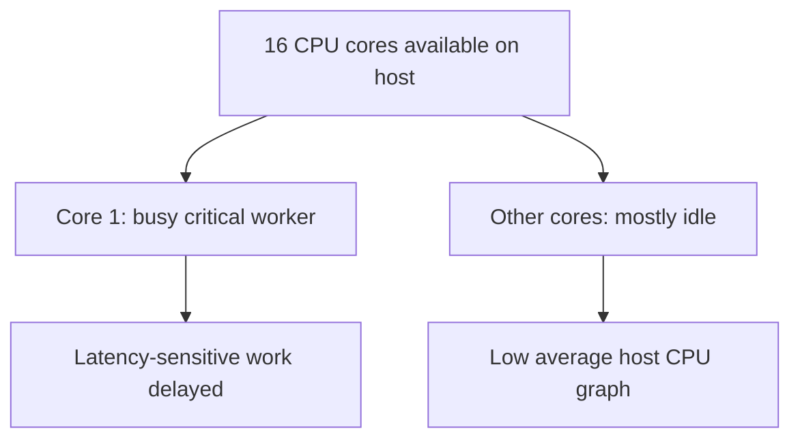
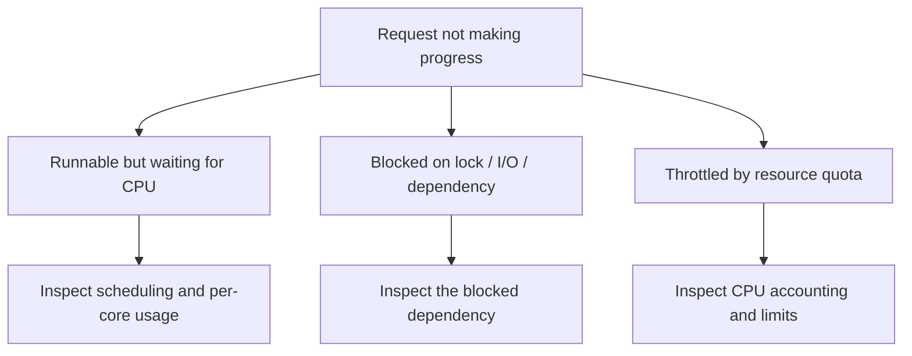

# CS320 — Operating Systems, Concurrency, and Runtimes

## Lecture 04: Scheduling, CPU Time, and Contention

*Why a sixteen-core server with low average CPU usage can still leave one worker experiencing severe response delays.*

**Estimated study time:** 75–95 minutes, including the optional practical lab.

---

### How to listen to this lecture

This lecture has two progressive parts.

**Part I — Intuition** establishes the mental picture: processes competing for CPU time, the difference between being ready and actually executing, and why the resources available to one application may be much smaller than the machine appears to possess.

**Part II — Deep Dive** develops that picture into a practical model of Linux scheduling, process states, run queues, context switching, CPU affinity, cgroup quotas, contention, and production diagnosis.

Our recurring mystery is a worker that takes several hundred milliseconds to complete work requiring only a few tens of milliseconds of CPU time.

The fundamental question is:

**If the processor is fast and the machine looks idle, where did the missing time go?**

---

# Part I — Intuition

*A sixteen-core server looks nearly idle, yet one application thread struggles to get timely CPU service. The missing picture is a waiting line for processor time.*

### The picture to carry in your head

Imagine an office with sixteen meeting rooms and dozens of employees. Most rooms are empty. Yet one team complains that it cannot finish its work because everyone on the team needs the **same** locked conference room.

A dashboard reporting average room occupancy says the building is almost unused. That's true for the building as a whole, but it tells us very little about the room this team needs.

CPU utilization behaves similarly. Sixteen cores can be only lightly used on average while one critical execution thread is saturated, delayed by a CPU quota, or waiting to be scheduled. The whole-machine average can conceal a local bottleneck.

The opening diagram shows why averaging every core can make one busy execution lane disappear into a reassuring dashboard value.



### 1. Runnable does not mean running

Picture a receptionist whose job is ready. The paperwork is on her desk, the customer is waiting, and nothing else is missing. But the manager hasn't assigned her a counter yet.

A thread in the **runnable** state is similar: it has work to execute but may be waiting for processor time. A thread that's **blocked** waiting for disk, a lock, or a network event isn't in the same situation. It might not be ready to use a CPU at all.

The operating system's scheduler decides which runnable threads execute on which available processors. On a busy machine, it gives work turns, may interrupt a running thread, and must balance throughput, responsiveness, and other policies.

A **context switch** is part of moving execution between contexts. It requires bookkeeping and may disturb CPU cache locality. Scheduling is necessary, but it isn't free.

Two different waiting times therefore matter: waiting because an external condition hasn't completed and waiting because work is ready but no permitted processor time is available.

**Checkpoint:** If an application thread is ready to run but hasn't been scheduled, is it necessarily waiting for a network response? No. It may simply be waiting for CPU service.

### 2. The machine can own cores you are not allowed to use

Now put our application in a container. The host has sixteen cores, but the container may have a CPU quota equivalent to substantially fewer cores over the relevant accounting periods.

Our service can see host capacity while being restricted by its own resource budget. During a burst, the process may consume its permitted CPU time and then be **throttled** until more becomes available. The host can still show unused capacity elsewhere.

This is like a company renting one hour of conference-room access per day in an enormous building. Empty rooms don't automatically grant extra rental time.

Alternatively, the application may be pinned to only certain cores, or a single-threaded critical path may not be distributable across all available cores. Adding more host processors won't accelerate a calculation that must execute serially on one thread.

The correct capacity question isn't merely, “How many cores exist?” It's, “Which execution resources can this workload actually use, and what is waiting for them?”

### 3. More workers can mean more waiting

Suppose a service has four CPU-intensive threads and four cores available for their work. They may make efficient progress.

Now launch two hundred equally CPU-intensive threads. The number of cores hasn't changed. The scheduler has more runnable work to juggle; context switching and contention may rise, while each thread gets less continuous time.

Sometimes more threads help because many spend most of their time waiting. Sometimes they hurt because all compete for the same finite CPU or shared lock. There's no universal best thread count independent of workload.

And scheduling priorities can introduce subtler failures. Imagine a high-priority task waiting for a lock held by a low-priority task. If other work prevents the lock holder from running, the high-priority task can effectively be delayed by lower-priority work. This is the intuition behind **priority inversion**.

The second diagram distinguishes three very different reasons that a customer-facing request might not progress. Diagnosis begins by identifying which waiting line it joined.



### 4. The minute-long replay

A busy worker is one bottleneck inside a large, apparently idle host. The scheduler chooses when runnable work executes. A container may restrict which CPU time that work can consume. More threads may increase competition without increasing capacity. And a request that's slow because of a lock requires a different fix from one that's waiting for processor time.

L04's Deep Dive will give the machinery names—preemption, context switching, affinity, quotas, fair scheduling, priority inversion—but the story remains one office with more work ready than the relevant room or budget can handle.

### Three questions before the Deep Dive

1. **Why can one core be saturated while average host CPU is low?** The average combines busy and idle execution resources.
2. **What is the difference between runnable and running?** Runnable means eligible and ready; running means currently executing on a processor.
3. **Why might doubling application threads make latency worse?** More contenders can increase scheduling and lock contention without adding capacity.

*The intuition pass ends here.*

---

# Part II — Deep Dive

# 1. Sixteen Cores, Eight Percent CPU, and a Worker That Barely Moves

It's Monday morning, and your document-processing service has a problem.

The service runs in a Docker container on a Linux server with sixteen logical CPUs. Customers upload documents, and a worker extracts text, calculates some statistics, and writes the results to a database.

On your development machine, a typical document takes approximately forty milliseconds of CPU work.

In production, similar documents occasionally take three hundred milliseconds to finish.

You inspect the machine.

Host CPU utilization is around eight percent.

Memory usage looks healthy.

Disk activity is unremarkable.

The Node.js process is alive, and the application logs show no exceptions.

Naturally, someone proposes adding more worker threads.

Someone else suggests buying a larger server.

But consider the evidence.

If the worker really requires forty milliseconds of CPU computation, why is its response time approaching three hundred milliseconds?

The first possibility is that it performs more work than we think.

Perhaps the production data is different.

Perhaps there is a hidden expensive loop.

Perhaps garbage collection is consuming time.

But there's another possibility.

**The worker may be spending most of its elapsed time not executing its own instructions at all.**

This is the essential distinction between CPU time and wall-clock time.

We'll investigate the worker's execution timeline, the operating system's scheduling decisions, and the resource restrictions surrounding the container.

By the end, we'll reconstruct the incident without resorting to random restarts or blind resource increases.

---

# 2. Your Program Lives in Two Different Kinds of Time

Imagine a function that begins at noon and finishes one second later.

How much CPU time did it consume?

You cannot answer from those timestamps alone.

Perhaps the function performed calculations continuously for the entire second.

Perhaps it initiated a network request, waited nine hundred milliseconds, and used only a few milliseconds of CPU time.

Perhaps it was ready to execute but spent much of the second waiting for a scheduler to assign it a processor.

Or perhaps its container exhausted its CPU quota halfway through the operation.

The duration you observe on a clock is **wall-clock time**.

The time the operating system accounts to your process or thread while it actually executes on a CPU is **CPU time**.

They measure different things.

## 2.1 The execution timeline

Let's invent a simplified worker operation.

The request enters the application.

It spends twenty milliseconds running calculations.

Then it waits sixty milliseconds for another condition.

Then it becomes runnable but waits thirty milliseconds before receiving processor time.

Finally, it performs another twenty milliseconds of calculations.

The elapsed time is one hundred thirty milliseconds.

The actual CPU time is forty milliseconds.

The missing ninety milliseconds weren't necessarily spent performing instructions.

They were spent waiting.

But even the word "waiting" contains several distinct mechanisms.

Waiting for a network response isn't the same as waiting for a mutex.

And waiting for a mutex isn't the same as being ready to run but not getting CPU service.

Here's a simplified accounting picture:

```text
WALL CLOCK: 130 ms

[ running ][ blocked ........ ][ runnable, queued ... ][ running ]
   20 ms           60 ms                30 ms              20 ms

CPU SERVICE:       40 ms
BLOCKED WAIT:      60 ms
RUNNABLE WAIT:     30 ms
```

The precise timing categories used by monitoring tools depend on what they measure, and asynchronous applications may contain overlapping waits.

But this example gives us a powerful diagnostic principle.

**Slow response time does not tell us whether the application is consuming CPU, waiting for CPU, or waiting for something else.**

We must distinguish those possibilities before choosing an optimization.

## 2.2 CPU time can exceed wall time

There's another surprising consequence.

Suppose a process runs four CPU-intensive threads simultaneously on four cores.

During one second of real elapsed time, each thread might accumulate approximately one second of CPU time.

The process can therefore accumulate around four CPU-seconds during one wall-clock second.

This is why per-process CPU percentages can exceed one hundred percent in monitoring tools whose convention treats one fully occupied logical CPU as one hundred percent.

A process showing four hundred percent CPU usage in that convention isn't breaking physics.

It's using approximately four logical processors' worth of execution capacity.

Monitoring tools may normalize percentages differently, so always check their accounting convention.

The broader lesson is to avoid interpreting a CPU percentage without understanding its denominator.

---

# 3. Processes, Threads, and the Scheduler's Actual Subjects

Before understanding scheduling, we need to know what gets scheduled.

In everyday language, developers often say:

"The operating system schedules processes."

That's broadly understandable, but for Linux it's more precise to speak about schedulable tasks, which commonly correspond to threads.

A process may contain several threads.

Those threads can execute different parts of the process's work.

Each has relevant execution state and scheduling information.

The operating system decides when eligible tasks execute on available logical CPUs.

## 3.1 Three important execution states

At the conceptual level, we care about three situations.

**Running:** A task is currently executing on a processor.

**Runnable:** A task is ready to execute but is not currently receiving processor time.

**Blocked or sleeping:** A task isn't presently eligible to run because it's waiting for an event, a lock, an I/O operation, or another condition.

Linux exposes several task-state codes.

For example, `R` commonly covers both actually running and runnable tasks.

`S` represents interruptible sleep.

`D` represents uninterruptible sleep, often associated with I/O or other kernel waits.

There are additional states for stopped, traced, and terminated tasks.

Do not confuse these codes with a complete performance diagnosis.

Seeing `R` does not, by itself, distinguish a task executing at that instant from one waiting on a run queue.

And seeing a sleeping state does not automatically explain what resource the task is waiting for.

The state is a clue.

We still need evidence about the specific wait.

## 3.2 A runnable thread can be perfectly healthy

Imagine a background worker has completed an asynchronous database request.

The result is ready.

The worker's continuation becomes eligible to run.

But the processor it can use is occupied.

The worker waits briefly.

There's nothing inherently broken about this.

Schedulers routinely coordinate more runnable tasks than available execution slots.

Problems arise when runnable waiting becomes substantial relative to the application's latency requirement.

A delay that is irrelevant for a nightly batch job may be disastrous for a latency-sensitive HTTP handler.

The same scheduler behavior can be acceptable or unacceptable depending on the workload.

---

# 4. What Scheduling Is Actually Trying to Accomplish

Imagine the operating system has eight runnable tasks and four logical CPUs.

It cannot execute all eight tasks simultaneously if each needs continuous use of a logical CPU.

Some tasks must wait.

The scheduler determines which tasks run, where they run, and when execution should switch.

But what objective should it optimize?

Maximum throughput?

Fairness?

Low interactive latency?

Predictable deadlines?

Avoiding starvation?

These goals sometimes conflict.

## 4.1 An impossible scheduler

Imagine a hypothetical scheduler that always allows the currently running CPU-intensive task to continue until it finishes.

That minimizes certain switching costs.

But what if the task never finishes?

Other runnable work could starve indefinitely.

Now imagine a scheduler that switches tasks after every instruction.

Responsiveness might seem excellent.

But the overhead of switching would be enormous.

Actual schedulers seek workable compromises.

They divide processor time among eligible tasks, respect relevant priorities and policies, and try to make useful progress without spending excessive resources on scheduling itself.

## 4.2 Fair scheduling

Linux has long used sophisticated fair-scheduling mechanisms for ordinary tasks.

The classic Completely Fair Scheduler, or CFS, is often explained through **virtual runtime**.

Imagine keeping a ledger for each runnable task.

Instead of recording only how much raw time it has executed, we account for execution in a way that reflects its scheduling weight.

A task that has received comparatively less service may become a good candidate to run.

This helps approximate a fair distribution of processor time.

The idea is not that every runnable task receives exactly equal wall-clock time.

Priorities, weights, eligibility, task behavior, CPU availability, and other constraints matter.

The important concept is that a scheduler can use accounting to avoid giving one ordinary task unlimited service while others wait.

## 4.3 Modern Linux: EEVDF

Here we need an up-to-date distinction.

Linux began transitioning toward **Earliest Eligible Virtual Deadline First**, or EEVDF, in the Linux 6.6 era.

EEVDF develops the fairness model using concepts such as virtual service, lag, eligibility, and virtual deadlines.

At a high level, it tracks whether eligible work has received an appropriate share of processor service and uses virtual deadlines when selecting tasks.

This can help balance fairness with responsiveness for workloads that benefit from relatively short execution slices.

You do not need to reproduce its equations to diagnose most application incidents.

And it's a mistake to assume that every Linux host in production runs the same scheduler implementation simply because the textbook described CFS.

Kernel versions, scheduling classes, distribution patches, and configuration matter.

The useful engineering picture is simpler:

**The scheduler chooses among eligible tasks using a defined policy. Runnable waiting is a measurable consequence of those choices and the available capacity.**

## 4.4 Real-time scheduling is a different contract

Linux also supports scheduling classes intended for workloads with different priority or timing requirements.

For instance, certain real-time policies can give eligible real-time tasks precedence over ordinary fair-scheduled tasks.

That can be useful in specialized environments.

But it can also cause severe starvation if misconfigured.

Changing an ordinary backend worker to a real-time scheduling policy is not a sensible first response to unexplained latency.

Before changing scheduling priorities, we should understand the current workload and the actual source of its delay.

---

# 5. Preemption: The Operating System Can Interrupt Your Work

Suppose a CPU-intensive task is executing.

Another task becomes runnable.

Perhaps it has been waiting for some time.

Perhaps it is latency-sensitive.

Perhaps scheduling policy gives it a higher priority.

Does the first task necessarily continue until it voluntarily yields?

Not on a preemptive operating system.

The scheduler may arrange for a running task to be interrupted so another task can execute.

This is called **preemption**.

The details depend on the scheduling policy, current execution context, kernel preemption behavior, and other factors.

But the important property is that a task doesn't have unlimited ownership of a logical CPU merely because it started running.

## 5.1 Why preemption matters

Imagine a desktop operating system.

A video encoding program is consuming substantial CPU.

You move the mouse and open a menu.

You expect the interface to respond even though the encoding program still has work to do.

The scheduler must support appropriate responsiveness.

Preemption helps make this possible.

In a backend server, similar considerations arise when latency-sensitive request handlers share computing resources with background calculations.

A long-running computational task should not necessarily prevent all other eligible work from progressing.

## 5.2 Context switching

When the CPU stops executing one task and begins another, execution context must be managed.

The operating system preserves or restores information required for each task to continue correctly.

This includes architectural processor state and other relevant scheduling information.

The operation is commonly described as a **context switch**.

Context switches have costs.

There is bookkeeping.

There may be disruption to cache locality.

Depending on the tasks and architecture, memory-translation and other processor state can be affected.

But context switching is not automatically the primary cause of latency.

A modest number of context switches is normal.

We should investigate them when evidence suggests excessive scheduling overhead or contention.

Not because their existence is inherently suspicious.

## 5.3 Voluntary and involuntary switches

A task may stop running voluntarily because it blocks or otherwise yields.

Or it may be preempted involuntarily.

Those events have different meanings.

A service that frequently blocks on a database connection may exhibit many voluntary switches.

A heavily contested CPU may involve significant involuntary preemption.

But counters alone don't diagnose the problem.

We need to connect scheduling observations with CPU time, runnable delays, blocked waits, and the application's workload.

---

# 6. Sixteen Cores Do Not Mean Sixteen Cores for Your Critical Path

Let's return to our production server.

It has sixteen logical CPUs.

Surely that should be enough for one document-processing worker.

But there are several reasons this reasoning can fail.

## 6.1 One serial task cannot consume every core simultaneously

Suppose our worker performs a single long-running sequential calculation.

At any given moment, one execution thread performs the relevant instructions.

Even if the machine has sixteen logical CPUs, this task cannot automatically distribute its computation across them.

It may fully occupy one logical CPU while the remaining fifteen are idle.

Under a simple normalization across sixteen equally capable logical CPUs, that can appear as approximately 6.25% aggregate CPU utilization.

A dashboard displaying six or seven percent CPU might therefore describe a completely saturated single-threaded critical path.

The machine isn't globally overloaded.

The relevant execution lane is fully occupied.

This is why per-core and per-thread measurements are important.

## 6.2 CPU affinity

A thread may be restricted to particular CPUs.

On Linux, CPU affinity determines which logical CPUs a task is allowed to execute on.

This can be configured deliberately.

It may also be constrained by container or cgroup placement, orchestration rules, or external system configuration.

Imagine a process with several runnable threads but an affinity mask allowing execution only on one logical CPU.

The host may have many idle CPUs.

The scheduler cannot simply move the restricted threads to any of them.

We have a localized execution bottleneck.

Before recommending more hardware, inspect which CPUs the workload can actually use.

## 6.3 Logical CPUs aren't always equal to independent cores

A server advertised as having sixteen logical CPUs may use simultaneous multithreading.

Two logical CPUs can share execution resources within one physical core.

The exact arrangement depends on processor architecture.

Therefore, sixteen logical CPUs do not necessarily provide sixteen times the throughput of one logical CPU for a given workload.

Cache contention, memory bandwidth, shared execution resources, and CPU frequency behavior also influence scaling.

For application diagnosis, this means that counting logical CPUs is a starting point, not a complete capacity model.

---

# 7. CPU Quotas: The Container With Half a Processor

Now we reach the most interesting part of our mystery.

Our application runs inside a container.

The host has sixteen logical CPUs.

But the container has a CPU quota.

On Linux systems using cgroup v2, the CPU controller exposes a file named `cpu.max`.

This file contains a maximum CPU bandwidth value and an accounting period.

For example:

`50000 100000`

The values are expressed in microseconds.

Conceptually, this configuration allows fifty thousand microseconds of aggregate CPU runtime per one-hundred-thousand-microsecond period.

That's fifty milliseconds of CPU runtime per one-hundred-millisecond period.

In the steady-state capacity sense, it is equivalent to **half a logical CPU's worth of aggregate runtime**, although the work need not execute on only one specific CPU.

That's a critical distinction.

## 7.1 The quota isn't necessarily one physical CPU

Imagine the container has two CPU-intensive threads.

The scheduler may run them simultaneously on two logical CPUs, subject to the relevant scheduling and CPU restrictions.

If both run for twenty-five milliseconds, together they have consumed fifty milliseconds of CPU time.

The container has exhausted its quota for the period.

Its fair-scheduled tasks may then be throttled until more budget becomes available.

So two threads can burn a fifty-millisecond aggregate budget in approximately twenty-five milliseconds of wall-clock time.

Then both may be forced to wait.

The rest of the host can be almost completely idle.

The diagram shows one possible accounting period.

```text
CPU BUDGET: 50 ms per 100 ms period

Wall time             0 ms                25 ms                 100 ms
                      |--------------------|----------------------|

Thread A              [ 25 ms CPU work ][ throttled .............]
Thread B              [ 25 ms CPU work ][ throttled .............]

Aggregate CPU used:     50 ms
Budget remaining:        0 ms

HOST:
Other logical CPUs may remain idle throughout.
```

The exact timing depends on the workload and scheduling details.

But the principle is fundamental.

**CPU quota limits aggregate processing time over an accounting period, not necessarily the number of CPU cores a task may briefly occupy.**

## 7.2 Why latency comes in bursts

Now suppose an incoming request needs forty milliseconds of CPU work.

If sufficient budget is available, it may finish promptly.

But imagine the container has already consumed most of its quota serving earlier requests.

The new request begins.

A few milliseconds later, the remaining budget is exhausted.

The application must wait until the appropriate budget becomes available.

The request's wall-clock latency increases even though its required CPU work hasn't changed.

This can produce periodic latency spikes.

The delay may appear correlated with traffic bursts.

And increasing the application's HTTP timeout merely allows the request to wait longer.

It does not change the CPU allocation mechanism.

## 7.3 The utilization paradox

Suppose our container is allowed half a logical CPU's worth of runtime on a sixteen-logical-CPU host.

If the container continuously consumes its entire quota, its aggregate CPU usage represents only about 3.125% of the host's theoretical sixteen-CPU capacity under simple normalization.

Yet the container is completely saturated relative to its allocation.

The host dashboard can be green.

The container can be struggling.

Both observations can be correct.

This is why an application engineer must distinguish **host capacity** from **workload entitlement**.

---

# 8. CPU Quotas Versus CPU Weights

Now imagine two containers sharing a host.

One has a high scheduling weight.

The other has a lower weight.

What does that mean?

It's not the same as giving one container a strict CPU quota.

## 8.1 CPU weight is a relative preference

In cgroup v2, `cpu.weight` expresses a relative distribution preference among relevant competing cgroups under the applicable scheduler.

The default weight is commonly one hundred, within the documented permitted range.

When groups compete for a limited CPU resource, their weights can influence how that resource is shared.

But a lower weight doesn't necessarily mean a container is forbidden from using otherwise idle CPU capacity.

A weight is a relative scheduling control.

A bandwidth quota is a maximum accounting constraint.

Those are different mechanisms.

## 8.2 Why the distinction matters in Kubernetes

In Kubernetes, CPU requests and limits are related but distinct.

CPU requests influence resource planning and scheduling, and may influence relative CPU-sharing behavior through underlying controls.

CPU limits ordinarily create a maximum CPU usage constraint, commonly enforced through cgroup CPU bandwidth mechanisms on Linux.

A workload with a low CPU limit can be throttled even when the node has spare CPU.

A workload with a lower request but no restrictive CPU limit may be able to use additional available CPU resources when conditions permit.

The actual behavior depends on platform configuration, runtime, cgroup version, and scheduler implementation.

But the diagnostic question remains stable:

**Is the process competing for CPU with other tasks, or is it being prevented from using available CPU because of a configured limit?**

Different answers imply different solutions.

---

# 9. The Run Queue: Ready Work That Isn't Executing

Suppose a task becomes runnable.

But every CPU it may use is occupied with other eligible work.

The task waits.

The scheduler manages runnable tasks through appropriate queueing and accounting structures.

The exact structures depend on the scheduling class and kernel implementation.

For ordinary application diagnosis, we can think of a **run queue** as the set of tasks eligible for CPU service that haven't necessarily received it yet.

The important measurement is not simply how many tasks exist.

It's how much runnable work is competing for the available CPU resources, and how long tasks wait before executing.

## 9.1 Scheduler latency

Imagine a task is awakened at time zero.

It becomes eligible to execute.

But it doesn't actually start running until fifteen milliseconds later.

That fifteen milliseconds is a form of **scheduler delay** or runnable waiting time.

In a latency-sensitive request, it can be significant.

If this happens repeatedly, a tiny amount of application computation may produce unexpectedly long wall-clock durations.

Some Linux tracing and performance tools can observe scheduling events and estimate this delay.

For example, `perf sched` supports analysis of runnable-to-running delays.

Such tools help distinguish scheduling latency from time actually spent executing instructions.

## 9.2 CPU pressure

Linux also provides Pressure Stall Information, or PSI.

CPU pressure helps describe time during which tasks are stalled because CPU service is not immediately available.

For example, Linux exposes relevant system-level information through `/proc/pressure/cpu`, and cgroup-level CPU pressure may be available through cgroup interfaces.

The familiar `some` measure indicates periods when at least some runnable work is stalled waiting for CPU.

It's a different observation from aggregate CPU utilization.

High utilization says substantial CPU service is being consumed.

CPU pressure indicates that tasks are experiencing CPU-related waiting.

Those are related, but they're not interchangeable.

A system can have uneven per-core contention or restricted workloads even when overall host utilization appears modest.

## 9.3 Pressure and throttling require separate evidence

Be careful not to treat every scheduling delay as proof of global CPU shortage.

A container may be throttled by its quota.

A thread may have a restrictive affinity mask.

A workload may face competition within a subset of CPUs.

A high-priority task may interfere with ordinary scheduling.

These situations can produce delays with different resource availability and policy constraints.

Investigate pressure metrics alongside per-thread activity, affinity, and cgroup accounting.

The goal is to locate the restriction actually affecting the workload.

---

# 10. Oversubscription: More Workers Than Useful Execution Capacity

Now management asks whether we should double the worker count.

Let's think carefully.

Suppose the application has four CPU-intensive workers and enough execution capacity for four to make progress simultaneously.

Adding workers may not improve throughput significantly.

The CPU capacity is already occupied.

Now imagine increasing the worker count to thirty-two while keeping the same usable CPU capacity.

The scheduler has many more runnable tasks to coordinate.

Context switching may increase.

Caches may become less effective.

Shared data structures may experience greater contention.

And each worker may spend more time waiting for CPU service.

The application can become less responsive without processing more work per second.

## 10.1 Throughput versus response latency

This distinction matters.

An increase in worker count may initially improve throughput.

But near saturation, queueing delays can grow rapidly.

New requests wait behind existing work.

If the service accepts work without sufficient admission control, latency may become extremely high.

At some point, the application may simply accumulate an expanding backlog.

A large runnable set can be a symptom of overload.

But a large number of sleeping or waiting threads doesn't necessarily create the same CPU pressure.

For I/O-heavy workloads, many tasks may be waiting for external events rather than competing for continuous CPU execution.

Therefore, thread count alone is not a reliable measure of CPU overload.

We must know how many tasks are runnable and what they are doing.

## 10.2 Worker pools as admission control

A bounded worker pool limits how many computational tasks execute or compete at once.

This can reduce unnecessary contention.

It can also create an explicit queue where pending work waits before consuming execution resources.

That makes load easier to manage.

But the pool must be sized for the actual workload.

A CPU-heavy batch processor and a service dominated by network waits may require different strategies.

A universal rule such as "number of workers equals number of cores" is too simplistic.

We should benchmark useful throughput and tail latency while observing CPU utilization, waiting, and contention.

---

# 11. Locks: The Thread That Isn't Waiting for CPU at All

Now suppose our worker is slow, but scheduler-delay measurements don't show a significant runnable wait.

Perhaps it's blocked on a lock.

Imagine two threads sharing a cache.

One thread acquires a mutex, updates the cache, and releases the lock.

Another thread needs the same mutex.

Until the first thread releases it, the second cannot enter the protected section.

It might sleep rather than actively consume CPU.

From the application's perspective, the second operation is delayed.

But buying a faster processor may not solve the fundamental problem.

The contention is over **exclusive access to a shared resource**.

## 11.1 Lock contention and CPU contention are different

A thread waiting for a mutex is often not runnable for ordinary CPU execution.

A thread waiting on a run queue is runnable but not currently executing.

The distinction matters operationally.

The first problem may require reducing critical-section duration, changing the locking design, or reducing shared-state contention.

The second may require correcting CPU allocation, affinity, worker concurrency, or other scheduling constraints.

The same symptom—slow requests—can arise from either.

## 11.2 Priority inversion

Consider three tasks.

A low-priority task acquires a lock.

A high-priority task needs that lock and blocks.

Meanwhile, medium-priority work consumes processor time and prevents the low-priority lock holder from executing promptly.

The high-priority task is effectively delayed by the low-priority task.

This is **priority inversion**.

It sounds paradoxical because the high-priority task should ordinarily receive favorable CPU service.

But scheduling priority doesn't let it bypass a lock it must acquire.

Some synchronization mechanisms support **priority inheritance**, allowing relevant priority information to influence the lock holder while the contention exists.

The exact guarantees depend on the operating system and lock primitive.

Ordinary application mutexes should not be assumed to provide every possible priority-inheritance behavior.

The broader lesson is that scheduling priority and synchronization dependencies interact.

Changing one without understanding the other can make a system harder to reason about.

---

# 12. Context Switching: Necessary Work That Can Become Expensive

Let's return to context switching.

It's easy to imagine that each context switch is a catastrophic operation.

In practice, operating systems perform context switches constantly.

They're a normal part of multitasking.

The problem isn't that context switches exist.

The problem arises when the application spends excessive resources switching and coordinating relative to useful computation.

## 12.1 The tiny-task problem

Imagine each pricing job performs only a few microseconds of useful work.

We assign every job to a new thread.

We coordinate startup, scheduling, completion, and result collection for millions of jobs.

The overhead may dominate.

Now imagine grouping those pricing operations into larger chunks.

The amount of arithmetic hasn't changed.

But the system performs far fewer scheduling and coordination operations.

That can improve throughput.

This is why granularity matters.

A good unit of parallel work is large enough to amortize coordination cost.

But not so large that it leaves most execution capacity idle or creates unacceptable latency.

## 12.2 Cache locality

A processor may keep recently used data in fast caches.

If a task repeatedly executes on a processor where relevant data remains cached, that can improve performance.

Frequent migration between processors or competition with other tasks can disturb locality.

This doesn't mean CPU affinity is always desirable.

Pinning tasks can reduce scheduling flexibility and create hotspots.

We should use affinity deliberately, with evidence about the workload's behavior.

A scheduler must balance locality against fairness and load distribution.

The right compromise depends on the machine and workload.

---

# 13. Why the Event Loop Can Look Like a Scheduler Problem

Let's connect this to Node.js.

Our document-processing application runs a Node.js service.

The team measures HTTP latency and discovers that the event loop sometimes responds slowly.

They immediately suspect CPU throttling.

That may be correct.

But event-loop delay has several possible causes.

## 13.1 The application blocks its own event loop

Imagine a synchronous JavaScript function performing one hundred milliseconds of CPU work.

The event loop cannot execute other ordinary JavaScript callbacks on that same thread during the computation.

The application has created its own scheduling bottleneck.

The operating system may be giving the thread plenty of CPU service.

The problem is that the application's thread spends that service executing the wrong work for the latency requirements of incoming requests.

The fix may involve moving CPU-heavy work to a worker pool, reducing its computational cost, or restructuring the application.

Increasing a container CPU quota won't automatically allow multiple callbacks to execute simultaneously on one JavaScript thread.

## 13.2 The event loop is ready but the OS delays it

Now imagine the main JavaScript thread becomes runnable after an asynchronous operation completes.

The continuation is ready.

But the container has exhausted its CPU quota.

The thread cannot execute until it receives additional CPU service.

From the application's perspective, the event loop is delayed.

But the immediate cause lies in resource allocation rather than a long synchronous callback.

The fix may involve correcting the quota, reducing aggregate CPU demand, or changing deployment capacity.

## 13.3 A third possibility: the event loop waits for something

The application may also be waiting for a blocking operation, native extension, lock, or external dependency.

Different APIs have different execution paths.

Some asynchronous operations rely on operating-system event notification.

Others may use native worker-pool threads.

Some synchronous operations execute directly in a way that blocks the main JavaScript thread.

We need to know which path the application actually uses.

This foreshadows CS320-L06, where we'll trace asynchronous I/O through runtime and kernel mechanisms.

For now, remember:

**Event-loop delay is a symptom. The cause might be synchronous application work, scheduler delay, resource throttling, or another blocked dependency.**

---

# 14. How to Investigate Scheduling Without Guessing

Let's build a practical diagnostic framework.

Our production worker is slow.

The host dashboard says CPU usage is low.

What should we measure?

Begin by separating the time categories.

## 14.1 Step one: establish the actual latency

Capture the end-to-end request duration.

Then inspect the application's major stages.

How long does it spend parsing the document?

How long calculating results?

How long waiting for database operations?

How long waiting for a worker to become available?

Where does the delay appear?

A single request duration is insufficient.

We need stage boundaries.

## 14.2 Step two: measure CPU consumption

Look at per-process and, where appropriate, per-thread CPU activity.

Is one thread saturating a logical CPU?

Are several threads consuming CPU simultaneously?

Does aggregate CPU time increase in proportion to wall-clock time?

Is the process mostly blocked?

If a request takes three hundred milliseconds but consumes only forty milliseconds of CPU, we need to investigate the remaining elapsed time.

If it consumes approximately three hundred milliseconds of CPU on one thread, the problem may be computational rather than scheduling.

## 14.3 Step three: inspect the available execution resources

How many logical CPUs exist?

How many may this task use?

Is CPU affinity restricted?

Are cpuset constraints present?

Does the container have a CPU quota?

Is there a parent cgroup imposing an additional limit?

These questions determine whether the workload can actually use the resources visible on the host.

A process may have abundant host CPU capacity available in theory but far less capacity permitted by its execution environment.

## 14.4 Step four: inspect throttling

On cgroup v2 systems, relevant files commonly include `cpu.max` and `cpu.stat`.

The latter provides CPU usage accounting and, when applicable, throttling counters such as `nr_throttled` and `throttled_usec`.

A rising throttling count under load is evidence that the cgroup has been affected by CPU bandwidth restrictions.

But don't convert `throttled_usec` blindly into a request's wall-clock delay.

Accounting details and concurrent execution can make those interpretations misleading.

Also, hierarchical cgroup restrictions matter: a parent cgroup can impose constraints not obvious from one child's local counters.

Use these statistics together with the quota configuration, request timing, and runtime behavior.

## 14.5 Step five: inspect runnable waiting and pressure

If the workload isn't obviously quota-throttled, investigate scheduler delays.

Are threads runnable but waiting?

Are only certain logical CPUs overloaded?

Does CPU pressure rise?

Is the process competing with unrelated workloads?

Can scheduler tracing show substantial time between becoming runnable and actually executing?

These observations help distinguish local scheduling contention from other forms of waiting.

## 14.6 Step six: inspect blocked dependencies

If the thread isn't using CPU and isn't accumulating runnable waiting, ask what it's blocked on.

A mutex?

A condition variable?

Disk I/O?

A network operation?

A database query?

A worker-pool queue?

Application traces, thread stacks, system-call observations, and appropriate runtime metrics may help.

The distinction between *blocked* and *runnable but waiting* is central.

Only after identifying the actual waiting mechanism should we decide whether the solution involves more CPU, fewer workers, different synchronization, or an application change.

---

# 15. The Production Mystery, Reconstructed

Let's return to the sixteen-core server.

The document-processing worker takes roughly three hundred milliseconds to complete some operations.

The host reports approximately eight percent CPU utilization.

The team initially suspects poor performance or underutilized hardware.

You collect more evidence.

The document-processing code still requires about forty milliseconds of CPU time for a representative input.

The worker is not spending hundreds of milliseconds actively computing.

The application's container has a CPU quota configured through the cgroup hierarchy.

The visible configuration permits only a fraction of a logical CPU's sustained aggregate runtime.

The application also has several other active threads competing within that same quota.

During bursts, the container consumes its CPU budget quickly.

The kernel throttles the relevant fair-scheduled work until more budget becomes available.

Meanwhile, most of the host's logical CPUs remain underutilized.

The result is entirely consistent.

A healthy sixteen-core server.

A container with a restrictive CPU budget.

A worker that needs additional processor time.

And a request that spends far more wall-clock time waiting than performing useful computation.

## 15.1 Why adding workers makes it worse

The team had proposed doubling the worker count.

That would allow even more runnable computations to compete for the same aggregate quota.

It wouldn't increase the quota.

It might burn the available CPU budget more quickly.

It could increase contention and scheduling overhead.

The proposed optimization targets the wrong constraint.

## 15.2 The appropriate fix

First, validate whether the CPU quota is intentional and whether it matches the workload's legitimate resource requirements.

Perhaps the service was configured using a limit appropriate for an earlier version of the application.

Perhaps a Kubernetes CPU limit was copied from a lightweight API deployment and applied to a CPU-intensive processor.

Perhaps the worker pool was expanded without revisiting resource allocation.

A reasonable remedy may be to allocate an appropriate CPU budget, separate CPU-heavy work from latency-sensitive request handling, and establish bounded concurrency.

But the exact fix requires capacity measurements.

Simply removing every limit can create noisy-neighbor problems elsewhere.

The goal is to allocate resources according to the workload rather than hide the constraint.

## 15.3 Prove the fix

After adjusting the configuration, repeat a representative load test.

Compare request latency.

Compare CPU consumption and throttling statistics.

Observe per-thread activity and runnable delays.

Check whether throughput improved or whether another bottleneck emerged.

Verify that other workloads sharing the node remain healthy.

Only then can we say the diagnosis was supported.

The underlying principle is more important than the particular configuration change.

**We didn't make the CPU faster. We identified why the application couldn't use the CPU time it needed.**

---

# 16. A Senior Engineer's Decision Framework

When a service is slow, resist the urge to collapse every problem into "CPU" or "not CPU."

There are several distinct questions.

Is the program performing too much computation?

Is the computation concentrated in one serial execution thread?

Is the thread runnable but waiting for CPU service?

Is CPU affinity restricting where it can run?

Is a cgroup quota restricting how much execution time it can consume?

Is the thread blocked on synchronization?

Is the application waiting for I/O?

Is it spending excessive time coordinating an oversized worker pool?

Or is the external dependency simply slow?

These aren't interchangeable diagnoses.

They lead to different interventions.

The strongest engineering habit is to identify **which resource or condition prevents the next unit of useful work from progressing**.

Sometimes the answer is processor capacity.

Sometimes it is permission to use that capacity.

Sometimes it is a lock.

Sometimes it is a network response.

And sometimes the application has created its own queue by choosing an unsuitable execution model.

Knowing the difference is what turns performance investigation from guesswork into engineering.

---

# 17. The Oral Examination

Answer these aloud before reading the solutions. Avoid naming a tool as your entire answer; explain the mechanism you would investigate.

### Challenge A — The Six-Percent CPU Mystery

A sixteen-logical-CPU host reports approximately six percent overall CPU utilization.

A CPU-heavy single-threaded worker cannot process requests any faster.

How can both observations be correct?

Would adding another sixteen logical CPUs necessarily help?

### Challenge B — Runnable Versus Blocked

Two requests take two hundred milliseconds.

Request A's thread was ready to execute but spent most of the time waiting for CPU service.

Request B's thread was blocked waiting for a database response.

What evidence would distinguish them?

Would increasing the CPU quota help both?

### Challenge C — The Half-CPU Container

A container uses cgroup v2 with `cpu.max` configured as `50000 100000`.

The host has sixteen logical CPUs.

Two CPU-intensive worker threads run concurrently.

How can they exhaust their quota in substantially less than one hundred milliseconds of wall-clock time?

Why might the host remain mostly idle?

### Challenge D — Weight Versus Quota

Two containers have different `cpu.weight` values.

Neither has a restrictive CPU quota.

Only one container is currently active.

Must the lower-weight container remain restricted to a small fraction of the host's CPU?

Explain the difference between relative sharing and a hard CPU bandwidth limit.

### Challenge E — More Threads, Worse Latency

A service increases its worker pool from eight to one hundred twenty-eight threads.

Throughput barely changes.

Tail latency gets worse.

What hypotheses would you investigate?

Why isn't more parallelism automatically more capacity?

### Challenge F — Priority Inversion

A high-priority thread is blocked on a lock held by a low-priority thread.

Medium-priority tasks repeatedly run.

Explain how the high-priority thread can be delayed indirectly.

What is priority inheritance intended to address?

### Challenge G — Event-Loop Delay

A Node.js service reports occasional event-loop delays of one hundred milliseconds.

List three fundamentally different causes.

What additional measurements would help distinguish them?

### Challenge H — The Production Fix

You discover that a CPU-heavy container has a restrictive CPU quota and frequent throttling.

Management suggests removing all CPU limits from every production workload.

Would you approve?

Explain a more measured approach and how you would validate the result.

---

# 18. Solutions and Discussion

*Read this section after answering out loud. The practical lab appears after the spoken lecture ends.*

### Solution A — The Six-Percent CPU Mystery

A single CPU-intensive thread can saturate one logical CPU while the remaining fifteen are mostly idle.

One fully occupied logical CPU out of sixteen corresponds to approximately 6.25% of aggregate theoretical logical-CPU capacity under simple normalization.

Adding more CPUs won't automatically accelerate a serial critical path.

Investigate the algorithm, threading model, actual per-thread utilization, and whether the work can be divided effectively.

### Solution B — Runnable Versus Blocked

Request A may show runnable waiting or scheduler delay.

Request B may show a sleeping thread, database-related application traces, or wait events associated with the dependency.

CPU quota changes may help A if quota throttling is its actual constraint.

They generally won't fix a slow database response affecting B unless CPU allocation is itself the underlying cause of that database delay.

### Solution C — The Half-CPU Container

The quota allows fifty milliseconds of aggregate CPU time per one-hundred-millisecond period.

Two threads executing simultaneously can jointly consume that budget in approximately twenty-five milliseconds of wall-clock time.

After exhausting the budget, relevant tasks may be throttled until additional quota becomes available.

The restriction belongs to the container's resource allocation, not necessarily to total host capacity.

### Solution D — Weight Versus Quota

CPU weight expresses relative sharing under relevant contention.

It does not ordinarily impose an absolute maximum CPU bandwidth in the way a quota does.

A lower-weight container may be able to use substantial spare CPU resources when there is no relevant competition or other constraint.

### Solution E — Oversubscription

The workload may have exhausted its useful CPU capacity.

Additional threads create runnable contention, synchronization overhead, context switching, cache disruption, or scheduling pressure.

Investigate per-thread CPU activity, run-queue delays, locks, actual usable CPUs, and the throughput response to different worker counts.

Use a bounded pool informed by representative measurements.

### Solution F — Priority Inversion

The high-priority thread cannot continue until the lock holder releases the resource.

Medium-priority work may keep the lower-priority holder from running promptly.

Priority inheritance can temporarily adjust the effective priority relationship around certain lock ownership situations, helping the holder execute and release the contested resource.

Its exact behavior depends on the supported synchronization mechanism.

### Solution G — Event-Loop Delay

Possible causes include a long synchronous JavaScript computation, OS scheduler delay or CPU throttling, and blocking work in an API or native component affecting the event-loop thread.

Useful measurements include event-loop utilization and delay, CPU profiles, per-thread CPU usage, cgroup throttling, scheduling evidence, and application tracing.

### Solution H — Appropriate Resource Allocation

I wouldn't remove all limits indiscriminately.

First, determine actual CPU requirements under representative load.

Identify which services need greater CPU budgets and whether any workloads should be isolated.

Adjust limits, requests, quotas, or pool sizes deliberately.

Then compare throttling, throughput, latency, and node-level effects before and after the change.

The goal is to fix the specific bottleneck while preserving safe resource allocation across the system.

---

# 19. The Mental Model Worth Keeping

A running application consumes several kinds of time.

**CPU time** is time spent executing on a processor.

**Wall-clock time** is elapsed real time.

**Runnable waiting** occurs when work is ready but isn't currently executing.

**Blocked waiting** occurs when work cannot proceed until another condition or dependency is satisfied.

**Scheduling** determines which eligible tasks run and where.

**Preemption** allows execution to be interrupted so other eligible work can run.

**Context switching** moves execution between tasks, with coordination and locality costs.

**CPU affinity** constrains which processors a task may use.

**CPU weight** influences relative sharing under applicable contention.

**CPU quota** restricts aggregate CPU service over accounting periods.

**Contention** describes competition for finite execution capacity or shared resources.

**Priority inversion** occurs when a high-priority task is indirectly delayed by lower-priority work holding a needed resource.

**Oversubscription** occurs when runnable work exceeds the useful capacity available to execute it simultaneously.

Three questions should guide almost every scheduling investigation:

1. **Is the task doing work, ready to do work, or waiting for something else?**
2. **Which CPUs and how much CPU time is the task actually allowed to use?**
3. **What evidence explains the difference between CPU service time and wall-clock latency?**

The principle worth keeping is:

**A slow program is not necessarily a program performing slow instructions. It may be a program that cannot obtain timely permission or opportunity to execute them.**

---

# 20. Next Lecture — Virtual Memory, Paging, and Memory Pressure

CPU time is only one resource the operating system manages.

In the next lecture, we'll examine a second great illusion.

Your program behaves as though it owns a large, private, continuous address space.

But its memory is backed by physical pages, shared resources, operating-system mappings, caches, and possibly swap.

That arrangement makes modern computing possible.

It also creates some deeply counterintuitive production failures.

A container can run out of memory while the host reports substantial free RAM.

A process can use far more memory than its JavaScript heap appears to contain.

And reading an address can trigger significant operating-system work without any explicit allocation in the application code.

In **CS320-L05 — Virtual Memory, Paging, and Memory Pressure**, we'll follow one memory access through the operating system's virtual-memory machinery and investigate what happens when physical memory becomes scarce.

---

## Optional Practical Lab — Investigating Scheduler Delay and CPU Limits

*The spoken lecture ends here. The remaining material is intended for terminal-based experiments and visual reference.*

**Environment:** Linux, preferably a disposable VM or development container. Some commands require appropriate privileges, installed tools, or kernel capabilities. Avoid running stress tests on a production node.

### Lab A — Establish host and process CPU visibility

Start by inspecting CPU topology and aggregate utilization.

```bash
nproc
lscpu
uptime
top
```

If `sysstat` is installed, inspect per-logical-CPU activity.

```bash
mpstat -P ALL 1
```

Look for uneven load.

One busy logical CPU can disappear inside an aggregate utilization figure when many other CPUs are idle.

Now identify a target process.

```bash
ps -eo pid,ppid,stat,psr,%cpu,comm --sort=-%cpu | head -25
```

For a known process ID, inspect threads.

```bash
PID=<your-process-id>

ps -L -p "$PID" -o pid,tid,psr,stat,pcpu,comm
```

The process's total CPU use may conceal one particularly busy thread.

Explain why a single hot thread can limit an application without saturating the host.

### Lab B — Inspect CPU affinity

Linux exposes each process's allowed CPU set.

```bash
PID=<your-process-id>

grep Cpus_allowed_list /proc/"$PID"/status
```

Where available, inspect affinity using `taskset`.

```bash
taskset -pc "$PID"
```

Compare the number of CPUs on the host with the number available to the process.

Explain why idle host CPUs don't help a task that's not permitted to run on them.

### Lab C — Inspect cgroup v2 CPU limits

Inside a suitable Linux cgroup v2 environment, examine the available controller files.

```bash
cat /proc/self/cgroup
cat /sys/fs/cgroup/cpu.max
cat /sys/fs/cgroup/cpu.stat
cat /sys/fs/cgroup/cpu.weight
```

On a containerized system, the relevant path may differ depending on cgroup namespaces and how the hierarchy is mounted.

If the current cgroup is not the restricted one, locate the correct cgroup and consider applicable ancestor limits.

Interpret these values:

- `cpu.max`: configured bandwidth maximum and period.
- `cpu.stat`: usage accounting and, where enabled, throttling information.
- `cpu.weight`: relative weight for applicable CPU sharing.

Remember that inspecting a file from inside a container may expose a namespace-specific view.

### Lab D — Understand quota arithmetic

Suppose a cgroup has:

```text
cpu.max
50000 100000
```

How much aggregate CPU runtime is permitted per accounting period?

How many logical CPUs could briefly execute simultaneously under that quota, subject to other restrictions?

Now consider:

```text
cpu.max
200000 100000
```

This represents a steady-state budget equivalent to two CPUs' worth of aggregate execution time per period, not necessarily exclusive access to two physical cores.

Explain why quota, affinity, and host core count are distinct.

### Lab E — Observe CPU pressure

On a Linux system with PSI support:

```bash
cat /proc/pressure/cpu
```

Where available, inspect the relevant cgroup pressure file:

```bash
cat /sys/fs/cgroup/cpu.pressure
```

Compare pressure observations during idle and controlled CPU-heavy activity.

Explain how CPU pressure differs from total utilization.

Do not interpret one short measurement as a complete diagnosis.

### Lab F — Capture scheduler activity

Where the `perf` tooling and permissions are available, record scheduling events for a short controlled workload.

```bash
sudo perf sched record -- sleep 5
sudo perf sched timehist
```

The precise output depends on system activity, kernel support, and tool versions.

Inspect the difference between execution duration and scheduler delay.

For a more targeted experiment, use an appropriate process or thread filter supported by your installed `perf` version.

Then explain:

What does the tool reveal about time spent ready to run but not actually executing?

### Lab G — Run a controlled CPU workload

In a disposable environment, use a simple CPU-consuming process or an appropriate load-generation tool.

Begin with one worker.

Observe per-core and per-process utilization.

Then increase the worker count.

Compare throughput, CPU utilization, and scheduling behavior.

If experimenting with CPU quotas, apply them only in the disposable environment and repeat the test under different limits.

Observe how throttling and latency respond.

A meaningful report should distinguish a single-thread bottleneck from quota throttling and generalized CPU contention.

### Lab H — Measure Node.js event-loop delay

Node.js provides performance instrumentation for event-loop delay.

This example intentionally creates a synchronous CPU-bound interval and reports delay metrics. Run it in a local test environment.

```javascript
import { monitorEventLoopDelay, performance } from "node:perf_hooks";

const histogram = monitorEventLoopDelay({ resolution: 10 });
histogram.enable();

const started = performance.now();

function busyWork(durationMs) {
  const until = performance.now() + durationMs;

  while (performance.now() < until) {
    Math.sqrt(Math.random());
  }
}

setTimeout(() => {
  busyWork(200);

  setTimeout(() => {
    console.log({
      elapsedMs: performance.now() - started,
      maxEventLoopDelayMs: histogram.max / 1e6,
      meanEventLoopDelayMs: histogram.mean / 1e6,
    });

    histogram.disable();
  }, 100);
}, 100);
```

Run this several times.

Then compare it with an application that becomes slow under container CPU throttling.

Discuss why both can produce event-loop delay but require different interventions.

### Lab I — Incident response exercise

You're given the following observations:

- Sixteen logical CPUs on the host.
- Host utilization around eight percent.
- A document-processing request takes three hundred milliseconds.
- Its local computation normally requires forty milliseconds of CPU time.
- The application runs in a container with a restrictive CPU quota.
- Throttling counters increase during the incident.
- Several CPU-heavy workers are active concurrently.
- Increasing worker count makes tail latency worse.

Prepare a short diagnosis.

Identify the most likely mechanism, relevant supporting evidence, alternative explanations, the smallest useful experiment, and a cautious resource-allocation fix.

Your conclusion should explain why the host can appear healthy while the application remains CPU-constrained.

---

## Further Reading — Optional References

1. [Linux Kernel Documentation — EEVDF Scheduler](https://docs.kernel.org/scheduler/sched-eevdf.html) — Modern fair-scheduling concepts, eligibility, and virtual deadlines.
2. [Linux Kernel Documentation — CFS Scheduler](https://docs.kernel.org/scheduler/sched-design-CFS.html) — The historical virtual-runtime model and its relationship to fair scheduling.
3. [Linux Kernel Documentation — Control Group v2](https://docs.kernel.org/admin-guide/cgroup-v2.html) — `cpu.max`, `cpu.weight`, throttling accounting, and resource controllers.
4. [Linux Kernel Documentation — PSI](https://docs.kernel.org/accounting/psi.html) — Pressure Stall Information and resource waiting.
5. [Linux Kernel Documentation — Scheduler Statistics](https://docs.kernel.org/scheduler/sched-stats.html) — Scheduling delay and task accounting.
6. [Linux perf Documentation — Scheduler Analysis](https://github.com/torvalds/linux/blob/master/tools/perf/Documentation/perf-sched.txt) — Recording and inspecting scheduler events.
7. [Linux man-pages — sched(7)](https://man7.org/linux/man-pages/man7/sched.7.html) — Scheduling policies and related Linux behavior.
8. [Linux man-pages — sched_setaffinity(2)](https://man7.org/linux/man-pages/man2/sched_setaffinity.2.html) — CPU affinity.
9. [Kubernetes Documentation — Resource Management](https://kubernetes.io/docs/concepts/configuration/manage-resources-containers/) — CPU requests and limits in containers.
10. [Node.js — Monitoring the Event Loop](https://nodejs.org/api/perf_hooks.html) — Event-loop delay and utilization instrumentation.
11. Brendan Gregg, *Systems Performance* — CPU utilization, schedulers, profiling, and latency analysis.

---

## Dense Cheatsheet — Interview Glance Card

*Fenced for voice-reader skipping. Use this for quick revision and interview recall.*

```text
CS320-L04 — SCHEDULING, CPU TIME & CONTENTION

THE THREE TIME CATEGORIES
  Wall-clock time       Real elapsed time.
  CPU time              Time actually executing on CPU.
  Runnable waiting      Ready for CPU, but not executing.
  Blocked waiting       Waiting on lock, I/O, event, dependency.

  Wall time != CPU time.
  Multithreaded process CPU time may exceed wall time.
  Slow request != necessarily slow instructions.

TASK STATES
  Running              Currently executing on processor.
  Runnable             Ready but not necessarily scheduled.
  Sleeping/blocked     Waiting for condition or resource.

  Linux R              Running OR runnable.
  Linux S              Interruptible sleep.
  Linux D              Uninterruptible sleep.
  State alone          Not sufficient diagnosis.

SCHEDULING
  Scheduler            Selects eligible tasks for available CPUs.
  Fair scheduling      Distributes CPU service under policy/weights.
  CFS                  Historical vruntime-based fairness model.
  EEVDF                Eligibility, lag, virtual deadlines; newer Linux.
  Preemption           Running task may be interrupted for another.
  Context switch       Change executing task; bookkeeping/cache costs.
  Real-time classes    Different scheduling priorities/guarantees.
  Nice/priority        Not a substitute for workload diagnosis.

WHY HOST CPU AVERAGES LIE
  1 busy thread / 16 logical CPUs ~ 6.25% aggregate capacity.
  Serial critical path cannot automatically use all cores.
  CPU affinity/cpuset can limit usable logical CPUs.
  SMT logical CPUs != equal independent physical cores.
  Host idle != container allowed to execute.

CGROUP V2 CPU CONTROLS
  cpu.max              $MAX $PERIOD, microseconds.
  cpu.max: 50000 100000 -> 0.5 CPU-equivalent quota.
  2 threads simultaneously may use 50ms CPU in ~25ms wall.
  Then throttling possible until quota available again.
  cpu.weight           Relative sharing preference under contention.
  cpu.stat             Usage and throttling counters.
  cpu.pressure         CPU stall/pressure observations.

  QUOTA != WEIGHT != AFFINITY.
  Parent cgroup constraints may matter.
  throttled_usec is not a simple request-latency timer.

KUBERNETES
  CPU requests         Influence scheduling/resource sharing.
  CPU limits           Often enforced as cgroup CPU bandwidth caps.
  Low limit            May throttle even when host has spare CPU.
  Removing all limits  Not automatically a safe operational fix.

RUN QUEUES & LATENCY
  Runnable tasks compete for permitted processor service.
  Scheduler delay = runnable -> running delay.
  CPU PSI 'some'       Some runnable work waiting for CPU.
  CPU utilization     CPU service consumed, different signal.
  perf sched          Useful for detailed scheduling evidence.

CONTENTION
  CPU contention       Runnable tasks compete for available CPU.
  Lock contention      Threads wait for exclusive resource.
  I/O waiting          Threads wait for external completion.
  Oversubscription     More runnable work than useful CPU capacity.
  Priority inversion   High-priority task waits on low-priority owner.
  Priority inheritance Can help with supported lock mechanisms.

WORKER COUNTS
  More workers != more cores.
  CPU-heavy pools benefit from bounded concurrency.
  Too many workers -> scheduling overhead, cache disruption,
                      lock contention, queueing, worse tail latency.
  I/O-heavy tasks may benefit from many mostly-waiting tasks.
  Measure throughput AND p95/p99 latency.

NODE.JS
  Long synchronous JS computation blocks event-loop callbacks.
  Promise.all does not create CPU parallelism.
  Worker threads can provide CPU parallelism.
  Event-loop delay may arise from:
    - synchronous JavaScript work
    - OS scheduling delay
    - CPU quota throttling
    - blocking native/runtime operations
  Diagnose the mechanism, not the metric alone.

USEFUL LINUX TOOLS
  top -H -p PID          Per-thread activity.
  ps -L -p PID           Thread state and CPU use.
  mpstat -P ALL 1        Per-logical-CPU utilization.
  taskset -pc PID        Affinity.
  /proc/PID/status       Cpus_allowed_list.
  /sys/fs/cgroup/cpu.max CPU quota.
  /sys/fs/cgroup/cpu.stat CPU/throttling counters.
  /proc/pressure/cpu     CPU pressure.
  perf sched timehist   Scheduler delays and execution intervals.

DIAGNOSTIC SEQUENCE
  1. Measure request/stage wall time.
  2. Measure CPU time per process/thread.
  3. Determine runnable vs blocked waiting.
  4. Inspect CPU affinity and cgroup limits.
  5. Inspect throttling and CPU pressure.
  6. Inspect locks, I/O, queues and event-loop work.
  7. Identify smallest evidence-backed fix.
  8. Retest latency, throughput and resource impact.

INTERVIEW RECOVERY
  "16 CPUs, 6% busy"        Could be one saturated serial thread.
  "Host idle, pod slow"     Check quota, throttling, affinity.
  "More threads slower"     Oversubscription and contention.
  "Runnable but delayed"    Scheduler/run-queue/CPU allocation.
  "Sleeping thread"        Identify lock/I/O/event it awaits.
  "Node loop delay"         Separate JS blocking from OS throttling.

SENIOR LINE
  "I'd first separate CPU service time from elapsed time,
   determine whether the task is runnable or blocked, inspect
   its actual permitted CPU resources, and use scheduler and
   cgroup evidence before changing worker counts or hardware."
```
