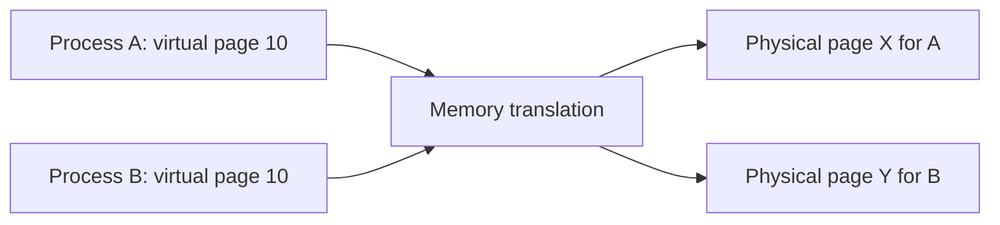
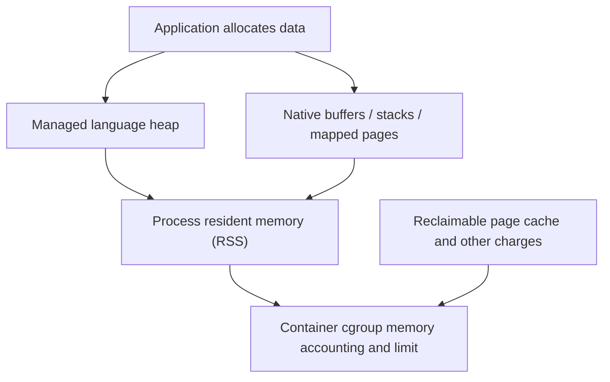

# CS320 — Operating Systems, Concurrency, and Runtimes

## Lecture 05: Virtual Memory, Paging, and Memory Pressure

*Why a container can crash from memory exhaustion even though its JavaScript heap looks modest and the host reports free memory.*

**Estimated study time:** 80–100 minutes, including practical investigation.

---

### How to listen to this lecture

This lecture has two progressive parts.

**Part I — Intuition** establishes the mental picture: every process operates inside a private virtual address space, while the operating system manages the real memory backing those addresses. It also introduces the surprising fact that application memory metrics, process memory, and container memory describe different things.

**Part II — Deep Dive** follows a document-processing service through page tables, TLBs, page faults, memory mapping, copy-on-write, page caching, reclaim, swapping, cgroup memory limits, and out-of-memory termination.

Our recurring production mystery is a Node.js worker that dies under memory pressure even though its V8 heap looks perfectly healthy.

The most important question is:

**Which memory are we measuring, which memory is actually being consumed, and who is enforcing the limit?**

This lecture builds on CS220-L02, which examined application objects, garbage collection, and memory leaks. Here, we descend beneath the programming-language runtime into the operating system.

The practical investigation follows the spoken narrative.

---

# Part I — Intuition

*A program believes it has an enormous private warehouse of memory. The operating system has to fit that imagined space into actual shelves, shared caches, and strict container budgets.*

### The picture to carry in your head

Imagine a hotel where every guest receives a room-numbered catalogue of everything they own. One guest sees locker number 1000 and another guest also sees locker number 1000. That isn't a conflict because each catalogue maps its numbers to different physical storage locations.

Programs have a similar illusion. Each process works with **virtual addresses**—numbers that make sense inside that process's address space. The hardware and operating system cooperate to map those addresses to physical memory or other backing when needed.

So the program may believe it has a huge private region of addresses. That does not mean the machine has allocated that much physical RAM to it.

The opening diagram distinguishes an address in the application's world from the physical memory that may back it.



### 1. A memory address is not necessarily a physical location

In ordinary code, we create objects, arrays, and buffers. The runtime manages values and references. At a lower level, memory addresses used by a process are translated through page mappings.

A **page** is a fixed-size unit of virtual memory management. Rather than keeping a separate complete mapping for every individual byte, the machine organizes translations at page granularity. Page tables hold relevant mappings, and processor hardware caches translations in a structure called a translation lookaside buffer, or TLB.

You don't need to calculate page-table levels yet. The intuition is enough: there's an address book between the memory address the process uses and the physical location or backing the system manages.

When code touches an address whose needed translation or resident backing isn't currently established, the processor may trigger a **page fault**. The kernel checks what's required: perhaps it allocates a fresh page, maps a file-backed page, or rejects an invalid access.

A page fault therefore isn't automatically an application crash. Many are ordinary parts of running programs. Some involve expensive disk activity; others don't.

**Checkpoint:** If a process reserves a large virtual address range, has it necessarily consumed that much RAM? No. Virtual address space and resident physical memory are different quantities.

### 2. The page cache belongs to the story too

Now imagine the hotel staff keeps frequently requested documents near the reception desk instead of fetching them from distant storage every time.

The operating system's **page cache** plays a related role for file-backed data. Keeping useful file pages in RAM can make later reads much faster.

But these cached pages consume memory. Under pressure, the kernel may reclaim eligible cached pages and use the space for other needs. Not all cached memory is simply wasted or permanently occupied.

This complicates the phrase “free RAM.” A machine may be using memory productively for caches even when applications aren't directly holding all of it. A cache can be reclaimed, but doing so may increase later I/O.

Similarly, a process's memory footprint can't be understood solely from one programming-language metric. A Node.js heap measurement describes part of the runtime's managed memory. Its resident set, or **RSS**, can also include stacks, native allocations, mapped regions, and other resident pages.

A service can have a stable JavaScript heap and still experience growing process-level memory demand.

### 3. The container gets a budget, not the whole warehouse

Now place our program in a Linux container. The host has lots of free memory. The container is allowed a much smaller charged-memory budget through cgroup controls.

During a busy document-processing request, the application creates buffers, reads files, builds objects, and uses native libraries. These may contribute to memory charges differently from the JavaScript heap counter visible in the runtime dashboard.

Once the container approaches its limit, the kernel tries applicable reclaim mechanisms. If sufficient memory cannot be reclaimed to satisfy the demand, an out-of-memory condition can lead to termination of a process.

The host can still have free RAM outside the container's permitted budget. The limit is a policy boundary, not a statement about physical scarcity on the host.

Here's the second picture: several different measurements describe overlapping but nonidentical memory accounting boundaries.



### 4. Copying doesn't always mean copying right now

One more warehouse trick is worth seeing before the Deep Dive. Suppose a process is duplicated through a fork-like mechanism. Immediately copying every memory page could be wasteful.

Many systems use **copy-on-write**: initially, the processes may share physical pages where appropriate. When one needs to modify a shared page, the system creates a private copy as required.

This can make process creation cheaper in some circumstances, while later writes increase memory consumption. It also illustrates why seemingly straightforward measures like “size of the process” depend on how shared memory is accounted for.

Copy-on-write isn't magical compression. It is a strategy for postponing unnecessary copying until changes make it necessary.

### 5. The minute-long replay

Our process operates inside a virtual memory map, not directly inside a dedicated heap of physical RAM. Translations connect its addresses to real backing. Page faults establish or retrieve what it needs. The kernel uses RAM for process pages and useful caches. A container imposes its own accounting limits. And not all of that consumption appears inside the JavaScript heap graph.

The Deep Dive will examine page tables, the TLB, paging, RSS, reclaim, swapping, cgroups, and OOM behavior. You already have the central picture: a private address book backed by a finite shared warehouse.

### Three questions before the Deep Dive

1. **Does a page fault always mean invalid memory access?** No. It may be the normal way to establish or retrieve a page.
2. **Is JavaScript heap usage the entire process memory footprint?** No. Native allocations, stacks, mapped pages, and other memory contribute.
3. **Can a container be OOM-killed while the host has spare RAM?** Yes. The container can hit its own memory budget.

*The intuition pass ends here.*

---

# Part II — Deep Dive

# 1. The Process That Disappeared With a Healthy Heap

It's Wednesday, 14:37.

Your document-processing service is having a bad afternoon.

The application accepts customer documents, extracts information, builds structured results, and stores them in PostgreSQL. It runs in a Kubernetes pod with a memory limit of 512 mebibytes.

For months, the service has been reliable.

Then a customer uploads an unusually complicated PDF.

Several more documents arrive before the first has finished processing. The worker starts extracting images and text, creating temporary buffers and asking a native parsing library to decode pages.

A few seconds later, the container disappears.

Kubernetes starts a replacement.

The last application log contains an ordinary progress message. There is no JavaScript stack trace and no useful exception.

The container's previous termination status reports that it was OOM-killed.

You inspect the monitoring dashboard.

The JavaScript heap was using approximately 94 mebibytes.

The configured container memory limit was 512 mebibytes.

The host had several gigabytes of available RAM.

What happened to the other memory?

Your first suspicion is a memory leak. You remember that JavaScript garbage collection sometimes fails to reclaim objects because the application retains references.

But the V8 heap graph is nearly flat.

Garbage collection is occurring normally.

You increase the heap limit anyway.

The problem persists.

Next, someone increases the HTTP timeout. That changes nothing.

Then a colleague suggests that Kubernetes must be reporting incorrect memory usage, since the host clearly isn't out of memory.

This is where we need to distinguish three different systems.

The **JavaScript runtime** manages its own objects and allocations.

The **operating system** manages virtual memory, resident pages, caches, and physical memory.

The **container resource controller** accounts memory consumption against a configured limit.

Those systems interact, but they do not report identical quantities.

A process can have a small JavaScript heap and a large resident footprint.

A container can consume memory not included in that process's resident set.

And a container can reach its configured limit even while the host has spare capacity.

Nothing in the incident necessarily requires a broken garbage collector.

The system may be behaving exactly as configured.

To understand how, we must follow a memory access below the runtime.

---

# 2. The Great Illusion: Every Process Has Its Own Memory World

Imagine two completely separate applications.

One is our Node.js document processor.

The other is PostgreSQL.

Both contain instructions referring to memory addresses.

Could they use the same numerical address?

Yes.

That doesn't mean they refer to the same physical memory.

Each process ordinarily has its own **virtual address space**.

A virtual address is interpreted in the context of the relevant process's memory mappings.

The operating system and hardware cooperate to translate that address into a physical location or other managed backing.

This solves a surprisingly large collection of problems.

## 2.1 Without virtual memory

Imagine a primitive computer where every program directly refers to physical RAM.

Program A expects to use addresses starting at a particular location.

Program B expects to use the same addresses.

Now we have a conflict.

We could manually assign every application a different physical region, but memory management quickly becomes complicated.

Applications would need to know where they were loaded.

Relocating them would require additional work.

And a bug in one application might corrupt another application's memory.

Modern operating systems use virtual memory to separate the program's view of addresses from the physical storage underneath.

The application sees a logical address space.

The kernel manages the mappings.

## 2.2 An address space is not an allocation

On a modern 64-bit system, a process may have access to an enormous virtual address range, subject to architectural and operating-system restrictions.

But reserving virtual address space does not necessarily reserve an equivalent amount of physical RAM.

For example, a program might reserve a large region for future use.

It may touch only a small fraction of that region.

The operating system may therefore need to back only the pages that are actually used, depending on the mapping and allocation policy.

This is one reason a process can report a very large virtual memory size without consuming a similarly large amount of RAM.

The distinction is crucial.

**Virtual address space describes addresses the process can potentially use. Resident memory describes pages actually present in physical RAM.**

Those quantities are not interchangeable.

---

# 3. Pages: How the Operating System Divides Memory Into Manageable Pieces

Now imagine that the operating system had to maintain a completely separate translation for every individual byte.

That would require an enormous amount of mapping information.

Instead, virtual memory systems normally organize memory in units called **pages**.

A common page size on many systems is four kibibytes, although architectures and configurations support different base sizes and larger page mappings.

Each virtual page can be mapped to a physical memory frame or handled through another appropriate backing arrangement.

## 3.1 A small numerical example

Suppose the base page size is 4,096 bytes.

A virtual address can be thought of as containing two conceptual pieces.

One part identifies the virtual page.

The other identifies the byte offset within that page.

If the virtual address is translated to a particular physical frame, the offset identifies the location within that frame.

The operating system doesn't need a completely independent mapping for every byte.

It maps pages.

The processor uses the translation to locate the correct physical address.

The exact bit layout and translation structure depend on the architecture and page size, but the concept is stable.

## 3.2 Page tables

Where does the mapping information live?

In structures commonly called **page tables**.

The kernel establishes and maintains the appropriate mappings according to the process's address space, permissions, and memory-management operations.

Hardware uses these mappings to translate virtual addresses.

On modern architectures, page tables are commonly hierarchical rather than one giant flat array.

That saves memory because large unused portions of an address space need not have every lower-level translation structure populated.

The exact implementation varies, but the purpose remains the same.

A virtual address must be interpreted through the process's memory mappings before it can access physical memory.

## 3.3 The translation doesn't happen in application code

When Node.js executes an instruction that accesses memory, its JavaScript runtime doesn't normally invoke a special operating-system function to translate every address.

The processor's memory-management hardware handles ordinary translations.

The operating system prepares and manages the relevant page tables.

That division of responsibility makes virtual memory practical.

Hardware performs common translation work efficiently.

The kernel handles mapping policy and exceptional conditions.

The application sees a relatively simple address space.

---

# 4. The TLB: Caching the Address Book

We've introduced an additional operation.

Every relevant memory access needs an address translation.

Doesn't that make memory access terribly slow?

It would, if every access required an expensive walk through several levels of page tables.

Processors therefore use translation caches, commonly called **Translation Lookaside Buffers**, or TLBs.

The TLB stores recently used address translations.

When the processor needs a translation, it may find a usable entry in the TLB.

That avoids repeating the full page-table walk.

## 4.1 TLB hits and misses

A **TLB hit** means a suitable cached translation is available.

A **TLB miss** means the processor must obtain the translation through the appropriate page-table mechanism.

But here's an important distinction.

A TLB miss is not necessarily a page fault.

The virtual page may already be mapped and resident.

The hardware simply doesn't have its translation cached.

It can walk the page tables, discover the valid mapping, and proceed.

A page fault is a different kind of event, occurring when the memory access cannot be completed through the existing translation state without further handling.

This distinction is easy to lose in simplified explanations.

**A TLB miss asks for a translation. A page fault requires the operating system to resolve an exceptional memory-mapping condition.**

## 4.2 Why locality matters

Now imagine our document-processing algorithm repeatedly accesses a compact array.

Nearby elements often reside in the same small collection of pages.

The processor can reuse translations and may also benefit from data caches.

Now imagine an algorithm jumping unpredictably among millions of scattered objects.

It may touch many different pages.

The TLB can cover only a limited working set of translations.

More misses may require additional page-table walks.

Memory locality therefore matters at several levels.

A program can be slowed by poor CPU cache locality, poor TLB locality, excessive page faults, or combinations of these.

Those mechanisms are related but not identical.

## 4.3 Huge pages

Many architectures support larger page mappings.

A larger page can represent a greater amount of memory with one translation entry.

That can reduce TLB pressure for suitable workloads.

But larger pages also create trade-offs involving memory usage, allocation, fragmentation, and management behavior.

On Linux, mechanisms such as Transparent Huge Pages can influence when larger mappings are used.

These are useful optimization tools in some environments.

They are not universal performance switches.

Before changing page-size behavior, we should establish that address-translation overhead is actually relevant to the workload.

---

# 5. Page Faults: Not All Faults Are Failures

Now return to our document processor.

It allocates a large buffer.

The allocation succeeds.

Then it begins writing into the buffer.

As it touches previously unused pages, the processor may trigger page faults.

The operating system handles them.

The program continues.

No exception appears.

No application error has occurred.

How can something called a fault be normal?

Because a page fault is a mechanism for asking the operating system to resolve a memory access that the current translation state cannot immediately complete.

## 5.1 A normal first-touch fault

Imagine reserving a region of virtual memory for a new array.

The process receives a range of usable addresses under the operating system's allocation policy.

But the kernel may not need to allocate and populate every physical page immediately.

When the application first writes to a page, the kernel can provide the appropriate backing and establish the mapping.

The access then proceeds.

This is called **demand paging** in the broader sense of establishing memory backing when it becomes necessary.

It's one reason large virtual allocations don't always translate into immediate physical memory consumption.

## 5.2 Minor and major faults

Linux distinguishes minor and major page faults in relevant accounting.

A **minor page fault** can be resolved without requiring the kind of blocking storage I/O associated with a major fault.

For example, the kernel may need to establish an appropriate mapping to an already available page.

A **major page fault** generally involves a need to retrieve the page through backing storage I/O.

The distinction matters for performance.

A page fault that the kernel resolves quickly from resident memory may be inexpensive relative to a fault requiring storage access.

But the names shouldn't be interpreted as universal latency guarantees.

Actual cost depends on the operation and environment.

## 5.3 Invalid accesses

Some faults do represent genuine programming errors.

If a process attempts to access an address that isn't valid under its mappings, or violates relevant protection rules, the kernel may deliver a fault signal.

On Linux, invalid memory accesses can result in signals such as `SIGSEGV`.

That is different from an ordinary demand-paging event.

The important lesson is:

**Page fault is a technical category of memory-access event, not a synonym for application crash.**

---

# 6. Memory Protection: Why One Process Can't Normally Read Another's Objects

Virtual memory also provides a foundation for isolation.

The page mappings associated with a process carry access permissions.

A mapping may permit reading, writing, execution, or some combination according to applicable architecture and operating-system rules.

The hardware checks the relevant permissions during memory access.

This helps prevent ordinary application code from freely accessing memory belonging to unrelated processes.

## 6.1 Read-only and executable mappings

Imagine our service loads program code and shared libraries.

Some regions are mapped for execution.

Other regions hold writable data.

Still others may be read-only.

The operating system can assign appropriate permissions.

Attempting to write into a read-only region may trigger a protection fault.

This is one part of the broader security model.

It doesn't mean every memory vulnerability is prevented.

Memory safety also depends on language semantics, compiler behavior, hardware protections, and other mechanisms.

But virtual memory gives the system an essential enforcement boundary.

## 6.2 Process isolation isn't a container boundary

A container typically uses ordinary Linux processes.

Those processes still rely on the host kernel's memory-management machinery.

Containers add namespace and resource-control mechanisms, but they don't generally possess their own independent Linux kernel.

Therefore, container isolation and process address-space isolation are related but distinct ideas.

A container can have restricted memory accounting while still operating within the host's physical memory system.

This distinction becomes especially important when debugging memory limits.

---

# 7. Virtual Size, RSS, and PSS: Three Different Answers to "How Much Memory?"

Now let's approach the production incident.

Our Node.js worker reports memory usage.

But what exactly is it reporting?

There are several relevant quantities.

## 7.1 Virtual memory size

A process's virtual memory size includes its mapped virtual address regions.

Some may be backed by resident physical pages.

Others may not currently be resident.

Some may represent reserved regions.

Some may be file-backed mappings.

Some may be shared.

Therefore, virtual size can be vastly larger than the process's actual resident memory.

For ordinary performance diagnosis, a large virtual size isn't automatically evidence of physical-memory exhaustion.

You need to know what the mappings represent and which pages are resident.

## 7.2 Resident Set Size

**Resident Set Size**, or RSS, broadly describes the resident physical pages mapped into a process's address space.

It includes more than a language runtime's managed object heap.

Depending on the process and mappings, it may reflect anonymous memory, mapped file pages, stacks, native allocations, and other resident regions.

RSS is useful, but it is not a complete accounting of all memory that may be charged to a container.

And RSS can count shared resident pages in more than one process.

Suppose two processes map the same physical library pages.

Those pages may contribute to both processes' RSS values.

Adding their RSS measurements together can therefore overstate the unique physical memory consumed by those mappings.

## 7.3 Proportional Set Size

Linux exposes a useful measurement called **Proportional Set Size**, or PSS, through interfaces such as `/proc/PID/smaps` and `/proc/PID/smaps_rollup`.

PSS attempts to account for shared mapped pages proportionally among processes mapping them.

If two processes share certain physical pages, each receives an appropriate fraction of those pages in its PSS accounting.

This can help estimate how much resident memory should be attributed to individual processes when shared mappings matter.

But PSS still isn't identical to cgroup memory usage.

A cgroup also accounts relevant kernel memory, file cache, and other categories under its own rules.

**RSS, PSS, and cgroup usage describe overlapping but different accounting perspectives.**

## 7.4 The problem with adding metrics

Here's a dangerous habit.

A developer reads the process's RSS.

Then adds the V8 heap size.

Then adds the external-buffer metric.

The resulting total is much larger than expected.

The mistake is double counting.

Some runtime memory categories already contribute to RSS.

Likewise, some mapped file pages counted in process RSS also belong to memory-accounting categories visible through cgroups.

These are not independent buckets you can necessarily add together.

Before performing arithmetic, establish how each metric is defined and whether the categories overlap.

---

# 8. Node.js Memory: The Heap Is Only One Part of the Process

Now we can examine the exact metrics our application exposes.

Node.js provides `process.memoryUsage()`.

Its common fields include `rss`, `heapTotal`, `heapUsed`, `external`, and `arrayBuffers`.

Those names sound reasonably self-explanatory.

But they describe different parts of memory behavior.

## 8.1 Heap used

`heapUsed` describes memory currently used within V8's managed heap.

This includes many ordinary JavaScript-managed values and objects.

It's extremely useful when investigating JavaScript-object retention and garbage-collection behavior.

If a global cache accidentally retains millions of booking objects, `heapUsed` may grow.

But a stable heap doesn't establish that the entire process has a stable memory footprint.

## 8.2 Heap total

`heapTotal` describes memory associated with V8's heap allocation, under the metric's semantics.

It isn't the same as the amount of live JavaScript data.

A runtime may reserve or retain managed-heap capacity for reuse.

And the relationship between heap size and process RSS changes with allocation behavior, garbage collection, and other runtime activity.

## 8.3 External memory

`external` measures memory used by relevant C++ objects associated with JavaScript objects managed by V8.

This is important because Node.js applications frequently interact with native code and data that doesn't reside directly inside V8's ordinary managed heap.

## 8.4 ArrayBuffers and Buffers

`arrayBuffers` measures memory allocated for `ArrayBuffer` and `SharedArrayBuffer` objects, including Node.js `Buffer` allocations within the documented tracking behavior.

This memory is included in the `external` figure.

So adding `arrayBuffers` to `external` as if they were independent categories would double count part of the memory.

Now recall our document-processing service.

It reads a PDF into a Buffer.

Then a native library decodes images from the file.

It may allocate additional memory outside the ordinary JavaScript-object heap.

Meanwhile, the application creates JavaScript objects representing extracted text and metadata.

The managed heap can remain modest while the process's resident memory increases significantly.

## 8.5 The native allocation problem

Native libraries may use system allocators directly.

Those allocations don't necessarily appear as ordinary V8 heap usage.

Even after memory is logically freed, allocator behavior and fragmentation may affect when pages are returned to the operating system.

On systems using glibc's memory allocator, for example, RSS can remain elevated because of fragmentation or retained allocation arenas.

That's not automatically a leak.

But it may still matter under a container memory limit.

The memory continues to contribute to resident or charged usage while retained.

The correct investigation must distinguish live objects, allocator retention, native allocations, and operating-system accounting.

---

# 9. The Page Cache: Memory Belonging to No JavaScript Object

Now let's discuss a different form of memory.

The Linux kernel uses RAM to cache file-backed data.

Suppose our document processor reads a large PDF from disk.

The operating system may retain file pages in memory so later accesses are faster.

This is the **page cache**.

It improves performance by avoiding repeated storage operations.

But it consumes memory while those pages remain cached.

## 9.1 Why cached memory isn't wasted

Imagine a server with sixteen gigabytes of RAM.

Its applications currently need only a fraction of that memory.

Would it be sensible for the operating system to leave the remainder permanently unused?

Not necessarily.

Using spare memory to cache recently accessed file data can improve performance dramatically.

If an application needs more RAM later, the kernel may reclaim eligible cached pages.

This is one reason operating-system memory dashboards distinguish free memory from broader measures of available or reclaimable memory.

A machine using memory for caches isn't necessarily under dangerous pressure.

## 9.2 Clean and dirty pages

Not all cached pages are equally easy to reclaim.

A clean file-backed page can often be discarded because its contents are already available from the underlying file.

If needed again, the system can retrieve it.

A dirty page contains changes that haven't yet been written to the backing storage.

Before reclaiming such a page, the kernel may need to arrange writeback.

That can involve I/O and waiting.

Reclaim therefore has costs and constraints.

It isn't simply a matter of deleting whichever cache entries appear least important.

## 9.3 Cache pressure can still matter

Now imagine our document processor repeatedly reading large files.

The kernel may cache substantial file data.

Some of those pages may be charged to the container's memory cgroup under Linux memory-accounting rules.

That consumption can contribute to approaching the container's configured limit.

However, file-cache accounting must be interpreted carefully.

Pages can be shared, recharged, reclaimed, or attributed under kernel-specific rules.

The container's memory total isn't necessarily equal to the sum of its process RSS values plus a separately measured cache figure.

Different metrics overlap.

The central point is that **a container's memory footprint can include file-backed cache and kernel-managed memory that no JavaScript heap metric describes**.

---

# 10. Memory Mapping: Making Files Part of an Address Space

So far, we've described ordinary memory allocations and file caching.

But operating systems can also map file contents directly into a process's virtual address space.

On Linux and other Unix-like systems, interfaces such as `mmap` support memory mapping.

This means a process can access selected file data through ordinary memory addresses, subject to the mapping's permissions and semantics.

## 10.1 Why would an application do this?

Imagine a program that repeatedly reads different portions of a large data file.

It could issue explicit read operations and copy data into application-managed buffers.

Alternatively, it might map the file and access relevant regions through memory.

The operating system handles the connection between the virtual addresses and file-backed pages.

This can make certain data-access patterns convenient and efficient.

But memory mapping isn't automatically faster than every alternative.

Page faults, cache behavior, access patterns, and storage characteristics still matter.

## 10.2 Mapping doesn't imply immediate residency

Suppose a process maps a one-gigabyte file.

That doesn't necessarily load the entire gigabyte into RAM immediately.

The operating system may populate the relevant file-backed pages as the process accesses them.

Some pages may already exist in the page cache.

Others may require storage I/O.

And pages that are no longer needed may be eligible for reclamation.

This is another example of the difference between virtual address space and physical residency.

## 10.3 Private and shared mappings

Memory mappings can have different sharing semantics.

With appropriate shared mappings, changes may be visible to other mappings and can interact with file-backed persistence rules.

With private copy-on-write mappings, writes may create private modified pages rather than changing the underlying shared file mapping.

The precise behavior depends on mapping flags and operating-system rules.

But the conceptual distinction is useful.

A mapping may represent shared file-backed data or private process modifications.

That matters for both correctness and memory accounting.

---

# 11. Copy-on-Write: Why a Fork Doesn't Immediately Double RAM

Imagine our process creates a child through a fork-like mechanism.

The child initially has a memory view very similar to the parent.

Would it be efficient to copy every physical page immediately?

Usually not.

Many pages might never be modified.

So operating systems can use **copy-on-write**, abbreviated COW.

## 11.1 Sharing until a write occurs

The parent and child can initially share appropriate physical pages.

Their page mappings are arranged so that a write requiring private data triggers the necessary handling.

When one process modifies a shared copy-on-write page, the kernel can allocate a new physical page and copy the relevant contents.

The writing process then uses its private copy.

The other process continues to reference the original page where appropriate.

This postpones copying until it becomes necessary.

## 11.2 The surprising memory spike

Now imagine a large parent process creates several children.

Immediately after creation, the total resident memory attributed across processes may appear large, partly because shared pages appear in multiple RSS measurements.

But the unique physical memory consumed may be much lower than the sum of their RSS figures.

Then the children begin modifying many of the formerly shared pages.

Copy-on-write creates additional private pages.

Physical memory consumption increases.

This can surprise teams that assume forking processes is always either free or immediately doubles every byte.

Neither assumption is generally correct.

## 11.3 Why this matters in production

Some server models use worker processes created from a common parent.

Some workloads use private memory mappings.

Some databases and language runtimes interact with copy-on-write behavior in important ways.

A system may begin with substantial sharing and then consume more memory as private modifications accumulate.

PSS can provide useful information about shared resident mappings.

But an investigation still requires understanding the actual memory behavior rather than relying on one metric.

---

# 12. Memory Pressure: What Happens When RAM Becomes Scarce?

Now imagine a system approaching its usable physical-memory capacity.

Applications request additional pages.

The operating system needs space.

What happens?

It attempts to reclaim memory where appropriate.

But reclaiming memory isn't a single operation with one universal cost.

Different pages have different kinds of backing and different reclaim requirements.

## 12.1 File-backed pages

Clean file-backed pages are often good reclaim candidates.

The data exists in the underlying file.

The kernel can release appropriate resident pages and retrieve them later if necessary.

Dirty file-backed pages may need writeback before reclamation.

That can create additional I/O activity.

## 12.2 Anonymous memory

Anonymous pages typically contain data not backed by an ordinary file mapping.

Examples include many process heap allocations and private writable pages.

The operating system cannot necessarily discard such pages and recover their contents from an original file.

If swapping is available and permitted, eligible anonymous pages may be written to swap storage.

If swap is unavailable or restricted, the options are narrower.

The kernel may need to reclaim other pages or eventually report an out-of-memory condition.

## 12.3 Reclaim costs time

Memory reclaim can be expensive.

The kernel may need to identify candidate pages.

It may perform writeback.

It may wait on I/O.

It may evict cached data that the application will soon need again.

Repeatedly reclaiming and refaulting the same working set can produce severe performance degradation.

This is often called **thrashing** when the system spends excessive effort moving or reestablishing memory pages instead of performing useful application work.

A machine under memory pressure may therefore become slow before it actually exhausts memory.

The application may appear to be doing little useful CPU work while the system struggles to manage its working set.

## 12.4 Memory pressure isn't the same as a memory leak

A leak can contribute to memory pressure.

But a workload may experience pressure without leaking anything.

Perhaps it legitimately needs more memory than its limit permits.

Perhaps the number of concurrent documents increased.

Perhaps a temporary allocation peak occurs during image decoding.

Perhaps the working set no longer fits in available memory.

Or perhaps the kernel is reclaiming useful cache pages repeatedly.

The diagnosis must determine whether memory demand is erroneous, temporary, excessive for the allocation, or constrained by policy.

---

# 13. Swapping: Turning Memory Pressure Into Storage Work

Swapping is often described as moving inactive memory pages from RAM to disk.

That's a useful initial picture.

But the consequences deserve more careful attention.

## 13.1 What swap can accomplish

If suitable swap storage is available, the kernel may evict eligible anonymous memory pages from physical RAM while preserving their contents elsewhere.

That frees RAM for other uses.

If the application later accesses an evicted page, the system must restore the necessary contents.

This can involve storage I/O.

That operation is much slower than ordinary resident-memory access on most systems.

Swap therefore provides flexibility at a cost.

## 13.2 Why swap isn't simply bad

It's tempting to conclude that any swapping indicates a broken server.

But occasional swap activity isn't necessarily catastrophic.

A system may benefit from moving relatively inactive pages out of RAM.

The real problem appears when the workload repeatedly needs pages that have been evicted.

Then page-in and page-out activity can become excessive.

The system may spend a disproportionate amount of time moving data rather than processing useful work.

The important measurement is not merely whether swap exists.

It's whether swap behavior is causing relevant latency and throughput problems.

## 13.3 Containers complicate swap

Containers may have their own swap-related controls, depending on the cgroup version and deployment configuration.

On cgroup v2, `memory.swap.max` controls swap usage under the relevant memory-controller semantics.

It should not be confused with `memory.max`, which controls ordinary memory charges.

Also, Kubernetes swap behavior depends on cluster and node configuration.

We should not assume that a container has unrestricted access to host swap merely because the host has swap configured.

Likewise, we should not assume that swap is disabled everywhere.

The actual runtime configuration must be inspected.

---

# 14. Linux Memory Cgroups: The Container's Memory Budget

We can now return to the key production mechanism.

Our document processor runs inside a container.

The host has plenty of physical memory.

But the container has its own memory restriction.

Linux implements much of this resource accounting through **control groups**, commonly called cgroups.

On systems using cgroup v2, the memory controller exposes interfaces such as `memory.current`, `memory.stat`, `memory.high`, `memory.max`, and `memory.events`.

These files give us a more meaningful view of container memory behavior than a JavaScript heap graph alone.

## 14.1 `memory.current`

`memory.current` reports the current memory usage charged to the cgroup and its descendants under the controller's accounting rules.

This is not simply the sum of the V8 heaps of all Node.js processes.

Relevant charges can include anonymous memory, file cache, and kernel memory.

The precise accounting details matter when analyzing shared pages and hierarchical cgroups.

But the general concept is straightforward.

**The container has an accounting boundary independent of any single language runtime.**

## 14.2 `memory.max`

`memory.max` is the hard memory limit.

If the cgroup's usage approaches or exceeds the configured limit, the kernel may attempt applicable reclaim.

If the demand cannot be satisfied through permitted reclaim and other mechanisms, an out-of-memory condition can invoke the OOM killer within the cgroup.

The host need not be globally out of memory.

The limit is enforced because the cgroup is not permitted to consume more memory under that constraint.

This answers our opening mystery.

A container can be out of memory **relative to its own budget** while the host still has plenty of available RAM.

## 14.3 `memory.high`

`memory.high` is different.

It is a memory-pressure or throttling threshold.

Exceeding it can cause processes to experience stronger reclaim pressure and throttling behavior.

It is not the same as the hard OOM limit.

The kernel documentation explicitly distinguishes the two.

Crossing `memory.high` doesn't, by itself, invoke the OOM killer.

Crossing `memory.max`, with insufficient ability to reclaim memory, can lead to an OOM condition and termination.

This difference matters operationally.

A service may become very slow under memory pressure before reaching the hard limit.

## 14.4 `memory.low` and `memory.min`

The controller also supports memory-protection mechanisms.

At a high level, `memory.low` provides best-effort protection against reclaim for eligible memory within the configured effective boundary.

`memory.min` provides stronger protection under its documented rules.

These interact with ancestor cgroups and overall resource availability.

We don't need to become kernel memory-controller specialists here.

The important distinction is that cgroups can define not only maximum memory usage, but also policies influencing how reclaim pressure is distributed.

The complete memory-control picture is richer than one memory-limit number.

---

# 15. `memory.stat` and `memory.events`: Let the Kernel Explain Itself

Our application dashboard shows V8 heap usage.

Now we inspect the relevant cgroup.

What can we learn?

## 15.1 `memory.stat`

`memory.stat` provides a breakdown of memory-accounting categories.

Relevant fields can include anonymous memory, file-backed memory, kernel-related charges, page tables, and slab memory, depending on kernel version and configuration.

For example, `anon` describes relevant anonymous memory usage.

`file` includes relevant file-backed cache and related categories under the controller's definitions.

Additional fields help distinguish reclaimable and unreclaimable kernel memory and other accounting details.

This is how we begin to understand which categories dominate container memory consumption.

But don't treat every field as a mutually exclusive bucket.

Some fields are subcategories or overlapping descriptions.

The kernel documentation should guide how the fields are interpreted.

## 15.2 `memory.events`

`memory.events` exposes counters related to important memory-controller events.

These can include `high`, `max`, `oom`, and `oom_kill`.

Their names are closely related but not interchangeable.

`high` tracks events associated with exceeding the high threshold and entering reclaim or throttling behavior.

`max` tracks occasions when memory usage is about to exceed the hard boundary.

`oom` tracks relevant out-of-memory situations under the documented semantics.

`oom_kill` tracks processes killed by an OOM killer and attributed to the cgroup.

The counters provide valuable evidence.

But they require careful interpretation.

For example, an increase in `max` doesn't necessarily mean a process was killed.

The kernel may reclaim enough memory for the allocation to succeed.

And `memory.events` can include events from descendants because the file is hierarchical.

`memory.events.local` provides the local perspective.

## 15.3 Observe changes, not just snapshots

Imagine collecting a single reading after the incident.

The replacement container has started.

Its memory usage is low.

No problem appears.

That tells us little about what happened immediately before the crash.

We need time-series measurements or preserved incident evidence.

Which counters increased?

How quickly did memory usage approach the limit?

Did reclaim pressure increase?

Did the OOM-kill counter change?

Did the workload process an unusually large document?

Did concurrent processing increase?

A reliable diagnosis reconstructs the timeline.

---

# 16. OOM-Killed Is Not the Same as "JavaScript Heap Out of Memory"

This distinction deserves its own section because it's so common in Node.js production incidents.

Imagine two different failures.

In the first, V8 reaches a limit related to its managed heap and reports a JavaScript heap allocation failure.

You may see a fatal runtime message describing heap exhaustion.

In the second, the Linux kernel selects a process for termination because a memory limit cannot be satisfied.

The process may receive a signal that terminates it without giving JavaScript an opportunity to throw an ordinary exception.

Those failures have different owners.

## 16.1 V8 heap exhaustion

A JavaScript heap out-of-memory error concerns the runtime's ability to satisfy managed-heap allocation requirements under its configuration and current conditions.

Increasing V8's heap limit may be relevant in some legitimate scenarios.

But it should follow investigation of live object retention and actual memory needs.

A larger heap doesn't automatically fix a leak.

And a larger heap can increase the total process memory footprint.

## 16.2 Kernel or cgroup OOM

A cgroup OOM event concerns memory-accounting limits enforced by the operating system.

The kernel may terminate the process because the container's permitted memory budget is exhausted.

That can happen even when V8's managed heap usage is modest.

Increasing the V8 heap limit doesn't give the container more memory.

In fact, it may allow the JavaScript runtime to consume a larger fraction of the same fixed budget.

The result could be an even earlier or more severe container OOM.

## 16.3 What does exit code 137 mean?

On many Unix-like systems, an exit status convention represents a process terminated by signal nine, `SIGKILL`, as 128 plus 9, giving 137.

An OOM kill frequently produces this kind of termination.

But exit code 137 by itself does not prove that the kernel's OOM killer was responsible.

An administrator, orchestration system, or other mechanism could also send `SIGKILL`.

In Kubernetes, a recorded `OOMKilled` termination reason provides stronger evidence than an exit code alone.

Relevant kernel and cgroup events help establish the underlying cause.

The correct approach is to correlate multiple observations.

**A disappearing process and a small JavaScript heap are perfectly compatible with a container-level OOM kill.**

---

# 17. The Document Processor's Actual Memory Footprint

Let's reconstruct the incident with illustrative numbers.

Our container has a memory limit of 512 mebibytes.

Shortly before failure, the Node.js runtime reports:

- V8 `heapUsed`: approximately 94 MiB.
- V8 `heapTotal`: approximately 145 MiB.
- External and buffer-related memory: substantial.
- Process RSS: approximately 350 MiB.

Meanwhile, the cgroup's `memory.current` approaches 500 MiB.

Why are these values different?

Because they measure different things.

The managed heap is only part of the process.

The process RSS includes resident memory beyond the managed heap.

The cgroup's charges include memory accounted at the container boundary, potentially including relevant file cache and kernel memory in addition to process memory.

And some accounting categories overlap.

So we should not add these figures together as if they were independent components.

Instead, we need to identify the relevant sources of actual pressure.

## 17.1 The large document

The uploaded PDF is thirty mebibytes.

That sounds manageable.

But the worker doesn't merely hold thirty mebibytes of compressed source data.

It may decode large images.

A compressed image can expand into a much larger in-memory representation.

A page that looks small in the PDF may become a substantial pixel buffer when decoded.

Imagine an image that is 4,000 pixels wide and 3,000 pixels tall.

That's twelve million pixels.

If represented as four bytes per pixel in a straightforward uncompressed format, the pixel buffer alone requires about forty-eight million bytes.

That's roughly forty-six mebibytes.

And that's just one decoded image buffer.

The PDF may contain several images.

The parser may hold intermediate representations.

The application may retain the original source Buffer.

And extraction may produce additional native and JavaScript-managed data.

A thirty-mebibyte upload can therefore create a much larger peak memory footprint.

## 17.2 Concurrency multiplies working sets

Now suppose four documents are processed concurrently.

Each requires substantial temporary memory.

The workers may overlap their peak allocation phases.

Instead of one document holding several large decoded buffers, the application may hold several documents' buffers at once.

This doesn't necessarily indicate a leak.

The application may release all the memory once processing finishes.

But the peak may exceed the container's memory limit before those operations complete.

This is an important operational pattern.

**A service can have stable long-term memory usage and still fail because concurrent work produces excessive temporary peaks.**

## 17.3 Native memory is part of the story

Suppose the parsing library is implemented partly in native code.

It may allocate memory outside the V8-managed heap.

Those allocations can contribute to RSS and cgroup charges without producing equivalent growth in `heapUsed`.

The runtime's external-memory accounting may reflect some relevant allocations, but you shouldn't assume that every allocation made by every native library is perfectly represented in one Node.js metric.

That's why process-level and operating-system metrics are essential.

## 17.4 File-cache charges complicate the picture

The application is also reading source files and possibly writing temporary outputs.

Relevant file-backed pages may be cached.

Some of those pages can contribute to cgroup memory accounting.

The kernel may attempt to reclaim eligible cache pages as pressure increases.

But if the active working set is too large, reclaim may not free enough usable memory.

The hard limit remains.

Eventually, the kernel may invoke an OOM decision.

The host still has available RAM.

The process is nevertheless operating beyond its assigned budget.

---

# 18. The Right Fix Is Usually About the Working Set

Now management suggests increasing the container memory limit.

Is that a reasonable response?

Possibly.

But we should determine what actually drives peak memory demand.

If the workload legitimately requires more memory than the current limit, increasing the budget may be appropriate.

However, if the service retains multiple unnecessary copies of large documents, or accepts unbounded concurrent processing, a higher limit may only postpone the next failure.

## 18.1 Stream instead of buffering everything

Consider a design that loads every uploaded document completely into memory before processing it.

Sometimes that is necessary because a library requires random access or complete input.

But sometimes the work can be streamed or processed incrementally.

If an operation can consume chunks without retaining the entire document, streaming may reduce peak memory.

We should not blindly claim streaming always solves the problem.

Some formats and parsers inherently require substantial in-memory state.

But where incremental processing is possible, it changes the relationship between input size and working memory.

## 18.2 Bound concurrency

Suppose each active document can require hundreds of mebibytes during image extraction.

Allowing ten simultaneous documents in a container limited to 512 MiB is an obvious risk.

A bounded worker pool can limit the number of memory-intensive operations that overlap.

The correct limit should reflect measured peak working-set size, baseline process memory, kernel charges, and an appropriate safety margin.

That limit may be smaller than the number of CPU cores.

CPU parallelism and memory concurrency are not the same resource budget.

## 18.3 Separate workload classes

Perhaps ordinary PDFs require little memory, while image-heavy documents occasionally require much more.

We might classify workloads by size, complexity, or estimated resource demand.

Small documents can use the standard worker pool.

Large or image-heavy documents can run in a separate processing class with a larger memory budget and lower concurrency.

This isolates expensive operations.

It also prevents one unusual document from destabilizing the entire request-serving service.

## 18.4 Limit input amplification

A file's compressed size doesn't necessarily predict its decoded memory footprint.

An input can expand dramatically during processing.

We should consider limits on pages, image dimensions, decompressed sizes, document complexity, or other relevant characteristics.

These limits are especially important when users control the uploaded data.

They protect capacity and can reduce denial-of-service risk from extreme inputs.

## 18.5 Measure the peak, not only the steady state

A dashboard showing memory every sixty seconds can miss a short-lived allocation spike.

The container may allocate hundreds of mebibytes in a few seconds and be killed before the next sample.

For incident analysis, sampling frequency and retained metrics matter.

The relevant capacity question is:

**What is the maximum concurrent working set under realistic worst-case inputs, and does the container have sufficient headroom to handle it?**

That's more useful than asking whether the garbage collector eventually frees the memory.

---

# 19. How to Diagnose Memory Pressure Without Guessing

Let's put the evidence into a repeatable sequence.

Imagine you're on call.

A pod repeatedly restarts.

Someone tells you the JavaScript heap looks normal.

What do you do?

## 19.1 First: establish the termination mechanism

Inspect the workload's termination reason.

Was it recorded as OOMKilled?

Did it receive a signal?

Was the container restarted because of a failing health check?

Did the runtime itself report a heap allocation failure?

Don't infer OOM solely from a restart.

And don't infer a JavaScript leak solely from an OOM.

We need to know who terminated the process and why.

## 19.2 Second: identify the correct memory boundary

What is the pod or container's memory limit?

Which cgroup enforces it?

Are there parent cgroup restrictions?

Is swap available and permitted?

What memory-accounting metrics were collected?

A process's RSS may be below the limit while the container's cgroup charge is close to it.

Remember that the cgroup and process metrics don't have identical accounting boundaries.

## 19.3 Third: compare runtime and operating-system metrics

Inspect V8 heap usage.

Inspect external and ArrayBuffer-related memory.

Inspect process RSS.

Inspect cgroup memory usage and relevant memory.stat categories.

Observe whether anonymous memory, file-backed memory, or kernel-related charges dominate.

Avoid summing overlapping categories without understanding their definitions.

The purpose isn't to calculate one perfect universal memory number.

It's to identify which part of the system's working set is creating pressure.

## 19.4 Fourth: examine reclaim and OOM events

Look for increases in `memory.events`.

Did the `high` counter rise?

Did the cgroup encounter the hard maximum?

Did OOM events occur?

Were processes killed?

If memory pressure telemetry is available, inspect whether the workload experienced reclaim-related stalls before termination.

Memory PSI can help reveal pressure and stalls, although interpretation requires understanding the relevant scope and workload.

Repeated reclaim pressure before a crash may explain rising latency even when the application hasn't yet been killed.

## 19.5 Fifth: correlate with workload

What happened just before memory increased?

Was there a large upload?

Did several documents begin processing simultaneously?

Did a native parser decode images?

Was a file mapped?

Did a new deployment increase worker concurrency?

Did a batch operation allocate many temporary buffers?

A graph of memory without workload context is only half the evidence.

The strongest diagnosis connects resource behavior to a concrete operation.

## 19.6 Sixth: choose the smallest meaningful intervention

Perhaps the correct fix is a larger container limit.

Perhaps it's lower processing concurrency.

Perhaps it's streaming.

Perhaps it's changing a parsing library's allocation behavior.

Perhaps it's removing unnecessary retained buffers.

Perhaps it's separating memory-intensive jobs into a dedicated service.

The intervention should follow the observed cause.

Then test it under representative inputs, including memory-intensive cases.

A successful fix should improve correctness and stability without silently shifting the problem to another resource.

---

# 20. Five Memory Questions Every Backend Engineer Should Know

Let's compress the entire lecture into five questions.

**Question one: Is the address space large, or is physical memory actually resident?**

A large virtual mapping doesn't necessarily mean equivalent RAM consumption.

**Question two: Is the application using memory, or is the operating system caching useful data?**

The distinction affects reclaim behavior and the meaning of free memory.

**Question three: Which memory belongs to the language runtime, the process, and the container?**

Those measurements overlap, but they are not interchangeable.

**Question four: Is the system leaking memory, or does the legitimate working set exceed the available budget?**

Retention and capacity problems require different fixes.

**Question five: What happens when more memory is needed than the current policy permits?**

The kernel may attempt reclaim, use swap where available, apply memory-control pressure, or eventually invoke out-of-memory handling.

These questions turn an intimidating collection of memory terms into a practical diagnostic model.

---

# 21. The Oral Examination

Answer these questions aloud before reading the solutions.

The goal is to explain the mechanisms, not merely recite definitions.

### Challenge A — The Gigantic Virtual Address Space

A Linux process reports a virtual memory size of twenty gigabytes.

Its RSS is only six hundred mebibytes.

Is the process necessarily consuming twenty gigabytes of RAM?

Explain why the values differ.

### Challenge B — A Page Fault Without a Crash

A program allocates a large region of memory.

When it first writes to several pages, the operating system records page faults.

The program continues normally.

What happened?

Why isn't this necessarily an error?

### Challenge C — TLB Miss Versus Page Fault

A processor attempts to access a virtual address.

The required translation isn't present in the TLB, but a valid resident page-table mapping exists.

Must the operating system handle a page fault?

Explain the distinction.

### Challenge D — The Tiny Heap and the Huge RSS

A Node.js service reports:

- `heapUsed`: 110 MiB.
- RSS: 420 MiB.
- Container memory usage: 500 MiB.

Give several plausible explanations for these differences.

Why would simply increasing the V8 heap limit be a questionable response?

### Challenge E — The Page Cache

A file-heavy application causes Linux to use substantial memory for cached file data.

Does this necessarily indicate a leak?

What determines whether those pages can be reclaimed efficiently?

### Challenge F — The Forked Worker

A parent process forks several child processes.

Immediately afterward, their individual RSS figures appear large, but the total unique physical memory consumption hasn't increased proportionally.

How is this possible?

What happens if the children modify many formerly shared pages?

### Challenge G — The 512-MiB Container

A container has a hard memory limit of 512 MiB.

The host has eight gigabytes of available RAM.

The container receives an OOM kill.

Explain how the two observations are compatible.

Which cgroup files would you investigate?

### Challenge H — Memory Pressure Without OOM

A container experiences rising latency.

Its `memory.events` high counter increases, but its OOM-kill counter does not.

What might be happening?

Why is this different from hitting the hard memory limit?

### Challenge I — The Misleading Sum

An engineer adds V8 `heapUsed`, `external`, `arrayBuffers`, and process RSS together to estimate total application memory consumption.

Why is the result invalid?

### Challenge J — Design the Fix

A PDF-processing service dies when four image-heavy documents are processed concurrently.

The heap is stable.

Native allocations and temporary buffers are large.

The container has a small fixed memory budget.

Propose a remediation strategy that addresses the actual failure mechanism.

---

# 22. Solutions and Discussion

*Read this section after answering out loud. The practical lab appears after the spoken lecture ends.*

### Solution A — Virtual memory isn't resident memory

Virtual memory size describes mapped or reserved address regions, not necessarily physical RAM currently used by the process.

The process may reserve large address ranges without touching them, map files that aren't fully resident, or use other lazily backed regions.

RSS is a closer measure of resident mapped pages, though shared mappings and cgroup charges require further interpretation.

### Solution B — Normal demand paging

The operating system can establish physical backing lazily.

A first access may trigger a fault that lets the kernel allocate or map the needed page.

The access then succeeds.

This is a normal use of paging, not necessarily an invalid memory access.

### Solution C — Translation cache miss

A TLB miss can be resolved by reading valid page-table information through the architecture's translation mechanisms.

A page fault is not required simply because the translation wasn't cached.

A page fault occurs when the access needs further exceptional handling under the memory mappings and permissions.

### Solution D — Several memory layers

V8 heap usage is only part of Node.js process memory.

Other resident pages may include Buffers, native allocations, stacks, executable mappings, and allocator-retained memory.

The cgroup charge may also include file cache and relevant kernel memory.

Increasing the V8 heap limit doesn't increase the container budget and may worsen pressure.

### Solution E — File caching isn't automatically leakage

The kernel intentionally caches useful file-backed pages.

Clean eligible pages can often be reclaimed relatively easily.

Dirty pages may require writeback.

Repeatedly reclaiming and refaulting an active working set can harm performance.

The correct interpretation depends on reclaimability, actual pressure, and workload behavior.

### Solution F — Copy-on-write sharing

Fork-like process creation can preserve shared physical pages initially.

Those pages may appear in multiple processes' RSS measurements without being physically duplicated immediately.

When a child modifies an appropriately protected shared page, copy-on-write can allocate a private copy.

That increases unique physical memory consumption.

### Solution G — Cgroup hard limit

The container's cgroup memory budget is independent of the host's total available RAM.

If relevant charges reach the hard limit and reclaim cannot satisfy the demand, the kernel may invoke the cgroup OOM killer.

Inspect `memory.current`, `memory.max`, `memory.stat`, and `memory.events`, alongside the relevant workload and orchestration termination evidence.

### Solution H — High-threshold reclaim pressure

The cgroup may be exceeding its `memory.high` threshold, causing reclaim pressure or throttling behavior.

That can degrade performance without invoking the OOM killer.

The hard `memory.max` boundary has different semantics and can lead to OOM handling when allocations cannot be satisfied.

### Solution I — Overlapping categories

`heapUsed` contributes to the process's resident-memory picture when the relevant pages are resident.

`arrayBuffers` is included within Node's external-memory metric under the documented semantics.

RSS also includes resident memory from multiple categories.

Adding all these measurements produces double counting.

We must interpret each metric according to its definition.

### Solution J — Working-set management

First establish the actual peak resident and cgroup memory demand during representative document processing.

Then reduce unnecessary simultaneous buffers, consider incremental processing where supported, bound document concurrency, and isolate unusually memory-intensive workloads.

If the remaining legitimate working set exceeds the configured limit, allocate an appropriate larger memory budget.

Validate using concurrent image-heavy documents, peak memory measurements, reclaim pressure, and OOM-event evidence.

---

# 23. The Mental Model Worth Keeping

Virtual memory creates a private address space for each process.

The operating system and processor translate virtual addresses through page mappings.

A page is a unit of virtual-memory management.

Page tables describe mappings and relevant permissions.

The TLB caches translations.

A TLB miss isn't automatically a page fault.

A page fault isn't automatically an application crash.

Demand paging allows backing to be established when memory is actually accessed.

File-backed pages can be cached.

Copy-on-write allows some pages to remain shared until private modifications require copying.

RSS describes resident pages mapped into a process, with important shared-memory accounting limitations.

PSS proportionally attributes shared resident mappings.

V8 heap usage describes only part of Node.js memory.

Cgroup usage follows a different accounting boundary that can include file cache and kernel memory.

Reclaim attempts to recover usable memory.

Swap can extend some memory-management options at the cost of storage activity.

Memory pressure can create latency before an OOM occurs.

A hard cgroup limit can cause termination even while the host has spare RAM.

The most useful diagnostic sequence is:

**Virtual address space → Resident working set → Runtime and native allocations → Page cache and kernel charges → Cgroup accounting → Reclaim pressure → OOM decision.**

And the principle worth remembering is:

**A process doesn't own physical RAM merely because it has virtual addresses, and a container doesn't own the host's free RAM merely because the machine has it.**

---

# 24. Next Lecture — From System Calls to Asynchronous I/O

We've examined what happens when a program accesses memory.

But programs do much more than read and write RAM.

They open files.

Read documents.

Write database logs.

Receive network packets.

Wait for sockets.

And ask the operating system to perform operations that may complete later.

These operations cross the boundary between user space and the kernel.

Some block the calling thread.

Others support nonblocking or asynchronous execution.

And the implementation details explain why a Node.js server can serve thousands of network connections through a small number of JavaScript execution threads while still suffering major latency spikes from one unexpected synchronous operation.

In **CS320-L06 — From System Calls to Asynchronous I/O**, we'll follow an operation from a Node.js API call through the operating system's I/O interfaces.

The next mental picture is the natural continuation of this one.

Virtual memory explains where an application sees its data.

System calls and asynchronous I/O explain how that application asks the outside world to provide more.

---

## Optional Practical Lab — Investigating Real Memory Pressure

*The spoken lecture ends here. The remaining material is intended for screen-based experiments and terminal investigation.*

**Environment:** Linux, preferably a disposable VM or development container with cgroup v2. Some commands require suitable permissions or an unconfined environment. Never intentionally exhaust memory on a production host.

### Lab A — Inspect process virtual and resident memory

Select a process you control.

```bash
PID=<your-process-id>

grep -E 'VmSize|VmRSS|VmHWM|RssAnon|RssFile|RssShmem|VmSwap' \
  /proc/"$PID"/status
```

Explain which measurements describe virtual address size and which describe resident memory.

Where supported, inspect proportional resident memory.

```bash
cat /proc/"$PID"/smaps_rollup
```

Look for RSS and PSS.

Explain why adding the RSS values of multiple processes can overcount physical pages when they share mappings.

### Lab B — Inspect mappings

Use `/proc/PID/maps` to examine the process's address-space regions.

```bash
PID=<your-process-id>

head -40 /proc/"$PID"/maps
```

Identify executable mappings, shared libraries, anonymous regions, and stack mappings where present.

Explain why each region occupies virtual address space without necessarily implying that every page is resident.

### Lab C — Observe page faults

Use process accounting or an appropriate profiling tool to inspect page-fault activity.

```bash
/usr/bin/time -v python3 -c \
  'x = bytearray(100 * 1024 * 1024); x[::4096] = b"\1" * len(x[::4096])'
```

Observe the major and minor page-fault counts reported by the timing tool.

The exact results depend on the kernel, memory state, allocation behavior, and environment.

Explain why first-touch allocation can create minor page faults without requiring disk access.

For a more controlled experiment, allocate memory and touch one byte per page rather than relying on allocator behavior alone.

### Lab D — Inspect Node.js memory categories

Create a small Node.js script.

```javascript
const { memoryUsage } = require("node:process");

function report(label) {
  const m = memoryUsage();

  console.log(label, {
    rssMiB: (m.rss / 1048576).toFixed(1),
    heapUsedMiB: (m.heapUsed / 1048576).toFixed(1),
    heapTotalMiB: (m.heapTotal / 1048576).toFixed(1),
    externalMiB: (m.external / 1048576).toFixed(1),
    arrayBuffersMiB: (m.arrayBuffers / 1048576).toFixed(1),
  });
}

report("before");

const buffers = [];

for (let i = 0; i < 20; i++) {
  buffers.push(Buffer.alloc(5 * 1024 * 1024, 1));
}

report("after buffers");
console.log(buffers.length);
```

Run the script in a development environment.

Observe `heapUsed`, `external`, `arrayBuffers`, and RSS.

Why doesn't ordinary JavaScript heap usage increase by the same amount as the total Buffer allocation?

Why is `arrayBuffers` not an independent category to add to `external`?

### Lab E — Inspect cgroup v2 memory accounting

In a suitable cgroup v2 environment, inspect the memory-controller files visible for the relevant cgroup.

```bash
cat /proc/self/cgroup
cat /sys/fs/cgroup/memory.current
cat /sys/fs/cgroup/memory.max
cat /sys/fs/cgroup/memory.high
cat /sys/fs/cgroup/memory.events
cat /sys/fs/cgroup/memory.stat
```

Depending on cgroup namespaces and mount layout, the correct host-visible cgroup path may differ from the path visible inside a container.

Explain what each file measures.

Compare `memory.current` with process RSS.

Why shouldn't the two always be expected to match?

### Lab F — Inspect memory pressure

On a Linux system supporting PSI:

```bash
cat /proc/pressure/memory
```

Where available, inspect the cgroup-level memory-pressure file.

```bash
cat /sys/fs/cgroup/memory.pressure
```

Look at the `some` and `full` metrics.

Interpret them as pressure or stall information, not simply as memory-utilization percentages.

Discuss why memory pressure can cause latency before an OOM kill.

### Lab G — Distinguish a JavaScript heap problem from a cgroup OOM

Prepare a written comparison of two hypothetical incidents.

**Incident one:** Node.js reports a fatal JavaScript heap allocation failure and produces a V8-related error.

**Incident two:** The container terminates with a recorded OOMKilled reason, no JavaScript exception, and rising cgroup memory usage.

For each incident, identify which component enforced the limit, which metrics matter, and why increasing V8's heap limit may help one scenario but worsen the other.

### Lab H — Analyze copy-on-write conceptually

Write a small program in a suitable language that allocates and touches a significant amount of anonymous memory, then forks a child process.

In a disposable environment, compare the parent and child RSS and PSS values before substantial writes.

Then modify a large portion of the child's private mapping.

Inspect how shared and private page accounting changes.

Explain why the initial summed RSS is not a reliable measure of unique physical memory.

Do not perform this experiment on a memory-constrained production host.

### Lab I — Reconstruct the PDF incident

Given the following evidence:

- Container memory limit: 512 MiB.
- V8 heap usage: approximately 94 MiB.
- Node.js RSS: approximately 350 MiB.
- Cgroup `memory.current`: approximately 500 MiB before the crash.
- Several image-heavy PDFs processing concurrently.
- Large temporary buffers and native image-decoding allocations.
- Rising hard-limit memory events.
- Container termination recorded as OOMKilled.
- Host reports substantial available RAM.

Prepare a diagnosis.

Explain why these observations are consistent without treating the measurements as additive independent categories.

Then propose a remediation plan including bounded concurrency, workload classification, memory limits, and verification under representative inputs.

The key question is whether the service can reliably complete the necessary work without exceeding its actual resource budget.

---

## Further Reading — Optional Technical References

1. [Linux Kernel Documentation — Control Group v2](https://docs.kernel.org/admin-guide/cgroup-v2.html) — Memory accounting, `memory.max`, `memory.high`, and OOM events.
2. [Linux Kernel Documentation — Memory Management](https://docs.kernel.org/mm/index.html) — Virtual-memory implementation concepts and kernel memory-management subsystems.
3. [Linux Kernel Documentation — Page Tables](https://docs.kernel.org/mm/page_tables.html) — Page-table structure and address translation.
4. [Linux Kernel Documentation — Page Cache](https://docs.kernel.org/mm/page_cache.html) — File-backed caching and reclaim considerations.
5. [Linux Kernel Documentation — Transparent Hugepage Support](https://docs.kernel.org/admin-guide/mm/transhuge.html) — Larger page mappings and their trade-offs.
6. [Linux Kernel Documentation — PSI](https://docs.kernel.org/accounting/psi.html) — Memory pressure and stall measurements.
7. [Linux man-pages — proc_pid_status(5)](https://man7.org/linux/man-pages/man5/proc_pid_status.5.html) — Process memory fields.
8. [Linux man-pages — proc_pid_smaps(5)](https://man7.org/linux/man-pages/man5/proc_pid_smaps.5.html) — RSS, PSS, and mapping-level memory accounting.
9. [Linux man-pages — mmap(2)](https://man7.org/linux/man-pages/man2/mmap.2.html) — File mapping and virtual-memory interfaces.
10. [Node.js — process.memoryUsage()](https://nodejs.org/api/process.html#processmemoryusage) — V8 heap, external memory, Buffers, and RSS.
11. [Kubernetes — Resource Management for Pods and Containers](https://kubernetes.io/docs/concepts/configuration/manage-resources-containers/) — Memory limits and container resource behavior.
12. Brendan Gregg, *Systems Performance* — Virtual memory, page faults, memory pressure, and resource diagnosis.
13. Remzi H. Arpaci-Dusseau and Andrea C. Arpaci-Dusseau, *Operating Systems: Three Easy Pieces* — Virtual memory and operating-system foundations.

---

## Dense Cheatsheet — Interview Glance Card

*Fenced for voice-reader skipping. Use this as a compact reference for memory metrics, Linux paging, and container OOM diagnosis.*

```text
CS320-L05 — VIRTUAL MEMORY, PAGING & MEMORY PRESSURE

THE CENTRAL DISTINCTION
  Virtual address space != resident RAM.
  V8 heap != process RSS.
  Process RSS != cgroup memory.current.
  Host available RAM != container's permitted memory budget.

VIRTUAL MEMORY
  Each process has its own virtual address space.
  Hardware + kernel translate virtual -> physical mapping.
  Address space may be reserved/mapped without full RAM residency.
  Process isolation uses mappings and access permissions.

PAGES AND TRANSLATION
  Page            Unit of virtual-memory mapping/management.
  Physical frame  RAM location backing a resident page.
  Page table      Mapping and permissions information.
  TLB             Cache of address translations.
  TLB hit         Translation found in cache.
  TLB miss        Must obtain translation; NOT necessarily page fault.
  Page fault      Access needs exceptional mapping/backing handling.
  Minor fault     Resolved without relevant blocking backing-store I/O.
  Major fault     Requires relevant backing-store I/O.
  Invalid access  May cause SIGSEGV / protection failure.

MEMORY MAPPING
  mmap            Map memory or file regions into virtual address space.
  File mapping    May load pages on demand.
  Shared mapping  Can represent shared underlying data.
  Private mapping Can use copy-on-write for private modifications.
  Mapping 1 GiB != immediately resident 1 GiB.

COPY-ON-WRITE
  Fork-like copy  Shares appropriate physical pages initially.
  Private write   May allocate/copy page.
  Initial RSS sum Can overcount shared physical pages.
  More writes     May increase unique physical memory.
  COW != compression; defers copying until necessary.

PROCESS MEMORY METRICS
  VmSize / VSS     Virtual mapped address space.
  RSS             Resident pages mapped into process.
  PSS             Shared pages attributed proportionally.
  RssAnon         Resident anonymous pages (Linux process metric).
  RssFile         Resident file-backed pages.
  RssShmem        Resident shared-memory pages.
  RSS            Not the same as unique container physical usage.

NODE.JS MEMORY
  heapUsed        V8 managed heap memory in use.
  heapTotal       V8 heap capacity metric.
  external        Native/C++-related memory tied to V8-managed objects.
  arrayBuffers    ArrayBuffer/SharedArrayBuffer/Buffer allocation category.
  arrayBuffers INCLUDED in external.
  rss             Process resident memory, includes more than JS heap.
  Worker threads  RSS covers process; other fields may be per thread.
  Native parsers  May allocate outside managed JS heap.
  glibc malloc    Fragmentation/retention can keep RSS elevated.

PAGE CACHE
  Stores file-backed pages in RAM for faster reuse.
  Clean cache     Often reclaimable by discarding resident copy.
  Dirty cache     May need writeback before reclaim.
  Cache RAM != inherently wasted RAM.
  Reclaim can cause later I/O and latency.
  Cached pages may count toward cgroup memory charges.
  Avoid naive addition of cache and process metrics.

MEMORY PRESSURE
  Working set     Memory actively needed by workload.
  Reclaim         Kernel recovers memory from eligible pages.
  Swap            Eligible anonymous data moved to swap backing.
  Thrashing       Repeated eviction/refaulting dominates useful work.
  Pressure        Can cause latency before OOM.
  Leak            Unwanted retention, not the only source of pressure.
  Temporary peaks Can exceed limits without long-term memory growth.

CGROUP V2 MEMORY
  memory.current  Current charged memory usage incl. descendants.
  memory.stat     Category breakdown (anon, file, kernel, etc.).
  memory.high     Reclaim/throttling pressure threshold.
  memory.max      Hard memory limit; OOM possible if reclaim fails.
  memory.low      Best-effort protection from reclaim.
  memory.min      Stronger reclaim protection.
  memory.swap.max Swap usage control under controller semantics.
  memory.events   high / max / oom / oom_kill counters.
  memory.events.local Nonhierarchical local events.
  Ancestor cgroup limits may also matter.

OOM DISTINCTIONS
  V8 heap OOM     Runtime managed-heap allocation failure.
  Cgroup OOM      Kernel-enforced container memory budget exceeded.
  Host OOM        Global system memory exhaustion.
  Exit 137        Often SIGKILL-related; not proof of OOM alone.
  Kubernetes OOMKilled Stronger incident evidence.
  Small heapUsed  Does NOT rule out cgroup OOM.
  Raising V8 heap cap can worsen fixed-budget OOM risk.

TYPICAL PDF MEMORY SPIKE
  Source file compressed: 30 MiB.
  Decoded images may require many times source size.
  Native temporary buffers + source Buffer + JS metadata coexist.
  Several concurrent jobs multiply peak working-set demand.
  File cache and kernel charges contribute to cgroup accounting.
  Normal GC does not guarantee peak fits within memory limit.

DIAGNOSIS SEQUENCE
  1. Identify termination reason and OOM evidence.
  2. Determine container/cgroup actual limits.
  3. Compare heapUsed, external, arrayBuffers, RSS.
  4. Inspect memory.current / memory.stat.
  5. Inspect memory.events and pressure.
  6. Correlate with inputs and concurrent jobs.
  7. Find peak working set and reclaim behavior.
  8. Change concurrency, buffering, workload isolation or limit.
  9. Retest worst-case realistic inputs.
 10. Avoid adding overlapping accounting metrics.

USEFUL TOOLS
  /proc/PID/status       VmSize, VmRSS, RssAnon, RssFile, etc.
  /proc/PID/maps         Virtual address mappings.
  /proc/PID/smaps_rollup RSS/PSS summaries.
  /usr/bin/time -v      Fault and max-RSS observations.
  /proc/pressure/memory Memory pressure.
  /sys/fs/cgroup/*      Cgroup controller files.
  Node process.memoryUsage()   Managed/native/process metrics.
  Kubernetes describe/status   Termination reason, resource limits.

INTERVIEW RECOVERY
  "Heap 100 MiB, OOM"       Check RSS, native buffers, cgroup.
  "Host has free RAM"       Cgroup hard limit may still be exceeded.
  "Virtual size 20 GiB"     Not 20 GiB of resident RAM.
  "Page fault occurred"     May be normal demand paging.
  "RSS sum exceeds host"    Shared pages may be counted repeatedly.
  "Memory high, no kill"    Reclaim/throttle pressure can be active.
  "Process died, no JS log" Kernel SIGKILL may bypass JS error handling.

SENIOR LINE
  "I'd identify the enforcing memory boundary, distinguish managed
   heap from RSS and cgroup charges, inspect reclaim and OOM events,
   correlate peak working set with concurrency, then fix the actual
   memory demand or resource allocation rather than blindly raising
   V8's heap limit."
```
