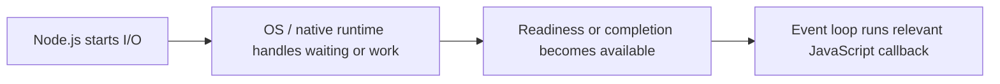
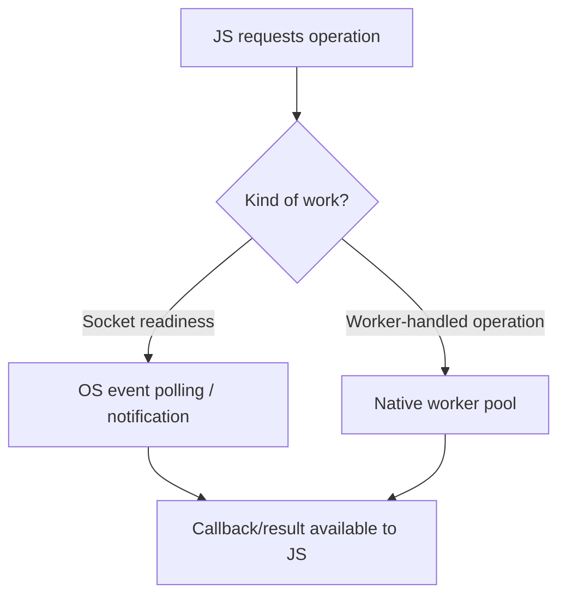

# CS320 — Operating Systems, Concurrency, and Runtimes
## Lecture 06: From System Calls to Asynchronous I/O

*Why a Node.js server that handles thousands of connections on one thread can suffer severe latency spikes from one seemingly harmless file operation.*

---

# Part I — Intuition

*How does one JavaScript thread manage thousands of network conversations? Imagine a librarian who hands out request tickets, then waits to be told which orders are ready.*

### The picture to carry in your head

Imagine a busy library. Readers ask for books stored in several remote warehouses. The librarian writes each request on a ticket, sends it out, and continues serving other readers. When a delivery arrives, she matches the book to the corresponding ticket and tells the right reader it's ready.

She doesn't personally drive to every warehouse. Nor does she stand motionless while each delivery travels through the city. She coordinates requests whose real work or waiting happens elsewhere.

This is the basic intuition behind event-driven I/O. An application asks the operating system to perform or track an operation, then later reacts when the operation can progress or has completed.

But the analogy has a twist. Not every kind of request can be tracked in the same way. Some operations produce a notification when a socket is ready for reading; others are delegated to worker threads or use an asynchronous completion facility. Treating every `async` API as the same kernel mechanism leads to confusion.

The first diagram is our librarian's desk: initiate work, allow other tasks to run, then process the notification or completed result.

### 1. The operating system hands out numbered tickets

Our application opens a network connection. On Unix-like systems, it receives a **file descriptor**, which you can picture as a numbered ticket for an open resource.

The descriptor doesn't contain the entire network conversation. It's a handle that lets the process interact with kernel-managed state. A file, socket, or pipe may all be represented through descriptors, even though their behavior and I/O mechanisms differ.

Now suppose the process wants to read from a socket but no data has arrived. In a blocking design, the calling thread may wait until reading can proceed or an error occurs. That's like our librarian refusing every new customer until the requested book is delivered.

In a nonblocking design, the operation can report that no data is currently available. The program can arrange to learn when the socket becomes ready rather than repeatedly staring at it.

**Checkpoint:** Does a file descriptor mean the bytes are already present? No. It's a handle to a resource; availability and completion are separate questions.

### 2. Readiness and completion answer different questions

Picture two library notifications.

One says: “The warehouse truck is at the loading dock; you may now collect the book.” That's a **readiness** notification. The librarian still performs the next step.

Another says: “The book has been delivered and placed on shelf seven.” That's a **completion** notification. The operation has already been carried out.

Operating systems offer APIs with different styles. On Linux, readiness interfaces such as `epoll` help applications efficiently monitor many file descriptors for relevant events. Similar roles are served by facilities such as `kqueue` on other Unix-like platforms.

Other environments offer completion-oriented mechanisms, such as Windows IOCP and Linux's `io_uring` interfaces for supported operations. These are not identical APIs, and their semantics depend on the exact operation and runtime integration.

The essential point is that **ready to do I/O** and **I/O already completed** are two different messages.

### 3. Why some asynchronous filesystem calls use threads

Now imagine the librarian asks not for a remote book, but for an expensive document to be copied and indexed inside the building.

If she personally performs the entire copying task, customers at the desk wait. It may be better to give that job to a back-office worker and receive a completion message later.

Node.js uses libuv and its runtime machinery to coordinate different kinds of asynchronous work. Network sockets commonly use event-driven OS mechanisms. Some filesystem operations, DNS functions, and other APIs may use a native worker pool instead of simply relying on a socket-readiness notification.

That means two JavaScript functions can both return promises and still take very different paths through the native runtime.

If code calls a **synchronous** filesystem operation from the main JavaScript thread, it may block that thread until the call returns. The API name `async` or the presence of `await` doesn't automatically remove a synchronous bottleneck buried inside a callback.

The second picture separates the two broad paths without claiming that every OS or API behaves identically.

### 4. One blocked librarian can delay everyone

The library has many warehouses delivering books at the same time. Yet suppose the librarian begins an hour-long handwritten inventory calculation at her desk. Delivery trucks still arrive. But readers cannot collect books until she finishes the calculation.

In Node.js, a CPU-heavy synchronous callback similarly occupies the main JavaScript execution thread. The operating system may have network data ready and the runtime may know work has completed, but the corresponding JS callback cannot execute until the thread is available.

This is why event-loop delay matters. The slow operation may not be in the network at all. It may be JavaScript work preventing the application from responding to already completed I/O.

This also explains why a backend can maintain thousands of waiting connections while still becoming unresponsive due to one poorly placed synchronous operation.

### 5. The minute-long replay

The application opens a resource and gets a descriptor or other handle. It asks the kernel or native runtime to track or perform I/O. Instead of remaining busy during every wait, the JavaScript event loop can serve other work. Later, readiness or completion is signaled and a callback progresses the request. But if the main thread is executing synchronous code, the callback waits its turn.

L06's Deep Dive adds exact APIs—`select`, `poll`, `epoll`, `kqueue`, IOCP, `io_uring`, libuv—and the operational details behind them. Keep the librarian in mind: tickets, waiting, notifications, workers, and a front desk that must remain available.

### Three questions before the Deep Dive

1. **What's a file descriptor?** A process-local handle for an open kernel-managed resource, not the resource's entire contents.
2. **What's the difference between readiness and completion?** Ready means an operation can now progress; complete means it has finished.
3. **Why can synchronous JS delay responses whose network data already arrived?** Their callbacks still need the main JavaScript thread to run.

*The intuition pass ends here.*

---

# Part II — Deep Dive

### Status — Planning Stub

Full voice-first manuscript not yet authored.

### Learning Objective

Explain how event-driven servers interact with the kernel and why asynchronous APIs don't all rely on the same low-level execution mechanism.

### Opening Problem

A Node.js server handles thousands of connections on one main JavaScript thread, yet introducing one seemingly harmless file operation causes severe latency spikes.

### Planned Coverage

File descriptors, sockets, pipes, blocking and nonblocking I/O, readiness versus completion models, select/poll, epoll, kqueue, IOCP, io_uring as a modern Linux interface, libuv, and the distinction between operating-system I/O and application scheduling.

### Scope Boundaries

CS230 teaches network protocols. CS320-L06 teaches how the runtime and kernel manage I/O operations.

### Expected Understanding

Trace an async API call to kernel I/O mechanisms; distinguish readiness from completion models; explain why some 'async' work still blocks the event loop.

### Planned Manuscript Structure

1. Narrative hook and sustained engineering case study.
2. Technical development of the underlying mechanisms.
3. Practical trade-offs and realistic failure scenarios.
4. Oral examination.
5. Solutions and discussion.
6. The Mental Model Worth Keeping.
7. Next Lecture or course-completion transition.
8. Optional Practical Lab, after the spoken lecture ends.
9. Further Reading.
10. Dense Cheatsheet — Interview Glance Card, last, inside one fenced text block.

<!-- Full manuscript to be generated later. -->

