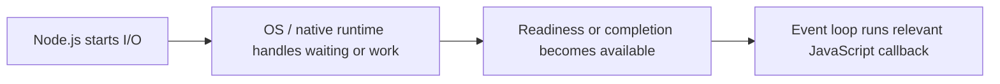
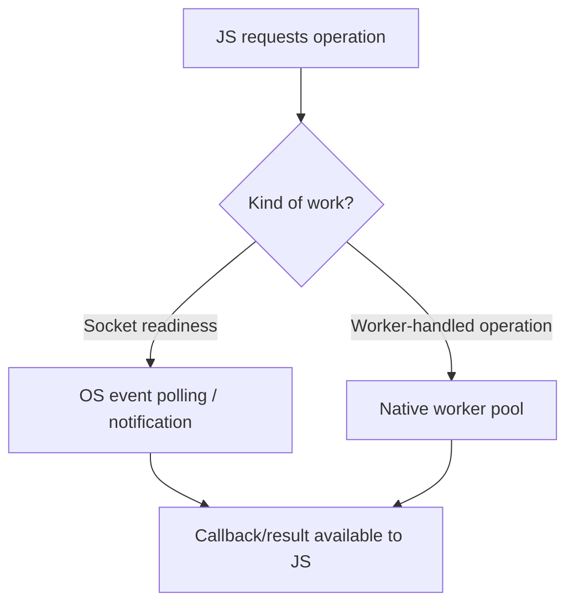

# CS320 — Operating Systems, Concurrency, and Runtimes

## Lecture 06: From System Calls to Asynchronous I/O

*Why a Node.js server that handles thousands of connections on one thread can suffer severe latency spikes from one seemingly harmless file operation.*

**Estimated study time:** 80–100 minutes, including the optional practical lab.

---

### How to listen to this lecture

**Part I — Intuition** introduces one recurring picture: a librarian who coordinates many requests without personally performing every task. It establishes file descriptors, readiness, completion, and the difference between waiting for work and executing a callback.

**Part II — Deep Dive** develops that picture into actual operating-system mechanisms. We'll follow network requests and filesystem operations through system calls, blocking and nonblocking I/O, `select`, `poll`, `epoll`, `kqueue`, IOCP, `io_uring`, libuv, and Node.js's event loop.

The recurring production mystery is a Node.js server whose network requests suddenly become slow after a seemingly innocent synchronous file operation is introduced.

We will also investigate a second failure: asynchronous operations that stop completing promptly because the native worker pool is saturated.

These two incidents look similar to customers, but the responsible mechanisms are different.

The practical exercises follow the spoken lecture. Multi-line code examples are reserved for screen-based investigation.

---

# Part I — Intuition

*How does one JavaScript thread manage thousands of network conversations? Imagine a librarian who hands out request tickets, then waits to be told which orders are ready.*

### The picture to carry in your head

Imagine a busy library. Readers ask for books stored in several remote warehouses. The librarian writes each request on a ticket, sends it out, and continues serving other readers. When a delivery arrives, she matches the book to the corresponding ticket and tells the right reader it's ready.

She doesn't personally drive to every warehouse. Nor does she stand motionless while each delivery travels through the city. She coordinates requests whose real work or waiting happens elsewhere.

This is the basic intuition behind event-driven I/O. An application asks the operating system to perform or track an operation, then later reacts when the operation can progress or has completed.

But the analogy has a twist. Not every kind of request can be tracked in the same way. Some operations produce a notification when a socket is ready for reading; others are delegated to worker threads or use an asynchronous completion facility. Treating every `async` API as the same kernel mechanism leads to confusion.

The first diagram is our librarian's desk: initiate work, allow other tasks to run, then process the notification or completed result.



### 1. The operating system hands out numbered tickets

Our application opens a network connection. On Unix-like systems, it receives a **file descriptor**, which you can picture as a numbered ticket for an open resource.

The descriptor doesn't contain the entire network conversation. It's a handle that lets the process interact with kernel-managed state. A file, socket, or pipe may all be represented through descriptors, even though their behavior and I/O mechanisms differ.

Now suppose the process wants to read from a socket but no data has arrived. In a blocking design, the calling thread may wait until reading can proceed or an error occurs. That's like our librarian refusing every new customer until the requested book is delivered.

In a nonblocking design, the operation can report that no data is currently available. The program can arrange to learn when the socket becomes ready rather than repeatedly staring at it.

**Checkpoint:** Does a file descriptor mean the bytes are already present? No. It's a handle to a resource; availability and completion are separate questions.

### 2. Readiness and completion answer different questions

Picture two library notifications.

One says: “The warehouse truck is at the loading dock; you may now collect the book.” That's a **readiness** notification. The librarian still performs the next step.

Another says: “The book has been delivered and placed on shelf seven.” That's a **completion** notification. The operation has already been carried out.

Operating systems offer APIs with different styles. On Linux, readiness interfaces such as `epoll` help applications efficiently monitor many file descriptors for relevant events. Similar roles are served by facilities such as `kqueue` on other Unix-like platforms.

Other environments offer completion-oriented mechanisms, such as Windows IOCP and Linux's `io_uring` interfaces for supported operations. These are not identical APIs, and their semantics depend on the exact operation and runtime integration.

The essential point is that **ready to do I/O** and **I/O already completed** are two different messages.

### 3. Why some asynchronous filesystem calls use threads

Now imagine the librarian asks not for a remote book, but for an expensive document to be copied and indexed inside the building.

If she personally performs the entire copying task, customers at the desk wait. It may be better to give that job to a back-office worker and receive a completion message later.

Node.js uses libuv and its runtime machinery to coordinate different kinds of asynchronous work. Network sockets commonly use event-driven OS mechanisms. Some filesystem operations, DNS functions, and other APIs may use a native worker pool instead of simply relying on a socket-readiness notification.

That means two JavaScript functions can both return promises and still take very different paths through the native runtime.

If code calls a **synchronous** filesystem operation from the main JavaScript thread, it may block that thread until the call returns. The API name `async` or the presence of `await` doesn't automatically remove a synchronous bottleneck buried inside a callback.

The second picture separates the two broad paths without claiming that every OS or API behaves identically.



### 4. One blocked librarian can delay everyone

The library has many warehouses delivering books at the same time. Yet suppose the librarian begins an hour-long handwritten inventory calculation at her desk. Delivery trucks still arrive. But readers cannot collect books until she finishes the calculation.

In Node.js, a CPU-heavy synchronous callback similarly occupies the main JavaScript execution thread. The operating system may have network data ready and the runtime may know work has completed, but the corresponding JS callback cannot execute until the thread is available.

This is why event-loop delay matters. The slow operation may not be in the network at all. It may be JavaScript work preventing the application from responding to already completed I/O.

This also explains why a backend can maintain thousands of waiting connections while still becoming unresponsive due to one poorly placed synchronous operation.

### 5. The minute-long replay

The application opens a resource and gets a descriptor or other handle. It asks the kernel or native runtime to track or perform I/O. Instead of remaining busy during every wait, the JavaScript event loop can serve other work. Later, readiness or completion is signaled and a callback progresses the request. But if the main thread is executing synchronous code, the callback waits its turn.

L06's Deep Dive adds exact APIs—`select`, `poll`, `epoll`, `kqueue`, IOCP, `io_uring`, libuv—and the operational details behind them. Keep the librarian in mind: tickets, waiting, notifications, workers, and a front desk that must remain available.

### Three questions before the Deep Dive

1. **What's a file descriptor?** A process-local handle for an open kernel-managed resource, not the resource's entire contents.
2. **What's the difference between readiness and completion?** Ready means an operation can now progress; complete means it has finished.
3. **Why can synchronous JS delay responses whose network data already arrived?** Their callbacks still need the main JavaScript thread to run.

*The intuition pass ends here.*

---

# Part II — Deep Dive

# 1. The File That Froze a Thousand Connections

It's 11:42 on a Tuesday morning.

Your Node.js backend serves a busy hotel-booking platform. Customers search for hotels, retrieve availability, and confirm reservations through an API.

The service handles thousands of active network connections without difficulty.

CPU utilization is moderate. Memory looks healthy. Database latency is stable.

Then you deploy a harmless-looking feature.

The booking company generates large PDF reports for enterprise customers. A developer adds a new endpoint that reads a generated report from disk and returns it to the caller.

The implementation is straightforward.

When a client requests a report, the handler reads the file, sets the appropriate HTTP headers, and sends the response.

The problem is that the handler uses a synchronous file-read function.

On a development machine, with a tiny cached test file, it appears instantaneous.

In production, a customer requests a large report from a slower storage path.

The synchronous read takes several hundred milliseconds.

During that interval, ordinary JavaScript execution on the main event-loop thread is blocked.

Suddenly, unrelated API requests become slow.

Customers searching for hotels experience latency spikes.

Availability requests that normally complete in twenty milliseconds begin taking hundreds of milliseconds.

Database monitoring shows no regression.

The network is healthy.

The CPU isn't necessarily saturated.

The report endpoint isn't even receiving particularly high traffic.

But something fundamental has changed.

**One HTTP handler has temporarily prevented the application's main JavaScript thread from responding to other work.**

The thousands of open connections still exist.

Incoming data can still arrive at the operating-system boundary.

The kernel can continue managing socket state.

But JavaScript callbacks that need the occupied event-loop thread cannot run.

This is the mystery we're going to dismantle.

To understand why, we need to follow a network request across the boundary between our program and the operating system.

---

# 2. The Boundary Between Your Code and the Kernel

Consider a Node.js application receiving an HTTP request.

At the JavaScript level, we work with request objects, response objects, streams, callbacks, and promises.

We rarely think about the operating-system interfaces beneath them.

But the application cannot directly manage a network card, physical disk, or kernel TCP connection by manipulating ordinary JavaScript objects.

It needs help from the operating system.

The boundary is commonly crossed through **system calls**.

## 2.1 A system call is not an ordinary library function

A library function executes code according to its implementation. It might perform calculations entirely within the process.

A system call requests a service from the operating-system kernel.

Examples on Linux include operations such as opening files, reading and writing data, creating sockets, and waiting for I/O events.

At the lowest level, the application and its runtime use the architecture's defined mechanism for entering the kernel.

The kernel checks the request, operates on relevant kernel-managed state, and returns a result or error.

The important distinction is privilege and ownership.

The application operates in user space.

The kernel controls protected operating-system resources.

The application asks the kernel to perform operations according to the operating system's contract.

## 2.2 Not every high-level API call corresponds to one system call

This is an important subtlety.

Imagine calling `fs.promises.readFile`.

The JavaScript API appears to be one operation.

But implementing it may involve several lower-level operations, such as opening the file, determining information about it, reading data, and closing resources.

The runtime may perform those steps through libuv and its worker pool.

Similarly, an HTTP request involves multiple socket operations, buffers, event notifications, protocol processing steps, and callbacks.

A single high-level API call is not necessarily a single kernel operation.

Nor does every JavaScript function call enter the kernel.

Much application work happens entirely in user space.

The runtime decides when kernel assistance is required.

---

# 3. File Descriptors: Small Numbers With Big Responsibilities

On Unix-like systems, an open file, socket, or pipe is commonly represented inside a process through a **file descriptor**.

A file descriptor is a small integer identifying an entry in that process's descriptor table.

That entry refers to operating-system-managed information about the resource.

Imagine our server opens a file.

The kernel might return descriptor number 17.

The number itself doesn't contain the file's bytes.

It's a handle through which the process can request operations on the open resource.

Now imagine the process has an established TCP socket represented by another descriptor.

Perhaps it's descriptor 42.

The application can interact with that socket through relevant I/O interfaces.

## 3.1 The same abstraction, different resources

Files, sockets, and pipes have something in common.

The operating system exposes operations for transferring data through them.

But their behavior differs.

A regular file represents stored data.

A TCP socket represents a network transport endpoint with kernel-managed connection state.

A pipe transfers data between communicating processes or threads according to its semantics.

These resources can all use file descriptors while having different readiness, blocking, and I/O behavior.

This is why saying "everything is a file" is useful as a Unix design intuition, but inaccurate if taken to mean that all descriptors behave identically.

## 3.2 Descriptors are resources

A process cannot necessarily open unlimited descriptors.

Operating systems impose limits.

Each open descriptor also corresponds to resources that need to be managed.

Suppose our booking service opens a new file for every request and forgets to close it.

Eventually, it may exhaust its available descriptor budget.

New file opens or socket accepts can fail.

On Linux, one error associated with exceeding a process's descriptor limit is `EMFILE`.

Increasing the descriptor limit might temporarily reduce the symptom.

But if the application is leaking descriptors, a larger limit doesn't fix the underlying resource-lifetime error.

Just as memory objects need appropriate lifetimes, open files and sockets need deliberate cleanup.

We'll revisit this in CS320-L08's forensic investigation.

---

# 4. Blocking I/O: When a Thread Must Wait

Imagine our server calls a function to read data from a TCP socket.

No data is currently available.

What happens?

That depends on the socket's state and the I/O mode.

In a blocking design, the calling thread may wait until data becomes available, a relevant condition changes, or an error occurs.

While blocked, it doesn't continue executing the subsequent application instructions.

## 4.1 One connection, one blocked thread

Consider an old-fashioned server architecture.

Each client connection is assigned a dedicated operating-system thread.

That thread reads a request.

If the client hasn't sent anything yet, the thread waits.

When data arrives, it continues.

This model is straightforward.

The control flow looks natural.

But suppose we have ten thousand connected clients.

Most are idle.

Maintaining one thread per connection can impose substantial memory, scheduling, and coordination overhead.

Operating systems can handle many threads, but the design still consumes resources and may become inefficient at scale.

We need a way to manage many waiting connections without requiring one blocked thread for each.

That's where nonblocking I/O and event notification become important.

## 4.2 Blocking isn't inherently bad

Before proceeding, avoid a false conclusion.

Blocking I/O isn't always wrong.

A dedicated worker thread may perform a blocking filesystem operation perfectly reasonably.

A small command-line application may benefit from straightforward blocking operations.

A thread pool may deliberately use blocking calls because it makes the operation easy to express and isolates the wait from latency-sensitive threads.

The problem isn't blocking in the abstract.

The problem is **blocking a thread whose availability is required for other important work**.

In Node.js, blocking the main event-loop thread affects unrelated JavaScript callbacks.

Blocking one dedicated background worker has a more localized effect, although enough blocked workers can exhaust the pool.

The ownership of the waiting thread determines the consequences.

---

# 5. Nonblocking I/O: Ask Without Waiting

Now imagine configuring a socket for nonblocking I/O.

The application attempts to read.

But no data is currently available.

Instead of putting the calling thread to sleep until data arrives, the operation can return immediately with a condition indicating that it cannot proceed right now.

On Linux and other POSIX-like systems, that condition is commonly represented using `EAGAIN` or `EWOULDBLOCK`, depending on the interface and platform.

The application remains free to execute other instructions.

## 5.1 The first naive solution: keep asking

Our server could repeatedly attempt to read the socket.

No data.

Try again.

Still no data.

Try again.

This is called **busy waiting** or busy polling in a simple form.

It avoids blocking the thread in the original read operation, but it can waste CPU time.

The application repeatedly asks a question whose answer probably hasn't changed.

If we have ten thousand sockets, repeatedly scanning them ourselves can become expensive.

We need a more efficient approach.

## 5.2 Express interest in an event

Instead of asking each socket whether data is available every millisecond, the application can tell an operating-system event facility which resources it wants to monitor.

The program then waits for relevant notifications.

When a socket becomes ready for reading, the application can attempt the read.

This separates two responsibilities.

The kernel tracks relevant I/O state.

The application reacts when that state permits useful progress.

That's the foundation of readiness-based event-driven I/O.

## 5.3 Nonblocking doesn't mean the operation is complete

Here's a distinction developers frequently miss.

A nonblocking read that reports no available data hasn't completed the intended transfer.

It has simply avoided waiting for the transfer to become possible.

Likewise, a nonblocking write may accept only part of the data.

The application or runtime must handle partial progress and arrange to continue later.

Nonblocking I/O requires more state management than a simple blocking function call.

Frameworks and runtimes hide much of that complexity.

But the complexity hasn't disappeared.

---

# 6. Readiness: The Operating System Says "You May Proceed"

Now let's be precise about **readiness**.

Suppose a TCP socket is registered for read-related events.

The operating system reports that it is readable.

What does that mean?

It means that an appropriate read-related operation can make progress without waiting in the ordinary way, or that a relevant condition such as end-of-stream or an error needs attention.

It does not necessarily mean a complete application message is available.

## 6.1 TCP doesn't preserve your HTTP messages

Remember CS230.

TCP provides an ordered byte stream.

It doesn't preserve the boundaries of application writes as independent messages.

A socket being readable might mean only part of an HTTP request has arrived.

Your server may need multiple reads to assemble the complete request.

A single read might also obtain bytes belonging to more than one application-level unit, depending on buffering and protocol framing.

This is why HTTP parsers exist.

The transport exposes bytes.

The application protocol interprets them.

## 6.2 Readable doesn't guarantee success forever

Consider another race.

The event facility reports that a descriptor is readable.

Before the application performs the read, relevant state may change, especially if multiple threads or consumers are involved.

An attempt may no longer produce the expected bytes.

Nonblocking operations must therefore still handle conditions such as `EAGAIN`.

A readiness notification is not a permanent reservation guaranteeing that a later operation will behave exactly as expected.

It's information about an observed opportunity to make progress.

## 6.3 End-of-stream is not an ordinary empty message

Suppose the peer has performed an orderly shutdown of its sending direction.

For a TCP stream, a read may eventually return zero bytes to indicate end-of-stream under the appropriate conditions.

That's distinct from an ordinary nonblocking read returning an unavailable-data condition.

An application must interpret the result correctly.

Otherwise, it may confuse a closed connection with a temporarily idle one.

These details usually remain hidden inside Node.js streams.

But they explain why network APIs must handle more than just "data arrived" and "data didn't arrive."

---

# 7. `select` and `poll`: The First Practical Mental Model

How can one thread monitor multiple file descriptors?

Two traditional Unix interfaces are `select` and `poll`.

Their basic purpose is to let a process wait until one or more monitored descriptors satisfy relevant I/O conditions.

The application identifies resources and desired events.

The kernel checks their state.

The call can wait until useful events occur or a timeout or interruption condition applies.

Then the application examines the result and handles the ready resources.

## 7.1 One event loop, many connections

Imagine our Node.js server has one thousand sockets.

Some have data arriving.

Most are idle.

The event loop doesn't need to create one JavaScript thread per socket.

It can rely on operating-system event monitoring to discover which sockets deserve attention.

When readiness is reported, the runtime performs the appropriate I/O operations and eventually schedules the corresponding JavaScript work.

The number of active connections can therefore be much larger than the number of JavaScript execution threads.

That's the conceptual breakthrough.

## 7.2 Why traditional interfaces have limits

These mechanisms are useful, but their performance characteristics differ.

With `select`, applications work with descriptor sets, and common implementations impose practical descriptor-number or set-size limitations.

With `poll`, the application passes a collection of descriptors and event interests.

Repeatedly inspecting large collections can create overhead.

At small scale, that may be perfectly acceptable.

At very large scale, more scalable event facilities become attractive.

The important issue is not that `select` or `poll` are unusable.

It's that monitoring thousands of mostly idle connections benefits from interfaces that minimize unnecessary per-call bookkeeping and scanning.

Linux provides such an interface through `epoll`.

---

# 8. `epoll`: Let the Kernel Remember What You're Watching

Linux's `epoll` interface allows an application to register interest in events associated with supported file descriptors.

Conceptually, there are three relevant operations.

Create an epoll instance.

Register, modify, or remove event interests.

Wait for relevant events.

The common system calls are `epoll_create1`, `epoll_ctl`, and `epoll_wait`.

You don't need their complete signatures to understand the design.

The application can maintain a set of monitored descriptors inside the kernel rather than rebuilding a large monitoring list for every wait.

When relevant events occur, the application receives information about descriptors that deserve attention.

This is especially valuable for servers managing large numbers of mostly idle sockets.

## 8.1 A concrete socket journey

Imagine one customer opens a TCP connection to our booking backend.

The operating system maintains the socket's connection state.

Node.js, through its native runtime machinery, arranges to monitor the appropriate socket events.

The customer sends a request.

Data arrives through the network stack.

The socket becomes readable.

The event facility reports the relevant condition.

The event loop reacts.

The native runtime reads available bytes and passes them through the necessary processing.

Eventually, the HTTP request becomes available to JavaScript.

Our handler executes.

Notice how many stages exist between "a packet arrived" and "the JavaScript callback ran."

The kernel can receive data while JavaScript is busy.

The event loop must still be available to process the event and execute the handler.

## 8.2 Level-triggered versus edge-triggered notifications

Here's a subtle but important distinction.

In **level-triggered** mode, an event can continue to be reported while the relevant readiness condition remains true.

Imagine a socket has unread bytes.

If the application reads only some of them, the socket may still be readable.

A later wait can report that condition again.

In **edge-triggered** mode, notifications are tied to relevant readiness transitions or changes rather than repeatedly reporting a persistent condition in the same way.

That can be efficient, but it requires more careful application behavior.

A common safe pattern is to use nonblocking descriptors and continue reading until the operation reports that no more data is currently available.

Otherwise, an application may leave unread data without receiving the expected further notification.

This is why edge-triggered code can be difficult to implement correctly.

The advantage is fewer redundant readiness notifications.

The cost is stricter state-management discipline.

Most application engineers don't implement this directly in Node.js.

But understanding the distinction explains why mature I/O libraries are valuable.

They encode the difficult operational details beneath convenient abstractions.

## 8.3 Regular files are different

One particularly important caveat:

Linux `epoll` is designed for descriptors that support its readiness-monitoring model, particularly sockets and other compatible event sources.

Ordinary regular files aren't generally monitored through `epoll` in the same way as network sockets.

An attempt to register an ordinary regular file can fail with `EPERM`.

This is one reason filesystem I/O and socket I/O often take different paths through a runtime.

The fact that both are represented by file descriptors doesn't mean their asynchronous implementations are identical.

---

# 9. `kqueue` and IOCP: Different Systems, Similar Goals

Linux isn't the only operating system with efficient I/O mechanisms.

Other platforms offer different facilities.

## 9.1 `kqueue`

On macOS and several BSD systems, `kqueue` provides an event-notification interface.

It allows software to register interest in various event sources.

These can include I/O-related events and other supported system conditions.

Conceptually, it serves an important role similar to `epoll`: efficient notification about relevant events without requiring the application to continuously inspect every resource.

But the interfaces and supported filters are not identical.

We should not assume that a piece of Linux-specific `epoll` code can be mechanically renamed into `kqueue` code.

Cross-platform runtimes exist partly to hide those differences.

## 9.2 Windows I/O Completion Ports

Windows provides an important completion-oriented mechanism called **I/O Completion Ports**, or IOCP.

Here, the system can associate asynchronous I/O operations with completion notifications.

Workers can retrieve completion events and continue processing.

This differs conceptually from merely receiving a notification that a socket is ready for a read or write.

The operation may already have completed, and the event reports its result.

Modern runtimes can provide a broadly similar application programming model even though the underlying operating-system mechanisms differ substantially.

## 9.3 Why this matters for developers

Suppose you write a Node.js server on macOS and deploy it on Linux.

Your JavaScript code may be nearly identical.

But the native runtime can use different platform I/O facilities.

On another deployment, Windows may use a different completion mechanism.

The behavior of high-level APIs can remain consistent because the runtime translates them into platform-appropriate operations.

That's part of the value of libuv.

But cross-platform consistency doesn't imply identical performance characteristics or internal execution paths.

---

# 10. `io_uring`: Submit Work, Receive Completions

Linux also provides a newer interface called **io_uring**.

Its central design involves shared submission and completion queues between user space and the kernel.

At a high level, an application places supported I/O requests into a submission queue.

The kernel processes those requests according to the interface's rules.

Completions become available through a completion queue.

This offers a different programming model from a simple readiness loop.

## 10.1 Submission and completion

Imagine our document-processing service wants to read several portions of a file.

Instead of waiting for readiness and then issuing each operation in a traditional pattern, an application using suitable `io_uring` operations can submit requests and later process their completions.

The submission entry describes the operation.

The completion entry reports a result.

The interface can reduce certain syscall and coordination costs under appropriate conditions.

It also supports a range of advanced features whose availability depends on kernel version and configuration.

But we should avoid turning this into a universal performance claim.

## 10.2 It isn't automatically zero-copy or zero-thread

Developers sometimes hear that `io_uring` eliminates the need for worker threads or makes every filesystem operation magically asynchronous.

That's too simplistic.

Different operations and kernel paths may require different mechanisms.

Some operations can execute efficiently through supported asynchronous kernel facilities.

Others may still involve worker execution or other internal handling.

Similarly, `io_uring` doesn't automatically make every data transfer zero-copy.

The interface supports capabilities that can improve I/O efficiency, but the actual behavior depends on the operation, implementation, buffers, and deployment environment.

## 10.3 Node.js doesn't automatically use it for everything

An especially important warning:

Do not assume that because Linux supports `io_uring`, every Node.js asynchronous API transparently uses it.

Node.js and libuv have their own implementation choices, and those can change across versions.

Their documented filesystem behavior has commonly relied on a native worker pool.

If a performance investigation depends on which underlying mechanism is used, inspect the runtime version and actual execution path.

An operating-system feature existing is not evidence that your application uses it.

**The reliable mental model is submission versus completion—not an unverified claim that every modern asynchronous operation runs through `io_uring`.**

---

# 11. Now Enter libuv: The Machinery Under Node.js

We've explored several operating-system I/O facilities.

How does Node.js use them without requiring JavaScript developers to write platform-specific code?

A major part of the answer is **libuv**.

Libuv is a cross-platform library providing event-loop facilities, asynchronous I/O abstractions, timers, filesystem operations, native worker-pool facilities, and other operating-system integrations.

Node.js uses libuv as an important component of its runtime infrastructure.

The application generally interacts with Node.js APIs.

Node.js and its native libraries coordinate lower-level work.

## 11.1 An event loop isn't the kernel

The event loop is runtime machinery.

The kernel provides mechanisms for managing resources and reporting events.

The event loop coordinates how the application responds.

These are separate roles.

On Linux, libuv can use `epoll` for suitable network I/O events.

On macOS, it can use `kqueue`.

On Windows, it uses relevant Windows facilities, including IOCP.

The application can retain a familiar programming model across platforms.

But libuv also has operations that don't follow the same readiness path.

## 11.2 Handles and requests

Libuv distinguishes abstractions representing longer-lived event sources from individual asynchronous requests.

A listening TCP server is associated with a longer-lived resource.

A particular filesystem operation is more naturally represented as a request that eventually completes.

These abstractions help the runtime manage different kinds of work through one broader event-driven architecture.

The fact that callbacks appear in one JavaScript event loop doesn't mean all operations were executed by the same mechanism.

## 11.3 The two-path picture

For our purposes, two broad paths are worth distinguishing.

**Path A: network socket readiness.**

The runtime registers interest in socket events, receives notifications, performs relevant nonblocking I/O, and eventually makes results available to JavaScript.

**Path B: native worker-pool operations.**

The runtime queues a task for a native worker, the worker performs the relevant operation, and completion is eventually reported to the event loop.

Both appear asynchronous to JavaScript.

Their waiting and execution characteristics differ.

This is where our production mystery becomes much more interesting.

---

# 12. Why Asynchronous Filesystem I/O Often Uses Worker Threads

Imagine reading a file.

On a traditional Unix-like interface, regular-file operations don't behave exactly like nonblocking network sockets.

Making a file descriptor nonblocking doesn't automatically provide the same useful readiness-notification pattern as a socket.

So a runtime needs another way to avoid blocking its event-loop thread while filesystem work proceeds.

One common solution is to delegate the operation to a native worker pool.

Node.js, through libuv, uses this approach for many asynchronous filesystem operations.

## 12.1 What actually happens during an asynchronous read?

Imagine JavaScript calls `fs.promises.readFile`.

The API returns a promise.

The application can continue executing other work.

Under the conventional libuv worker-pool path, the runtime queues the relevant filesystem work.

A native worker handles the operation.

The worker may block in operating-system file operations without blocking the main JavaScript event-loop thread.

When the operation has completed, the runtime arranges for the corresponding JavaScript continuation to run.

The important feature isn't that the filesystem read consumes no thread.

It's that the waiting occurs away from the main event-loop thread.

## 12.2 The worker pool is finite

Here's the catch.

The native worker pool has limited concurrency.

Libuv's default pool size has traditionally been four workers, configurable through `UV_THREADPOOL_SIZE` within supported limits.

That doesn't mean there are only four operating-system threads in the entire Node.js process.

It means the relevant libuv worker pool has a bounded number of workers for operations that use it.

Now imagine four expensive filesystem operations occupying the pool.

A fifth filesystem request arrives.

It may need to wait until a worker is available.

Its JavaScript promise remains pending.

The event loop itself might still be responsive.

But the operation has not completed.

This gives us a second kind of latency incident.

## 12.3 Pool sharing creates unexpected interference

Suppose our document-processing service performs expensive asynchronous filesystem operations.

Another part of the same process uses an asynchronous cryptographic operation that also relies on libuv's native worker pool.

The pool becomes saturated.

Now unrelated operations that need the same pool may wait longer.

The application can experience latency even though every affected API returns a promise.

This isn't the same failure as `readFileSync` blocking the event loop.

The main JavaScript thread may be free.

The bottleneck is the availability of native workers.

This distinction is central to debugging Node.js performance.

> **Sticky note #1:** Asynchronous JavaScript means the caller doesn't wait synchronously for the result. It doesn't tell you whether the operating system used readiness notifications, kernel completion facilities, or a finite pool of native threads.

---

# 13. Our First Incident: A Synchronous Read Blocks the Event Loop

Let's reconstruct the original production failure.

The report endpoint calls a synchronous file-read operation.

The call executes from a JavaScript handler running on the event-loop thread.

The kernel or native runtime performs the necessary filesystem work.

The caller doesn't continue until the synchronous operation returns.

Meanwhile, other client requests have arrived.

The kernel may have received their network data.

Relevant socket events may be pending or ready.

But the event-loop thread is occupied.

No other ordinary JavaScript handler on that same thread can run until control returns.

## 13.1 The latency timeline

Imagine the following sequence.

At time zero, request A begins reading a large report synchronously.

At ten milliseconds, request B's network data arrives.

At twenty milliseconds, request C's network data arrives.

At thirty milliseconds, an asynchronous database operation relevant to request D completes.

But the event-loop thread remains blocked until the file operation returns at two hundred fifty milliseconds.

Only afterward can the runtime execute the corresponding JavaScript work.

The visible delay for B, C, and D includes waiting for the event-loop thread.

The network didn't necessarily take longer.

The database didn't necessarily take longer.

The application simply couldn't process their completed work promptly.

## 13.2 Event-loop delay versus I/O latency

This distinction is enormously useful.

A client might report a three-hundred-millisecond response.

But the actual network transport could have been fast.

The backend's database query might have taken twenty milliseconds.

The remaining time could be spent waiting for the event-loop thread to execute the continuation.

If we only measure the database query and HTTP response duration, the discrepancy may appear mysterious.

Event-loop delay and utilization measurements help identify time the application spends unable to service scheduled work.

But they must be interpreted alongside CPU profiles, synchronous operations, and system-level scheduling evidence.

Not every event-loop delay originates from an application-level synchronous file read.

CS320-L04 already showed that CPU throttling or scheduler delay can also affect execution.

Here, we're investigating the case where the event-loop thread is blocked by its own synchronous operation.

---

# 14. Our Second Incident: The Event Loop Is Free, but the Worker Pool Is Busy

Now imagine replacing the synchronous file read with `fs.promises.readFile`.

The original event-loop stall disappears.

But the service still experiences occasional report-generation delays.

This time, network callbacks continue running.

Simple HTTP endpoints respond normally.

Yet some asynchronous filesystem operations take much longer than expected.

What's happening?

We inspect the workload.

Several large filesystem operations are already occupying native worker threads.

Other pool-backed tasks are queued.

The report's filesystem operation waits for a worker.

Its promise remains unresolved.

But the event loop itself is not blocked in the same way.

## 14.1 Two incidents, one customer symptom

Both incidents can produce a slow report response.

But their internal timelines differ.

**Incident A: synchronous operation on the main thread.**

The event loop cannot promptly execute unrelated callbacks.

Many unrelated API requests become slow.

**Incident B: saturated native worker pool.**

The event loop remains available, but particular operations that require native worker-pool execution wait before they can complete.

Endpoints not dependent on that pool may remain responsive.

This distinction leads to different remedies.

## 14.2 Why increasing the pool isn't always the answer

Someone proposes setting `UV_THREADPOOL_SIZE` to a much larger number.

That might help certain workloads.

But increasing native concurrency also increases resource consumption.

More concurrent filesystem operations may compete for the same storage device.

More CPU-intensive native tasks may contend for limited processor capacity.

And memory usage may increase.

If the real bottleneck is a saturated disk or an overloaded storage service, adding worker threads won't manufacture additional throughput.

A better first step is to measure queueing, operation duration, concurrency, and the underlying resource behavior.

Then adjust the workload or pool configuration deliberately.

**The event loop and the native worker pool are separate places where waiting can accumulate.**

---

# 15. An `async` Function Can Still Block Everything

Let's examine a subtle JavaScript misconception.

Imagine a developer writes an asynchronous request handler.

The handler begins with the keyword `async`.

Inside it, the function performs a large synchronous calculation, reads a file synchronously, and eventually returns a result.

Does the keyword make those operations nonblocking?

No.

The `async` keyword changes the function's return-value and asynchronous control-flow semantics.

It doesn't automatically move synchronous code to another thread.

Similarly, `await` doesn't transform a synchronous operation into an asynchronous kernel request.

## 15.1 The misleading wrapper

Suppose the developer writes a function named `loadReportAsync`.

Internally, it calls a synchronous file-read API.

The outer function returns a promise because it is declared `async`.

But the synchronous file read still occupies the calling JavaScript thread before the function yields a resolved or rejected result.

The name and return type don't determine the underlying execution behavior.

That's why performance analysis must inspect actual calls and execution paths.

## 15.2 `Promise.all` is not a worker pool

Now imagine scheduling a thousand asynchronous filesystem reads through `Promise.all`.

The JavaScript calls can be initiated concurrently.

But if the operations require libuv worker-pool execution, the actual amount of concurrent native work is bounded by the relevant worker pool and operating-system constraints.

The remaining operations wait.

`Promise.all` coordinates outcomes.

It doesn't create a thousand native worker threads.

Likewise, a thousand network promises don't imply a thousand dedicated socket-reading threads.

The runtime uses different I/O mechanisms.

The high-level promise abstraction intentionally hides those details.

But hidden execution mechanics still determine performance.

---

# 16. The Event Loop's Phases: Where the Callback Finally Runs

Now let's examine how Node.js schedules JavaScript callbacks.

The event loop is organized around phases and queues that determine when different categories of work are processed.

Commonly discussed phases include timers, pending callbacks, poll, check, and close callbacks.

The details have evolved across Node.js and libuv versions.

For example, changes in Node.js 20's libuv behavior affected when timers are processed relative to the poll phase.

The important goal here isn't memorizing an obsolete diagram.

It's understanding why a completed I/O operation doesn't imply immediate JavaScript execution.

## 16.1 The poll phase

The poll phase is closely associated with processing I/O-related events.

The runtime may wait for relevant I/O activity when appropriate.

When events are ready, it processes associated work.

But it must still execute JavaScript callbacks according to the event-loop machinery.

A callback that takes a long time delays other callbacks.

The event loop is not a preemptive scheduler of ordinary JavaScript functions.

It doesn't arbitrarily pause your synchronous JavaScript handler halfway through to run another request handler.

## 16.2 Microtasks and promise continuations

JavaScript also has microtask processing.

Promise reactions and other microtasks are executed at defined scheduling checkpoints.

Node.js additionally provides mechanisms such as `process.nextTick`, which has its own scheduling behavior.

This means callback ordering can be more subtle than a single first-in, first-out queue.

An application that continually schedules certain kinds of high-priority continuation work can delay opportunities for other event-loop activity.

The exact behavior depends on the runtime and scheduling context.

But the general lesson is straightforward.

**The event loop coordinates runnable JavaScript work. It doesn't guarantee that every completed I/O operation's callback runs immediately.**

## 16.3 Completion is not callback execution

Imagine a native filesystem worker completes its operation at time zero.

The event loop is currently executing a synchronous callback that lasts one hundred milliseconds.

The filesystem operation has completed.

Its result may be ready for delivery through the runtime's completion machinery.

But the JavaScript continuation cannot run until the event-loop thread is available.

Therefore, there are at least two useful timestamps.

When the underlying operation finished.

And when JavaScript actually handled its result.

The gap between them may be operationally significant.

This distinction also appears in network-event handling.

Data can be ready in the kernel while its application callback is delayed.

---

# 17. Backpressure: Even Nonblocking I/O Has Limits

Our booking service has now been fixed to use asynchronous I/O.

Can it accept unlimited work?

Of course not.

Every stage has finite capacity.

Network buffers are finite.

Application memory is finite.

Worker pools are finite.

Storage devices and remote services have finite throughput.

If producers generate data faster than consumers can process it, queues grow.

This is where **backpressure** becomes essential.

## 17.1 A writable socket is not infinitely writable

Suppose our server generates a large response.

It tries to write data to a socket.

The operating system may accept some data into relevant buffers.

But the client may be reading slowly.

Eventually, buffers may fill.

The server cannot assume it can enqueue unlimited bytes without cost.

In a nonblocking model, writes may make only partial progress or need to wait for further writability.

Higher-level Node.js streams manage such conditions through buffering and backpressure signals.

A stream's `write` method returning `false` means the producer should respect the relevant backpressure contract rather than continuing to push unlimited data into memory.

The `drain` event provides a way to resume under the relevant API semantics.

## 17.2 `readFile` versus streaming

Consider our report endpoint again.

One implementation reads the entire file into memory and then sends it.

Another uses a readable stream and pipes the data to the HTTP response.

The streaming design can avoid holding the entire file in an application buffer.

It can also respect backpressure as the downstream consumer reads at its own pace.

This is often a better design for large files.

But streaming isn't automatically the correct solution for every use case.

Some operations genuinely require full-file access.

Some parsers require random access.

And streaming still consumes buffers and can be affected by filesystem or network delays.

The important question is whether the application can process data incrementally and bound its in-flight working set.

## 17.3 Cancellation and timeouts

Now imagine the client disconnects halfway through a large download.

Should the server continue reading and processing the entire file?

Often, no.

The application should consider canceling unnecessary work or closing resources.

But cancellation is another place where high-level abstractions can mislead us.

An `AbortSignal` may request cancellation of a supported operation.

It doesn't universally guarantee that work already submitted to a native worker or kernel facility has stopped instantaneously.

Some operations may finish while cancellation is being processed.

Some cancellation mechanisms are cooperative.

Some supported APIs may reject with an abort-related error while lower-level work has already performed partial effects.

A robust design treats cancellation as a stateful protocol, not magic time travel.

This matters especially when an I/O operation has external side effects.

---

# 18. Readiness, Completion, and Application Semantics Are Three Different Layers

Let's zoom out.

We've spoken about whether a socket is ready.

We've spoken about whether an I/O operation has completed.

And we've spoken about whether an HTTP request has succeeded.

Those are three different questions.

## 18.1 Socket readiness

The operating system reports that a socket can make progress on a relevant I/O operation.

That doesn't guarantee that a complete HTTP message is available.

## 18.2 I/O completion

An operation has produced a result.

For example, a filesystem read may have completed.

Or an asynchronous network operation may report completion.

But that doesn't establish that the application has processed the result correctly.

## 18.3 Application success

The HTTP handler might still need to parse the request, authenticate the user, validate the payload, query the database, and commit a transaction.

The fact that bytes arrived successfully doesn't mean the booking succeeded.

Similarly, a write operation completing at the operating-system boundary may mean the kernel accepted data, not that the remote application has processed it or committed a business action.

This reconnects CS320 with CS230.

Network protocols determine how data is communicated.

Operating-system I/O mechanisms determine how programs interact with kernel-managed communication resources.

Application protocols and business logic determine what the data means.

They are separate layers.

And a failure at one layer shouldn't automatically be blamed on another.

---

# 19. Diagnosing the Production Incident Systematically

We now have enough knowledge to investigate our original Node.js incident properly.

Imagine the monitoring dashboard shows rising API latency after the new report endpoint is deployed.

How should we proceed?

## 19.1 First: identify the scope

Are all endpoints slow?

Or only endpoints performing filesystem operations?

If unrelated lightweight endpoints are also delayed, the main event-loop thread may be blocked.

If lightweight endpoints remain responsive while filesystem-related operations stall, worker-pool saturation or storage performance may be more plausible.

This isn't conclusive evidence.

But it's a useful first distinction.

## 19.2 Second: measure event-loop behavior

Node.js provides tools such as `monitorEventLoopDelay` and `eventLoopUtilization`.

Event-loop delay helps reveal whether scheduled work is being executed later than expected.

Event-loop utilization provides information about time the event loop is active versus waiting within its own accounting model.

These metrics need interpretation.

High utilization doesn't necessarily mean the CPU is fully occupied.

An event loop blocked in a synchronous operation may have high utilization while the underlying thread spends time waiting inside that operation.

Similarly, OS-level CPU throttling can delay the thread even when application work is ready.

Correlate event-loop metrics with CPU profiles and operating-system evidence.

## 19.3 Third: look for synchronous operations

Inspect the recent code change.

Search for synchronous filesystem APIs in request paths.

Look for heavy synchronous JSON parsing, compression, cryptographic computation, or other CPU-intensive operations.

A single long-running callback can delay unrelated work.

If the suspect operation is synchronous, measure its duration directly.

Then investigate whether it can be moved off the main thread, streamed, cached, or redesigned.

## 19.4 Fourth: inspect native worker-pool dependence

If the affected operation uses a worker-pool-backed API, investigate whether the pool is being saturated.

Look at concurrent filesystem tasks, DNS lookup activity, cryptographic operations, and compression work that may share relevant resources.

The default pool size is limited.

But avoid assuming every asynchronous API uses the pool.

Network sockets normally follow a different path.

And not every DNS-related API follows the same implementation.

For example, Node.js `dns.lookup` commonly uses the system address-resolution path through the worker pool, while `dns.resolve` uses a separate DNS-resolution mechanism.

This can create unexpectedly different performance characteristics despite similar-looking APIs.

## 19.5 Fifth: inspect kernel and resource behavior

If filesystem operations themselves are slow, investigate storage latency, page-cache behavior, memory pressure, and the actual file path.

If the process is constrained by a container CPU quota, inspect throttling and scheduling delay.

If file descriptors are exhausted, inspect descriptor counts and cleanup.

If network writes stall, inspect backpressure and slow consumers.

The question is always the same:

**Where does the operation stop making useful progress, and what resource or event must become available before it can continue?**

---

# 20. The Two Incidents, Resolved

Let's finish the story.

## 20.1 Incident A: synchronous report reading

Our first incident began when a developer added a synchronous file-read operation to the report endpoint.

The main event-loop thread became blocked while the file was being read.

Unrelated network requests accumulated callback delays.

The solution is to remove the synchronous operation from the latency-sensitive path.

For large reports, an appropriate streaming design may be particularly useful because it avoids materializing the entire file in application memory and can respect downstream backpressure.

We should verify that the replacement path doesn't contain another expensive synchronous operation.

Then measure event-loop delay and request latency again.

## 20.2 Incident B: native worker-pool saturation

In the second incident, the filesystem API was asynchronous.

The event loop remained available.

But native worker-pool operations queued behind other expensive tasks.

The fix requires different reasoning.

We need to identify which tasks occupy the pool, whether the workload is inherently slow, and whether the pool size and task granularity are appropriate.

Perhaps the service should limit concurrent report generation.

Perhaps CPU-heavy cryptographic work belongs in a separate worker or process pool.

Perhaps the filesystem workload should be isolated.

Perhaps a carefully measured adjustment to `UV_THREADPOOL_SIZE` helps.

But simply changing a configuration number without identifying the bottleneck is not engineering.

## 20.3 The common lesson

Both incidents involved delayed asynchronous application behavior.

One was caused by blocking the main event-loop thread.

The other was caused by limited native execution capacity.

Neither was necessarily a network protocol failure.

Neither required a new programming language.

Both became understandable once we distinguished JavaScript scheduling, native runtime work, and operating-system I/O mechanisms.

---

# 21. The Oral Examination

Answer these aloud before reading the solutions.

A strong answer identifies the relevant execution boundary and explains why a particular mechanism can produce the observed behavior.

### Challenge A — The File Descriptor

A Linux process has file descriptor 42 associated with a TCP socket.

What does the number represent?

Does it contain the incoming network bytes?

Can the same integer identify a different resource in another process?

### Challenge B — The Empty Socket

A nonblocking socket read finds no data currently available.

What happens?

Why is this different from a blocking read?

Why shouldn't the application repeatedly poll the socket in a tight loop?

### Challenge C — Readiness Versus Completion

An `epoll` event reports a socket as readable.

Has the operating system necessarily completed reading an entire HTTP request on behalf of the application?

What must happen next?

### Challenge D — Edge-Triggered I/O

An application receives an edge-triggered readability notification.

It reads only part of the available data and waits for another notification.

Why can this design become stuck?

What is the standard nonblocking-read principle used to avoid this problem?

### Challenge E — The `async` Illusion

A Node.js route handler is declared `async`.

Inside it, the developer calls `fs.readFileSync` on a large file.

Can that handler block unrelated JavaScript callbacks?

Why doesn't the `async` keyword prevent it?

### Challenge F — The Worker Pool

A Node.js service performs several expensive `crypto.pbkdf2` operations and then begins experiencing slow asynchronous filesystem requests.

How might those workloads interfere?

Why can the event loop remain responsive while the filesystem requests are delayed?

### Challenge G — `epoll` Versus `io_uring`

Explain the conceptual difference between monitoring readiness and submitting operations for later completion.

Does Linux supporting `io_uring` prove that your Node.js application uses it for every file read?

### Challenge H — Promise Concurrency

A developer launches ten thousand filesystem reads using `Promise.all`.

Does Node.js create ten thousand dedicated native filesystem threads?

What limits the amount of work actually executing at once?

### Challenge I — The Slow Client

Your Node.js service streams a large report to a client with a very slow connection.

What happens if the application ignores backpressure?

Why is streaming generally preferable to buffering every byte for this use case?

### Challenge J — Two Similar Latency Incidents

Incident A delays every endpoint, including a trivial health endpoint, whenever a report is requested.

Incident B delays report generation but leaves ordinary network endpoints responsive.

Give a plausible execution-path explanation for each.

What would you measure to distinguish the hypotheses?

---

# 22. Solutions and Discussion

*Read this section after answering out loud. The practical lab appears after the spoken lecture ends.*

### Solution A — The File Descriptor

The integer is a process-local handle referring to kernel-managed open-resource state.

It isn't the contents of the socket.

Different processes can use the same descriptor number for unrelated resources.

The descriptor table and kernel objects establish the actual relationship.

### Solution B — Nonblocking Read

A nonblocking read can return immediately with an unavailable-data condition such as `EAGAIN` or `EWOULDBLOCK`.

A blocking read might wait until data or another relevant event occurs.

Repeatedly attempting the nonblocking read in a tight loop wastes CPU when no useful progress is possible.

An event-monitoring facility allows the application to wait efficiently for relevant readiness.

### Solution C — Readiness Isn't a Complete Message

Readability means relevant I/O progress is possible or a condition requiring attention exists.

It doesn't guarantee a complete HTTP request has been assembled.

The runtime must perform the appropriate reads, handle partial progress and errors, and pass the resulting bytes through protocol parsing.

Only then can a complete application-level request be delivered.

### Solution D — Edge-Triggered Reads

Edge-triggered monitoring doesn't necessarily keep notifying the application simply because unread data remains.

If the application stops before exhausting currently available data, it may wait without receiving another suitable event.

A standard pattern uses nonblocking I/O and continues reading until the operation reports that no more data is currently available.

### Solution E — An Asynchronous Wrapper Can Still Block

An `async` function still executes synchronous operations on its calling JavaScript thread.

`fs.readFileSync` blocks until it returns.

If invoked on the main event-loop thread, it delays other JavaScript callbacks.

The `async` keyword doesn't move the synchronous operation to a background worker.

### Solution F — Shared Native Worker Capacity

Certain cryptographic operations and asynchronous filesystem operations use the libuv worker pool.

If expensive work occupies the available workers, other pool-backed requests may queue.

The event loop can remain available to execute unrelated callbacks.

The delay belongs to native worker-pool capacity rather than a synchronous block of the event-loop thread.

### Solution G — Readiness and Completion

A readiness facility reports when a monitored descriptor can make relevant I/O progress.

A completion-oriented facility can accept operations and later report their results.

`io_uring` supports submission and completion queues for appropriate Linux operations.

Its existence doesn't establish that a particular Node.js version or API uses it.

The actual runtime implementation must be inspected.

### Solution H — Promises Aren't Threads

`Promise.all` coordinates asynchronous results.

It doesn't directly create a dedicated native thread for each operation.

The actual execution path may use bounded worker pools, kernel event facilities, or other mechanisms.

Runtime and operating-system capacity determine how much work progresses simultaneously.

### Solution I — Backpressure

If the producer continuously generates data faster than the client consumes it, buffers can grow.

That can increase memory usage and potentially destabilize the service.

Streaming with correct backpressure handling allows the producer to pause or slow down when downstream capacity is constrained.

It also avoids holding the entire large report in application memory when full buffering isn't necessary.

### Solution J — Two Different Bottlenecks

Incident A suggests event-loop blocking, perhaps through a synchronous file read or expensive synchronous computation.

Incident B suggests an operation-specific bottleneck such as native worker-pool saturation or slow storage.

Inspect event-loop delay and utilization, CPU profiles, synchronous operations, worker-pool-dependent task durations, and relevant operating-system resource metrics.

Neither hypothesis should be treated as proven until the evidence supports it.

---

# 23. The Mental Model Worth Keeping

A Node.js application doesn't directly control every device or wait for every operation through ordinary JavaScript execution.

It relies on the operating system and native runtime machinery.

**System calls** request services from the kernel.

**File descriptors** identify open resources within a process.

**Blocking I/O** may suspend the calling thread until an operation can progress or completes.

**Nonblocking I/O** avoids that wait by reporting immediately when progress isn't possible.

**Readiness notifications** tell the application when an operation can make progress.

**Completion notifications** report that an operation has finished or produced a result.

**`select` and `poll`** monitor multiple descriptors for relevant events.

**`epoll`** provides scalable readiness monitoring on Linux.

**`kqueue`** serves related event-notification purposes on macOS and BSD systems.

**IOCP** provides completion-oriented I/O infrastructure on Windows.

**`io_uring`** supports submission and completion of appropriate I/O operations on Linux.

**libuv** provides cross-platform event-loop, I/O, and worker-pool abstractions used by Node.js.

**The event loop** coordinates application callbacks and asynchronous continuations.

**The native worker pool** performs certain operations away from the main JavaScript thread.

**Backpressure** prevents producers from overwhelming consumers with unlimited in-flight data.

The most important diagnostic distinctions are:

1. **Is the operation waiting for data, ready for I/O, or already completed?**
2. **Is the delay in the kernel, a native worker pool, or the JavaScript event loop?**
3. **Does the API truly avoid blocking the latency-sensitive thread?**
4. **What finite resource controls how much work can progress simultaneously?**

One final sentence captures the lecture:

**Asynchronous I/O doesn't eliminate waiting. It organizes waiting so that a thread can perform other useful work—and it only succeeds when every relevant execution boundary remains available.**

---

# 24. Next Lecture — Threads, Atomics, and Memory Ordering

We've examined how applications coordinate operations that happen outside their immediate JavaScript execution path.

The operating system receives network data.

Native workers perform selected tasks.

The event loop reacts to readiness and completion.

But another problem appears when multiple threads actually execute simultaneously and share memory.

Suppose two threads access the same data.

One writes.

The other reads.

What guarantees that the reader sees the correct value?

What happens when compilers or processors reorder operations?

What does it mean for a read or write to be atomic?

And why can apparently reasonable code behave differently under true parallel execution?

These questions lead directly to **CS320-L07 — Threads, Atomics, and Memory Ordering**.

There we'll move from coordinating independent I/O operations to coordinating shared-memory state.

The central transition is simple:

**L06 asks when an operation is ready to continue. L07 asks what that operation is allowed to observe when several threads continue at once.**

---

## Optional Practical Lab — Following I/O Through the Runtime

*The spoken lecture ends here. The remaining material is designed for screen-based investigation and code experiments.*

**Environment:** Node.js on Linux or macOS. Some investigations use Linux-specific tools such as `strace`, `ss`, and `perf`. Run load experiments locally or in a disposable environment rather than against production services.

### Lab A — Observe file descriptors

Start a simple Node.js HTTP server.

```javascript
const http = require("node:http");

const server = http.createServer((req, res) => {
  res.end("hello\n");
});

server.listen(8080, "127.0.0.1", () => {
  console.log(`PID ${process.pid}`);
});
```

On Linux, inspect the process's open descriptors:

```bash
PID=<node-process-id>

ls -l /proc/"$PID"/fd
```

Make several HTTP requests with `curl`, keeping a connection open where appropriate.

Observe the descriptor entries.

Explain why the same process can have descriptors for sockets, files, and other resources.

### Lab B — Demonstrate event-loop blocking

Build a minimal server with a deliberately slow synchronous endpoint.

```javascript
const http = require("node:http");
const fs = require("node:fs");
const { performance } = require("node:perf_hooks");

const server = http.createServer((req, res) => {
  if (req.url === "/block") {
    const started = performance.now();

    // Illustrates blocking even if the file is cached.
    // Use a large local test file to amplify the effect.
    const content = fs.readFileSync("./large-test-file.bin");

    res.end(`read ${content.length} bytes in ${
      (performance.now() - started).toFixed(1)
    } ms\n`);
    return;
  }

  res.end("fast endpoint\n");
});

server.listen(8080, "127.0.0.1");
```

Generate a sufficiently large local test file, or substitute a controlled synchronous CPU operation if filesystem caching makes the read too quick to observe.

While one request hits `/block`, repeatedly request another endpoint.

Measure how the supposedly fast endpoint behaves.

Explain why unrelated requests are delayed.

### Lab C — Replace synchronous reading with streaming

Replace the blocking endpoint with a streaming design.

```javascript
const fs = require("node:fs");

function streamReport(res) {
  const stream = fs.createReadStream("./large-test-file.bin");

  stream.on("error", () => {
    if (!res.headersSent) {
      res.statusCode = 500;
      res.end("read error");
    } else {
      res.destroy();
    }
  });

  stream.pipe(res);
}
```

Measure the impact on unrelated endpoint responsiveness.

Inspect memory usage when serving large files.

Explain the difference between buffering the entire response and using stream backpressure.

### Lab D — Measure event-loop delay

Use Node.js performance instrumentation.

```javascript
const {
  monitorEventLoopDelay,
  performance,
} = require("node:perf_hooks");

const histogram = monitorEventLoopDelay({
  resolution: 10,
});

histogram.enable();

function report() {
  console.log({
    maxDelayMs: histogram.max / 1e6,
    meanDelayMs: histogram.mean / 1e6,
    eventLoopUtilization:
      performance.eventLoopUtilization(),
  });

  histogram.reset();
}

setInterval(report, 1000);
```

Run it under ordinary load.

Then introduce a synchronous blocking operation.

Observe the measurements.

Discuss why event-loop utilization isn't identical to operating-system CPU utilization.

### Lab E — Saturate the native worker pool

The following code starts several expensive PBKDF2 operations. It is intentionally configured to demonstrate contention in a disposable development environment.

```javascript
const crypto = require("node:crypto");
const fs = require("node:fs/promises");
const { performance } = require("node:perf_hooks");

function pbkdf2Job() {
  return new Promise((resolve, reject) => {
    crypto.pbkdf2(
      "password",
      "salt",
      2_000_000,
      32,
      "sha256",
      (error) => {
        if (error) reject(error);
        else resolve();
      }
    );
  });
}

async function main() {
  const started = performance.now();

  const jobs = Array.from(
    { length: 4 },
    () => pbkdf2Job()
  );

  const readStarted = performance.now();
  const fileRead = fs.readFile(__filename);

  await fileRead;

  console.log(
    "file read elapsed:",
    (performance.now() - readStarted).toFixed(1),
    "ms"
  );

  await Promise.all(jobs);

  console.log(
    "total elapsed:",
    (performance.now() - started).toFixed(1),
    "ms"
  );
}

main().catch(console.error);
```

Run the experiment with the default worker-pool configuration.

Then repeat in a fresh process with a different `UV_THREADPOOL_SIZE`, for example:

```bash
UV_THREADPOOL_SIZE=8 node experiment.js
```

Do not interpret one measurement as definitive. Repeat it and compare the distribution of results.

Explain why a filesystem operation can be delayed while the JavaScript event loop remains available.

### Lab F — Inspect I/O system calls with `strace`

On Linux, attach `strace` to a disposable Node.js process:

```bash
sudo strace -f -p <PID> \
  -e trace=epoll_wait,epoll_pwait,read,write,openat,close
```

Generate network traffic.

Look for event-waiting and file-operation activity.

Be aware that tracing introduces overhead and that syscall patterns differ across architectures, Node.js versions, and runtime implementations.

Describe the boundary between JavaScript-level operations and kernel-level requests.

### Lab G — Compare readiness and completion conceptually

Build two sequence diagrams.

**Readiness-based path:**

1. Socket is registered for read events.
2. Data arrives.
3. Kernel reports readability.
4. Application attempts a nonblocking read.
5. Application processes obtained bytes.

**Completion-based path:**

1. Application submits an I/O operation.
2. Operation progresses through the supported mechanism.
3. Completion event reports a result.
4. Application processes the completed result.

Explain why readiness and completion aren't interchangeable descriptions.

### Lab H — Observe backpressure

Create a readable stream that produces data faster than a slow writable consumer accepts it.

Observe `write()` returning `false`.

Resume writing only after the relevant `drain` event.

Measure memory usage with and without correct backpressure handling.

Discuss how an apparently nonblocking program can still exhaust memory if it allows unlimited buffering.

### Lab I — Diagnose the two incidents

You're given two production reports.

**Incident A:**

- Simple API endpoints experience latency spikes.
- Spikes correlate with requests for large reports.
- Event-loop delay increases.
- A synchronous file-read operation was recently introduced.

**Incident B:**

- Simple API endpoints remain responsive.
- Asynchronous filesystem and some cryptographic operations become slow.
- Several expensive native pool-backed tasks execute concurrently.
- Event-loop delay remains comparatively low.

For each report:

- Identify the likely execution boundary.
- Explain the relevant queue or blocking mechanism.
- Name evidence that would confirm the hypothesis.
- Recommend the smallest appropriate intervention.
- Explain which tempting fix would be ineffective or misleading.

---

## Further Reading — Optional References

1. [Node.js — The Event Loop](https://nodejs.org/en/learn/asynchronous-work/event-loop-timers-and-nexttick) — Phases, I/O callbacks, and callback scheduling.
2. [Node.js — Don't Block the Event Loop](https://nodejs.org/en/learn/asynchronous-work/dont-block-the-event-loop) — Event-loop and worker-pool responsibilities.
3. [Node.js — File System API](https://nodejs.org/api/fs.html) — Synchronous and asynchronous filesystem operations.
4. [Node.js — Streams](https://nodejs.org/api/stream.html) — Backpressure and stream coordination.
5. [Node.js — Performance Hooks](https://nodejs.org/api/perf_hooks.html) — Event-loop delay and utilization.
6. [libuv — Design Overview](https://docs.libuv.org/en/v1.x/design.html) — Event loop, platform I/O facilities, and thread-pool architecture.
7. [libuv — Thread Pool Work Scheduling](https://docs.libuv.org/en/v1.x/threadpool.html) — Worker-pool behavior and configuration.
8. [Linux — epoll(7)](https://man7.org/linux/man-pages/man7/epoll.7.html) — Linux readiness monitoring and triggering behavior.
9. [Linux — select(2)](https://man7.org/linux/man-pages/man2/select.2.html) — Traditional descriptor monitoring.
10. [Linux — poll(2)](https://man7.org/linux/man-pages/man2/poll.2.html) — Monitoring multiple descriptors.
11. [Linux — io_uring(7)](https://man7.org/linux/man-pages/man7/io_uring.7.html) — Submission and completion queue programming model.
12. [FreeBSD — kqueue(2)](https://man.freebsd.org/cgi/man.cgi?query=kqueue&sektion=2) — BSD event-notification interface.
13. [Microsoft — I/O Completion Ports](https://learn.microsoft.com/en-us/windows/win32/fileio/i-o-completion-ports) — Windows completion-based asynchronous I/O.
14. Brendan Gregg, *Systems Performance* — System calls, I/O latency, scheduling, and performance diagnostics.
15. W. Richard Stevens and Stephen A. Rago, *Advanced Programming in the UNIX Environment* — File descriptors, nonblocking I/O, and system interfaces.

---

## Dense Cheatsheet — Interview Glance Card

*Fenced for voice-reader skipping. Use this for interview revision and quick operational recall.*

```text
CS320-L06 — SYSTEM CALLS & ASYNCHRONOUS I/O

THE CENTRAL PICTURE
  JS application -> Node native runtime -> kernel I/O mechanisms
  Kernel reports readiness or completion -> runtime schedules JS work
  Underlying I/O completion != immediate callback execution

SYSTEM CALLS
  Kernel-provided operations: open/read/write/socket/poll etc.
  User space requests OS service via defined syscall interface.
  One high-level API may require multiple syscalls.
  Ordinary library call != necessarily syscall.

FILE DESCRIPTORS
  Small process-local integers naming open resource entries.
  Files, sockets, pipes can all have descriptors.
  Same number in different processes can mean different resources.
  FD != entire file/socket contents.
  Leaked FDs can lead to EMFILE and resource exhaustion.

BLOCKING VS NONBLOCKING
  Blocking read may suspend caller while waiting.
  Nonblocking read reports no data available via EAGAIN/EWOULDBLOCK.
  Nonblocking != operation completed.
  Busy polling wastes CPU.
  Partial reads and writes must be handled.

READINESS VS COMPLETION
  Readiness: operation CAN make progress now.
  Completion: requested operation HAS produced a result.
  Readability != full HTTP message.
  TCP is a byte stream, not application-message transport.
  Read may return 0 for orderly end-of-stream.
  Readiness can change; handle EAGAIN.

MONITORING FACILITIES
  select     Traditional descriptor-set polling.
  poll       Array-like collection of monitored descriptors.
  epoll      Linux scalable readiness monitoring.
  kqueue     macOS/BSD event notification.
  IOCP       Windows completion-oriented I/O.
  io_uring   Linux submission/completion queue interface.

EPOLL
  epoll_create1   Create instance.
  epoll_ctl       Add/modify/remove descriptor interests.
  epoll_wait      Retrieve events.
  Level-triggered Persistent readiness can be reported again.
  Edge-triggered  React to changes; drain nonblocking I/O to EAGAIN.
  Ordinary regular files typically not usable like sockets with epoll.

IO_URING
  SQ/SQE      Submission queue / operation entries.
  CQ/CQE      Completion queue / result entries.
  Supports selected async operations; specifics vary.
  Does NOT automatically mean no workers or universal zero-copy.
  Node.js does NOT automatically use io_uring for every async API.

LIBUV
  Cross-platform Node.js event-loop and I/O library.
  Socket I/O typically uses OS event mechanisms.
  Some async filesystem/DNS/crypto-related work uses native pool.
  Worker pool default commonly 4, configurable UV_THREADPOOL_SIZE.
  Pool is bounded; queued operations may wait.
  More pool workers != more disk/CPU capacity.

NODE.JS
  One ordinary main JS event-loop execution thread.
  Thousands of sockets possible through event-driven I/O.
  Callbacks still execute on JS thread.
  Long synchronous callback blocks unrelated callbacks.
  async/await does NOT make sync calls nonblocking.
  Promise.all does NOT create native threads.
  Worker threads ≠ libuv's internal worker pool.

TWO FAILURE MODES
  A. EVENT LOOP BLOCKED
     fs.readFileSync / expensive synchronous computation
     Unrelated endpoints delayed
     Event-loop delay often rises
     Fix: remove/move/blocking work, stream/worker as appropriate

  B. WORKER POOL SATURATED
     Many pool-backed fs/crypto/DNS jobs
     Dependent async operations queue
     Simple network endpoints may stay responsive
     Fix: inspect work, bound concurrency, measure pool and resource
     Changing UV_THREADPOOL_SIZE blindly can worsen contention

ASYNC FS
  fs.readFileSync blocks calling JS thread.
  fs.promises.readFile commonly uses native worker pool.
  Native worker can block without blocking main JS loop.
  ReadFile may buffer entire file.
  createReadStream supports incremental data flow.
  Backpressure must be respected.

DNS DETAIL
  dns.lookup often uses system resolver / libuv pool.
  dns.resolve commonly uses separate async DNS mechanism.
  Similar JS API names don't prove identical execution paths.

BACKPRESSURE
  Producer faster than consumer -> buffer growth.
  stream.write false -> wait for drain under contract.
  Streaming can bound memory for large transfers.
  Slow clients and stalled sinks still consume finite resources.

CANCELLATION
  AbortSignal requests cancellation under API semantics.
  Not guaranteed to instantly undo started native/kernel work.
  Handle partial effects and cleanup.
  Timeouts != automatic proof underlying operation stopped.

OBSERVABILITY
  monitorEventLoopDelay -> delayed event-loop execution.
  eventLoopUtilization -> event-loop activity, not OS CPU percentage.
  CPU profile -> synchronous JS work.
  strace -> syscall evidence.
  lsof /proc/PID/fd -> open descriptors.
  ss -> socket state.
  Storage metrics -> disk-related latency.
  Pool-dependent operation timings -> native worker bottlenecks.

DIAGNOSIS SEQUENCE
  1. Which endpoints suffer?
  2. Is the event loop blocked or still responding?
  3. Does the operation use socket readiness or pool-backed work?
  4. Is actual I/O slow, or is execution/callback delivery delayed?
  5. Are there finite queues, workers, buffers, FDs or resource limits?
  6. Identify the smallest measured fix.
  7. Retest latency, concurrency, memory, throughput and error rates.

INTERVIEW RECOVERY
  "How can one JS thread serve thousands?" -> nonblocking socket I/O.
  "Readable socket" -> ready, not full application message.
  "Async fs unexpectedly slow" -> worker pool/storage contention.
  "All endpoints stall on file access" -> synchronous main-thread work.
  "Promise.all 10k reads" -> tasks, not 10k threads.
  "Why streaming?" -> incremental transfer + backpressure.
  "io_uring everywhere?" -> no; inspect runtime implementation.

SENIOR LINE
  "I'd trace the operation through the JavaScript, native runtime,
   and kernel boundaries; distinguish readiness, completion, and
   callback execution; then measure whether waiting occurs in I/O,
   the event loop, or a finite worker pool before changing capacity."
```
