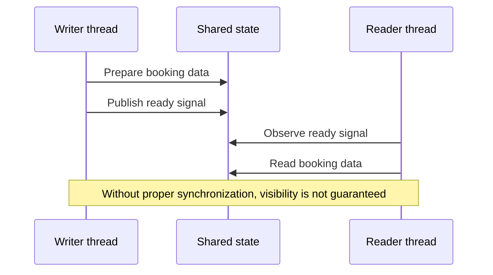
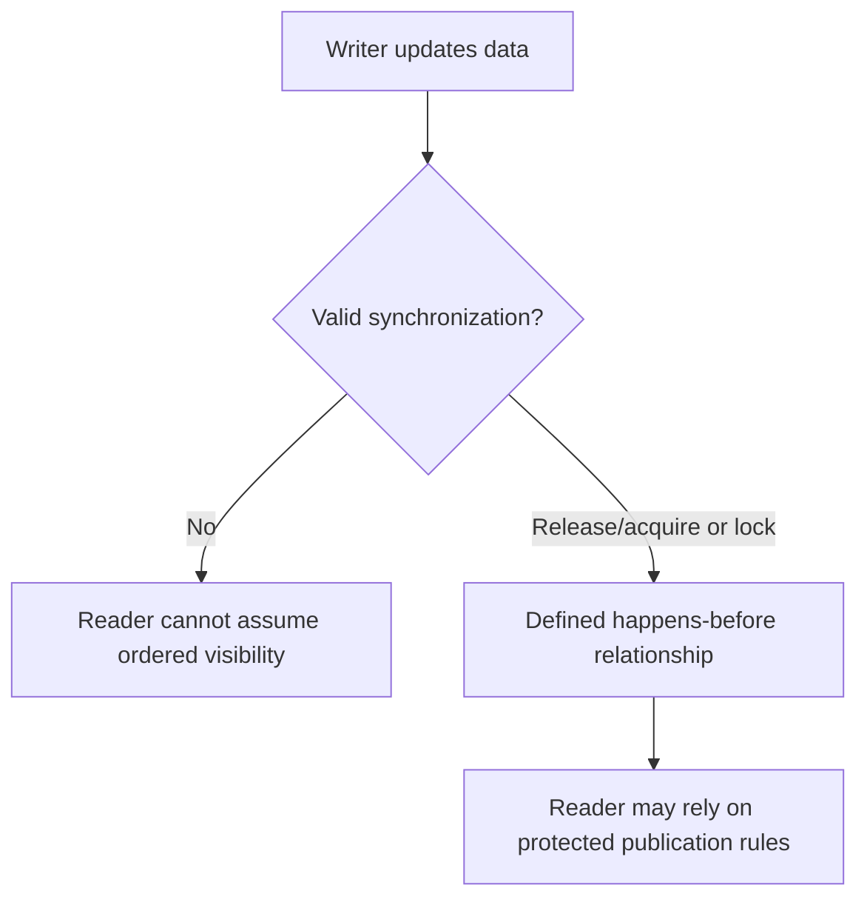

# CS320 — Operating Systems, Concurrency, and Runtimes
## Lecture 07: Threads, Atomics, and Memory Ordering

*Why two threads updating shared state with code that looks logically correct can still observe inconsistent results across processors.*

---

# Part I — Intuition

*Two workers share a notice board. One writes the data and then raises a flag. The other sees the flag—but what exactly is it allowed to assume about the data?*

### The picture to carry in your head

Imagine a hotel with two employees in separate offices. One employee prepares tomorrow's room assignments. When finished, she posts the assignments and turns on a green light to tell her colleague they are ready.

The colleague has one rule: don't read the new assignments until the green light is on.

This sounds perfectly safe. First write the data, then signal completion; first observe the signal, then read the data.

But computers don't always expose shared-memory operations to other threads in the order a human imagines from reading source code. Compilers and processors may rearrange some operations under the language's allowed rules. Different cores have caches and machinery for making memory updates visible. If our code has no proper synchronization, the apparent green-light protocol may not establish the guarantee we think it does.

The first diagram is deliberately simple: our problem isn't merely two threads sharing data. It's whether a signal establishes a trustworthy relationship between the writer's changes and the reader's observation.

### 1. A shared variable is not a hand-delivered message

In a single-threaded program, you often reason from the order of statements. Set the room number, set the price, then set `ready` to true. Later lines observe changes made earlier in the same execution according to the language's semantics.

Across threads, however, shared memory introduces additional questions. Does each access happen atomically? Can operations be reordered? When does another thread become entitled to observe earlier writes? Which operations actually synchronize with each other?

Picture two employees writing on independent whiteboards and using an unreliable communication system to exchange changes. One employee may know they've written the room assignments, but the other needs a defined method to know those assignments are visible and complete.

The analogy is imperfect, because real hardware has precise memory-coherence and ordering rules rather than arbitrary delays. But it reminds us to ask for an actual guarantee instead of relying on what source-code order seems to imply.

### 2. Atomic doesn't mean “the whole workflow is safe”

Suppose several threads increment a shared counter. A naïve `counter = counter + 1` appears to be one line. But the conceptual operation reads a value, computes a new one, and writes it back. Another thread may interfere if the accesses aren't coordinated under the language's rules.

An **atomic operation** can make a particular update indivisible in the way specified by the memory model. That's useful for counters, flags, and certain synchronization structures.

But an atomic `ready` flag by itself doesn't automatically make a complex business operation transactionally correct. You must choose the appropriate memory ordering and synchronization relationship for the data being published. And an atomic in-process flag cannot protect a booking invariant spread across ten separate backend services.

**Checkpoint:** If every thread increments one atomic counter correctly, does that guarantee a hotel can't be double-booked? No. The counter and the authoritative reservation workflow are different correctness boundaries.

### 3. The handshake that makes publication meaningful

Our two employees need a proper handoff protocol.

One suitable pattern is for the writer to prepare ordinary data, then publish an atomic flag using **release** semantics. The reader observes that flag through a compatible atomic **acquire** operation. When the acquire observes the corresponding release under the model's conditions, operations that happened before the release become appropriately ordered and visible to the reader.

This is part of the idea behind a **happens-before** relationship.

You don't need to memorize the complete memory-ordering formalism yet. The intuition is that the handoff isn't just a boolean. It's a synchronization event with defined consequences for other memory operations.

Locks can provide similar higher-level protection. A writer acquires a mutex, modifies protected data, then releases it. A reader acquires the same mutex before inspecting that data. Correct lock discipline gives the program an understood relationship between the modifications and reads.

There is a cost: locks can create waiting and contention. Some concurrency designs use atomics and lock-free techniques to avoid particular forms of blocking, but those designs can be much harder to reason about correctly.

The second diagram contrasts the uncontrolled shared-board arrangement with a synchronized handoff.

### 4. Reordering is not permission for random behavior

It's tempting to say that CPUs can reorder everything however they like. That would be wrong. Programming languages define what transformations and observations are permitted, and processors must preserve the required architectural behavior.

Some languages classify certain unsynchronized conflicting memory accesses as data races. In C and C++, for example, a data race on ordinary non-atomic memory has undefined behavior. Java and JavaScript shared-memory facilities have their own defined memory models. Rust safe code restricts many conflicting references so that unsynchronized data races are prevented under its safety guarantees.

The key point isn't that every shared-memory program inevitably fails. It's that correct behavior needs a model-backed synchronization mechanism, not a belief that two processors will see every operation in the author's intended order.

### 5. The minute-long replay

One employee prepares data and raises a flag. Another waits for the flag before reading. In ordinary conversation, this seems enough. In shared-memory programming, a correct handoff must also establish the relevant atomicity, ordering, and visibility guarantees. Release/acquire synchronization or a mutex can give those guarantees under the language model's conditions.

L07 will explore what atomics actually promise, what memory order means, and why apparently reasonable unsynchronized programs can fail. The single picture to keep is **a publication protocol**, not mysterious processors randomly disobeying source code.

### Three questions before the Deep Dive

1. **Why isn't a plain shared `ready` flag automatically enough?** It may lack the atomicity and ordering guarantees needed to publish associated data safely.
2. **What does happens-before describe?** A defined ordering relationship that allows certain observations to be justified.
3. **Do atomics replace database transactions?** No. In-process shared-memory synchronization doesn't enforce distributed business invariants.

*The intuition pass ends here.*

---

# Part II — Deep Dive

### Status — Planning Stub

Full voice-first manuscript not yet authored.

### Learning Objective

Understand why code order isn't necessarily sufficient to reason about shared-memory correctness and when synchronization establishes the necessary guarantees.

### Opening Problem

Two threads update shared state using code that appears logically correct, yet different processors observe inconsistent results.

### Planned Coverage

Shared memory, data races, atomic operations, synchronization, happens-before relationships, memory visibility, mutexes, contention, deadlocks, lock-free intuition, and why compiler/CPU reordering complicates concurrency.

### Scope Boundaries

L01 teaches concurrency as an application concept. L07 examines lower-level shared-memory correctness. Keep the discussion conceptual rather than turning the course into C++ concurrency specialization.

### Expected Understanding

Explain data races versus synchronization; describe happens-before and visibility; recognize when reordering makes 'correct-looking' shared-memory code unsafe.

### Planned Manuscript Structure

1. Narrative hook and sustained engineering case study.
2. Technical development of the underlying mechanisms.
3. Practical trade-offs and realistic failure scenarios.
4. Oral examination.
5. Solutions and discussion.
6. The Mental Model Worth Keeping.
7. Next Lecture or course-completion transition.
8. Optional Practical Lab, after the spoken lecture ends.
9. Further Reading.
10. Dense Cheatsheet — Interview Glance Card, last, inside one fenced text block.

<!-- Full manuscript to be generated later. -->

