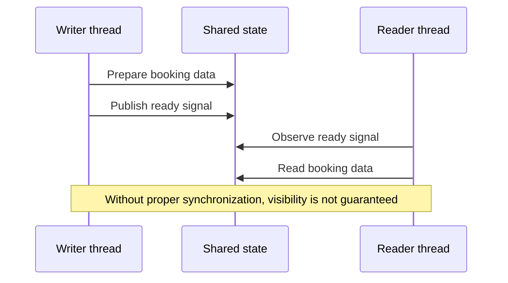
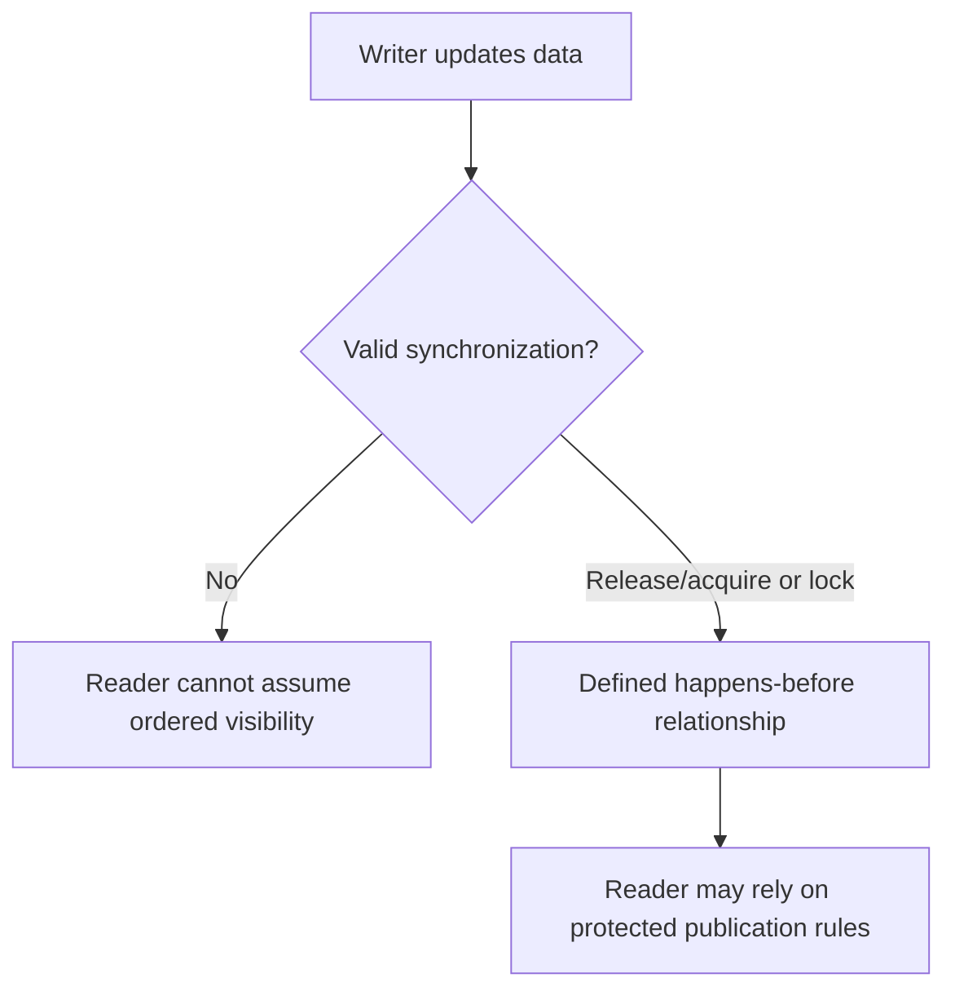

# CS320 — Operating Systems, Concurrency, and Runtimes

## Lecture 07: Threads, Atomics, and Memory Ordering

*Why two threads updating shared state with code that looks logically correct can still observe inconsistent results across processors.*

**Estimated study time:** 80–100 minutes, including the optional practical lab.

---

### How to listen to this lecture

This lecture builds one model of shared-memory correctness, then uses it to explain the mechanisms developers encounter in real systems.

**Part I — Intuition** introduces two workers sharing a notice board. One publishes data and raises a ready flag. The other sees the flag and attempts to read the result. That simple handoff exposes the central problem: how can one thread know which actions performed by another thread are safe to observe?

**Part II — Deep Dive** examines data races, atomic operations, memory ordering, happens-before relationships, mutexes, condition variables, lock-free techniques, and the interaction between compilers and processors.

We'll compare how these concepts appear in JavaScript, Rust, Java, and Go without turning this into a C++ language-specialization course.

The spoken narrative prioritizes mental models. Language-specific code and experiments follow in the optional practical lab.

---

# Part I — Intuition

*Two workers share a notice board. One writes the data and then raises a flag. The other sees the flag—but what exactly is it allowed to assume about the data?*

### The picture to carry in your head

Imagine a hotel with two employees in separate offices. One employee prepares tomorrow's room assignments. When finished, she posts the assignments and turns on a green light to tell her colleague they are ready.

The colleague has one rule: don't read the new assignments until the green light is on.

This sounds perfectly safe. First write the data, then signal completion; first observe the signal, then read the data.

But computers don't always expose shared-memory operations to other threads in the order a human imagines from reading source code. Compilers and processors may rearrange some operations under the language's allowed rules. Different cores have caches and machinery for making memory updates visible. If our code has no proper synchronization, the apparent green-light protocol may not establish the guarantee we think it does.

The first diagram is deliberately simple: our problem isn't merely two threads sharing data. It's whether a signal establishes a trustworthy relationship between the writer's changes and the reader's observation.



### 1. A shared variable is not a hand-delivered message

In a single-threaded program, you often reason from the order of statements. Set the room number, set the price, then set `ready` to true. Later lines observe changes made earlier in the same execution according to the language's semantics.

Across threads, however, shared memory introduces additional questions. Does each access happen atomically? Can operations be reordered? When does another thread become entitled to observe earlier writes? Which operations actually synchronize with each other?

Picture two employees writing on independent whiteboards and using an unreliable communication system to exchange changes. One employee may know they've written the room assignments, but the other needs a defined method to know those assignments are visible and complete.

The analogy is imperfect, because real hardware has precise memory-coherence and ordering rules rather than arbitrary delays. But it reminds us to ask for an actual guarantee instead of relying on what source-code order seems to imply.

### 2. Atomic doesn't mean “the whole workflow is safe”

Suppose several threads increment a shared counter. A naïve `counter = counter + 1` appears to be one line. But the conceptual operation reads a value, computes a new one, and writes it back. Another thread may interfere if the accesses aren't coordinated under the language's rules.

An **atomic operation** can make a particular update indivisible in the way specified by the memory model. That's useful for counters, flags, and certain synchronization structures.

But an atomic `ready` flag by itself doesn't automatically make a complex business operation transactionally correct. You must choose the appropriate memory ordering and synchronization relationship for the data being published. And an atomic in-process flag cannot protect a booking invariant spread across ten separate backend services.

**Checkpoint:** If every thread increments one atomic counter correctly, does that guarantee a hotel can't be double-booked? No. The counter and the authoritative reservation workflow are different correctness boundaries.

### 3. The handshake that makes publication meaningful

Our two employees need a proper handoff protocol.

One suitable pattern is for the writer to prepare ordinary data, then publish an atomic flag using **release** semantics. The reader observes that flag through a compatible atomic **acquire** operation. When the acquire observes the corresponding release under the model's conditions, operations that happened before the release become appropriately ordered and visible to the reader.

This is part of the idea behind a **happens-before** relationship.

You don't need to memorize the complete memory-ordering formalism yet. The intuition is that the handoff isn't just a boolean. It's a synchronization event with defined consequences for other memory operations.

Locks can provide similar higher-level protection. A writer acquires a mutex, modifies protected data, then releases it. A reader acquires the same mutex before inspecting that data. Correct lock discipline gives the program an understood relationship between the modifications and reads.

There is a cost: locks can create waiting and contention. Some concurrency designs use atomics and lock-free techniques to avoid particular forms of blocking, but those designs can be much harder to reason about correctly.

The second diagram contrasts the uncontrolled shared-board arrangement with a synchronized handoff.



### 4. Reordering is not permission for random behavior

It's tempting to say that CPUs can reorder everything however they like. That would be wrong. Programming languages define what transformations and observations are permitted, and processors must preserve the required architectural behavior.

Some languages classify certain unsynchronized conflicting memory accesses as data races. In C and C++, for example, a data race on ordinary non-atomic memory has undefined behavior. Java and JavaScript shared-memory facilities have their own defined memory models. Rust safe code restricts many conflicting references so that unsynchronized data races are prevented under its safety guarantees.

The key point isn't that every shared-memory program inevitably fails. It's that correct behavior needs a model-backed synchronization mechanism, not a belief that two processors will see every operation in the author's intended order.

### 5. The minute-long replay

One employee prepares data and raises a flag. Another waits for the flag before reading. In ordinary conversation, this seems enough. In shared-memory programming, a correct handoff must also establish the relevant atomicity, ordering, and visibility guarantees. Release/acquire synchronization or a mutex can give those guarantees under the language model's conditions.

L07 will explore what atomics actually promise, what memory order means, and why apparently reasonable unsynchronized programs can fail. The single picture to keep is **a publication protocol**, not mysterious processors randomly disobeying source code.

### Three questions before the Deep Dive

1. **Why isn't a plain shared `ready` flag automatically enough?** It may lack the atomicity and ordering guarantees needed to publish associated data safely.
2. **What does happens-before describe?** A defined ordering relationship that allows certain observations to be justified.
3. **Do atomics replace database transactions?** No. In-process shared-memory synchronization doesn't enforce distributed business invariants.

*The intuition pass ends here.*

---

# Part II — Deep Dive

# 1. The Booking Snapshot That Was Ready Before It Was Safe

Our hotel-booking platform has developed a new pricing engine.

Previously, the backend calculated prices on the main JavaScript execution thread. That worked for modest workloads, but large batches created latency spikes.

The engineering team moves the expensive calculation into worker threads.

Each worker prepares a pricing snapshot containing three pieces of information: a hotel identifier, an available-room count, and a calculated price. The results are stored in a shared memory region so the main thread doesn't need to copy large amounts of data between workers.

The arrangement seems elegant.

A worker writes the values.

It sets a shared flag called `ready` to true.

The main thread checks the flag.

When the flag becomes true, the main thread reads the snapshot and sends the price to the customer.

The test suite passes.

Then, during a particularly busy evening, something strange happens.

The main thread appears to observe a completed snapshot, yet the accompanying data isn't what the application expects.

A hotel has its new price but an earlier room count. Or a reader sees an incomplete state and incorrectly treats it as final.

The team examines the source code.

The worker clearly writes the fields before setting `ready`.

The reader clearly checks `ready` before accessing the fields.

Nobody can find a line where the business logic explicitly permits the wrong combination.

Naturally, an engineer says:

"But the statements are in the right order."

And that's exactly where our investigation begins.

**Source-code order within one thread isn't automatically a synchronization contract between threads.**

That doesn't mean the processor simply ignores program instructions.

It means that several distinct properties must hold before one thread can safely draw conclusions from another thread's actions.

We need to know whether the memory is genuinely shared, whether accesses are atomic, whether they are ordered, and whether the synchronization establishes the relationship the application depends on.

A correctly designed handoff gives us those guarantees.

An ordinary unsynchronized flag may not.

---

# 2. Threads Share an Address Space, Not a Single Stream of Execution

Let's begin beneath the application.

A process can contain multiple threads.

Those threads normally share the process's address space, while retaining their own execution contexts, stacks, and relevant scheduling state.

The operating system can schedule threads onto different logical CPUs.

If the machine has appropriate processing capacity, multiple threads can execute instructions simultaneously.

That's the meaning of actual parallel execution.

## 2.1 Shared memory creates communication without messages

Imagine two worker threads inside one process.

Both can access a suitable shared data structure.

The first writes a value.

The second reads the same memory location.

No network packet is required.

No JSON serialization is inherently required.

The communication happens through shared memory.

That can be extremely efficient.

But it introduces a difficult question.

**What does it mean for one thread's write to be observable by another thread?**

The answer isn't always as simple as "the writer executed first."

We must establish what kind of ordering exists between the operations.

## 2.2 Threads aren't always sharing the same JavaScript objects

In Node.js, worker threads execute JavaScript in separate execution environments.

They don't ordinarily share arbitrary JavaScript object graphs as ordinary mutable objects.

Data passed through worker messaging is generally cloned or transferred according to the relevant API and data type.

But a `SharedArrayBuffer` allows supported memory to be shared.

Different workers can create typed-array views over the same shared backing storage.

Now genuine shared-memory coordination becomes possible.

And because the workers may execute on different CPU cores, our concurrency concerns are no longer merely about callbacks running in surprising order.

They concern simultaneous memory accesses.

---

# 3. The First Problem: Read, Modify, Write Isn't One Operation

Before dealing with memory ordering, let's begin with a much simpler mistake.

Suppose our booking service maintains a counter of processed reservations.

Two workers need to increment it.

The source code resembles:

`counter = counter + 1`

That looks like one operation because it's written on one line.

But conceptually, incrementing a stored value involves several steps.

Read the existing value.

Calculate the next value.

Store the result.

Now imagine the counter begins at ten.

Worker A reads ten.

Worker B also reads ten.

Worker A calculates eleven.

Worker B calculates eleven.

Worker A writes eleven.

Worker B writes eleven.

Both workers completed an increment.

The final value is eleven, not twelve.

This is a **lost update**.

## 3.1 Why separate correctness isn't enough

Each worker followed the intended algorithm.

The problem appears only when the operations overlap.

We saw the same broad pattern in CS320-L01 and in our database-transactions course.

But there's an important difference here.

In a database, we need the database's transaction and isolation machinery to protect shared business state.

Inside one process, we're dealing with accesses to shared memory governed by the programming language's memory model.

These are separate correctness boundaries.

## 3.2 Atomic increment

A suitable atomic read-modify-write operation allows the increment to happen as one indivisible operation according to the language's atomic semantics.

The two workers no longer independently overwrite each other's increment in the simple lost-update pattern.

For example, JavaScript's `Atomics.add` operates on supported shared integer typed arrays.

Rust provides atomic integer operations such as `fetch_add`.

Java provides appropriate atomic variable classes.

Go provides operations through its `sync/atomic` package.

All of them address the need for indivisible updates to particular atomic locations.

But atomicity is only our first problem.

It does not explain why writing a complete record and then signaling readiness may require additional ordering guarantees.

---

# 4. Atomicity, Visibility, and Ordering Are Three Different Questions

Let's separate three ideas that developers often collapse into the word "thread-safe."

**Atomicity** asks whether an operation can be observed as an indivisible update under the relevant memory model.

**Visibility** asks what writes another thread is allowed to observe and under what conditions.

**Ordering** asks which relationships among operations the programming language guarantees across threads.

These are related properties, but they aren't interchangeable.

## 4.1 Atomicity doesn't automatically order unrelated memory

Suppose a worker writes several ordinary fields and then updates an atomic counter.

The counter update may be indivisible.

But whether another thread can safely use that counter observation to read the fields depends on the synchronization semantics and the program's ownership protocol.

An atomic counter isn't automatically an announcement that every unrelated piece of memory is ready.

We need an appropriate synchronization relationship.

## 4.2 Visibility needs a contract

Imagine the worker calculates a price and writes it into shared memory.

The main thread reads that same location.

In a sequential program, the ordering of statements provides a straightforward model.

In a concurrent program, the relevant language rules determine what observations are permitted.

A plain unsynchronized shared read may not be entitled to assume it sees the most recent write in the intuitive wall-clock sense.

And in languages such as C++, a data race involving ordinary non-atomic accesses can make the program's behavior undefined.

This isn't an invitation to memorize spooky examples.

It's a reason to use well-defined synchronization instead of guessing about processor behavior.

## 4.3 Ordering is a relationship, not a stopwatch

Now imagine two threads running on separate cores.

There may be no useful universal ordering between every instruction in both threads.

Some operations are independent.

Some are explicitly synchronized.

Others can overlap.

A memory model determines which ordering relationships matter and what results they permit.

This leads to one of the central concepts of concurrent programming.

**Happens-before.**

---

# 5. Happens-Before: A Contract for Explaining What Another Thread May Observe

The term *happens-before* sounds like ordinary time.

But in concurrent programming, it describes a defined ordering relationship.

It isn't simply a statement that one line of code appeared earlier in a source file.

Nor is it merely a claim that one CPU instruction happened earlier according to a wall clock.

It's a relation established through the language's rules, including the relevant within-thread ordering and synchronization operations.

## 5.1 The two ingredients

First, a language defines an ordering among operations within a thread.

This is often described using terms such as **sequenced-before** or **program order**, depending on the language.

Second, certain operations establish synchronization relationships between threads.

A matching lock release and subsequent acquisition can do this.

An appropriate atomic release and acquire pair can do this.

Some language runtimes provide additional synchronization mechanisms.

The combination allows us to reason across the thread boundary.

## 5.2 Our publication protocol

Return to the pricing snapshot.

The writer performs the following conceptual operations.

First, it prepares the booking data.

Second, it publishes a ready signal through a suitable release operation.

The reader waits until a compatible acquire operation observes the relevant published signal.

Then it reads the booking data.

Under a correct publication protocol, the writes that happened before the release become ordered before the reader's accesses following the corresponding acquire.

The reader now has a meaningful basis for trusting the published snapshot.

Notice the important limitation.

This doesn't permit the writer to keep changing the data concurrently while the reader accesses it without further coordination.

The publication protocol must also establish an appropriate lifetime and ownership rule for the data.

For example, the writer may promise not to mutate the published snapshot again until the reader has finished.

Synchronization cannot rescue an incorrectly designed ownership protocol.

## 5.3 The key condition

It's not enough that one thread performs an acquire load at some arbitrary moment.

The acquire must observe the corresponding release, or participate in an appropriate release sequence under the relevant memory model.

Otherwise, the synchronization edge we intended may not exist.

This subtlety is why memory ordering is about precise relationships rather than simply placing keywords around variables.

A well-designed library hides much of that complexity.

But when engineers implement shared-memory protocols themselves, the details are essential.

---

# 6. Why the Compiler and CPU Can Rearrange Work

The intuitive publication bug becomes more interesting when we ask why source-code order isn't sufficient.

Modern compilers optimize programs.

Processors also execute instructions through sophisticated mechanisms.

They may use store buffers, caches, speculative execution, and other techniques that allow independent operations to progress without behaving like a simplistic instruction-by-instruction machine.

But there's an important qualification.

Compilers and processors must preserve the behavior required by the relevant language and architecture.

They cannot simply reorder anything without restriction.

## 6.1 The single-threaded illusion

Imagine two independent calculations.

The compiler may discover that executing them in a different internal order produces the same permitted result.

It can rearrange work where allowed.

Similarly, a processor may issue or complete independent operations through mechanisms that improve performance.

Within a correctly defined single-threaded program, these transformations preserve the language's required observable behavior.

But with shared memory, another thread may observe effects.

Now ordering rules become important.

## 6.2 Cache coherence isn't enough

Modern multiprocessor systems commonly provide hardware cache-coherence mechanisms.

These help maintain coherent behavior for accesses to individual memory locations under the architecture's rules.

But coherence is not the same as a universal order across all different memory locations.

Imagine writing the price into one location and setting readiness in another.

We need the language-level synchronization rule connecting those operations.

The fact that processors maintain coherent caches doesn't automatically prove that our larger publication protocol is correct.

This is a distinction worth remembering:

**Coherence concerns the behavior of individual memory locations. Memory ordering concerns relationships among operations, potentially involving several locations.**

## 6.3 x86 and ARM may differ

Different processor architectures expose different memory-ordering constraints.

A low-level shared-memory implementation that appears to work reliably on one architecture may fail on another if it relies on assumptions the language doesn't guarantee.

For example, some memory-ordering behaviors are stronger by default on common x86 implementations than on other architectures.

But the correct engineering approach isn't to memorize which architecture seems forgiving.

It's to use synchronization primitives defined by the programming language or runtime.

Then rely on the implementation to generate the necessary instructions or barriers for the target architecture.

That's what portability means at this level.

---

# 7. The Memory-Ordering Ladder: Relaxed, Acquire, Release, Sequentially Consistent

Now we're ready to introduce the terminology.

Languages such as Rust and C++ expose several atomic memory-ordering modes.

These allow programmers to express different synchronization requirements.

The exact formal rules are complex.

But we can build a useful mental hierarchy.

## 7.1 Relaxed atomics

A **relaxed** atomic operation guarantees atomic access to that location under the relevant language model, without introducing the broader ordering constraints associated with acquire or release operations.

Imagine several workers incrementing a statistics counter.

The counter's individual updates must not be lost.

But the counter doesn't necessarily publish any other shared data.

In that case, relaxed atomic operations may be sufficient.

We care about the integrity of the counter itself.

We aren't using the counter as a handoff signal protecting a separate data structure.

This is a good example of a comparatively weak synchronization requirement.

But be careful: saying relaxed operations are atomic doesn't mean they automatically establish a useful happens-before relationship for unrelated ordinary memory accesses.

## 7.2 Release

A **release** operation is suitable for publishing earlier work.

Conceptually, it prevents relevant earlier operations from being reordered past the release in ways that would violate the language's memory-model guarantees.

Imagine our worker has finished constructing a snapshot.

It publishes a ready flag using release semantics.

That operation can participate in a handoff to another thread.

The release alone doesn't guarantee that another thread has already consumed the data.

It's the publishing side of the protocol.

## 7.3 Acquire

An **acquire** operation is suitable for observing a publication.

When the acquire reads the corresponding released value under the relevant rules, it establishes the synchronization relationship.

Now subsequent accesses can rely on earlier writes ordered before the release, provided the surrounding program respects the necessary ownership and race-freedom conditions.

This is the receiving side of the protocol.

Release says, in effect:

"My preceding work is ready to be published."

Acquire says:

"I've observed the appropriate publication, and I can proceed under its guarantees."

## 7.4 Acquire-release

Some atomic operations both read and modify memory.

For those operations, an **acquire-release** ordering can provide both kinds of synchronization behavior where applicable.

This is useful in certain lock implementations and other read-modify-write protocols.

But it isn't necessary for every atomic counter or flag.

The correct ordering follows the actual communication requirement.

## 7.5 Sequential consistency

**Sequentially consistent** atomic operations provide stronger ordering guarantees.

They participate in a single total order of sequentially consistent atomic operations consistent with the relevant rules.

This often provides a more intuitive mental model than weaker ordering combinations.

But don't interpret it as making an entire multithreaded application execute one instruction at a time.

Other non-atomic operations, independent threads, and broader program structure still need correct synchronization.

Sequential consistency makes particular atomic reasoning stronger.

It doesn't replace a sound concurrency design.

## 7.6 An important JavaScript distinction

JavaScript's `Atomics` API does not expose Rust-style choices between relaxed, acquire, and release ordering.

JavaScript's atomic operations on shared typed arrays have sequentially consistent semantics.

So while it's useful for a JavaScript developer to understand release/acquire conceptually, you cannot simply pass a Rust-like `Ordering::Release` option to `Atomics.store`.

The API makes a different design choice.

It exposes a stronger default atomic ordering model rather than requiring application developers to choose from a memory-ordering ladder.

That's an example of programming-language design affecting the complexity developers must manage.

---

# 8. A Correct Shared-Memory Handoff in JavaScript

Let's return to the Node.js pricing engine.

Suppose the worker and main thread share a small `SharedArrayBuffer`.

We create an integer typed-array view.

One location holds a result.

Another holds the ready flag.

The producer writes the result through an atomic store.

It then atomically stores the ready flag.

The consumer atomically loads the ready flag.

Once it observes the published value, it atomically loads the result.

Because JavaScript's atomic operations are sequentially consistent, the handoff has defined ordering behavior.

For this simple one-time publication, it's straightforward to reason about the result.

## 8.1 Why use atomics for both fields?

Using atomic accesses makes the example easier to state precisely.

The data field and flag participate in the atomic memory model.

We don't need to rely on ordinary shared-memory accesses with weaker semantics.

The protocol also avoids concurrent mutation after publication.

There's exactly one producer for the snapshot, and the consumer reads it only after the ready signal.

That's a clean starting point.

More complex protocols may use ordinary shared data protected by a suitable synchronization relationship, but they require careful adherence to the memory model and ownership rules.

## 8.2 Why the ready flag must be shared

An ordinary JavaScript boolean variable in one worker's execution context isn't automatically visible as the same mutable variable to another worker.

The workers need an explicit shared-memory mechanism or a message-passing channel.

`SharedArrayBuffer` makes the relevant backing memory available to both.

`Atomics` supplies operations with the required synchronization semantics.

This separates two concerns.

Sharing determines whether both agents can address the same memory.

Synchronization determines whether their concurrent accesses are correct.

You need both when using shared memory.

---

# 9. `Atomics.wait` and `Atomics.notify`: Don't Spin Forever

A consumer needs to wait until the snapshot becomes ready.

One possible design repeatedly loads the flag.

Still zero.

Still zero.

Still zero.

This is a **spin loop**.

It may consume significant CPU time while making no useful progress.

For very short waits in carefully designed low-level algorithms, spinning can sometimes be appropriate.

But long or indefinite spinning is usually undesirable.

## 9.1 Waiting on an atomic condition

JavaScript provides `Atomics.wait` for suitable shared integer typed-array locations in execution contexts where blocking waits are permitted.

Conceptually, a thread can say:

"Wait while this location still contains the expected value."

The runtime can block the waiting thread rather than making it repeatedly consume CPU.

Another thread updates the value and calls `Atomics.notify`.

A waiting thread can then wake and recheck the condition.

In browser environments, blocking waits are not allowed on the main UI thread. Web workers are the typical place for such waits.

In Node.js, worker threads are likewise a natural place for blocking waits.

Blocking the main application event-loop thread would be counterproductive.

## 9.2 Notification is not the condition itself

An important mistake is treating notification as proof that the desired state exists.

A notification means something relevant may have changed.

The consumer must still examine the shared state.

A worker could be awakened for a reason that doesn't mean its exact condition is satisfied.

The robust design is to wait for a condition, not merely for a notification.

This principle also appears in condition variables and operating-system synchronization primitives.

## 9.3 Avoiding lost wakeups

Imagine the writer completes the snapshot just before the reader begins waiting.

If the reader blindly waits for a future notification, it might wait forever.

A proper wait protocol checks the current value and only blocks if it still equals the expected value.

The check-and-wait behavior must be coordinated atomically by the appropriate primitive.

That's why `Atomics.wait` is more useful than inventing a homemade sleep-and-poll protocol.

It isn't merely a way to pause execution.

It participates in a defined synchronization scheme.

---

# 10. Mutexes: The Boring Tool That Solves Most Shared-State Problems

We have spent considerable time on atomics.

Does that mean every shared data structure should be implemented through atomic operations?

Absolutely not.

For most application-level shared mutable structures, a **mutex** is easier to reason about.

A mutex provides mutual exclusion.

Only an appropriate holder can enter a protected critical section at a time.

Other contenders must wait.

## 10.1 The booking snapshot with a mutex

Imagine our snapshot contains many fields.

Hotel identifier.

Arrival date.

Departure date.

Room inventory.

Price.

Discount information.

Version number.

A flag plus individually coordinated atomic fields could become complicated.

Instead, the writer acquires a mutex protecting the snapshot.

It updates the fields.

It releases the mutex.

The reader acquires the same mutex.

It reads a consistent protected state.

Then it releases the mutex.

Provided all accesses follow the same locking discipline, the synchronization mechanism establishes the relevant ordering and mutual-exclusion guarantees.

The design is conceptually simple.

Only one thread modifies or reads protected mutable state within the required exclusive critical section at a time.

## 10.2 Locking protects an invariant, not just a variable

Here's a useful improvement to our mental model.

Suppose the snapshot has two fields.

`availableRooms` and `reservedRooms`.

Together, they must satisfy a local invariant relative to an inventory total.

If we protect each field with a different mutex, a reader might acquire them at different moments and observe values belonging to different logical states.

Each individual field access could be properly synchronized.

The combined snapshot might still be inconsistent.

We should choose synchronization boundaries around the **invariant that must remain coherent**.

This is deeper than merely locking individual variables.

It asks which pieces of state must be observed together.

A good critical section protects the logical unit of state rather than a random collection of memory locations.

## 10.3 Locks come with costs

A mutex introduces the possibility of waiting.

If one thread holds it for a long time, others may be delayed.

If many threads frequently contend for the same lock, throughput can decline.

If code acquires several locks in inconsistent orders, deadlocks can occur.

And if a thread holds a lock while performing slow I/O, unrelated operations may become blocked behind an external dependency.

This is why synchronization design involves both correctness and performance.

But the correct response isn't to eliminate locks at all costs.

**A simple correct mutex design is often better than a clever lock-free design that nobody can reliably verify.**

---

# 11. Condition Variables: Wait for a State Change Without Burning CPU

Now imagine our shared work queue.

Producer threads add tasks.

Consumer threads remove tasks.

What should a consumer do when the queue is empty?

It could repeatedly acquire the mutex, inspect the queue, release the mutex, and try again.

That wastes work.

Instead, many threading libraries provide **condition variables**.

A condition variable allows a thread to wait for a relevant state transition while coordinating with a mutex.

## 11.1 The critical sequence

The consumer acquires the mutex.

It checks whether the queue contains work.

If the queue is empty, it waits on the condition variable.

The wait operation releases the mutex appropriately while blocking.

When awakened, the consumer reacquires the mutex before continuing under the condition-variable contract.

It then checks the condition again.

That last step matters enormously.

A notification does not guarantee the queue is still nonempty when the consumer resumes.

Another consumer may have taken the available work.

Spurious wakeups are also permitted by some condition-variable interfaces.

Therefore, the usual pattern is a **loop that rechecks the predicate**.

Not a single `if` statement that assumes every wakeup means success.

## 11.2 Why the mutex must be released while waiting

Imagine the consumer held the mutex while waiting for the producer.

The producer would need the same mutex to insert work.

The consumer would refuse to continue until work appeared.

The producer couldn't insert work because the consumer never released the lock.

We would have built a deadlock.

Condition-variable waiting avoids this problem by coordinating the release, wait, and reacquisition behavior.

It lets the producer make the state change that the consumer is waiting for.

This is another example of a synchronization API doing more than simply pausing a thread.

It establishes an appropriate protocol around shared state.

---

# 12. Deadlocks: Correct Locks, Incorrect Ordering

Now our pricing engine uses two mutexes.

One protects a snapshot cache.

The other protects a shared statistics structure.

Worker A acquires the snapshot lock.

Then it tries to acquire the statistics lock.

Worker B acquires the statistics lock.

Then it tries to acquire the snapshot lock.

Both locks are implemented correctly.

Both threads follow their local code correctly.

But the system stops making progress.

Worker A holds the resource B needs.

Worker B holds the resource A needs.

Neither can release its first lock because each is waiting for the second.

That's a **deadlock**.

## 12.1 The simple prevention rule

One common strategy is to establish a global lock-acquisition order.

For example:

Always acquire the snapshot lock before the statistics lock.

Every relevant code path follows that order.

Now the cyclic wait pattern above cannot arise through those two locks in the same way.

This is a design rule, not a special CPU instruction.

The important insight is that synchronization correctness includes relationships among locks, not merely whether each lock works individually.

## 12.2 Lock contention isn't deadlock

Suppose one worker holds a mutex for two hundred milliseconds.

Other workers wait.

Eventually, the holder releases it.

The waiters continue.

That is contention.

It may be slow, but it isn't necessarily a deadlock.

Now suppose the holder never releases the lock because it is itself waiting for a resource that requires a blocked waiter to make progress.

That's a different failure.

Diagnosis needs to distinguish long waits from cyclic dependencies.

## 12.3 Priority inversion revisited

In CS320-L04, we studied priority inversion.

A high-priority task may wait for a lock held by a lower-priority task.

Scheduling policy and lock ownership can interact in surprising ways.

Some synchronization mechanisms provide priority inheritance.

But ordinary mutexes shouldn't be assumed to provide every real-time scheduling guarantee.

The correct response is to understand the lock's behavior and the scheduling environment.

---

# 13. Compare-and-Swap: The Atomic Building Block Behind Many Concurrent Structures

Now imagine we want an atomic state transition.

A counter currently holds five.

We want to change it to six, but only if nobody else has changed it since we last observed five.

This is where **compare-and-swap**, often called CAS, becomes useful.

The conceptual operation is:

"Compare the current value with an expected value. If they match, replace it with the new value as one atomic operation."

If another thread changed the value first, the comparison fails.

The caller can inspect the result and decide whether to retry.

## 13.1 Optimistic concurrency in memory

This may sound familiar.

In database systems, optimistic concurrency control often checks whether a version still matches before committing an update.

CAS resembles that pattern at the level of atomic memory operations.

Instead of acquiring a mutex before attempting every update, a thread can make a conditional atomic change and retry if necessary.

But the analogy has limits.

A CPU atomic operation affects a particular atomic memory location or supported operation.

A database transaction can coordinate persistent state across many rows and constraints.

One doesn't replace the other.

## 13.2 CAS loops

A common atomic update pattern reads a current value.

Computes a desired replacement.

Attempts a compare-and-swap.

If the comparison fails, it retries based on the new value.

This can be useful for counters and some concurrent data structures.

But it introduces another potential issue.

Under heavy contention, many threads may repeatedly fail and retry.

They consume CPU without necessarily making proportional progress.

So even a lock-free-looking operation may have performance costs under contention.

## 13.3 The ABA problem

Here's a famous trap.

Suppose a thread reads the value A.

While it's doing other work, another thread changes A to B.

Then another operation changes B back to A.

The first thread performs compare-and-swap.

The current value is A again.

Its comparison succeeds.

But the shared state may have changed substantially in between.

This is the **ABA problem**.

It matters especially in certain pointer-based lock-free data structures, where reusing the same pointer value may conceal object replacement or reclamation.

Solutions can involve version tags, carefully designed reclamation, or different algorithms.

We don't need to implement those techniques today.

The important lesson is that **an atomic equality check doesn't prove nothing happened between observations**.

It proves only the condition guaranteed by the atomic operation.

---

# 14. Lock-Free Doesn't Mean Simple, Fast, or Free of Waiting

Now we reach an especially seductive term.

**Lock-free programming.**

It sounds like removing locks should make everything faster.

Sometimes lock-free designs are extremely valuable.

But the terminology is more precise than the marketing suggests.

## 14.1 Progress guarantees

A lock-free algorithm provides a particular system-wide progress guarantee.

Roughly speaking, under the relevant execution assumptions, the system can make progress even if an individual participating thread is delayed.

That does not mean every thread finishes quickly.

A particular thread can repeatedly lose races and fail to complete its own operation.

A stronger property, **wait-freedom**, guarantees that each operation completes within a bounded number of its own steps under the defined model.

These are technical progress properties.

They don't simply mean "uses atomics" or "has no mutex object in the source code."

## 14.2 Lock-free isn't contention-free

A lock-free structure can still have substantial contention.

Several threads may repeatedly update the same cache line.

Their atomic operations may cause coherence traffic between cores.

Retries may waste CPU.

And memory reclamation can become extremely difficult when other threads might still hold references to removed nodes.

A design without mutexes can therefore be slower, more complicated, and harder to validate than a straightforward locked implementation.

## 14.3 Memory reclamation is the hidden difficulty

Imagine a lock-free linked structure.

One thread removes a node.

It wants to free the node's memory.

But another thread might still be reading it.

How do we know reclamation is safe?

Traditional mutexes can simplify the ownership story because exclusive access is explicit.

Lock-free structures often require specialized memory-reclamation techniques such as hazard pointers, epoch-based reclamation, or related approaches.

These are sophisticated topics.

The important architectural lesson is not to adopt lock-free techniques casually.

Use established libraries and well-tested algorithms unless there is compelling evidence that a custom low-level structure is necessary.

> **Sticky note #1:** Avoiding a mutex is not the same as avoiding synchronization cost. Atomics, retries, cache coherence, and memory reclamation still impose real obligations.

---

# 15. False Sharing: When Independent Variables Fight Over One Cache Line

Let's examine a performance failure that has nothing to do with logical data races.

Our pricing engine has eight worker threads.

Each worker maintains its own counter.

No two workers update the same counter.

The code appears embarrassingly parallel.

Yet performance doesn't scale as expected.

Why?

One possibility is **false sharing**.

## 15.1 Cache lines, not individual integers

Processors move and maintain coherence for memory in cache-line-sized units.

A common cache-line size is sixty-four bytes, although it varies by architecture.

Suppose several independent counters occupy the same cache line.

Different cores repeatedly write their own counters.

Even though the logical variables are distinct, the hardware may need to coordinate ownership of the cache line.

That creates cache-coherence traffic.

The threads aren't logically contending for the same counter.

But their data occupies the same unit of hardware coherence.

## 15.2 The mitigation

One approach is to separate frequently updated per-thread values so they don't share cache lines in a harmful way.

Another is to accumulate results in local registers or thread-local storage and combine them less frequently.

This can reduce coherence traffic.

But padding every structure is not automatically beneficial.

It increases memory footprint and may hurt locality in other ways.

As always, the optimization should follow profiling and representative measurement.

The broader lesson is that concurrency performance depends not only on logical ownership but also on physical data layout.

**Two independent variables can still compete through the hardware's memory hierarchy.**

---

# 16. Java, Go, Rust, and JavaScript: Same Problem, Different Guarantees

We've now developed the concepts.

Let's compare how several languages expose them.

## 16.1 Rust

Rust provides atomic types and explicit memory-ordering choices.

A developer can use relaxed, acquire, release, acquire-release, or sequentially consistent ordering where supported by the operation.

Rust also offers mutexes, channels, and other synchronization tools.

Its ownership and borrowing system prevents many unsafe aliasing patterns in ordinary safe code.

Safe Rust is designed to prevent data races.

But logical race conditions, deadlocks, and incorrect synchronization protocols can still exist.

In particular, memory safety is not the same as business correctness.

## 16.2 Java

Java has a formal memory model that defines happens-before relationships.

A write to a `volatile` field has synchronization effects with subsequent reads of that field under the language's rules.

Monitor unlock and subsequent lock operations also establish ordering relationships.

Java offers atomic variable classes, synchronized blocks, locks, condition variables, and higher-level concurrency utilities.

The JVM must implement these language-level guarantees on the underlying hardware.

But marking every field `volatile` isn't a replacement for protecting a complex invariant.

An atomic field update doesn't automatically make a multi-field business operation atomic.

## 16.3 Go

Go's memory model defines synchronization relationships for goroutines.

The `sync` and `sync/atomic` packages provide relevant synchronization primitives.

Go's atomic operations have sequentially consistent semantics under its documented memory model.

Channel sends and receives can also establish synchronization relationships.

This is particularly useful because Go encourages communication through channels for many concurrent designs.

But goroutines can still have data races.

Go's race detector can identify many such bugs during testing.

And channels themselves don't guarantee that the surrounding application logic is correct.

## 16.4 JavaScript

JavaScript worker threads can communicate through messages or appropriate shared memory.

With `SharedArrayBuffer`, workers may access common memory through typed-array views.

The `Atomics` API supplies sequentially consistent atomic operations.

It includes loads, stores, arithmetic updates, compare-and-exchange, and waiting/notification operations for appropriate types and contexts.

JavaScript doesn't expose the weaker memory-ordering options available in Rust and C++.

But its atomic APIs still require correct protocol design.

A ready flag must represent an actual completed publication.

A shared counter doesn't protect unrelated business state.

And an `Atomics` operation doesn't coordinate a PostgreSQL transaction.

## 16.5 Different syntax, same engineering questions

Across all four languages, the meaningful questions remain stable.

What memory is shared?

Who is allowed to modify it?

Which operations are atomic?

What synchronization establishes ordering?

What prevents readers from observing partially updated state?

What happens when a thread waits?

Can the design deadlock, starve, or contend excessively?

These are language-independent engineering questions.

The language determines which answers can be enforced statically and which mechanisms are available at runtime.

---

# 17. When Message Passing Is Better Than Shared Memory

Now imagine the engineering team reconsiders the architecture.

Instead of having workers directly modify one shared pricing snapshot, each worker calculates a result independently and sends a message to the main thread.

The main thread receives the result and updates its own state.

This is **message passing**.

It changes the ownership relationship.

Rather than multiple threads reading and writing the same shared object, each worker communicates explicit results across a boundary.

## 17.1 Why message passing is easier to reason about

Imagine our worker calculates a hotel price.

When finished, it sends the result to the main thread.

The receiver processes that result.

If the message transfers or clones the relevant data under the API's semantics, we can avoid many shared-mutable-state concerns.

The worker and main thread don't need to coordinate concurrent writes to the same object.

This can substantially simplify correctness reasoning.

## 17.2 Message passing still has costs

Messages may require serialization, copying, ownership transfer, or queueing.

Large data transfers can be expensive.

Queues have finite capacity.

A receiver may become overloaded.

A message may arrive after the requesting operation has been cancelled.

Ordering guarantees depend on the messaging mechanism.

So message passing doesn't eliminate concurrency design.

It changes the kinds of problems we need to solve.

## 17.3 The right choice

For a CPU-heavy Node.js worker returning one relatively small result, message passing may be the simplest approach.

For a large shared numerical buffer that many workers need to read efficiently, shared memory may be attractive.

The choice depends on throughput requirements, data size, update frequency, ownership complexity, and the team's ability to maintain the synchronization protocol.

The useful default is:

**Prefer clear ownership and simple communication. Introduce shared mutable memory when the measured benefit justifies its additional complexity.**

---

# 18. Why Atomics Don't Prevent Double Booking

Now let's connect the whole lecture to the booking system.

Imagine our shared-memory inventory counter is atomic.

The available-room count begins at one.

Two threads attempt to decrement it.

A carefully designed compare-and-exchange loop can ensure that only one in-process claim succeeds when the count is one.

Excellent.

But what if the actual inventory is stored in PostgreSQL and accessed by several independent backend processes?

Their local atomic counters don't automatically represent one shared authoritative value.

Each process has its own memory.

A Node.js `SharedArrayBuffer` shared between workers in one process doesn't turn into a distributed atomic variable across independent servers.

Our problem has moved to another boundary.

## 18.1 Three different atomicity domains

First, there's **atomic memory access**.

A single atomic operation updates a shared memory location according to the language and hardware model.

Second, there's **local synchronization**.

Mutexes and other mechanisms can protect complex in-process state transitions.

Third, there's **authoritative transactional state**.

A database transaction or equivalent mechanism can enforce invariants across concurrent application instances.

These are related concepts.

But they aren't interchangeable implementations of one universal guarantee.

## 18.2 The application-level invariant

Suppose our booking service must never confirm more reservations than available inventory.

That invariant needs enforcement at the authoritative inventory boundary.

A database atomic conditional update, appropriate constraint, transaction isolation strategy, or equivalent coordinated mechanism may be required.

An in-process mutex can help coordinate local workers.

But it doesn't protect against another process accessing the same database.

Likewise, a database transaction doesn't automatically protect arbitrary unsynchronized memory accesses inside one process.

Correct systems use the appropriate mechanism at each boundary.

---

# 19. Diagnosing a Real Shared-Memory Failure

Let's return to the original pricing snapshot.

The worker writes data and sets `ready`.

The main thread occasionally reports inconsistent snapshots.

What should we investigate?

## 19.1 Identify actual sharing

First, establish how data is shared.

Is it a `SharedArrayBuffer`?

Is it a message-passing result?

Are several workers modifying one typed array?

Is the application using a native addon with shared state?

We need to know what memory is actually accessible concurrently.

## 19.2 Identify every reader and writer

Next, list the operations.

Which thread writes the price?

Which writes the inventory count?

Which updates the ready flag?

Does any thread reuse the snapshot while another thread is reading it?

Could the writer begin the next update before the reader finishes the previous one?

A protocol may publish the initial snapshot correctly and still fail during reuse.

That's a common source of subtle errors.

## 19.3 Check the synchronization contract

Are the shared accesses atomic where required?

What ordering does the language guarantee?

Does the reader observe a signal that actually synchronizes with the writer's publication?

Is the data stable after publication?

Are readers and writers using the same lock or compatible atomic protocol?

Do not assume source-code order alone answers these questions.

## 19.4 Reduce the reproduction

Create a minimal test containing only the shared state and participating workers.

Remove the database, network calls, business logic, and unrelated application code.

Now test the publication protocol directly.

If the reduced program still fails, we have isolated the shared-memory mechanism.

But remember: failing to reproduce a race doesn't prove that the program is correct.

A rare concurrency bug may require an unusual execution schedule.

Repeated successful tests are useful evidence, but they aren't a substitute for a valid synchronization design.

## 19.5 Use the right tools

In Rust, compiler checks and appropriate concurrency testing tools can identify certain unsafe patterns.

In Go, race detection can reveal many concurrent-access bugs.

In Java, concurrency-specific tests and runtime diagnostics can help.

In Node.js, worker-thread tests with deliberately varied scheduling can exercise the shared-memory protocol.

But different tools offer different guarantees.

A race detector may miss an execution path.

A stress test may never encounter the relevant interleaving.

And a program can be race-free while still containing a logical deadlock or incorrect business transition.

The strongest evidence combines appropriate tools with a clear argument about the synchronization relationships.

---

# 20. The Incident, Resolved

Our investigation reveals that the pricing snapshot used ordinary shared-memory writes and a plain readiness field without an adequate synchronization protocol.

The worker wrote the fields in the intended source-code order.

The reader checked readiness as intended.

But the program didn't establish the required cross-thread guarantees.

The team replaces the protocol.

For a simple one-time result, it uses atomic shared-memory operations with defined ordering.

For more complicated mutable records, it adopts clearer ownership and controlled synchronization.

It also establishes a rule:

Once a snapshot is published, the writer cannot overwrite it until the consumer has acknowledged completion or the protocol has safely transferred ownership to another buffer.

This prevents a second class of bug involving snapshot reuse.

The team then tests the design under concurrent workloads.

The results are stable.

But more importantly, the team can explain **why** the protocol is correct under the language's memory model.

That's the real improvement.

The goal isn't merely to find a configuration that appears to work.

It's to build a concurrency design whose correctness doesn't depend on lucky timing.

---

# 21. The Senior Engineer's Shared-Memory Checklist

When reviewing concurrent code, begin with ownership.

Who owns the data?

Who can read it?

Who can change it?

Then identify synchronization.

Which operations coordinate access?

Which are atomic?

Which establish happens-before relationships?

Next, identify the protected invariant.

Is it one counter?

A multi-field snapshot?

A queue?

A cache?

A state machine?

Make sure the synchronization boundary protects the actual invariant, not merely individual fields.

Then examine progress and performance.

Could the design deadlock?

Could it starve one participant?

Are threads spinning unnecessarily?

Is lock contention significant?

Does memory layout create false sharing?

Finally, establish the system boundary.

Does the invariant belong entirely inside one process?

Or must it be enforced across databases, services, or machines?

That last question prevents a particularly dangerous mistake: using the correct synchronization mechanism at the wrong scope.

---

# 22. The Oral Examination

Answer these questions aloud before reading the solutions.

### Challenge A — The Lost Increment

Two threads each execute `counter = counter + 1` on the same ordinary shared variable.

Both intend to increment the counter once.

Why can the final count be smaller than expected?

Which atomic operation would be appropriate for a simple shared counter?

### Challenge B — The Ready Flag

A worker writes a booking snapshot and then sets a plain shared `ready` flag.

A reader waits until the flag is true and then reads the snapshot.

Why isn't this automatically a safe publication protocol?

Explain the role of atomicity, ordering, and the relevant synchronization relationship.

### Challenge C — Relaxed Atomics

Several Rust threads increment one atomic statistics counter.

The counter doesn't publish any other data.

Could relaxed atomic increments be appropriate?

Why would relaxed ordering be insufficient for a flag intended to publish an accompanying ordinary data structure?

### Challenge D — Release and Acquire

A writer prepares data and performs a release store to a flag.

A reader performs an acquire load and observes the value written by that release.

What relationship is established?

What additional ownership rule is needed if the writer wants to modify the data again?

### Challenge E — JavaScript Atomics

A developer wants to use `Atomics.store` with an explicit release-order parameter because they read about it in a Rust tutorial.

Does JavaScript expose that choice?

What ordering semantics do JavaScript atomic operations use?

### Challenge F — The Mutex That Doesn't Protect the Invariant

A booking snapshot has two fields that must be observed consistently.

Each field has its own mutex.

The reader locks and reads the first field, releases that lock, then locks and reads the second field.

Can it still observe an inconsistent combined snapshot?

How would you redesign the synchronization boundary?

### Challenge G — Deadlock

Thread A acquires mutex X and then attempts mutex Y.

Thread B acquires mutex Y and then attempts mutex X.

Both threads become blocked.

What happened?

Name one common design rule that reduces this risk.

### Challenge H — Compare-and-Swap and ABA

A thread reads a shared pointer value A.

Another thread changes it to B and later back to A.

The first thread performs a successful compare-and-swap expecting A.

Why doesn't success prove that the underlying object or state remained unchanged during the interval?

### Challenge I — False Sharing

Eight threads update eight different counters.

No logical counter is shared between writers.

Yet throughput is poor.

How can physical memory layout still create contention?

What design change might help?

### Challenge J — Local Versus Distributed Atomicity

A Node.js application uses an atomic inventory counter shared among worker threads.

Two independent backend instances access the same PostgreSQL reservation inventory.

Can the in-process atomic counter guarantee that the hotel won't be double-booked?

Where must the global invariant be enforced?

---

# 23. Solutions and Discussion

*Read this section after answering out loud. The practical lab appears after the spoken lecture ends.*

### Solution A — The Lost Increment

The source expression conceptually consists of a read, calculation, and write.

Another thread may interleave its own operations.

Both may read the same old value and write the same incremented result.

An appropriate atomic read-modify-write operation, such as `Atomics.add` in JavaScript or `fetch_add` in Rust, prevents that simple lost-update pattern for the atomic location.

### Solution B — The Ready Flag

A plain shared flag may lack the atomicity and ordering properties needed for safe publication.

Correctness requires an appropriate synchronization protocol connecting the writer's data preparation to the reader's observation.

The reader must also avoid accessing the snapshot while the writer is concurrently modifying it without coordination.

### Solution C — Relaxed Atomics

Relaxed ordering can be appropriate for a counter whose individual updates must be atomic but which doesn't communicate the state of unrelated data.

A publication flag needs stronger synchronization semantics if the reader is supposed to rely on earlier writes to another data structure.

A relaxed flag doesn't, by itself, establish the required release/acquire relationship.

### Solution D — Release/Acquire Handoff

When the reader's acquire observes the corresponding release under the relevant model, a synchronization relationship is established.

Earlier writes ordered before the release become appropriately visible to the reader's subsequent accesses.

But the writer must not concurrently modify the data again while the reader accesses it without additional synchronization.

The publication protocol needs a clear ownership or reuse rule.

### Solution E — JavaScript Ordering

JavaScript's `Atomics` API doesn't expose separate relaxed, acquire, or release ordering parameters.

Its atomic operations have sequentially consistent semantics.

The developer should use the provided API and design the appropriate protocol rather than attempting to transfer Rust syntax directly.

### Solution F — Protect the Whole Snapshot

Even though both field accesses use mutexes, they occur at different moments.

Another thread may update the state between the two reads.

The reader can observe fields from different logical versions.

A better design protects the related state under a coherent synchronization boundary, or uses an appropriately designed versioned snapshot protocol.

### Solution G — Deadlock

The threads have formed a circular wait.

Each holds a lock needed by the other.

One common prevention strategy is a globally consistent lock-acquisition order.

Both code paths should acquire X before Y, rather than using opposite orders.

### Solution H — ABA

CAS verifies the relevant expected-value comparison at the atomic operation.

It doesn't establish that the value remained unchanged throughout the earlier interval.

The value may have changed away from A and then back.

For pointer-based structures, this can create correctness and memory-reclamation problems.

Versioning or suitable specialized algorithms may be required.

### Solution I — False Sharing

The independent counters may occupy the same cache line.

Repeated writes from different cores can create cache-coherence traffic even though the variables are logically unrelated.

Separating frequently written per-thread counters, or accumulating locally and combining less often, may reduce the cost.

The change should be measured rather than assumed beneficial.

### Solution J — The Wrong Scope

The atomic counter protects a memory location shared within the relevant process.

It doesn't coordinate independent backend instances or guarantee authoritative database inventory.

The global booking invariant must be enforced at the appropriate shared-state boundary, typically through atomic database operations, constraints, or transactions with suitable isolation and retry behavior.

---

# 24. The Mental Model Worth Keeping

Threads can execute simultaneously while sharing memory.

That makes communication efficient, but it creates responsibilities.

**Atomicity** determines whether an operation is indivisible under the memory model.

**Visibility** concerns which writes another thread may observe.

**Ordering** defines relationships among memory operations.

**Happens-before** expresses the ordering guarantees that allow cross-thread reasoning.

**Relaxed atomics** provide atomic access without broader publication ordering.

**Release/acquire synchronization** can establish a safe handoff when the acquire observes the appropriate release.

**Sequential consistency** provides stronger ordering guarantees for atomic operations.

**Mutexes** protect shared state through mutual exclusion and synchronization.

**Condition variables** allow threads to wait for predicates while coordinating lock release and reacquisition.

**Compare-and-swap** supports conditional atomic updates.

**Deadlock** arises when participants wait in a cycle that prevents progress.

**Lock-free algorithms** provide particular progress guarantees, not universal performance superiority.

**False sharing** creates hardware contention between logically independent variables occupying common cache lines.

And **message passing** can eliminate entire classes of shared-mutable-state problems by giving information clearer ownership boundaries.

The five questions worth keeping are:

1. What memory is shared?
2. Which accesses may occur concurrently?
3. What atomicity and ordering guarantees exist?
4. Which synchronization protects the actual invariant?
5. Does that invariant live inside one process or across independent systems?

The deepest principle is:

**A correct concurrent program needs more than the right instructions. It needs a justified relationship between what each participant does and what the others are allowed to observe.**

---

# 25. Next Lecture — Operating-System and Runtime Forensics

We've now studied processes, scheduling, virtual memory, system calls, asynchronous I/O, threads, and memory ordering.

Each mechanism introduces its own failure modes.

A thread may be runnable but unable to obtain CPU time.

A process may be killed by a memory-cgroup limit despite free host RAM.

A filesystem operation may block an event loop or queue behind a saturated worker pool.

A shared-memory program may use an incorrect publication protocol.

But production incidents rarely arrive with labels naming the mechanism responsible.

Instead, they arrive as symptoms.

Latency spikes.

Memory growth.

Disappearing workers.

Failed connections.

Exhausted descriptors.

And logs that seem to contradict the infrastructure dashboard.

In **CS320-L08 — Operating-System and Runtime Forensics**, we'll bring the entire course together.

We'll investigate a production service with several competing symptoms, reconstruct the timeline, and decide which evidence can distinguish one failure mechanism from another.

The final skill isn't remembering every Linux command.

It's knowing what question to ask next.

---

## Optional Practical Lab — Shared Memory Without Guesswork

*The spoken lecture ends here. The following experiments are for on-screen execution and investigation. Some involve intentionally incorrect synchronization to demonstrate failure modes. Run them only in isolated development environments.*

### Lab A — A Shared Counter in Node.js

Create a Node.js experiment with several worker threads incrementing a counter inside a `SharedArrayBuffer`.

Use an `Int32Array` view.

First, use an ordinary increment expression.

Then repeat with `Atomics.add`.

Compare the results.

An illustrative worker-side operation is:

```javascript
// Ordinary shared-memory update:
shared[0] = shared[0] + 1;

// Atomic alternative:
Atomics.add(shared, 0, 1);
```

The ordinary version performs a non-atomic read-modify-write and has no guarantee of preserving every concurrent increment.

The atomic version provides an indivisible read-modify-write operation.

Note that an incorrect concurrent program may appear to work in some runs.

A successful result isn't proof of synchronization correctness.

### Lab B — A Correct One-Time Publication in Node.js

The following CommonJS example creates one worker and two shared integer slots.

Slot zero holds the payload.

Slot one holds the ready flag.

The main thread publishes the payload and notifies the worker.

```javascript
// publication.js
const {
  Worker,
  isMainThread,
  parentPort,
  workerData,
} = require("node:worker_threads");

if (isMainThread) {
  const sharedBuffer = new SharedArrayBuffer(
    Int32Array.BYTES_PER_ELEMENT * 2
  );

  const shared = new Int32Array(sharedBuffer);

  const worker = new Worker(__filename, {
    workerData: sharedBuffer,
  });

  worker.on("message", (message) => {
    console.log("Worker received:", message);
  });

  worker.on("error", console.error);

  worker.on("online", () => {
    Atomics.store(shared, 0, 42);
    Atomics.store(shared, 1, 1);
    Atomics.notify(shared, 1, 1);
  });
} else {
  const shared = new Int32Array(workerData);

  // Wait while ready is still zero.
  Atomics.wait(shared, 1, 0);

  const ready = Atomics.load(shared, 1);
  const payload = Atomics.load(shared, 0);

  parentPort.postMessage({ ready, payload });
}
```

Run:

```bash
node publication.js
```

Explain why the worker can safely observe the published payload.

Also explain why the design still needs a reuse protocol if the main thread intends to overwrite the same slots while the worker reads them.

### Lab C — Release and Acquire in Rust

Rust provides explicit atomic memory-ordering choices.

This example uses a relaxed atomic payload and a release/acquire flag.

The publication ordering makes the payload observation safe under the specified one-producer, one-consumer protocol.

```rust
use std::sync::atomic::{
    AtomicBool,
    AtomicUsize,
    Ordering,
};
use std::thread;

fn main() {
    let payload = AtomicUsize::new(0);
    let ready = AtomicBool::new(false);

    thread::scope(|scope| {
        scope.spawn(|| {
            payload.store(42, Ordering::Relaxed);

            ready.store(true, Ordering::Release);
        });

        while !ready.load(Ordering::Acquire) {
            thread::yield_now();
        }

        assert_eq!(
            payload.load(Ordering::Relaxed),
            42
        );
    });
}
```

Explain why the release/acquire relationship on the ready flag is relevant to the payload.

Then explain why changing both flag operations to relaxed ordering would remove the intended publication guarantee.

Do not interpret the result as permission to use unsynchronized non-atomic shared memory arbitrarily.

### Lab D — A Mutex-Protected Snapshot in Rust

Create a small booking snapshot shared through an `Arc<Mutex<T>>`.

One thread updates the snapshot.

Another reads it only while holding the mutex.

```rust
use std::sync::{Arc, Mutex};
use std::thread;

#[derive(Debug)]
struct Snapshot {
    rooms: u32,
    price_minor: u64,
}

fn main() {
    let snapshot = Arc::new(Mutex::new(Snapshot {
        rooms: 10,
        price_minor: 15000,
    }));

    let writer_snapshot = Arc::clone(&snapshot);

    let writer = thread::spawn(move || {
        let mut data = writer_snapshot.lock().unwrap();

        data.rooms = 9;
        data.price_minor = 16500;
    });

    writer.join().unwrap();

    let data = snapshot.lock().unwrap();

    println!("{:?}", *data);
}
```

Discuss what happens if multiple readers and writers run concurrently.

Then consider whether one mutex should protect the entire snapshot or whether separate locks would be safe for the invariant.

### Lab E — A Deadlock Thought Experiment

Design two threads and two mutexes.

Thread A acquires lock X and then lock Y.

Thread B acquires lock Y and then lock X.

Draw the wait-for graph.

Explain how the circular dependency forms.

Then redesign the code so both threads acquire locks in one globally consistent order.

You don't need to hang a real program to understand this failure mode.

### Lab F — A Condition Variable

Implement a producer-consumer queue using a mutex and condition variable in a language with well-supported threading primitives.

The consumer must wait in a loop checking whether work is available.

The wait operation must release the associated mutex while sleeping and reacquire it before returning under the primitive's contract.

Explain why using a single `if` check instead of a loop can be incorrect.

Also explain why waiting while permanently holding the mutex would prevent the producer from adding work.

### Lab G — Compare-and-Swap

Implement an atomic counter update using a compare-and-exchange loop in Rust, Java, Go, or another language with suitable atomic primitives.

The algorithm should:

1. Load the current value.
2. Compute the desired value.
3. Attempt compare-and-exchange.
4. Retry after a failed comparison.

Measure how performance changes as more threads contend for the counter.

Explain why repeated CAS failures consume CPU without completing the desired operation.

### Lab H — False Sharing

Create an experiment with multiple threads repeatedly incrementing separate counters.

Compare a representation where counters are closely packed with a representation designed to reduce cache-line sharing.

Measure performance under representative load.

Avoid drawing conclusions from a single run.

Explain why logically independent variables can still compete through cache-coherence mechanisms.

### Lab I — Local and Distributed Invariants

Consider a hotel with one remaining room.

First, design an in-process atomic counter protecting one worker pool.

Then imagine a second independent backend process accessing the same database inventory.

Explain why the local counter no longer protects the global state.

Propose an authoritative transactional design.

Compare the guarantees of the atomic counter and database operation.

### Lab J — Review the Original Production Incident

Our pricing engine uses worker threads and a shared snapshot.

The writer publishes data.

The reader observes a ready flag.

Occasionally, the reader reports an inconsistent result.

Prepare a technical diagnosis addressing:

- The actual shared-memory layout.
- Which threads read and write each location.
- The atomicity of the accesses.
- The publication ordering.
- The possibility of concurrent reuse.
- The validity of the ownership protocol.
- A corrected synchronization design.
- The smallest useful stress test.

Your final answer should explain why the corrected protocol is sound, not merely why the test usually passes.

---

## Further Reading — Optional Technical References

1. [MDN — Atomics](https://developer.mozilla.org/en-US/docs/Web/JavaScript/Reference/Global_Objects/Atomics) — JavaScript atomic operations on shared typed arrays.
2. [MDN — SharedArrayBuffer](https://developer.mozilla.org/en-US/docs/Web/JavaScript/Reference/Global_Objects/SharedArrayBuffer) — Shared-memory foundations.
3. [MDN — JavaScript Execution Model](https://developer.mozilla.org/en-US/docs/Web/JavaScript/Reference/Execution_model) — Agents, shared memory, and ordering.
4. [Node.js — Worker Threads](https://nodejs.org/api/worker_threads.html) — Parallel JavaScript execution and shared buffers.
5. [Rust — Atomic Ordering](https://doc.rust-lang.org/std/sync/atomic/enum.Ordering.html) — Relaxed, acquire, release, and sequentially consistent operations.
6. [The Rustonomicon — Atomics](https://doc.rust-lang.org/nomicon/atomics.html) — Deeper reasoning about memory ordering.
7. [Go — The Memory Model](https://go.dev/ref/mem) — Synchronization and happens-before relationships.
8. [Go — Data Race Detector](https://go.dev/doc/articles/race_detector) — Finding concurrent-access bugs.
9. [Java Language Specification — Threads and Locks](https://docs.oracle.com/javase/specs/jls/se25/html/jls-17.html) — Java's memory model and synchronization guarantees.
10. [Linux man-pages — futex(2)](https://man7.org/linux/man-pages/man2/futex.2.html) — Kernel-assisted waiting on shared-memory conditions.
11. [C++ Reference — Memory Order](https://en.cppreference.com/w/cpp/atomic/memory_order.html) — Formal background for acquire/release and sequential consistency.
12. Mara Bos, *Rust Atomics and Locks* — Practical and conceptual guide to low-level shared-memory synchronization.
13. Anthony Williams, *C++ Concurrency in Action* — Broader concurrency patterns and memory-model reasoning.
14. Maurice Herlihy and Nir Shavit, *The Art of Multiprocessor Programming* — Advanced concurrent data structures and progress guarantees.

---

## Dense Cheatsheet — Interview Glance Card

*Fenced for voice-reader skipping. Use for quick review of shared-memory correctness and synchronization choices.*

```text
CS320-L07 — THREADS, ATOMICS & MEMORY ORDERING

CENTRAL PROBLEM
  Source order in writer != automatically cross-thread visibility.
  Shared memory needs explicit synchronization where required.
  Correctness requires an ordering contract, not lucky timing.

THREADS
  Same process: often share address space.
  Different threads: separate execution contexts and stacks.
  Can run simultaneously on different logical CPUs.
  Node worker_threads have separate JS execution contexts.
  SharedArrayBuffer enables explicit shared backing memory.

THREE DIFFERENT PROPERTIES
  Atomicity   Indivisible operation under memory model.
  Visibility  Which writes another thread may observe.
  Ordering    Defined relationships between operations.

LOST UPDATE
  counter++ conceptually read -> add -> write.
  Two threads can read same value and overwrite increments.
  Atomic RMW (Atomics.add/fetch_add/etc.) protects location.

DATA RACE
  Conflicting concurrent memory accesses without required ordering.
  C/C++ ordinary non-atomic data race -> undefined behavior.
  Rust safe code designed to prevent data races.
  Go/Java/JS have their own memory models.
  Race-free != logically correct application.

HAPPENS-BEFORE
  Defined ordering relation, not merely elapsed clock time.
  Within-thread ordering + synchronization edges.
  Mutex unlock -> matching later lock.
  Release store -> acquire load observing matching release.
  Reader can rely on published preceding writes under proper protocol.
  Later concurrent modifications still require coordination.

ATOMIC ORDERING (RUST / C++)
  Relaxed     Atomicity on location; no wider ordering.
  Release     Publish preceding operations.
  Acquire     Observe appropriate publication.
  AcqRel      Both aspects for supported RMW operations.
  SeqCst      Stronger global ordering of SeqCst atomic operations.
  Stronger order != whole business workflow atomicity.

JAVASCRIPT ATOMICS
  Uses sequentially consistent atomics.
  No user-visible relaxed/release/acquire ordering arguments.
  Atomics.load/store/add/compareExchange/...
  Atomics.wait blocks permitted worker contexts.
  Atomics.notify wakes waiting agents.
  Notification != condition satisfied; recheck predicate.

PUBLICATION PROTOCOL
  Writer initializes data.
  Writer publishes synchronization signal.
  Reader observes appropriate signal.
  Reader accesses published data.
  Writer must not concurrently overwrite data without further protocol.
  Correct handoff includes ownership/lifetime, not just ready flag.

MUTEX
  Mutual exclusion + synchronization.
  Lock protects actual multi-field invariant, not random variables.
  All relevant readers/writers follow same locking discipline.
  Long critical section -> contention.
  Lock held across slow I/O -> unnecessary waiting.
  Multiple locks acquired inconsistently -> deadlock.

CONDITION VARIABLE
  Check predicate while holding mutex.
  Wait releases mutex appropriately.
  On wake, reacquire and recheck predicate.
  Always reason with a loop (spurious wakeups / competing consumers).
  Notification != guaranteed work still available.

CAS / COMPARE-EXCHANGE
  If current == expected, atomically replace.
  Failure means expected state did not match.
  CAS loop retries under contention.
  ABA: A -> B -> A can fool value-only identity check.
  CAS != guarantee nothing changed between observations.

PROGRESS PROPERTIES
  Blocking     Operation may wait on another participant.
  Lock-free    System-wide progress under defined model.
  Wait-free    Per-operation bounded-step progress under model.
  Lock-free != universally faster.
  Lock-free != contention-free.
  Reclamation, ABA, retries, cache traffic remain hard.

HARDWARE INTERACTION
  Compiler optimization/reordering under language rules.
  CPU execution and store buffering under architectural rules.
  Coherence relates to per-location behavior.
  Ordering relates to operations across locations.
  False sharing: independent variables on same cache line.
  Fix data layout only after measuring.

LANGUAGE COMPARISON
  JS      SharedArrayBuffer + seq-cst Atomics.
  Rust    Explicit atomic orderings, Mutex, ownership.
  Go      seq-cst atomics, channels, mutexes; race detector.
  Java    volatile happens-before, synchronized, atomic classes.
  Different APIs; common invariant and ownership questions.

MESSAGE PASSING
  Explicit data exchange between workers.
  Often simpler than shared mutable state.
  Copy/transfer/queue overhead can matter.
  Shared memory justified when measured benefit outweighs complexity.

CORRECTNESS BOUNDARIES
  Atomic variable       One shared memory location/operation.
  Mutex                 In-process protected state.
  DB transaction        Authoritative persistent state.
  Distributed protocol  Coordination across services.
  Atomics don't replace inventory transactions.

DIAGNOSE SHARED-MEMORY INCIDENT
  1. Identify actual sharing and ownership.
  2. Enumerate all readers and writers.
  3. Identify concurrent conflicting accesses.
  4. Identify atomic operations and ordering.
  5. Prove synchronization edges.
  6. Ensure protected data isn't reused unsafely.
  7. Test varied schedules; use detectors where available.
  8. Prefer simple well-tested synchronization.
  9. Separate local races from distributed-state failures.

INTERVIEW RECOVERY
  "Why isn't ready=true enough?"
    No guaranteed publication without relevant synchronization.
  "Atomic counter, wrong booking state?"
    Atomicity scope too small; invariant spans other data.
  "Relaxed vs release/acquire?"
    Counter integrity vs publication of associated data.
  "Mutex for two fields?"
    Protect coherent snapshot under same boundary.
  "Lock-free always faster?"
    No: retries, cache contention, reclamation overhead.
  "Two Rust services double-book?"
    DB transaction needed; borrow checker isn't distributed lock.

SENIOR LINE
  "I'd identify the shared state, define the invariant and ownership,
   establish the exact happens-before relationships, then choose
   the simplest synchronization primitive that enforces them.
   Race freedom, algorithmic progress, and business correctness
   are different guarantees."
```
