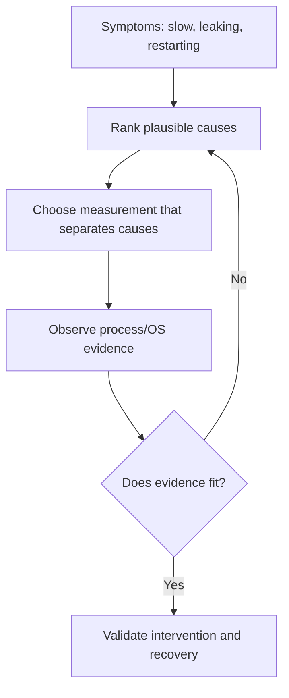
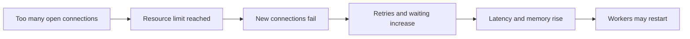

# CS320 — Operating Systems, Concurrency, and Runtimes
## Lecture 08: Operating-System and Runtime Forensics

*A production backend shows intermittent latency, memory growth, disappearing workers, and exhausted file descriptors — and several plausible explanations compete.*

---

# Part I — Intuition

*A production service has four alarming symptoms. Instead of restarting it, we become detectives and locate which promise broke first.*

### The picture to carry in your head

Imagine a hotel on a busy holiday weekend. Guests are waiting at reception. An elevator occasionally stops. The laundry department says it has no clean towels. And the building manager receives alerts about power consumption.

A panicked manager might turn off the lights, replace the elevator, hire more receptionists, and order new towels—all at once. Perhaps one of those changes helps. But afterward nobody knows what caused the problem or which intervention mattered.

A careful investigator asks a different question: what observations can distinguish the possible explanations?

Production software is similar. High latency, rising memory, worker restarts, and exhausted file descriptors may appear together, but they don't necessarily have the same cause. The job isn't to recite Linux commands. It's to **build a causal timeline and locate the resource or boundary where expected behavior stops**.

The opening diagram illustrates the investigative loop. You begin with symptoms, test a discriminating hypothesis, then revise your explanation using evidence.

### 1. A symptom is not a diagnosis

The dashboard shows CPU utilization of 25%. Does that prove the service isn't CPU-bound? No. One critical thread or container CPU quota can still be saturated while the host average remains low.

The Node.js heap chart looks flat. Does that prove memory isn't leaking? No. Native buffers, mapped memory, page cache, and other allocations may affect process or cgroup memory accounting differently.

The HTTP endpoint returns timeouts. Does that prove the application handler is stuck? No. Requests may be waiting for a database connection, a remote supplier, a network route, or a blocked event-loop callback.

Each metric is an observation at a defined boundary. It doesn't automatically reveal the cause. The investigative skill is knowing which additional observation would support or undermine a hypothesis.

**Checkpoint:** If memory usage increases and the process is later killed, should you immediately conclude there's a JavaScript object leak? No. First identify which memory accounting measure grew and whether it reflects retained JS objects, native allocations, caching, or another cause.

### 2. Follow one request and one process

Suppose a payment request takes five seconds. Start by following that specific request through its stages.

Was it admitted immediately, or did it wait for a connection? Did the application callback begin promptly? Was it blocked on a lock, filesystem operation, or database transaction? Did a remote service spend most of the time processing or waiting? Did a timeout occur before the underlying business operation finished?

Now follow the process handling the request. Was its main thread running or runnable? Was it throttled by its CPU quota? Did it open files or sockets without closing them? Did its resident memory rise while JavaScript heap usage remained stable?

We don't need every available metric at once. We need evidence at the boundary most likely to explain the symptom.

In the hotel analogy, if guests wait at reception, first discover whether the receptionist is absent, waiting for the booking system, or unable to unlock the cash drawer. Hiring ten more receptionists solves only some of those problems.

### 3. A timeline connects apparently separate failures

Imagine the following production sequence.

At 10:00, a deployment begins.

At 10:04, a worker starts opening many supplier connections.

At 10:07, open file-descriptor counts rise sharply.

At 10:09, new outgoing connections begin failing.

At 10:11, requests time out and retry.

At 10:13, in-flight requests accumulate and memory usage climbs.

At 10:15, containers restart.

If you examine only the final memory spike, you might decide the root cause is a memory leak. But the timeline suggests a different hypothesis: leaked or excessively opened descriptors caused connection failures, retries, and accumulating work, with memory growth as a downstream effect.

That hypothesis still needs verification. Perhaps the rising descriptor count is expected or the errors have another cause. But the timeline helps us choose the next test.

The second diagram shows why cause and symptom often form a chain rather than appearing as independent incidents.

### 4. The smallest useful test beats the largest dashboard

Imagine two competing explanations.

Hypothesis A: the process has a JavaScript memory-retention bug.

Hypothesis B: it accumulates native buffers while waiting for remote operations.

Another graph of total memory usage may not distinguish them. A comparison of managed heap measurements, resident process memory, buffer accounting, and workload timing would be more informative.

Or suppose a service is slow because the main JavaScript event loop is blocked. A generic CPU percentage may not establish that. Event-loop delay measurements and a targeted CPU profile may separate heavy JS computation from waiting on a dependency.

This is the purpose of **discriminating evidence**: select observations whose possible outcomes would lead you toward different explanations.

Don't gather metrics simply because tools make them available. Gather them because they answer a question.

### 5. Fixing the symptom isn't the same as fixing the failure mode

Restarting a process may temporarily release file descriptors or memory. Increasing a timeout may reduce immediate errors. Adding workers may absorb a traffic burst.

But if the underlying code keeps leaking resources, accumulating unbounded requests, or holding a shared lock, the incident may return under the same conditions.

A complete investigation therefore needs a mechanism, a controlled intervention, and evidence that the system behaves correctly afterward. It should also explain why the failure wasn't detected or contained earlier.

The goal isn't to avoid all restarts. Sometimes restarts are the correct emergency mitigation. The goal is to avoid treating a successful restart as proof that the cause has been understood.

### 6. The minute-long replay

Our incident shows high latency, memory growth, failed connections, and restarts. Those are observations, not explanations. We reconstruct the order of events, identify the most plausible common mechanisms, then inspect the right OS and runtime evidence. Once a hypothesis survives testing, we apply a fix and verify recovery.

L08's Deep Dive will walk through process state, CPU and memory profiles, cgroup accounting, sockets, descriptors, and production investigation tools. The mental map is one detective's notebook: **what happened, what could explain it, and which measurement would prove us wrong?**

### Three questions before the Deep Dive

1. **Does low host CPU prove a request wasn't CPU-delayed?** No. Per-core saturation or quota throttling may be hidden.
2. **Why inspect the sequence of events rather than only the final symptom?** An earlier resource failure can cause several later secondary symptoms.
3. **What makes a diagnostic measurement useful?** It distinguishes plausible causes and changes what we should investigate next.

*The intuition pass ends here.*

---

# Part II — Deep Dive

### Status — Planning Stub

Full voice-first manuscript not yet authored.

### Learning Objective

Diagnose resource and runtime failures by forming hypotheses and selecting evidence, rather than blindly changing limits or restarting services.

### Opening Problem

A production backend experiences intermittent latency, memory growth, disappearing worker processes, and exhausted file descriptors. Several plausible explanations compete.

### Planned Coverage

Integrated investigations using process state, CPU profiles, scheduling metrics, RSS, page faults, open descriptors, socket state, blocking I/O, cgroup limits, and relevant Linux tools.

### Scope Boundaries

This is a capstone investigation, not another lecture introducing operating-system vocabulary.

### Expected Understanding

Form ranked hypotheses for a multi-symptom incident; choose evidence from OS/runtime tools; defend a diagnosis without cargo-cult restarts or limit bumps.

### Planned Manuscript Structure

1. Narrative hook and sustained engineering case study.
2. Technical development of the underlying mechanisms.
3. Practical trade-offs and realistic failure scenarios.
4. Oral examination.
5. Solutions and discussion.
6. The Mental Model Worth Keeping.
7. Next Lecture or course-completion transition.
8. Optional Practical Lab, after the spoken lecture ends.
9. Further Reading.
10. Dense Cheatsheet — Interview Glance Card, last, inside one fenced text block.

<!-- Full manuscript to be generated later. -->

