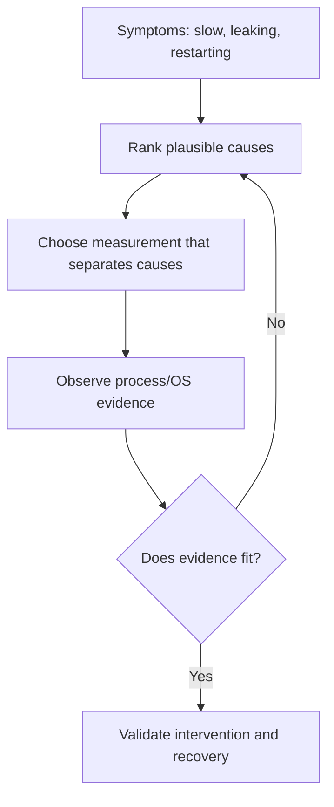
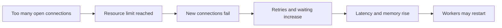
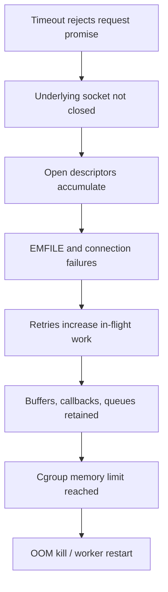

# CS320 — Operating Systems, Concurrency, and Runtimes

## Lecture 08: Operating-System and Runtime Forensics

*A production backend shows intermittent latency, memory growth, disappearing workers, and exhausted file descriptors—and several plausible explanations compete.*

**Estimated study time:** 90–110 minutes, including the optional investigation lab.

---

### How to listen to this lecture

This is the capstone of CS320.

**Part I — Intuition** establishes the investigator's mental model: symptoms are observations, not explanations. One underlying failure can generate several different symptoms, and our job is to find the first broken boundary.

**Part II — Deep Dive** follows a sustained production incident involving a Node.js service in Kubernetes. We will reconstruct a timeline, rank competing explanations, choose measurements that distinguish them, investigate process state, CPU scheduling, memory accounting, file descriptors, sockets, asynchronous work, and container termination.

This is not another vocabulary lecture. The earlier CS320 chapters taught us what the machinery does. Now we use that knowledge under uncertainty.

The oral examination asks you to act as the incident investigator. The practical lab follows the spoken lecture and provides a reproducible local investigation.

---

# Part I — Intuition

*A production service has four alarming symptoms. Instead of restarting it, we become detectives and locate which promise broke first.*

### The picture to carry in your head

Imagine a hotel on a busy holiday weekend. Guests are waiting at reception. An elevator occasionally stops. The laundry department says it has no clean towels. And the building manager receives alerts about power consumption.

A panicked manager might turn off the lights, replace the elevator, hire more receptionists, and order new towels—all at once. Perhaps one of those changes helps. But afterward nobody knows what caused the problem or which intervention mattered.

A careful investigator asks a different question: what observations can distinguish the possible explanations?

Production software is similar. High latency, rising memory, worker restarts, and exhausted file descriptors may appear together, but they don't necessarily have the same cause. The job isn't to recite Linux commands. It's to **build a causal timeline and locate the resource or boundary where expected behavior stops**.

The opening diagram illustrates the investigative loop. You begin with symptoms, test a discriminating hypothesis, then revise your explanation using evidence.



### 1. A symptom is not a diagnosis

The dashboard shows CPU utilization of 25%. Does that prove the service isn't CPU-bound? No. One critical thread or container CPU quota can still be saturated while the host average remains low.

The Node.js heap chart looks flat. Does that prove memory isn't leaking? No. Native buffers, mapped memory, page cache, and other allocations may affect process or cgroup memory accounting differently.

The HTTP endpoint returns timeouts. Does that prove the application handler is stuck? No. Requests may be waiting for a database connection, a remote supplier, a network route, or a blocked event-loop callback.

Each metric is an observation at a defined boundary. It doesn't automatically reveal the cause. The investigative skill is knowing which additional observation would support or undermine a hypothesis.

**Checkpoint:** If memory usage increases and the process is later killed, should you immediately conclude there's a JavaScript object leak? No. First identify which memory accounting measure grew and whether it reflects retained JS objects, native allocations, caching, or another cause.

### 2. Follow one request and one process

Suppose a payment request takes five seconds. Start by following that specific request through its stages.

Was it admitted immediately, or did it wait for a connection? Did the application callback begin promptly? Was it blocked on a lock, filesystem operation, or database transaction? Did a remote service spend most of the time processing or waiting? Did a timeout occur before the underlying business operation finished?

Now follow the process handling the request. Was its main thread running or runnable? Was it throttled by its CPU quota? Did it open files or sockets without closing them? Did its resident memory rise while JavaScript heap usage remained stable?

We don't need every available metric at once. We need evidence at the boundary most likely to explain the symptom.

In the hotel analogy, if guests wait at reception, first discover whether the receptionist is absent, waiting for the booking system, or unable to unlock the cash drawer. Hiring ten more receptionists solves only some of those problems.

### 3. A timeline connects apparently separate failures

Imagine the following production sequence.

At 10:00, a deployment begins.

At 10:04, a worker starts opening many supplier connections.

At 10:07, open file-descriptor counts rise sharply.

At 10:09, new outgoing connections begin failing.

At 10:11, requests time out and retry.

At 10:13, in-flight requests accumulate and memory usage climbs.

At 10:15, containers restart.

If you examine only the final memory spike, you might decide the root cause is a memory leak. But the timeline suggests a different hypothesis: leaked or excessively opened descriptors caused connection failures, retries, and accumulating work, with memory growth as a downstream effect.

That hypothesis still needs verification. Perhaps the rising descriptor count is expected or the errors have another cause. But the timeline helps us choose the next test.

The second diagram shows why cause and symptom often form a chain rather than appearing as independent incidents.



### 4. The smallest useful test beats the largest dashboard

Imagine two competing explanations.

Hypothesis A: the process has a JavaScript memory-retention bug.

Hypothesis B: it accumulates native buffers while waiting for remote operations.

Another graph of total memory usage may not distinguish them. A comparison of managed heap measurements, resident process memory, buffer accounting, and workload timing would be more informative.

Or suppose a service is slow because the main JavaScript event loop is blocked. A generic CPU percentage may not establish that. Event-loop delay measurements and a targeted CPU profile may separate heavy JS computation from waiting on a dependency.

This is the purpose of **discriminating evidence**: select observations whose possible outcomes would lead you toward different explanations.

Don't gather metrics simply because tools make them available. Gather them because they answer a question.

### 5. Fixing the symptom isn't the same as fixing the failure mode

Restarting a process may temporarily release file descriptors or memory. Increasing a timeout may reduce immediate errors. Adding workers may absorb a traffic burst.

But if the underlying code keeps leaking resources, accumulating unbounded requests, or holding a shared lock, the incident may return under the same conditions.

A complete investigation therefore needs a mechanism, a controlled intervention, and evidence that the system behaves correctly afterward. It should also explain why the failure wasn't detected or contained earlier.

The goal isn't to avoid all restarts. Sometimes restarts are the correct emergency mitigation. The goal is to avoid treating a successful restart as proof that the cause has been understood.

### 6. The minute-long replay

Our incident shows high latency, memory growth, failed connections, and restarts. Those are observations, not explanations. We reconstruct the order of events, identify the most plausible common mechanisms, then inspect the right OS and runtime evidence. Once a hypothesis survives testing, we apply a fix and verify recovery.

L08's Deep Dive will walk through process state, CPU and memory profiles, cgroup accounting, sockets, descriptors, and production investigation tools. The mental map is one detective's notebook: **what happened, what could explain it, and which measurement would prove us wrong?**

### Three questions before the Deep Dive

1. **Does low host CPU prove a request wasn't CPU-delayed?** No. Per-core saturation or quota throttling may be hidden.
2. **Why inspect the sequence of events rather than only the final symptom?** An earlier resource failure can cause several later secondary symptoms.
3. **What makes a diagnostic measurement useful?** It distinguishes plausible causes and changes what we should investigate next.

*The intuition pass ends here.*

---

# Part II — Deep Dive

# 1. Welcome to the Incident Room

It's Thursday morning at our hotel-booking company.

At 09:00, the backend team deploys an updated supplier integration. The change appears modest: a new timeout wrapper, better retry behavior, and more detailed logging around supplier availability requests.

For the first few minutes, everything looks healthy.

Then the availability API's p95 latency begins climbing.

At 09:08, a few customers receive HTTP 504 responses. At 09:11, memory consumption rises. At 09:14, one worker restarts. At 09:16, another starts failing outbound connections.

The infrastructure dashboard is a confusing collection of reassuring and alarming signals.

Host CPU utilization is twenty percent.

The database is healthy.

The Node.js heap appears relatively stable.

The external supplier's status page is green.

Yet the backend is intermittently unusable.

The operations team has several theories.

One engineer suspects the supplier's network.

Another suspects the Kubernetes CPU limits.

A third blames V8 garbage collection.

Someone points at the rising container memory graph and announces a memory leak.

And someone else has already prepared a pull request increasing the HTTP timeout from two seconds to ten.

Before accepting any of those explanations, ask one question.

**What observation would each theory predict that the others would not?**

If the supplier's network is slow, we might see long outbound requests even while the application's event loop remains responsive.

If the event loop is blocked, unrelated lightweight endpoints may also suffer delays, and the runtime's event-loop metrics may reveal them.

If CPU throttling is responsible, cgroup CPU accounting should provide evidence of a restrictive quota and throttling during relevant intervals.

If the process is running out of memory, we need to identify which memory boundary is being exhausted and whether the growth is the cause or a consequence of another failure.

If file descriptors are being leaked, the number of open descriptors should rise in a way that persists beyond completed or timed-out requests.

One incident.

Several hypotheses.

Different predictions.

That is our starting point.

---

# 2. Don't Confuse an Observation With an Explanation

Before touching production, we need to establish how an investigator reasons.

Suppose we observe:

"API requests take five seconds."

That is a measurement.

Now suppose somebody says:

"The supplier is slow."

That is a hypothesis.

The distinction is important because the same measurement may be consistent with many different mechanisms.

A five-second request might contain fifty milliseconds of CPU work and four seconds of network waiting.

Or it might spend four seconds waiting for a database connection from an exhausted pool.

Or it might be ready to run while the container is CPU-throttled.

Or its network operation may have completed promptly, with the JavaScript continuation delayed behind a synchronous computation.

The elapsed duration alone doesn't distinguish these possibilities.

## 2.1 Three levels of an investigation

I find it useful to organize an incident into three layers.

**Observation:** What happened, where was it measured, and at what time?

**Mechanism:** What system behavior could produce the observation?

**Cause:** Why did the mechanism become active in this incident?

For example:

Observation: The process has approximately four thousand open file descriptors.

Mechanism: Open sockets consume process descriptor entries.

Cause: A newly deployed code path retains timed-out sockets without closing them.

Notice the progression.

The first statement is a measurement.

The second explains a relevant operating-system rule.

The third attributes that mechanism to a concrete implementation defect.

We should not jump directly from the first statement to the third.

## 2.2 Evidence needs a boundary

Every metric comes from somewhere.

A request timer measures an interval selected by application code.

A CPU profiler samples execution.

A Node.js memory measurement reports specific runtime and process quantities.

A cgroup counter reports resource accounting at a particular group boundary.

A socket diagnostic tool observes kernel network state.

None of these is an all-knowing representation of the complete system.

For example, a flat JavaScript heap graph doesn't rule out growth in process RSS.

Low host CPU doesn't rule out one saturated thread or a throttled container.

And a TCP connection in the `ESTABLISHED` state doesn't tell us whether the business operation using it is healthy.

The metric is useful only when we understand what it can and cannot establish.

> **Sticky note #1:** Never promote a metric into a diagnosis without explaining the mechanism that connects them.

---

# 3. The First Rule: Preserve Evidence Before Changing the System

Now we're ten minutes into the incident.

An engineer proposes restarting every pod.

This might restore service temporarily.

Sometimes that's exactly what the business needs.

But before changing anything, think about which evidence may disappear.

When a process terminates, its live thread state disappears.

Its open file descriptors close.

Its in-memory queues vanish.

Its current heap and native allocations are released.

And a new healthy container doesn't automatically tell us what the previous one looked like immediately before it died.

## 3.1 Mitigation and investigation are separate goals

During a serious incident, user impact matters.

You may need to roll back, drain traffic, restart unhealthy instances, or disable a feature immediately.

But try to preserve the evidence that's cheap and safe to capture.

The current deployment revision.

The container's termination reason.

Relevant logs.

Time-series metrics.

Open descriptor counts.

Resource limits.

A representative request trace.

These observations can be gathered without necessarily delaying urgent mitigation.

And if preservation would create unacceptable risk or delay, mitigation takes priority.

The important thing is to know what you lost.

## 3.2 Beware the disappearing previous container

In Kubernetes, `kubectl logs --previous` may retrieve logs from a previous instance of a container when that instance's logs remain available.

It isn't a guaranteed historical archive.

If the pod has been replaced, deleted, or restarted repeatedly, the desired evidence may no longer be accessible through that command.

Similarly, the current pod's memory usage doesn't establish how much memory the earlier container consumed before an OOM kill.

A reliable production environment needs centralized logs and monitoring if we want useful historical evidence.

## 3.3 Make the timeline explicit

For our incident, we assemble this preliminary sequence.

At 09:00, the supplier integration was deployed.

At 09:04, outbound request counts began rising.

At 09:07, the number of open descriptors increased faster than request throughput.

At 09:09, the application logged errors opening new connections.

At 09:11, pending requests and retries accumulated.

At 09:13, resident memory increased sharply.

At 09:14, Kubernetes recorded an OOM-related container termination.

These observations don't prove a cause by themselves.

But the order matters.

The descriptor growth preceded the memory spike.

That makes a descriptor-retention problem a stronger early candidate than a purely spontaneous heap leak.

It doesn't eliminate other explanations.

It tells us where to investigate first.

---

# 4. Follow One Request Before You Investigate the Whole Machine

A production service is a crowded place.

Thousands of requests may be active.

Multiple workers may be running.

The kernel may be managing many sockets, files, and background operations.

It's easy to become overwhelmed by system-wide measurements.

So we begin with one representative slow request.

Imagine a customer asks for hotel availability.

The request passes through a load balancer to our Node.js API.

The API validates the request, consults local data, and calls the external supplier.

The supplier response is transformed into the application's availability model.

The API returns the result.

That's the expected journey.

## 4.1 Instrument the boundaries

We want to know when each stage began and ended.

When the request reached the application.

When the handler began executing.

When the supplier connection attempt started.

When the connection was established.

When the request was sent.

When the first relevant response arrived.

When the response finished.

When the handler completed.

We don't necessarily need all those timestamps for every request forever.

But during an incident, we need sufficient visibility to locate the delay.

A request that spends most of its time waiting for an outbound supplier response suggests a different investigation from one delayed before its handler begins.

## 4.2 A timeout doesn't say what happened remotely

Suppose our application gives up waiting after two seconds.

Does that prove the supplier didn't receive the request?

No.

The supplier might still be processing it.

The request might have succeeded remotely while the response was lost.

Or the transport operation might still be active after the application's promise rejected.

A local timeout expresses a decision by the local caller.

It does not inherently cancel every underlying operation or undo any remote side effects.

This matters especially for payments and reservations.

For ordinary availability reads, a retry may be relatively harmless if properly bounded.

For state-changing operations, retries require an idempotency and reconciliation strategy appropriate to the business.

## 4.3 The crucial question

Our traces show that many supplier requests time out locally.

But their underlying connections appear to remain active.

Some persist for much longer than the application's timeout.

Now we have a specific hypothesis.

The new timeout wrapper may stop waiting for results without actually terminating the underlying transport operation.

That would explain how the application could accumulate sockets even while logging that requests have finished.

But let's test it.

---

# 5. File Descriptors: The First Strong Clue

On Linux, files and sockets are commonly represented by file descriptors.

A file descriptor is a process-local handle for an open resource.

Opening a socket consumes a descriptor.

Closing it releases that descriptor.

Processes have limits on how many descriptors they may hold open simultaneously.

Our Node.js service has a configured soft descriptor limit.

During the incident, the open descriptor count approaches that limit.

## 5.1 What `EMFILE` actually tells us

The application begins logging `EMFILE` errors.

On Linux, `EMFILE` indicates that a process has reached its limit on open file descriptors.

That's a much more specific observation than "the network is slow."

The process cannot open another descriptor because its descriptor table has reached the applicable limit.

This can affect files and sockets.

It's not automatically proof of a network failure or a memory leak.

It's evidence of resource exhaustion at the descriptor boundary.

We should also distinguish it from `ENFILE`, which refers to a system-wide open-file-table limit in the relevant interfaces.

The distinction matters because the remedies differ.

A process-local descriptor exhaustion problem doesn't necessarily mean the entire operating system has run out of open resources.

## 5.2 What kind of descriptors are accumulating?

A process may legitimately hold many descriptors.

Listening sockets.

Established connections.

Files.

Pipes.

Event facilities.

Other runtime resources.

So we need to classify them.

Are the growing descriptors primarily sockets?

Do they belong to outbound connections toward the supplier?

Are they associated with particular remote addresses or ports?

Are they in `ESTABLISHED`, `CLOSE_WAIT`, or other relevant states?

Do they remain present after the application's request-level timeout?

These observations make the hypothesis testable.

## 5.3 The `CLOSE_WAIT` clue

Suppose some sockets are in `CLOSE_WAIT`.

That state ordinarily means the peer has sent an orderly close indication, but the local application has not yet fully closed its side of the connection.

A large, persistent population of `CLOSE_WAIT` sockets can therefore suggest that application-side cleanup isn't happening promptly.

But one `CLOSE_WAIT` connection isn't automatically a leak.

It might exist briefly during normal cleanup.

What matters is whether the count grows, persists, and corresponds to application behavior.

Likewise, `ESTABLISHED` connections aren't automatically healthy.

A socket can remain established while its application-level request has been abandoned.

## 5.4 Don't confuse `TIME_WAIT` with leaked descriptors

This is another important trap.

You may see many TCP connections in `TIME_WAIT`.

That state is commonly part of normal TCP connection teardown.

In many ordinary cases, `TIME_WAIT` sockets are maintained by the kernel after the application's file descriptor has already been closed.

Therefore, a large `TIME_WAIT` count doesn't directly mean the process has the same number of open file descriptors.

It can indicate high connection churn, but it is not by itself proof of an FD leak.

A good investigator compares process descriptor state with kernel socket state rather than treating them as identical.

---

# 6. The Suspect Code: A Timeout That Didn't Cancel Anything

We inspect the recently deployed supplier client.

The code opens a new TLS connection for a request.

It stores the socket in a registry keyed by request identifier.

It begins reading the supplier response.

Then it races the response against a timeout promise.

If the timeout wins, the caller receives a timeout error.

But the timeout branch never destroys the socket.

And the registry entry remains.

The request has ended **from the perspective of the awaiting application function**.

The underlying connection has not necessarily ended.

The cleanup responsibility was lost.

## 6.1 Application completion versus resource lifetime

This distinction is subtle.

The developer thought:

"The request is finished because the promise rejected."

But the operating system doesn't know that a JavaScript promise was rejected.

The kernel manages the socket until the relevant close and cleanup operations occur.

The promise is a JavaScript coordination abstraction.

The socket is a kernel-managed resource.

They have different lifetimes.

The application must connect those lifetimes deliberately.

## 6.2 Why a registry makes the problem worse

Our custom client also retains each socket in an active-connection map.

The entries aren't deleted on timeout.

This prevents the application from forgetting the socket's associated JavaScript objects.

The process may retain timers, callbacks, request metadata, and buffers associated with the abandoned operation.

Now we have two related consequences.

The kernel keeps open socket resources.

The application retains references to the objects managing those resources.

As more requests time out, both populations can grow.

## 6.3 Why the errors appear gradually

At first, there are only a few abandoned connections.

The service continues functioning.

Then hundreds accumulate.

New connections still open, but resource consumption rises.

Eventually, thousands of sockets and related objects remain active.

The process reaches its descriptor limit.

New connection attempts fail.

The application retries some of them.

Those retries create additional pressure.

The service has entered a feedback loop.

This is why the incident becomes dramatically worse several minutes after deployment rather than failing immediately.

The defect is cumulative.

---

# 7. Why the Supplier Could Be Slow Without Being the Root Cause

Now someone objects.

"Hold on. The supplier requests were timing out before our descriptors exploded. Surely the supplier is the cause."

Possibly a contributing factor.

But we need to distinguish a **trigger** from the defect that turns a trigger into a failure.

Imagine the supplier occasionally responds slowly.

That is normal enough for a distributed system.

Our application should handle delays, timeouts, and partial failures.

If a slow response causes us to keep a socket open forever after abandoning the request, that's a cleanup bug in our application.

The supplier's slowness may expose it.

But a correctly designed timeout path should not leak resources merely because an external service is delayed.

## 7.1 A healthy system under the same trigger

Imagine the previous version of our integration.

A slow supplier response occurs.

The application reaches its deadline.

The relevant operation is cancelled or cleaned up according to the client library's contract.

Its resources are released appropriately.

A bounded retry policy may apply.

The service remains healthy.

Now imagine the new version.

The same supplier delay occurs.

The local timeout rejects a promise.

The transport remains active.

The registry retains the socket.

Repeated requests accumulate resources.

The same external condition produces a completely different local outcome.

This tells us why the deployment matters.

## 7.2 The best discriminating test

We can reproduce the problem with a controlled local server that intentionally delays responses.

We don't need to rely on the real supplier's production behavior.

Run the old and new client implementations against that server under the same request schedule.

Measure open descriptors and active registry entries after requests time out.

If the new version retains them while the old version doesn't, we have direct evidence supporting the cleanup hypothesis.

This is much stronger than observing that the production supplier was slow.

The test isolates the relevant mechanism.

---

# 8. The Retry Storm: How One Failure Produces Several Others

Now the descriptor limit approaches exhaustion.

Some outbound operations fail immediately.

Others wait.

The application's retry logic interprets certain errors as transient and attempts another request.

But every additional attempt consumes resources.

If retries aren't bounded and concurrency isn't controlled, the system can amplify its own failure.

## 8.1 More attempts, less progress

Imagine the supplier is capable of processing a certain rate of requests.

Our service begins retrying failed attempts aggressively.

The number of initiated operations increases.

But the number of successfully completed business requests doesn't necessarily increase.

Instead, the service may produce more network activity, more pending timers, more queued callbacks, and more memory allocations.

This is **retry amplification**.

It can turn a partial external problem into a much larger local incident.

## 8.2 The application starts retaining in-flight work

Our request-handling code stores pending supplier operations and associated response metadata.

As retries accumulate, these structures grow.

Some of the objects contain Buffers or references to native resources.

The number of pending operations increases even though successful throughput is declining.

Now memory usage begins rising.

This is not necessarily an independent memory leak.

It may be a downstream effect of the connection-cleanup defect and the retry policy.

But we should verify the relationship rather than assuming it.

## 8.3 The causal chain

At this stage, our leading hypothesis predicts the following sequence.

The new timeout wrapper fails to clean up abandoned connections.

Open socket descriptors accumulate.

The process approaches its descriptor limit.

New operations begin failing.

Retries amplify demand.

Pending operations and retained buffers increase memory consumption.

Eventually, the container may hit its memory limit.

The diagram shows the proposed chain.



A causal diagram is a hypothesis until supported.

We need to check whether each arrow corresponds to evidence in our incident.

---

# 9. The Memory Mystery: Heap, RSS, and Cgroup Charges

The worker is now consuming more memory.

The JavaScript heap dashboard looks comparatively calm.

What do we make of that?

From CS320-L05, we already know that several measurements coexist.

**V8 heap usage** describes managed JavaScript heap memory.

**RSS** describes resident physical memory mapped into the process.

**Cgroup memory accounting** includes memory charged to the relevant cgroup under Linux's controller rules.

Those measurements overlap, but they are not identical.

## 9.1 What the runtime sees

Node.js exposes useful information through `process.memoryUsage()`.

Relevant fields include `heapUsed`, `heapTotal`, `external`, `arrayBuffers`, and `rss`.

If our retained operations contain Buffer data, the external and ArrayBuffer-related measurements may be informative.

But `arrayBuffers` is included within the external-memory accounting reported by Node.js.

It isn't an independent total to add blindly.

RSS can also include native allocations and other resident memory that the managed heap graph doesn't describe.

## 9.2 What the container sees

On Linux systems using cgroup v2, the memory controller exposes files such as `memory.current`, `memory.stat`, and `memory.events`.

`memory.current` represents charged memory usage at that cgroup boundary.

`memory.stat` provides categories of accounting.

`memory.events` records relevant threshold and OOM-related events.

Our container is configured with a hard memory limit.

A growing set of sockets, retained buffers, and pending work can contribute to memory pressure.

The host can still have available RAM.

The container doesn't automatically gain permission to exceed its own limit merely because the host isn't globally exhausted.

## 9.3 How to distinguish cause and consequence

Suppose cgroup memory usage begins increasing sharply only after the number of failed connections and retries explodes.

That timing supports the idea that memory growth is downstream.

But it doesn't prove it.

We should inspect memory composition and reproduce the request pattern.

Does the memory slope flatten when abandoned sockets are cleaned up?

Does bounding retries reduce peak memory?

Does the same workload with correct resource cleanup avoid the OOM?

Those are stronger tests than simply increasing the memory limit and observing that the restart takes longer to occur.

## 9.4 OOMKilled is a termination fact

Kubernetes reports that one container was terminated with reason `OOMKilled`.

That's important evidence.

But it doesn't tell us whether the memory demand came from a JavaScript object leak, native allocations, buffers, file cache, or excessive concurrency.

It's evidence about the enforcing boundary.

The underlying cause still requires investigation.

Likewise, exit code 137 alone is not proof of OOM. It commonly indicates termination by `SIGKILL` under standard shell conventions, which can have other causes.

We need the full termination context.

---

# 10. What About CPU? The Green Dashboard Is Not a Verdict

Now let's revisit the host CPU graph.

It reports twenty percent utilization.

Somebody concludes that CPU cannot be involved in the latency incident.

That's too confident.

We learned in CS320-L04 that overall host utilization can conceal several constraints.

One thread can saturate its available execution lane.

A container can have restrictive CPU quotas.

Threads can be runnable but wait for scheduling.

And shared locks can delay work even when host CPU use is low.

So we investigate CPU as one of the competing hypotheses.

## 10.1 CPU time versus wall time

A representative slow request takes five seconds.

How much processor time does its handling consume?

If most of the interval is waiting for a supplier, a database connection, or a queued native operation, the answer may be relatively little.

If the main JavaScript thread is executing an expensive synchronous calculation, it may consume substantial CPU time.

If the thread is runnable but quota-throttled, it may require CPU service that the cgroup cannot currently supply.

We need measurements at the correct execution boundary.

## 10.2 Inspect CPU throttling

On cgroup v2, files such as `cpu.max` and `cpu.stat` can provide evidence about configured CPU bandwidth and throttling.

A restrictive CPU quota may produce substantial delays even while the node has spare capacity.

But in our incident, the relevant counters don't show a new pattern of significant CPU throttling during the latency increase.

That weakens the CPU-quota hypothesis.

It doesn't establish that CPU is irrelevant to every part of the workload.

It means quota throttling isn't the best explanation for the observed timing.

## 10.3 Inspect the event loop

Node.js provides event-loop delay and utilization metrics.

If the main JavaScript thread were blocked by long synchronous operations, we might observe substantial event-loop delay.

We collect those measurements.

The event loop experiences some increased activity during the retry storm.

But the earliest slow supplier requests occur without a corresponding event-loop stall large enough to explain their elapsed time.

That weakens the theory that an expensive synchronous callback initiated the incident.

The later retry amplification may still make CPU behavior worse.

A later secondary effect doesn't have to be the original cause.

## 10.4 The important result

We haven't proved that CPU can never matter.

We've established that the observed descriptor accumulation and connection failures provide a more direct explanation of this incident than host CPU utilization.

That's how a good investigation progresses.

It doesn't require every alternative hypothesis to be philosophically impossible.

It requires evidence strong enough to justify the next diagnostic step and eventual intervention.

---

# 11. A Sleeping Thread Isn't Necessarily Doing Nothing

Let's connect the investigation to process states.

On Linux, threads can be running, runnable, sleeping, or in other relevant states.

A thread in interruptible sleep may be waiting for an event.

A thread in uninterruptible sleep may be waiting in a kernel path, often associated with I/O-related conditions.

A runnable thread may be waiting for CPU service.

These states help us choose the next question.

But they aren't complete diagnoses.

## 11.1 The misleading state code

Suppose we inspect the process and see many sleeping threads.

That doesn't mean the application is broken.

Thread pools commonly maintain workers that wait for tasks.

Event loops may sleep while waiting for I/O readiness.

A healthy server can contain many threads that are not currently consuming CPU.

The question is whether a thread that's needed for useful work is blocked unexpectedly.

## 11.2 Thread stacks reveal the nature of waiting

When available, thread stack traces can help explain what a particular thread is doing.

A thread might be blocked on a mutex.

Waiting on a condition variable.

Performing a filesystem operation.

Executing JavaScript.

Or waiting for a native worker task.

Different tools expose different levels of detail.

JavaScript stack traces show application execution contexts.

Native stack traces can reveal lower-level runtime operations.

Kernel tracing can reveal scheduling and system-call behavior.

No one stack trace necessarily explains the complete request.

But targeted evidence can show where an execution path stopped progressing.

## 11.3 Why our incident doesn't require a thread deadlock

Our leading hypothesis involves leaked socket resources and retries.

There's no requirement for two threads to hold locks in a circular wait.

If we inspected only long-running pending promises and called them "deadlocked," we'd be using the wrong concept.

A pending asynchronous operation is not automatically a mutex deadlock.

Its underlying resource may simply never be closed, cancelled, or completed.

The correct terminology helps us choose the correct evidence.

---

# 12. When Kernel Socket State and Application State Disagree

We now have a compelling clue.

The application logs report that some supplier operations have timed out.

But kernel tools still show corresponding sockets open.

How can that happen?

Because the operating system and application maintain different kinds of state.

The kernel manages TCP connection state and socket resources.

The application manages request deadlines, promises, business identifiers, and client-library state.

A local timeout can expire while the underlying socket remains active.

The kernel doesn't automatically interpret the rejected promise as a request to close the connection.

## 12.1 Application-level completion is not transport cleanup

Suppose our timeout wrapper returns a rejected promise after two seconds.

The caller catches the error.

It logs "supplier timeout."

Then it returns an HTTP error to the customer.

From the handler's perspective, the request path has ended.

But the TLS socket may remain open.

The custom connection registry may still hold a reference to it.

And event listeners may remain installed.

That's how we get a discrepancy between application metrics and operating-system resources.

## 12.2 A robust client needs a lifetime contract

A well-designed client library should establish clear responsibility for connections.

Who creates the socket?

Who owns it?

When may it be reused?

What happens when the caller abandons an operation?

Does the timeout cancel only waiting, or the underlying I/O?

Are errors and aborts handled consistently?

When is the connection removed from tracking structures?

What happens if a callback fires after cancellation?

These aren't minor cleanup details.

They determine whether a service remains stable under partial failure.

## 12.3 Connection reuse is not automatically leakage

One important qualification: production HTTP clients often keep connections open deliberately.

Connection pooling and keep-alive behavior can improve performance.

Therefore, a connection remaining open after one request is not automatically a bug.

The distinction is ownership and boundedness.

A healthy pool maintains a controlled population of reusable connections according to its configuration.

A leak retains abandoned resources without an appropriate lifetime or reuse policy.

To distinguish them, examine whether the number of open sockets stabilizes under a steady workload.

A bounded pool may reach a plateau.

An unbounded leak continues growing when similar requests complete or time out.

---

# 13. The Reproduction That Settles the Argument

At this point, we have several observations supporting the connection-cleanup hypothesis.

But before declaring victory, we want a controlled reproduction.

We build a local supplier simulator.

It accepts connections.

For selected requests, it deliberately delays its response longer than the client's timeout.

Then we run the suspect integration repeatedly.

## 13.1 What should happen in a healthy client?

Suppose we start with no active connections.

The client opens a connection.

The supplier delays.

The application timeout expires.

The client takes its configured cancellation or cleanup action.

Any operation-specific tracking entry is released.

If a connection is retained, it must belong to a bounded, intentional reuse policy.

Once the test becomes idle, resource usage should settle to an appropriate baseline.

## 13.2 What actually happens?

With the newly deployed client, the request promise rejects.

But the socket stays in the application's active-connection registry.

The connection remains open.

After fifty timed-out requests, approximately fifty additional socket entries may remain under the conditions of our controlled example.

After another fifty, the population grows further.

The pattern continues until another limit or external condition intervenes.

We now have direct evidence.

The timeout path terminates the caller's wait without terminating or releasing the owned resource.

## 13.3 The corrected version

The team modifies the client to give every operation a defined cleanup path.

Successful completion releases or returns the connection according to the client's pooling contract.

Timeouts trigger an appropriate abort or destruction mechanism.

Errors clean up listeners, timers, and registry entries.

Cancellation is idempotent where necessary.

Late events don't resurrect abandoned operations.

After the fix, we repeat the same local test.

The open-descriptor count returns toward the expected baseline.

The registry doesn't grow without bound.

The client remains stable during repeated delays.

This controlled experiment is the strongest evidence yet.

We've isolated a mechanism and shown that changing it alters the predicted outcome.

---

# 14. The Fix Has Two Parts: Remove the Leak and Contain the Failure

It would be tempting to finish the incident by adding one missing `socket.destroy()` call.

That might fix the immediate defect.

But consider why the failure escalated so severely.

We had an unbounded resource-lifetime problem.

We also had retry amplification and insufficient pressure controls.

A robust fix should address both.

## 14.1 Correct resource ownership

The connection's lifetime must be explicit.

Every initiated operation should have a coherent success, failure, timeout, and cancellation path.

Socket cleanup should be delegated to a trustworthy client abstraction when possible rather than recreated through fragile custom logic.

Event listeners and timers should also be cleaned up appropriately.

Use `finally`-style cleanup where it correctly models ownership, but remember that reusable pooled connections follow different lifecycle rules from disposable per-request sockets.

The objective isn't to destroy every connection after every request.

It's to prevent abandoned operations from retaining resources accidentally.

## 14.2 Bound concurrency

Suppose the external supplier becomes slow.

We shouldn't initiate unlimited new operations.

A concurrency limit protects the number of simultaneous supplier calls and their associated memory and socket resources.

This may be implemented through a bounded queue, semaphore, worker pool, or a client-library facility designed for the purpose.

When the limit is reached, the application needs a defined admission policy.

Wait briefly.

Reject excess work.

Degrade gracefully.

Use cached data if business rules allow.

The precise policy depends on the product.

But unbounded in-flight work is rarely a good production default.

## 14.3 Bound retries

Retries must have explicit limits.

A maximum number of attempts.

A deadline for the overall operation.

Appropriate backoff.

Jitter to reduce synchronized bursts.

Classification of retryable errors.

And a clear cancellation strategy when the caller no longer needs the result.

For state-changing operations, idempotency and reconciliation are additional correctness requirements.

The goal isn't to retry every failure until it eventually succeeds.

It's to recover from transient conditions without overwhelming the system.

## 14.4 Establish observability for the actual failure mode

Finally, record metrics that reveal the problem before the process reaches a hard limit.

Current active supplier operations.

Configured concurrency limit.

Pending queue depth.

Connection-pool size.

Open-descriptor utilization.

Timeout rate.

Retry rate.

Application-level cancellation counts.

Container RSS and cgroup memory usage.

You don't need every metric at maximum detail forever.

But these measurements should make cumulative resource growth visible before it becomes catastrophic.

---

# 15. Why Increasing Limits Can Be the Wrong Fix

Let's return to the team's proposed remedies.

One engineer wants more file descriptors.

Another wants more memory.

A third wants longer timeouts.

Each suggestion might temporarily change the incident's behavior.

But none directly fixes the cleanup defect.

## 15.1 Raising the descriptor limit

Suppose the process can currently open four thousand descriptors.

We increase the limit to sixty-four thousand.

The service runs longer.

The leak continues.

Eventually, it may consume far more memory and other resources before failing.

We have increased the size of the failure.

Now, legitimate production services may require high descriptor limits.

There's nothing inherently wrong with configuring suitable capacity.

The mistake is treating a higher limit as proof that an unbounded resource leak has been resolved.

## 15.2 Raising the memory limit

Suppose the container has a relatively small memory budget.

We double it.

The workload survives more abandoned sockets and pending requests.

But if the leak continues, memory demand can eventually exceed the larger budget.

Again, we may have postponed the incident rather than eliminated its cause.

A memory increase can be appropriate as a temporary mitigation or legitimate capacity adjustment.

It should be justified by measured working-set requirements.

## 15.3 Increasing the timeout

Now suppose we extend the supplier timeout from two seconds to ten.

Perhaps fewer operations are abandoned prematurely.

But every slow request may also retain resources for longer.

If concurrency is uncontrolled, longer waits may increase the average number of active operations.

The relationship follows a familiar queueing idea: as the average time work remains in the system increases, more work can accumulate at a given arrival rate.

Therefore, increasing timeouts without understanding demand and capacity can worsen resource pressure.

Timeouts are not merely user-experience settings.

They influence resource lifetime and concurrency.

## 15.4 Restarting everything

A restart releases process-owned descriptors and memory.

The service looks healthy again.

Then traffic returns.

The defective code repeats the same behavior.

The failure recurs.

That doesn't mean restarting was useless.

It may have restored service during an incident.

But we must distinguish a successful mitigation from a successful root-cause fix.

---

# 16. The Investigator's Toolkit: What Each Observation Can Prove

Now let's organize the operational tools we've used.

The purpose is not to memorize fifty commands.

It's to know which tool can distinguish which kind of failure.

## 16.1 Process and thread state

On Linux, tools such as `ps`, `top`, and process-specific `/proc` files help inspect process and thread information.

They can show CPU use, thread counts, states, and other relevant details.

Use them when the hypothesis concerns active computation, runnable waiting, blocked tasks, or unusual process growth.

But a state code alone doesn't prove a root cause.

A sleeping thread may be healthy.

A runnable thread may be waiting for CPU.

Interpret the observation in the context of a specific request or workload.

## 16.2 CPU profiles and event-loop metrics

A CPU profile helps identify which operations consume processor execution time.

For Node.js, event-loop delay and utilization metrics help investigate scheduling of JavaScript callbacks.

Use these when the service is slow but the delay's owner is unclear.

A CPU profile showing a hot synchronous parsing loop supports a different explanation from a request trace showing most time spent awaiting a supplier response.

## 16.3 Scheduling and cgroup CPU accounting

Cgroup CPU limits and throttling counters can reveal whether a container is constrained by its CPU allocation.

Linux PSI and appropriate tracing tools can provide additional insight into pressure and waiting.

Use these when a task appears ready to run but cannot obtain timely CPU service.

Remember that host CPU percentage and container entitlement are different measurements.

## 16.4 Memory accounting

Node.js exposes runtime and process memory metrics.

Linux exposes process RSS, mapping information, and cgroup memory statistics.

Use these to distinguish JavaScript heap retention, native allocations, file-backed memory, and container-level pressure.

Do not add overlapping categories blindly.

And don't use a healthy post-restart memory reading to dismiss a pre-restart allocation spike.

## 16.5 File descriptors and sockets

Process descriptor tables show which resources are open.

Socket tools such as `ss` reveal kernel TCP states and connection information.

Use these when investigating connection failures, resource exhaustion, or mismatches between application timeouts and transport state.

Correlate process-owned descriptors with socket state.

Remember that a large `TIME_WAIT` population doesn't necessarily represent the same number of open descriptors in the process.

## 16.6 System-call tracing

Tools such as `strace` can reveal system calls and their results on Linux.

They can help identify repeated file opens, failing socket operations, or relevant blocking behavior.

But tracing has overhead.

Attaching a tracer to a busy production process can affect timing.

Use targeted filters and short observations when appropriate, and prefer safer historical telemetry when the risk is unacceptable.

The tool is evidence-gathering machinery, not a universal default command to run on every incident.

---

# 17. Choosing the Next Test: Maximum Information, Minimum Risk

Now imagine you're interviewing a candidate.

You present the incident dashboard.

CPU is low.

Memory is rising.

Requests are timing out.

The supplier is slow.

You ask:

"What would you do first?"

A weak answer lists every tool the candidate remembers.

A stronger answer explains which uncertainty matters most.

## 17.1 Start with competing predictions

Suppose we have three leading hypotheses.

A: the event loop is blocked.

B: the external supplier is slow.

C: timed-out operations are retaining sockets.

Now consider possible observations.

If unrelated trivial endpoints experience the same callback delay, A gains support.

If requests from different clients and environments are all slow against the supplier, B gains support.

If open socket counts continue rising after application timeouts, C gains support.

The observations aren't equally informative.

We want one that separates the explanations.

## 17.2 Prefer reversible observations

We should generally prefer observations that don't alter production behavior unnecessarily.

Read a metric.

Inspect a current resource count.

Review a trace.

Compare revisions.

Capture a small diagnostic profile where safe.

A production configuration change is a much larger intervention.

It may eliminate useful evidence.

It may introduce new failure modes.

And if several changes occur simultaneously, it becomes difficult to attribute the result.

A good investigation tries to minimize uncontrolled variables.

## 17.3 The smallest experiment

For our incident, the local supplier simulator is especially valuable.

It creates the slow-response condition deliberately.

It removes the production supplier as an uncontrolled variable.

It lets us compare old and new clients.

It exposes whether the timeout path releases resources.

And it can be repeated safely.

The experiment doesn't reproduce every aspect of the production infrastructure.

It doesn't need to.

It directly tests the mechanism most relevant to our hypothesis.

**The best next test is often the one whose possible outcomes would most change your explanation.**

---

# 18. Root Cause, Trigger, and Contributing Factors

Now we have enough evidence to write a credible incident conclusion.

But don't compress everything into the sentence:

"The service had a memory leak."

That would be incomplete.

Let's separate the pieces.

## 18.1 Root cause

The newly deployed supplier client did not correctly release owned sockets and registry entries when an application-level timeout expired.

This allowed abandoned transport operations to remain active and retained.

The defect was reproducible with controlled delayed responses.

## 18.2 Trigger

Slow supplier responses caused some operations to exceed the application's deadline.

The deadline exposed the faulty cleanup path.

The supplier's behavior contributed to the occurrence of timeouts, but it did not require our service to leak resources.

## 18.3 Contributing factors

The service created new connections without an effective bound.

Retries increased work during resource exhaustion.

There was insufficient alerting on descriptor utilization and active supplier operations.

A hard container memory limit eventually terminated workers after the in-flight and retained working set grew.

These factors explain why a local cleanup defect escalated into a broader production incident.

## 18.4 Immediate mitigation

Traffic was shifted away from the affected revision, or the deployment was rolled back where operationally appropriate.

Affected workers were restarted to release abandoned resources.

The supplier request concurrency was temporarily limited.

These actions restored service.

They did not, by themselves, prove the bug was fixed.

## 18.5 Permanent remediation

The timeout and cancellation path now releases owned resources correctly.

Registry entries and listeners are cleaned up on every terminal path.

Request concurrency and retries are bounded.

Tests cover delayed, failed, aborted, and successfully completed operations.

Monitoring detects growth in active operations and descriptors before resource exhaustion.

The corrected implementation has been tested against the same delayed-response scenario that reproduced the defect.

This is a complete explanation.

It connects a code-level mistake to operating-system resource behavior and then to user-visible consequences.

---

# 19. The Postmortem Must Explain Why the System Failed So Hard

A useful postmortem goes beyond identifying the defective line.

Why didn't tests catch the issue?

Because they mainly verified successful responses and ordinary errors. They didn't verify resource cleanup after a timeout while the underlying connection remained open.

Why didn't monitoring detect the accumulation earlier?

Because the dashboards emphasized latency, CPU, and managed heap usage. They didn't expose the growth of open descriptors and abandoned operations clearly enough.

Why did retries worsen the incident?

Because the retry policy increased demand while the underlying resource was already constrained.

Why did memory rise?

Because the service retained in-flight work and associated resources while retry demand grew.

Why did a container restart?

Because relevant memory charges reached the enforced container boundary and the kernel recorded an OOM termination.

Why was the external supplier blamed first?

Because the earliest customer-visible error was a supplier timeout, even though the application's cleanup behavior transformed a transient delay into accumulating local resource exhaustion.

These answers matter because they identify prevention opportunities.

Better cancellation semantics.

Bounded concurrency.

Resource-lifetime tests.

Useful operational metrics.

Safer retry policies.

And a culture of investigating mechanisms rather than guessing from final symptoms.

## 19.1 A good postmortem distinguishes confidence levels

Not every detail will be known with equal certainty.

We may have strong evidence that the cleanup path leaked sockets.

We may have strong evidence that the process reached its FD limit.

We may have moderate evidence about the exact contribution of retained buffers to peak cgroup memory.

A good report states those differences.

It doesn't pretend that every arrow in a causal diagram has been independently measured if some are supported only by plausible inference.

## 19.2 Reproduction isn't always complete

Sometimes the corrected code behaves well under the local reproducer, but production also involved unusual supplier behavior, network conditions, and Kubernetes resource constraints.

The local test establishes an important mechanism.

Production telemetry supports the wider causal chain.

Together they may justify a confident remediation.

But the report should still identify any unanswered questions.

Uncertainty is part of rigorous incident analysis.

The objective isn't to sound certain.

It's to be accurate enough to make the next system safer.

---

# 20. The Senior Engineer's Forensic Framework

At this point, we can extract a general method from the case.

It applies to CPU incidents, memory incidents, networking incidents, and concurrency failures.

The method is simple enough to remember but demanding enough to distinguish experienced engineers.

## 20.1 State the symptom precisely

Not "the service is slow."

Instead:

"The p95 availability response time increased after the supplier-client deployment, with errors concentrated in requests that exceeded the local supplier deadline."

Precision determines what evidence we need.

## 20.2 Identify competing mechanisms

Could the delay belong to the CPU?

The scheduler?

The event loop?

A native worker pool?

The network?

A database?

A lock?

Resource exhaustion?

List plausible candidates without making the list infinite.

## 20.3 Identify the first broken boundary

Follow the request and process timeline.

Where does expected behavior first diverge?

In this incident, application-level timeouts no longer corresponded to appropriate transport-resource cleanup.

That boundary came before the descriptor failures and memory spike.

## 20.4 Choose a discriminating measurement

Look for evidence that distinguishes the leading hypotheses.

A growing population of process-owned sockets after request-level timeouts is much more informative than another generic memory graph.

## 20.5 Test the mechanism

Use a controlled reproduction where possible.

Alter one relevant condition.

Observe the predicted effect.

If the hypothesis doesn't survive, revise it.

## 20.6 Mitigate, remediate, and verify

Stop current user impact.

Fix the mechanism.

Add controls that contain similar failures.

Repeat the reproduction.

Monitor the system under representative load.

And record what evidence supports the conclusion.

That's the entire investigative loop.

---

# 21. The Oral Examination

Treat these questions as an incident-response interview.

For each answer, distinguish what you know, what you suspect, and what evidence you'd collect next.

### Challenge A — The Healthy CPU Dashboard

A sixteen-logical-CPU host reports approximately six percent CPU utilization.

One application endpoint is CPU-bound and cannot process requests faster.

Does the host utilization figure rule out a CPU bottleneck?

Which measurements would distinguish single-thread saturation from CPU-quota throttling?

### Challenge B — The Invisible Memory

A Node.js container is OOM-killed.

The last recorded `heapUsed` value is 110 MiB, and the container has a memory limit of 512 MiB.

Give at least three plausible explanations for the difference.

Which observation would you prioritize next?

### Challenge C — The Descriptor Explosion

A service approaches its process descriptor limit and logs `EMFILE`.

The number of outbound TCP sockets has increased steadily.

What hypotheses would you investigate?

Why isn't increasing the descriptor limit a complete fix?

### Challenge D — The `TIME_WAIT` Trap

A network dashboard shows thousands of TCP connections in `TIME_WAIT`.

An engineer concludes that the Node.js process has thousands of leaked open sockets.

Is that conclusion justified?

Explain what additional evidence is required.

### Challenge E — Two Slow Endpoints

Endpoint A spends five seconds waiting for an external supplier.

Endpoint B performs a synchronous five-second CPU operation on Node.js's main JavaScript thread.

How might their effects on unrelated endpoints differ?

Which runtime measurements would help distinguish the causes?

### Challenge F — A Suspicious Deployment

A memory spike begins after a new deployment.

The application also experiences retries, timeouts, and rising open descriptors.

Would you immediately classify the incident as a JavaScript memory leak?

How would you reconstruct the likely causal order?

### Challenge G — The Timeout That Didn't Stop Anything

A custom client uses `Promise.race` between a network operation and a timeout promise.

When the timeout wins, the caller gets an error.

Does that automatically cancel the underlying network operation?

What resource-lifetime responsibilities remain?

### Challenge H — Retry Amplification

A supplier is slow.

The application responds by aggressively retrying unsuccessful calls.

Successful throughput doesn't improve, but pending operations and memory usage rise.

Explain the feedback loop.

Name two safeguards that would reduce amplification.

### Challenge I — The Restart That "Fixed" It

Restarting the service immediately restores normal latency.

The incident recurs fifteen minutes later.

What does the successful restart prove?

What does it not prove?

### Challenge J — The Incident Report

Write a concise incident conclusion distinguishing root cause, trigger, contributing factors, mitigation, permanent remediation, and verification.

Avoid claiming certainty for evidence you don't actually possess.

---

# 22. Solutions and Discussion

*Read this section after answering out loud. The practical lab appears after the spoken lecture ends.*

### Solution A — Single-thread and quota bottlenecks

No. One saturated logical CPU out of sixteen can appear as roughly 6.25% aggregate usage under a simple normalization.

Inspect per-thread and per-core CPU activity. Examine the application's execution model and critical path.

For quota throttling, inspect the relevant cgroup CPU configuration and throttling counters.

A CPU-bound single-threaded calculation and a quota-limited multithreaded workload are different mechanisms.

### Solution B — Memory-accounting boundaries

The Node.js heap is only part of the process's memory footprint.

Native allocations, Buffers, stacks, mapped pages, allocator retention, and other resident memory may contribute.

Cgroup memory accounting can also include relevant file cache and kernel memory.

Inspect process RSS, Node external-memory metrics, cgroup memory usage, memory-category breakdowns, and OOM events.

Do not simply add overlapping categories.

### Solution C — Descriptor ownership

Investigate unclosed sockets or files, unbounded connection creation, abandoned requests, incorrect pooling, and cleanup failures.

Classify descriptor types and correlate them with request lifetimes.

Increasing the limit provides more headroom but doesn't repair an unbounded leak.

A controlled reproduction should demonstrate that resource usage stabilizes after operations complete or fail.

### Solution D — TCP state versus open descriptors

No. `TIME_WAIT` commonly persists in the kernel after an application's descriptor has closed.

It can reflect connection churn rather than process FD leakage.

Inspect process descriptor counts and ownership, relevant socket states, and whether active connections remain retained unexpectedly.

### Solution E — External wait versus event-loop blocking

Endpoint A may spend most of its time awaiting a supplier while the event loop continues handling other work.

Endpoint B blocks ordinary JavaScript callbacks on that thread during its synchronous computation.

Inspect event-loop delay, utilization, CPU profiles, request-stage traces, and dependency timing.

These observations help locate the execution boundary responsible for the delay.

### Solution F — Causal ordering

No. Rising memory is an observation, not proof of retained JavaScript objects.

Construct a timeline around the deployment, descriptor growth, failed connections, retry rate, pending work, RSS, cgroup charges, and termination events.

If descriptor growth precedes retry and memory amplification, investigate whether the earlier resource problem explains the later symptoms.

### Solution G — Promise timeout versus operation cancellation

No. `Promise.race` decides which promise settles the result observed by the caller.

It doesn't inherently cancel another promise or destroy its underlying socket.

The client must use the relevant cancellation and resource-cleanup mechanisms.

Timers, listeners, registry entries, and owned resources require deliberate lifetime management.

### Solution H — Retry amplification

Retries increase attempted work while the underlying bottleneck remains.

That can consume additional connections, buffers, queues, and CPU time, potentially worsening the original failure.

Safeguards include bounded retries, overall deadlines, backoff with jitter, limited in-flight concurrency, admission control, and suitable circuit-breaker behavior.

### Solution I — Restart as mitigation

The restart proves that replacing the process restored service under the observed conditions.

It doesn't establish why the old process failed.

Restarting releases many resources and resets state, so cumulative leaks and queueing problems may temporarily disappear.

The recurrence suggests that the underlying failure mode remains active.

### Solution J — Complete incident explanation

A strong report identifies the timeout cleanup defect as the root cause if supported by code inspection and reproduction.

It distinguishes supplier slowness as the trigger, insufficient resource bounds and retry amplification as contributing factors, rollback or restart as mitigation, cleanup and bounded-concurrency changes as remediation, and repeatable tests plus telemetry as verification.

It also states any uncertain parts of the broader causal chain rather than presenting inference as directly observed fact.

---

# 23. The Mental Model Worth Keeping

An incident is not a collection of alarming dashboard panels.

It is a sequence of events involving components that obey specific contracts.

The operating system provides execution time, memory mappings, file descriptors, sockets, scheduling, and resource enforcement.

The runtime coordinates application work through JavaScript, native libraries, worker pools, event loops, and memory management.

The application adds deadlines, retries, state transitions, and business semantics.

Failures occur when one or more of those contracts are misunderstood, violated, or overwhelmed.

The investigator's job is to identify which contract broke first.

Remember the five-part method.

**Observe:** What happened, where, and when?

**Hypothesize:** Which mechanisms could explain it?

**Discriminate:** Which measurement would distinguish those mechanisms?

**Verify:** Can the proposed mechanism be reproduced or otherwise supported?

**Remediate:** Does the change fix the failure mode under representative conditions?

And remember these distinctions.

Low host CPU doesn't rule out a local CPU bottleneck.

A flat JavaScript heap doesn't rule out memory pressure.

A timeout doesn't prove the remote operation never occurred.

A rejected promise doesn't automatically cancel an underlying resource.

A `TIME_WAIT` socket doesn't necessarily represent an open process descriptor.

A restart doesn't establish root cause.

And an error disappearing after a configuration change doesn't prove that the underlying design is correct.

The fundamental principle of CS320 is:

**A running program is never just its source code. It is source code interacting with a runtime, an operating system, shared resources, and other concurrently executing systems.**

To diagnose it, we must understand those interactions.

---

# 24. End of CS320 — From Mechanisms to Engineering Judgment

We've reached the end of **CS320 — Operating Systems, Concurrency, and Runtimes**.

The course began with concurrency.

We learned why independently correct operations can produce incorrect combined results, why asynchronous execution differs from parallelism, and why time becomes part of correctness.

We then examined the operating system.

Processes, threads, system calls, filesystems, containers, and the resources programs use without owning directly.

We investigated JavaScript and TypeScript's runtime behavior, then moved deeper into CPU scheduling, virtual memory, and asynchronous I/O.

We studied the relationship between threads, shared memory, atomic operations, and happens-before guarantees.

And finally, we've used those mechanisms to reconstruct a realistic production incident.

The journey has taken us from a simple line of code to the larger machine that actually executes it.

That is the most valuable kind of systems knowledge.

Not memorizing every kernel interface.

Not developing a reflex to increase limits whenever performance degrades.

But understanding enough of the underlying machinery to replace guesses with testable explanations.

The natural next step in our programme is applying those foundations to larger application and infrastructure designs: frontend behavior, backend services, persistent data, distributed workflows, and production architecture.

CS320's ideas will reappear throughout those subjects.

Whenever a service becomes unexpectedly slow, asks for more memory, stops responding, or behaves differently under concurrency, you'll have a framework for deciding where to look.

The final question worth carrying forward is:

**What would the system have to be doing for these observations to make sense—and what evidence would prove that explanation wrong?**

That is the question of an engineer who understands the machine.

---

## Optional Practical Lab — Build an Incident Room

*The spoken lecture ends here. The following experiments are intended for screen-based investigation. Use a disposable local environment or a development cluster. Do not deliberately exhaust production resources.*

### Lab A — Capture the process boundary

Start a local Node.js service and identify its process ID.

Inspect basic process information:

```bash
PID=<node-process-id>

ps -p "$PID" -o pid,ppid,stat,%cpu,%mem,rss,etime,comm
ps -L -p "$PID" -o pid,tid,stat,psr,pcpu,comm
```

Explain the difference between process-level and thread-level activity.

For a thread that appears inactive, determine whether it is sleeping, runnable, or waiting on an operation.

### Lab B — Inspect file-descriptor usage

On Linux, inspect the process's descriptor table:

```bash
PID=<node-process-id>

ls /proc/"$PID"/fd | wc -l
cat /proc/"$PID"/limits | grep -i "open files"
```

Observe that descriptor counts are snapshots and can change while the process runs.

If `lsof` is installed:

```bash
lsof -p "$PID"
```

Classify the types of open resources.

Are they files, pipes, sockets, or other handles?

Explain why counting descriptors is more informative than looking at TCP state alone when investigating `EMFILE`.

### Lab C — Inspect socket state

Use a disposable service that opens local TCP connections.

On Linux, inspect sockets:

```bash
ss -tanp
```

Filter the results by relevant local or remote addresses where appropriate.

Compare `ESTABLISHED`, `CLOSE_WAIT`, and `TIME_WAIT`.

Explain why the states describe different conditions.

Do not assume every `TIME_WAIT` entry corresponds to a still-open application file descriptor.

### Lab D — Reproduce an application timeout that does not cancel I/O

Create a local TCP server that accepts connections and deliberately does not send a response.

The following example listens only on the loopback interface:

```javascript
// slow-server.js
const net = require("node:net");

const server = net.createServer((socket) => {
  socket.on("error", () => {});
  // Deliberately retain this connection without responding.
});

server.listen(9090, "127.0.0.1", () => {
  console.log("Local slow server on port 9090");
});
```

Now implement a deliberately defective client:

```javascript
// leaky-client.js
const net = require("node:net");

const active = new Map();

function requestWithBadTimeout(id) {
  const socket = net.connect(9090, "127.0.0.1");

  active.set(id, socket);

  const response = new Promise((resolve, reject) => {
    socket.once("data", resolve);
    socket.once("error", reject);
  });

  const timeout = new Promise((_, reject) => {
    setTimeout(() => {
      reject(new Error("request deadline exceeded"));
    }, 100);
  });

  // Deliberately wrong:
  // timeout does not destroy the socket or clear the registry.
  return Promise.race([response, timeout]);
}

async function main() {
  for (let i = 0; i < 50; i++) {
    requestWithBadTimeout(i).catch(() => {});
  }

  setInterval(() => {
    console.log({
      retainedSocketObjects: active.size,
      rssMiB: (
        process.memoryUsage().rss / 1048576
      ).toFixed(1),
    });
  }, 1000);
}

main();
```

Run the server and client in separate terminals.

Inspect the client's descriptor count before and after initiating the requests.

Observe that the application deadlines expire while the sockets remain retained.

This is a deliberately incorrect example. Terminate both local processes after observing the behavior.

Next, redesign the client so success, timeout, error, and cancellation paths clean up appropriately.

Verify that descriptor and registry counts return toward the expected baseline.

### Lab E — Distinguish two timeout implementations

Implement two client versions.

**Version A:** Uses `Promise.race` to stop awaiting a result but doesn't cancel the underlying operation.

**Version B:** Uses an appropriate supported abort or cleanup mechanism and correctly releases the owned resource.

Run both against the same controlled slow server.

Record:

- Number of attempted requests.
- Number of timed-out application operations.
- Open descriptor count.
- Active registry entries.
- RSS over time.
- Resource usage after the test becomes idle.

Explain which observations distinguish the two implementations.

### Lab F — Inspect Node.js memory

Add periodic memory reporting to your local service:

```javascript
const { memoryUsage } = require("node:process");

function printMemory() {
  const m = memoryUsage();
  const mib = (n) => (n / 1048576).toFixed(1);

  console.log({
    heapUsedMiB: mib(m.heapUsed),
    heapTotalMiB: mib(m.heapTotal),
    externalMiB: mib(m.external),
    arrayBuffersMiB: mib(m.arrayBuffers),
    rssMiB: mib(m.rss),
  });
}

setInterval(printMemory, 1000);
```

Observe how the values respond to retained sockets and buffers.

Explain why `heapUsed`, `external`, `arrayBuffers`, and RSS are not independent additive categories.

### Lab G — Inspect cgroup memory and CPU restrictions

In a cgroup v2 environment:

```bash
cat /proc/self/cgroup

cat /sys/fs/cgroup/cpu.max
cat /sys/fs/cgroup/cpu.stat

cat /sys/fs/cgroup/memory.current
cat /sys/fs/cgroup/memory.max
cat /sys/fs/cgroup/memory.stat
cat /sys/fs/cgroup/memory.events
```

The actual relevant cgroup path depends on the environment, hierarchy, and namespace configuration.

Identify which counters represent CPU throttling and which represent memory-controller events.

Explain how a container can hit its memory limit while the host still has available RAM.

### Lab H — Inspect Kubernetes termination evidence

In a development cluster with appropriate permissions:

```bash
kubectl get pods -n <namespace>
kubectl describe pod <pod-name> -n <namespace>
```

Where a previous container instance remains available:

```bash
kubectl logs <pod-name> \
  -n <namespace> \
  --previous \
  --tail=100 \
  --timestamps
```

Identify restart counts, termination reasons, and resource limits.

Remember that `--previous` isn't a permanent historical archive.

Explain why exit code 137 alone isn't sufficient to establish OOM as the cause.

### Lab I — Investigate event-loop behavior

Use Node.js `perf_hooks` to measure event-loop delay:

```javascript
const {
  monitorEventLoopDelay,
  performance,
} = require("node:perf_hooks");

const histogram = monitorEventLoopDelay({
  resolution: 10,
});

histogram.enable();

setInterval(() => {
  console.log({
    maxDelayMs: histogram.max / 1e6,
    meanDelayMs: histogram.mean / 1e6,
    utilization: performance.eventLoopUtilization(),
  });

  histogram.reset();
}, 1000);
```

Compare three controlled workloads:

1. A slow asynchronous network request.
2. A long synchronous CPU computation.
3. A collection of many asynchronous operations using a finite native worker pool.

Which workloads delay unrelated event-loop callbacks?

Which mainly delay their own awaited results?

Explain why similar HTTP latency doesn't imply identical underlying mechanisms.

### Lab J — Construct an incident timeline

Create a short fictional incident report using the following events:

- 09:00 — New supplier integration deployed.
- 09:04 — Outbound request count rises.
- 09:07 — Open descriptor count rises.
- 09:09 — Connection-opening errors begin.
- 09:11 — Retries increase.
- 09:13 — RSS and cgroup memory usage rise.
- 09:14 — Container OOM kill recorded.

For each event, write:

- What was observed.
- Which mechanism could explain it.
- Which competing explanation remains possible.
- What measurement would distinguish the explanations.

Then draw a causal diagram.

Mark which arrows are directly supported and which remain hypotheses.

### Lab K — Write the postmortem

Prepare a one-page incident report containing:

**Impact:** Which users and operations were affected?

**Timeline:** Which events occurred, in what order?

**Root cause:** Which verified defect initiated the failure chain?

**Trigger:** What condition exposed the defect?

**Contributing factors:** What allowed the incident to escalate?

**Mitigation:** What restored service temporarily?

**Permanent remediation:** What prevents recurrence?

**Verification:** What tests and measurements support the fix?

**Open questions:** What remains uncertain?

The most important grading criterion is whether the report makes a defensible causal argument, rather than merely listing metrics and symptoms.

---

## Further Reading — Optional Technical References

1. [Linux Kernel Documentation — Control Group v2](https://docs.kernel.org/admin-guide/cgroup-v2.html) — CPU and memory controller accounting.
2. [Linux Kernel Documentation — PSI](https://docs.kernel.org/accounting/psi.html) — CPU, memory, and I/O pressure.
3. [Linux man-pages — proc(5)](https://man7.org/linux/man-pages/man5/proc.5.html) — Process information interfaces.
4. [Linux man-pages — proc_pid_fd(5)](https://man7.org/linux/man-pages/man5/proc_pid_fd.5.html) — Open descriptors.
5. [Linux man-pages — proc_pid_status(5)](https://man7.org/linux/man-pages/man5/proc_pid_status.5.html) — Process state and memory information.
6. [Linux man-pages — socket(7)](https://man7.org/linux/man-pages/man7/socket.7.html) — Socket semantics and errors.
7. [Linux man-pages — tcp(7)](https://man7.org/linux/man-pages/man7/tcp.7.html) — TCP state and behavior.
8. [Node.js — Process Memory Usage](https://nodejs.org/api/process.html#processmemoryusage) — Managed heap, external memory, and RSS.
9. [Node.js — Performance Hooks](https://nodejs.org/api/perf_hooks.html) — Event-loop delay and utilization.
10. [Node.js — Don't Block the Event Loop](https://nodejs.org/en/learn/asynchronous-work/dont-block-the-event-loop) — Runtime scheduling and worker-pool behavior.
11. [Node.js — Net](https://nodejs.org/api/net.html) — Socket lifecycle, errors, and destruction.
12. [Kubernetes — Resource Management](https://kubernetes.io/docs/concepts/configuration/manage-resources-containers/) — Container CPU and memory limits.
13. [Kubernetes — Logging Architecture](https://kubernetes.io/docs/concepts/cluster-administration/logging/) — Capturing diagnostic evidence.
14. Brendan Gregg, *Systems Performance* — Practical performance investigation across operating-system layers.
15. John Allspaw, *The Art of Capacity Planning* — Understanding load and resource constraints.
16. Michael Nygard, *Release It!* — Failure containment, retries, circuit breakers, and operational stability.
17. Google, *Site Reliability Engineering* — Incident response and postmortem practices.

---

## Dense Cheatsheet — Interview Glance Card

*Fenced for voice-reader skipping. Use this for rapid recall of diagnostic boundaries, evidence, and incident reasoning.*

```text
CS320-L08 — OPERATING-SYSTEM & RUNTIME FORENSICS

CORE PRINCIPLE
  Symptom != mechanism != root cause.
  Observation has a source, boundary, timestamp, and limitations.
  Build a causal timeline; locate the first broken contract.
  Choose tests that DISCRIMINATE between hypotheses.

INVESTIGATION LOOP
  OBSERVE -> HYPOTHESIZE -> DISCRIMINATE -> VERIFY -> REMEDIATE
  Keep competing explanations alive until evidence rules them down.
  Prefer small, reversible measurements.
  Separate urgent mitigation from permanent root-cause fix.

INCIDENT TIMELINE
  Deploy -> outbound attempts grow -> descriptors grow ->
  connection failures -> retries -> pending work/memory ->
  cgroup OOM -> restart.
  Sequence suggests mechanism, but timestamps alone != proof.

TIME
  Wall time        Elapsed request duration.
  CPU time         Active execution on CPUs.
  Runnable wait    Ready but waiting for processor.
  Blocked wait     Waiting for I/O, lock, condition, dependency.
  Long request != CPU-bound request.

CPU
  Host aggregate CPU can hide one saturated core/thread.
  Container may have restrictive CPU quota.
  cpu.max         Cgroup v2 CPU bandwidth limit.
  cpu.stat        Usage + throttling counters.
  PSI             CPU pressure/stall evidence.
  ps -L/top -H    Thread-level activity.
  perf            Targeted CPU/scheduler investigation.
  Event-loop delay may originate from JS blocking or OS constraints.

MEMORY
  heapUsed        V8 managed heap.
  external        Relevant native/C++ allocations.
  arrayBuffers    Included within external.
  RSS             Resident process pages.
  memory.current  Charged cgroup memory usage.
  memory.stat     Memory-controller categories.
  memory.events   high/max/oom/oom_kill and related events.
  V8 heap != RSS != cgroup charge.
  Don't add overlapping metrics.
  OOMKilled is termination evidence, not leak classification.
  Exit 137 alone != conclusive OOM proof.

FILE DESCRIPTORS
  FD             Process-local handle for open resource.
  Socket/file/pipe/event facility may consume FD.
  EMFILE         Process FD limit reached.
  ENFILE         System-wide open-file-table limit.
  /proc/PID/fd   Open descriptor entries.
  /proc/PID/limits Process resource limits.
  lsof -p PID    Open-resource inspection.
  Leak evidence: count rises, persists, fails to reach steady state.

SOCKET STATE
  ESTABLISHED    TCP connection established, not app success proof.
  CLOSE_WAIT     Peer closed sending side; local cleanup pending.
  TIME_WAIT      Normal TCP teardown state; often no process FD.
  ss -tanp       Inspect TCP states and process association.
  Many TIME_WAIT sockets != directly leaked open descriptors.
  Intentional keep-alive pool != unbounded connection leak.

ASYNC LIFETIMES
  Promise rejection != transport cancellation.
  Promise.race(timeout) does NOT automatically abort loser.
  Application deadline != remote rollback.
  Socket needs owner, cleanup, error and abort paths.
  Registry/listeners/timers must be released appropriately.
  Bounded pool can retain connections intentionally.

RETRY AMPLIFICATION
  Failure -> retry -> more in-flight work -> resource pressure ->
  more failure -> more retry.
  Safeguards:
    - bounded concurrency
    - limited attempts
    - overall deadline
    - exponential backoff + jitter
    - error classification
    - cancellation cleanup
    - idempotency for state-changing operations
    - backpressure/admission control

TOOLS BY QUESTION
  What is slow?           Request trace + stage timings.
  CPU execution?          CPU profile; process/thread CPU metrics.
  CPU throttled?          cgroup cpu.stat/cpu.max.
  Runnable waiting?       scheduler tracing/PSI.
  Event loop blocked?     perf_hooks delay + profile.
  Process memory?         process.memoryUsage/RSS/smaps.
  Container memory?       memory.current/stat/events.
  Descriptors leaking?    /proc/PID/fd; lsof.
  Socket states?          ss.
  Kernel calls failing?   Targeted strace.
  Container restarted?    describe pod / previous logs / events.

DIAGNOSTIC CAUTIONS
  Tool snapshot != history.
  Current container != prior terminated container.
  Trace collection has overhead.
  Kernel counters have scope and definitions.
  Connections may be healthy and intentionally pooled.
  A metric correlation alone doesn't establish causation.
  Reproducer should test one mechanism under controlled conditions.

MITIGATION VS REMEDIATION
  Restart / rollback / shift traffic = possible mitigation.
  Raising limit = capacity change, not necessarily root-cause fix.
  Permanent fix = correct ownership/lifetime + bounds + verification.
  Don't change five variables at once and declare victory.

POSTMORTEM
  Impact -> timeline -> verified root cause -> trigger ->
  contributing factors -> mitigation -> permanent fix ->
  verification -> remaining uncertainty.
  Separate observation from inference.
  Report confidence honestly.

INTERVIEW RECOVERY
  "Heap flat, pod OOM"      Inspect RSS, native buffers, cgroup.
  "Host CPU low, slow"      Check hot thread, throttling, waits.
  "EMFILE"                  Inspect descriptor types and lifetimes.
  "TIME_WAIT explosion"     Not necessarily open FD leak.
  "Timeout returned"        Underlying operation may continue.
  "Restart fixed it"        Released resources; cause may persist.
  "Supplier slow"           Trigger possible; local cleanup still matters.
  "Retries making worse"    Bound work; protect downstream capacity.

SENIOR LINE
  "I'd reconstruct the request and process timeline, separate
   observations from explanations, rank competing mechanisms,
   select the measurement that most distinguishes them, reproduce
   the failure where possible, and verify that remediation fixes
   the resource-lifetime or correctness contract—not merely the
   final symptom."
```
