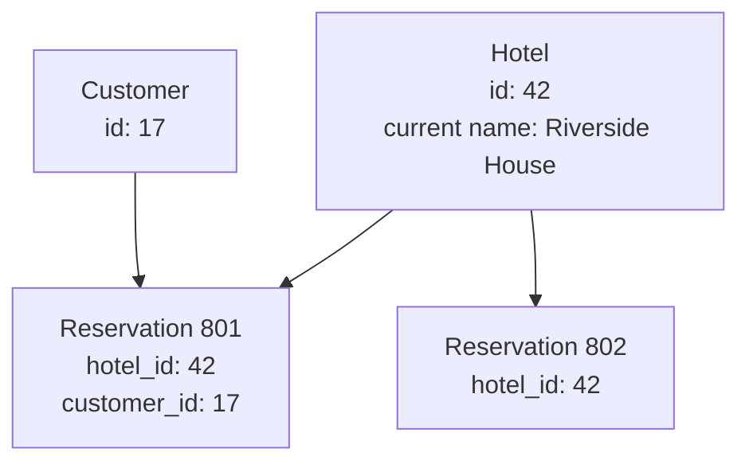
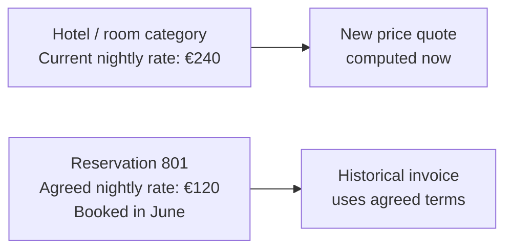

# CS330 — Relational Databases and Transactions
## Lecture 01: Relational Database Design

*How to model a changing business without turning its database into a museum of regrettable decisions.*

**Estimated study time:** 85–105 minutes, including the PostgreSQL lab.

---

### How to listen to this lecture

Written for continuous listening first, then for on-screen re-reading. Theme: **the schema is a model of business facts, not a mirror of TypeScript objects.** Sticky-note callouts mark where convenient duplication becomes an anomaly — and where a snapshot is history, not a sin. Near the end, answer the oral challenges **out loud** before reading solutions. The PostgreSQL lab lives after the spoken lecture ends — keep it for a screen session.

By the end, you should be able to say why a flat reservation table fails when the business grows, how keys separate identity from business uniqueness, what normalization prevents and when snapshots are required, how constraints enforce relationships (and what they cannot), and how expand–migrate–contract keeps production online.

---

# Part I — Intuition

*Before deciding what tables to create, imagine the hotel's actual world. A database schema is a map of that world, and a bad map can confidently tell us the wrong story.*

### The picture to carry in your head

Imagine a small hotel with twelve rooms, one receptionist, and a thick paper reservation book. Each booking takes one line: the customer's name, their room, their dates, and the agreed price. If you were writing software for this hotel on its first day, you might copy that book into a single table. That seems sensible. It even works.

Now imagine the hotel becomes part of a travel-booking platform. It changes its name. Several rooms are renovated and renamed. Customers book three rooms at a time. Nightly prices change daily. Some guests cancel one room without cancelling the entire trip, and accountants need to reconstruct exactly what someone agreed to pay six months ago.

The book no longer has enough boxes for reality. That's the heart of relational database design: **not how many columns we can create, but which facts belong to which things, and how those facts change independently**.

## 1. A name is not a hotel

Suppose your first table stores the hotel name inside every reservation row. We have a hundred reservations at the hotel called Riverside Inn. When the hotel is renamed Riverside House, someone edits those hundred records to update the name.

But which question were those records supposed to answer? If we want to know the hotel's current name, updating a hundred copies of it seems wasteful. If we want to know what the customer saw on their original confirmation, rewriting the historical name may actually destroy information we wanted to keep.

A single field was being asked to represent two different facts: **what the hotel is called now** and **what the customer was told then**. The design failed because it couldn't distinguish them.

Let's give each real thing a separate identity. There is a hotel, there is a customer, and there is a reservation linking them. The hotel has its current name. The reservation has its own identity, stay dates, and agreed booking details. A reservation refers to the hotel rather than repeating every current hotel attribute.

The first picture shows the relationships. One hotel can have many reservations. One customer can make many reservations. Each reservation points to the hotel and customer it belongs to.



The numbers are identifiers. They aren't the names shown to customers; they're stable handles for the entities our system needs to distinguish. This explains why an identifier deserves its own place in the model.

**Checkpoint:** If the hotel changes its current name, which record normally needs updating? The hotel record. Old bookings can still refer to that same hotel ID.

## 2. Why separate tables are useful, not merely tidy

Imagine you store the customer's email beside every booking. The customer changes email addresses. If you update only nine of their ten reservations, the database now disagrees with itself. Which address is current?

This is an *update anomaly*. It's a surprisingly simple problem: we copied one fact into many places and now must keep the copies synchronized.

There are related failures. Maybe you can't store a hotel before its first reservation because hotels exist only inside booking rows. Or deleting the last reservation also deletes the only remaining record of the hotel. Those are design problems, not SQL syntax errors.

A well-chosen relational model stores stable business facts in appropriate places and links them through keys. This reduces accidental duplication and gives us clearer rules about what may exist independently.

But separating everything into a thousand tables isn't the goal. We're trying to **represent the actual relationships and dependencies of the business**, not win a contest for maximum normalization.

## 3. Which information should we copy on purpose?

Now for a twist. The hotel normally charges 180 euros per night. A customer booked in June with a promotional price of 120 euros. By October, the hotel's new rate is 240 euros.

If we calculate the customer's old invoice by looking up today's hotel rate, we'll produce a wildly incorrect invoice. And if we update every booking whenever the current rate changes, we'll erase the historical agreement.

So although we don't want arbitrary duplicates of the hotel's current name or customer email, we *do* want a preserved booking-price snapshot. It's not a faulty copy of today's price. It's a different fact: **what was agreed at the time of this booking**.

The second picture separates current state from historical agreement. A change in today's catalogue does not rewrite yesterday's contract.



This is one of the most valuable database-design distinctions. Some repeated-looking information is a mistake. Some is a legitimate snapshot. You decide by asking what each value is supposed to mean over time.

**Checkpoint:** Should a new room rate silently change a confirmed booking from six months ago? No. The old booking's agreed terms need their own durable representation.

## 4. Relationships have shapes

Consider a new requirement: one customer wants to reserve three rooms in one purchase. Our original rule was that one reservation equals one room. It no longer fits the business.

We might now distinguish a booking order from the individual reserved room items. One order belongs to a customer, and several items belong to the order. Each item carries its own room category, dates, and price details. If one item is cancelled, the rest of the order can remain intact.

Notice that we didn't just add a new array to a JavaScript object. We asked what the *business entities* are and how many of one thing can belong to another. Those counts and relationships are often called **cardinality**.

A hotel might have many rooms. A reservation order might have many items. A particular physical room might be associated with many stays over time, but not overlapping confirmed assignments if that is the inventory model. Those are different kinds of rules.

Relational databases give us tools to enforce parts of these relationships. A foreign key can require that the referenced hotel exists. A unique constraint can prevent duplicated identifiers or selected combinations of facts. But some rules, such as availability across overlapping date ranges, require more careful constraints or transactional coordination.

The data model describes reality. The constraints help prevent us from recording an impossible version of it.

## 5. Even a correct model eventually changes

The hotel company will inevitably invent another requirement. Perhaps bookings may be transferred between customers. Perhaps some room categories offer connected rooms. Perhaps the business must retain the exact legal name appearing on a historical invoice.

A database schema is therefore not a permanent stone tablet. It is a working model that needs controlled evolution.

We cannot always change it in one dramatic deployment, because yesterday's backend may still be running while tomorrow's version rolls out. Real migrations often proceed in stages: introduce a compatible new structure, begin writing it, carefully move old data, then remove obsolete structures only once nobody needs them.

That is the intuition behind safe schema migration. The challenge isn't simply to end with a beautiful schema. It's to **move from one model to another while the business continues operating**.

### The minute-long mental replay

Start with the hotel reservation book. Separate things with independent identities: customer, hotel, booking, perhaps booking items. Link them through stable keys rather than repeatedly copying current attributes. Keep historical snapshots when the past agreement is itself a fact worth preserving. Enforce what the database can enforce, and change the structure carefully as the business evolves.

When the Deep Dive begins discussing entities, primary and foreign keys, normalization, denormalization, constraints, and migrations, place them around this one question: **which fact belongs where, and what should happen when reality changes?**

### Three questions before the Deep Dive

1. **Why not put the hotel name into every reservation as the only representation of the hotel?** Changing one current fact would require coordinated edits in many rows, and the system would confuse current identity with historical information.
2. **Is storing an agreed booking price a normalization mistake?** Not necessarily. It is a historical business fact, distinct from the current catalogue rate.
3. **Does a foreign key guarantee that a room isn't double-booked?** No. It establishes a reference relationship, not every time-dependent inventory rule.

*The intuition pass ends here.*

---

# Part II — Deep Dive

# 1. The Reservation That Changed Its Price After the Guest Checked Out

It's October 2026, and your hotel-booking platform has been running successfully for eighteen months.

The original developer—possibly you—designed a wonderfully straightforward database. A reservation has a customer, a hotel room, two dates, and a price.

Something like this — one flat reservations table with customer, hotel, room, dates, and nightly price inline:

```sql
CREATE TABLE reservations (
  id BIGSERIAL PRIMARY KEY,
  customer_name TEXT,
  customer_email TEXT,
  hotel_name TEXT,
  room_number TEXT,
  room_type TEXT,
  check_in DATE,
  check_out DATE,
  nightly_price NUMERIC(10, 2)
);
```

At launch, this seems perfectly sensible.

The product supports individual reservations. Every reservation has one room. Every room has one price. The hotel has twelve rooms, and the application receives perhaps fifty bookings a week.

Nothing complicated. Then business happens. The hotel renovates its third floor and renumbers several rooms.

Its standard room, previously called *Economy Double*, becomes *Classic Double*. The revenue manager updates nightly rates from €189 to €249.

A customer books three rooms in one transaction. Another customer changes dates halfway through a stay.

And the accounting department asks you to reconstruct the exact financial details of a reservation from six months ago.

Suddenly, answering simple questions becomes surprisingly difficult. Which room was the customer actually promised?

Was the reservation for a particular physical room or merely a room category? Should changing a room number alter historical bookings?

If the nightly rate has changed, which price belongs on the old invoice?

If a reservation includes three rooms, should there be three reservations—or one reservation containing three rooms? And what happens if one of those rooms is cancelled?

The database isn't corrupted. Its tables contain perfectly valid rows. The problem is more interesting.

**The schema represents an oversimplified version of the business, and the business has outgrown its assumptions.**

> **Sticky note #1**
>
> Valid rows can still encode the wrong business model.

This is why database design deserves considerably more thought than deciding which TypeScript properties should become SQL columns.

A relational database isn't merely a storage mechanism.

It is a formal description of relationships, identities, dependencies, and restrictions in the world your application represents.

If that description is wrong, even perfectly executed SQL can produce incorrect business behavior.

Today, we'll explore how to construct a useful description—and how to evolve it when reality refuses to cooperate.

---

# 2. Before Drawing Tables, Understand the World

Imagine you're asked to design the reservation database for a hotel. Your first instinct might be to identify entities:

- Hotel
- Room
- Customer
- Reservation
- Payment

That's a reasonable beginning. But it's not yet a data model. An entity name tells us surprisingly little about its actual meaning.

Consider the word *room*. A hotel has 100 physical rooms. But it might sell only five room categories: Standard, Deluxe, Suite, Family, and Accessible.

When a customer books a Deluxe room for next Friday, are they booking a particular physical room? Not necessarily.

They might simply be purchasing the right to occupy any suitable Deluxe room during that period. The actual physical room may be assigned when the guest checks in.

This means our model needs to distinguish two different concepts.

**Room type:** A category of accommodation offered for sale.

**Physical room:** An individual accommodation unit that physically exists in the hotel.

The distinction immediately changes our schema. A hotel owns room types; each type owns physical rooms — Standard with 101–103, Deluxe with 201–202:

```text
HOTEL
  |
  +-- ROOM TYPE: Standard
  |      |
  |      +-- Room 101
  |      +-- Room 102
  |      +-- Room 103
  |
  +-- ROOM TYPE: Deluxe
         |
         +-- Room 201
         +-- Room 202
```

A reservation may initially refer to the room type rather than the room. Now imagine the hotel has ten Deluxe rooms. On November 12, eight are booked.

On November 13, nine are booked. On November 14, all ten are booked. How many Deluxe rooms can we sell for a reservation spanning November 12–15?

Zero. Not because the property has no Deluxe rooms. Not because there are no vacancies on November 12.

But because the booking needs accommodation across every night in the requested interval. Already, a seemingly simple domain has revealed several different concepts:

**Accommodation category, physical unit, inventory availability, and reservation.**

These concepts are related, but they aren't interchangeable. And this is the first major principle of relational modeling:

**A good schema begins by identifying which facts are genuinely distinct—not by translating the application's existing objects into tables.**

> **Sticky note #2**
>
> Room type ≠ physical room ≠ inventory night ≠ reservation.

TypeScript classes can be rewritten relatively easily.

A mistaken persistence model becomes increasingly expensive to correct as more data, business logic, and external integrations depend upon it.

---

# 3. Entities, Relationships, and Cardinality

A relational model expresses information through relations—implemented in SQL systems primarily as tables.

We already know how to create tables, so let's concentrate on the design questions beneath them.

Suppose our system contains hotels, room types, customers, and reservations. We might begin with four core tables — hotels, room types, customers, and reservations:

```text
HOTELS
  id
  name
  timezone

ROOM_TYPES
  id
  hotel_id
  name
  max_guests

CUSTOMERS
  id
  email
  name

RESERVATIONS
  id
  hotel_id
  customer_id
  check_in
  check_out
  status
```

What relationships exist? A hotel offers many room types. Each room type belongs to one hotel — hotel one-to-many room types.

A customer can make many reservations. Each reservation belongs to one customer account, according to this particular model — customer one-to-many reservations. These are **one-to-many relationships**.

Notice that cardinality is a statement about the business, not merely a property of SQL. What if a reservation can contain multiple room types?

And the same room type can appear across thousands of reservations? We now have a many-to-many relationship. A common solution is an intermediate table — reservations one-to-many reservation items, and room types one-to-many reservation items:

```text
RESERVATIONS
    |
    | 1
    |
    | N
RESERVATION_ITEMS
    | N
    |
    | 1
ROOM_TYPES
```

Each reservation item describes one component of the booking. For example, reservation R-1042 might have two Deluxe and one Standard:

1. R-1042 — Deluxe — quantity 2.
2. R-1042 — Standard — quantity 1.

One reservation now represents three rooms. That is fundamentally different from creating three independent reservations.

They might share one customer, one payment, one cancellation policy, and one confirmation. But they might also support partial cancellation or separate room assignments.

The intermediate table provides a place for information that belongs to the relationship itself—such as quantity, price, selected rate plan, or special requirements.

### One-to-one relationships

One-to-one relationships are less common than beginners might expect. Sometimes they separate optional or sensitive information: customers one-to-zero-or-one customer billing profiles.

But don't split a table into two just because one group of columns feels aesthetically different.

A one-to-one relationship is useful when the separation reflects a meaningful lifecycle, ownership, security boundary, or access pattern.

Otherwise, you've added another join without necessarily improving the model.

### The question that prevents many mistakes

When considering a relationship, ask:

> Can these things exist, change, or be deleted independently?

A room type can exist without reservations. A reservation cannot meaningfully refer to a nonexistent customer account under our current assumptions.

A hotel may rename a room type without changing what an earlier customer purchased. These answers reveal where the boundaries between entities should lie.

---

# 4. Identity: What Makes Two Things the Same Thing?

Let's talk about keys. A primary key identifies a row. That sounds trivial until we consider what should qualify as an identity.

Suppose we have room number `204` at hotel Grand Baltic.

Is `204` a unique room identifier? Obviously not across all hotels. Perhaps the combination of hotel and room number is unique: `UNIQUE (hotel_id, room_number)`.

That is a **composite key constraint**.

It expresses a meaningful business rule: one hotel cannot have two physical rooms with the same number at the same time, according to our model.

But should `(hotel_id, room_number)` be the primary key? Not necessarily. Hotels renumber rooms.

Room numbers are business identifiers that can change. A stable database-generated ID may be a better technical identity. Rooms get a surrogate primary key plus a hotel-scoped uniqueness rule on room number:

```sql
CREATE TABLE rooms (
  id BIGINT GENERATED ALWAYS AS IDENTITY PRIMARY KEY,
  hotel_id BIGINT NOT NULL,
  room_number TEXT NOT NULL,

  UNIQUE (hotel_id, room_number)
);
```

Now we have two distinct ideas.

**Primary key:** The stable identity used by the database.

**Business uniqueness constraint:** The rule that prevents conflicting real-world identifiers.

These need not be the same.

### Natural versus surrogate keys

A *natural key* is derived from meaningful business data.

Examples include a country's ISO code or a product's externally assigned identifier, provided its semantics genuinely guarantee uniqueness and stability.

A *surrogate key* is introduced primarily to identify a record. Examples include generated integers and UUIDs.

Surrogate keys are common because business identifiers have a troublesome habit of changing. Email addresses change. Room numbers change.

Product codes get reorganized. Even identifiers described as permanent sometimes turn out to be permanent until next Tuesday.

A reasonable default for many SaaS applications is to use stable surrogate primary keys while separately enforcing genuine business uniqueness.

That doesn't imply a universal preference for UUIDs over integers. Integers are compact and naturally ordered when generated sequentially.

UUIDs can be generated independently and avoid reliance on one database sequence for assigning globally unique identifiers.

Their storage and indexing characteristics differ, and not all UUID-generation strategies have the same locality properties.

The right choice depends on distribution, scale, interoperability, and operational requirements.

What matters more than the fashionable key format is that **identity and business meaning are not accidentally conflated**.

> **Sticky note #3**
>
> Surrogate primary key for stability; separate UNIQUE for business rules.

---

# 5. Why Normalization Exists: The Three Anomalies

Let's return to our original reservation table — customer, hotel, room, dates, and price all on one row:

```text
reservation_id
customer_name
customer_email
hotel_name
hotel_address
room_number
room_type
check_in
check_out
price
```

At first glance, it's convenient. Everything needed to display a reservation sits in one row. No joins.

No separate lookups. Beautiful. Until the hotel's address changes.

You now need to update every reservation containing that hotel's address—potentially hundreds of thousands of historical rows. What if one update fails?

Some reservations say the hotel is on Main Street 12. Others say Main Street 14. Which is correct?

We've encountered an **update anomaly**. The same current fact exists in multiple places, and modifying it requires coordinating multiple copies.

There are two related problems.

### Insertion anomaly

Suppose you want to register a hotel before it receives any reservations. But the only place to store hotel information is inside a reservation record.

How do you create the hotel without inventing a reservation? Your representation ties together facts that should be independently representable.

### Deletion anomaly

Suppose the last reservation for a hotel is deleted.

If the hotel exists only through its reservation rows, deleting that final reservation also removes the only stored information about the hotel.

Deleting one fact accidentally destroys another. These problems motivated the development of relational normalization techniques.

The underlying objective is straightforward:

**Store independently meaningful facts in a way that reduces unnecessary duplication and prevents unrelated operations from corrupting them.**

Instead of repeatedly storing the hotel's address in reservation rows, hotels hold current identity and address; reservations reference the hotel:

```text
HOTELS
  id
  name
  address

RESERVATIONS
  id
  hotel_id
  ...
```

The reservation references the hotel. If the current address changes, we update the hotel's record. The reservation still refers to the same hotel.

No mass update of reservation rows is necessary.

### Functional dependencies

There's a useful theoretical idea beneath this. Imagine a relation containing hotel ID, hotel name, and hotel address.

If every hotel ID identifies exactly one hotel with one current name and address, we have a functional dependency: `hotel_id → hotel_name, hotel_address`.

Knowing the hotel ID determines the associated current hotel information. Now imagine storing that information inside reservations: `reservation_id → hotel_id → hotel_address`.

The reservation ID determines the hotel ID, which determines the hotel address. The address is not fundamentally a property of the reservation.

That dependency suggests a separate hotel relation. This is the kind of reasoning that relational normalization formalizes.

### The normal forms, without the ritual chanting

You'll commonly encounter First, Second, and Third Normal Form.

**First Normal Form (1NF)** requires an appropriate relational representation of values, rather than treating a single cell as an arbitrary collection of independently queryable values.

For example, don't store reserved room IDs as `"101,102,108"` and then build business logic around splitting that string. Represent repeated relationships explicitly.

**Second Normal Form (2NF)** addresses dependencies on only part of a composite candidate key.

Suppose a line item is identified by `(reservation_id, room_type_id)`, and its row also stores `room_type_name`.

If `room_type_name` depends only on `room_type_id`, rather than the entire composite key, that attribute belongs elsewhere.

**Third Normal Form (3NF)** further addresses dependencies among non-key attributes that cause unnecessary duplication.

The hotel-address example illustrates the intuition: reservation data shouldn't repeatedly carry an independently maintained hotel address merely because the reservation references that hotel.

The precise formal definitions are more subtle, but for our engineering purposes, the central question is:

> Does this attribute belong to the entity represented by this row, or am I storing a fact about something else?

That question will take you surprisingly far.

---

# 6. A Dangerous Misunderstanding: Normalization Is Not a Religion

At this point, you might conclude that duplicate information is always bad. That would be a mistake. Imagine a customer books a room for three nights at €189 per night.

Six months later, the hotel raises the rate to €249. Should the reservation display €189 or €249? Obviously, it should preserve the agreed historical price.

The current room rate is a property of the hotel's present commercial offering.

The price agreed upon when the reservation was created is a property of that reservation or its pricing agreement.

Those are **different facts**, even if they originally contained the same number.

Therefore, storing the booked price alongside the reservation is not necessarily improper denormalization. It may be essential historical information. Current rates live on a rate schedule; agreed prices live on reservation items:

```text
ROOM_RATE
  room_type_id
  effective_date
  current_price

RESERVATION_ITEM
  reservation_id
  room_type_id
  agreed_price
```

In real hotel systems, pricing can vary by night, occupancy, tax rules, promotions, and rate plans.

The reservation may therefore need a detailed price breakdown rather than a single nightly figure. But the principle is the same.

We must preserve what the customer actually agreed to purchase.

### Current state versus historical facts

The same distinction appears throughout business software: a product's current title versus the title on a historical invoice, or today's tax rate versus the rate that applied when an order completed. Reconstructing historical documents by joining against today's mutable reference data can produce fiction. Sometimes data duplication preserves history rather than creating inconsistency.

A useful rule:

**Normalize facts that represent the same independently maintained information. Preserve snapshots when historical context gives the information a distinct meaning.**

> **Sticky note #4**
>
> Same number, different fact — current rate ≠ agreed price.

This is one reason experienced database designers spend time understanding business semantics before manipulating table structures.

The correct design is determined by what the facts mean. Not merely by whether two columns happen to contain identical values.

---

# 7. Building a More Serious Hotel Schema

Let's construct a small but meaningful relational model.

We'll intentionally keep payments, complex pricing, and room assignment outside the initial implementation so we can concentrate on the relationships. First, hotels — identity, name, and property timezone:

```sql
CREATE TABLE hotels (
  id BIGINT GENERATED ALWAYS AS IDENTITY PRIMARY KEY,
  name TEXT NOT NULL,
  timezone TEXT NOT NULL
);
```

The timezone might be something like `Europe/Vilnius`.

Storing the hotel's timezone matters because reservation nights are defined according to the property's local calendar. Next, room types — hotel-scoped code, name, guest capacity, and two uniqueness rules:

```sql
CREATE TABLE room_types (
  id BIGINT GENERATED ALWAYS AS IDENTITY PRIMARY KEY,
  hotel_id BIGINT NOT NULL REFERENCES hotels(id),

  code TEXT NOT NULL,
  name TEXT NOT NULL,
  max_guests INTEGER NOT NULL CHECK (max_guests > 0),

  UNIQUE (hotel_id, code),
  UNIQUE (id, hotel_id)
);
```

The first uniqueness constraint protects a business identifier within the hotel.

The second provides a composite key that other tables can reference when we need to enforce hotel-specific relationships. The single-column primary key already uniquely identifies a room type, so this additional unique constraint is an intentional integrity mechanism with some storage and write overhead.

Now customers — display identity without assuming email is a login key:

```sql
CREATE TABLE customers (
  id BIGINT GENERATED ALWAYS AS IDENTITY PRIMARY KEY,
  email TEXT NOT NULL,
  display_name TEXT NOT NULL
);
```

Notice we haven't declared `email` unique. That's deliberate.

Whether email must be unique depends on whether this table represents login accounts, booking contacts, or individual people.

Real hotels may receive multiple bookings using the same email address. A contact email isn't necessarily a reliable personal identity.

If this were an authentication-account table, we would examine email uniqueness and case handling more carefully. Now reservations — hotel, customer, half-open stay dates, status, and a composite key for hotel-scoped references:

```sql
CREATE TABLE reservations (
  id BIGINT GENERATED ALWAYS AS IDENTITY PRIMARY KEY,

  hotel_id BIGINT NOT NULL REFERENCES hotels(id),
  customer_id BIGINT NOT NULL REFERENCES customers(id),

  check_in DATE NOT NULL,
  check_out DATE NOT NULL,

  status TEXT NOT NULL DEFAULT 'pending'
    CHECK (status IN ('pending', 'confirmed', 'cancelled')),

  created_at TIMESTAMPTZ NOT NULL DEFAULT now(),

  CHECK (check_out > check_in),

  UNIQUE (id, hotel_id)
);
```

Finally, reservation items — quantity, quoted money, and composite foreign keys that keep hotel ownership consistent:

```sql
CREATE TABLE reservation_items (
  id BIGINT GENERATED ALWAYS AS IDENTITY PRIMARY KEY,

  reservation_id BIGINT NOT NULL,
  hotel_id BIGINT NOT NULL,
  room_type_id BIGINT NOT NULL,

  quantity INTEGER NOT NULL CHECK (quantity > 0),

  quoted_total_minor BIGINT NOT NULL
    CHECK (quoted_total_minor >= 0),

  currency CHAR(3) NOT NULL,

  FOREIGN KEY (reservation_id, hotel_id)
    REFERENCES reservations(id, hotel_id),

  FOREIGN KEY (room_type_id, hotel_id)
    REFERENCES room_types(id, hotel_id)
);
```

There is something interesting here. Why include `hotel_id` in `reservation_items` when both the reservation and room type already identify a hotel?

Because we've chosen to enforce an additional invariant:

**A reservation item cannot refer to a room type from a different hotel than its parent reservation.**

Without the composite foreign keys, this would be structurally possible:

1. Reservation belongs to Hotel A.
2. Room type belongs to Hotel B.
3. Reservation item connects the two.

Both ordinary foreign keys could be individually valid while the combined business relationship was invalid.

By including the hotel identifier and using composite foreign keys, PostgreSQL can enforce the relationship itself.

This is a deliberate trade-off: a little redundant information and additional indexes in exchange for a stronger database-enforced invariant.

Another design might avoid such duplication through different table ownership or identifiers. There isn't one universally correct schema.

But the exercise illustrates something important.

**Relational constraints can express not just the existence of records, but the validity of relationships among them.**

Our schema still doesn't enforce that a reservation has at least one item, that inventory exists, or that a particular status transition is permitted. That's fine.

A schema is one part of the correctness model, not the entire application.

---

# 8. Constraints: Make Invalid States Difficult to Represent

Suppose our reservation service contains this validation — reject stays where checkout is not after check-in:

```typescript
if (checkOut <= checkIn) {
  throw new Error("Invalid dates");
}
```

Good. Now imagine another application writes to the same database. Or a background migration contains a bug.

Or an administrator runs SQL manually. Your TypeScript validation doesn't exist at those entry points. But the database constraint does: `CHECK (check_out > check_in)`.

The database rejects invalid rows regardless of which application submitted them. This is one of the strongest arguments for database constraints.

They establish guarantees at the shared persistence boundary. Let's examine their responsibilities.

### NOT NULL

A column declaration like `hotel_id BIGINT NOT NULL` means the field must contain a non-null value. This is often more important than developers appreciate.

Making every property optional and relying on application conventions can produce a database full of ambiguous states. But beware: `NULL` has semantics.

It can mean unknown, missing, or not applicable, depending on the domain. For instance, an unassigned physical room might legitimately be represented by a null `room_id`.

A null booking status, on the other hand, is probably a modeling mistake.

### UNIQUE

`UNIQUE (hotel_id, code)` prevents two room types in one hotel from sharing the same code. It does not prevent two different hotels from using `DELUXE`. That's exactly what we want.

A subtle PostgreSQL detail: ordinary unique constraints permit multiple nulls because null values are normally treated as distinct for uniqueness checks.

PostgreSQL also supports `NULLS NOT DISTINCT` when a different uniqueness policy is required.

### FOREIGN KEY

`hotel_id BIGINT REFERENCES hotels(id)` prevents a room type from referencing a nonexistent hotel. Foreign keys also define what happens when the referenced row is updated or deleted.

Should deleting a hotel delete its reservations? In a production reservation system, probably not.

Historical reservations, financial records, and audit obligations may need to survive indefinitely.

Cascading deletes are useful for genuinely dependent records, such as temporary child data with no independent lifecycle.

They are dangerous when used indiscriminately across business-critical entities.

### CHECK

`CHECK (quantity > 0)` enforces a condition on the new or updated row. But ordinary PostgreSQL `CHECK` constraints cannot reliably express arbitrary cross-row or cross-table business rules.

For example:

> The number of sold Deluxe rooms on every date must never exceed the hotel's capacity.

That's not a simple row-local condition. It involves multiple bookings, quantities, dates, and potentially mutable inventory. We'll need different mechanisms for that.

### Constraints are not application validation replacements

A database error is useful as a last line of defense. But customers deserve informative responses.

Applications often validate earlier to produce better messages and avoid unnecessary work. The database still enforces authoritative integrity.

Think of application validation as the polite employee at the entrance. The database constraint is the locked door behind them. You generally want both.

---

# 9. The Curious Problem of Reservation Dates

Let's revisit dates, because hotel reservations provide a beautiful example of how representation affects correctness.

A customer checks in on November 12 and checks out on November 15. Which nights are reserved? November 12, 13, and 14.

Not November 15. The checkout date is the exclusive upper boundary. Mathematically, we can represent the stay as the half-open interval `[2026-11-12, 2026-11-15)`.

The opening bracket means November 12 is included. The closing parenthesis means November 15 is excluded. This is a **half-open interval**.

Why is that useful? Because another guest can check in on November 15 without overlapping the previous reservation. Guest A occupies `[Nov 12, Nov 15)`; Guest B occupies `[Nov 15, Nov 18)`.

The intervals meet but don't overlap. Half-open intervals occur throughout software engineering because they simplify boundaries and eliminate many off-by-one errors.

### Dates versus timestamps

Should we store hotel stays using UTC timestamps? Not automatically. A hotel night is typically a property-local calendar concept.

Check-in and checkout dates are therefore naturally represented as SQL `DATE` values. The exact arrival time may be a separate field or timestamp.

For event records, such as when a reservation was created, PostgreSQL's `TIMESTAMPTZ` is generally appropriate.

It represents an instant in time; PostgreSQL stores it in a normalized manner and renders it according to session timezone settings.

For a property-local calendar rule, an IANA timezone identifier such as `Europe/Vilnius` is valuable.

Timezones have daylight-saving transitions, historical changes, and rules that cannot be captured safely by a permanently fixed UTC offset.

A hotel night isn't always exactly 24 elapsed hours. This is a surprisingly practical lesson.

**Choose temporal types according to the meaning of the time being represented.**

Not merely according to the fact that the value looks vaguely date-shaped.

---

# 10. Can the Database Prevent Double Booking?

Here's an interesting question. Suppose every reservation is assigned to a particular physical room. Room 204 is reserved from November 12 to November 15.

Another customer tries to reserve the same room from November 14 to November 17. Can PostgreSQL itself reject the second reservation? Yes.

PostgreSQL has range types and exclusion constraints.

We can model an assigned-room reservation using a date range and require that reservations for the same room do not overlap. A simplified example — GiST exclusion so held or confirmed stays for the same room cannot overlap on a half-open date range:

```sql
CREATE EXTENSION IF NOT EXISTS btree_gist;

CREATE TABLE assigned_stays (
  id BIGINT GENERATED ALWAYS AS IDENTITY PRIMARY KEY,

  room_id BIGINT NOT NULL,
  check_in DATE NOT NULL,
  check_out DATE NOT NULL,

  status TEXT NOT NULL
    CHECK (status IN ('held', 'confirmed', 'cancelled')),

  CHECK (check_out > check_in),

  EXCLUDE USING gist (
    room_id WITH =,
    daterange(check_in, check_out, '[)') WITH &&
  )
  WHERE (status IN ('held', 'confirmed'))
);
```

The exclusion constraint expresses:

> For two relevant rows, it must not be true that they have the same room and overlapping date ranges.

The `btree_gist` extension supplies equality support for scalar types in GiST indexes. The `&&` operator checks whether ranges overlap.

The `[)` notation represents our half-open interval. This is rather elegant. We've encoded an important business invariant directly in the database.

Two concurrent applications cannot simply ignore it. But here's the catch. Remember that customers often book room categories rather than specific physical rooms.

A hotel may have ten interchangeable Deluxe rooms. The customer isn't reserving Room 204. They're purchasing one unit of Deluxe inventory across several nights.

Our exclusion constraint doesn't solve that problem. It prevents overlapping reservations for an **identified physical room**.

It doesn't enforce capacity for a **pool of interchangeable rooms**. Those are different inventory models.

For pooled inventory, we might track availability or allocations by room type and date. Suppose Deluxe capacity is ten each night:

1. November 12 — reserved 8 of 10.
2. November 13 — reserved 9 of 10.
3. November 14 — reserved 10 of 10; that night is sold out.

But now a reservation spanning three nights must coordinate changes across three inventory rows. And concurrent requests may compete for the final unit.

Simply reading `reserved < total_capacity` before updating is not sufficient. We need transactional enforcement. That's the subject of CS330-L03.

For today, the important insight is that two superficially similar business concepts—room assignment and category inventory—lead to substantially different persistence models.

---

# 11. Money, Status, and Other Semantic Traps

Database schemas often fail in small, mundane ways rather than through spectacular architectural mistakes. Take money. Suppose we store `price DOUBLE PRECISION`.

That looks reasonable until floating-point representation becomes relevant. Binary floating-point cannot exactly represent many decimal fractions.

Financial software usually needs exact decimal arithmetic or carefully defined integer minor-unit representations.

For many applications, something like `amount_minor BIGINT NOT NULL` with `currency CHAR(3) NOT NULL` is appropriate.

For EUR, `18900` means €189.00.

But currencies don't all use two decimal places, and some financial calculations require precision smaller than the currency's ordinary settlement unit.

A `NUMERIC` representation can also be appropriate.

The real requirement is a deliberate monetary model: currency, precision, rounding, arithmetic, and historical interpretation.

`CHAR(3)` only constrains representation length, not whether a valid currency code was supplied.

Now consider reservation status: `pending`, `confirmed`, or `cancelled`.

We can enforce membership in that set using a check constraint. But that doesn't mean every transition is valid.

Should a cancelled reservation be allowed to become confirmed again? Perhaps through an explicit reinstatement operation. Perhaps never.

Should a reservation become confirmed without successful inventory allocation? Certainly not if confirmation promises accommodation. These are state-transition rules.

They depend on the previous state, current state, and sometimes related data.

A row-level constraint can restrict which states are representable, but it doesn't automatically enforce the complete transition graph.

That's application and transaction logic, potentially assisted by database mechanisms. The distinction is worth remembering:

**A valid value is not necessarily a valid transition.**

The same issue appears in payments, orders, subscriptions, delivery workflows, and AI-agent execution states.

---

# 12. Denormalization: When Duplication Is the Right Decision

Suppose your database now contains millions of reservations. The administration dashboard frequently asks:

> How many confirmed reservations does each hotel have this month?

A normalized query might aggregate reservations directly. That's perfectly reasonable at first.

But as the application grows, repeatedly computing expensive aggregates may become costly. One option is a summary table — hotel, month, confirmed count, and gross booking value:

```text
HOTEL_MONTHLY_STATISTICS

hotel_id
month
confirmed_reservations
gross_booking_value
```

Now we have stored information that could theoretically be computed from the underlying reservations. That is a form of denormalization. Why introduce it?

Performance. Or to support reporting workloads without constantly scanning operational tables. But the advantage comes with an obligation.

The summary must be maintained. What happens when a reservation is cancelled? When a refund is issued?

When an old reservation is corrected? The summary may become stale or incorrect unless those events are reflected properly.

A common mistake is introducing denormalized data because it looks faster without defining its consistency contract. A better approach begins with questions:

What is the source of truth? How fresh must the summary be? Can it be rebuilt?

What happens if an update is missed? Does the summary drive operational decisions, or is it merely displayed on a dashboard?

If it's used for quarterly analytics, a few minutes of delay may be harmless.

If it's used to decide whether the last available room may be sold, stale data could be disastrous. This suggests a general rule:

**Normalize operational truth by default. Introduce derived or duplicated representations when they serve a specific purpose and you understand their maintenance costs.**

There are excellent reasons to denormalize. Performance, read patterns, historical snapshots, external integrations, and analytical workloads are all legitimate.

The problem isn't duplication itself. It's ungoverned duplication.

---

# 13. Schema Evolution: The Migration That Took Production Down

Now imagine the platform has five million reservation records. Product management wants every reservation to include a booking channel: `direct`, `partner`, or `corporate`.

Easy enough. You write `ALTER TABLE reservations ADD COLUMN booking_channel TEXT NOT NULL` and deploy it.

Unfortunately, existing rows have no value for the new column.

PostgreSQL cannot accept the intended `NOT NULL` requirement without a suitable value for those rows.

Even when the migration is syntactically valid with a default, adding constraints or changing large tables may require locks, scans, or other operations whose cost matters in production.

And there's another problem. Old application instances may still be running during deployment.

What happens if they try to insert reservations without providing the new field? They may fail.

You've now discovered that a schema migration isn't simply a database script.

**It is a coordinated change across application versions, stored data, database constraints, and operational traffic.**

Let's design a safer approach.

### Phase 1 — Expand

Introduce the new column in a backward-compatible way: `ALTER TABLE reservations ADD COLUMN booking_channel TEXT`.

Existing application code can continue to operate. New code can begin writing the field. At this stage, the database permits null values.

That's intentional transitional flexibility.

### Phase 2 — Deploy compatible application code

Update every relevant write path to populate `booking_channel`.

That includes HTTP controllers, background workers, administrative scripts, imports, and scheduled operations.

Where appropriate, establish a default semantic value such as `direct` or `legacy`. But don't invent business meaning carelessly.

A reservation imported from a partner should not be labelled `direct` merely because that's convenient.

### Phase 3 — Backfill historical data

Populate missing values in existing rows — set null channels to `legacy`:

```sql
UPDATE reservations
SET booking_channel = 'legacy'
WHERE booking_channel IS NULL;
```

This demonstrates the transformation, but running one giant update against millions of rows may produce excessive locks, transaction logs, replication pressure, and operational disruption.

A production backfill may need bounded batches, progress tracking, and retryable execution. The data transformation should be idempotent wherever practical.

### Phase 4 — Enforce the invariant

Once all write paths are compatible and old data has been addressed, introduce the required constraint.

For large tables, PostgreSQL supports an approach involving a not-yet-validated check constraint — add the check as `NOT VALID` so new writes are checked without scanning the whole table yet:

```sql
ALTER TABLE reservations
ADD CONSTRAINT booking_channel_present
CHECK (booking_channel IS NOT NULL) NOT VALID;
```

A `NOT VALID` check avoids immediately scanning all existing rows when the constraint is added. However, it still applies to newly inserted or updated rows.

That's why compatible writers must be deployed first. Then validate existing rows with `VALIDATE CONSTRAINT booking_channel_present`.

PostgreSQL can validate existing rows separately, with different locking characteristics from immediately adding a fully validated constraint.

Where appropriate, we can subsequently set the column itself to `NOT NULL`. The exact locking and scanning behavior depends on the PostgreSQL version and the operation.

### Phase 5 — Contract

Only after old application versions no longer depend on the previous representation should obsolete columns or compatibility logic be removed.

This sequence is commonly called:

**Expand → Migrate → Contract**

> **Sticky note #5**
>
> Expand → migrate → contract — never lock production into one giant ALTER.

The same principle applies to renaming fields, splitting tables, introducing new foreign keys, and changing data representations.

A safe migration may require several deployments. That might feel excessive for something as simple as one column.

But a production database isn't an empty development database. It has history, traffic, operational constraints, and software versions that may temporarily coexist.

The migration strategy must respect all four.

---

# 14. Foreign Keys, Indexes, and Operational Cost

Before leaving schema evolution, there's an important practical detail. Constraints aren't free. Foreign keys need to be checked.

Unique constraints require supporting indexes. Additional indexes consume storage and increase write overhead.

And schema changes may acquire locks that interfere with concurrent operations. Suppose we add an index on hotel and check-in: `CREATE INDEX idx_reservations_hotel_date ON reservations (hotel_id, check_in)`.

On a small development database, this may finish almost instantly.

On a table containing hundreds of millions of rows, a conventional index build can interfere with writes for an unacceptable period. PostgreSQL supports building without blocking ordinary writes: `CREATE INDEX CONCURRENTLY idx_reservations_hotel_date ON reservations (hotel_id, check_in)`.

This allows ordinary writes to continue during the build, although the operation generally takes longer, consumes resources, and has additional operational considerations.

It also cannot run inside a regular transaction block. A failed concurrent build may leave an invalid index requiring cleanup.

These details matter because correctness and availability interact.

A perfectly reasonable schema modification can still be an operational incident if deployed carelessly. We'll explore indexes in detail during the next session.

For now, remember that relational modeling has at least three dimensions:

**Logical correctness:** Does the schema represent the right facts?

**Integrity:** Does it prevent invalid relationships and values?

**Operational behavior:** Can the database support the required queries, writes, and migrations under real load?

A schema can succeed in one dimension and fail in another.

---

# 15. The Oral Examination

Pause the lecture for each one.

Answer **out loud** — as if an interviewer were across the table — before you listen to or read the solutions.

They're designed to reinforce practical judgment rather than obscure SQL trivia.

### Challenge A — The Historical Invoice

**Suggested time: 8 minutes**

An e-commerce application stores orders with references to a product table.

Product names and prices change over time.

A developer proposes eliminating duplicated price and description fields from order items, arguing that normalization requires querying the product table whenever an old invoice is displayed.

Is this correct?

How should historical order information be modeled?

### Challenge B — One Reservation, Multiple Rooms

**Suggested time: 8 minutes**

A hotel reservation can contain several rooms of different categories.

A customer may cancel one room without cancelling the others.

What entities and relationships would you introduce?

Should each room necessarily become an independent reservation?

### Challenge C — Cross-Tenant Integrity

**Suggested time: 10 minutes**

Your database has hotels and room types.

Both have valid primary keys and foreign keys.

But your reservation items can still associate a reservation belonging to Hotel A with a room type belonging to Hotel B.

How could you prevent this at the database level?

### Challenge D — The Disappearing Hotel

**Suggested time: 8 minutes**

Your schema contains `hotel_id BIGINT REFERENCES hotels(id) ON DELETE CASCADE`.

A hotel is removed from the platform.

Every associated reservation is automatically deleted.

What is wrong with this design?

When might cascading deletion actually be appropriate?

### Challenge E — The Production Migration

**Suggested time: 10 minutes**

You need to make a nullable field mandatory in a table with fifty million rows.

Your application is deployed across multiple instances, and old and new versions may coexist temporarily.

How would you approach the change?

### Challenge F — The Last Deluxe Room

**Suggested time: 10 minutes**

A hotel has ten Deluxe rooms.

Two transactions simultaneously attempt to reserve the last available unit for the same night.

Both read the current inventory and see that one unit remains.

Both prepare a reservation.

Which part of the database schema can prevent the invalid result?

And what additional mechanism might be required?

---

# 16. Solutions and Discussion

*Listen or read only after you have answered each challenge out loud.*

### Solution A — Historical invoices

The developer is confusing two different kinds of information.

A product's current catalogue price and the price agreed upon when an order was placed are not the same fact.

Likewise, a product's current name might not match the description legally relevant to a completed transaction.

An order item should normally preserve appropriate historical commercial details.

Those snapshots aren't merely redundant copies of current product data.

They represent the agreement at the time of purchase.

The exact snapshot requirements depend on the business, tax obligations, and invoicing rules.

### Solution B — Reservation components

A reasonable model uses a reservation as the overarching booking and reservation items as its constituent accommodation commitments.

Each item can identify a room category, quantity, price, and potentially its own cancellation or fulfillment state.

Physical room assignments can be modeled separately when necessary.

Creating independent reservations for every room may complicate payment, cancellation, communication, and booking-level operations.

However, if the business truly treats each reservation as an independent agreement, separate reservations linked by a booking group may be appropriate.

The distinction comes from the business lifecycle—not simply the number of rooms.

### Solution C — Cross-tenant integrity

Ordinary foreign keys can prove that a reservation exists and that a room type exists.

They don't necessarily prove that the two belong to the same hotel.

Composite foreign keys can include the hotel identifier and enforce consistency with both parent records.

Alternatively, a different schema might encode tenant ownership without duplicating the hotel identifier.

What matters is that the model prevents cross-tenant combinations rather than relying solely on independent existence checks.

This is especially important in multi-tenant SaaS systems.

### Solution D — Cascading deletion

Cascading deletion from hotels to reservations is likely inappropriate because reservation records may have independent historical, financial, and legal significance.

Removing a hotel from active service should not automatically erase its booking history.

A soft-delete or lifecycle status might better represent the hotel becoming inactive.

Cascading deletion is appropriate when child rows truly have no independent meaning once their parent is removed.

For example, removing a temporary import batch might reasonably delete temporary staging rows that exist only within that batch.

The correct behavior follows data ownership and retention requirements.

### Solution E — Expand, backfill, enforce, contract

Begin by identifying existing null values and every application write path.

Deploy compatible code that can populate the new field.

Backfill historical rows carefully, potentially in batches.

Introduce the required database constraint when old writers are no longer producing incompatible records.

Validate existing data and tighten the schema.

Finally, remove transitional compatibility logic.

Locking, table size, long-running transactions, replication effects, and rollback procedures should be considered before deployment.

The essential principle is that the application and database must remain compatible during the transition.

### Solution F — Concurrency-aware inventory

A row-local check such as `reserved <= capacity` can help prevent invalid inventory values.

But a naive read-then-write sequence may still be unsafe if both transactions rely on the same outdated availability information.

The operation must coordinate concurrent claims.

One approach uses a conditional atomic update that succeeds only while capacity remains available.

Another uses appropriate row locking and transactional inventory allocation.

The exact strategy depends on the inventory schema and business rules.

The important insight is that schema design and concurrency control are inseparable once correctness depends on shared mutable state.

We'll investigate that mechanism in depth in CS330-L03.

---

# 17. The Mental Model Worth Keeping

A relational database isn't simply a collection of tables corresponding to application objects. It's a model of the facts your business needs to preserve.

Good relational design starts by asking:

**What are the real entities?**

Distinguish concepts that appear similar but have different identities or lifecycles. A hotel room category is not necessarily a physical room.

A reservation is not necessarily a room assignment. A booking contact is not necessarily a hotel guest.

**Which facts belong together?**

Normalization helps separate independently maintained information and avoid update, insertion, and deletion anomalies.

**Which facts must remain historically true?**

Snapshots and carefully chosen denormalization can preserve agreements and historical meaning.

**Which relationships must never become invalid?**

Primary keys, foreign keys, uniqueness, and check constraints can enforce important guarantees directly in PostgreSQL.

**Which business rules require coordination beyond ordinary constraints?**

Inventory availability, valid state transitions, and concurrent modifications may require transactions and more sophisticated database mechanisms.

**How will the model survive change?**

Real schemas evolve while applications remain online. Safe migrations are part of backend engineering, not merely database maintenance.

Remember these durable distinctions:

- **Entity names ≠ data model** — room type, physical room, inventory night, and reservation are different facts.
- **Primary key ≠ business uniqueness** — stable identity and real-world uniqueness constraints often diverge.
- **Normalization ≠ delete every duplicate** — snapshots preserve agreements; current reference data is a different fact.
- **Valid value ≠ valid transition** — check constraints restrict representable states, not the full transition graph.
- **Assigned room ≠ pooled inventory** — exclusion constraints and capacity accounting solve different problems.
- **Schema change ≠ one ALTER** — expand, migrate, and contract across coexisting application versions.

> **The master sticky note**
>
> The goal isn't an academically perfect schema. It's a representation that is correct, understandable, adaptable, and operationally realistic — and that distrusts simplicity when the business itself isn't simple.

---

# 18. Next Lecture — CS330-L02: SQL and Query Performance

We've constructed a normalized reservation database. Hotels are separate from room types. Reservations contain items.

Constraints protect relationships. The schema is clean, the business rules are reasonably represented, and everything works beautifully.

Until the customer history page starts taking four seconds to load. The SQL query hasn't changed. The application code hasn't changed.

In development, the query completes in 15 milliseconds. In production, it takes four seconds. What's happening?

The answer leads us into a fascinating part of database engineering. PostgreSQL doesn't simply execute SQL by following a fixed sequence of instructions.

It must decide *how* to retrieve the requested information. Should it scan the entire table? Use an index?

Join tables in a different order? Build an in-memory hash table? Sort a million rows?

Read from disk or reuse cached pages? And how does it estimate which strategy will be cheapest before executing the query?

In **CS330-L02**, we'll investigate SQL execution, B-tree indexes, selectivity, query planners, joins, statistics, pagination, and execution plans.

We'll discover why adding an index sometimes transforms performance—and why adding another can make things worse. The database now knows how our business is organized.

Next, we'll investigate how it actually finds anything.

---

## Optional Practical Lab — Let PostgreSQL Protect the Model

*The spoken lecture ends here. The remaining material is a screen-first investigation worksheet.*

You'll need any PostgreSQL instance and a SQL console. The following commands use temporary tables and won't require changes to an existing application schema.

**Suggested time: 15–20 minutes.**

> **Gym rules:** predict before you run. Challenge spoilers are in Solutions and Discussion above; lab answers follow the experiments.

### Experiment A — Composite uniqueness

Create a temporary room table — surrogate id plus hotel-scoped uniqueness on room number:

```sql
CREATE TEMP TABLE demo_rooms (
  id BIGINT GENERATED ALWAYS AS IDENTITY PRIMARY KEY,
  hotel_id INTEGER NOT NULL,
  room_number TEXT NOT NULL,

  UNIQUE (hotel_id, room_number)
);
```

Now insert the same room number under two hotels — both should succeed:

```sql
INSERT INTO demo_rooms (hotel_id, room_number)
VALUES (1, '204');

INSERT INTO demo_rooms (hotel_id, room_number)
VALUES (2, '204');
```

Both succeed.

But try inserting hotel 1 / room 204 again — `INSERT INTO demo_rooms (hotel_id, room_number) VALUES (1, '204');` — PostgreSQL should reject the duplicate within that hotel.

The uniqueness rule doesn't mean room numbers are globally unique.

It means they're unique within a particular hotel.

This is a small example of a database encoding domain semantics.

### Experiment B — Valid values versus valid relationships

Create two temporary tables — hotels and room types with a foreign key to hotels:

```sql
CREATE TEMP TABLE demo_hotels (
  id INTEGER PRIMARY KEY,
  name TEXT NOT NULL
);

CREATE TEMP TABLE demo_room_types (
  id INTEGER PRIMARY KEY,
  hotel_id INTEGER NOT NULL
    REFERENCES demo_hotels(id),

  name TEXT NOT NULL
);
```

Insert a hotel with `INSERT INTO demo_hotels VALUES (1, 'Baltic Grand');`.

Then try a room type that points at a nonexistent hotel: `INSERT INTO demo_room_types VALUES (10, 999, 'Deluxe');`.

The room type contains entirely reasonable values.

The identifier is an integer.

The name is a string.

But the relationship is invalid because Hotel 999 doesn't exist.

PostgreSQL rejects the row.

That's referential integrity.

### Experiment C — Why a valid date pair is still insufficient

Create bookings with only a local date check — checkout must be after check-in:

```sql
CREATE TEMP TABLE demo_bookings (
  id INTEGER PRIMARY KEY,
  room_id INTEGER NOT NULL,
  check_in DATE NOT NULL,
  check_out DATE NOT NULL,

  CHECK (check_out > check_in)
);
```

Insert two overlapping stays for the same physical room — both rows satisfy the check:

```sql
INSERT INTO demo_bookings VALUES
  (1, 204, '2026-11-12', '2026-11-15');

INSERT INTO demo_bookings VALUES
  (2, 204, '2026-11-14', '2026-11-17');
```

Both succeed.

Every row satisfies the check constraint.

And yet the same physical room is booked twice for overlapping nights.

This is the key observation.

**A database can enforce every declared constraint perfectly while still allowing an invalid business state if the constraints don't express the necessary invariant.**

The next challenge is to think about what additional constraint or transactional operation would be needed.

For an assigned physical room, a PostgreSQL exclusion constraint may solve the overlap problem.

For pooled category inventory, the model and enforcement strategy will be different.

We've reached the boundary between relational modeling and concurrency control.

### Lab solutions

*Read after attempting the experiments.*

**Experiment A — Composite uniqueness.** Both cross-hotel inserts succeed; the second insert for hotel 1 / room 204 fails. Uniqueness is scoped to `(hotel_id, room_number)`, not to room number alone.

**Experiment B — Referential integrity.** Locally sensible column values still fail when `hotel_id` does not exist in `demo_hotels`. Foreign keys enforce relationship validity, not merely type shape.

**Experiment C — Missing invariant.** Both overlapping bookings insert successfully because `CHECK (check_out > check_in)` is row-local. Preventing double booking for an assigned room needs an exclusion constraint (or equivalent); pooled inventory needs a different model plus transactional coordination.

---

## Further Reading

The following official PostgreSQL references complement this session:

- **Constraints:** https://www.postgresql.org/docs/current/ddl-constraints.html
- **Range Types and Exclusion Constraints:** https://www.postgresql.org/docs/current/rangetypes.html
- **Numeric Types:** https://www.postgresql.org/docs/current/datatype-numeric.html
- **Date and Time Types:** https://www.postgresql.org/docs/current/datatype-datetime.html
- **ALTER TABLE and Constraint Validation:** https://www.postgresql.org/docs/current/sql-altertable.html
- **CREATE INDEX and Concurrent Index Builds:** https://www.postgresql.org/docs/current/sql-createindex.html

---

## Dense Cheatsheet — Interview Glance Card

*Fenced so voice readers skip it. Skim on screen when revising; open sections above only when a row fails to spark.*

```text
CS330-L01  RELATIONAL DATABASE DESIGN — INTERVIEW GLANCE CARD

CORE MODEL
  Schema = model of business facts, not a mirror of TypeScript objects
  Valid rows can still encode the wrong business model
  Distinct concepts ≠ interchangeable names
    room type ≠ physical room ≠ inventory night ≠ reservation

ENTITIES, RELATIONSHIPS, CARDINALITY
  Cardinality is a business statement, not merely SQL syntax
  1:N common (hotel → room types; customer → reservations)
  M:N via intermediate table (reservation_items) — place for quantity,
    price, rate plan, partial cancel / assignment
  1:1 rare — useful for lifecycle / ownership / security / access pattern;
    don't split for aesthetics
  Independence test: can these things exist, change, or be deleted separately?

IDENTITY AND KEYS
  Primary key     stable technical identity (often surrogate)
  Business UNIQUE real-world uniqueness (hotel_id, room_number)
  Natural key     from business data — only if unique AND stable
  Surrogate key   generated ID/UUID — common because business IDs change
  Don't conflate identity with business meaning
  Integers vs UUIDs: compactness/order vs independent generation / locality

NORMALIZATION — THREE ANOMALIES
  Update anomaly   same current fact copied → coordinated mass updates
  Insertion anomaly can't store independent fact without inventing another
  Deletion anomaly deleting one fact accidentally destroys another
  Goal: store independently meaningful facts; reduce unnecessary duplication
  Functional dependency: hotel_id → hotel_name, hotel_address
  1NF  don't stuff independently queryable collections into one cell
  2NF  no non-key attrs depending on only part of a composite key
  3NF  no unnecessary non-key → non-key duplication (hotel address on reservation)
  Engineering question: does this attribute belong to THIS row's entity?

SNAPSHOTS ≠ DENORMALIZATION SIN
  Current rate ≠ agreed price (same number, different fact)
  Normalize independently maintained current facts
  Preserve historical snapshots (invoice title/price, tax at order time)
  Reconstructing history via today's mutable reference data → fiction

CONSTRAINTS (SHARED PERSISTENCE BOUNDARY)
  NOT NULL   require value; NULL semantics = unknown / missing / N/A
  UNIQUE     scoped uniqueness; ordinary PG UNIQUE treats NULLs as distinct
             (NULLS NOT DISTINCT available when needed)
  FOREIGN KEY existence + ON UPDATE/DELETE behavior
             CASCADE dangerous for historical/financial entities
  CHECK      row-local conditions; NOT arbitrary cross-row inventory rules
  App validation = polite entrance; DB constraint = locked door — want both
  Valid value ≠ valid transition (status CHECK ≠ full state machine)

HOTEL SCHEMA PATTERNS (LECTURE MODEL)
  hotels, room_types (hotel-scoped UNIQUE code), customers, reservations,
  reservation_items with quantity + quoted_total_minor + currency
  Composite FKs (reservation_id, hotel_id) / (room_type_id, hotel_id)
    → prevent Hotel A reservation + Hotel B room type
  Schema enforces relationships; not every business rule (min items,
    inventory, status transitions)

DATES AND TEMPORAL TYPES
  Stay nights = half-open [check_in, check_out) — checkout exclusive
  Hotel nights → DATE + property IANA timezone (Europe/Vilnius)
  Event instants → TIMESTAMPTZ
  Choose types by meaning, not "looks date-shaped"

DOUBLE BOOKING — TWO DIFFERENT MODELS
  Assigned physical room: GiST EXCLUDE on room_id + daterange overlap
    (btree_gist; WHERE held/confirmed)
  Pooled category inventory: capacity by type×night — needs transactional
    coordination (→ CS330-L03); exclusion constraint alone insufficient

MONEY / STATUS TRAPS
  Prefer amount_minor BIGINT + currency CHAR(3) or NUMERIC — not float
  CHAR(3) length ≠ valid currency code
  Status membership ≠ permitted transitions

DENORMALIZATION
  Derived summaries OK for performance / reporting — with maintenance contract
  Ask: source of truth? freshness? rebuildable? drives ops decisions?
  Normalize operational truth by default; govern every duplicate

SCHEMA EVOLUTION — EXPAND → MIGRATE → CONTRACT
  1 Expand nullable / compatible column
  2 Deploy writers that populate it
  3 Backfill (batched, idempotent)
  4 Enforce (CHECK … NOT VALID then VALIDATE; then NOT NULL)
  5 Contract remove compatibility once old versions gone
  CREATE INDEX CONCURRENTLY for large tables; ops cost is a design dimension

LOGICAL ✓  INTEGRITY ✓  OPERATIONAL ✓ — a schema can fail any one

SENIOR LINE: distrust simplicity when the business itself isn't simple.
```
