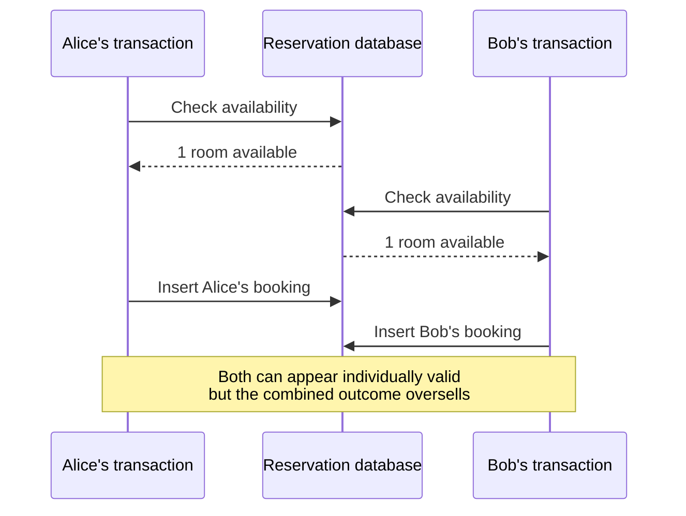
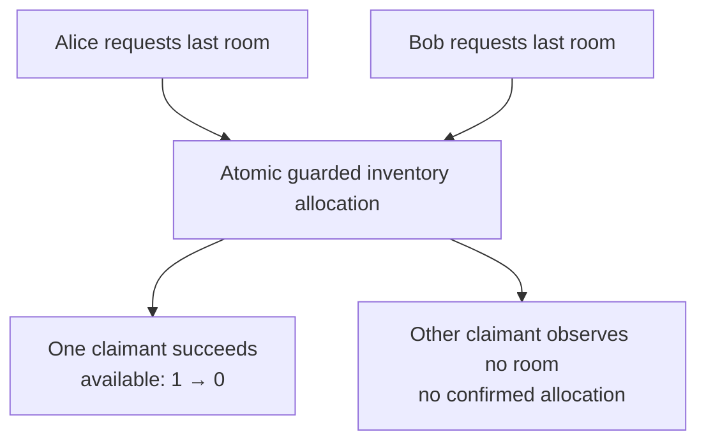

# CS330 — Relational Databases and Transactions

## Lecture 03: Transactions: When Correct Operations Produce Incorrect Results

*Two customers. One remaining hotel room. Two successful transactions. An outcome that should have been impossible.*

**Estimated study time:** 90–110 minutes, including the oral challenges and the optional PostgreSQL lab.

---

### How to listen to this lecture

Written for continuous listening first, then for on-screen re-reading. The theme today is simple: **a transaction is not a magical bubble around business logic.** Isolation levels, MVCC snapshots, locks, conditional updates, and constraints each protect different shapes of invariant — and the wrong shape is how two correct operations double-book a room. Bold takeaways mark ideas worth pausing on. Near the end, answer the challenges **out loud** before reading the solutions. The two-terminal PostgreSQL experiments live after the spoken lecture ends — keep them for a screen session.

By the end, you should be able to explain what ACID does and does not promise, why Read Committed and Repeatable Read can still permit write skew, when Serializable, `FOR UPDATE`, optimistic versions, and atomic conditional updates each fit, how to bound retries without replaying irreversible side effects, and which questions to ask before trusting a concurrent workflow.

---

# Part I — Intuition

*Two customers want the same last room. Each follows the correct booking procedure. Both receive confirmation. How can the database do everything it was asked to do and still produce an impossible result?*

### The picture to carry in your head

It's Friday evening. A hotel has one Deluxe room left for Saturday. Alice clicks **Book** from Berlin. At almost the same moment, Bob clicks **Book** from Stockholm. Our service handles both requests.

The developer has written a careful procedure: check availability, confirm that one room remains, create the reservation, and save it. There's even a database transaction around each request. All steps succeed.

The problem is the word *each*. Alice's request is correct when viewed alone. Bob's request is correct when viewed alone. But together they sell two reservations for one room. The program has a problem with **how two correct-looking operations can overlap in time**.

This is the fundamental purpose of transaction isolation: not to make one operation look pretty in code, but to control which combinations of concurrent operations may produce a committed result.

## 1. Two stories can be individually true and jointly impossible

Imagine a small reception desk with a chalkboard displaying the number of available rooms. It says **one**.

Alice's clerk reads the board. One room remains. Good. Before Alice's clerk changes anything, Bob's clerk reads the same board. One room remains. Good.

Alice's clerk writes a confirmed reservation. Bob's clerk writes a confirmed reservation. Both report success. The two clerks weren't lying about what they saw. But neither saw the other one's in-progress work before making the decision.

The first picture shows the overlap. Neither request has to crash, read corrupt data, or violate a simple field type to create a bad business outcome.



**Checkpoint:** Did either clerk necessarily make an arithmetic mistake? No. The mistake was relying on observations that became unsafe when the requests overlapped.

## 2. A transaction isn't a magic pause button

We often learn transactions through a simple example: transfer money between two accounts. Subtract from one, add to the other. If the operation fails halfway through, roll back so we don't leave money missing.

That's important. A transaction can make a group of database changes succeed or fail as an appropriate unit. This is the **atomicity** idea: don't leave half of this transaction's committed changes behind.

But atomicity doesn't automatically mean **nobody else can act between the time I read a value and the time I make a decision based on it**.

Multiple transactions may operate concurrently. Databases deliberately allow substantial overlap because forcing every request on a large system to wait for every other request would be expensive.

The challenge is choosing which overlapping actions may be observed and when conflicting work must wait, fail, or retry. That is the domain of **isolation**.

The database can have a perfectly functioning transaction mechanism and still permit a business anomaly if the application chooses insufficient coordination for the invariant it needs.

## 3. Give the last-room decision one authoritative moment

How might we fix the receptionist problem?

One approach is to make room allocation a single conditional operation. Instead of separately checking the chalkboard and later writing a reservation, ask the database to reduce the available count **only if a room is still available**.

Think of a machine that dispenses the final numbered ticket. Alice and Bob can press the button together, but the machine must decide who receives the last ticket. It can't issue ticket number one twice.

If the database has one inventory counter for the relevant date and category, an atomic conditional decrement can establish that decision, provided the full reservation operation uses a suitable transaction and the inventory model correctly represents what is being sold.

Another approach is to lock an appropriate inventory row before inspecting and changing it. Then a competing transaction must wait or otherwise resolve the conflict before it can make its own decision. Other designs use a stricter isolation mode and retry transactions that the database rejects as incompatible with a serial history.

These techniques differ, and the right one depends on how inventory is represented. A physical room assigned across date ranges isn't identical to a simple stock counter. But the core requirement is the same: **the business decision must have an authoritative point where competing claims cannot both succeed incorrectly**.

The second picture replaces the two separate check-and-insert decisions with one guarded allocation step. One claimant gets the ticket; the other gets an explicit rejection or must retry the appropriate transaction.



**Checkpoint:** Is putting the word `transaction` around a check followed by an insert always enough? No. We need an isolation or atomic enforcement strategy that actually protects the booking invariant.

## 4. Seeing the world at different moments

Suppose Alice starts reading reservation data just before Bob commits an update. Should Alice see Bob's change during the rest of her transaction? The answer depends on how the database provides views of data to concurrent operations.

Many relational databases support versions of records so readers and writers can make progress without always blocking one another. This idea is called **multi-version concurrency control**, or MVCC.

Think of a photographer taking pictures of the hotel's booking board. Alice may consult a view representing one moment; Bob may change the live board afterward. A stable picture helps Alice reason consistently about what she saw, but it doesn't necessarily make her decision safe against every competing transaction.

Some isolation modes provide newer views for successive statements. Others hold a transaction-level snapshot. Stronger modes may reject executions that cannot be understood as a valid sequential ordering of committed transactions.

You don't need the names of every isolation level yet. First understand the reason they exist: **a transaction's view of other concurrent work affects which decisions are safe**.

## 5. What about the payment provider?

Now assume Alice wins the last room. Our booking service also needs to charge her card through an external payment provider.

You might think we should hold one database transaction open while making the payment request, waiting for the provider, and sending a confirmation email. That sounds like keeping the whole business process together.

But a PostgreSQL transaction cannot roll back an arbitrary payment provider's completed operation. Nor can a database lock guarantee that a network request returns promptly. Holding locks across remote waits can cause contention and failures.

So database atomicity and the wider business workflow have different boundaries. We need a durable plan for payment attempts, uncertain responses, retries, cancellation, and recovery. Idempotency matters because a repeated network request must not accidentally perform the same charge twice.

The transaction protects the relevant database state. A reliable workflow protects the cross-system process. They cooperate; neither substitutes for the other.

## 6. A retry isn't the same as pretending the first attempt never happened

Suppose two concurrent booking transactions conflict under a strict isolation mode. The database may abort one transaction. That is not a broken database; it may be the database preserving a stronger guarantee.

The application can retry the complete database decision when appropriate, using fresh information and bounded attempts. But if the failed transaction already called an external payment API, blindly re-running the entire callback could charge the customer twice.

This is why retry boundaries matter. The database may undo its own changes; it cannot rewind the world outside it. We need explicit handling of side effects and uncertain outcomes.

### The minute-long mental replay

Alice and Bob see the same last room. Each checks availability and tries to book. A transaction makes its internal changes atomic, but that alone may not coordinate the two observations. We need an authoritative allocation mechanism—perhaps a guarded update, an appropriate lock, or serializable isolation with retries—so both claims cannot commit incorrectly. Meanwhile, payment and notification happen through a wider workflow that a database transaction cannot magically undo.

When the Deep Dive introduces ACID, MVCC, isolation levels, row locks, write skew, serializability, and retries, keep the reception desk in mind: **who is allowed to claim the final ticket, and what makes that decision real?**

### Three questions before the Deep Dive

1. **Can two transactions both commit successfully while the resulting business state is wrong?** Yes, when their isolation and enforcement strategy doesn't protect the relevant invariant.
2. **What does an atomic guarded inventory update achieve?** It makes the shared allocation condition and decrement one authoritative operation, rather than a vulnerable check followed by an unrelated later change.
3. **Can rolling back PostgreSQL automatically undo a payment already processed by an external provider?** No. External effects need their own protocols and recovery design.

*The intuition pass ends here.*

---

# Part II — Deep Dive

# 1. The Hotel That Sold Its Last Room Twice

It's Friday evening. A hotel in Copenhagen has one Deluxe room remaining for Saturday night. Two customers are looking at the hotel's booking page.

Alice is in Germany. Bob is in Sweden.

At 19:42:07, Alice clicks **Confirm Reservation**. Almost simultaneously, Bob clicks the same button.

The booking system receives two requests. Both execute essentially the same backend code — a TypeORM-style transaction that checks availability, throws if nothing remains, then saves a confirmed reservation:

```typescript
async function createReservation(input: ReservationInput) {
  return dataSource.transaction(async manager => {
    const available = await checkAvailability(
      manager,
      input.roomTypeId,
      input.dates
    );

    if (!available) {
      throw new Error("No rooms available");
    }

    return manager.save(Reservation, {
      ...input,
      status: "confirmed",
    });
  });
}
```

Looks reasonable. We're using a transaction.

We check availability before making the reservation. If availability is insufficient, we throw an error.

And if anything fails during persistence, the transaction rolls back. What could possibly go wrong?

Here's what actually happens — both sessions begin, both see one available room, both insert, both commit:

<escape>

```text
TIME       ALICE'S TRANSACTION       BOB'S TRANSACTION
────────────────────────────────────────────────────────

19:42:07   BEGIN
19:42:07                              BEGIN

19:42:07   Check available rooms
           Result: 1

19:42:07                              Check available rooms
                                      Result: 1

19:42:07   Insert reservation

19:42:07                              Insert reservation

19:42:07   COMMIT

19:42:07                              COMMIT

────────────────────────────────────────────────────────

FINAL RESULT:

Available rooms originally: 1
New confirmed reservations: 2
```

</escape>

Both transactions succeed. Both customers receive confirmation.

Both database inserts are valid. No database constraint is necessarily violated.

And the hotel has a problem. A rather physical problem, in fact. There are now two paying customers expecting to sleep in one bed.

The most disturbing part is that **PostgreSQL may have executed both transactions exactly according to its documented guarantees**. There was no database malfunction.

The problem was our understanding of what a transaction guarantees.

We assumed that placing several operations inside a transaction made the entire business operation safe against concurrency. It doesn't necessarily.

A transaction protects certain properties of database operations. Which properties it protects depends on the isolation level, the operations involved, and the constraints we've defined.

Today we're going to dismantle this mystery.

We'll examine the guarantees of transactions, the mechanics of MVCC, the anomalies created by concurrent execution, and the tools PostgreSQL provides to prevent them.

By the end, the objective is to understand something more valuable than how to write `BEGIN` and `COMMIT`.

We want to recognize **when two individually correct operations can interact to violate a shared invariant—and how to make the database prevent it**.

---

# 2. What Is a Transaction Actually Supposed to Do?

Let's begin with the familiar acronym: ACID. You've probably encountered it countless times.

Atomicity. Consistency. Isolation. Durability. Most developers can recite these four properties.

Fewer can explain exactly what they promise. And that distinction matters enormously.

## Atomicity: all or nothing

Imagine transferring €100 from Account A to Account B. The operation requires two changes — debit A, then credit B:

```sql
UPDATE accounts
SET balance = balance - 100
WHERE id = 'A';

UPDATE accounts
SET balance = balance + 100
WHERE id = 'B';
```

If the first operation succeeds but the second fails, €100 disappears from the represented account balances. Atomicity allows us to group the operations inside `BEGIN` / `COMMIT`:

```sql
BEGIN;

UPDATE accounts
SET balance = balance - 100
WHERE id = 'A';

UPDATE accounts
SET balance = balance + 100
WHERE id = 'B';

COMMIT;
```

If the transaction aborts, neither change is committed. If the transaction commits successfully, both changes are committed.

That's atomicity. But notice what atomicity *doesn't* promise.

It doesn't promise that Account A originally contained €100. It doesn't promise that the two account IDs represent legitimate accounts.

And it doesn't promise that another transaction cannot interfere with our business assumptions.

Atomicity concerns the indivisibility of the transaction's database effects, not whether the underlying business operation was sensible.

## Consistency: the database must remain valid

Consistency is probably the most misunderstood ACID property. It doesn't mean that every query always returns the latest data.

It doesn't mean replicas are synchronized. And it doesn't mean the database understands every business rule automatically.

Instead, consistency concerns preserving the database's defined integrity requirements. Consider an accounts table with a non-negative balance check:

```sql
CREATE TABLE accounts (
  id TEXT PRIMARY KEY,
  balance NUMERIC(12, 2) NOT NULL,
  CHECK (balance >= 0)
);
```

PostgreSQL enforces the declared balance constraint. A transaction cannot successfully commit a row with `balance = -50`.

But what if our application requires total money across a collection of accounts to be conserved? PostgreSQL does not automatically know that rule.

We must design the operations and constraints that enforce it.

**A transaction cannot preserve a business invariant that neither the application nor the database properly enforces.**

This explains part of our hotel-booking mystery. We believed reservations must never exceed available inventory.

But had we actually encoded that invariant anywhere capable of enforcing it under concurrency? Not yet.

## Isolation: concurrent transactions should not interfere in prohibited ways

This is where our investigation becomes interesting.

Isolation defines which effects of concurrent transactions may become visible to one another and which combined outcomes are permitted.

Different isolation levels make different promises. At weaker levels, transactions may observe changing snapshots of data.

At stronger levels, the database prevents additional anomalies, sometimes by forcing a transaction to abort.

But the important detail is that **isolation is not necessarily equivalent to running every transaction one at a time**. That stronger guarantee belongs to serializability.

We'll get there.

## Durability: committed work survives failures

Once a transaction has committed successfully, PostgreSQL normally ensures that the committed changes survive a database process or system crash, using mechanisms such as write-ahead logging and recovery.

The precise guarantee depends on configuration and storage behavior. For example, deliberately disabling synchronous commit changes the crash-loss window.

Also, durability does not mean that data survives every conceivable catastrophe. Backups, replication, and disaster recovery remain separate concerns.

And there's an especially subtle distinction. Suppose the database commits successfully, but the network connection fails before the application receives the confirmation.

The application doesn't know whether the transaction committed. The transaction may be perfectly durable.

The caller's knowledge of its outcome is not. We'll encounter this uncertainty again in the distributed-systems sessions.

For now, the critical observation is:

**ACID is a collection of distinct guarantees. Atomicity does not imply serializability, and durability does not imply that the client knows what happened.**

> **Sticky note #1**
>
> Reciting ACID is cheap. Naming what each letter *doesn't* promise is the interview skill.

---

# 3. Concurrency Creates a Second Dimension of Correctness

Imagine two transactions executing on a database. If we ran them strictly one after another, we'd have two possible orders — Alice then Bob, or Bob then Alice:

```text
Option A:

Transaction Alice
      |
      v
Transaction Bob
```

Or:

```text
Option B:

Transaction Bob
      |
      v
Transaction Alice
```

In either order, Bob or Alice would discover that the last room was already taken. One reservation succeeds.

The other fails. The invariant is preserved.

But production databases don't ordinarily serialize every transaction. That would waste substantial opportunities for concurrent work.

Instead, operations from different transactions may overlap and interleave — both read availability, then both insert, then both commit:

```text
Alice:  READ availability -------- INSERT -------- COMMIT
Bob:          READ availability -------- INSERT -------- COMMIT
```

Now the result depends on what each transaction can observe and which operations conflict.

Computer science has a useful term for the order in which concurrent operations occur:

**An execution schedule**, sometimes called a history. Different schedules can produce different outcomes, even when each transaction runs the same code.

### The idea of serializability

Suppose multiple transactions execute concurrently.

Their execution is *serializable* if the resulting behavior is equivalent to some valid serial execution of those transactions.

Not necessarily the order in which they started. Not necessarily the order in which their first queries completed.

Just some serial ordering consistent with the database's serializability rules.

In our hotel example, no serial ordering permits two successful reservations for the one remaining room, assuming each transaction correctly checks and consumes availability.

Therefore, the observed result is not serializable. That's the essential distinction.

A transaction can be atomic, durable, and internally reasonable while participating in a nonserializable execution. So how does PostgreSQL decide what each transaction sees?

To understand that, we need to revisit a mechanism introduced briefly in our previous sessions. MVCC.

---

# 4. MVCC: The Database That Remembers Several Versions of Reality

Imagine a database where every update immediately overwrites the existing value. A reader is examining a customer record.

Meanwhile, another transaction wants to modify it. How can the database prevent the reader from encountering an inconsistent intermediate state?

One traditional approach relies heavily on locking. Readers and writers coordinate access to shared records, potentially blocking one another.

PostgreSQL uses a different central mechanism:

**Multi-Version Concurrency Control**, or MVCC. The idea is that updating a row doesn't simply destroy the old version and replace it in place.

PostgreSQL maintains row versions whose visibility depends on transaction state and snapshots. Conceptually, Reservation 10842 might have Version 1 with `status = pending` and Version 2 with `status = confirmed`.

Suppose Transaction A started reading before Transaction B committed the status change.

Depending on the isolation level, Transaction A may continue seeing the earlier version while another transaction sees the newer one. Conceptually — A keeps seeing pending after its snapshot; B commits confirmed; C's later snapshot sees confirmed:

```text
                  TIME ─────────────────────>

Transaction A:
    Snapshot created
          |
          v
    Sees: pending ──────────────────────────

Transaction B:
                 UPDATE status = confirmed
                            |
                          COMMIT

Transaction C:
                                   Snapshot
                                      |
                                      v
                                Sees: confirmed
```

These versions are not magical copies of the entire database.

PostgreSQL maintains tuple versions and metadata that allow it to determine which versions are visible to a particular snapshot.

Transaction identifiers and transaction status help determine whether a row version should be visible. This design has a remarkable consequence.

**Ordinary readers generally do not block writers, and writers generally do not block ordinary readers.**

A long-running analytical query can read a consistent snapshot while updates continue elsewhere. That's enormously useful.

But it introduces the concept at the center of this lecture:

A transaction's view of the database is not necessarily identical to the latest globally committed state. It's determined by visibility rules.

And those rules change with the isolation level.

### The cost of keeping old versions

MVCC also has operational consequences. Old row versions cannot necessarily be discarded immediately.

A transaction may still need them. PostgreSQL therefore relies on vacuuming and related maintenance to reclaim reusable space and manage visibility information.

Long-running transactions can prevent old row versions from being cleaned up. This can contribute to table bloat and storage pressure.

So an application that begins a transaction and leaves it open for fifteen minutes isn't merely holding a connection. It may also interfere with database maintenance.

We won't explore vacuum internals today, but the connection is worth remembering:

**Concurrency guarantees have physical storage and operational costs.**

Now let's examine the isolation levels.

---

# 5. Read Committed: A New Snapshot for Every Statement

PostgreSQL's default transaction isolation level is **Read Committed**. It's appropriate for many ordinary application operations.

But understanding its limitations is essential.

In Read Committed, each ordinary `SELECT` statement sees a snapshot reflecting data committed before that statement began, along with the transaction's own changes.

Two successive statements within the same transaction can therefore see different committed database states. Let's reproduce the idea.

Transaction A begins and reads account A's balance:

```sql
BEGIN;

SELECT balance
FROM accounts
WHERE id = 'A';
```

Result: `balance = 100`.

Meanwhile, Transaction B updates that balance to 150 and commits:

```sql
BEGIN;

UPDATE accounts
SET balance = 150
WHERE id = 'A';

COMMIT;
```

Transaction A executes the same query again:

```sql
SELECT balance
FROM accounts
WHERE id = 'A';
```

Now the result is `balance = 150`.

Transaction A has not committed or rolled back. Yet it has observed two different values for the same row.

This is called a **non-repeatable read**. Nothing is broken.

It's permitted by Read Committed.

### What about dirty reads?

A dirty read occurs when one transaction reads another transaction's uncommitted changes.

PostgreSQL does not permit dirty reads, even when you request the SQL-standard `READ UNCOMMITTED` isolation level.

In PostgreSQL, Read Uncommitted effectively behaves like Read Committed. That's an important PostgreSQL-specific detail.

### The phantom read

Now consider a query involving several rows — counting confirmed reservations for a hotel:

```sql
SELECT COUNT(*)
FROM reservations
WHERE hotel_id = 482
  AND status = 'confirmed';
```

Transaction A receives 125 reservations.

Transaction B inserts a new matching reservation and commits. Transaction A repeats its query.

Now it sees 126 reservations.

The result set has changed because a new matching row appeared. This is a *phantom read*.

It illustrates why reasoning about concurrency requires more than tracking updates to existing rows. New rows can change the truth of a business condition.

And that is precisely what happened in our double-booking example. Both transactions asked:

> How many confirmed reservations already exist?

Both received an answer that was correct at the time of their respective queries. Neither answer guaranteed that the result would remain valid until the transaction committed.

---

# 6. Lost Updates: When Two Writers Disagree About the Past

Let's examine another classic anomaly. Suppose a hotel inventory record contains `remaining_rooms = 5`.

Two processes want to reserve one room. Both read the value.

Both receive 5. Both calculate `const newValue = remainingRooms - 1` in application memory.

Both issue the same absolute assignment: `UPDATE inventory SET remaining_rooms = 4 WHERE id = 1`.

What happens? Both updates can eventually succeed under Read Committed.

The second writer may wait for the first writer's row lock to be released. But it's still assigning the stale value `4`.

The database ends up with four remaining rooms. Two reservations were made.

Only one unit was deducted. This is a form of **lost update**.

The problem is that the application calculated a new state using information that was no longer current.

### Not all updates have this problem

Now compare a database-side decrement: `UPDATE inventory SET remaining_rooms = remaining_rooms - 1 WHERE id = 1`.

This is different. The arithmetic happens inside the database statement.

Under PostgreSQL Read Committed, concurrent updates to the same row coordinate through row locking.

If another transaction updates the row first, the waiting updater can proceed against the updated row version once the first transaction commits.

The second decrement therefore applies to the new value. Starting with five rooms, two successful decrements produce three.

That's what we wanted. This distinction is remarkably useful.

**Reading a value into application memory, modifying it, and writing it back is not equivalent to asking the database to atomically modify the current value.**

The second approach can avoid a whole category of stale-state problems. But we're not finished.

What if the inventory contains zero rooms? We don't want the value to become negative.

And we don't want to insert a reservation unless the inventory update succeeds. We need a stronger operation.

We'll design one shortly. First, let's examine what happens when we increase the isolation level.

---

# 7. Repeatable Read: A Stable Snapshot Can Still Lie About the Whole System

You might now propose a seemingly elegant solution. Why not change the isolation level to Repeatable Read with `BEGIN ISOLATION LEVEL REPEATABLE READ`?

In PostgreSQL, Repeatable Read provides a stable snapshot for the transaction.

The snapshot is established at the first relevant statement, rather than automatically at `BEGIN`.

Subsequent ordinary reads continue observing the same committed database state, together with the transaction's own changes. Non-repeatable reads disappear.

Phantom reads are also prevented in PostgreSQL's implementation, which is stronger in this respect than the SQL standard's minimum requirement for Repeatable Read. Excellent.

So our booking problem is solved? Not necessarily.

In fact, a stable snapshot can make the underlying danger easier to demonstrate.

### The two doctors problem

Imagine a hospital where at least one doctor must remain on duty. Two doctors are currently available — Doctor Alice `on_duty = true`, Doctor Bob `on_duty = true`.

Alice wants to leave. Her transaction checks whether another doctor is on duty.

Yes—Bob is available. So Alice marks herself off duty.

Simultaneously, Bob wants to leave. His transaction checks whether another doctor is on duty.

Yes—Alice is available. So Bob marks himself off duty.

Under Repeatable Read, both transactions may operate using snapshots in which both doctors are on duty. Alice updates her own row.

Bob updates his own row. They aren't modifying the same database row.

Both transactions can commit. Final state: both doctors `on_duty = false`.

No doctors remain on duty. Each transaction made a locally reasonable decision.

Together they violated a global invariant. This anomaly is called **write skew**.

### Why row-level conflict detection doesn't save us

PostgreSQL's Repeatable Read prevents certain conflicting updates to the same row.

For example, if two transactions try to update the same existing row based on incompatible snapshots, one can receive a serialization failure.

But our doctors update different rows. The conflict lies in what each transaction *read* when deciding what to write.

Alice's decision depends on Bob's status. Bob's decision depends on Alice's status.

Their writes affect the truth of each other's earlier reads. That's the dangerous relationship.

And the same pattern can arise in hotel bookings. One transaction counts existing reservations.

Another does the same. Each inserts a different reservation row.

Neither updates an existing reservation row that the other is trying to modify. Both can commit under Repeatable Read.

**A stable snapshot is not the same thing as a serializable execution.**

This is one of the most important distinctions in practical database concurrency.

> **Sticky note #2**
>
> Repeatable Read freezes *your* view. Write skew is when two frozen views each approve a change the other would have blocked.

---

# 8. The Isolation Levels Compared

We now have enough context to compare PostgreSQL's isolation levels meaningfully. Spoken as a stack rather than a table:

- **Read Uncommitted** — dirty reads prevented in PostgreSQL (behaves as Read Committed); non-repeatable reads, phantoms, and serialization anomalies still possible.
- **Read Committed** — dirty reads prevented; non-repeatable reads, phantoms, and serialization anomalies possible. This is PostgreSQL's default.
- **Repeatable Read** — dirty, non-repeatable, and phantom reads prevented in PostgreSQL's snapshot implementation; serialization anomalies such as write skew still possible.
- **Serializable** — dirty, non-repeatable, phantom, and serialization anomalies prevented; the application must handle transaction failures and retries.

A few details deserve emphasis. Read Uncommitted is not a distinct weaker implementation in PostgreSQL; it behaves as Read Committed.

PostgreSQL's Repeatable Read is based on snapshot isolation and prevents phantoms, but can permit write skew.

Serializable provides the strongest isolation semantics, but the application must handle transaction failures and retries.

The comparison is useful, but don't memorize it as the entire subject. The real skill is recognizing the shape of an operation.

Are we updating one row? Are we deriving a write from an earlier read?

Are we checking a condition across multiple rows? Could another transaction insert a row that invalidates our decision?

These questions determine whether our chosen isolation and locking strategy is sufficient.

---

# 9. Serializable: The Database Refuses an Impossible History

Let's return to the two doctors. Alice's transaction reads Bob's availability and marks Alice off duty.

Bob's transaction reads Alice's availability and marks Bob off duty. If they executed sequentially, one would discover that the other had already left.

Both cannot successfully leave in a correct serial execution. PostgreSQL's Serializable isolation level detects conflicts that could produce such nonserializable outcomes.

It uses a mechanism called **Serializable Snapshot Isolation**, or SSI. The key idea is rather clever.

PostgreSQL doesn't simply force every transaction to execute one after another.

Instead, it allows considerable concurrency while tracking read/write dependencies that could make the committed history inconsistent with serial execution.

When it detects an unsafe situation, it aborts a transaction. The application may receive an error such as: could not serialize access due to read/write dependencies among transactions — SQLSTATE `40001`, which is `serialization_failure`.

That's the signal. One transaction succeeds.

The other must retry. When retried, the operation obtains a new snapshot and reevaluates the business condition.

It can now discover that the invariant would be violated.

### Serializable is not a giant database lock

It's tempting to imagine Serializable as a mode that locks the entire database. That is not how PostgreSQL implements it.

Its SSI mechanism tracks dangerous dependencies using predicate-locking information and related concurrency machinery.

These predicate locks are not ordinary blocking row locks. Their purpose is to detect conflicts, not to stop every writer immediately.

This allows substantial concurrency. However, Serializable has costs.

Conflict tracking consumes resources. Some transactions must be retried.

Under contention, retries can increase latency and wasted work. The database may occasionally abort a transaction conservatively to prevent a possible anomaly.

And applications must be designed to recover from those failures.

### An essential qualification

Serializable reasoning applies to transactions participating appropriately in the relevant isolation and correctness strategy.

You cannot make one operation safe merely by changing its isolation level while unrelated write paths continue modifying the same business state without respecting the intended invariant.

A correctness strategy must cover **every operation capable of violating the rule**.

That might involve serializable transactions, database constraints, carefully coordinated locks, or atomic conditional updates.

The important goal is not to enable a prestigious-sounding isolation level. It's to enforce a particular invariant.

---

# 10. Pessimistic Locking: Take the Resource Before Somebody Else Does

Let's consider another approach. Suppose our hotel keeps a row describing available inventory for a particular room type and date — `room_type_id = 42`, night `2026-11-14`, `remaining = 1`.

Instead of merely reading the row, we can lock it with `SELECT ... FOR UPDATE`:

```sql
BEGIN;

SELECT remaining
FROM room_inventory
WHERE room_type_id = 42
  AND night = DATE '2026-11-14'
FOR UPDATE;
```

`FOR UPDATE` acquires a row-level lock that conflicts with other transactions attempting certain operations on the same row.

If Alice has locked the inventory row, Bob's conflicting lock request waits. Alice checks the inventory, creates the reservation, decrements availability, and commits.

Only then can Bob proceed. Under Read Committed, Bob's locking read can return the updated version of the row after waiting.

He discovers that no rooms remain. His booking fails.

That's **pessimistic concurrency control**. We're assuming contention is possible and coordinating access before performing the dependent operation.

### The power and limitations of row locks

Row-level locks are excellent when all competing operations share a clearly identified row. But suppose the business rule is:

> No more than ten reservations may exist for this category and date.

You query matching reservations with `FOR UPDATE`:

```sql
SELECT *
FROM reservations
WHERE room_type_id = 42
  AND night = DATE '2026-11-14'
FOR UPDATE;
```

What if there are currently no matching rows? There's nothing to lock.

Locking existing reservation rows does not automatically prevent another transaction from inserting a new matching row.

PostgreSQL does not turn every `SELECT FOR UPDATE` predicate into a general-purpose blocking range lock. This is a common mistake.

**A row lock protects a row. It does not automatically protect the absence of rows or every possible future row matching a condition.**

That's why a dedicated inventory row can be useful. Every transaction competing for the same room type and night can coordinate through the same record.

But all booking paths must respect that protocol.

If one integration bypasses inventory allocation and directly inserts confirmed reservations, the locking design no longer protects the business invariant.

---

# 11. The Atomic Conditional Update: Often the Simplest Good Solution

Let's improve our inventory design.

Instead of reading availability, locking manually, calculating a new value, and writing it back, we can ask PostgreSQL to perform the entire condition and modification atomically — decrement only while `remaining > 0`, and return the new value:

```sql
UPDATE room_inventory
SET remaining = remaining - 1
WHERE room_type_id = 42
  AND night = DATE '2026-11-14'
  AND remaining > 0
RETURNING remaining;
```

This is a powerful pattern. The statement means:

> Decrease availability by one, but only if the currently eligible row still has positive availability.

Suppose two transactions attempt this simultaneously. Initially `remaining = 1`.

Alice obtains the row lock and updates it to zero. Bob attempts the same update.

He waits for Alice's transaction. If Alice commits, PostgreSQL rechecks the update condition against the updated row under Read Committed.

Now `remaining > 0` is false. Bob updates zero rows.

The application can interpret that as unavailable inventory. No separate stale availability calculation is required.

### The transaction must still connect inventory and reservation

Of course, we don't want to decrement inventory without creating the reservation. So wrap both in one transaction — claim inventory, then insert only if the update returned a row:

```sql
BEGIN;

UPDATE room_inventory
SET remaining = remaining - 1
WHERE room_type_id = 42
  AND night = DATE '2026-11-14'
  AND remaining > 0
RETURNING remaining;

-- Only continue if exactly one row was updated.

INSERT INTO reservations (
  room_type_id,
  check_in,
  check_out,
  status
)
VALUES (
  42,
  DATE '2026-11-14',
  DATE '2026-11-15',
  'confirmed'
);

COMMIT;
```

The application must verify that the update returned exactly one row before inserting.

If no row was updated, it should roll back or terminate the transaction without creating a reservation. If the insert fails, the inventory decrement rolls back.

For a multi-night booking, every night's inventory allocation must succeed within the transaction. If any night cannot be allocated, the entire allocation must be undone.

And concurrent multi-night bookings should lock inventory rows in a consistent order to reduce deadlocks.

### Why I like this approach

For inventory rows that represent authoritative remaining capacity, atomic conditional updates are often a better default than a separate availability read plus hope that isolation will save you. They coordinate through the shared resource itself and don't require Serializable merely to keep a counter non-negative—but they still depend on a sound inventory model. If capacity is computed dynamically from several tables, or inventory can be modified through many independent operations, the design may need additional coordination.

The correct concurrency mechanism follows the shape of the business invariant.

---

# 12. Optimistic Concurrency: Don't Lock Until You Know There's a Conflict

Pessimistic locking coordinates access before a contested modification. Optimistic concurrency control takes a different approach.

It allows operations to proceed based on an observed version, then rejects the write if that version is no longer current. Suppose a reservation has `id = 10842`, `status = pending`, `version = 7`.

The application reads it and prepares a change. Instead of updating by id alone — `UPDATE reservations SET status = 'confirmed' WHERE id = 10842` — we require both the id and the read version (seven here) in the where clause, increment version in the same statement, and return the new row so the app can tell success from zero rows updated:

```sql
UPDATE reservations
SET
  status = 'confirmed',
  version = version + 1
WHERE id = 10842
  AND version = 7
RETURNING id, version;
```

If no other transaction changed the row, the update succeeds. The version becomes eight.

If another operation has already modified the reservation and incremented the version, the condition no longer matches. Zero rows are updated.

The application detects a conflict. This is commonly called **optimistic locking**, although it doesn't necessarily involve a database lock acquired during the initial read.

It's also a form of compare-and-swap behavior.

### When is it useful?

Imagine two hotel employees editing a reservation. Alice changes the check-in time.

Bob changes the guest count. Both opened the reservation when its version was seven.

Alice saves first. The version becomes eight.

Bob attempts to save his stale version-seven representation. The update fails.

Now Bob can refresh the record and decide how to merge or reapply his changes. Without version checking, Bob's stale update might overwrite Alice's work.

Optimistic concurrency is attractive when conflicting modifications are relatively rare. It avoids holding a database transaction open while a user thinks about an edit.

### Its limitation

A version column on an individual reservation protects that reservation against conflicting updates.

It doesn't automatically protect an invariant involving many different reservations.

If Alice inserts Reservation A and Bob inserts Reservation B, neither necessarily conflicts on a shared versioned row.

For aggregate rules, optimistic control must coordinate through a shared version, predicate-aware mechanism, constraint, or other enforcement strategy.

This is why the right question is not:

> Should I use optimistic or pessimistic locking?

It's:

> What exact shared state or invariant can competing operations invalidate?

Only then can you identify the correct coordination point.

---

# 13. Deadlocks: When Everyone Politely Waits Forever

Locks prevent many concurrency anomalies. But they introduce another kind of problem.

Imagine a reservation workflow that updates two inventory rows. Alice books nights Friday and Saturday.

Bob books the same nights. Alice locks Friday first.

Bob locks Saturday first. Then Alice attempts to lock Saturday.

She must wait for Bob. Bob attempts to lock Friday.

He must wait for Alice. Neither can proceed — a classic circular wait:

```text
Transaction Alice              Transaction Bob

Locks Friday                   Locks Saturday
     |                              |
     v                              v
Requests Saturday             Requests Friday
     |                              |
     +---------- WAIT --------------+
     |                              |
     +---------- WAIT --------------+
```

This is a **deadlock**. Fortunately, PostgreSQL doesn't allow such a cycle to remain unresolved indefinitely.

Its deadlock-detection machinery can identify the problem and abort one of the transactions. The application receives an error such as SQLSTATE `40P01` — `deadlock_detected`.

The surviving transaction can proceed.

### Avoiding deadlocks

One highly practical technique is acquiring locks in a consistent order. For example, always process inventory rows in ascending date order.

Then both Alice and Bob attempt Friday before Saturday. One waits for Friday.

The other proceeds through the dates and commits. No circular wait is created by that particular sequence.

Other useful practices include keeping transactions short, avoiding unnecessary locks, and acquiring the intended lock strength deliberately.

But deadlocks cannot always be eliminated. Complex systems have multiple transaction paths and competing resources.

A robust application should be prepared to retry appropriate deadlock failures.

### Don't confuse waiting with deadlocking

A transaction waiting for another transaction's row lock is not automatically deadlocked. Ordinary lock waiting is part of concurrency control.

A deadlock requires a circular dependency that prevents progress. Lock waiting can still cause serious latency, however.

PostgreSQL provides tools such as `pg_stat_activity` and `pg_locks` to investigate blocking and lock contention.

And this is where poor transaction boundaries become expensive.

A transaction that holds inventory locks while calling an external payment provider may block other bookings for several seconds.

The database isn't slow because its arithmetic is difficult. It's slow because one operation owns a resource that others need.

This brings us to transaction design at the application level.

---

# 14. Where Should a Transaction Begin and End?

Recall the architecture we developed in SE320-L01 — HTTP controller over an application service that owns domain logic, repositories, and external services:

```text
HTTP Controller
      |
      v
Application Service
      |
      +-- Domain Logic
      |
      +-- Repositories
      |
      +-- External Services
```

Where does the transaction belong? Typically, around a coherent unit of database work required to preserve a business operation's invariants.

For example — allocate inventory, create the reservation, and record an outbox event inside one Read Committed transaction:

```typescript
await dataSource.transaction(
  "READ COMMITTED",
  async manager => {
    const inventory = await allocateInventory(
      manager,
      booking
    );

    if (!inventory.success) {
      throw new InventoryUnavailableError();
    }

    await createReservation(manager, booking);

    await recordOutboxEvent(manager, booking);
  }
);
```

The precise implementation depends on the domain, but the transaction encompasses the database changes that must succeed or fail together.

An important TypeORM detail: operations belonging to the transaction must use the transaction-provided entity manager or repositories derived from it.

If a nested service silently uses the global `dataSource.manager`, it may execute operations outside the intended transaction.

That's an excellent way to introduce bugs that only appear during failures.

### The dangerous external call

Now imagine charging the customer *inside* the same database transaction:

```typescript
await dataSource.transaction(async manager => {
  await allocateInventory(manager, booking);

  await paymentProvider.chargeCustomer(payment);

  await createReservation(manager, booking);
});
```

This looks attractive. Everything appears to belong to one use case.

But the payment provider does not participate in your PostgreSQL transaction.

If the database rolls back after payment succeeds, PostgreSQL cannot reverse the charge automatically.

If the payment provider takes eight seconds to respond, your database transaction may hold locks and a connection for eight seconds.

And if the provider times out, you may not know whether the charge occurred.

The correct design often separates local atomic persistence from external side effects, using durable workflow state, idempotency, and reconciliation.

We'll investigate those patterns more deeply when the curriculum moves into distributed systems. For now, a useful principle is:

**A database transaction should protect the smallest coherent unit of database state that must change atomically—not the entire duration of a complicated business process involving unreliable external systems.**

Small does not mean artificially splitting an operation that requires atomicity. It means avoiding unnecessary work while scarce database resources and locks are held.

---

# 15. Retrying Transactions Without Making Things Worse

Serializable transactions can fail with SQLSTATE `40001`. Deadlocks can fail with `40P01`.

These errors often justify retrying the transaction. But retrying correctly is more subtle than repeating the final SQL statement.

Suppose the original transaction:

1. Reads available inventory.
2. Determines a price.
3. Selects a particular room.
4. Inserts the reservation.

If the transaction fails because the concurrent world changed, retrying only the insert is not sufficient. The business decision must be reevaluated against fresh data.

PostgreSQL's guidance is to retry the **complete transaction**, including the logic that determines which statements and values to use. A simplified Node.js retry wrapper — retry only serialization and deadlock codes, with bounded attempts and jittered backoff:

```typescript
const RETRYABLE_CODES = new Set([
  "40001", // serialization_failure
  "40P01", // deadlock_detected
]);

async function runWithRetry<T>(
  operation: () => Promise<T>,
  maxAttempts = 3
): Promise<T> {
  for (let attempt = 1; attempt <= maxAttempts; attempt++) {
    try {
      return await operation();
    } catch (error: any) {
      const code = error?.driverError?.code ?? error?.code;

      if (
        !RETRYABLE_CODES.has(code) ||
        attempt === maxAttempts
      ) {
        throw error;
      }

      const delay =
        Math.min(100 * 2 ** (attempt - 1), 1000) *
        (0.5 + Math.random());

      await new Promise(resolve =>
        setTimeout(resolve, delay)
      );
    }
  }

  throw new Error("Unreachable");
}
```

This is a teaching-level wrapper: production code should also account for deadlines, cancellation, error classification, and the application's response contract.

Usage might look like wrapping a fresh Serializable transaction on each attempt:

```typescript
const reservation = await runWithRetry(() =>
  dataSource.transaction(
    "SERIALIZABLE",
    async manager => {
      return createReservationTransaction(
        manager,
        command
      );
    }
  )
);
```

Each attempt begins a fresh transaction. The complete decision process runs again.

The retry is bounded. And a little randomized delay reduces synchronized retry storms.

### The crucial warning

Never blindly retry a transaction callback that performs irreversible external side effects.

If the callback charges a payment card and then the database aborts, automatically retrying the entire callback might charge the customer again.

Retries must operate within clearly defined side-effect boundaries. A reliable workflow requires idempotency and durable coordination around external effects.

Also, not every database constraint error is transient.

A unique-key violation may represent a legitimate duplicate business request rather than a concurrency anomaly that should be retried.

Error classification is part of correctness.

---

# 16. Choosing the Right Strategy in Real Systems

Let's consolidate the available techniques as a spoken toolkit rather than a comparison grid:

- **Unique constraint** — strong for preventing duplicate keys or identities; doesn't express arbitrary business rules.
- **Exclusion constraint** — strong for preventing overlapping physical-room reservations; not a general pooled-capacity solution.
- **Atomic conditional update** — strong for claiming limited inventory represented by shared rows; requires a suitable shared-state model.
- **`SELECT FOR UPDATE`** — strong for coordinating modifications to existing rows; doesn't lock absent rows.
- **Optimistic version check** — strong for preventing stale updates to existing entities; doesn't automatically protect cross-row invariants.
- **Repeatable Read** — strong for stable transaction snapshots; can permit write skew.
- **Serializable** — strong for preventing nonserializable committed histories; requires retry handling and has overhead.

There's no universally superior option. But we can make practical recommendations.

### For simple counters and inventory allocations

Prefer an atomic conditional update when the business rule can be cleanly represented that way. It's often efficient, explicit, and easy to reason about.

### For entity editing

Optimistic concurrency using a version column is frequently an excellent choice. Especially when users may hold an editing screen open for minutes.

### For contested multi-row resources

Explicit row locking can work well if competing operations have a well-defined shared resource to coordinate through. Acquire locks consistently and keep transactions short.

### For complex predicate-based invariants

Serializable transactions are worth serious consideration. They can reduce the need to invent intricate manual locking protocols.

But the entire relevant workflow must participate appropriately, and retries must be handled correctly.

### For rules naturally expressible as database constraints

Use constraints.

An overlapping-room prohibition implemented through a PostgreSQL exclusion constraint can be stronger and simpler than relying entirely on application-level checks.

### What about distributed locks?

You might be tempted to introduce Redis locks for booking coordination.

For a business invariant that lives in PostgreSQL, I would generally avoid making an external distributed lock the primary correctness mechanism unless there's a compelling architectural reason.

Redis locking introduces another system whose availability, failure behavior, lease expiration, and ownership semantics must be understood. A process can pause.

A lock lease can expire. Another process can acquire the lock while the original process is still capable of writing.

Without appropriate fencing or database-side enforcement, the lock may not provide the guarantee you expected.

If PostgreSQL can directly enforce the invariant, that's usually a better place to begin. We'll revisit distributed coordination later.

---

# 17. The Oral Examination

We now have enough of transaction semantics to talk about double-booking, lost updates, and retries like an engineer rather than hoping `BEGIN` / `COMMIT` would have saved us.

Before reading the solutions, try answering these questions out loud. Imagine that a senior engineer is interviewing you and will challenge any hand-waving. Speak complete explanations, not fragments.

### Challenge A — The Misleading Transaction

*Suggested time: 8 minutes.*

Two customers attempt to purchase the final concert ticket. Each transaction performs:

1. `SELECT COUNT(*)` of existing ticket allocations.
2. Checks that the count is below capacity.
3. Inserts a new allocation.
4. Commits.

The database uses Read Committed. Why is wrapping the operation in a transaction insufficient?

What are two plausible fixes?

### Challenge B — Lost Update or Safe Update?

*Suggested time: 6 minutes.*

Two transactions execute `UPDATE accounts SET balance = balance - 100 WHERE id = 1`.

The original balance is €500. Will PostgreSQL necessarily lose one deduction under Read Committed?

How does this differ from reading €500 into application memory and later executing `SET balance = 400`?

### Challenge C — The Empty Result Problem

*Suggested time: 6 minutes.*

You execute `SELECT * FROM reservations WHERE room_id = 204 AND check_in = DATE '2026-11-14' FOR UPDATE`.

No rows are returned. Does this prevent another transaction from inserting a matching reservation?

Why or why not?

### Challenge D — The Dangerous Retry

*Suggested time: 8 minutes.*

Your transaction:

1. Creates an inventory hold.
2. Charges a credit card through an external provider.
3. Writes a confirmed reservation.

The database reports a serialization failure. Your retry wrapper executes all three steps again.

What's wrong with this design?

### Challenge E — Optimistic Locking

*Suggested time: 6 minutes.*

Two administrators load Reservation 10842 at version 7. One changes its status to confirmed.

The other changes its guest count. Both attempt to update using `WHERE version = 7`.

What happens? How should the application respond to the second update?

### Challenge F — Serializable Everywhere?

*Suggested time: 8 minutes.*

A colleague proposes switching the entire PostgreSQL application to Serializable isolation to eliminate all concurrency bugs. Would you support this?

What guarantees would improve, and what problems would remain?

---

# 18. Solutions and Discussion

*Read this section after answering out loud. The optional PostgreSQL lab appears after the spoken lecture ends.*

### Solution A — The count-and-insert operation has a concurrency gap

The transactions read a condition that can be invalidated by concurrent inserts. Their separate inserted rows need not conflict under Read Committed.

One solution is to represent the remaining ticket capacity in a shared inventory row and claim it through an atomic conditional update.

Another is to use Serializable transactions and retry failures, ensuring the relevant competing operations respect the same concurrency strategy.

For individually numbered seats, a unique constraint on event and seat identity may be even simpler.

The right design follows whether we're selling interchangeable capacity or identified resources.

### Solution B — The database-side decrement is different

PostgreSQL coordinates concurrent row updates. Under Read Committed, a waiting update can operate against the row version committed by the earlier updater.

Two successful `balance = balance - 100` operations can therefore reduce €500 to €300.

If both application processes previously read €500 and separately assign the calculated value €400, the second stale assignment can overwrite the effect of the first.

The difference is between modifying the current database value and assigning a previously calculated value.

For financial systems, additional conditions and ledger integrity rules would normally be necessary.

### Solution C — You cannot row-lock a nonexistent row

`SELECT FOR UPDATE` locks returned rows. If no matching rows exist, there is no matching row lock protecting that absence.

Another transaction may insert a row satisfying the condition.

You need a constraint, an appropriate shared coordination row, Serializable isolation, or another strategy that protects the intended invariant.

### Solution D — PostgreSQL cannot roll back the card charge

The external payment provider is not part of the PostgreSQL transaction.

A serialization failure can roll back the database work, but it cannot automatically undo an external charge. Retrying the entire callback may charge the customer again.

The workflow needs separate durable states, idempotency controls, and recovery logic for the payment operation. We will explore payment workflow correctness in CS430-L05.

### Solution E — The second update fails its version check

The first successful update changes the version from seven to eight. The second operation still requires version seven.

Its update affects zero rows.

The application should recognize a stale-state conflict and decide whether to refresh, merge, retry after reevaluating the change, or ask the user to resolve the conflict.

Silently overwriting the newer state defeats the purpose of optimistic concurrency.

### Solution F — Serializable is not a universal cure

Serializable prevents committed histories that are inconsistent with serial execution of appropriately participating transactions. That's a strong guarantee.

But it introduces serialization failures that applications must retry. It can increase overhead and latency under contention.

It doesn't automatically express business rules. It doesn't protect operations outside the relevant transactional protocol.

And it doesn't make external APIs participate atomically in PostgreSQL transactions. For straightforward single-row resource claims, a conditional update may be simpler.

For complex multi-row invariants, Serializable may be an excellent choice.

The correct decision depends on the workload and invariant, not a blanket preference for maximum isolation.

---

# 19. The Mental Model Worth Keeping

Transactions are not magical protective bubbles around business logic. They provide particular guarantees about database operations.

And the most important insight from this session is that **correctness must be evaluated across concurrent operations, not merely within individual transactions**.

Remember these durable distinctions:

**Atomicity** — a group of database changes succeeds or fails together; it does not invent business rules.

**MVCC** — PostgreSQL keeps row versions and serves transaction-dependent snapshots; readers and writers need not block each other the way a pure lock model would.

**Read Committed** — statement-level snapshots; no dirty reads; changing observations and serialization anomalies remain possible.

**Repeatable Read** — a stable snapshot; not the same as a serializable execution; write skew can still land.

**Serializable** — refuses nonserializable committed histories; expect aborts and retries.

**Pessimistic locking** — coordinate contested resources before modification; a row lock does not lock absence.

**Optimistic concurrency** — detect when the state you relied on has changed; protects the versioned entity, not every aggregate rule.

**Atomic conditional updates** — check and modify shared state in one coordinated statement when the invariant fits that shape.

**Constraints** — enforce selected invariants regardless of which application path writes.

**Transaction boundaries** — decide which database effects are atomic, and which external effects remain outside that protection.

When evaluating a concurrent workflow, the most useful questions are:

> What business invariant must always hold?

> Which concurrent operations can violate it?

> What shared data do those operations read or modify?

> Where is the authoritative enforcement mechanism?

> What happens when two operations reach that mechanism simultaneously?

> How does the application respond when one operation must wait, fail, or retry?

If you can answer those questions, you can reason about a remarkable range of production problems. Hotel inventory. Concert tickets. Bank balances. Coupon redemptions. Warehouse stock. Subscription limits. Financial ledgers. Appointment scheduling. Even distributed agent workflows coordinating access to limited resources.

The technologies differ, but the underlying problem often has the same shape. Several operations are trying to make decisions about shared mutable state.

And those decisions must remain valid when the operations overlap. That's the real subject of transaction engineering.

> **The master sticky note**
>
> Ask what invariant must hold, which operations can break it, and where enforcement lives — not whether you "use transactions."

That also closes CS330. You now have relational design, SQL performance judgment, and the concurrency model that makes correct statements produce incorrect systems when schedules collide.

---

# 20. Next Course — Data Systems Beyond Relational Databases

CS330 ends here: schema design, query performance, and the transaction semantics that decide whether concurrent bookings, payments, and inventory updates stay honest.

The Application and data engineering track continues with **CS340 — Data Systems Beyond Relational Databases**. PostgreSQL is not the whole storage world. Document models, storage engines, replication and sharding, Redis, DynamoDB, search indexes, and analytical stores each optimize different trade-offs — and misuse any of them and you recreate today's problems with worse tooling.

In **CS340-L01**, that course begins — The Database That Didn't Fit Into Tables. Why a feature's shape sometimes refuses the relational rectangle, and how to choose a model without collecting databases like souvenirs.

When you are ready for multi-node failure and workflows that span more than one database, **CS430-L01** opens Advanced systems and production — Distributed Systems and Partial Failure. Today's durability uncertainty — the commit that succeeded while the client never heard — is the opening pressure for that course.

If your next focus is backend caching and asynchronous workflows rather than storage models, **SE320** remains a natural alternative. If you want Linux, containers, and cloud delivery next, **SE340** is the other production-path option. See the recommended study order in `README.md`.

---

## Optional Practical Lab — Make PostgreSQL Double-Book a Room

*The spoken lecture ends here. The remaining material is a screen-first investigation worksheet.*

This is one of the most valuable experiments in the course. You need PostgreSQL and **two independent SQL sessions**.

For example, open two `psql` terminals connected to the same disposable database. We'll call them Terminal A and Terminal B.

The experiment uses one available room and an intentionally unsafe reservation strategy.

**Suggested time: 25–35 minutes.**

> **Gym rules:** predict before you commit. The oral challenges were in the spoken lecture; these labs are for your own eyes and two terminals.

### Part A — Reproduce the double booking

First, run this setup once — a bookings table with no capacity enforcement beyond what your application checks:

```sql
DROP TABLE IF EXISTS demo_bookings;

CREATE TABLE demo_bookings (
  id BIGINT GENERATED ALWAYS AS IDENTITY PRIMARY KEY,
  hotel_id INTEGER NOT NULL,
  night DATE NOT NULL,
  customer TEXT NOT NULL
);
```

Assume the hotel has capacity for exactly one booking on November 14. In Terminal A, begin Read Committed and count matching bookings:

```sql
BEGIN ISOLATION LEVEL READ COMMITTED;

SELECT COUNT(*)
FROM demo_bookings
WHERE hotel_id = 1
  AND night = DATE '2026-11-14';
```

Result: `0`.

Don't commit yet. In Terminal B, run the same begin-and-count. Result: also `0`.

Now both transactions believe the room is available. In Terminal A, insert Alice:

```sql
INSERT INTO demo_bookings (hotel_id, night, customer)
VALUES (1, DATE '2026-11-14', 'Alice');
```

In Terminal B, insert Bob:

```sql
INSERT INTO demo_bookings (hotel_id, night, customer)
VALUES (1, DATE '2026-11-14', 'Bob');
```

Now commit both transactions with `COMMIT`.

Finally select all rows from `demo_bookings`. You should see two bookings. Both transactions committed.

The business invariant failed.

### Part B — Try Repeatable Read

Reset the data after both earlier transactions have finished with `TRUNCATE demo_bookings RESTART IDENTITY`.

Now repeat the experiment, but start both transactions with `BEGIN ISOLATION LEVEL REPEATABLE READ`.

Have both sessions perform their `COUNT(*)` query before either commits. Then insert a booking in each transaction and commit both.

What happens? Both can still commit.

Why? Because the transactions insert different rows, and their stable snapshots don't establish the necessary serializability guarantee.

This is the anomaly we've been investigating.

### Part C — Try Serializable

Reset again with `TRUNCATE demo_bookings RESTART IDENTITY`.

Start both sessions with `BEGIN ISOLATION LEVEL SERIALIZABLE`.

Again, both sessions query the booking count before either inserts. Both initially see zero.

Have each insert a booking. Then commit Terminal A.

Attempt to commit Terminal B. This time, PostgreSQL should reject one of the conflicting transactions with a serialization failure.

The exact point at which the failure becomes visible can depend on the execution, but PostgreSQL must prevent both conflicting transactions from committing as a nonserializable history.

The application would need to retry the aborted transaction. On retry, it would observe the existing booking and reject the attempt to reserve capacity beyond one.

Notice the critical difference:

Read Committed allowed both transactions to succeed. Repeatable Read could also allow both to succeed.

Serializable prevented the incompatible committed history.

### Part D — A simpler solution for explicit inventory

Let's try a different model — an inventory row with a non-negative remaining check:

```sql
CREATE TABLE demo_inventory (
  hotel_id INTEGER NOT NULL,
  night DATE NOT NULL,
  remaining INTEGER NOT NULL
    CHECK (remaining >= 0),

  PRIMARY KEY (hotel_id, night)
);

INSERT INTO demo_inventory
VALUES (1, DATE '2026-11-14', 1);
```

In Terminal A, begin and claim with a conditional decrement:

```sql
BEGIN;

UPDATE demo_inventory
SET remaining = remaining - 1
WHERE hotel_id = 1
  AND night = DATE '2026-11-14'
  AND remaining > 0
RETURNING remaining;
```

Result: `remaining = 0`.

Don't commit yet. In Terminal B, run the same transaction and update.

Terminal B should wait on the conflicting row update. Now commit Terminal A.

Terminal B can proceed. Its update returns no rows because the condition `remaining > 0` is no longer true.

It cannot claim the room. Rollback or finish Terminal B without inserting a reservation.

We've enforced the inventory invariant without requiring Serializable isolation.

The difference is that both transactions now compete through a common, authoritative inventory row. That's a powerful design pattern.

### What this lab proves

It isn't enough to say:

> We use transactions.

You need to answer:

> Which state do competing transactions coordinate through, and what exact guarantee prevents an invalid combined outcome?

Sometimes the answer is a unique constraint. Sometimes an exclusion constraint.

Sometimes an atomic conditional update. Sometimes explicit locking.

Sometimes Serializable isolation. And sometimes a combination.

The appropriate mechanism depends on the invariant.

### Lab solutions

*Read after attempting the experiments.*

**Part A — Double booking.** Under Read Committed, both sessions can observe count zero, both insert distinct rows, and both commit. No row conflict forces a failure; the capacity invariant was never encoded where concurrency can enforce it.

**Part B — Repeatable Read.** Stable snapshots still allow both inserts when each transaction writes a different row. Write-skew / serialization-anomaly shape: each decision was locally consistent with its snapshot.

**Part C — Serializable.** SSI should abort at least one conflicting commit so the history remains equivalent to a serial execution. Retry against a fresh snapshot and the second booking can see capacity already taken.

**Part D — Conditional inventory.** Competing claims serialize on the shared inventory row; after the first successful decrement to zero, the waiting update rechecks `remaining > 0`, updates zero rows, and cannot honestly take the room — without requiring Serializable for this counter-shaped invariant.

---

## Further Reading

Official PostgreSQL documentation:

- **Transaction Isolation:** https://www.postgresql.org/docs/current/transaction-iso.html
- **Explicit Locking:** https://www.postgresql.org/docs/current/explicit-locking.html
- **Data Consistency Checks:** https://www.postgresql.org/docs/current/applevel-consistency.html
- **Serialization Failure Handling:** https://www.postgresql.org/docs/current/mvcc-serialization-failure-handling.html
- **Concurrency Control:** https://www.postgresql.org/docs/current/mvcc.html
- **Constraints:** https://www.postgresql.org/docs/current/ddl-constraints.html

For an additional technical explanation of PostgreSQL's Serializable implementation:

- **PostgreSQL Wiki — Serializable Snapshot Isolation:** https://wiki.postgresql.org/wiki/SSI

---

## Dense Cheatsheet — Interview Glance Card

*Fenced so voice readers skip it. Skim on screen when revising; open sections above only when a row fails to spark.*

```text
CS330-L03  TRANSACTIONS & ISOLATION — INTERVIEW GLANCE CARD

CORE FAILURE
  Two correct txs can double-book: both read "1 left", both insert, both commit
  BEGIN/COMMIT ≠ automatic serializability of business invariants
  Ask: what invariant? which ops can break it? where is enforcement?

ACID — WHAT EACH LETTER DOES *NOT* PROMISE
  Atomicity   all-or-nothing DB effects — not "business was sensible"
  Consistency preserves defined integrity — DB doesn't invent all rules
  Isolation   visibility/anomaly contract by level — not always serial
  Durability  committed work survives crash (config/storage dependent)
              client may not know outcome if response lost
  Atomicity ≠ serializability; durability ≠ client knowledge

MVCC
  Updates create row versions; readers/writers often don't block each other
  Snapshot visibility ≠ latest globally committed state
  Old versions → vacuum / bloat; long txs hinder cleanup

ISOLATION LEVELS (PostgreSQL)
  Read Uncommitted   behaves as Read Committed (no dirty reads)
  Read Committed     DEFAULT; statement snapshots; non-repeatable + phantoms OK
  Repeatable Read    stable snapshot; PG also prevents phantoms;
                     write skew / serialization anomalies STILL possible
  Serializable       SSI; refuses nonserializable histories; expect 40001 retries
  Stable snapshot ≠ serializable execution (two-doctors write skew)

ANOMALIES
  Dirty read          uncommitted data — PG prevents
  Non-repeatable read same row changes between statements (RC)
  Phantom             new matching rows appear (RC)
  Lost update         read → compute in app → write stale absolute value
  Write skew          each tx decides from snapshot; different rows; both commit

LOST UPDATE FIX SHAPE
  BAD:  SET remaining = 4   (stale absolute from app memory)
  GOOD: SET remaining = remaining - 1   (DB-side current value)
  BETTER for capacity claim:
    UPDATE … SET remaining = remaining - 1
    WHERE … AND remaining > 0 RETURNING remaining;
    Only insert reservation if exactly one row updated; same txn

LOCKING
  SELECT … FOR UPDATE  pessimistic; locks returned rows
  Cannot lock ABSENCE — empty result locks nothing; inserts may still appear
  Shared inventory row = coordination point all booking paths must use
  Optimistic version: UPDATE … WHERE id AND version = N; zero rows = conflict
  Version protects that entity — not aggregate/cross-row invariants

DEADLOCKS
  Circular lock wait → 40P01 deadlock_detected; one tx aborted
  Prevent: consistent lock order (e.g. ascending dates); short txs
  Waiting ≠ deadlock; lock wait still causes latency
  Don't hold DB locks while calling external payment APIs

TX BOUNDARIES
  Encompass coherent DB work that must succeed/fail together
  TypeORM: use transaction manager — not silent global dataSource.manager
  External side effects OUTSIDE DB tx; durable workflow + idempotency
  Smallest coherent atomic unit — not the whole multi-system process

RETRIES
  Retry COMPLETE transaction (re-decide on fresh data) for 40001 / 40P01
  Bound attempts; exponential backoff + jitter
  NEVER blindly retry callbacks with irreversible external charges
  Unique violations may be real duplicates — classify errors

TOOLKIT MATCH TO INVARIANT
  UNIQUE / EXCLUDE constraints     identified seat / non-overlapping room
  Atomic conditional update        shared counter / inventory row
  FOR UPDATE                       contested existing rows
  Optimistic version               rare concurrent entity edits
  Serializable + retry             complex predicate / multi-row invariants
  Redis distributed lock           usually NOT primary correctness for PG data
                                   (lease expiry / fencing risks)

SENIOR LINE: correctness across concurrent schedules — not "we use transactions."
```
